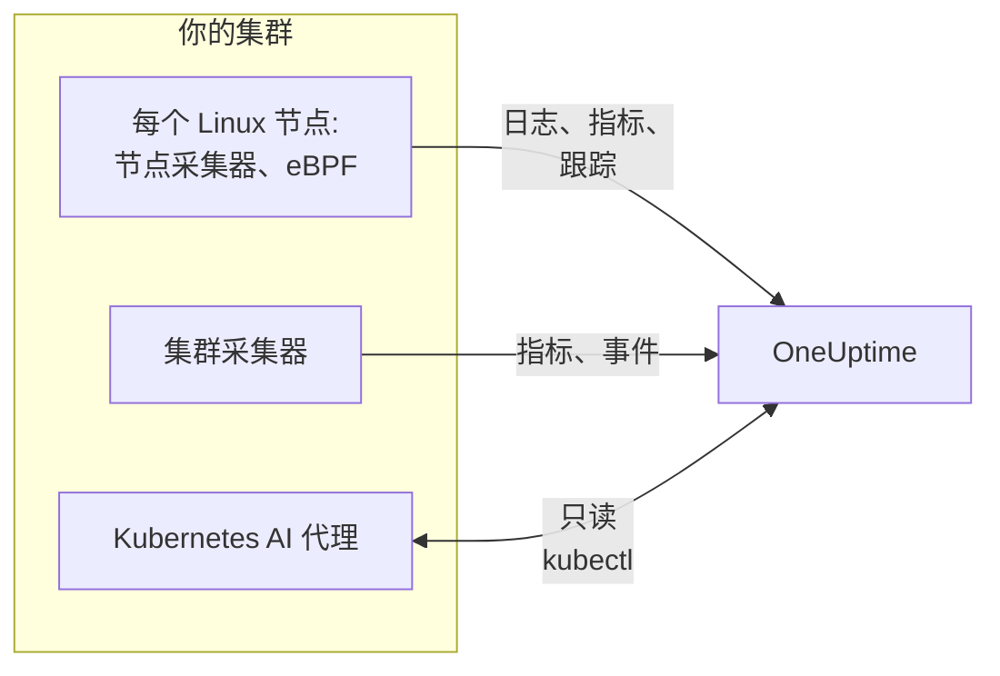

# Kubernetes 代理(Helm 安装)

OneUptime Kubernetes 代理是一个 Helm Chart，它采集集群的指标、事件和 Pod 日志、通过 eBPF 捕获的应用跟踪，以及每个节点的操作系统指标，并发送到 OneUptime。只需一次 `helm install` 即可部署，无需修改应用代码。[Kubernetes 监视器](/docs/monitor/kubernetes-monitor) 根据它发送的数据发出告警。

:::cards
- [安装代理](#安装代理): 使用 Helm 的四个步骤。
- [选择预设](#选择预设): 标准集群、GKE Autopilot 或 EKS Fargate。
- [常用选项](#常用选项): 大多数集群会修改的设置。
- [故障排查](#故障排查): 一个诊断脚本和常见问题。
:::

## Chart 安装的内容

Chart 在它自己的命名空间中运行几个工作负载。每个工作负载都使用你提供的摄取密钥，通过 OTLP 把采集到的数据发送到你的 OneUptime URL。



| 工作负载 | 类型 | 作用 | 默认开启 |
| --- | --- | --- | --- |
| 集群采集器 | Deployment | 从 Kubernetes API 采集集群指标、Kubernetes 事件，以及 Pod、节点和工作负载的完整规格。 | 是 |
| 节点采集器 | DaemonSet | 来自 `/var/log/pods` 的 Pod 日志、kubelet 和 cAdvisor 指标，以及节点的操作系统指标。 | 是 |
| eBPF 插桩(OBI) | DaemonSet | 来自每个 Pod 的 HTTP、gRPC、SQL 和 Redis 跟踪与请求指标，以及服务地图。 | 是 |
| Kubernetes AI 代理 | Deployment | 让 OneUptime AI 在调查此集群上的事件或告警时运行只读的 `kubectl`。 | 是 |
| 日志跟随器 | Deployment | 在节点采集器无法读取的地方，通过 Kubernetes API 获取 Pod 日志。 | 在 `gke-autopilot` 和 `eks-fargate` 预设中 |
| eBPF 性能分析器 | DaemonSet | 每个进程的持续 CPU 火焰图。 | 否 |
| kube-state-metrics | Deployment | Pod 阶段、容器等待原因和资源配额。 | 否 |

每个代理镜像都只支持 Linux，因此每个工作负载都固定在 Linux 节点上。

## 开始之前

- **一个摄取密钥。** 在 OneUptime 的 **项目设置 → 遥测与 APM → 摄取密钥** 中创建。代理把它作为 `x-oneuptime-token` 标头发送，因此项目 API 密钥在这里不起作用。
- **Helm 3** 以及对集群的 `kubectl` 访问权限。升级会使用 `--reset-then-reuse-values`，它需要 Helm 3.14 或更高版本。
- **集群的名称**，在你的项目中唯一。没有名称时 Chart 会拒绝安装：两个同名集群会显示为一个。
- 从集群到你的 OneUptime URL 的 **出站 HTTPS**。

## 安装代理

:::steps
### 添加 Helm 仓库

```bash
helm repo add oneuptime https://helm-chart.oneuptime.com
helm repo update
```

### 安装 Chart

把 URL 替换为你的 OneUptime URL，并把两个占位符替换为你的摄取密钥和集群的名称：

```bash
helm install oneuptime-agent oneuptime/kubernetes-agent \
  --namespace oneuptime-kubernetes-agent \
  --create-namespace \
  --set oneuptime.url=https://oneuptime.com \
  --set oneuptime.apiKey=<YOUR_API_KEY> \
  --set clusterName=<A_UNIQUE_NAME_FOR_THIS_CLUSTER>
```

这使用的是 `standard` 预设。在 GKE Autopilot 或 EKS Fargate 上，请改为 [选择它们的预设](#选择预设)。

### 检查 Pod 是否在运行

```bash
kubectl get pods -n oneuptime-kubernetes-agent
```

每个 Pod 都应在一两分钟内进入 `Running` 状态。

### 在 OneUptime 中找到集群

打开 **产品 → 基础设施 → Kubernetes → 所有集群**。几分钟内，集群会以其名称出现，其节点、Pod 和工作负载也会陆续填充。
:::

## 选择预设

有些 Kubernetes 平台不允许工作负载挂载 `hostPath` 卷或运行 DaemonSet，而节点采集器两者都要用到。`preset` 设置用来选择在你的平台上可行的方式：

| 预设 | 适用于 | Pod 日志 | 每个节点上 |
| --- | --- | --- | --- |
| `standard`(默认) | 自管理、**EKS on EC2**、**GKE Standard**、**AKS**、minikube、kind、k3s | 节点采集器读取 `/var/log/pods` | kubelet、cAdvisor 和操作系统指标 |
| `gke-autopilot` | **GKE Autopilot** | 日志跟随器通过 Kubernetes API 读取 | kubelet 和 cAdvisor 指标，不使用 `hostPath` |
| `eks-fargate` | **EKS Fargate** | 日志跟随器通过 Kubernetes API 读取 | 无：Fargate 不运行 DaemonSet |

如果不确定，请不设置 `preset`，以使用 `standard`。如果安装因提到 `hostPath` 的 Pod Security 错误而失败，请用 `gke-autopilot` 重新安装，在 EKS Fargate 上则用 `eks-fargate`。

GKE Autopilot 和 EKS Fargate 也会拒绝 eBPF 插桩和性能分析所需的特权 Pod，因此它们的预设会同时省略这两者：

:::tabs
@tab Standard
```bash
helm install oneuptime-agent oneuptime/kubernetes-agent \
  --namespace oneuptime-kubernetes-agent --create-namespace \
  --set oneuptime.url=https://oneuptime.com \
  --set oneuptime.apiKey=<YOUR_API_KEY> \
  --set clusterName=prod
```
@tab GKE Autopilot
```bash
helm install oneuptime-agent oneuptime/kubernetes-agent \
  --namespace oneuptime-kubernetes-agent --create-namespace \
  --set oneuptime.url=https://oneuptime.com \
  --set oneuptime.apiKey=<YOUR_API_KEY> \
  --set clusterName=prod-gke-autopilot \
  --set preset=gke-autopilot
```
@tab EKS Fargate
```bash
helm install oneuptime-agent oneuptime/kubernetes-agent \
  --namespace oneuptime-kubernetes-agent --create-namespace \
  --set oneuptime.url=https://oneuptime.com \
  --set oneuptime.apiKey=<YOUR_API_KEY> \
  --set clusterName=prod-eks-fargate \
  --set preset=eks-fargate
```
:::

## 为集群添加标签

你在安装时传入的标签会附加到集群上，以及此代理报告的服务和主机上。`--set oneuptime.labels.<key>=<value>` 会成为名为 `<key>:<value>` 的项目标签：

```bash
helm install oneuptime-agent oneuptime/kubernetes-agent \
  --namespace oneuptime-kubernetes-agent \
  --create-namespace \
  --set oneuptime.url=https://oneuptime.com \
  --set oneuptime.apiKey=<YOUR_API_KEY> \
  --set clusterName=prod \
  --set oneuptime.labels.team=payments \
  --set oneuptime.labels.env=production \
  --set oneuptime.labels.region=us-east-1
```

或者把它们放在 values 文件中：

```yaml title="values.yaml"
oneuptime:
  url: https://oneuptime.com
  apiKey: <YOUR_API_KEY>
  labels:
    team: payments
    env: production
    region: us-east-1
clusterName: prod
```

```bash
helm install oneuptime-agent oneuptime/kubernetes-agent \
  --namespace oneuptime-kubernetes-agent --create-namespace \
  -f values.yaml
```

这样，此代理发送的每条记录——日志、指标、跟踪和性能分析数据——都会带有 `team:payments`、`env:production` 和 `region:us-east-1`。每个标签都是一个 `oneuptime.label.<key>=<value>` 资源属性，OneUptime 会把每个以 `oneuptime.label.` 开头的属性变成标签。标签匹配时不区分大小写，因此已有的 `Production` 标签会被复用，而不会重复创建。代理从不删除你在 OneUptime 中添加的标签。

## Pod 日志

`preset` 会设置 `logs.mode`，你也可以自己设置它：

| `logs.mode` | 如何读取日志 | 优点 | 注意事项 |
| --- | --- | --- | --- |
| `daemonset` | 每个节点上的一个节点采集器跟随读取 `/var/log/pods` 下的文件。 | 开销最低，随节点扩展，不给 Kubernetes API 服务器增加负载，能跟随日志轮转。 | 需要 `hostPath` 和 DaemonSet。 |
| `api` | 一个日志跟随器从 Kubernetes API 流式获取每个容器的日志，就像 `kubectl logs -f` 一样。 | 在 `hostPath` 被阻止或适用 `restricted` Pod Security Standard 的地方也能工作。 | 每个容器流都是与 API 服务器的一个长连接。一个副本可处理几千个容器。 |
| `disabled` | 什么都不做。 | 适用于已经用其他方式发送日志的应用。 | |

要关闭日志采集，请设置 `--set logs.enabled=false`，并改用 [OpenTelemetry](/docs/telemetry/open-telemetry) SDK 发送应用日志。指标不受影响：节点采集器会继续运行。

### 混合操作系统集群(Windows 节点池)

Windows 节点上从不运行代理 Pod。关于这些节点及其 Pod 的集群级数据仍会到达，因为它们来自 Kubernetes API：节点状况、Pod 阶段、Kubernetes 事件和 kube-state-metrics。Windows 节点缺少的是在节点上采集的数据：操作系统指标、kubelet 和 cAdvisor 指标、eBPF 跟踪、性能分析数据，以及在 `daemonset` 日志模式下的 Pod 日志。

要同时采集 Windows 节点上 Pod 的日志，请开启混合模式：

```bash
helm upgrade oneuptime-agent oneuptime/kubernetes-agent \
  --namespace oneuptime-kubernetes-agent --reset-then-reuse-values \
  --set logs.windowsPods.enabled=true
```

日志跟随器随后会与节点采集器并行运行，只处理 Windows 节点上的 Pod。Linux Pod 继续使用开销更低的文件跟随，二者按节点的操作系统划分 Pod，因此不会有日志行被发送两次。

- **跟随器镜像的版本。** 仅针对 Windows 的划分内置在 `kubernetes-log-tailer` 镜像中。旧镜像会忽略它并跟随 *每个* Pod，把每个 Linux Pod 的日志发送两次。不要把 `logs.api.image.tag` 固定到比 Chart 发布版本更旧的版本；如果某个节点可能缓存了旧的 `release` 镜像，请在升级时添加 `--set logs.api.image.pullPolicy=Always`。
- **按严重性过滤。** 设置了 `filters.logs.minSeverity` 时，没有可识别严重性的行在节点采集器的路径上会被丢弃，但在日志跟随器的路径上会被保留——请参阅 [按日志严重性过滤](/docs/telemetry/kubernetes-agent#按日志严重性过滤)。因此，Windows Pod 发送的无级别行可能比 Linux Pod 多。

## 使用 eBPF 的应用跟踪

Chart 会在每个节点上运行 [OpenTelemetry eBPF Instrumentation (OBI)](https://opentelemetry.io/docs/zero-code/obi/)。OBI 把 eBPF 程序加载到 Linux 内核中并观察每个 Pod 的网络流量，因此无需对应用做任何改动(没有 SDK，也没有 sidecar)就能重建 HTTP 和 HTTPS、gRPC 以及 SQL 和 Redis 调用。它把这些作为跟踪和请求指标发送到 OneUptime。

一两分钟内，你的服务会出现在 **产品 → 跟踪** 下和服务地图上，`k8s.cluster.name` 设置为集群的名称，因此可以按集群过滤。

### 何时关闭 eBPF

eBPF 默认开启。在以下情况下，请用 `--set ebpf.enabled=false` 关闭它：

- 集群是 **GKE Autopilot** 或 **EKS Fargate**。它们的预设会替你关闭：这两个平台会拒绝特权 Pod，而 OBI 必须拥有特权才能加载其程序。
- 节点运行的内核早于 **Linux 5.8** 且没有 BTF。Debian 11、Ubuntu 20.10、Fedora 34、RHEL 9 及更高版本都没有问题。
- 你的应用已经通过 OpenTelemetry SDK 发送跟踪，而你不想要重复的数据。

### eBPF 发送的内容

OBI 会发送几种信号。每一种都可以用 `--set ebpf.features.<key>=false` 关闭：

| 设置 | 默认值 | 添加的内容 |
| --- | --- | --- |
| `ebpf.features.httpMetrics` | 开启 | 每个服务的 HTTP 和 gRPC 请求指标：请求速率、延迟直方图和错误。 |
| `ebpf.features.spanMetrics` | 开启 | Span 指标：按服务、路由或操作、Span 类型和状态统计的调用次数与耗时——`traces.span.metrics.calls` 和 `traces.span.metrics.duration`(秒)。 |
| `ebpf.features.serviceGraph` | 开启 | 从一个服务到另一个服务的每次调用的速率和延迟，用于绘制服务地图。 |
| `ebpf.features.networkMetrics` | 开启 | 每对 Pod 之间经由 TCP 和 UDP 传输的字节和数据包，带有它们的 Kubernetes 名称。即使是 OBI 无法解析的协议，也能显示每一对相互通信的 Pod。 |
| `ebpf.features.networkInterZoneMetrics` | 关闭 | 同样的数据，但统计可用区之间。会使序列数量翻倍：只有在按可用区调度时才开启。 |
| `ebpf.features.tcpStats` | 开启 | 每个节点的 TCP 统计：往返时间、失败的连接和重传。 |

### 跨服务关联跟踪

OBI 还能让跟踪跨越一次调用延续下去：当 Pod A 通过 HTTP 或 gRPC 调用 Pod B 时，B 端的 Span 会加入 A 的跟踪，两个应用中都不需要 SDK。**此功能默认关闭。** 阅读下面的警告后，用 `--set ebpf.contextPropagation=true` 开启它。

| 选项 | 默认值 | 作用 |
| --- | --- | --- |
| `ebpf.contextPropagation` | 关闭 | 把 W3C `traceparent` 写入出站流量，使 Span 在服务之间关联起来。 |
| `ebpf.contextPropagationMode` | `headers` | 方式：`headers`(HTTP/1.1 请求标头，范围最窄)、`tcp`(TCP 选项，通过 Linux Traffic Control)或 `all`(两者都用)。仅在 `contextPropagation` 开启时读取。 |
| `ebpf.trackRequestHeaders` | 开启 | 在内核中跟踪请求标头，使接收端在普通 HTTP 服务器上也能找到 `traceparent`。仅在 `contextPropagation` 开启时生效。 |

> [!WARNING]
> 每种传播模式都会修改已经在传输中的流量。对于普通 HTTP，OBI 会在内核中扩大出站请求以容纳标头；对于 TLS 和原始 TCP，它会从 Traffic Control 钩子添加一个 TCP 选项，重写数据包及其校验和。如果随后连接的字节计数没有被精确修正，数据流就会 **失去同步**：经过 nginx 这类代理的传输一旦响应超过约 64 KB 就会中途卡住，直到连接超时。小请求仍能正常工作，因此看起来像是应用或代理的缺陷。没有哪个内核版本能让这种重写消失。跟踪、请求指标和服务地图在没有它的情况下都能工作；服务中的 OpenTelemetry SDK 完全不需要内核重写就能关联跟踪。如果你要开启它，请先在非生产集群上试用，并检查经过代理的大文件传输。

### 将日志关联到跟踪

**默认关闭。** 开启后，OBI 会在它插桩的每个进程的 `write()` 系统调用上挂载一个探针，并且：

- **JSON 日志行** 会获得 `trace_id` 和 `span_id` 字段(行中已有的字段会保留)。节点采集器会把它们移到日志记录自身的跟踪字段上，因此在 OneUptime 中，一个 Span 的日志只需一次点击就能看到，日志行的跟踪也是如此。
- **其他任何日志行** 都会原样采集，不带关联。

```bash
helm upgrade oneuptime-agent oneuptime/kubernetes-agent \
  --namespace oneuptime-kubernetes-agent --reset-then-reuse-values \
  --set ebpf.logToTraceCorrelation=true
```

| 选项 | 默认值 | 作用 |
| --- | --- | --- |
| `ebpf.logToTraceCorrelation` | `false` | 开启 OBI 的日志增强器以及节点采集器对 `trace_id` 的提取。 |
| `ebpf.logEnricher.services` | `[{service: [{exe_path: "*"}]}]` | 增强器会处理哪些进程。每个条目都是一个 OBI [GlobAttributes](https://opentelemetry.io/docs/zero-code/obi/configure/options/#service-discovery) 选择器，带有 `exe_path`、`languages`、`k8s_pod_labels`、`k8s_pod_annotations`、`open_ports` 和 `cmd_args` 等字段。 |

#### 与之一起会崩溃的 APM 代理

增强器会 **在进程内部** 重写应用的输出缓冲区：当匹配的进程调用 `write()` 时，OBI 会清空原始字节并写入增强后的副本。通过 `LD_PRELOAD` 加载并且自己也包装 `write()` 的 APM 代理无法承受这一点：

| APM 代理 | 库 | 会发生什么 |
| --- | --- | --- |
| Dynatrace OneAgent | `liboneagentproc.so` | 应用以 SIGSEGV(退出码 139)崩溃。Dynatrace 看门狗自身的 `write()` 卡住超过其 10 秒限制，OneAgent 不断循环重启。 |
| New Relic | `libnewrelic*.so` | 同样的崩溃。 |
| AppDynamics | `libappdynamics*.so` | 同样的崩溃。 |
| Datadog | `libdd*.so` | 同样的崩溃。 |
| Instana | `libinstana*.so` | 同样的崩溃。 |

**.NET 应用受影响最大：** Dynatrace 的 .NET 代理总是通过 `LD_PRELOAD` 加载，而 Microsoft.Extensions.Logging 的控制台日志不经缓冲，因此每一行都会走这条路径。Python 和 Go 应用通常不受影响。

要与这些代理之一一起使用，请让 `logEnricher.services` 只指向没有该代理的 Pod。增强器无法排除，因此请列出要增强的 Pod：

```yaml title="values.yaml"
ebpf:
  logToTraceCorrelation: true
  logEnricher:
    services:
      # Enrich only pods with the apm-agent=none label
      - service:
          - k8s_pod_labels:
              apm-agent: "none"
```

或者按运行时选择。Dynatrace 的 `LD_PRELOAD` 加载针对的是 .NET，因此只增强 Python、Go、Ruby 和 Node.js 就能避开它：

```yaml title="values.yaml"
ebpf:
  logToTraceCorrelation: true
  logEnricher:
    services:
      - service:
          - languages: "python,go,ruby,nodejs"
```

#### 日志必须是 JSON 且不缓冲

- **只有 JSON 行才会获得 `trace_id`。** 请把日志记录器切换为 JSON 格式：`structlog`、`pino`、`winston`、`serilog`、`logback-json`、klog `--logging-format=json` 等。
- **缓冲输出会断开关联**，因为此时 `write()` 发生在与请求不同的线程上。在 **Python** 中，设置 `PYTHONUNBUFFERED=1`。在 **.NET** 中，在启动时调用 `Console.SetOut(new StreamWriter(Console.OpenStandardOutput()) { AutoFlush = true })`；Microsoft.Extensions.Logging 的 `AddConsole()` 和 Serilog 的异步接收器不起作用，Serilog 普通的 `WriteTo.Console()` 可以。
- Greenlet、gevent、Tornado 和其他自定义异步运行时不受支持。

### 调整 eBPF

| 选项 | 默认值 | 作用 |
| --- | --- | --- |
| `ebpf.enabled` | `true` | 运行 eBPF DaemonSet。`false` 则不部署它。 |
| `ebpf.image.tag` | `v0.14.0` | OBI 镜像。OBI 还处于 1.0 之前：请固定你测试过的版本，更换前再测试一次。 |
| `ebpf.autoTargetExe` | `*` | 要插桩的可执行文件的通配模式，以逗号分隔。缩小范围(例如 `*/python,*/java`)可以插桩更少的运行时。 |
| `ebpf.excludeExePaths` | Shell、集群基础组件、服务网格 sidecar、CNI 代理、浏览器、ClickHouse、采集器和 OBI 自身 | 要跳过的可执行文件的通配模式，以逗号分隔。范围过宽的模式也会跳过你自己的二进制文件。 |
| `ebpf.logLevel` | `info` | `debug`、`info`、`warn` 或 `error`。 |
| `ebpf.printTraces` | `false` | 同时把 Span 打印到 OBI 自己的日志中，以便检查它捕获了什么。 |
| `ebpf.resources.*` | 请求 `100m` CPU 和 `512Mi` 内存，限制 `2000m` 和 `2Gi` | 在流量大或短生命周期进程多的节点上调高。 |

要检查 OBI 是否在运行并能看到流量：

```bash
kubectl get pods -n oneuptime-kubernetes-agent -l component=ebpf-instrument
kubectl logs -n oneuptime-kubernetes-agent -l component=ebpf-instrument --tail=200
```

## 持续 CPU 性能分析

[OpenTelemetry eBPF Profiler](https://github.com/open-telemetry/opentelemetry-ebpf-profiler) 也可以在每个节点上运行，使用 `otel/opentelemetry-collector-ebpf-profiler` 镜像。它以每秒 19 次的频率对每个进程正在运行的内容采样，支持 Go、Java、.NET、Python、Ruby、Node.js、PHP、Perl、C、C++ 和 Rust，并把性能分析数据发送到 OneUptime。这些数据显示在 **产品 → 性能配置** 下，也会作为火焰图显示在每个跟踪 Span 上。

**性能分析默认关闭：** 它每个节点消耗的 CPU 和内存比 eBPF 插桩更多。用 `--set profiling.enabled=true` 开启它。

如果同时开启了 eBPF 插桩(默认)，每个样本都会带有它所属的跟踪，因此每个 Span 都有自己的火焰图。为此，Chart 会要求 OBI 保持当前的跟踪上下文可用(`OTEL_EBPF_BPF_POPULATE_TRACE_CONTEXT=true`)，这会让被插桩的应用在每次异步上下文切换时付出少许开销。设置 `profiling.obiProcessContext=false` 可得到不关联 Span 的火焰图。

性能分析需要 **Linux 5.10** 或更高版本，以及一个拥有节点进程 ID 的特权 Pod：它无法在 GKE Autopilot 或 EKS Fargate 上运行，它们的预设会让它保持关闭。在本身就是容器的节点上(例如 kind 或 k3d)，它无法区分进程，几乎没有样本能关联到 Span。

| 选项 | 默认值 | 作用 |
| --- | --- | --- |
| `profiling.enabled` | `false` | 运行性能分析器 DaemonSet。 |
| `profiling.image.tag` | `0.152.0` | 性能分析器镜像。它还处于 1.0 之前：请固定你测试过的版本。 |
| `profiling.samplesPerSecond` | `19` | 每秒采样多少次。19 可以避免与常见的定时器频率对齐。 |
| `profiling.offCpuThreshold` | `0` | 大于 0 且不超过 1 的值还会分析 CPU 之外花费的时间，从而显示锁竞争和阻塞 I/O，但会带来一些额外开销。 |
| `profiling.tracers` | `""`(每种运行时) | 要加载的语言跟踪器，以逗号分隔，例如 `go,python`。 |
| `profiling.obiProcessContext` | `true` | 把样本关联到 OBI 的跟踪，并让 OBI 为此保持跟踪上下文可用。 |

## 其他数据采集

| 选项 | 默认值 | 添加的内容 |
| --- | --- | --- |
| `hostMetrics.enabled` | 开启 | 每个节点来自 `/proc` 和 `/sys` 的操作系统指标：磁盘 I/O 队列、文件系统 inode、网络接口错误、分页和平均负载。在节点采集器中运行，不需要额外的 Pod。 |
| `kubeletstats.utilizationMetrics.enabled` | 开启 | 容器和 Pod 的 CPU 与内存占其 request 和 limit 的百分比，CPU 和内存饱和监视器读取这些数据。对于没有 request 或 limit 的 Pod 始终为 0。 |
| `kubeletstats.volumeMetrics.enabled` | 开启 | 每个 PVC 的可用空间和总空间(`k8s.volume.available`、`k8s.volume.capacity`)，PVC Low Disk Space 监视器读取这些数据。每个 Pod 的每个 PVC 一个序列。 |
| `cadvisor.enabled` | 开启 | 来自每个 kubelet 的 `/metrics/cadvisor` 的 CPU 节流和 OOM 终止：`container_cpu_cfs_throttled_seconds_total`、`container_cpu_cfs_periods_total` 和 `container_oom_events_total`，没有其他内容。 |
| `kubeStateMetrics.enabled` | 关闭 | 来自 kube-state-metrics 的 Pod 阶段(Pending、Terminating)、无法调度的 Pod、容器等待原因(CrashLoopBackOff、ImagePullBackOff)和资源配额使用情况。`kubeStateMetrics.mode: bundled`(默认)会为你运行一个小型 kube-state-metrics；`external` 则读取你已在运行的实例，位于 `kubeStateMetrics.endpoint`。 |
| `auditLogs.enabled` | 关闭 | Kubernetes 审计日志 `/var/log/kubernetes/audit.log`：对 API 的每个请求，由谁发出、针对什么。仅限自管理集群：托管集群(EKS、GKE、AKS、DOKS)会把它发送给云服务商。 |
| `csi.enabled` | 关闭 | 来自带有 `app=csi-driver` 或 `app.kubernetes.io/component=csi-driver` 标签的 Pod 的 CSI 存储驱动指标：卷挂接和分离时间、预配失败、IOPS。 |
| `coreDns.enabled` | 关闭 | `:9153/metrics` 上的 CoreDNS 指标：查询速率、延迟、缓存命中和错误。 |
| `controlPlane.enabled` | 关闭 | etcd、API 服务器、调度器和控制器管理器。仅限自管理集群：托管集群不暴露这些组件。 |
| `cost.enabled` | 关闭 | 每个工作负载的成本。请参阅 [Kubernetes 成本可观测性](/docs/telemetry/kubernetes-cost)。 |

## 常用选项

| 选项 | 默认值 | 作用 |
| --- | --- | --- |
| `oneuptime.url` | (必填) | 你的 OneUptime URL。 |
| `oneuptime.apiKey` | (必填) | 摄取密钥，来自 **项目设置 → 遥测与 APM → 摄取密钥**。作为 `x-oneuptime-token` 标头发送；项目 API 密钥不起作用。 |
| `clusterName` | (必填) | 集群的名称，在项目中唯一。每条记录都把它作为 `k8s.cluster.name` 携带。 |
| `preset` | (空：`standard`) | `standard`、`gke-autopilot` 或 `eks-fargate`。请参阅 [选择预设](#选择预设)。 |
| `oneuptime.labels` | `{}` | 此代理发送的每条记录的标签。请参阅 [为集群添加标签](#为集群添加标签)。 |
| `namespaceFilters.rules` | 把 `kube-system` 排除在 `podLogs` 和 `ebpfDiscovery` 之外 | 针对 `podLogs`、`ebpfDiscovery`、`metrics` 和 `traces` 包含或排除命名空间的规则。模式可以使用 `*`，排除始终优先。 |
| `filters.logs.minSeverity` | `""` | 丢弃低于此级别的 Pod 日志行：`TRACE`、`DEBUG`、`INFO`、`WARN`、`ERROR` 或 `FATAL`。 |
| `filters.metrics.exclude` | `[]` | 要丢弃的指标名称。 |
| `sampling.traces.percentage` | `100` | 要保留的跟踪比例，从 0 到 100。跟踪整体保留或丢弃。 |
| `logs.enabled` | `true` | 采集 Pod 日志。 |
| `logs.mode` | (来自 `preset`) | `daemonset`、`api` 或 `disabled`。覆盖预设。 |
| `logs.windowsPods.enabled` | `false` | 同时跟随 Windows 节点上的 Pod。请参阅 [混合操作系统集群](#混合操作系统集群windows-节点池)。 |
| `logs.api.replicas` | `1` | 在 `api` 模式下日志跟随器的副本数。 |
| `ebpf.enabled` | `true` | eBPF 跟踪和请求指标。请参阅 [使用 eBPF 的应用跟踪](#使用-ebpf-的应用跟踪)。 |
| `profiling.enabled` | `false` | CPU 火焰图。请参阅 [持续 CPU 性能分析](#持续-cpu-性能分析)。 |
| `kubeStateMetrics.enabled` | `false` | 来自 kube-state-metrics 的集群状态。 |
| `aiAgent.enabled` | `true` | Kubernetes AI 代理。它可以做什么，请参阅 [Kubernetes AI 代理](/docs/telemetry/kubernetes-agent)。 |

Chart 的 [`values.yaml`](https://github.com/OneUptime/oneuptime/blob/master/HelmChart/Public/kubernetes-agent/values.yaml) 列出并解释了每个选项，[Kubernetes 代理](/docs/telemetry/kubernetes-agent) 介绍了过滤、采样以及如何控制数据量。

## 升级

```bash
helm repo update
helm upgrade oneuptime-agent oneuptime/kubernetes-agent \
  --namespace oneuptime-kubernetes-agent \
  --reset-then-reuse-values
```

`--reset-then-reuse-values`(Helm 3.14 及更高版本)会保留你设置的值——预设、集群名称、过滤器——并从新 Chart 中获取其他所有值。在它后面添加任何新的 `--set`。在 Helm 3.13 或更早版本上，请改为使用你设置的值进行升级：

```bash
helm repo update
helm get values oneuptime-agent --namespace oneuptime-kubernetes-agent -o yaml > values.yaml && \
  helm upgrade oneuptime-agent oneuptime/kubernetes-agent \
  --namespace oneuptime-kubernetes-agent -f values.yaml
```

不要使用 `--reuse-values` 升级：它还会保留你升级前那个 Chart 的默认值，因此新 Chart 的默认值(包括其 eBPF 镜像)永远不会生效。当某个发布使用旧 Chart 的默认值运行时，Helm 在安装或升级后打印的说明会以一条警告和修复它的命令结尾。

> [!WARNING]
> **eBPF Span 指标有了新名称。** `ebpf.features.spanMetrics` 现在发送 `traces.span.metrics.calls` 和 `traces.span.metrics.duration`(秒)，取代 `traces_spanmetrics_calls_total` 和 `traces_spanmetrics_latency`：同样的序列，使用 OBI 保留的名称(它已弃用旧名称)。基于旧名称的仪表板、图表或指标监视器在升级后会收不到新数据，也不会报错——请把它们改为新名称，并更新所有提到旧名称的 `filters.metrics` 条目。

## 卸载

```bash
helm uninstall oneuptime-agent --namespace oneuptime-kubernetes-agent
kubectl delete namespace oneuptime-kubernetes-agent
```

## 故障排查

:::details 集群显示为 Disconnected，或没有数据到达
运行 Chart 的诊断脚本。它会检查 Pod、摄取密钥以及离开集群的网络路径，询问 OneUptime 密钥是否被接受，并输出一个结论。它只读取，不做任何更改：

```bash
curl -fsSL https://raw.githubusercontent.com/OneUptime/oneuptime/master/HelmChart/Public/kubernetes-agent/troubleshoot.sh \
  | bash -s -- -n oneuptime-kubernetes-agent
```

常见原因(尤其是在重新安装之后)是摄取密钥错误或已被吊销：OneUptime 拒绝它，采集器会丢弃每一批数据，而它的 Pod 仍处于 `Running` 状态。
:::

:::details 安装失败，提示 "hostPath volumes are not allowed"
集群阻止了 `hostPath`。请切换到通过 Kubernetes API 读取日志的预设，它也会省略 eBPF：

```bash
helm repo update
helm upgrade oneuptime-agent oneuptime/kubernetes-agent \
  --namespace oneuptime-kubernetes-agent \
  --reset-then-reuse-values \
  --set preset=gke-autopilot
```

在 EKS Fargate 上，请使用 `--set preset=eks-fargate`。
:::

:::details 代理 Pod 在 Windows 节点上卡在 ImagePullBackOff
旧版 Chart 会把代理的 DaemonSet 调度到 Windows 节点上，而那里永远无法拉取它们的 Linux 镜像。运行 `helm upgrade`：当前的 Chart 会把每个工作负载固定在 Linux 节点上，卡住的 Pod 就会消失。要采集 Windows 节点上 Pod 的日志，请参阅 [混合操作系统集群](#混合操作系统集群windows-节点池)。
:::

:::details 没有日志到达 OneUptime
检查代理的 Pod 及其日志：

```bash
kubectl get pods -n oneuptime-kubernetes-agent
kubectl logs -n oneuptime-kubernetes-agent -l app.kubernetes.io/part-of=oneuptime --tail=200
```

在 `api` 模式下，日志跟随器会在 `/healthz`(端口 13133)上返回其导出的状态：用 `kubectl port-forward` 访问它。
:::

:::details eBPF Pod 处于 CrashLoopBackOff，或无法启动
查看 OBI 的日志：

```bash
kubectl logs -n oneuptime-kubernetes-agent -l component=ebpf-instrument --tail=200
```

- **内核太旧，或没有 BTF。** OBI 需要带 BTF 的 Linux 5.8 或更高版本；在节点上用 `uname -r` 检查。如果无法升级内核，请用 `--set ebpf.enabled=false` 关闭 eBPF。
- **特权 Pod 被拒绝。** 有些集群即使不是 Autopilot 或 Fargate 也会拒绝它们。请关闭 eBPF。
- **OBI 在运行，但没有跟踪到达。** 设置 `--set ebpf.printTraces=true` 并再次查看 OBI 的日志。如果那里有 Span，说明导出到 OneUptime 失败：请检查 URL 和摄取密钥。如果那里没有 Span，可能是流量被 OBI 无法读取的 TLS 库(例如静态链接的库)加密了。
:::

:::details 开启跟踪关联后，大文件传输卡住
这是 `ebpf.contextPropagation` 在重写流量：请参阅 [跨服务关联跟踪](#跨服务关联跟踪) 中的警告。用 `--set ebpf.contextPropagation=false` 关闭它。
:::

:::details 开启日志关联后，应用以退出码 139 崩溃
同一个 Pod 中有通过 `LD_PRELOAD` 加载的 APM 代理：请参阅 [与之一起会崩溃的 APM 代理](#与之一起会崩溃的-apm-代理)。关闭 `ebpf.logToTraceCorrelation`，或让 `ebpf.logEnricher.services` 指向没有该代理的 Pod。
:::

:::details 一个日志跟随器不足以应对集群(api 模式)
把命名空间分配到多个发布中，每个发布都用自己的命名空间规则安装：

```bash
helm install oneuptime-agent-ns-a oneuptime/kubernetes-agent \
  --set preset=gke-autopilot \
  --set-json 'namespaceFilters.rules=[{"action":"include","namespaces":["app-a","app-b"],"scopes":["podLogs"]}]' \
  ...
```

增加 `logs.api.replicas` 会增加跟随器，但每个跟随器都会读取所有允许的命名空间，因此仍需要拆分命名空间以避免重复。
:::

## 后续步骤

:::cards
- [Kubernetes 监控](/docs/monitor/kubernetes-monitor): 根据代理发送的数据发出告警。
- [Kubernetes 代理](/docs/telemetry/kubernetes-agent): 过滤、采样、AI 代理，以及如何控制数据量。
- [Kubernetes 成本可观测性](/docs/telemetry/kubernetes-cost): 查看每个工作负载的成本。
- [跟踪监控](/docs/monitor/traces-monitor): 根据 eBPF 捕获的跟踪发出告警。
:::
