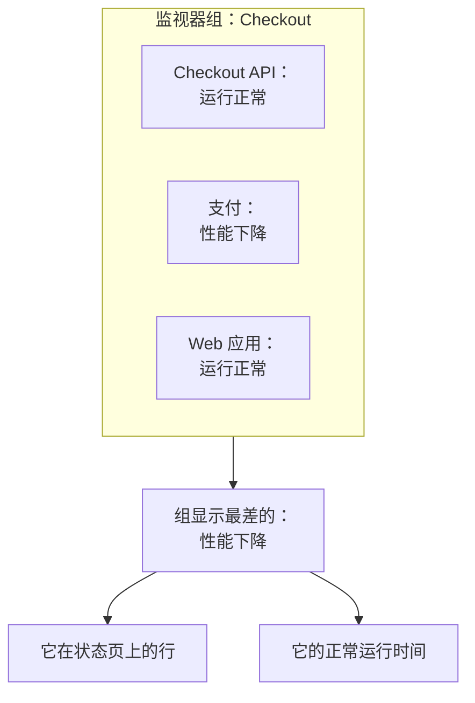

# 监视器组

监视器组将多个监视器汇总为一个状态。把共同组成一个服务的监视器放进一个组，例如 Checkout：它的 API、支付服务和 Web 应用。组显示其中最差的状态，保留自己的正常运行时间，状态页可以将整个组显示为一行。

:::cards
- [组的状态如何得出](#组的状态如何得出): 其监视器中最差的状态。
- [启用监视器组](#启用监视器组): 项目设置中的一个开关。
- [创建监视器组](#创建监视器组): 为它命名，然后分配监视器。
- [在状态页上显示组](#在状态页上显示组): 整个组显示为一行。
:::

## 组的状态如何得出

组从您的运行正常状态开始，并取其监视器中最差的状态：即项目监视器状态列表中最靠下的那个。一个监视器变为 **性能下降**，整个组就变为 **性能下降**；一个变为 **离线**，组就变为 **离线**。

- **已归档的监视器不计入。** 已归档的监视器不会被检查，因此其状态被冻结；组会忽略它。
- **空组为运行正常。** 没有监视器或只有已归档监视器的组，显示您的运行正常状态。
- **顺序由您决定。** 哪个状态最差，取决于 **监控 → 设置 → 监视器状态** 中的顺序。请参阅 [监视器状态](/docs/monitor/criteria-and-statuses#监视器状态)。

监视器组不是状态页分组。状态页分组是某个状态页上容纳若干行的标题。监视器组是代表多个监视器的一行，任何状态页都可以显示它。

## 开始之前

- **您的套餐。** 在 OneUptime Cloud 上，监视器组需要 Scale 套餐。
- **开关。** 在为项目打开 **监视器组** 之前，监视器组是隐藏的（见下文）。打开它需要 Project Owner 角色，或拥有 Edit Project 或 Manage Billing 权限的自定义角色。
- **您的角色。** 创建、更改和删除组需要 Project Owner、Project Admin、Project Member、Monitor Admin 或 Monitor Member 角色，或拥有相应监视器组权限的自定义角色。Viewer 可以查看组，但不能更改。

## 启用监视器组

:::steps
### 打开功能标志

前往 **项目设置 → 高级 → 功能标志**。侧边菜单中的 **高级** 默认是折叠的：请先展开它。

### 拨动开关

拨动 **监视器组** 开关。它会立即保存：**监视器组** 出现在 **监视器** 侧边菜单中，每个状态页的 **监视器** 菜单项会改名为 **资源**，您可以在那里添加组。
:::

再次关闭开关会把 **监视器组** 从菜单中隐藏。不会删除任何组。

## 创建监视器组

:::steps
### 打开监视器组

前往 **监控 → 监视器组**。**监视器组** 卡片列出每个组及其 **当前状态**、标签和所有者。

### 创建组

点击 **创建监视器 组**，输入 **名称**，如有需要再输入 **描述**，然后点击表单底部的 **创建监视器 组**。组创建时没有任何监视器。

### 分配其监视器

打开该组，点击其侧边菜单中的 **监视器**。点击 **分配监视器**，在 **选择监视器** 中选择一个监视器，然后点击 **分配**。对组中的每个监视器重复此操作。

### 检查其状态

点击 **概览**。**当前状态** 显示组当前的状态，**运行时间图** 显示最近 90 天，每天一个条形。
:::

要将监视器从组中移出，请在 **组内监视器** 中该监视器的行上点击 **取消分配**。监视器本身不会改变。一个监视器可以属于多个组。

## 组的页面

打开一个组，即可在侧边菜单中看到它的页面：

| 页面 | 显示什么 |
| --- | --- |
| **概览** | **监视器组详情**、**当前状态**，以及显示组最近 90 天正常运行时间百分比的 **运行时间图**。 |
| **所有者** | 负责该组的人员和团队。 |
| **监视器** | **组内监视器**，以及 **分配监视器** 和 **取消分配**。 |
| **事件** | 组中任一监视器上的事件。 |
| **警报** | 组中任一监视器上的警报。 |
| **审计日志** | 谁在何时更改了该组。它位于默认折叠的 **高级** 下。 |
| **删除组** | 删除该组，同样位于 **高级** 下。 |

**概览** 上的正常运行时间将除运行正常以外的所有状态都计为停机。状态页只计算它自己的 **计为停机时间** 列表中的状态：请参阅 [选择页面上显示什么](/docs/status-pages/index#选择页面上显示什么)。

**监视器组** 列表可以按所有者和标签筛选组，一次为多个组设置标签和所有者，并以 JSON 格式导出或导入组。

## 在状态页上显示组

:::steps
### 打开状态页的资源

前往 **状态页面**，打开该页面，然后点击其侧边菜单中的 **资源**。

### 把对话框切换为组

点击 **添加监视器**。在监视器下拉列表下方，点击 **Add a Monitor Group instead.** 下拉列表会变为 **监视器 组**。

### 选择组并添加

选择该组。**显示名称** 是访客看到的名称，在您输入自己的名称之前会填入组名。点击 **添加监视器**：该行会带着组的状态出现在页面上。
:::

在状态页上，这一行代表组中的每个监视器：

- **它的状态。** 是组的状态：其监视器中最差的一个。
- **它的事件。** 组中任一监视器上的事件都会出现在页面上，并在受影响的资源中列出该组。
- **它的订阅者。** 选择该组的订阅者会收到组中每个监视器的消息。请参阅 [让订阅者自己选资源和事件类型](/docs/status-pages/subscribers#让订阅者自己选资源和事件类型)。

关于这一行的其他选项，例如它的正常运行时间和历史图表，请参阅 [状态页资源与分组](/docs/status-pages/resources-and-groups)。

> [!WARNING]
> 删除监视器组也会从每个显示它的状态页上删除它的行。组中的监视器及其事件不会被删除。

## API 和 Terraform

一个组是 `/api/monitor-group`，组中的每个监视器是 `/api/monitor-group-resource` 的一行，将 `monitorGroupId` 与 `monitorId` 配对。在 Terraform 中，它们是 `oneuptime_monitor_group` 和 `oneuptime_monitor_group_resource`：请参阅 [监视器组](/docs/terraform/examples#监视器组)。

## 故障排除

:::details 监视器菜单中没有监视器组
**监视器组** 开关是关闭的。请在 **项目设置 → 高级 → 功能标志** 中打开它。在 OneUptime Cloud 上，组还需要 Scale 套餐。
:::

:::details 组显示离线，但它的大多数监视器都正常
这是规则：组显示其最差的监视器。打开组上的 **监视器** 找到宕机的监视器，或取消分配不属于该组的监视器。
:::

:::details 状态页无法添加该组
**Add a Monitor Group instead.** 只在项目的 **监视器组** 开关打开时才会出现在对话框中。
:::

## 后续步骤

:::cards
- [监视器条件与状态](/docs/monitor/criteria-and-statuses): 是什么设置了每个监视器的状态。
- [状态页资源与分组](/docs/status-pages/resources-and-groups): 布置状态页上的行。
- [订阅者与公告](/docs/status-pages/subscribers): 把组的事件告诉客户。
:::
