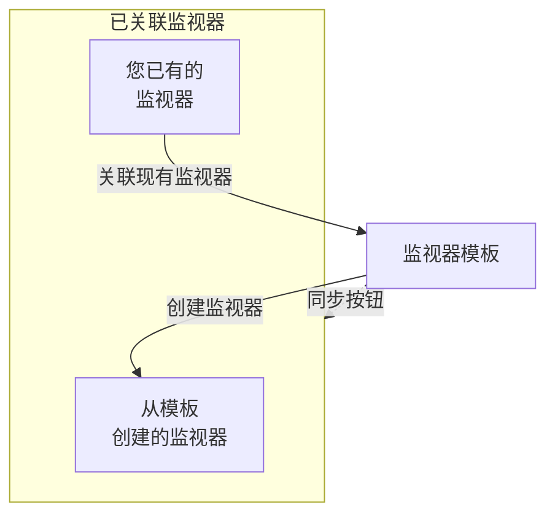

# 监视器模板

监视器模板是一份保存好的监视器配置（类型、条件、间隔、标签和自定义字段默认值），您可以一键从中创建监视器。从模板创建或关联到模板的监视器会保持连接：修改模板，然后把更改同步到所有这些监视器。当许多监视器应以相同方式工作时使用模板，例如每个服务上相同的健康检查，或者生产环境和预发布环境中相同的 API 检查。

:::cards
- [创建模板](#创建模板): 四个步骤，与创建监视器相同。
- [从模板创建监视器](#从模板创建监视器): 一键创建，或关联您已有的监视器。
- [同步更改](#将更改同步到已关联的监视器): 每个同步按钮复制的内容。
- [将监视器移动到其他模板](#将监视器移动到其他模板): 换用更好的模板，每个监视器都保留其历史记录。
- [保留每个监视器自己的值](#保留每个监视器自己的值): 防止目标地址或标头被同步覆盖。
:::

## 模板的工作原理

模板本身不监控任何内容。监视器从模板创建或关联到模板，模板页面会将它们列为 **已关联监视器**。修改模板后，在您同步之前，这些监视器不会发生任何变化：每个同步按钮会把模板的一部分复制到每个已关联的监视器上，而您保护的字段会保留每个监视器自己的值。



## 开始之前

- **可以创建模板的角色**：项目所有者、项目管理员、项目成员、监视器管理员或监视器成员，或者拥有 Create Monitor Template 权限的自定义角色。修改模板需要相同的角色，或 Edit Monitor Template 权限。
- **更新已关联监视器的权限。** 同步会以您的身份写入每个已关联的监视器，并跳过您的权限未覆盖的监视器。

## 创建模板

:::steps
### 打开模板列表

前往 **监视器 → 设置 → 模板**，点击 **创建监视器模板**。

### 为模板命名

在 **模板信息** 中输入 **模板名称**（例如 `Production API Health`）。**模板描述** 可选填。然后点击 **下一步**。

### 设置监视器默认值

在 **监视器默认值** 中，用与创建监视器相同的选择器选择 **监视器类型**。可以选择填写 **默认监视器名称**；留空时，每个监视器会以它监控的资源命名。**默认监视器描述** 和 **标签** 位于 **更多字段** 中。点击 **下一步**。

### 设置条件和间隔

在 **标准** 中填写要检查的对象和条件，与 [创建监视器](/docs/monitor/create-monitor#标准) 中相同。顶部的 **模板同步设置** 卡片可以让字段不被同步覆盖（参见 [保留每个监视器自己的值](#保留每个监视器自己的值)）。对于由探测器检查的监视器类型，最后一步 **间隔** 会询问 **监控间隔**。在最后一步点击 **创建监视器模板**。
:::

模板会添加到列表中。打开它即可看到它的页面，每个部分都有一张卡片：**模板信息**、**监视器默认值**、**标准**、**监控间隔**（含 **最小探测器一致数**）、**标签**、**自定义字段默认值**（当项目有监视器自定义字段时）和 **已关联监视器**。每个部分都在自己的卡片上修改，例如使用 **编辑条件** 或 **编辑间隔**。

## 从模板创建监视器

- **新监视器。** 在列表中模板所在的行点击 **创建监视器**，或在模板页面上点击 **从模板创建监视器**。**创建监视器** 打开时已填好模板的类型和设置；修改需要的内容，然后创建。新监视器会关联到该模板。
- **您已有的监视器。** 在 **已关联监视器** 中点击 **关联现有监视器** 并选择它们。开启 **使用模板的标准和间隔** 时，它们在关联时会采用模板的条件、间隔和探测器一致数；关闭时，在您同步之前，它们会保留自己的设置。已关联到其他模板的监视器会移到此模板。

在 **自定义字段默认值** 中设置的自定义字段值会写入从该模板创建的每个监视器，包括自动导入规则和警报策略从中创建的监视器。

## 将更改同步到已关联的监视器

编辑模板只会更改模板本身。要把更改复制到已关联的监视器上，请使用您所修改卡片上的同步按钮。每个按钮都会写明它影响的监视器数量，例如 **将标准同步到 3 个已关联的监控**；没有任何关联时按钮显示为灰色。同步无法撤销。

| 按钮 | 复制到每个已关联监视器的内容 | 保持不变的内容 |
| --- | --- | --- |
| **将标准同步到已关联的监控** | 条件以及步骤设置（例如目标地址和请求选项），受保护的字段除外 | 监控间隔、最小探测器一致数、名称、描述、标签和自定义字段值 |
| **将间隔同步到已关联的监控** | 监控间隔和最小探测器一致数 | 条件、名称、描述、标签和自定义字段值 |
| **将标签同步到已关联的监控** | 仅标签 | 其他所有内容 |
| **将自定义字段同步到已关联的监视器** | 模板设置了默认值的自定义字段，替换每个监视器原有的值 | 模板留空的自定义字段，以及其他所有内容 |

要同步单个监视器，请在 **已关联监视器** 中该监视器所在的行点击 **从模板同步**。这会复制条件和步骤设置（受保护的字段除外）、监控间隔、最小探测器一致数和标签，而监视器的名称、描述和自定义字段值保持不变。要断开监视器，请参阅[从模板取消关联监视器](#从模板取消关联监视器)。

同步后，摘要会显示更新了多少个监视器。**部分同步** 表示一些已关联的监视器仍是之前的配置，通常是因为您的权限未覆盖它们。

## 将监视器移动到其他模板

当更好的模板取代原有模板时，请将其监视器移动到新模板，而不是删除它们。每个监视器都会保留其名称、状态历史记录、标签、所有者和事件，并采用新模板的条件。

:::steps
### 选择监视器

打开监视器当前关联的模板。在 **已关联监视器** 中选择监视器，或全部选择。您也可以在监视器列表中按任意列筛选后选择监视器。

### 移动监视器

在 **批量操作** 中点击 **移动到其他模板**（在监视器列表中为 **关联到模板**），然后选择模板。

### 保持模板的设置开启

让 **使用模板的标准和间隔** 保持开启，使每个监视器立即采用模板的条件、步骤设置、间隔和探测器一致数。关闭时，在您同步之前，每个监视器会保留自己的设置。然后确认。
:::

移动会执行以下操作：

- 监视器的条件、间隔和探测器一致数会替换为模板中的设置。旧条件设置为自动解决的未关闭事件或警报会被解决，如果问题仍然存在，新条件会创建新的事件或警报。每个网络设备监视器会继续监视自己的设备，每个地址或 URL 监视器会继续检查自己设备的地址。
- 名称、描述、状态历史记录、标签、所有者、自定义字段值和事件关联保持不变。
- 由导入、自动导入规则或网络警报策略创建的监视器会保留创建它的模板。该规则不会再次创建它，警报策略也会放开它：不再删除或替换它。
- 每台设备从每个模板只有一个监视器。如果设备已有一个从新模板为其创建的监视器，它的另一个监视器会被排除，变更会指出造成冲突的监视器：删除其中一个，然后再次移动。
- 与模板类型不同的监视器会被排除。

变更在服务器上运行，一次最多处理 10,000 个监视器，并显示进度：移动了哪些、排除了哪些及原因，以及它解决的未关闭事件和警报。关闭对话框不会停止变更，模板的页面会显示仍在运行的变更。**停止** 会在下一个监视器之前停止变更，**重试** 会再次尝试失败或未处理到的监视器。

> [!TIP]
> 要将自动导入规则的设备移动到新模板？请先移动监视器，再将规则指向新模板。如果顺序相反，规则会在每台设备已有的监视器之外，再从新模板为它创建第二个监视器。

## 从模板取消关联监视器

在 **已关联监视器** 中监视器所在的行点击 **从模板取消关联**，或者在那里或监视器列表中选择监视器，然后在 **批量操作** 中使用 **从模板取消关联**。选择监视器要保留的内容：

| 选项 | 监视器之后的行为 |
| --- | --- |
| **保留其设置** | 它们作为独立的监视器，继续使用当前的条件进行检查和发出警报，不再接收模板的更新。 |
| **从监视器中清除模板的标准** | 它们会继续检查，但在重新关联到模板之前，不会创建事件或警报，也不会设置状态。其条件设置为自动解决的未关闭事件或警报会被解决。 |

无论哪种方式，它们都会保留其名称、状态历史记录、标签、所有者和事件，创建它们的规则也不会再次创建它们。

## 删除模板

网络警报策略或自动导入规则用于创建监视器的模板无法删除：请先将策略或规则指向其他模板。当有监视器关联到该模板时，删除时会询问如何处理它们：

- **保留其设置**（默认）：删除会取消关联它们，它们会继续使用现有的条件进行检查和发出警报。
- **从监视器中清除此模板的标准**：每个监视器都会在清除其条件后取消关联，如上所述，然后删除模板。如果有监视器仍保持关联，例如您的权限未涵盖的监视器，模板会被保留，对话框会显示数量。

如果要改为将监视器移动到其他模板，请在删除模板之前使用 **移动到其他模板**。

## 保留每个监视器自己的值

除非您保护这些字段，否则条件同步还会复制步骤设置，例如目标地址、请求标头和超时。保护某个字段，即可让每个已关联的监视器保留该字段自己的值。

:::steps
### 打开该模板

前往 **监视器 → 设置 → 模板** 并打开该模板。

### 编辑它的条件

在 **标准** 卡片上点击 **编辑条件**。

### 保护字段

在 **模板同步设置** 中，勾选要在已关联监视器上保留的每个字段旁边的 **不同步此字段**。

### 保存

保存更改。**标准** 卡片以及下方两种同步的确认框都会列出受保护的字段。

### 同步

使用 **将标准同步到已关联的监控**，或在单个已关联的监视器上使用 **从模板同步**。
:::

例如，在 API 模板上保护 **监视目标** 和 **请求标头**。生产环境和预发布环境的监视器会保留各自的 URL 和标头，同时都会收到模板更新后的条件和其他未受保护的设置。

可用的选项取决于监视器类型，包括目标地址和端口、HTTP 请求选项、数据库连接、DNS 设置、基础设施选择器和遥测查询。相关的凭据（例如客户端证书及其私钥）会一起保留。

### 排除项的行为

- 勾选的字段会保留每个现有监视器的当前值，包括空值或未设置的值。请求标头和其他集合会完整保留。
- 未勾选的字段会继续从模板同步。取消勾选受保护的字段并保存，下次同步时就会复制模板中的值。
- 排除项同时适用于批量同步和单个同步。它们保存在模板上，而不是在每次同步时单独选择。
- 新监视器仍以模板中的字段值开始。排除项只影响向现有监视器的同步。
- 条件总是会同步。仅同步条件时，监控间隔、标签和其他监视器级别的设置保持不变。
- 现有模板在您配置之前没有字段排除项。网络设备 监视器会继续自动保留它们自己的设备绑定，网络发现导入为设备创建的 Ping、IP、Port 和 NTP 监视器也会继续检查各设备自己的地址。该导入创建的网站、API 和 SSL 证书监视器会保留各设备的地址作为其 URL 的主机，并采用模板的协议、端口和路径。

对于有多个步骤的模板，受保护的值按步骤 ID 匹配。单独创建的单步骤监视器也可以接收单步骤模板。如果某个受保护的步骤无法匹配，同步会在任何监视器更新之前被拒绝，因此新增或重新排序的步骤不会意外复制另一个步骤的目标地址或凭据。

> [!IMPORTANT]
> 在更改已保存模板的监视器类型（使用 **编辑监视器默认值**）之前，请先在 **编辑条件** 中清除不适用于新类型的排除项。模板的所有排除项都必须存在于它的监视器类型中。

## 通过 API 配置

每个模板步骤都在其 `MonitorStep.value` 对象中接受一个 `doNotSyncFields` 数组。对于 API 监视器，可以这样保护它的目标地址和整个标头集合：

```json title="monitorSteps (excerpt)"
{
  "_type": "MonitorSteps",
  "value": {
    "monitorStepsInstanceArray": [
      {
        "_type": "MonitorStep",
        "value": {
          "id": "<step id>",
          "doNotSyncFields": ["monitorDestination", "requestHeaders"]
        }
      }
    ]
  }
}
```

省略该数组或将其设为 `[]`，即可同步所有受支持的步骤设置。不受支持的字段名称，以及不适用于模板监视器类型的字段，都会被拒绝。同步由模板的数组控制；已关联监视器上的任何此类元数据都不会覆盖它。

:::details 按监视器类型列出的 doNotSyncFields 字段名称
| 监视器类型 | 字段名称 |
| --- | --- |
| 网站、API、Ping、IP、端口、SSL 证书、NTP | `monitorDestination`, `requestTimeoutInMs`, `retryCount` |
| 仅 API | `requestHeaders`, `requestType`, `requestBody` |
| 网站和 API | `doNotFollowRedirects`, `allowSelfSignedCertificates`, `tlsClientAuthentication`（客户端证书、密钥和密码一起） |
| 端口、NTP | `monitorDestinationPort` |
| 合成监视器、自定义 JavaScript 代码 | `customCode` |
| 合成监视器 | `browserTypes`, `screenSizeTypes`, `retryCountOnError` |
| DNS | `dnsMonitor.queryName`, `dnsMonitor.recordType`, `dnsMonitor.resolver`（DNS 服务器和端口一起）, `dnsMonitor.timeout`, `dnsMonitor.retries` |
| 域名 | `domainMonitor.domainName`, `domainMonitor.lookupMethod`, `domainMonitor.timeout`, `domainMonitor.retries` |
| DNSSEC | `dnssecMonitor.domainName`, `dnssecMonitor.resolvers`, `dnssecMonitor.checkNameserverConsistency`, `dnssecMonitor.signatureExpiryWarningDays`, `dnssecMonitor.timeout`, `dnssecMonitor.retries` |
| SQL 查询 | `sqlMonitor.connection`, `sqlMonitor.connectionTimeoutInMs`, `sqlMonitor.statementTimeoutInMs`, `sqlMonitor.query`, `sqlMonitor.maxRows` |
| 数据库健康状况 | `databaseMonitor.connection`, `databaseMonitor.connectionTimeoutInMs`, `databaseMonitor.statementTimeoutInMs`, `databaseMonitor.enabledMetricGroups` |
| 外部状态页 | `externalStatusPageMonitor.statusPageUrl`, `externalStatusPageMonitor.provider`, `externalStatusPageMonitor.components`, `externalStatusPageMonitor.timeout`, `externalStatusPageMonitor.retries` |
| 日志、安全事件、追踪、AI / LLM、指标、异常、配置文件 | `logMonitor`, `securityEventsMonitor`, `traceMonitor`, `llmMonitor`, `metricMonitor`, `exceptionMonitor`, `profileMonitor`（监视器的整个配置） |
| 探测器状态 | `probeStatusMonitor.probeIds` |

基础设施监视器（Kubernetes、Docker 容器、主机、Podman 容器、Proxmox、Docker Swarm、Ceph、存储阵列、IoT 设备）可以保护它们的资源选择器、筛选条件（主机除外）、指标查询和查询时间窗口。这些名称列在该类型模板的 **模板同步设置** 中。
:::

## 故障排查

:::details 同步显示“部分同步”
一些已关联的监视器没有更新，通常是因为您的权限未覆盖它们。请让能够更新所有已关联监视器的人重新运行同步。
:::

:::details 同步失败并显示 "a template step cannot be matched to an existing monitor step"
某个受保护的字段无法匹配到其中一个监视器上的步骤，因此同步在更改任何监视器之前就停止了。为模板的步骤设置与监视器步骤相同的 ID，或者对单步骤监视器使用单步骤模板。
:::

:::details 同步按钮显示为灰色
还没有任何监视器关联到该模板。从模板创建一个监视器，或在 **已关联监视器** 中点击 **关联现有监视器**。
:::

:::details 移动时排除了一个监视器：“为其创建此监视器的设备已有一个关联到此模板的监视器”
该设备已有一个从您要移动到的模板为其创建的监视器，通常是因为在移动之前，有自动导入规则已指向该模板。删除不需要的那个（较新的那个历史记录最少），然后再次移动。
:::

:::details 自动导入规则改用新模板后，设备有两个监视器
规则在每台设备已有的监视器之外，又为它创建了新模板的监视器。删除新的监视器，然后将旧的监视器移动到新模板：它们会保留历史记录，规则也不会再次创建监视器。
:::

:::details 保存失败并显示 "Unsupported do not sync field"
`doNotSyncFields` 中的某个名称不是该模板监视器类型的字段。请对照上面的字段名称检查它。
:::

## 后续步骤

:::cards
- [创建监视器](/docs/monitor/create-monitor): 模板所填写的表单。
- [API 监控](/docs/monitor/api-monitor): API 模板所携带的设置。
- [监控密钥](/docs/monitor/monitor-secrets): 在多个监视器之间共享凭据而无需复制。
- [Terraform 监控步骤](/docs/terraform/monitor-steps): 以代码管理监视器及其步骤。
:::
