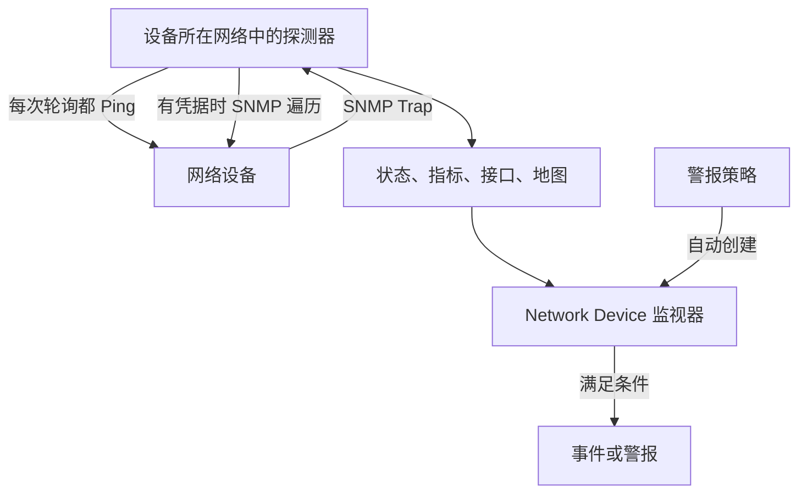
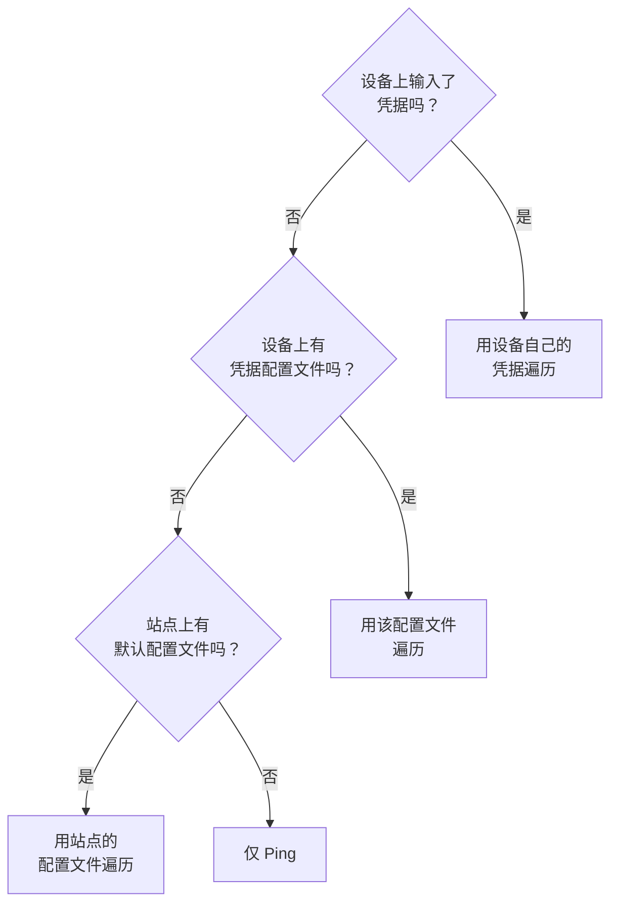
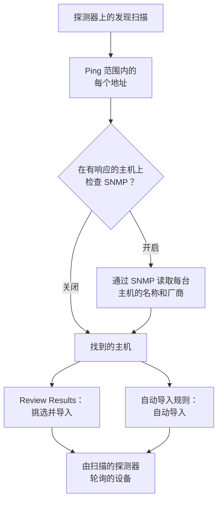
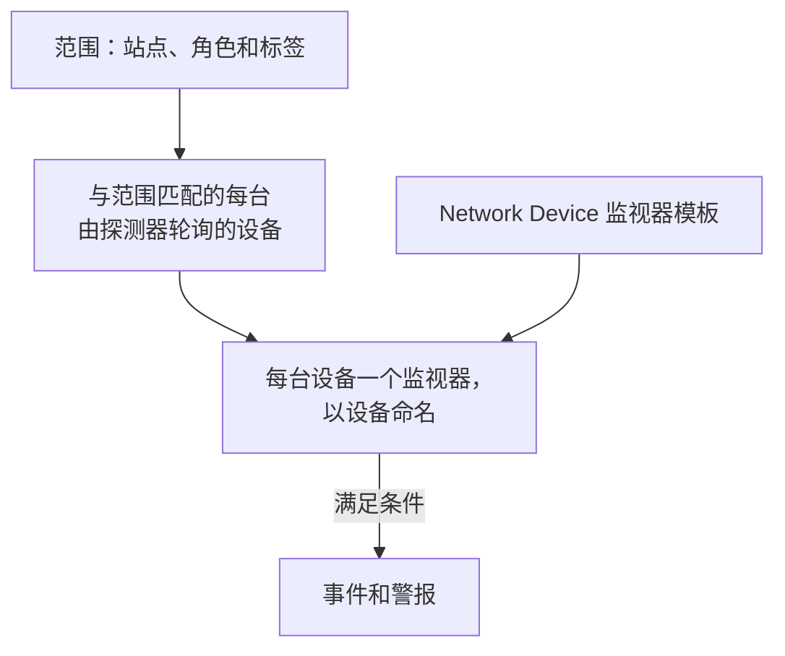
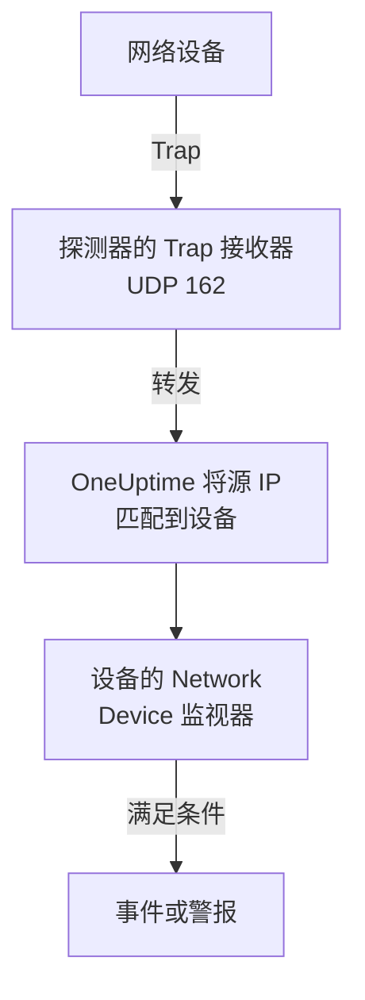

# 网络设备监控

监控交换机、路由器、防火墙、接入点、PDU、摄像头和打印机：网络上任何有地址的东西，无论它是否支持 SNMP。

用地址和探测器添加设备后，探测器会按计划 Ping 它：设备获得在线或宕机状态、在网络地图上的位置，以及在其站点健康状况中的一票。为它提供 SNMP 凭据后，同一个探测器还会遍历它：接口及其中的光模块、硬件清单、LLDP 和 CDP 邻居，以及健康 OID。添加一个监视器，或为整个设备群添加一条警报策略，它的轮询和 Trap 就会产生事件和警报。

:::cards
- [添加设备](#添加网络设备): 地址和探测器，一个页面搞定。
- [发现网络](#通过网络扫描发现设备): 扫描一个地址范围，导入有响应的主机。
- [通过 SNMP 读取设备](#snmp-凭据和凭据配置文件): 接口、光模块、清单和健康状况。
- [接收警报](#警报): 单台设备用监视器，设备群用策略。
- [查看地图](#网络拓扑): 实时绘制的邻居，可导出为 PDF。
- [排查问题](#故障排查): 待处理的设备、失败的遍历、收不到的 Trap。
:::

## 工作原理



设备和监视器的职责不同：

| 部分 | 作用 | 何时需要 |
| --- | --- | --- |
| 设备 | 探测器按设备自己的计划轮询它。每次轮询都会记录可达性、Ping 往返时间和丢包率；带 SNMP 凭据的轮询还会读取设备的身份、接口、邻居和健康 OID。 | 始终需要：你添加的就是设备。 |
| 监视器 | 针对设备的每个轮询结果和每个 Trap 评估条件，并创建事件和警报。 | 仅在需要事件和警报时。状态、清单、图表和地图都不需要监视器。 |

## 开始之前

- **能到达设备的探测器。** 探测器从它自己的网络 Ping 和遍历设备，所以私有地址上的设备需要该网络内的[自定义探测器](/docs/probe/custom-probe)：公共互联网上的探测器无法到达它。
- **SNMP，用于 Ping 之外的数据。** 可选。需要在设备上配置 v1 或 v2c 团体字符串或 SNMPv3 用户，并允许探测器访问 UDP 161。没有它，设备只会被 Ping。
- **Trap、syslog 和流。** 可选。探测器在 UDP 162 上接收 SNMP Trap，开启后在 UDP 5140 上接收 syslog，在 UDP 2055、4739 和 6343 上接收流记录，因此请放行从设备到探测器的这些端口。

## 网络概览

**网络 → 概览**是网络区域的入口，它先给出答案：一句话说明你的网络是否健康；如果不健康，说明哪里出了问题，最坏的消息排在最前面。

| 显示的内容 | 何时 |
| --- | --- |
| **3 台设备宕机** | 设备的探测器或监视器无法到达它。 |
| **2 个站点需要关注** | 所有设备都有响应，但某个站点的健康状况不是正常运行。 |
| **5 个接口宕机** | 所有设备都有响应，但有端口不通。 |
| **2 台设备未报告其详细信息** | 它们响应 Ping，但 SNMP 遍历失败，所以接口和健康状况没有刷新：通常是凭据问题。 |
| **正在等待首次检查** | 设备已添加，但探测器还没有检查它们。 |
| **全部 40 台设备都在线** | 所有设备都有响应。仍在等待首次检查的设备单独计入一行。 |

下面一行说明设备宕机时是否有东西会创建事件：开启了多少条[警报策略](#警报策略)，或者一条都没有时显示 **Set up alerts** 链接。旁边的 **Add Device** 和 **Discover Devices** 按钮打开对应的表单，下面的磁贴和列表给出细节：需要关注的设备和站点、按厂商划分的设备群，以及最近的扫描。

在添加任何内容之前，概览会改为显示两种入门方式：**发现设备**扫描一个地址范围，让你挑选要添加的内容，最适合整个网络或新站点；**添加单个设备**按 IP 地址或主机名添加一台设备。

网络菜单让你每天打开的页面始终可见：**概览**、**Devices**、**站点**、**Map**、**Traffic** 和 **Discovery**。其余页面折叠在分组中，打开分组中的任一页面时该分组会自动展开：

| 分组 | 页面 |
| --- | --- |
| **拓扑** | **Device Topology**、**端点**、**Latency Matrix**、**Site Links**、**Device Links** |
| **规则** | **Auto Import Rules**、**Site Assignment Rules**、**所有者规则**、**标签规则**、**Link Rules** |
| **设置** | **Alert Policies**、**SNMP 凭据**、**Device Roles**、**Site Types**、**OID Collection Templates** |
| **高级** | **Archived Devices** |

## 添加网络设备

:::steps
### 打开 Devices 列表
前往**网络 → Devices**，点击 **Add Device**。网络**概览**上的 **Add Device** 也会打开同一个表单。

### 输入设备地址
在**主机名**中输入它的 IP 地址或主机名。**名称**留空则设备以主机名命名。

### 检查站点和探测器
如果你使用站点，选择设备所在的 **Site**。**探测器**会自动填入站点的默认探测器，或项目唯一的自定义探测器；请确认它能到达该设备。

### 添加设备
点击 **Add Device**。几分钟内探测器就会 Ping 该设备，其状态变为 **Up** 或 **Down**。有 SNMP 凭据时，首次遍历成功后，概览中还会填入设备的身份、接口和健康状况。
:::

表单只有一页（主机名、名称、站点和探测器），下面折叠着 **SNMP** 和**更多字段**。它不询问设备如何被监控：你添加的每台设备都由其探测器轮询，少数需要的设备可以在设备的**设置**页面上使用[绑定监视器覆盖](#绑定监视器覆盖)。

设备的详细信息（名称、描述、角色、站点、标签和地址）之后在一个地方编辑：设备**设置**页面上的 **Device Settings** 卡片。概览上的**设备详情**卡片显示这些信息，并带有**在设置中编辑**链接。

### 设备

| 字段 | 说明 | 必填 |
| --- | --- | --- |
| 主机名 | 探测器 Ping 的 IP 地址或主机名，设备有凭据后也通过 SNMP 遍历它。 | 是 |
| 名称 | 友好名称，例如 core-switch-01。留空则以主机名命名。API 也一样：不带名称创建的设备以主机名命名。 | 否 |
| Site | 设备所在的[网络站点](/docs/monitor/network-sites)。站点的健康状况由其设备汇总而来，设有默认探测器的站点会填入下面的探测器。 | 否 |
| 探测器 | Ping 此设备、有凭据时通过 SNMP 遍历它，并接收其 Trap、syslog 和[流记录](/docs/monitor/network-traffic)的探测器。它必须能直接到达设备：公共互联网上的探测器无法到达私有地址。 | 是 |

**探测器**会尽可能自动填入：只有一个自定义探测器的项目会默认使用它，选择站点后会替换为[站点的默认探测器](/docs/monitor/network-sites#监控默认值)。它从不覆盖你自己选择的探测器。在站点上设置默认探测器后，只凭地址就能添加设备。

### 更多字段（折叠）

| 字段 | 说明 | 必填 |
| --- | --- | --- |
| 描述 | 自由文本。 | 否 |
| Device Role | 核心交换机、接入交换机、防火墙等。它决定设备在地图上的层级，并限定警报策略的范围。 | 否 |
| MAC 地址 | 设备自己的 MAC。对于既不支持 LLDP 也不支持 CDP 的设备，地图用它把设备放到学到该 MAC 的交换机端口上；参见[仅 Ping 设备及其交换机端口](#仅-ping-设备及其交换机端口)。通常会从路由器的 ARP 表中自动学到。 | 否 |
| 同时创建用于事件的 Ping 监视器 | 探测器已经在 Ping 设备并为它提供状态；把失败的 Ping 变成事件的是 Ping 监视器。勾选后，保存时会在主机名上创建一个监视器并绑定到设备。它计入你的套餐，并且在你从监视器页面开启之前，它的事件处于关闭状态。 | 否 |

勾选 Ping 监视器复选框会显示 **Ping from probes**，即监视器自己的探测器。它们必须能到达设备的网络；留空则使用项目的默认探测器。要一次对多台设备设置警报，请改用[警报策略](#警报策略)。

### SNMP（折叠，可选）

保持折叠时设备只会被 Ping：折叠的部分会用一句话说明这一点。设备仍会在首次轮询时获得状态，仍位于其站点和地图上，但在有凭据之前没有接口、清单或健康 OID。展开该部分可以输入团体字符串或 v3 用户，或选择已保存的凭据配置文件。

:::tabs
@tab SNMP v1 / v2c
| 字段 | 说明 | 必填 |
| --- | --- | --- |
| SNMP 版本 | V1、V2c 或 V3。 | 是，默认 V2c |
| SNMP Community String | v1 或 v2c 团体字符串，例如 `public`。 | 否：留空表示仅 Ping |
| SNMP Port | 代理监听的 UDP 端口。 | 否，默认 161 |
| SNMP Credential Profile | 已保存的凭据集，用来代替在此处输入凭据。 | 否 |
@tab SNMPv3
| 字段 | 说明 | 必填 |
| --- | --- | --- |
| SNMP v3 Security Level | No Auth, No Priv；Auth, No Priv；或 Auth, Priv。 | 是 |
| SNMP v3 Username | 设备上配置的安全名称（用户）。 | 是：留空表示仅 Ping |
| SNMP v3 Authentication Protocol | MD5、SHA、SHA-256 或 SHA-512。 | 使用认证时 |
| SNMP v3 Authentication Key | 认证密码短语。 | 使用认证时 |
| SNMP v3 Privacy Protocol | DES、AES 或 AES-256。 | 使用加密时 |
| SNMP v3 Privacy Key | 隐私（加密）密码短语。 | 使用加密时 |
:::

在设备上输入的凭据优先于在旁边选择的凭据配置文件，设备所在站点也可以带有默认配置文件。配置文件上的凭据经过静态加密。输入到设备上的凭据受相同的读取权限保护，但不做静态加密：这是把共享凭据放在配置文件中的又一个理由。

## 一次更改多台设备

对客户网络的一次发现扫描会带来几十台设备，它们属于同一个站点、共用一个角色、来自同一个厂商。你不必逐台打开：在 **Devices** 列表中勾选行，或选中筛选条件匹配的所有设备，然后打开**批量操作**。

| 操作 | 作用 |
| --- | --- |
| **设置站点** / **清除站点** | 把所有选中的设备移到你选择的站点，它们会计入该站点的健康状况；没有自己探测器的设备会使用站点的默认探测器。**清除站点**把它们移出所在站点。被站点分配规则匹配的设备会在下次轮询时回到规则指定的站点，所以对于发现会不断找到的设备，请改为在**网络 → 规则 → Site Assignment Rules** 下添加规则；**设置站点**对话框中有指向那里的链接。 |
| **设置设备角色** / **清除设备角色** | 为所有选中的设备设置同一个角色，例如二十台都是“Access Switch”的交换机。角色是项目自己的，位于**网络 → 设置 → Device Roles** 下，对话框中有指向那里的链接。**清除设备角色**会根据每台设备的 SNMP 身份重新推断其角色。 |
| **应用厂商模板** | 把一个[厂商模板](#厂商健康模板)的健康 OID 和 SNMP 表添加到所有选中的设备。对话框中的第一个选项**按每台设备的厂商匹配**会根据每台设备的 SNMP 遍历结果选出它自己的模板，因此混合的选择也能在每台设备上得到正确的模板；也可以为所有设备选择同一个模板。 |

每个操作都是针对整个选择的一个对话框、一次保存，每台设备都要经过与在其自己的设置页面上编辑时相同的检查：权限、你的角色的标签和所有者范围，以及设备可收集内容的上限。

**应用厂商模板**在执行任何操作之前会先显示它将做什么：多少台设备会得到哪个模板，多少台会被跳过以及原因。它只在每台设备已收集的内容上添加，不删除任何内容，已经拥有模板中全部内容的设备不会被重写。它会跳过由监视器支持的设备（没有东西轮询它）、链接到 [OID Collection Template](#oid-收集模板) 的设备（由模板决定它收集什么，因此请把厂商的 OID 加到那里），以及在匹配模式下尚未通过 SNMP 遍历或其厂商没有模板的设备。

操作完成后，它会列出多少台设备已更改、哪些失败以及原因（你的角色无权编辑的设备、超出上限的列表），以及哪些没有更改以及原因：已在该站点或角色中的设备，或厂商模板跳过的设备。

其他批量操作在各自所属的位置介绍：**Set OID Collection Template** 见 [OID 收集模板](#oid-收集模板)，**Set SNMP Credential Profile**、**Switch to Probe Polling** 和 **Create Ping Monitors** 见[批量处理](#批量处理)，**Shorten Names to Hostname** 见[发现的设备如何命名](#发现的设备如何命名)。

## 一次轮询实际做了什么

对由探测器轮询的设备，每次轮询都是一次 Ping。当设备有可用的 SNMP 凭据时，探测器还会执行一次完整的 SNMP 遍历。两者并行运行，遍历从不等待 Ping，所以位于丢弃 ICMP 的 ACL 后面的 SNMP 设备仍会报告 **Up**。

| 结果 | 仅 Ping 设备 | 有 SNMP 凭据的设备 |
| --- | --- | --- |
| 状态（Up 或 Down） | 来自 Ping | 来自 Ping 或遍历：任一方有响应即可 |
| Ping 往返时间和丢包率 | 记录为设备指标 | 记录为设备指标 |
| SNMP 响应时间 | — | 遍历的时间，绝不是 Ping 的时间 |
| 接口、邻居、端点 | — | 来自成功的遍历 |
| 系统身份、厂商、型号、序列号 | — | 来自成功的遍历 |
| 健康 OID 和 SNMP 表 | — | 来自成功的遍历 |

可用的凭据是指通过[凭据链](#snmp-凭据和凭据配置文件)找到的、带团体字符串的 v1 或 v2c 凭据集，或带用户名的 v3 凭据集。空的凭据集会被跳过，因此设备绝不会用猜测的默认团体字符串去遍历。

丢包率复用 [Ping 监视器](/docs/monitor/ping-monitor)的序列，所以在整个产品中读法一致。往返时间有自己的序列 `oneuptime.monitor.ping.round.trip.time`，因为在网络设备上，普通的响应时间是 SNMP 遍历的时间。设备的**指标**页面绘制接口利用率和健康 OID 的图表；最近一小时的往返时间绘制在地图上设备的详情面板中。

### "SNMP failing" 不等于 "Down"

响应 Ping 但遍历失败的设备是 **Up**，并带有 **SNMP failing** 标记，两部分都很重要：

- 它是 Up，因为该地址上有东西在响应。把它标成红色，会把一台运行良好的设备计入你的事件数。
- 它是 SNMP failing，因为它的接口、清单和健康 OID 已停止刷新，几乎总是由于凭据、被禁用的 SNMP 代理或 ACL。页面上没有其他任何东西会告诉你这些数字已经冻结。

Ping 和遍历都失败的设备就是 **Down**，所以这个标记只会出现在绿色徽章旁边。

### 解读设备状态

所有显示设备的地方（Devices 列表、站点的 Devices 页面、概览、地图）都使用相同的三种判定，以及旁边相同的限定标记。

| 判定 | 含义 |
| --- | --- |
| **Up** | 上一次轮询（Ping 或 SNMP）或绑定的监视器到达了设备。 |
| **Down** | 上一次轮询（Ping 或 SNMP）或绑定的监视器无法到达设备。 |
| **待处理** | 尚无判定：从未轮询过、未分配探测器，或未绑定监视器。 |

| 限定标记 | 何时显示 | 怎么做 |
| --- | --- | --- |
| **Stale** | 远超过设备的间隔时间都没有尝试过轮询。 | 检查设备的探测器是否在线，并且跟得上它负责的设备群。 |
| **No probe** | 设备由探测器轮询，但没有探测器，或其轮询已关闭。 | 分配一个能到达它的探测器；在此之前没有东西轮询它。 |
| **No monitor** | 设备使用[绑定监视器覆盖](#绑定监视器覆盖)，但没有绑定任何监视器。 | 绑定一个监视器，或把它切换回探测器轮询。 |
| **SNMP failing** | Ping 显示 Up，但上一次 SNMP 遍历失败。 | 检查凭据、SNMP 代理或 ACL。 |

**Devices** 列表有一个 **SNMP** 筛选器，有三个值：**OK**（上次遍历成功）、**Failing**（上次遍历失败）和 **Not configured**（仅 Ping、没有凭据或从未轮询）。“哪些设备的凭据失效了”只需一次点击。对于只被 Ping、从未被遍历的设备，列表的 **Interfaces (Up / Down)** 列显示 **No SNMP** 而不是 `0 / 0`：没有可用端口是另一种说法，而且是错误的说法。

## SNMP 凭据和凭据配置文件

设备会使用按以下顺序找到的第一个可用凭据集进行遍历，找到第一个即停止查找：



站点这一步只读取设备自己的站点，不再往上：Unit 中的设备不会继承其上级 Region 上设置的配置文件。站点的默认探测器则会沿树向下传递，因为探测器只在设备上复制一次，而凭据在每次轮询时都会重新读取；详情见[网络站点](/docs/monitor/network-sites#监控默认值)。

### SNMP 凭据页面

**网络 → 设置 → SNMP 凭据**保存项目的凭据配置文件。一个配置文件是一组命名的凭据（v1 或 v2c 团体字符串，或带有安全级别、协议和密钥的 v3 用户），任意数量的设备和站点都可以指向它。设备上不会复制任何内容，所以轮换团体字符串只需在这里编辑一次，使用该配置文件的每台设备都会在下次轮询时获得新值。

配置文件上的机密经过静态加密，只有可以读取设备自身凭据的角色才能读取它们。显示其配置文件的设备或站点只显示配置文件的名称和版本，从不显示其机密。

仍被设备或站点指向的配置文件无法删除：删除会被拒绝，并给出阻碍删除的对象数量。先把这些设备和站点移到另一个配置文件，或清除它们上的配置文件，然后再删除。

### 把设备改回仅 Ping 设备

在设备的**设置**页面上，**编辑设置**的 **SNMP 凭据**步骤中有一个 **Ping only — clear this device's own SNMP credentials** 复选框。保存时它会清除设备自己的团体字符串和 v3 用户名。之所以有它，是因为该清空哪个字段并不明显：只要 v3 设备的用户名还在，无论你清空其他什么，它都仍可被遍历。

清除设备自己的凭据不会清除配置文件。如果设备或其站点仍指定了配置文件，设备会继续用它遍历；要让设备只被 Ping，请同时清除配置文件。

### 批量处理

在 **Devices** 列表中选择设备，然后使用：

- **Set SNMP Credential Profile** / **Clear SNMP Credential Profile**：为所选设备附加或移除配置文件。
- **Switch to Probe Polling**：用于使用绑定监视器覆盖的设备。选择一个探测器后，每台选中的设备从此按计划被 Ping，有凭据后也会被遍历。已经绑定的监视器保持绑定；设备的状态现在来自探测器。
- **Create Ping Monitors**：针对使用绑定监视器覆盖的设备，在每台设备的主机名上创建一个 Ping 监视器并绑定它，使设备显示 Up 或 Down。

当项目中有使用绑定监视器覆盖但没有绑定任何监视器的设备（没有东西轮询、也没有东西报告的设备）时，**Devices** 页面会显示一条横幅，并链接到可修复它们的选择。

## 站点监控默认值

[网络站点](/docs/monitor/network-sites#监控默认值)为其中的设备提供两个默认值。它的 **Default Probe** 会复制到在该站点中创建、或移入该站点且没有自己探测器的设备上。它的 **Default SNMP Credential Profile** 会在每次轮询该站点中没有自己凭据的设备时被读取。在站点上设置这两项后，那里的设备只凭地址就能添加，并从首次轮询起被 Ping 和遍历。站点指南说明了每个默认值沿站点树向下传递多远。

## 绑定监视器覆盖

有些设备是探测器无法到达或 Ping 没有意义的：NAT 后面的设备、更适合用 HTTP 检查判断健康状况的设备、真正信号是端口检查的服务。对于这些设备，设备**设置**页面上的**编辑设置**中有一个 **Monitoring Method**：

| 方式 | 含义 |
| --- | --- |
| **探测器** | 默认值。由分配的探测器按计划 Ping，有凭据时通过 SNMP 遍历。 |
| **Bound monitor** | 一个现有监视器的状态就是此设备的状态。 |

把设备切换为 **Bound monitor** 会停止轮询它。探测器、间隔和轮询开关会从 **Polling & Data Collection** 卡片中移除，设备旧的轮询结果会被清除，其状态来自你绑定的监视器。绑定是可选的：在你绑定之前，设备显示为**待处理**，并带有 **No monitor** 标记。

切换回**探测器**会恢复轮询并要求选择探测器。之前绑定的监视器保持绑定并继续发出警报；它只是不再决定设备的状态。

大多数设备不需要这样做。每台由探测器轮询的设备都已经有可达性状态，因此不需要为了获得状态而绑定 Ping 监视器；当你需要那个监视器的事件时才绑定监视器。

## 轮询与数据收集

轮询设置位于设备**设置**页面的 **Polling & Data Collection** 卡片上（**编辑Polling**）。默认值适合新设备，因此无需调整：

| 设置 | 说明 | 默认值 |
| --- | --- | --- |
| 探测器 | 轮询设备的探测器。 | 添加设备时设置 |
| Polling Enabled | 探测器按下面的计划轮询设备。关闭它可以暂停轮询而不删除设备。 | 开启 |
| Polling Interval (Minutes) | 探测器轮询设备的频率。至少 1 分钟。 | 5 |
| Walk Interfaces | 每次轮询时遍历接口表（IF-MIB）：每个端口的状态、带宽、利用率和错误，以及用于地图的 LLDP 和 CDP 邻居。 | 开启 |
| Collect Connected Endpoints | 还会遍历 ARP 表和网桥转发表，找出接在设备上的东西：POS 终端、打印机、电话、笔记本电脑。从 ARP 表中还会填入注册在这些地址上的设备的 MAC 地址。每次轮询会多出几次遍历。 | 关闭 |
| OID Collection Template | 设备收集的一个共享的、命名的 OID 列表。编辑模板会在下次轮询时改变每台链接的设备。 | 无 |
| Device-Specific Health OIDs | 在模板的 OID 之外，仅此设备收集的额外 OID。 | 无 |
| Auto-Apply Vendor Health Template | 当识别出设备的厂商且其自己的 OID 列表为空时，在下次轮询时用厂商的模板填充该列表。 | 关闭；发现导入的设备为开启 |
| Device-Specific SNMP Tables | 在模板的表之外，仅此设备遍历的额外 [SNMP 表](#snmp-表)。与模板表键相同的表会在此设备上替换它。 | 无 |

从 **Walk Interfaces** 往下的所有设置都需要 SNMP 凭据：在仅 Ping 设备上，这些设置会被保留，但没有遍历可以应用。

### 接口遍历

开启 **Walk Interfaces** 并找到凭据后，每次轮询都会跟踪每个接口的运行状态和管理状态、入站和出站比特、利用率和错误。同一次遍历还会为地图收集 LLDP 和 CDP 邻居。

在设备的 **Interfaces** 页面上将接口静音（例如实验端口或故意拔掉的链路），它会保留在清单中，但不再参与警报和指标。失败的遍历从不会只清除一半已收集的内容：上一次的接口快照会保留，设备会被标记为 **SNMP failing**，这样就没人会把它误认为是最新的。

### 厂商健康模板

在 **Health OIDs** 编辑器中，**Vendor Health Template** 会应用一组为设备厂商预先构建的 OID。许多模板还附带 [SNMP 表](#snmp-表)，可在 **SNMP Tables** 编辑器中通过 **Add a Vendor's Tables** 添加。

| 厂商模板 | 健康 OID | SNMP 表 |
| --- | --- | --- |
| Generic (Host Resources MIB) | CPU 负载、总 RAM 和可用 RAM、平均负载 | CPU 核心（每个核心一行，无论平台如何编号） |
| Arista EOS | CPU 负载、平均负载、总 RAM 和可用 RAM | — |
| Cambium Networks cnMatrix | CPU、RAM、闪存、温度、供电电压 | 风扇、PoE 端口、冗余电源 |
| Cambium Networks Enterprise Wi-Fi (cnPilot, XV, XE, XH) | CPU、可用内存、Wi-Fi 客户端、cnMaestro 连接 | Wi-Fi 射频（频段、信道、带宽、发射功率、客户端、底噪、空口时间、状态）、SSID |
| Cisco IOS / IOS-XE | CPU、已用和空闲内存、温度、风扇状态、电源状态 | — |
| Dell Force10 / OS9 | CPU、内存 | — |
| Extreme Networks EXOS / Switch Engine | CPU、温度、过温告警、电源状态 | 电源、风扇、每个插槽的内存、堆叠成员 |
| Extreme Networks Fabric Engine / VOSS | vIST 会话、I-SID 数量 | 按邻居命名的 Fabric（IS-IS）邻接、每个插槽的 CPU 和内存、温度传感器、风扇、电源 |
| Extreme Networks IQ Engine (HiveOS) Access Points | CPU、内存、Wi-Fi 客户端、温度 | Wi-Fi 射频（信道、发射功率、底噪）、SSID |
| Extreme Networks Wireless Controller (XIQ-C, ExtremeWireless) | 接入点、活动接入点、Wi-Fi 客户端 | 接入点（状态、客户端、地址、软件）、Wi-Fi 射频（频段、信道、带宽、底噪、繁忙空口时间）、WLAN（SSID、客户端） |
| Fortinet FortiGate | CPU、内存、磁盘 | — |
| HPE / Aruba ProCurve | CPU、总内存和空闲内存 | — |
| HPE Aruba Instant (AOS 8) | 集群名称、固件版本、主控（conductor） | 接入点（状态、型号、CPU、内存）、按接入点命名的 Wi-Fi 射频（信道、发射功率、底噪、利用率、客户端、状态）、SSID（客户端） |
| HPE Aruba Mobility Controller (AOS 8) | 接入点、Wi-Fi 客户端、控制器角色 | 接入点（状态、型号、AP 组）、按接入点命名的 Wi-Fi 射频（频段、信道、发射功率、利用率、客户端、模式）、SSID（客户端、在线和离线的接入点）、处理器、内存 |
| Huawei VRP | CPU、内存、温度 | — |
| Juniper Junos | CPU、内存缓冲区、温度 | — |
| MikroTik RouterOS | CPU 负载、温度、电压 | — |
| Palo Alto PAN-OS | 管理平面 CPU、会话利用率、活动会话 | — |
| Sophos Firewall (SFOS / XGS) | 内存、磁盘、交换空间、HA 状态和对端状态、IPsec 服务、CPU 温度（SFOS v22 及更高版本） | IPsec 隧道（状态需要 SFOS v20 及更高版本）、CPU 核心 |
| TP-Link Omada Access Points (EAP) | Wi-Fi 客户端 | — |
| Ubiquiti EdgeOS / EdgeSwitch / UniFi Switches | CPU 负载、总 RAM 和可用 RAM | — |
| Ubiquiti UniFi Access Points | 隔离状态、平均负载、总 RAM 和可用 RAM | Wi-Fi 射频（频段、空口时间）、SSID（频段、信道、客户端、发射功率、连接质量）、CPU 核心 |

模板的 OID 会复制到设备自己的列表中，你可以在那里删减或扩充。首次遍历识别出厂商后，设备页面会建议匹配的模板。匹配读取设备的 `sysObjectID`，在一个企业号下有两个操作系统时还会读取其 `sysDescr`：运行在通用硬件上的 Extreme Fabric Engine 报告的企业号（1916）与 EXOS 相同，只有其描述（`…-FabricEngine (9.0.4.0)`）能区分二者。UniFi 接入点也以同样方式与 Ubiquiti 的路由器区分（`U6-Pro 6.6.50.15098`），旧固件使用 Net-SNMP 的弧响应时也是如此；IQ Engine 接入点则以同样方式与共用其弧的 Aerohive 交换机区分（`AP230, HiveOS 8.2r1`）。

开启了 **Auto-Apply Vendor Health Template** 的设备会在首次轮询时获得模板的 OID 和表：自动导入规则带入的设备，以及从 **Review Results** 导入且开启了厂商模板开关的设备（除非你关闭，否则该开关是开启的）。要一次为多台设备应用模板（例如在该开关出现之前发现的设备群），请在 **Devices** 列表中选择它们并使用**应用厂商模板**（参见[一次更改多台设备](#一次更改多台设备)）。

应用厂商模板是一次性复制，所以模板更改时不会传播任何内容。对于不止一台设备的情况，请改用 **OID Collection Template**；创建时会提供厂商模板作为起点。

### OID 收集模板

**OID Collection Template**（**网络 → 设置 → OID Collection Templates**）是一个命名的 OID 列表，通常以设备类型命名，例如“Cisco Catalyst 9300”，任意数量的设备都可以链接到它。链接是实时的，而不是副本：设备的 OID 列表在每次轮询时组装，因此编辑模板会在下次轮询时改变每台链接设备收集的内容，无需同步步骤。

在构建之前，先确认你需要它。每个端口的入站和出站比特、运行状态、利用率和每秒错误数，在每次轮询时都会为每个端口收集，完全不需要 OID（参见[接口遍历](#接口遍历)），而且已经可以按端口设置警报。模板用于非按端口的数据：CPU、内存、温度、风扇、电源、BGP 对等体。

如果你从 Zabbix 迁移过来：

| Zabbix | OneUptime |
| --- | --- |
| 模板 | OID Collection Template |
| 监控项 | 该模板上的一个 OID |
| 带监控项原型的“Network interfaces by SNMP”发现规则 | 对接口计数器内置且始终开启：无需编写任何内容 |
| 触发器 | 监视器条件 |
| 触发器原型，每个发现的接口一个 | 将**接口**设为 `*` 的条件，会按端口展开 |
| 针对任何其他 SNMP 表（隧道、射频、风扇）的带监控项原型的发现规则 | 模板上的 [SNMP 表](#snmp-表) |
| 针对此类表的触发器原型 | 将 **Row** 设为 `*` 的 SNMP Table Value 或 SNMP Table Row Is Unhealthy 条件 |
| 主机组 | 标签 |
| “主机发现时链接模板”动作 | 自动导入规则的 **OID Collection Template** |
| 针对主机组的动作（“对每台交换机发出警报”） | [警报策略](#警报策略) |

模板上的 OID 按原样收集，所以指向表中某一行的 OID（`…ifSpeed.3`）只收集那一行，不管轮询当天索引 3 上是什么。凡是列表形式的数据（隧道、射频、风扇、邻居）都应放在 [SNMP 表](#snmp-表)中，它会遍历每一行，并随着行的出现和消失而跟踪。按端口的接口数据两者都不需要：接口遍历会把运行状态、每秒入站和出站比特、利用率以及合并的每秒错误率记录为序列。按方向的错误、丢弃、管理状态和链路速率会进入设备的接口清单，但不是序列，无法设置警报。

链接设备有三种方式，对于发现会不断找到的设备群，第三种最重要：

- 一次一台，在设备的 **Polling & Data Collection** 卡片上。
- 批量，在 **Devices** 列表中选择设备并使用 **Set OID Collection Template**。列表的 **Template** 列显示哪些设备链接到了什么。
- 自动，在自动导入规则上设置 OID Collection Template，这样扫描导入的每台设备在创建时就会被链接。

设备先收集模板的 OID，再收集它自己的 **Device-Specific Health OIDs**。两者指定同一个 OID 时只收集一次，以设备的名称和描述为准；模板条目保持其位置，因此设备特定的附加项永远不会把它们挤出去。

| 上限 | 值 |
| --- | --- |
| 设备轮询的健康 OID | 200 |
| 模板上的 OID | 150 |
| 已链接设备自己的 OID | 50 |
| 未链接设备自己的 OID | 200 |

这些上限是相加的，所以已链接的设备轮询的 OID 永远不会超过 200 个。超出时会在保存时报验证错误，而不会在轮询时被悄悄截断；链接一台自己已有超过 50 个 OID 的设备会被拒绝，并提示需要删除多少个。

仍有设备链接的模板无法删除。请先取消链接，例如使用 **Clear OID Collection Template** 批量操作，这样删除操作永远不会悄悄停止整个设备群的收集。

### 自定义 OID

在模板上或作为设备特定的附加项，添加你希望每次轮询都收集的任何 OID：

| 字段 | 说明 | 必填 |
| --- | --- | --- |
| OID | 数字形式的 OID，例如 1.3.6.1.2.1.1.1.0。 | 是 |
| 名称 | OID 的友好名称，例如 sysDescr。 | 否 |
| 描述 | 该 OID 代表什么。 | 否 |

收集到的值会在设备的**指标**页面上绘制成图表，**SNMP OID Value** 和 **SNMP OID Exists** 条件会基于它们发出警报。这些条件上的 OID 选择器会列出所选设备收集的 OID（包括其模板的和它自己的），所以无需手动输入。

长的 OID 列表会拆分成多个 SNMP GET 请求，使每个请求都能放进一个 UDP 数据报。如果你因为旧版本把回复 `tooBig` 的设备报告为离线而让 OID 列表保持简短，现在已经不需要了。

### SNMP 表

设备知道的一些信息是列表：每个 IPsec 隧道、Wi-Fi 射频、SSID、Fabric 邻居、风扇或电源各一行。SNMP 表由其列定义，每次轮询都会遍历每一行，所以新增、重命名或删除的隧道都会被跟踪，无需任何人编辑。

| 字段 | 作用 |
| --- | --- |
| 名称和键 | 表的名称。键（字母、数字和下划线，留空时由名称生成）供条件、指标和模板变量使用，因此重命名表永远不会破坏警报。 |
| 类型 | 行是什么：VPN 隧道、Wi-Fi 接入点、Wi-Fi 射频、Wi-Fi SSID、路由邻居、硬件或通用。Wi-Fi 类型为设备的 [Wi-Fi 页面](#wi-fi-选项卡)提供数据。 |
| 列 | 要收集的列 OID（表条目的 OID 加上列号，例如 Sophos 隧道状态的 `1.3.6.1.4.1.2604.5.1.6.1.1.1.1.9`），每列都有名称，并可选地设置单位、角色（状态、频段、信道、信道带宽、发射功率、客户端、底噪、利用率、SSID）、值标签和健康值。 |
| 行名称 | 可选的列，其值用来为每一行命名，例如隧道的连接名称。没有它们时，行以索引命名。名称可以来自共享相同索引的同级表（Fabric Engine 用 `rcIsisAdjHostName` 为 IS-IS 邻接命名），也可以来自其索引是此表索引开头部分的父表（Aruba Instant 用接入点的名称为每个射频命名）。以名称为索引的表（ArubaOS 以 SSID 为其 SSID 表的索引）以解码后的索引命名。 |
| 行数上限 | 保留多少行：默认 100，最多 250。 |

数字按数字读取，以数字开头的文本也按该数字读取（`"36"`、`"-95 dBm"`、`"80MHz"`），因为很多厂商会把数字放在字符串里。对于只是看起来像数字的值，把列的值类型设为 **Text only**。**Value labels** 把代码变成文字（`0=inactive, 1=active`）：用于绘图和比较的仍是原始值，显示的是标签。**Healthy values**（`1`）说明哪些值表示一切正常：它们为设备 **SNMP Tables** 页面上的行着色，并驱动 **SNMP Table Row Is Unhealthy** 条件。

一些厂商模板的列还会对读取的数字进行**调整**，用于以自身单位保存数值的 MIB：ArubaOS 报告的发射功率是两倍（读取值 × 0.5），Aruba Instant 报告的底噪不带符号（× −1），Aerohive 报告的底噪加了 256（− 256），Extreme 的控制器以 20 MHz 为步长报告信道带宽（× 20）。显示、绘图和比较使用的是调整后的数字，所以 **Noise Floor Greater Than -80** 在每个厂商上含义都相同，表编辑器会在列下方显示这一换算。

表来自 [OID Collection Template](#oid-收集模板)，由每台链接的设备共享（最多 10 个表），或来自设备自身的 **Device-Specific SNMP Tables**（再多 10 个）。它们在每次轮询时按键合并，模板优先，键相同的设备表会替换模板的表。两个编辑器都提供 **Add a Vendor's Tables**。

探测器把每一列作为子树遍历，在设备上所有表共享的 30 秒时间预算内完成。无法遍历的表会说明原因，且从不会使轮询失败：设备的 **SNMP Tables** 页面会保留其上一次正常的行，并说明最近一次遍历失败；而条件只判断本次遍历的结果，因此超时永远不会被当作空表。每个数值单元格都会记录为指标 `oneuptime.monitor.snmp.table.value`，带有属性 `snmpTableKey`、`snmpTableName`、`snmpTableColumn`、`snmpTableColumnOid`、`snmpTableRow` 和 `snmpTableRowIndex`，所以仪表板可以绘制每条隧道的状态或每个射频的发射功率，Metrics 监视器也可以按 `snmpTableRow` 分组。

### Wi-Fi 选项卡

遍历结果中包含 Wi-Fi 表（接入点、射频或 SSID，由 Wi-Fi 厂商模板带来）的设备会有一个 **Wi-Fi** 页面。页面开头是在线的接入点（控制器上）、开启的射频、客户端和 SSID，然后列出控制器管理的每个接入点及其状态、射频和客户端；每个射频及其频段、信道、频率、信道带宽、发射功率、客户端、底噪和空口时间；以及每个 SSID 及其频段和客户端。列按其角色查找，所以任何为列标注了角色的厂商表都会以相同方式显示。

各厂商拆分这些信息的方式不同，页面会把它们重新组合起来：

- 频率根据频段和信道，按 802.11 信道规划（2.4、5 和 6 GHz）计算得出。在 MIB 中写着信道的位置却报告频率的控制器（Extreme 的）会被反过来读取。
- 不报告频段的射频按其信道归类：1 到 14 是 2.4 GHz，32 到 177 是 5 GHz，只有 6 GHz 使用的编号（37、53、181……）是 6 GHz。
- UniFi 按 SSID 报告信道、发射功率和客户端：射频从其频段上的 SSID 获取这些值。
- Aruba 按射频统计客户端：接入点的客户端就是其各射频的客户端。
- 不广播任何网络的接口（IQ Engine 会列出每个接口，对这些接口显示 N/A）不会被列为 SSID。

对于尚未报告 Wi-Fi 的设备，页面会给出其厂商模板的名称（按自动应用的方式根据最近一次轮询匹配），并可以用**应用模板**应用它；射频会在下一次轮询后出现。

### 支持的 Wi-Fi 厂商

每个 Wi-Fi 厂商通过 SNMP 报告的内容，以及只有其云端才有的内容：

| 厂商 | 接入点和控制器 | 厂商模板 | 通过 SNMP 读取 | 需要厂商的云 API（未实现） |
| --- | --- | --- | --- | --- |
| Cambium Networks | Enterprise Wi-Fi 接入点（cnPilot、XV、XE、XH） | Cambium Networks Enterprise Wi-Fi (cnPilot, XV, XE, XH) | 每个射频的频段、信道、带宽、发射功率、客户端、底噪、空口时间和状态；SSID；CPU、内存 | cnMaestro 中的设备群视图 |
| Ubiquiti UniFi | UniFi 接入点（UAP、U6、U7、UK） | Ubiquiti UniFi Access Points | 每个射频的频段和空口时间；每个 SSID 的信道、客户端和发射功率；每个核心的 CPU、内存 | UniFi Network 应用中的按客户端数据和站点视图 |
| HPE Aruba | 通过虚拟控制器访问的 Instant 集群（AOS 8） | HPE Aruba Instant (AOS 8) | 每个接入点的状态、CPU 和内存；每个射频的信道、发射功率、底噪、利用率、客户端和状态；带客户端数的 SSID | — |
| HPE Aruba | Mobility Controller（AOS 8） | HPE Aruba Mobility Controller (AOS 8) | 每个受管接入点的状态；每个射频的频段、信道、发射功率、利用率和客户端；带客户端数的 SSID；控制器的 CPU 和内存 | — |
| HPE Aruba | 由 Aruba Central 管理的 AOS 10 接入点 | — | 可达性（Ping） | 射频、SSID 和客户端：Aruba Central API |
| Extreme Networks | IQ Engine（HiveOS）接入点 | Extreme Networks IQ Engine (HiveOS) Access Points | 每个射频的信道、发射功率和底噪；SSID；CPU、内存、客户端、温度 | ExtremeCloud IQ 中的客户端和设备群视图 |
| Extreme Networks | ExtremeCloud IQ Controller（原 Extreme Campus Controller）和 ExtremeWireless 控制器 | Extreme Networks Wireless Controller (XIQ-C, ExtremeWireless) | 每个接入点的状态和客户端；每个射频的频段、信道、带宽、底噪和繁忙空口时间；带客户端数的 WLAN | — |
| TP-Link | Omada 接入点（EAP） | TP-Link Omada Access Points (EAP) | 客户端数量，需固件带有 TP-Link 的 EAP 客户端 MIB | 射频、信道和 SSID：Omada Controller API |
| Juniper | Mist 接入点 | — | 可达性（Ping）；通过 Mist 的 Webhook 得知接入点上线和离线 | 其他一切：Mist 云 API |

模板根据每台设备的 `sysObjectID` 和 `sysDescr` 匹配，所以自动应用、**应用厂商模板**批量操作的**按每台设备的厂商匹配**以及 Wi-Fi 页面都能自动选出模板，TP-Link 的除外，需要你自己应用。按厂商开启 SNMP 的方法：

- **Cambium**：在 cnMaestro 中，SNMP 按 AP 组设置（Configuration → Wi-Fi Profiles → AP Groups → Management → SNMP），使用 v2c 团体字符串或 v3 用户。逐个添加接入点。
- **Ubiquiti UniFi**：在 UniFi Network 应用中开启 SNMP，它会在其管理的设备上设置。逐个添加接入点。
- **HPE Aruba Instant**：为集群开启 SNMP，并把其虚拟控制器的地址添加为一台设备；它会代表每个接入点响应。
- **HPE Aruba Mobility Controller**：添加控制器；园区接入点本身不响应 SNMP。
- **Extreme IQ Engine**：在 ExtremeCloud IQ 推送到接入点的网络策略中开启 SNMP，并逐个添加接入点。
- **Extreme Wireless Controller**：在控制器的管理设置中开启 SNMP，并添加控制器。
- **TP-Link Omada**：在 Omada Controller 中为站点开启 SNMP（Network Config → SNMP），添加接入点，然后在其设置页面上或用**应用厂商模板**应用模板。
- **Juniper Mist**：Mist 接入点不响应 SNMP。把它们添加为仅 Ping 设备以获取可达性，并把 Mist 的 `device-updowns` Webhook 发送到 [Incoming Request 监视器](/docs/monitor/incoming-request-monitor)，将接入点离线变成事件。

控制器的表最多保留 250 行：在接入点或射频超过 250 个的控制器上，其余部分不会列出，表会说明这一点。其接入点数和客户端数是健康 OID，所以会统计全部。

### 收发器

设备端口中的 SFP、SFP+、SFP28 和 QSFP 光模块会在每次遍历接口的轮询中读取：无需开启任何东西，也无需应用模板。对每个光模块，OneUptime 会保存：

- 它是什么：光模块报告的厂商、部件号、序列号、版本、类型和波长。第三方光模块（FS.com、FLEXOPTIX、Carritech 等）的读取方式与交换机厂商自己的相同。
- 它的读数：来自其数字光学监控（DOM，也称 DDM）的温度、供电电压、激光偏置电流以及发送和接收光功率。QSFP 按通道报告功率和偏置电流。
- 设备自己的阈值：交换机为每个读数报告的低/高警告和告警限值。光模块只按这些限值判断；OneUptime 从不自行编造限值。
- 一个月的接收光功率：过去 30 天中最弱通道的每日平均值。脏污的连接器、弯折的光纤或老化的光模块，会在链路中断前几周在这里显现。

设备的 **Interfaces** 页面以**收发器**卡片开头：先列出问题，然后每个光模块一行，显示其端口、是什么、文字描述的状态及其读数。超过阈值的读数会被着色并标注（**低告警**、**高警告**），RX 值旁边有一个月接收光功率的小图表；QSFP 的行显示其最差的通道。点击一行可查看每个通道相对于每个阈值的情况、带最佳日的接收光功率趋势以及光模块的身份信息。不报告光模块的设备（只有铜口，或代理不公开它们）根本不会显示该卡片。

| 状态 | 含义 |
| --- | --- |
| 健康 | 设备有阈值的每个读数都在阈值之内。 |
| Warning | 某个读数达到或超过警告阈值。 |
| 告警 | 某个读数达到或超过告警阈值，或设备标记了信号丢失或发射器故障。 |
| 未检测到 | 端口曾有光模块，现在不再报告，而端口仍处于启用状态。页面仍会显示之前在那里的光模块名称。 |
| 无阈值 | 光模块报告了读数，但设备没有报告用于判断的限值。请用 **SNMP Transceiver Reading** 对其设置警报。 |
| Detected | 光模块完全不报告诊断信息：铜缆 SFP 和直连电缆通常如此。 |
| 端口已禁用 | 端口已关闭，因此其激光按设计处于关闭状态：会显示其读数，但从不判断。 |

设备的 `sysObjectID` 决定读数来自哪里：先用厂商自己的表（当它包含标准表没有的内容时），以 ENTITY-SENSOR-MIB 作为后备。

| 设备 | 读取来源 | 阈值 |
| --- | --- | --- |
| Cisco | CISCO-ENTITY-SENSOR-MIB，通过 ENTITY-MIB 匹配到端口 | 是 |
| Arista | ENTITY-SENSOR-MIB，以及 ARISTA-ENTITY-SENSOR-MIB 的阈值 | 是 |
| Juniper | JUNIPER-DOM-MIB，多通道光模块提供每通道读数 | 是 |
| HPE Comware 和 H3C | HH3C-TRANSCEIVER-INFO-MIB | 是 |
| HPE Aruba ProCurve / ArubaOS-Switch | HP-ICF-TRANSCEIVER-MIB | 是 |
| MikroTik RouterOS | MIKROTIK-MIB（`mtxrOpticalTable`），带信号丢失和发射器故障标志 | 否 |
| Cambium Networks cnMatrix（4.5 及更高版本） | CAMBIUM-NETWORKS-TRANSCEIVER-MIB | 否 |
| 其他所有设备 | ENTITY-SENSOR-MIB（RFC 3433），通过 ENTITY-MIB 匹配到端口 | 否 |

首次轮询读取全部内容。之后的轮询只读取会变化的内容（读数，以及用于识别光模块被更换的序列号），其余内容（阈值、身份信息、哪个光模块在哪个端口）会在光模块插入、拔出或更换时重新读取，并且至少每小时读取一次。没有任何这些 MIB 的设备，每尝试一个 MIB 只花费一次请求。读取有自己的 20 秒时间预算，超时或被中断的读取会保留设备上一次正常的光模块信息，而不会报告它们消失了。

启用的端口上缺失的光模块会立即在页面上显示为**未检测到**，并在连续两次轮询后才在警报中计为缺失，所以代理偶尔返回一次空结果不会呼叫任何人。从已关闭的端口拔出的光模块会被直接忽略，已静音的接口会在页面上保留其光模块，但从不对其发出警报。

每个读数也是一个设备指标，每个端口和通道一个序列，单位与页面显示的相同：`oneuptime.monitor.snmp.transceiver.temperature`（°C）、`oneuptime.monitor.snmp.transceiver.voltage`（V）、`oneuptime.monitor.snmp.transceiver.bias.current`（mA）、`oneuptime.monitor.snmp.transceiver.tx.power` 和 `oneuptime.monitor.snmp.transceiver.rx.power`（dBm），带有属性 `interfaceName`、`interfaceIndex` 和 `lane`。仪表板可以绘制一条链路几个月来的光功率，Metrics 监视器可以对其设置警报。

OneUptime AI 调查来自 Network Device 监视器的事件或警报时，会从相关端口的光模块开始：是否仍被检测到、每个读数与设备阈值的对比，以及最近几周的接收光功率。当你询问时，AI 也可以读取任何设备的光模块。

### 设备身份

首次遍历成功后，OneUptime 会读取 SNMPv2 系统组，并在设备支持时读取 ENTITY-MIB，然后填写设备记录：系统名称、描述、位置、联系人、运行时间、厂商、型号、序列号和固件版本。厂商的企业 OID（`sysObjectID`）是设备的指纹：它标识厂商并选出匹配的厂商模板。同样的信息会与其他所有资产一起出现在[资产清单](/docs/inventory/cmdb-sync#network-device-asset-attributes)中。

仅 Ping 设备保留你或发现扫描为它指定的名称和地址：没有 SNMP 代理可以询问更好的信息。

## 通过网络扫描发现设备

不必逐台添加设备，可以从探测器扫描一个地址范围，导入有响应的主机。



:::steps
### 打开 Discovery
前往**网络 → Discovery**，点击**开始扫描**。网络**概览**上的 **Discover Devices** 也会打开同一个表单。

### 说明要扫描什么
在**扫描目标**步骤中，输入范围，检查**探测器**，并决定是否启用 **Check SNMP on hosts that answer**。

### 添加要尝试的凭据
开启 SNMP 时，**SNMP 凭据**步骤会要求提供要尝试的凭据集。关闭时没有第二步：扫描是[仅 Ping 扫描](#仅-ping-扫描)，**开始扫描**就在第一页上。

### 开始扫描
点击**开始扫描**。探测器扫描该范围，并报告它扫描了多少主机、有多少响应：有多少响应了 SNMP，或者在仅 Ping 扫描中有多少响应了 Ping。

### 导入找到的内容
在完成的扫描上点击 **Review Results**，选择你需要的设备，然后点击 **Import Selected**。
:::

| 字段 | 说明 | 必填 |
| --- | --- | --- |
| 扫描目标 | 要扫描的地址，使用 [CIDR 或八位组范围表示法](#扫描目标表示法)。 | 是 |
| 探测器 | 执行扫描的探测器。它必须能直接到达该范围。只有一个自定义探测器的项目会默认使用它。 | 是 |
| Check SNMP on hosts that answer | 扫描会先 Ping 该范围；此选项决定是否随后通过 SNMP 向有响应的主机询问其名称和厂商。关闭它即为[仅 Ping 扫描](#仅-ping-扫描)。在创建扫描时选择，之后不可更改。默认开启。 | 否 |
| SNMP Configs | 第二步：要按顺序尝试的凭据集。每台主机会依次用每个凭据集询问，直到有一个得到响应，因此请为每组共享相同版本和团体字符串或 v3 用户的设备添加一个凭据集。 | 开启 Check SNMP 时 |

折叠在第一步的**更多字段**下，供需要的扫描使用：

| 字段 | 说明 | 默认值 |
| --- | --- | --- |
| 名称 | 扫描的用途，便于与其他扫描区分。为空时列表显示扫描目标。 | 空 |
| 查询 Windows 名称（NetBIOS） | 通过 UDP 137 向每台没有 SNMP 系统名称的主机询问其 NetBIOS 名称，即其 Windows 计算机名。该名称优先于主机的反向 DNS 名称。仅限私有地址和自定义探测器；参见[发现的设备如何命名](#发现的设备如何命名)。 | 开启 |
| Name devices by their short hostname | 用完全限定主机名的第一部分为导入的设备命名：用 `core-sw-01` 而不是 `core-sw-01.corp.example.com`。 | 关闭 |
| Repeat this scan | 按 **Rescan Interval (Minutes)** 间隔（至少 15 分钟）再次运行扫描，使发现持续进行；参见[自动导入规则](#使用自动导入规则自动导入)。重复扫描找到的主机会等待你审核，除非有自动导入规则匹配它们。 | 关闭 |

### 扫描目标表示法

扫描目标接受两种表示法，都只支持 IPv4。CIDR 是一个连续的子网：

```text
192.168.1.0/24
10.0.5.0/28
```

网络地址和广播地址会被跳过，所以 `/24` 扫描 254 台主机。`/31` 和 `/32` 没有需要跳过的网络地址或广播地址，因此其中的每个地址都会被扫描。

在八位组范围中，四个八位组中的任何一个都可以是包含两端的 `low-high` 范围，而不是单个数字：

```text
10.16-22.0-255.51-66
10.48-50.0-255.51-66
192.168.1.10-40
10.0.0.5
```

结果中的每个地址都会被扫描，没有一个被视为网络地址或广播地址，因为没有前缀长度可以用来推算：`10.0.0.0-255` 包含 `10.0.0.0` 和 `10.0.0.255`。

- 每个八位组是 0 到 255 之间的数字，或下界在前的范围。`10.22-16.0.1` 会作为反向范围被拒绝，而不是悄悄地什么都不扫描。
- 单独的地址（`10.0.0.5`）只扫描那一台主机。
- 一次扫描最多覆盖 32,768 个地址。更大的目标会在保存扫描时被拒绝：请拆分成多个扫描，或缩小范围。

目标在保存扫描时检查，所以拼写错误会显示在表单上，而不是几分钟后表现为失败的扫描。

八位组范围适用于形状不像 CIDR 块的网络。`10.16-22.0-255.51-66` 会扫描从 `10.16` 到 `10.22` 的每个 `/24` 中的 `.51` 到 `.66`：共 28,672 个地址。用 CIDR 写需要 1,792 次扫描，而包含它的最小 CIDR 块（`10.16.0.0/13`）有 512k 个地址，其中 95% 不值得探测。

### 扫描导入什么

扫描找到的每台主机都会作为由探测器轮询的设备导入，分配扫描的探测器并开启轮询，所以它从首次轮询起就有状态。主机之间的区别在于随之导入的内容：

- 响应了 SNMP 的主机导入时，以响应的地址作为主机名，名称按下文选择，并带上响应的凭据，所以 v3 扫描导入的设备已准备好通过 v3 遍历，会立即开始收集接口和清单。
- 响应了 Ping 但没有响应 SNMP 的主机（[仅 Ping 扫描](#仅-ping-扫描)找到的每台主机，以及 SNMP 扫描无法识别的主机）导入时不带凭据。探测器按计划 Ping 它们；之后在设备上、或作为设备或其站点上的配置文件添加凭据，同一个探测器也会开始遍历它们。

已注册的设备会被标记并跳过。只有在你需要某个 [Ping](/docs/monitor/ping-monitor) 或 [IP](/docs/monitor/ip-monitor) 监视器的事件时，才把它绑定到导入的设备；对于设备群，[警报策略](#警报策略)通常是更好的答案。

当扫描找到 SNMP 主机时，**Review Results** 会提供**在首次轮询时为每台 SNMP 主机应用其厂商模板（推荐）** 选项，默认开启：每台导入的 SNMP 设备都会获得与其首次遍历结果对应的[厂商模板](#厂商健康模板)，包括健康 OID 和 SNMP 表，就像自动导入规则带入的设备一样。厂商没有模板的设备保持不变。对于应当不带模板开始的一批设备，请关闭此开关。

### 发现的设备如何命名

发现的主机按以下顺序中它拥有的第一个名称命名：

1. 它的 SNMP 系统名称（`sysName`），即设备为自己报告的名称。`localhost` 之类的占位名称或 IP 地址不算。
2. 当扫描开启了**查询 Windows 名称（NetBIOS）** 时，它的 NetBIOS 名称，即 Windows 或 Samba 主机为自己报告的计算机名。它保留主机报告的大小写：`WB0024KDS03`。
3. 它的反向 DNS 名称，即探测器在扫描后查询的 PTR 记录。
4. 它的 IP 地址。

设备自己的名称排在前面，因为那是其所有者使用的名称：一台名为 `WB0024KDS03` 的 Windows 主机，即使其反向区域称它为 `wb-0024-kds03.wbhq.com`，也保留原名。反向 DNS 名称也会被保留：**Review Results** 会在地址旁显示它，设备会把它保存为 **DNS Name**。NetBIOS 会把计算机名截断为 15 个字符，所以如果 NetBIOS 名称是一个更长的反向 DNS 名称的开头（`WB-0024-KITCHEN` 对应 `wb-0024-kitchen-display-03.wbhq.com`），就会让位于反向 DNS 名称。

**Review Results** 会显示设备将得到的名称，无论你在那里导入，还是由[自动导入规则](#使用自动导入规则自动导入)导入，它都会得到相同的名称。设备的主机名始终是其 IP 地址。只要设备的名称仍是发现给它的名称，其概览就会以**名称来源**显示名称的来源。

**Name devices by their short hostname** 会把完全限定名称截断为第一个标签：`core-sw-01.corp.example.com` 导入为 `core-sw-01`。它适用于反向 DNS 名称，以及是完全限定主机名的 `sysName`；其他任何名称（`Core Switch`、`ubuntu-22.04`、IP 地址）保持不变。它只改变设备的叫法，所以无需重新扫描：**Review Results** 和自动导入规则会在下次为主机命名时使用它，已导入的设备保留其名称。

从有反向 DNS 名称的主机导入的设备会把完整名称保存为 **DNS Name**，无论扫描是否使用短名称。它显示在设备的概览上，**Devices** 列表的搜索会匹配它，站点分配规则也会用它匹配主机名模式，所以 `*.store-0660.corp.example.com` 规则仍会放置名称已去掉域名的设备。NetBIOS 名称永远不会保存为 DNS Name：它是主机关于自身的报告，而不是 DNS 记录。

> [!WARNING]
> 标签规则和所有者规则按设备名称匹配。针对 DNS 名称（`*.wbhq.com`）或完整名称（`*.corp.example.com`）编写的模式，不会匹配以自身名称或短名称命名的设备。站点分配规则还会尝试 DNS Name，因此仍能匹配。

要缩短已导入设备的名称，请在 **Devices** 列表中选择它们并使用 **Shorten Names to Hostname**。确认框会显示将被重命名的设备数量和示例。没有 DNS Name 的设备会把完整名称保存为其 DNS Name，除非该名称也是其 SNMP 系统名称，或长到在导入时已被截断。当另一台设备已经使用其短名称、两台选中的设备会得到相同的短名称，或其名称在你选择之后发生了变化时，该设备会被跳过。每台被重命名的设备都会重新运行站点分配规则；标签规则和所有者规则不会，因此请对匹配设备名称的规则使用 [Run Now](/docs/configuration/run-rules-now)。现有的 Ping 监视器保留其名称，以设备名称作为标签的指标序列会以新名称开始一个新序列。

:::details NetBIOS 名称：查询如何工作
Windows 和 Samba 主机通常没有 SNMP 代理，因此没有这个功能时，它们会以其所有者可能不使用的反向 DNS 名称或地址列出。开启**查询 Windows 名称（NetBIOS）** 后，探测器会在扫描后通过发往 UDP 137 的 NBSTAT 查询，向每台没有 SNMP 系统名称的主机询问其 NetBIOS 名称，没有反向 DNS 名称的主机优先。新扫描默认开启此选项，在此选项出现之前创建的扫描默认关闭；开启或关闭它会保留扫描的结果，并在扫描下次运行时生效。它尽力而为：

- 只询问私有地址（`10.0.0.0/8`、`172.16.0.0/12`、`192.168.0.0/16`）和运营商级 NAT 地址（`100.64.0.0/10`）上的主机。从不询问公网地址。
- 无论扫描如何设置，全局探测器都不会发送这些查询。请从网络内的[自定义探测器](/docs/probe/custom-probe)运行扫描，并允许从探测器发出的 UDP 137 及其回复。
- 名称保留主机报告的大小写（`FILESRV01`），并且只有在长度为 1 到 15 个字符、是有效的主机名标签且包含字母时才会使用。
- 每次扫描最多询问 2,000 台主机，并在扫描结束时增加最多约一分钟。自定义探测器可以用 `PROBE_DISCOVERY_NETBIOS_MAX_HOSTS` 提高主机数量。当上限或时间限制使其提前停止时，扫描的状态消息会说明有多少主机未被询问，不响应的主机保留其反向 DNS 名称或地址作为名称。
- 向大量主机发送 NBSTAT 查询可能触发入侵检测规则。在这一点很重要的网络上扫描时请关闭此选项，或先告知你的安全团队。
:::

:::details 主机没有名称时
在 **Review Results** 中以地址列出的主机会显示 **No name found**，旁边有一个 (i)。将鼠标悬停在 (i) 上或聚焦它，可以查看每种命名方式返回了什么：

- SNMP：扫描没有检查 SNMP，主机没有响应，或者响应中没有系统名称或名称无效，例如 `localhost` 或 IP 地址。
- NetBIOS：扫描关闭了该选项，扫描在全局探测器上运行，该地址未被询问（公网地址，或达到了主机数量或时间限制），或主机没有在 UDP 137 上响应。
- 反向 DNS：探测器的 DNS 服务器没有该地址的 PTR 记录，返回的不是有效主机名，没有及时响应，失败（SERVFAIL），拒绝了查询或无法连接；或者该地址从未被查询，因为扫描用于名称查询的时间用完了，或 DNS 服务器完全没有响应。

探测器通过它自己的 DNS 服务器查询名称，即其运行位置的 `/etc/resolv.conf` 中的服务器：捆绑的 Docker Compose 探测器使用主机的，Kubernetes 中的探测器使用集群的 DNS。它们可能不是你工作站所使用的服务器，所以当一台你知道有 PTR 记录的主机显示没有记录时，请在探测器的容器或 Pod 内运行 `nslookup <address>` 进行比较。超时或失败的查询会在扫描的名称查询时间内重试一次，并依次询问每个已配置的名称服务器（最多三个），只有第一个名称服务器的“没有 PTR 记录”才是最终结果。查询仍然失败时，扫描的状态消息会说明涉及多少台主机，重新扫描会再次尝试。探测器 `/etc/hosts` 中的名称会在询问 DNS 之前使用。
:::

:::details 之后找到的更好名称
扫描并不总能第一次就找到主机的最佳名称。运行中的扫描上传的部分结果不带名称，因为反向 DNS 和 NetBIOS 名称是在扫描结束后统一查询一次的，所以从部分结果导入的主机（由自动导入规则导入，或在扫描仍在运行时从 **Review Results** 导入）一开始以其 IP 地址命名。NetBIOS 回复可能丢失，主机也可能在导入后才装上 SNMP 代理。

因此，由发现命名的设备会记住其名称的来源。当对其地址完成的扫描找到更好的名称时（用 SNMP 系统名称或 NetBIOS 名称取代反向 DNS 名称，用任何名称取代 IP 地址），设备会被重命名为现在导入时会得到的名称，如果没有 DNS Name 则会填入。如果另一台设备已使用该名称，则设备以括号中带地址的名称命名（`FILESRV01 (10.0.0.5)`），如果这个名称也被占用，它就保留原名。

名称只会变得更好：设备的 DNS 记录变化，或之后的扫描没有收到 NetBIOS 回复时，设备保留其名称。有 DNS 名称的设备只会被在其地址上找到相同 DNS 名称的扫描重命名，所以当该地址现在属于另一台机器（例如 DHCP 租约发生了转移）时，设备不会采用那台机器的名称。你重命名过的设备（在其设置页面上、通过 API，或用 **Shorten Names to Hostname**）永远不会被扫描重命名。在发现开始记录名称来源之前导入的设备保留其名称，但仍在运行的扫描以 IP 地址导入的设备会在该扫描完成时被重命名。
:::

### 使用自动导入规则自动导入

逐个手动审核扫描在超过最初几个子网后就难以为继。**网络 → 规则 → Auto Import Rules** 是你一次性写下导入规则的地方：规则说明要认领哪些发现的主机（一个 IP 范围，以及可选的系统名称、描述和 `sysObjectID` 模式），以及（可选）它导入的设备会得到哪个监视器模板和 [OID Collection Template](#oid-收集模板)。标记为排除的规则不认领任何主机，并否决其他规则：这就是从宽泛的子网规则中排除打印机和电话的方法。

规则没有自己的计划，也不需要。已启用的规则会在每次扫描的结果到达时自动运行，包括长时间扫描在运行过程中上传的部分结果，所以主机在被发现后一分钟内就会导入，而不是等到范围扫描结束。在发现扫描上开启 **Repeat this scan**，两者就成为一套常设机制：扫描按你的间隔再次扫描其范围，找到的每台新主机都会自动导入，无需任何人操作。

保存规则时，它也会应用到项目已有的结果：你今天编写或启用的规则会在约一分钟内覆盖过去 24 小时内发现的主机，所以在一次性扫描后编写的规则不会一直等待一个永远不会再运行的扫描。更早的结果保持不变，因为导入上个月发现的整个环境是一个决定，而不是保存规则的副作用。规则上的两个按钮就是你做出这个决定的方式，它们会覆盖项目中的每次扫描，无论多旧：

- **Dry Run** 评估每次已完成的扫描，并报告规则会导入和监控什么。它不写入任何内容，因此是在生产环境中启用规则之前查看规则会认领什么的安全方法。已禁用的规则也可以试运行；只有真正运行时才需要启用它，这就是在仪表板中创建的规则一开始**已启用**为关闭的原因：先试运行，再开启它。
- **Run Rule** 执行相同的评估并实际导入。

**谁可以运行规则。** 一次运行会覆盖项目的每次扫描，所以按下 **Dry Run** 或 **Run Rule** 需要覆盖整个项目的权限：编辑该规则的权限、创建网络设备的权限，以及（当规则带有 Monitor Template 时）创建监视器的权限，每项权限的范围都必须是项目中的所有资源。仅限于标签或自有设备的权限是不够的，团队在创建设备或监视器上带标签的阻止也会拒绝这次运行。站点分配规则或设备标签规则的 **Run Now** 需要编辑该规则和编辑网络设备的权限，同样必须覆盖整个项目（参见[对现有资源运行规则](/docs/configuration/run-rules-now#开始之前)，其中列出了每项权限）。

大型环境会分批按节奏导入。创建设备或监视器会运行完整的流程（站点分配、所有者、标签，对于监视器还有套餐、状态和状态页的处理），所以一次运行每次创建几百个，而不是一下子创建几万个。按一次 **Run Rule** 就会推进环境所需的全部批次并报告总数，所以扫描 900 台路由器只需按一次。如果运行在还有剩余工作时停止，报告会准确说明剩余多少（“Stopped at the run cap with 409 active Network Device monitors still to create”），再按一次按钮会继续：已导入的主机和已创建的监视器会被跳过，所以再次运行永远不会重复添加。

设备和监视器是各自独立、有各自上限的工作：在设备导入后才获得监视器模板的规则根本不会创建设备，只会创建监视器，其报告也会这样说明。

### 仅 Ping 扫描

关闭 **Check SNMP on hosts that answer**，扫描就是一次普通的 ICMP 扫描：它 Ping 范围内的每个地址，报告有响应的地址，完全不发送 SNMP 数据包。SNMP 凭据步骤会从表单中消失，所以表单只有一页，上面就有**开始扫描**，扫描也不会询问或存储任何版本、团体字符串或 v3 凭据。

这个选择在创建扫描时做出，之后无法更改：以仅 Ping 方式创建的扫描始终是仅 Ping，包括重复扫描的每次运行。要用另一种方式扫描同一范围，请创建第二个扫描。

在以下情况下使用它：

- 你没有该范围的 SNMP 凭据：实验室、租户网络、你接手的子网。仅 Ping 扫描可以告诉你那里有什么是活的，而不需要你先猜测团体字符串。
- 你想要的是清单扫描而不是身份检查：这个范围上有什么在响应，而不是它是什么型号。它也是两者中更快的一种，因为它跳过了 SNMP 探测，以及对响应 Ping 但不和你说 SNMP 的主机的逐台超时。

运行之前需要了解两点：

- 探测器需要允许 ICMP 的运行时。扫描运行操作系统的 `ping`，所以探测器容器需要 `NET_RAW` 能力和该二进制文件。OneUptime 自己的部署两者都有：`docker-compose.base.yml` 和 Helm 图表的 `probeContainerSecurityContext` 添加了 `NET_RAW`，探测器镜像安装了 `iputils-ping`。这里失败通常意味着加固过的 Kubernetes `securityContext` 去掉了 `NET_RAW`，或自定义探测器镜像漏掉了 `ping`。这时仅 Ping 扫描没有其他可以尝试的方式，因此会失败并给出说明这一点的消息，而不是报告一个空范围。如果 Ping 在中途停止工作，扫描会保留已经确认的主机，并说明该范围没有完全检查。
- 它找到的所有内容都会作为不带凭据、由探测器轮询的设备导入，从首次轮询起由扫描的探测器 Ping。只要你有了凭据，就可以在设备上、或作为设备或其站点上的配置文件添加，探测器也会开始遍历该设备。

仅 Ping 扫描只能找到响应 ICMP 回显的主机。丢弃 Ping 的主机（默认设置下的 Windows 主机，以及常见的管理 VLAN）即使响应 SNMP，对它来说也是不可见的。SNMP 扫描涵盖这种情况：当其 Ping 阶段完全没有找到 SNMP 响应者时，它会回头通过 SNMP 询问那些没有响应的地址。所以如果你预期某个范围中有受管设备，而仅 Ping 扫描返回为空，请开启 **Check SNMP on hosts that answer** 再扫描一次。

## 警报

轮询为你提供状态、清单和图表。事件、警报和呼叫需要监视器，获得监视器有两种方式：为一组设备中的每台设备维持一个监视器的警报策略，或为一台设备创建的监视器。

### 警报策略

**网络 → 设置 → Alert Policies** 是一次性写下设备群警报配置的地方。策略说明哪些设备（站点、设备角色和标签的范围）以及对什么发出警报（一个 Network Device 监视器模板），所以“每台仓库交换机在不可达时创建事件”只是一行，而不是两百个监视器。



随后 OneUptime 会在设备被添加、在站点间移动、重新标记、归档和删除的过程中，为每台匹配的设备维持一个由模板生成的 Network Device 监视器；第二百零一台交换机在被发现的那一刻就会被覆盖。对少数设备的更改会立即应用，每五分钟一次的巡检会带入更大的更改，例如把一千台设备移入某个站点。

- **范围**在不同类型之间是 AND，在同一类型内是 OR：设备必须同时匹配站点、角色和标签，其中“在站点 A 或站点 B”满足任一即可。空的类型匹配一切，所以每种类型都为空的策略覆盖项目中的每台设备，表中会显示 **All devices**。
- 只覆盖有探测器、由探测器轮询的设备。使用绑定监视器覆盖的设备已经有自己的监视器，已归档的设备不受影响。
- 自动创建的监视器以设备命名，并与模板保持同步：编辑模板的条件，每个监视器都会跟着变；手动编辑自动创建的监视器，下次同步会覆盖它。禁用策略会让其监视器停用但不删除；删除策略会删除它创建的监视器。
- 一个模板只能支撑一条策略，并且不能同时被自动导入规则选中，因为一个自动创建的监视器只属于一台设备和一个模板。表单会用一句话拒绝这些选择。策略的寿命比其模板更长：它保留名称和范围，在选择另一个模板之前不创建任何内容，并在表中显示为没有模板。

> [!IMPORTANT]
> 策略创建的每个监视器都会计入你的套餐。覆盖大型环境的策略一次保存就会产生大量监视器，所以推荐策略的确认框会在创建任何内容之前给出项目的设备数量。

表中的 **Covered Devices** 列在策略首次同步之前显示 **Not counted yet**，**Last Sync** 说明同步发生的时间或失败的原因。

还没有策略时，页面会提供 **Create the recommended policy**：一个带有[推荐警报包](#推荐警报包)的 **Network device alert pack (recommended)** 监视器模板，以及一条把它应用到整个项目的 **Alert on every device** 策略。模板通过其描述中的标记被再次找到，所以该操作永远不会创建第二个副本，它也是一个你可以用于自己创建的监视器的监视器模板。如果整个项目范围太大，之后再缩小策略的范围。

### 一次一台设备

打开设备页面，在 **Monitors alerting on this device** 卡片上点击**创建监视器**。监视器表单会以 Network Device 类型和该设备打开，并填好[推荐警报包](#推荐警报包)：检查它，设置严重程度和值班策略，然后保存。

如果改为从**监视器**创建：

1. 前往**监视器**，点击**创建监视器**。
2. 选择 **Network Device** 作为监视器类型。
3. 选择要发出警报的网络设备。所有与收集数据有关的内容（主机名、凭据、计划、接口遍历、健康 OID）都来自设备；监视器只通过其条件选择对什么发出警报。

Network Device 监视器没有自己的间隔：每当设备的轮询结果到达，以及每当来自设备的 Trap 到达时，都会对它进行评估。

### 自定义字段默认值

如果你的项目定义了监视器自定义字段（厂商、配置项、所属服务，以及你的 CMDB 需要的任何内容），监视器模板可以填写它们。从**监视器 → 设置 → 模板**打开模板，并设置其 **Custom Field Defaults**。

此后从该模板创建的每个监视器都会带有这些值：你用**从模板创建监视器**创建的监视器，以及当[发现扫描](#通过网络扫描发现设备)一次带入一千台设备时，由自动导入规则或警报策略创建的监视器。

- 模板上留空的字段不是默认值：每个监视器继续自行填写它，所以模板可以为整个交换机设备群设置默认厂商，而配置项仍按设备填写。
- 默认值在创建监视器时应用，不会应用到已存在的监视器。同一卡片上的 **Sync Custom Fields to Linked Monitors** 会把它们推送到现有监视器。它会覆盖模板设有默认值的字段，包括手动输入的值，其确认框会先列出这些字段；模板留空的字段永远不会被改动。

普通的**从模板同步**不会改动自定义字段：推送条件或间隔永远不会重写你监视器上的这些值。

## 监控条件

条件检查每个轮询结果和 Trap，并创建事件或警报。

### 可用的过滤器类型

| 过滤器类型 | 检查什么 | 在仅 Ping 轮询上 |
| --- | --- | --- |
| SNMP Device Is Online | 设备是否可以通过 Ping 或 SNMP 到达：与其状态相同的判定。 | 会评估 |
| SNMP Walk Is Succeeding | 上一次 SNMP 遍历是否成功。False 即“SNMP failing”状态：可达，但接口和清单已停止刷新。 | 不评估 |
| SNMP Response Time (in ms) | 遍历的响应时间（毫秒），绝不是 Ping 的时间。 | 不评估 |
| SNMP OID Value | 一个 OID 返回的值。 | 不评估 |
| SNMP OID Exists | OID 是否返回值。 | 不评估 |
| SNMP Interface Is Down | 管理上已启用的接口在运行上宕机时为 true。 | 不评估 |
| SNMP Interface Utilization (in %) | 最繁忙接口的链路利用率。 | 不评估 |
| SNMP Interface Errors (per second) | 最差接口的错误率。 | 不评估 |
| SNMP Transceiver Not Detected | 曾有光模块的端口在仍启用的情况下连续两次轮询没有报告光模块时为 true。 | 不评估 |
| SNMP Transceiver Past Alarm Threshold | 光模块的读数达到或超过设备报告的告警阈值，或设备标记了信号丢失或发射器故障时为 true。 | 不评估 |
| SNMP Transceiver Past Warning Threshold | 在警告阈值上的相同判断；超过告警阈值的光模块也算在内。 | 不评估 |
| SNMP Transceiver RX Power Drop (in dB) | 光模块的接收光功率比过去 30 天中最佳日平均值低多少。 | 不评估 |
| SNMP Transceiver Reading | 一个读数（RX 或 TX 光功率（dBm）、温度（°C）、供电电压（V）或偏置电流（mA））与你自己设定的值比较，用于不报告阈值的设备。范围内任何光模块的任何通道匹配即满足。 | 不评估 |
| SNMP Table Value | [SNMP 表](#snmp-表)的一列，逐行检查。范围内任何一行匹配即满足；Row `*` 会为每一行发出一个警报。 | 不评估 |
| SNMP Table Row Is Unhealthy | 范围内某一行的状态超出其列的健康值时为 true。Row `*` 会为每一行发出一个警报。 | 不评估 |
| SNMP Table Row Count | 表或范围内的行有多少行。 | 不评估 |
| SNMP Trap Received (Trap OID) | 来自设备的、具有给定 OID 的 Trap 到达时满足。 | 由 Trap 触发 |
| SNMP Trap Varbind Value | Trap 携带的值，或其中一个 varbind。 | 由 Trap 触发 |

在没有运行遍历的轮询上，标记为“不评估”的条件不返回判定，而不是返回失败。当 SNMP 响应时间过长时创建事件的条件，不可能在只被 Ping 的设备上触发，所以被基于遍历的条件监视的仅 Ping 设备永远不会产生误报。

接口检查需要在设备的轮询设置中开启 **Walk Interfaces**，默认即为开启。OID 检查读取设备配置的健康 OID。管理上禁用的接口是有意宕机的，永远不会算作故障。

SNMP 表条件选择一个表、一列（用于 SNMP Table Value）和一个行范围。留空会把所有行作为一个合并的警报判断；`*` 为每一行发出单独的警报，每个警报各自解决并以其行命名；其他值则按名称或索引指定一行。数字按数字比较，文本同时与原始值和其标签比较，所以 Not Equal To `active` 和 Not Equal To `1` 都能捕获宕机的 Sophos 隧道。本次轮询遍历失败的表不会被评估，而不是被当作空表，表条件只判断当前这次遍历，而不是一段时间。

收发器条件的范围与接口检查相同：留空会把所有光模块作为一个合并的警报判断，`*` 为每个装有光模块的端口发出单独的警报（每个警报各自解决并以其端口命名），其他值则按名称或别名指定一个端口。它们判断的是本次轮询时设备的[收发器](#收发器)，而收发器已经带有历史（光模块缺失了多少次轮询、一个月的接收光功率），所以它们也不是在一段时间上评估的。收发器读取失败的轮询会让它们继续按上一次正常的读取判断，所以未解决的警报不会在一次无法查看的轮询上被解决。

### 推荐警报包

在条件表单上点击 **Add Recommended Alerts**，即可添加一组预先构建的条件：大多数网络运维人员都需要的警报，无需每次手动构建。从设备页面创建监视器时会自动填入该警报包，推荐警报策略的模板携带的也是它。

| 条件 | 何时触发 | 创建 |
| --- | --- | --- |
| Device unreachable | 设备停止响应 Ping 和 SNMP。 | 事件 |
| SNMP walk failing | 设备响应 Ping，但其 SNMP 遍历失败。 | 警报 |
| Interface down | 管理上已启用的接口在运行上宕机。 | 事件 |
| Interface saturated | 接口利用率超过 80%。 | 警报 |
| Interface errors | 接口每秒记录超过 1 个错误。 | 警报 |
| Transceiver not detected | 在仍启用的端口中，连续两次轮询都检测不到光模块。 | 警报 |
| Transceiver past its alarm threshold | 光模块的读数超过设备报告的告警阈值，或设备标记了信号丢失或发射器故障。 | 警报 |
| Transceiver RX power dropping | 光模块接收的光比过去 30 天中最佳的一天至少少 2 dB。 | 警报 |

当设备遍历声明了健康值的 [SNMP 表](#snmp-表)时，警报包还会为每个这样的表添加一个 Row 为 `*` 的 **SNMP Table Row Is Unhealthy** 条件：对隧道、路由邻居和控制器的接入点，每行一个事件（“IPsec Tunnels: row unhealthy”，或对于从控制器消失的接入点是“Access Points: row unhealthy”）；对硬件表和射频，每行一个警报。

SNMP walk failing 是警报而不是事件，这是有意为之：设备并没有宕机，所以为此在凌晨 2 点叫醒别人是不对的，但其清单已停止刷新，应该有人去修复凭据。它永远不会在仅 Ping 设备上触发，因为没有运行遍历时不会评估该条件。

三个收发器条件为每个端口发出一个警报（`*`），出于同样的原因，它们是警报而不是事件：熄灭的光模块已经让其接口宕机，而 Interface down 会为此呼叫，这些条件则说明原因，或在问题发生前发出警告。2 dB 大约是三分之一的光没了：远超健康链路日常零点几 dB 的波动，又足够早，能在链路失去余量之前清洁连接器。在不报告光模块的设备上，它们都不会触发。

添加警报包后，像往常一样为每个条件选择严重程度和值班策略；阈值和你自己构建的任何条件一样可以编辑。

## SNMP Trap

轮询会在下一次轮询时发现问题；Trap 能在几秒内发现问题。每个探测器都运行一个 SNMP Trap 接收器，接收 v1 和 v2c 的 Trap 和 Inform，并将它们转发给 OneUptime。



### 启用 Trap 接收器

接收器默认开启，监听 UDP 162。在探测器上用环境变量配置它：

| 环境变量 | 说明 | 默认值 |
| --- | --- | --- |
| `PROBE_SNMP_TRAP_RECEIVER_ENABLED` | 设为 `false` 可关闭 Trap 接收器。 | `true` |
| `PROBE_SNMP_TRAP_RECEIVER_PORT` | 接收器监听的 UDP 端口。 | `162` |
| `PROBE_SNMP_TRAP_RATE_LIMIT_PER_MINUTE` | 每分钟转发的 Trap 数量，超出部分会被丢弃。 | `300` |

如果探测器运行在 Docker 中，请发布 UDP 端口，让 Trap 能够到达它：

```bash
docker run ... -p 162:162/udp oneuptime/probe
```

在 Docker 之外，低于 1024 的端口需要提升的权限：以该权限运行探测器，或把 `PROBE_SNMP_TRAP_RECEIVER_PORT` 设为高于 1024 的端口，并把设备的 Trap 发送到那里。绑定失败会被记录到日志中，且从不影响轮询。

然后把设备的 Trap 目标指向探测器；例如在 Cisco IOS 上：

```text
snmp-server host <probe-ip> traps version 2c <community>
```

### Trap 如何对应到监视器

Trap 通过设备清单进行匹配：

1. Trap 到达探测器的接收器，并被转发给 OneUptime。
2. OneUptime 查找分配给该探测器、且主机名或某个**其他地址**是 Trap 源 IP 地址的网络设备。
3. Trap 会记录到设备的 Trap 历史中，匹配设备上的每个 Network Device 监视器都会根据其条件（通常是 **SNMP Trap Received (Trap OID)** 过滤器）评估它。

匹配依据的是地址而不是凭据，所以仅 Ping 设备也能接收 Trap：你没有读取凭据的设备仍然可以发送 Trap。请用设备发送 Trap 时使用的地址注册设备，或在其**设置**页面上把该地址添加到**其他地址**。SNMPv1 通用 Trap（coldStart、linkDown、linkUp 等）会转换为其标准的 SNMPv2 通知 OID，所以无论 SNMP 版本如何，linkDown 都匹配 Trap OID `1.3.6.1.6.3.1.1.5.3`。

#### 示例：在 linkDown 时创建事件

- **过滤器类型**：SNMP Trap Received (Trap OID)
- **过滤条件**：Equal To
- **值**：`1.3.6.1.6.3.1.1.5.3`

该过滤器还提供 Contains、Starts With 和 Ends With，所以一个条件就能按 OID 前缀匹配一整类企业 Trap。

#### 示例：区分共用同一个 Trap OID 的事件

有些厂商把每个事件都作为同一个 Trap 发送，并把事件放在一个文本 varbind 中：每条 Sophos Firewall 通知都是 `sfosNotification`（`1.3.6.1.4.1.2604.5.1.8.1.1`），消息在 `sfosTrapMessage`（`1.3.6.1.4.1.2604.5.1.8.1.2`）中。在一个条件中组合两者：

- **SNMP Trap Received (Trap OID)**：Equal To `1.3.6.1.4.1.2604.5.1.8.1.1`
- **SNMP Trap Varbind Value**：varbind OID `1.3.6.1.4.1.2604.5.1.8.1.2`，Contains `IPSec`

否定过滤器（Not Contains、Not Equal To、Is Empty）只有在范围内没有任何 varbind 匹配其肯定形式时才满足。将 varbind OID 留空可搜索 Trap 携带的所有 varbind。

## 警报的模板变量

Network Device 监视器上的事件模板和警报模板可以使用以下变量：

| 变量 | 说明 |
| --- | --- |
| `{{isOnline}}` | 设备是否可通过 Ping 或 SNMP 到达（true 或 false） |
| `{{responseTimeInMs}}` | SNMP 遍历的时间（毫秒） |
| `{{failureCause}}` | SNMP 遍历失败时的错误消息 |
| `{{isTimeout}}` | SNMP 遍历是否超时（true 或 false） |
| `{{oidResponses}}` | OID 响应，以数组形式 |
| `{{OID_NAME}}` | 按名称指定的一个 OID 的值：`{{sysUpTime}}` |
| `{{sysName}}` | 来自 SNMP 系统组的设备名称 |
| `{{sysDescr}}` | 来自 SNMP 系统组的设备描述 |
| `{{sysObjectId}}` | 厂商的企业 OID（设备的指纹） |
| `{{sysLocation}}` | 来自 SNMP 系统组的设备位置 |
| `{{downInterfaces}}` | 管理上开启但运行上宕机的接口，每个都带有 `name`、`alias` 和 `interfaceIndex` |
| `{{interfacesTotal}}` | 遍历的接口数量 |
| `{{interfacesUp}}` | 管理上和运行上都开启的接口 |
| `{{interfacesDown}}` | 管理上开启但运行上宕机的接口 |
| `{{interfaceWalkFailure}}` | 接口遍历失败时的错误消息 |
| `{{trapOid}}` | Trap OID，用于由 Trap 触发的检查 |
| `{{trapSourceIp}}` | Trap 的来源地址，用于由 Trap 触发的检查 |
| `{{trapVarbinds}}` | Trap 携带的 varbind，每个都带有 `oid` 和 `value` |
| `{{tables.<key>.rowCount}}` | 按键指定的 [SNMP 表](#snmp-表)中遍历到的行数：`{{tables.ipsec_tunnels.rowCount}}` |
| `{{tables.<key>.unhealthyRowCount}}` / `{{tables.<key>.unhealthyRows}}` | 状态超出其健康值的行，每行都带有 `name`、`index` 和 `values.<column>` |
| `{{tables.<key>.rows}}` | 每一行（最多 50 行），每行都带有 `name`、`index` 和 `values.<column>`，列名为小写，空格写作 `_` |
| `{{snmpTable}}` / `{{snmpTableRow}}` | 在按行警报（Row `*`）上，该警报所涉及的表和行 |

`{{isOnline}}` 在每次轮询时都会填充。其他所有变量都来自 SNMP 遍历，所以在仅 Ping 轮询上它们都是空的：如果策略的范围可能包含没有凭据的设备，请编写以 `{{isOnline}}` 和设备名称开头的模板。接口变量和系统变量还需要开启接口遍历，Trap 变量只有在 Trap 触发检查时才会设置。像这样的事件标题：

```text
{{downInterfaces.0.name}} on {{sysName}} is down
```

会显示为“Gi0/1 on core-switch-01 is down”。[事件与告警模板](/docs/monitor/incident-alert-templating)介绍了模板的一般用法。

## 网络拓扑

**网络 → 拓扑 → Device Topology** 是你网络的实时地图，基于接口遍历收集的 LLDP 邻居构建，在 Cisco 环境中还加入了 CDP。受管设备是实心的，非受管的 LLDP 对端是空心的；节点的颜色就是其设备的状态，点击受管设备即可打开它。

要让地图填充起来：

- 为设备提供 SNMP 凭据。邻居表来自遍历，所以仅 Ping 设备会出现在地图上，但不会报告自己的邻居。
- 在设备的轮询设置中保持 **Walk Interfaces** 开启：邻居表与接口一起遍历。
- 在设备本身上开启 LLDP，在 Cisco 设备上开启 CDP。

点击一个非受管对端，**Add to Monitoring** 会把它注册为由探测器轮询的设备。它会使用其邻居一致使用的探测器，所以从首次轮询起就会被 Ping；如果发现它支持 SNMP，你之后可以添加凭据。

### 将地图导出为 PDF

地图顶部的**导出 PDF** 会把你正在查看的地图下载为 PDF，你可以把它附到评估报告、变更请求或事件复盘中，或离线阅读。设备地图的每个视图都有它：**Device Topology**、**Map** 上的站点，以及**拓扑**的**网络**选项卡。

PDF 包含：

- 整张地图，而不仅仅是屏幕上的部分，以矢量绘制，因此在任何缩放级别下都保持清晰。每台设备都有其名称、表示其类型的形状和表示其状态的颜色（Up、Down 或 Unknown）。每条链路都按其状态绘制，没有链路的设备归入 **Not linked to anything** 分组。
- 你的视图：你选择的布局、你拖动过的设备，以及你的筛选条件（隐藏的节点类型、端点 VLAN、健康筛选或搜索，搜索会淡化不匹配的设备）。页眉会说明哪些筛选条件处于开启状态。
- 图例，以及包含项目、站点和导出时间的页眉。
- 两个表格：每台设备（类型、种类、状态、厂商和型号、地址、接口和链路数量），以及每条连接（两端的端口、其状态、利用率以及发现方式）。

小型站点可以放在一页 A4 上。更大的网络会得到更大的第一页，这样放大时设备名称仍然清晰可读，表格则在后续的 A4 页面上。无论你使用哪种主题，PDF 始终是浅色的，并由你的浏览器根据屏幕上的地图生成。其中的文字是英文：用内置字体无法绘制的文字（例如中文、日文或西里尔字母）写成的名称会被替换，PDF 会说明这一点。

### 从地图执行 Ping 和 traceroute

在地图上点击受管设备会打开其详情面板，面板的 **Connectivity** 部分回答了“它在线吗？”之后通常会问的两个问题：它最近怎么样，以及我现在能否到达它。

- **Round-trip time, past hour** 是一个小图表，显示设备自身轮询得到的 Ping 往返时间，下方是当前值、平均值和峰值，旁边是这一小时内最严重的丢包率。**Open metrics** 会打开设备的**指标**页面。过去一小时内没有被 Ping 过的设备会显示 **No ping data in the last hour.**
- **Ping** 向设备发送五个 ICMP 回显请求，并报告它是否响应、最小、平均和最大往返时间、抖动和丢包率。只响应了其中一部分的设备会被报告为可达，并带有丢包率。
- **Traceroute** 逐跳报告从探测器到设备的路径（跳数、响应的主机及其往返时间），超时的跳标记为 `* * *`；当路由没有到达设备时，会指出在哪一跳中断。

两者都从设备分配的探测器运行，而不是从 OneUptime 服务器运行，所以结果反映的是从实际监控设备的位置看到的情况。探测器会在大约十秒内领取请求，一旦它回报，结果就会出现。如果探测器在两分钟内没有响应，面板会说明这一点，并建议检查探测器是否在线、运行的版本是否支持诊断。没有探测器的设备会显示一条指向其**设置**页面的提示，而不是按钮。运行诊断需要 **Create Network Device Diagnostic** 权限，项目成员拥有该权限；没有它时按钮会被隐藏，但往返时间图表仍会显示。

结果会保留两天，然后删除。同样的工具也在设备概览的 **Connectivity tools** 卡片中，供你直接来到设备而不是地图时使用。

### 仅 Ping 设备及其交换机端口

收银机、电话、自助终端或摄像头既不支持 LLDP 也不支持 CDP，所以它报告的任何内容都无法把它放到地图上。不过它的交换机知道：每台被遍历的交换机都会报告其转发表，也就是在哪个端口上学到了哪个 MAC，地图利用这一点绘制设备的线缆，从交换机连到设备自己的节点，并标出学到它的端口和 VLAN。每次加载地图时都会根据最近一次遍历计算链路，所以当设备移到另一个端口或交换机时，地图会在下一次轮询时跟上。

为此，地图必须知道哪个学到的 MAC 属于该设备。有两种方式，而且你很少需要手动处理任何一种：

- 从 ARP 表：当站点的路由器，或任何遍历结果中包含 ARP 表的设备开启了 **Collect Connected Endpoints** 时，该表会把每个地址绑定到一个 MAC，主机名是该地址的已注册设备会自动填入其 **MAC 地址**。以这种方式学到的 MAC 会在之后的遍历把该地址绑定到另一个 MAC 时被更正；你手动输入的 MAC 永远不会被改动。按 IP 地址注册的设备（发现导入设备时就是这样）不需要其他任何操作。
- 手动输入：当设备的主机名是 DNS 名称，或站点上没有路由器被遍历时，在设备的**设置**页面或概览卡片上设置 **MAC 地址**。常见的各种写法都可以接受。

设备所连接的交换机也需要开启 **Collect Connected Endpoints**：端口信息就来自那里。地址在设备所在的站点内匹配，因为每个分支机构都有一个 `10.0.0.5`；MAC 则不论站点都能匹配。

设备的概览上有一个 **Connected to** 卡片，显示交换机、端口和 VLAN。在地图上，设备详情面板的 **Connected to** 下显示相同的内容，链路详情面板会说明它是从交换机的转发表学到的。Parent-Child 视图会把设备绘制在其交换机下方。你在 **Device Links** 下为同一对设备手动绘制的链路会与学到的链路合并，而不是重复：学到的端口会替换输错的端口，你在手绘链路上设置的父设备会被保留。


## 最佳实践

- **注册所有设备，能加凭据的地方就加上凭据。** 没有 SNMP 凭据的设备仍然有状态、站点和地图上的位置，所以在寻找团体字符串期间不要漏掉任何设备。
- **在站点上设置监控默认值。** 每个站点设置默认探测器和默认凭据配置文件，意味着新设备只凭地址就能添加，整个站点的凭据轮换也只需编辑一次。
- **优先使用凭据配置文件而不是按设备的凭据，优先使用 SNMPv3 而不是 v2c。** 这样轮换团体字符串只涉及一个配置文件，而不是数百台设备，而 v3 还增加了认证和加密。
- **先发现，再导入。** 发现扫描比手动添加设备更快、更不容易出错，它找到的所有设备从导入那一刻起就会被轮询。
- **把设备群的警报写成策略。** 策略既覆盖你已有的设备，也覆盖你即将发现的设备；手动构建的监视器只覆盖你当时已有的设备。
- **按设备发送 Trap 时使用的地址注册设备**，或把该地址列在**其他地址**下：Trap 按源 IP 匹配。
- **在交换机和路由器上保持接口遍历开启，并在每个站点的交换机和路由器上开启 Collect Connected Endpoints。** 接口遍历支撑接口警报、利用率和地图；端点遍历会把每台仅 Ping 设备放到它所接入的端口上。
- **只对探测器无法到达的设备使用绑定监视器覆盖。** 它会关闭轮询，接口、清单和设备自身的指标也会随之关闭。

## 故障排查

:::details 设备一直处于待处理状态
在还没有任何内容报告设备时，设备会显示为**待处理**。查看状态徽章旁边的限定标记：

- **No probe**：分配一个探测器，或重新开启 **Polling Enabled**。在此之前没有东西轮询该设备。
- **No monitor**：设备使用[绑定监视器覆盖](#绑定监视器覆盖)，但没有绑定任何监视器。绑定一个监视器，或使用 **Switch to Probe Polling** 让其探测器 Ping 它。
- 完全没有限定标记：设备有探测器，正在等待首次轮询。在大型设备群中，探测器每个周期只分发有限数量的设备，所以首次轮询可能比设备的间隔时间更久。

如果同一个探测器上有凭据的设备都正常，而仅 Ping 设备却持续数小时处于待处理状态，请检查该探测器的版本。Ping 优先轮询之前的探测器无法 Ping 设备，把没有凭据的设备交给它，会让它用默认团体字符串遍历，并把健康的设备报告为 Down。所以服务器不会把仅 Ping 设备分配给旧探测器，并为每批记录一条警告，写明探测器以及它扣留了多少台设备。这些设备会一直处于待处理状态（明显是在等待，而绝不会被错误地标记为 Down），直到探测器升级；之后它们会在下一个周期报告，无需其他操作。
:::

:::details 设备是 Up，但带有 "SNMP failing" 标记
设备响应 Ping，但其 SNMP 遍历没有响应。按可能性从高到低：

- 凭据错误或已被轮换。检查[凭据链](#snmp-凭据和凭据配置文件)：设备自己的凭据优先于其配置文件，配置文件优先于其站点的配置文件。
- 设备上没有启用 SNMP，或代理已停止。
- ACL 或防火墙阻止了来自探测器的 UDP 161。
- 对于 v3，用户名、认证协议或密钥、隐私协议或密钥，或安全级别与设备不匹配。

在此期间，设备保留其上一次的接口和清单：它们是被冻结，而不是被清除，这正是该标记要告诉你的。
:::

:::details Interfaces 列显示 "No SNMP"
设备已被轮询，但没有尝试遍历，因为在其凭据链中任何地方都没有找到可用的凭据。在设备上添加凭据、让它指向一个凭据配置文件，或在其站点上设置默认配置文件。对于电话、摄像头或 PDU，这是正常状态：并非每台设备都需要被遍历。
:::

:::details 有凭据的设备上不显示接口
- 检查设备的轮询设置中 **Walk Interfaces** 是否开启。
- 检查 `{{interfaceWalkFailure}}` 模板变量和监视器的日志：设备可能对你的凭据限制了 IF-MIB 子树。
:::

:::details 仅 Ping 设备没有连到其交换机上
地图根据交换机的转发表绘制仅 Ping 设备的线缆，这需要满足三个条件：

- 交换机收集端点：其轮询设置中开启了 **Collect Connected Endpoints**，并且有能让遍历成功的凭据。交换机学到设备后，设备的概览会显示 **Connected to** 卡片。
- 设备的 MAC 已知：设置了其 **MAC 地址**，或站点的路由器收集端点，且设备的主机名是该路由器 ARP 表所绑定的地址。按 DNS 名称注册且没有 MAC 的设备无法匹配，所以请手动输入 MAC。
- 同一个站点：地址只会匹配到与学到它的交换机处于同一站点的设备。没有站点的设备只有在该交换机也没有站点时才会按地址匹配；如果交换机在某个站点中，请把设备放到同一个站点。MAC 则不论站点都能匹配。

如果设备位于非网管交换机或集线器后面，网管交换机会在一个端口上学到其后面的所有 MAC，地图绘制的就是那个端口：这是网管交换机所看到的物理事实。
:::

:::details 只导入了部分发现的设备
运行报告会回答这个问题，它在运行结束时打开的对话框中，而不是在日志中。在批次上限处停止的运行会说明这一点并列出剩余的内容：再次按下 **Run Rule**，它会从停止的地方继续。已完成但认领的主机比你预期少的运行，会说明其余的去了哪里：被排除规则否决、该地址已经注册，或不符合规则的条件。

如果设备都在但监视器不在：设备和监视器是独立的工作，所以在设备导入之后才获得监视器模板的规则，会报告没有导入设备、只创建了监视器。这是规则恰好完成了剩下的工作，而不是导入失败；参见[使用自动导入规则自动导入](#使用自动导入规则自动导入)。
:::

:::details SNMP 表没有任何行
- 设备在这些列 OID 下没有返回任何内容。从探测器的网络遍历其中一列（`snmpwalk -v2c -c <community> <device> <column OID>`）：设备没有实现的列不会有任何行。
- 你的凭据所使用的 SNMP 视图可能不包含该子树；受限的 v3 用户通常只能看到系统组和 IF-MIB。
- Sophos 隧道状态需要 SFOS v20 或更高版本；固件 6.5.3 之前，Cambium 的客户端数读数为 0。
- 在厂商设置 SNMP 的位置开启 SNMP 之前，Wi-Fi 表会一直为空（参见[支持的 Wi-Fi 厂商](#支持的-wi-fi-厂商)）；Juniper Mist 接入点和 Aruba Central 管理的 AOS 10 接入点完全不响应 SNMP。
- 列在 **Waiting for the first walk** 下的表还没有被遍历过；它会在设备下一次 SNMP 轮询成功后出现。
:::

:::details 收发器卡片没有出现
- 设备没有报告光模块，或没有通过 SNMP 公开任何光模块。从探测器的网络遍历 ENTITY-SENSOR-MIB（`snmpwalk -v2c -c <community> <device> 1.3.6.1.2.1.99.1.1.1.1`）：没有任何行意味着代理不以这种方式报告传感器。
- 设备的轮询设置中关闭了 **Walk Interfaces**：收发器是随接口遍历一起读取的，并与遍历找到的端口匹配。
- 你的凭据所使用的 SNMP 视图可能不包含 ENTITY-MIB 或厂商的收发器表；受限的 v3 用户通常只能看到系统组和 IF-MIB。
- Cambium cnMatrix 交换机从固件 4.5 起才报告其收发器。
:::

:::details 收不到 Trap
- 发布并放行到探测器的 UDP 162，或 `PROBE_SNMP_TRAP_RECEIVER_PORT` 中的端口。
- 检查设备的主机名或其某个**其他地址**是否就是它发送 Trap 时使用的地址：Trap 正是这样匹配到设备的。
- 检查探测器日志中的绑定错误：端口已被占用，或没有使用 1024 以下端口的权限。
:::

:::details 从探测器的网络测试 SNMP
在向设备添加凭据之前，先从探测器自己的网络用命令行工具测试它们：

:::tabs
@tab SNMP v2c
```bash
snmpget -v2c -c public 192.168.1.1 1.3.6.1.2.1.1.1.0
```
@tab SNMPv3
```bash
snmpget -v3 -u username -l authPriv -a SHA -A authpassword -x AES -X privpassword 192.168.1.1 1.3.6.1.2.1.1.1.0
```
:::

如果返回了设备的描述，说明探测器可以用这些凭据遍历它。
:::

## 后续步骤

:::cards
- [网络站点](/docs/monitor/network-sites): 把设备分组到各个地点，并沿树向上汇总其健康状况。
- [网络流量](/docs/monitor/network-traffic): 从设备的流记录中查看谁在和谁通信。
- [网络设备厂商指南](/docs/monitor/network-vendor-guides): Sophos、Extreme 和 Cambium 的端到端指南。
- [抓包](/docs/probe/packet-capture): 在设备的探测器上抓包，供 Wireshark 使用。
:::
