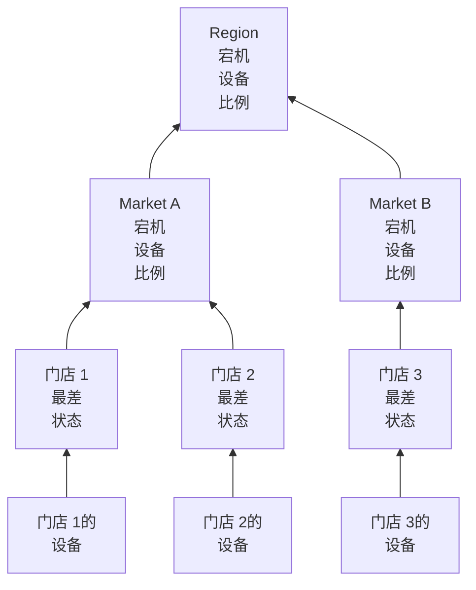

# 网络站点(健康汇总与正常运行时间)

网络站点就是一个地点：一个区域、一个市场、一个加盟商、一个配送中心、一家门店。站点可以相互嵌套，网络设备挂在站点上，OneUptime 会沿树向上汇总设备的健康状况，所以 Region 上的一个状态就能回答“外面有什么出问题了吗？”

你可以在**网络 → 站点**下找到它们，也可以在**网络 → Map** 下的地图上看到它们。本页明确说明站点的状态如何根据其下属内容计算、其正常运行时间意味着什么，以及计划维护如何改变这两者。

:::cards
- [添加站点](#添加站点): 三个步骤，或用 CSV 文件导入整个环境。
- [设置监控默认值](#监控默认值): 为站点中的每台设备提供探测器和凭据。
- [选择健康状况的汇总方式](#父站点健康状况如何计算): 门店看最差状态，区域看比例。
- [解读正常运行时间](#正常运行时间): 百分比统计的是什么，逐日查看。
:::

## 工作原理



每个站点的状态来自其子树中的每台设备，并按站点自己的[汇总策略](#父站点健康状况如何计算)判断。站点的正常运行时间来自它自己的状态时间线，站点上的[维护窗口](#网络站点的计划维护)会把其设备从上级的投票中移除。

## 层级结构

站点构成一棵树。每个站点都有一个 **Site Type** 和一个可选的父站点。站点类型是项目自己的列表，位于**网络 → 设置 → Site Types** 下，新项目一开始从上到下依次有 Account Type、Region、Franchisee、Market 和 Unit，另外还有 Data Center 和 Other。类型自身也构成层级（**Parent Site Type**），它决定哪些站点可以作为某个站点的父站点。标记为 **Is Unit Level** 的类型是你环境中的叶子层级，即单个门店或分支机构：其站点容纳的是设备，而不是其他站点。

站点的类型、名称、描述、父站点和位置在一个地方编辑：站点**设置**页面上的 **Site Settings** 卡片。站点的概览会显示这些信息，并带有**在设置中编辑**链接；**站点**列表用于添加站点，但不用于编辑。

每台设备挂在一个站点上。站点的子树是站点本身加上其下的所有站点，子树中的设备就是其健康状况汇总的来源，所以没有自己设备的 Region 仍然有状态，因为它下面的 Unit 有设备。

> [!NOTE]
> 当设备状态变化、设备移到另一个站点、站点在树中移动时，汇总会重新计算；此外每五分钟一次的巡检会捕捉仅仅因为时间流逝而改变结果的情况。

## 添加站点

:::steps
### 新建站点
前往**网络 → 站点**，点击**添加Site**。

### 说明站点是什么
在 **Site Details** 步骤中，选择 **Site Type**（这是什么样的地点：区域、门店、数据中心），并输入**名称**。描述、街道地址，以及在地图上定位站点的纬度和经度折叠在**更多字段**下：现在填写或以后填写都可以。

### 放到树中
在 **Hierarchy** 步骤中，如果该站点位于另一个站点之下，请选择 **Parent Site**。留空则站点保持在顶层。

### 设置其默认值
在 **Monitoring Defaults** 步骤中，为添加到该站点的设备选择[默认探测器和凭据配置文件](#监控默认值)，然后点击**添加Site**。
:::

在站点自己的 **Child Sites** 页面上，**添加子站点**只询问类型和名称，表单只有一页，位置折叠起来，并会把新站点放在该站点之下。

### 从 CSV 文件导入站点

要一次性导入整个环境，请打开**站点**列表顶部的菜单，点击 **Import from CSV**。文件需要有标题行；列可以按任意顺序排列，列名不区分大小写：

```csv title="sites.csv"
name,siteType,parentName,address,latitude,longitude
North,Region,,,,
Leeds,Market,North,,,
Store 0660,Unit,Leeds,"1 High Street, Leeds",53.7997,-1.5492
```

- `name` 和 `siteType` 是必填的。`siteType` 必须是项目的站点类型之一。
- `parentName` 指定父站点，父站点可以在同一个文件中：没有父站点或父站点已存在的行先导入，然后是它们的子站点。顶层站点请留空。
- 找不到父站点的行会被跳过，并在结果中列出。**Preview Import** 会在写入任何内容之前显示文件将创建什么。

## 地图

**网络 → Map** 在地图上显示你的站点，并自动框定到它们所在的位置；点击站点可以深入查看。下面有站点的站点会显示这些站点，既显示在地图上，也以它们之间链路的图形显示。下面没有站点但有自己设备的站点，或类型为单元级的站点，会打开这些设备的实时拓扑。

还没有站点的项目也有地图：Map 会改为显示其设备的拓扑，把设备分组到站点后，它们就会按位置显示在地图上。

## 监控默认值

站点也是你一次性说明其中设备如何被监控的地方。**Site Settings** 卡片上的**编辑设置**有一个包含两个字段的 **Monitoring Defaults** 步骤：

| 设置 | 效果 |
| --- | --- |
| **Default Probe** | Ping 此站点中的设备、并在设备有凭据时通过 SNMP 遍历它们的探测器。在站点中创建且没有自己探测器的设备会使用它，没有探测器而移入的设备也一样。 |
| **Default SNMP Credential Profile** | 当设备本身及其自己的配置文件都没有凭据时，用于遍历此站点中设备的[凭据配置文件](/docs/monitor/network-device-monitor#snmp-凭据和凭据配置文件)。 |

在站点上设置这两项后，那里的新设备只凭地址就能添加：它从首次轮询起被 Ping，也从首次轮询起被遍历。

两者的行为有意不同：

- 探测器在设备于站点中创建或移入站点时复制到设备上。之后更改站点的默认探测器不会移动已有探测器的设备：哪个探测器能到达某台设备是关于网络的事实，而不是可以从站点表单批量改写的偏好。
- 凭据配置文件在每次轮询时实时读取。在站点上设置一个配置文件，站点中所有没有凭据的设备都会在下次轮询时开始被遍历，无需逐台编辑；清除它，这些设备就会恢复为仅 Ping。

它们沿树向下传递的距离也不同：

- 探测器会贯穿整棵树。落在没有默认探测器的站点中的设备会使用最近祖先的探测器，所以在 Region 上设置的一个探测器会覆盖其下的每个 Market 和 Unit，而指定了自己探测器的 Market 会在其子树中覆盖它。
- 凭据配置文件只从设备自己的站点读取。Unit 中的设备不会继承其 Region 上设置的配置文件，所以请把它设置在设备实际挂接的站点上。

## 父站点健康状况如何计算

每个站点在其**设置**页面的 **Health Rollup** 卡片上（**Rollup Policy**）从两种汇总策略中选择一种。

### 任意设备的最差状态（默认）

子树中任何设备报告的最差状态就是站点的状态。状态有多差取决于它作为监视器状态的优先级：新项目的状态是 Operational（1）、Degraded（2）和 Offline（3），数值越高越差。一台离线设备就会让站点离线，无论旁边有多少健康的设备。

对于 Unit，这是正确的答案。同一栋楼里的四台交换机和一台防火墙并不是相互独立的：其中一台断了，就是该地址出了问题，把它平均掉会掩盖真正的故障。

对于下面有四百家门店的 Region，这通常是错误的答案。12,000 号门店里一台断掉的交换机就会把整个区域标为 Offline：从最狭义上说没错，但在实际中毫无用处，因为只要任何地方的任何门店出了问题，区域就会变红，从而不再告诉你任何信息。

### 宕机设备的比例

站点的状态由子树中正在报告的设备里处于非运行状态的比例决定：

| 宕机设备比例 | 站点状态 |
| --- | --- |
| 0% | Operational |
| 高于 0%，低于阈值 | Degraded：项目中既不是运行状态也不是离线状态的那个状态；项目没有这种状态时为 Offline |
| 达到或高于阈值 | Offline |

阈值按站点设置，即 **Offline Threshold (%)**，默认为 50。

没有设备宕机时，无论阈值设得多低都是 Operational：阈值为 0 的意思是“任何设备宕机都会让它离线”，而不是“健康的区域是离线的”。

### 哪些设备有投票权

两种策略在这一点上一致，而且它比听起来更重要：

- 已归档的设备从不投票。它们已经退役：保留其站点，但被排除在外。
- 从未报告过任何内容的设备从不投票。等待首次轮询的设备不能作为故障的证据，所以它会从比例的分子和分母中都排除，接入进行到一半的区域会按已经响应的那一半打分。
- 由探测器轮询的设备（最常见的类型）按其上一次轮询的结果投票：是否能通过 Ping 或 SNMP 到达，而不是距离上次成功有多久。在 SNMP 遍历失败时仍响应 Ping 的设备是可达的，并按此投票；站点显示它在线，设备所在行显示 **SNMP failing**，以便有人去修复凭据。
- 由监视器支持的设备，即在其设置页面上切换为绑定监视器覆盖的设备，按绑定到它的监视器的状态投票，因为没有东西轮询它。没有绑定任何监视器时它从未报告过，因此完全不投票。

由探测器轮询的设备上的 Network Device 监视器不会改变设备的投票方式。一个带有“接口宕机即 Offline”条件的监视器会给响应每次 Ping 的交换机打上 Offline，一个熄灭的端口就会让整个站点变红，而它下面的每一行设备都显示 Up：站点会与它所汇总的列表不一致。对于被轮询的设备，轮询才是其健康状况的来源；监视器的作用是创建事件。

### 选择策略

对于加盟连锁环境，一个合理的起点：

| 层级 | 策略 | 原因 |
| --- | --- | --- |
| Unit 或门店 | 最差状态 | 一台设备宕机，就是一个站点出了问题。 |
| Market | 比例，阈值约 50% | 一半门店宕机的市场就是宕机了。 |
| Region | 比例，阈值 25% 到 50% | 单个门店的故障让区域变为 Degraded 而不是 Offline，发生系统性问题时才变为 Offline。 |

策略按站点设置，所以你可以给 Region 这些行使用比例策略，而让其下的一切保持默认。

## 正常运行时间

每个站点都有一条状态时间线：其汇总状态每变化一次就有一行，在状态变化时打开，在再次变化时关闭。正常运行时间据此计算：

- 处于未标记为运行状态的时间都算作停机时间。
- 重叠的行会被合并，所以没有哪一秒会被计算两次。
- 没有被任何行覆盖的时间算作正常运行。时间线只有在汇总运行之后才会有行，没有证据并不等于故障。
- 仍然打开的行会一直延续到所测量窗口的末尾。

Degraded 不是运行状态，所以也算作宕机。因此在任一策略下，站点的正常运行时间都是其下没有任何正在报告的设备宕机的时间所占的比例：策略改变的是局部故障显示的状态（Degraded 或 Offline），而不是它是否被计入。

完全没有时间线行的站点会显示 `—` 而不是 100%：从未汇总过的站点是未被监控的，而不是完美的。

### 每日正常运行时间

除了 30 天的数字，每个站点的概览都会显示 **Uptime (24h)**，其**状态时间线**页面显示过去 24 小时、7 天、30 天和 90 天，以及过去 30 天每天一根柱形。

30 天平均值无法显示糟糕的一天。在 30 天的窗口中，一整天的故障只会扣掉 3.3 个百分点，所以整个星期二都断开的站点在这个月仍会报告 96.7%，这个数字读起来就像四舍五入。每日柱形把同样的数据放在一个糟糕的日子就是一根糟糕柱形的地方。

这里的“天”是截至此刻的滚动 24 小时区间，而不是日历日：设备、查看者和服务器可能各自处在不同的时区，不存在它们都认同的同一个“天”。

### 父站点的正常运行时间不是子站点正常运行时间的平均值

父站点的正常运行时间来自父站点自己的时间线，该时间线由其汇总策略产生，而不是来自其子站点百分比的平均值。

对子站点取平均，会把只有两台设备的门店与有两百台设备的配送中心同等看待。而父站点自己的时间线给出的是可以用一句话表述的读数：区域中完全没有任何东西宕机的时间所占的比例。它有意设计得很严格，所以对于大区域，请结合每日柱形和状态一起解读，状态会说明局部故障是 Degraded 还是 Offline。

## 网络站点的计划维护

像添加主机一样，在计划维护事件的**受影响的资源**步骤中，把站点添加到**其他受影响的资源**下。站点自己的**计划维护**页面会列出关联到它的事件，其中的**创建计划维护事件**会打开已选好该站点的表单。

父站点上的窗口会覆盖其下的一切：Region 上的窗口会覆盖其中的每个 Market 和 Unit，包括在安排窗口之后才创建的站点，所以区域性的运营商割接不必列出四百家门店。

覆盖范围只向下传递。一个 Unit 上的窗口不会让其 Region 进入维护：该区域仍应在线，同一时段内另一个 Unit 发生的真实故障仍会计入该区域。

### 维护窗口会改变什么

| 在窗口期间 | 会发生什么 |
| --- | --- |
| 站点的实时状态 | 不变。因计划工作而关闭的 Unit 在地图和树中仍显示为 Offline，旁边带有“In maintenance”徽章：查看它的人需要知道它是关闭的。 |
| 站点的正常运行时间 | 窗口会同时从停机时间和测量周期中扣除。两小时的维护让这一天变成 22 小时，这两小时内发生的任何事都不计入任何一方。 |
| 其祖先的健康汇总 | 被维护子树中的设备停止投票，所以区域不会因为日历上已安排的割接而变红。 |
| 其祖先的正常运行时间 | 不受影响，也没有需要更正的内容，因为计划内的中断从未进入它们的时间线。 |

最后一行说明了为什么对祖先是通过暂停投票来处理，而不是把窗口从其正常运行时间中扣除：从区域的测量周期中扣除窗口，也会抹掉同一时段内区域其他地方发生的真实故障。

正常运行时间按事件声明的开始和结束时间来更正，而不是按工作进程在状态之间移动它的时间，所以这个数字可以对照日历手动核对。完全落在窗口内的一天会在每日柱形中显示为维护，而不是完美的一天，并且不计入平均值。

### 与监视器的交互

把监视器关联到同一个事件仍会照常起作用：该监视器的主动监控会在窗口期间暂停。两者相互独立：关联站点是为了把它排除在汇总和其正常运行时间之外，关联监视器是为了让它们停止发出警报。

## 站点警报

站点**设置**页面上的 **Alerting** 卡片有 **Alert When Unhealthy**：当站点的汇总进入非运行状态时会打开一个警报，并在站点恢复时自动解决。**警报严重性**设置其严重程度；留空时使用项目中最严重的级别。

它只对变化发出警报：对一个已经不健康的站点开启它，会为下一次变化做好准备，而不会对过去发出警报。Degraded 不是运行状态，所以使用比例策略的站点会在其正在报告的设备中有一台宕机时立即发出警报，与使用最差状态策略的站点一样；当站点在 Degraded 和 Offline 之间切换时，警报保持打开，不会产生第二个警报，其标题写的是站点最先达到的状态。

## 故障排查

:::details 区域总是红色
该站点使用的是最差状态策略，所以其下任何地方的一台离线设备都会让它离线。在区域的 **Health Rollup** 卡片上把它切换为 **Percentage of devices down**，并设置一个阈值，与你认为区域要宕机多大比例才算宕机相符。
:::

:::details 站点显示 — 而不是正常运行时间
该站点从未运行过汇总，所以没有时间线行：它是未被监控的，而不是完美的。向该站点或其下的站点添加设备，下一次汇总就会开始其时间线。
:::

:::details 设备没有计入其站点
已归档的设备和尚未报告的设备从不投票。没有绑定监视器的、由监视器支持的设备也从未报告过。检查设备的状态：**待处理**的设备会在首次轮询后开始投票。
:::

:::details 站点的警报没有触发
**Alert When Unhealthy** 在从运行状态变为任何其他状态时触发，所以你开启它时已经不健康的站点，会在恢复之后的下一次变化时发出警报。还要检查其设备是否投票：已归档的设备和等待首次轮询的设备从不投票，处于维护中的站点的设备不会在其上级的汇总中投票。
:::

## 后续步骤

:::cards
- [网络设备监控](/docs/monitor/network-device-monitor): 添加挂在这些站点上的设备，轮询它们并为其设置警报。
- [网络流量](/docs/monitor/network-traffic): 从设备的流记录查看站点的流量。
- [资产清单](/docs/inventory/overview): 网络设备与你拥有的所有其他资产并列。
:::
