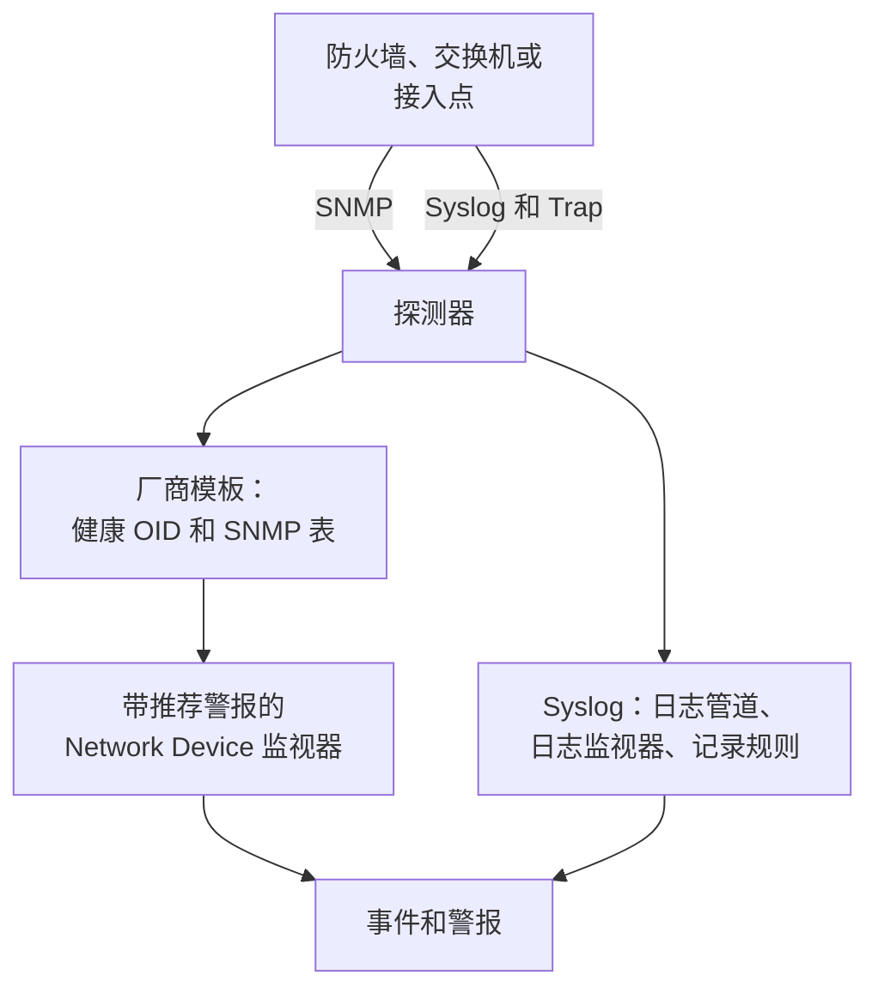

# 网络设备厂商指南(Sophos、Extreme、Cambium)

如何用 OneUptime 端到端地监控三种常见环境：带 IPsec 隧道、WAN 链路和 SD-WAN 的 Sophos Firewall（XGS、SFOS）；带 Fabric 的 Extreme Networks 交换机（EXOS / Switch Engine 和 Fabric Engine / VOSS）；以及 Cambium Networks cnMatrix 交换机和 Enterprise Wi-Fi 接入点，细到每个射频的信道和发射功率。这些指南也涵盖 SAN 交换机（Brocade Fabric OS 和 Cisco MDS 9000），细到每个 Fibre Channel 端口的错误。

:::cards
- [Sophos Firewall](#sophos-firewall-xgs-sfos): 隧道、WAN 链路、网关和 SD-WAN。
- [Extreme Networks](#extreme-networks-exos-switch-engine-和-fabric-engine-voss): 交换机、Fabric 及其硬件。
- [Cambium Networks](#cambium-networks-enterprise-wi-fi-和-cnmatrix): 细到每个射频的接入点，以及 cnMatrix 交换机。
- [Brocade Fabric OS](#brocade-fabric-os): Fibre Channel 端口、光模块、传感器和 Fabric 事件。
- [Cisco MDS 9000](#cisco-mds-9000): Fibre Channel 接口、VSAN、慢速排空和端口监控告警。
:::

## 工作原理

每份指南都使用相同的组成部分：



- 每台设备一个[网络设备](/docs/monitor/network-device-monitor)，由能到达它的探测器轮询，并带有一个厂商模板，提供合适的健康 OID 和 [SNMP 表](/docs/monitor/network-device-monitor#snmp-表)。
- 每台设备一个用于警报的 网络设备 监视器。从设备页面创建它，[推荐警报](/docs/monitor/network-device-monitor#推荐警报包)就会自动填好，其中包括为每个知道何为健康的表设置的按行警报。对于设备群，[警报策略](/docs/monitor/network-device-monitor#警报策略)会在每台设备上维持一个监视器。
- 对于厂商只在日志中报告的内容：发送到探测器的 syslog（OneUptime 会自行把它读取为[网络事件](/docs/monitor/network-events)）、按隧道或网关各发一次警报的[带 Group By 的日志监视器](/docs/monitor/logs-monitor#按分组警报group-by)，以及把这些日志中的数字绘制成图表的[日志记录规则](/docs/telemetry/log-recording-rules)。

## Sophos Firewall (XGS / SFOS)

| 你想看到的 | 来自哪里 |
| --- | --- |
| 防火墙健康状况：内存、磁盘、交换空间、HA 状态、IPsec 服务、每个核心的 CPU | SNMP，使用 **Sophos Firewall (SFOS / XGS)** 厂商模板 |
| 每条 IPsec 隧道的状态，按名称 | SNMP 表 `ipsec_tunnels`（SFOS v20 及更高版本） |
| 每条 WAN 链路的状态、吞吐量、利用率和错误 | WAN 端口的接口遍历 |
| 每条 WAN 链路的延迟、丢包率和抖动 | 来自 OneUptime 探测器的 Ping 监视器和设备轮询 |
| 网关上线和下线、SD-WAN SLA 是否达标、SD-WAN 路由变化 | 防火墙的 syslog |
| 每个网关的 SD-WAN 延迟、抖动和丢包率图表 | 基于 SD-WAN SLA 日志的日志记录规则 |

无论哪个 SFOS 版本，Sophos 都不通过 SNMP 报告网关或 SD-WAN 的健康状况：这些信息只存在于防火墙的日志和 Sophos Central 的警报中，所以最后三行要通过 syslog 实现。

### 注册防火墙

:::steps
1. 在防火墙上，在 **Administration → SNMP** 下开启 SNMP：添加一个 SNMPv3 用户或 v2c 团体字符串，并允许探测器的地址查询它。
2. 在 OneUptime 中，前往**网络 → 设备**，点击 **添加设备**。输入防火墙的管理地址，选择一个能到达它的探测器，并在 **SNMP** 下添加 SNMP 凭据。
3. 在设备的**设置**页面上，在 **Polling & Data Collection** 下，从 **Vendor Health Template** 应用 **Sophos Firewall (SFOS / XGS)** 模板，并从 **Add a Vendor's Tables** 添加其表。或者开启 **Auto-Apply Vendor Health Template**，首次轮询会同时完成这两项。
:::

下一次轮询后，设备的 **SNMP 表** 页面会列出每个 IPsec 连接及其状态（active、inactive、partially active），以及各个 CPU 核心。SFOS 从 196608 开始为其核心编号，这就是 CPU 来自表而不是单个 `hrProcessorLoad.1` 的原因。

### 对每条 IPsec 隧道发出警报

在设备页面上点击**创建监视器**。推荐警报包括 **IPsec Tunnels: row unhealthy**，即在 `ipsec_tunnels` 表上 Row 为 `*` 的 **SNMP 表行是否不健康** 条件：它为每条非 active 的隧道打开一个以隧道命名的事件，并在隧道恢复时逐个解决。

Sophos 报告为 active 的隧道只说明其安全关联已建立。要证明有流量通过，请从一个站点的探测器向每条隧道对端的主机添加 [Ping 监视器](/docs/monitor/ping-monitor)，并在**网络 → 拓扑 → 站点链路** 下把隧道绘制为两个[站点](/docs/monitor/network-sites)之间的站点链路，绑定到该监视器：地图上的链路随后会显示该监视器的颜色。

### WAN 链路

- **端口健康状况。** 接口遍历已经测量了每个 WAN 端口的状态、入站和出站比特、利用率和错误。在防火墙的监视器上，将**接口**设为 WAN 端口名称（或设为 `*` 表示每个端口）的 **SNMP 接口是否宕机** 或 **SNMP 接口利用率（%）** 条件会按链路发出警报。
- **路径质量。** 每条链路的延迟、丢包率和抖动从防火墙外部测量：从 OneUptime 云探测器到每条 WAN 链路公网地址的 Ping 监视器，以及从站点的探测器到每个 ISP 网关的 Ping 监视器。这些监视器上的丢包率和抖动条件会按链路发出警报，**网络 → 拓扑 → 延迟矩阵** 则可以一眼看到每个探测器与每个监视器的对比。
- **流量。** SFOS 导出 NetFlow v5。把它发送到探测器的 UDP 2055（探测器的流收集器默认在此监听），设备的 **流量** 页面就会显示每条 WAN 链路上谁在和谁通信；详情见[网络流量](/docs/monitor/network-traffic)。

### 从 syslog 获取网关和 SD-WAN 信息

:::steps
1. 探测器的 syslog 接收器默认开启。它在端口 5140 上通过 UDP 和 TCP 监听（可用 `PROBE_SYSLOG_RECEIVER_PORT` 更改）；如果探测器运行在 Docker 中，请发布该端口。消息会匹配到主机名或某个**其他地址**是发送方地址的网络设备，并显示在设备的**事件**和**日志**页面上。
2. 在防火墙上，在 **System services → Log settings** 下添加指向探测器和该端口的 syslog 服务器，并勾选 IPsec 和网关的 **Event** 日志类型以及 **SD-WAN** 日志类型：在勾选之前，SLA 日志一直处于关闭状态。
3. 无需解析。OneUptime 会把防火墙的 `key=value` 字段读取为 `sophos.*` 属性，并从中读出隧道、网关、SD-WAN SLA 变化、故障切换和登录，作为[网络事件](/docs/monitor/network-events)。在设备的**日志**页面上打开一条日志，即可看到你的 SFOS 版本生成的确切属性名称。
4. 在设备的**事件**页面上点击**创建警报**并选择一个警报。它会打开一个已填好的[日志监视器](/docs/monitor/logs-monitor)，其中设置了 **按属性分组**，让每条隧道或每个网关单独发出警报，并设置了**按属性解决**，让每个警报在防火墙报告恢复时关闭。下表中的三行是可以先建立的监视器。
5. 绘制 SD-WAN 质量图表：开启 SD-WAN 日志后，防火墙会按配置文件和网关写入 SLA 摘要（`latency`、`jitter`、`packet_loss`）。在**日志 → 设置 → 记录规则**下，为每个数字创建一条规则，例如按 `sophos.gw_name` 和 `sophos.profile_name` 分组的 `sophos.latency` 平均值，然后绘制结果图表，或用按网关分组的 [Metrics 监视器](/docs/monitor/metrics-monitor)对其发出警报。[日志记录规则](/docs/telemetry/log-recording-rules)逐步讲解了这个示例。
:::

| 警报 | 统计的事件 | 每个警报对应 | 由什么关闭 |
| --- | --- | --- | --- |
| VPN 隧道中断 | `vpn.tunnel_down` | `vpn.tunnel.name` | `vpn.tunnel_up` |
| WAN 链路中断 | `gateway.down` | `network.gateway.name` | `gateway.up` |
| SD-WAN 链路低于其 SLA | `sdwan.sla_not_met` | `network.gateway.name` | `sdwan.sla_met` |

前两个在**创建警报**列表中；第三个需要打开它的某个事件，然后点击**为此事件创建警报**。syslog 事件补充了 SNMP 表：它们在隧道断开的那一刻到达，而表还能发现从未建立起来的隧道。

### Trap

每条 Sophos 通知都是同一个 Trap `sfosNotification`（`1.3.6.1.4.1.2604.5.1.8.1.1`），事件以文本形式放在 `sfosTrapMessage`（`1.3.6.1.4.1.2604.5.1.8.1.2`）中。要对某一类事件发出警报，请把 **收到的 SNMP Trap（Trap OID）** 等于 `1.3.6.1.4.1.2604.5.1.8.1.1` 与针对该 varbind 的 **SNMP Trap Varbind 值** 组合起来，例如包含 `IPSec`。把防火墙的 Trap 目标设为 SNMP v2c：探测器的 Trap 接收器接收 v1 和 v2c Trap。

## Extreme Networks (EXOS / Switch Engine 和 Fabric Engine / VOSS)

| 你想看到的 | 来自哪里 |
| --- | --- |
| EXOS：CPU、温度及其告警、电源状态、电源、风扇、每个插槽的内存、堆叠成员 | **Extreme Networks EXOS / Switch Engine** 模板 |
| Fabric Engine：每个插槽的 CPU 和内存、温度传感器、风扇、电源、vIST 会话、I-SID 数量 | **Extreme Networks Fabric Engine / VOSS** 模板 |
| 每个 Fabric Connect（IS-IS）邻接，按其邻居命名 | Fabric Engine 模板的表 `isis_adjacencies` |
| 端口、LLDP 邻居、网络地图 | 两者都来自接口遍历 |

### 选择哪个模板

运行在 Extreme 通用硬件（5000 和 7000 系列）上的 Fabric Engine 报告的企业号与 EXOS 相同：只有其系统描述（`7520-48Y-8C-FabricEngine (9.0.4.0)`）能说明正在运行哪个操作系统。OneUptime 会同时读取两者，所以自动应用和设备页面的建议都会选出正确的模板；较旧的 VSP 交换机报告的是 Avaya/Nortel 的弧，会直接被识别为 Fabric Engine。

### Fabric 和硬件警报

Fabric Engine 交换机上的推荐警报包括 **Fabric Adjacencies (IS-IS): row unhealthy**，为邻接未建立的每个邻居打开一个事件。Fabric Engine 还会在邻接变化时发送一个 Trap，即 `rcnIsisPlsbAdjStateTrap`（`1.3.6.1.4.1.2272.1.21.0.281`），针对它的 **收到的 SNMP Trap（Trap OID）** 条件能在几秒内、赶在下一次轮询之前发出警报。

电源、风扇、温度传感器和堆叠成员都是声明了健康值的表，所以它们在推荐警报中各有一个按行警报。

### 流和 Wi-Fi

EXOS 和 Fabric Engine 以 sFlow 和 IPFIX 导出流。把 sFlow 发送到探测器的 UDP 6343，或把 IPFIX 发送到 UDP 4739，设备的 **流量** 页面就会显示其流量；参见[网络流量](/docs/monitor/network-traffic)。

IQ Engine（HiveOS）接入点和 ExtremeCloud IQ Controller 有各自的厂商模板，会填充设备的 **Wi-Fi** 页面。[支持的 Wi-Fi 厂商](/docs/monitor/network-device-monitor#支持的-wi-fi-厂商)介绍了它们，以及 Ubiquiti UniFi、HPE Aruba、TP-Link Omada 和 Juniper Mist。

## Cambium Networks (Enterprise Wi-Fi 和 cnMatrix)

### 接入点

:::steps
1. 在接入点上开启 SNMP。在 cnMaestro 中，SNMP 按 AP 组设置：**Configuration → Wi-Fi Profiles → AP Groups → Management → SNMP**。使用 v2c 只读团体字符串或 SNMPv3 用户开启它。
2. 用管理地址和这些凭据添加每个接入点，并应用 **Cambium Networks Enterprise Wi-Fi (cnPilot, XV, XE, XH)** 模板，或开启自动应用。
3. 打开设备的 **Wi-Fi** 页面。它显示有多少射频开启、客户端和 SSID，然后是每个射频的频段、信道、频率、信道带宽、发射功率、客户端、底噪和空口时间，以及每个 SSID 及其客户端。频率根据频段和信道计算得出；接入点本身不报告它。
:::

有用的警报，全部设置在 `wifi_radios` 表上，Row 为 `*`，让每个射频单独发出警报：

| 警报 | 条件 |
| --- | --- |
| 射频被关闭 | **SNMP 表行是否不健康**，属于推荐警报 |
| 发射功率发生变化 | **SNMP 表值**，列 TX Power，不等于你规划的功率 |
| 拥挤的射频 | **SNMP 表值**，列 Clients，大于你的上限 |
| 嘈杂的信道 | **SNMP 表值**，列 Noise Floor，大于 `-80` |

每个数值型射频值也是一个指标（`oneuptime.monitor.snmp.table.value`，每个射频和每列一个序列），所以信道、功率和客户端可以在仪表板上随时间绘制图表；不断变化的信道说明 DFS 在起作用。

Cambium 仅从固件 6.5.3 起报告客户端总数；更早的固件返回 0。

### cnMatrix 交换机

**Cambium Networks cnMatrix** 模板收集 CPU、RAM、闪存、温度和供电电压，并以表的形式收集风扇、冗余电源和每个端口的 PoE 功耗。端口和 LLDP 邻居与任何交换机一样来自接口遍历。

### cnMaestro 告警

cnMaestro 可以把它的告警（例如接入点离线）发送到 HTTPS Webhook。把它指向一个 [Incoming Request 监视器](/docs/monitor/incoming-request-monitor)，即可把这些告警变成与 SNMP 数据并列的 OneUptime 事件。

## Brocade Fabric OS

| 你想看到的 | 来自哪里 |
| --- | --- |
| 交换机状态、固件、CPU 和内存 | SNMP，使用厂商模板 **Brocade Fabric OS (SAN switches)** |
| 交换机的状态、传感器和可更换部件（FRU），逐行显示 | 模板的表 `switch_status`、`sensors` 和 `frus` |
| 每个 Fibre Channel 端口的类型、停机端口停机的原因，以及每秒的错误、丢弃的帧和信用等待 | SW-MIB 和 FCMGMT-MIB，在设备的 **接口** 页面 |
| 每个光模块的接收和发送功率、温度、电压和偏置电流 | FA-EXT-MIB，在 **收发器** 卡片上 |
| 交换机间链路断开、Fabric 分裂或重新配置、分区变更、MAPS 警报、FRU 变更 | SNMPv3 trap |

每台运行 Fabric OS 的交换机和导向器都报告 `1.3.6.1.4.1.1588.2.1.1` 下的系统对象 ID，因此模板适用于所有这些设备，而不适用于 Brocade 的其他产品：VDX 和 SLX 交换机保留原有模板。

### 在 Fabric OS 上设置 SNMP

:::steps
1. 添加一个带认证和加密（SHA 和 AES）的 SNMPv3 用户：`snmpconfig --set snmpv3` 会询问用户、协议和口令。
2. 用 `snmpconfig --set mibCapability` 开启 FA-MIB。它包含每个端口的 64 位错误计数器及其光模块；没有它，端口只以 32 位计数器报告 CRC 错误、编码错误、丢弃的 3 类帧和信用等待。
3. 在 OneUptime 中，用交换机的管理地址和该用户添加交换机。开启 **Auto-Apply Vendor Health Template** 时，第一次轮询会应用模板 **Brocade Fabric OS (SAN switches)**；否则在设备的 **设置** 页面的 **Vendor Health Template** 中应用它。
:::

之后，设备的 **接口** 页面会为每个 Fibre Channel 端口标出类型（例如 E-Port 或 F-Port），并像 `switchshow` 那样说明停机端口停机的原因：No light、No module、Disabled。它的 **Fibre Channel 端口** 卡片按秒绘制每个端口的错误、丢弃的帧和信用计数器。

端口的 CRC 错误、无效传输字、链路故障以及同步和信号丢失就是它的错误：**SNMP 接口错误（每秒）** 据此报警，推荐的警报包含 **Fibre Channel port errors**，在十秒超过一个错误时触发。丢弃的帧和信用等待不是错误；要按其中之一报警，请使用 **SNMP Fibre Channel 计数器（每秒）**。

### Virtual Fabrics

启用 Virtual Fabrics 的机箱在各自的 SNMPv3 上下文中应答每个逻辑交换机：`VF:` 加上逻辑交换机的 Fabric ID。为每个逻辑交换机添加一台设备，都使用机箱的管理地址，并为每台设置 **SNMP v3 上下文**（`VF:128`、`VF:20`）；没有上下文的设备读取默认逻辑交换机。

### Brocade trap

Fabric OS 通过 SNMPv3 发送 trap。用 `snmpconfig --set snmpv3` 把探测器添加为 OneUptime 轮询所用用户的 trap 接收方，UDP 端口 162：探测器接收它所轮询设备的用户发来的 SNMPv3 trap（参见 [SNMPv3 trap 和 inform](/docs/monitor/network-device-monitor#snmpv3-trap-和-inform)），每个逻辑交换机的 trap 都带有它的上下文，因此只在它的设备上触发。Fabric OS 升级可能会重新关闭个别 trap：升级后用 `snmpconfig --show mibCapability` 检查，并用 `snmpconfig --enable mibCapability -mib_name SW-MIB -trap_name swFCPortScn` 重新开启。

Brocade 交换机的推荐警报为每个重要的 Fabric 事件各包含一项：**Inter-switch link down**（E-Port 离线）、**Fabric segmented**、**Fabric reconfigured**、**Zone configuration changed**、**MAPS alert** 和 **Field-replaceable unit changed**。

## Cisco MDS 9000

| 你想看到的 | 来自哪里 |
| --- | --- |
| CPU 和内存 | SNMP，使用厂商模板 **Cisco MDS 9000 (SAN switches)** |
| 电源、模块和风扇托盘，逐行显示 | 模板的表 `power_supplies`、`modules` 和 `fan_trays` |
| 每个 VSAN 及其状态 | 模板的表 `vsans` |
| 每个 fc 接口的类型、停机接口停机的原因，以及每秒的错误、丢弃的帧、信用丢失和信用等待 | CISCO-FC-FE-MIB，在设备的 **接口** 页面 |
| 每个光模块的读数和告警阈值 | CISCO-ENTITY-SENSOR-MIB，在 **收发器** 卡片上 |
| 端口监控告警、链路断开、分区、VSAN、Fabric 和 FRU 变更 | Trap |

MDS 与所有其他 Cisco 设备共用 Cisco 的企业编号，因此 OneUptime 通过型号或以 `Cisco NX-OS(tm) m9` 开头的系统描述识别它：IOS、IOS-XE 和 Nexus 交换机保留原有的 Cisco 模板。

### 在 NX-OS 上设置 SNMP

:::steps
1. 添加一个只读 SNMPv3 用户：`snmp-server user oneuptime network-operator auth sha <auth-passphrase> priv aes-128 <priv-passphrase>`。`network-operator` 角色只读，不能更改任何内容。
2. 以该用户向探测器发送 trap：`snmp-server host <probe-address> traps version 3 priv oneuptime`。
3. 开启默认关闭的 trap：`snmp-server enable traps zone`、`snmp-server enable traps vsan`、`snmp-server enable traps fcdomain`、`snmp-server enable traps fspf`，以及用于光模块的 `snmp-server enable traps link cisco-xcvr-mon-status-chg`。
4. 在 OneUptime 中，用交换机的管理地址和该用户添加交换机：模板 **Cisco MDS 9000 (SAN switches)** 以同样的方式应用。
:::

MDS 的推荐警报包含 **Credit loss (slow drain)** 和 **Timeout discards (slow drain)**，每个接口一次：不再返还缓冲区信用的主机或存储阵列会拖慢其后的每条流，而这些计数器最先显示出来。

### 端口监控告警

MDS 的端口监控策略在端口计数器越过阈值时触发 RMON 警报。推荐的警报包含 **Port monitor alarm**，其警报会写明计数器和接口，例如 "Port monitor: Credit loss rising on fc1/5"。一个监视慢速排空的策略：

```text
port-monitor name slow-drain
  logical-type edge
  counter credit-loss-reco poll-interval 1 delta rising-threshold 1 event 4 falling-threshold 0 event 4
  counter timeout-discards poll-interval 60 delta rising-threshold 200 event 4 falling-threshold 10 event 4
port-monitor activate slow-drain
```

## 故障排查

:::details IPsec Tunnels 表没有状态
隧道状态需要 SFOS v20 或更高版本。还要检查你凭据的 SNMP 视图是否包含 Sophos 企业树（`1.3.6.1.4.1.2604`）：受限的 v3 用户通常只能看到系统组和 IF-MIB。
:::

:::details 收不到防火墙的 syslog
除非探测器是以 `PROBE_SYSLOG_RECEIVER_ENABLED=false` 启动的，否则它会在端口 5140 上通过 UDP 和 TCP 监听 syslog：如果探测器运行在 Docker 中，请发布该端口或你的 `PROBE_SYSLOG_RECEIVER_PORT`。消息按发送方的地址匹配到设备，所以防火墙在 OneUptime 中的主机名或其某个**其他地址**必须是它发送 syslog 时使用的地址；在此之前，这些消息会以**尚未成为设备**列在网络的**事件**页面上。
:::

:::details Fabric Engine 交换机被应用了 EXOS 模板
模板是根据交换机的系统描述选择的。检查设备的概览是否显示了提到 Fabric Engine 的描述（例如 `7520-48Y-8C-FabricEngine (9.0.4.0)`）；如果是，请删除 EXOS 的 OID 和表，并从 **Vendor Health Template** 应用 **Extreme Networks Fabric Engine / VOSS**。
:::

:::details Cambium 接入点报告 0 个客户端
客户端总数需要固件 6.5.3 或更高版本。在更早的固件上，射频仍会报告其信道、功率和底噪。
:::

## 后续步骤

:::cards
- [网络设备监控](/docs/monitor/network-device-monitor): 设备收集的一切，以及它可以发出警报的每个条件。
- [网络事件](/docs/monitor/network-events): 各厂商 syslog 的内容，以事件和警报的形式呈现。
- [日志管道](/docs/telemetry/log-pipelines): 把防火墙日志解析为属性。
- [日志监控](/docs/monitor/logs-monitor): 按隧道或网关各发一次警报。
:::
