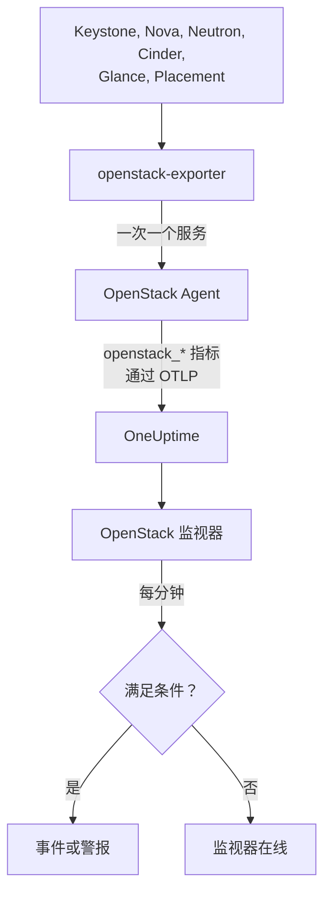

# OpenStack 监控

OpenStack 监视器负责监视一套云：它的 API、API 背后的工作进程、虚拟机监控程序（hypervisor）、实例、网络、存储池和项目配额，并在 API 不再响应、某个工作进程宕机、某台 hypervisor 没有余量可分配或某个存储池被占满时通知你。它读取 OneUptime OpenStack Agent 从 openstack-exporter 收集、或由探测器从云的 API 收集的 `openstack_*` 系列指标。

:::cards
- [创建监视器](#创建-openstack-监视器): 在 Dashboard 中分六步完成。
- [模板](#预置警报模板): 现成的警报，每个工作进程、实例、网络或区域各对应一个事件。
- [从外部检查](#从外部检查): 通过云外部的探测点，检查是否真的有人能启动实例。
- [身份属性](#身份属性): 如何锁定某个区域、主机或项目。
- [指标](#收集的指标): 监视器可以据以告警的所有指标系列。
:::

## 工作原理

Agent 由 OpenTelemetry Collector 和 openstack-exporter 组成，你需要把它们运行在能够访问云 API 的机器上。它按各个 OpenStack 服务分别收集数据，因此 Nova 出现故障只会丢失 Nova 的指标系列；它的读取也很温和：计算、网络、卷和 placement 每 2 分钟一次，身份和镜像每 5 分钟一次。

每个指标系列都带有云的名称 `openstack.cloud.name`，每个数据点都带有 `openstack.region.name` 和 `openstack_service`。一套云对应一个 Keystone，一个 OpenStack 监视器只对应一套云。它每分钟对该云的指标运行一次查询，并将结果与自己的条件进行比较。



## 开始之前

- **用 OpenStack Agent 收集云的指标。** 或[探测器](/docs/telemetry/openstack-agentless)。**文档**位于 **产品 → 基础设施 → OpenStack** 下，其中有安装代理的完整步骤。
- **确认云已注册。** 首次收集之后，它会出现在 **产品 → 基础设施 → OpenStack** 下，名称取自 Agent 的 `OPENSTACK_CLOUD_NAME`。

## 创建 OpenStack 监视器

:::steps
### 新建监视器

进入**监视器**，点击**创建监视器**。

### 选择 OpenStack

在**监视器类型**下点击**更多监视器类型**，在**基础设施**下选择 **OpenStack**，也可以在搜索框中输入 `openstack`。输入**名称**（它会用在事件和警报的标题中），然后点击**下一步**。

### 选择云

在 **OpenStack Monitor Configuration** 下，从 **OpenStack 云**中选择云。所有已发送过数据的云都在列表中。选定之后，字段下方会有一行文字说明数据是否正在到达。

### 选择要监视的内容

新监视器默认使用**告警内容**下的 **Cloud Stopped Reporting**。若要监视其他内容：

- **更改**：选择另一个[模板](#预置警报模板)。它会设置指标、属性过滤器、聚合、时间范围、分组依据和阈值，并用自己的条件替换下方的条件。你仍然可以修改**时间范围**。
- **Custom Metric**（在**更多字段**下）：从 **OpenStack 指标**中选择一个指标，然后设置**聚合**和**时间范围**，并用[过滤器](#监视器设置)缩小范围。
- **高级**（在**更多字段**下）：在**选择指标**下自行构建查询和公式，可按 `status`、`adminState` 或 `resourcetype` 等属性过滤。按[身份属性](#身份属性)**分组依据**，可以分别判断每个部分。

### 检查条件

展开**标准**下的每一项条件，检查其**指标**、**聚合**、**条件**和**阈值**。模板会自动填好这些内容。使用 **Custom Metric** 或**高级**时，监视器从默认条件开始，而默认条件只会发现指标不再发送数据，因此请设置你自己的阈值。

### 创建监视器

点击**创建监视器**。OneUptime 会打开该监视器的页面，并每分钟对其求值一次。它产生的事件和警报也会列在云的**事件**和**警报**页面中。
:::

> [!TIP]
> 若要一次设置多个模板，请从 **产品 → 基础设施 → OpenStack** 打开云，进入**建议**。选择你想要的模板，指定通知谁，OneUptime 会为每个模板创建一个监视器。

## 监视器设置

| 字段 | 选项卡 | 作用 |
| --- | --- | --- |
| **OpenStack 云** | 全部 | 必填。将每个查询限定到 `resource.openstack.cloud.name`。 |
| **区域** | Custom Metric、高级 | 可选。指定一个区域：`openstack.region.name`。每个指标系列都带有它。 |
| **可用区** | Custom Metric、高级 | 可选。指定一个可用区：hypervisor、实例、卷和 Neutron agent 上用 `availability_zone`，Nova 和 Cinder 的工作进程上用 `zone`。 |
| **Hypervisor** | Custom Metric、高级 | 可选。指定一台主机：工作进程、hypervisor 和 Placement 上用 `hostname`，实例上用 `hypervisor_hostname`。Nova 的工作进程使用主机的短名称，而 hypervisor、Placement 和实例使用其完整名称，因此请使用指标系列中出现的那一种。 |
| **服务** | Custom Metric、高级 | 可选。指定一个工作进程的二进制文件，例如 `nova-compute`：`service`。 |
| **项目 ID** | Custom Metric、高级 | 可选。指定一个项目：Nova 和 Cinder 的指标系列以及网络和子网上用 `tenant_id`，浮动 IP、路由器和地址可用性上用 `project_id`。 |
| **OpenStack 指标** | Custom Metric | 从[目录](#收集的指标)中选择一个指标。 |
| **聚合** | Custom Metric | 样本的合并方式：**平均值**、**最大值**、**最小值**、**总和**或**计数**。默认使用该指标通常的聚合方式。 |
| **时间范围** | 全部 | 查询读取的滚动窗口，从**Past 1 Minute**到**Past 365 Days**。新监视器默认为**过去 15 分钟**；模板会设置自己的值。 |
| **选择指标** | 高级 | 查询构建器：**指标**、**Aggregate by**、**Filter by attributes**、**分组依据**，以及用于组合查询的**添加指标**和**添加公式**。 |

过滤器只会缩小带有对应标签的指标系列：`openstack_nova_up` 没有项目，因此项目过滤器对它不起作用。

请把窗口设置为所读内容至少三次收集的长度：计算、网络、卷和 placement 为 6 分钟，身份和镜像为 15 分钟。更短的窗口容纳不了足够多次收集，**所有值** 就无法表示一段持续时间。

## 身份属性

每个指标系列都带有 `openstack.cloud.name` 作为**资源属性**，并带有 `openstack.region.name` 和 `openstack_service` 作为数据点属性。其余部分由 exporter 自己的标签说明：

| 部分 | 指标系列 | 用于标识它的标签 |
| --- | --- | --- |
| API | `openstack_*_up` | `openstack.region.name`, `openstack_service` |
| 工作进程 | `openstack_nova_agent_state`, `openstack_neutron_agent_state`, `openstack_cinder_agent_state` | `hostname`, `service`。`adminState` 表示运维人员是否让它保持启用。切勿对 Cinder 的指标按 `uuid` 分组：exporter 在每次收集时都会随机生成一个 |
| Hypervisor | `openstack_placement_resource_*`, `openstack_nova_vcpus_*` | `hostname`（其完整名称），Placement 的指标上还有 `resourcetype` |
| 实例 | `openstack_nova_server_status` | `uuid`, `name`, `tenant_id`, `hypervisor_hostname`, `status`。其值是一个代码：请按 `status` 这个单词过滤 |
| 卷 | `openstack_cinder_volume_gb` | `id`, `name`, `tenant_id`, `status` |
| 存储池 | `openstack_cinder_pool_capacity_*` | `name`, `volume_backend_name` |
| 网络 | `openstack_neutron_network_ip_availabilities_*` | `network_id`, `network_name`, `cidr`, `ip_version` |
| 路由器 | `openstack_neutron_l3_agent_of_router` | `router_id`, `agent_host`, `ha_state`, `agent_alive`, `agent_admin_up` |
| 项目 | `openstack_nova_limits_*`, `openstack_cinder_limits_*` | `tenant_id`, `tenant` |

在监视器的过滤器和分组键中，资源属性以 `resource.` 开头（`resource.openstack.cloud.name`），数据点属性则不带（`openstack.region.name`、`hostname`、`status`）。空标签不会到达 OneUptime，因此 `disabledReason` 只会出现在被人禁用的工作进程上。

## 预置警报模板

OneUptime 提供 120 个针对常见 OpenStack 问题的模板，**告警内容**列表中会列出它们。云的“建议”页面只会向运行了 Heat、Magnum、Ironic、Manila、Octavia、Trove、Designate、Gnocchi 或 Swift 的云提供对应的模板；只由探测点发送的指标系列上的模板，只提供给由探测点收集的云；基于[从外部检查](#从外部检查)的模板，只提供给开启了该检查的云：在其他云上，这些指标系列并不存在，模板永远不会触发。每个模板都会构建一个完整的监视器：指标查询、属性过滤器、按一个事件所针对的对象进行的分组、一条触发条件和一条恢复条件。阈值与云自己的页面所画的线一致，是可以修改的起点。

每个模板都至少读取所监视对象的三次收集，并且只有在条件在整个窗口内都成立时才会触发。针对占比的阈值会在越过阈值线 10% 后恢复，因此徘徊在阈值附近的值不会反复抖动。

| 模板 | 类别 | 严重程度 | 监视对象 | 触发条件 | 恢复条件 |
| --- | --- | --- | --- | --- | --- |
| Cloud Stopped Reporting | 可用性 | 严重 | `openstack_identity_up`，对整个云取计数，**过去 15 分钟** | 整个窗口内都没有数据：Agent 已停止或无法连接 OneUptime，或 exporter 无法登录 Keystone | 数据再次到达 |
| Identity API Down | 可用性 | 严重 | `identity` 的 `openstack_identity_up` 和 `scrape_samples_scraped`，按区域取最小值，**过去 15 分钟** | 所有调用都失败，或因 exporter 无法登录而返回空的收集结果 | 两者都为 1 或更大 |
| Compute API Down | 可用性 | 严重 | `compute` 的 `openstack_nova_up` 和 `scrape_samples_scraped`，按区域取最小值，**过去 10 分钟** | 所有调用都失败，或因 exporter 无法访问 Nova 的 API 而返回空的收集结果 | 两者都为 1 或更大 |
| Network API Down | 可用性 | 严重 | `network` 的 `openstack_neutron_up` 和 `up`，按区域取最小值，**过去 10 分钟** | 所有调用都失败，或 exporter 没有应答 | 两者都为 1 |
| Block Storage API Down | 可用性 | 严重 | `volume` 的 `openstack_cinder_up` 和 `up`，按区域取最小值，**过去 10 分钟** | 所有调用都失败，或 exporter 没有应答 | 两者都为 1 |
| Image API Down | 可用性 | 严重 | `image` 的 `openstack_glance_up` 和 `up`，按区域取最小值，**过去 15 分钟** | 所有调用都失败，或 exporter 没有应答 | 两者都为 1 |
| Placement API Down | 可用性 | 严重 | `placement` 的 `openstack_placement_up` 和 `up`，按区域取最小值，**过去 10 分钟** | 所有调用都失败，或 exporter 没有应答 | 两者都为 1 |
| Compute Service Down | 控制平面 | 严重 | `openstack_nova_agent_state`，过滤为 `service = nova-compute` 且 `adminState = enabled`，按主机取最小值，**过去 10 分钟** | 低于 1：某个已启用的 nova-compute 已宕机。被人禁用的不会触发 | 已启动，或已被禁用 |
| Compute Service Disabled | 控制平面 | 警告 | `openstack_nova_agent_state`，过滤为 `service = nova-compute` 且 `adminState = disabled`，按主机计数，**过去 10 分钟** | 大于 0：有 `nova-compute` 被禁用，并且没有任何正在进行的维护事件覆盖其主机、可用区或云。因 libvirt 故障而自行禁用的（原因以 `AUTO:` 开头），在 libvirt Service Down 处于打开状态时保持静默。项目不会收到通知 | 它被重新启用，或有事件覆盖它 |
| Scheduler or Conductor Down | 控制平面 | 警告 | `openstack_nova_agent_state`，过滤为 `nova-scheduler` 或 `nova-conductor` 且 `adminState = enabled`，按主机和二进制文件取最小值，**过去 10 分钟** | 低于 1。只要还剩下任何一个，其他的就会继续工作 | 已启动，或已被禁用 |
| Every Scheduler or Conductor Down | 控制平面 | 严重 | 同上，按区域和二进制文件取最大值，**过去 10 分钟** | 低于 1：一个也没有存活，因此无法启动任何新实例 | 有一个已启动 |
| Network Agent Down | 控制平面 | 严重 | `openstack_neutron_agent_state`，过滤为 `adminState = up`，按主机和二进制文件取最小值，**过去 10 分钟** | 低于 1：某个被设为 up 的 agent 并未存活。被人设为 down 的不会触发 | 已存活，或已被设为 down |
| Block Storage Service Down | 控制平面 | 严重 | `openstack_cinder_agent_state`，过滤为 `adminState = enabled`，按主机和二进制文件取最小值，**过去 10 分钟** | 低于 1：某个已启用的 Cinder 服务已宕机。被人禁用的不会触发 | 已启动，或已被禁用 |
| vCPU Allocation High | 计算 | 警告 | `openstack_placement_resource_*`，过滤为 `resourcetype = VCPU`，用量 / ((总量 - 保留量) x 超分比)，按 hypervisor，**过去 10 分钟** | 高于 90%：指的是分配量，而不是负载 | 等于或低于 81% |
| Memory Allocation High | 计算 | 警告 | 同上，`resourcetype = MEMORY_MB` | 高于 90% | 等于或低于 81% |
| Local Disk Allocation High | 计算 | 警告 | 同上，`resourcetype = DISK_GB` | 高于 90% | 等于或低于 81% |
| Hypervisor CPU Saturated | 计算 | 警告 | `openstack.hypervisor.instances.cpu.utilization`，按 hypervisor，**过去 15 分钟**。需要 libvirt 或 Ceilometer 的 exporter | 高于其 CPU 线程的 90%：指的是负载，而不是分配量。它的页面会指出是哪些实例造成的 | 等于或低于 81% |
| Hypervisor Memory Pressure | 计算 | 警告 | `openstack.hypervisor.instances.memory.utilization`，按 hypervisor，**过去 15 分钟**。需要 libvirt 的 exporter，或 Ceilometer 轮询 `memory.resident` | 高于其内存的 90%：指的是已使用的，而不是已承诺的 | 等于或低于 81% |
| Instance CPU Saturated | 计算 | 警告 | `openstack.instance.cpu.utilization`，按实例取最大值，**过去 15 分钟**。需要 libvirt 或 Ceilometer 的 exporter | 高于其 vCPU 的 95% | 等于或低于 85.5% |
| Instance Disk Latency High | 计算 | 警告 | `openstack.instance.disk.read.latency` 和 `openstack.instance.disk.write.latency`，按实例和磁盘取最大值，**过去 15 分钟**。需要 libvirt 的 exporter，或 Ceilometer 轮询 `disk.device.read.latency` 和 `disk.device.write.latency` | 每个请求高于 50 毫秒。没有请求的磁盘没有延迟，因此空闲的磁盘不会触发 | 等于或低于 45 毫秒，或不再被使用 |
| Instances in Error | 计算 | 警告 | `openstack_nova_server_status`，过滤为 `status = ERROR`，按区域计数，**过去 10 分钟** | 大于 0 | 一个也不剩 |
| Instance Stuck Building | 计算 | 警告 | `openstack_nova_server_status`，过滤为 `status = BUILD` 或 `BUILD(spawning)`，按实例取最大值，**过去 1 小时** | 一小时内每次收集都处于该状态 | 已离开该状态 |
| Instance Stuck Transitioning | 计算 | 警告 | 同上，针对 `REBUILD`、`RESIZE`、`REVERT_RESIZE`、`MIGRATING`、`REBOOT`、`HARD_REBOOT` 和 `PASSWORD`，**过去 1 小时** | 一小时内每次收集都处于其中之一 | 已离开这些状态 |
| Instance Stuck in Verify Resize | 计算 | 警告 | 同上，针对 `VERIFY_RESIZE`，**过去 1 小时** | 等待有人确认或回退已达一小时 | 已确认或已回退 |
| Router Not Active | 网络 | 警告 | `openstack_neutron_routers_not_active`，按区域取最大值，**过去 10 分钟** | 大于 0 | 为 0 |
| Floating IP Not Active | 网络 | 警告 | `openstack_neutron_floating_ips_associated_not_active`，按区域取最大值，**过去 10 分钟** | 大于 0：有一个正在使用的并非 ACTIVE。闲置的本来就应该是 down | 为 0 |
| External IP Pool Nearly Full | 网络 | 警告 | `openstack_neutron_network_ip_availabilities_*`，针对 `ip_version = 4`，并结合 `openstack_neutron_network` 上的 `is_external = true`，按网络，**过去 10 分钟** | 高于外部网络 IPv4 地址的 90%。租户的网络不会触发 | 等于或低于 81% |
| Network Out of IPs | 网络 | 严重 | 同上 | 达到 100%：没有剩余地址 | 低于 90% |
| Router Without Active Agent | 网络 | 严重 | `openstack_neutron_l3_agent_of_router`，过滤为 `agent_admin_up = true`，按路由器取最大值，**过去 10 分钟** | 低于 1：承载它的 agent 都没有存活。在没有此类 agent 的 OVN 上保持静默 | 有一个存活 |
| Router With Two Active Agents | 网络 | 严重 | 同上，过滤为 `ha_state = active` 且 `agent_alive = true`，按路由器计数，**过去 10 分钟** | 大于 1：脑裂。在 OVN 上保持静默 | 等于或小于 1 |
| Storage Pool Warning | 存储 | 警告 | `openstack_cinder_pool_capacity_*`，(总量 - 空闲) / 总量，按存储池，**过去 10 分钟** | 高于 85% | 等于或低于 76.5% |
| Storage Pool Critical | 存储 | 严重 | 同上 | 高于 95% | 等于或低于 85.5% |
| Volumes in Error | 存储 | 警告 | 针对每个错误状态词的 `openstack_cinder_volume_status_counter`，按区域和状态词取最大值，**过去 10 分钟** | 大于 0 | 为 0 |
| Volume Stuck | 存储 | 警告 | 针对每个过渡状态词的 `openstack_cinder_volume_gb`，按卷取最大值，**过去 30 分钟** | 30 分钟内每次收集都处于该状态 | 已离开该状态 |
| Image Stuck | 存储 | 警告 | 针对每个过渡状态词的 `openstack_glance_image_created_at`，按镜像取最大值，**过去 1 小时** | 一小时内每次收集都处于该状态 | 已离开该状态，或已被删除 |
| Orchestration API Down | 可用性 | 严重 | `orchestration` 的 `openstack_heat_up` 和 `up`，按区域取最小值，**过去 15 分钟** | 所有调用都失败（已停止的 `heat-engine` 读出来也是这样），或 exporter 没有应答 | 两者都为 1 |
| Kubernetes Clusters API Down | 可用性 | 严重 | `container-infra` 的 `openstack_container_infra_up` 和 `up`，按区域取最小值，**过去 15 分钟** | 所有调用都失败，或 exporter 没有应答 | 两者都为 1 |
| Rating API Down | 可用性 | 严重 | `rating` 的 `openstack_cloudkitty_up` 和 `up`，按区域取最小值，**过去 15 分钟**。只有探测点会发送它 | CloudKitty 的 API 没有应答，因此各项目的计费评级不再更新 | 两者都为 1 |
| Heat Engine Down | 控制平面 | 警告 | `openstack_heat_agent_state`，按主机取最小值，**过去 15 分钟**。只有探测点会发送它 | Heat 把某个 `heat-engine` 列为 down。所有 engine 都停止时，Heat 无法列出它们，此时触发的是 Orchestration API Down | 它读为 1，或 Heat 删除了它的记录 |
| Magnum Conductor Down | 控制平面 | 严重 | `openstack_container_infra_agent_state`，带 `adminState=enabled`，按主机取最小值，**过去 15 分钟**。只有探测点会发送它 | Magnum 把某个已启用的 `magnum-conductor` 列为 down。Magnum 的 API 会继续应答，因此没有其他信号会说明这一点 | 它读为 1，或有人将其禁用 |
| Stack Failed | 编排 | 警告 | `openstack_heat_stack_status`，针对每个 `*_FAILED` 状态，按 stack，**过去 15 分钟** | 某个 stack 在整个窗口内都处于失败状态 | 它被更新或被删除 |
| Stack Stuck In Progress | 编排 | 警告 | `openstack_heat_stack_status`，针对每个 `*_IN_PROGRESS` 状态，按 stack，**过去 2 小时** | 某个 stack 在整个窗口内都处于进行中状态，超过了 Heat 给定的一小时（除非有人选择了更长的时间） | 它到达下一个状态，或被删除 |
| Kubernetes Cluster Failed | 编排 | 警告 | `openstack_container_infra_cluster_status`，针对每个 `*_FAILED` 状态，按集群，**过去 15 分钟** | 某个集群在整个窗口内都处于失败状态 | 它被更新或被删除 |
| Kubernetes Cluster Stuck | 编排 | 警告 | `openstack_container_infra_cluster_status`，针对每个 `*_IN_PROGRESS` 状态，按集群，**过去 2 小时** | 某个集群在整个窗口内都处于进行中状态。只有 Magnum 的 conductor 才能让它继续推进 | 它到达下一个状态，或被删除 |
| Shared File Systems API Down | 可用性 | 严重 | `sharev2` 的 `openstack_sharev2_up` 和 `up`，按区域取最小值，**过去 15 分钟** | 所有调用都失败，或 exporter 没有应答。任何能够登录的凭据读出来都是 1，因此这不可能是凭据被拒绝 | 两者都为 1 |
| Manila Service Down | 控制平面 | 警告 | `openstack_sharev2_agent_state`，带 `adminState=enabled`，按主机和服务取最小值，**过去 15 分钟**。只有探测点会发送它 | Manila 把某个已启用的服务列为已停止或 down。它的 API 会继续应答，因此没有其他信号会说明这一点 | 它读为 1，或有人将其禁用 |
| Share in Error | 存储 | 警告 | `openstack_sharev2_share_gb`，针对每个错误状态，按共享，**过去 15 分钟** | 某个共享在整个窗口内都处于错误状态 | 它被修复或被删除 |
| Share Stuck | 存储 | 警告 | `openstack_sharev2_share_gb`，针对每个过渡状态，按共享，**过去 1 小时** | 某个共享在整个窗口内都处于过渡状态。Manila 对缓慢的后端没有自己的超时。正在迁移或正在备份的共享不在监视范围内 | 它到达下一个状态，或被删除 |
| Load Balancers API Down | 负载均衡器 | 严重 | `openstack_loadbalancer_up`，按区域取最小值，**过去 15 分钟** | 低于 1。已停止的 Octavia API 会让 Agent 的 exporter 得到空的应答而不是 0，与没有 Octavia 的云一样，因此在由 Agent 收集的云上它保持静默，由云的页面说明最后一次收到 Octavia 数据的时间 | 读为 1，或已消失 |
| Load Balancer in Error | 负载均衡器 | 严重 | `openstack_loadbalancer_loadbalancer_status`，带 `provisioning_status=ERROR`，按负载均衡器计数，**过去 15 分钟** | 某个负载均衡器在整个窗口内都保持 provisioning ERROR。Octavia 不会重试其中任何一个 | 它回到 ACTIVE，或被删除 |
| Load Balancer Stuck Pending | 负载均衡器 | 警告 | `openstack_loadbalancer_loadbalancer_status`，针对每个 `PENDING_*` provisioning 状态，按负载均衡器计数，**过去 1 小时** | 某个负载均衡器在整个窗口内都保持 PENDING 状态：Octavia 的 worker 已停止，或丢失了请求 | 它到达 ACTIVE 或 ERROR，或被删除 |
| Load Balancer With Two Masters | 负载均衡器 | 严重 | `openstack_loadbalancer_amphora_status`，带 `role=MASTER` 且 `status=ALLOCATED`，按负载均衡器计数，**过去 15 分钟**。需要有权列出 amphora 的凭据 | 同一个负载均衡器有多个已分配的 amphora 为 MASTER | 只有一个为 MASTER |
| Amphora in Error | 负载均衡器 | 严重 | `openstack_loadbalancer_amphora_status`，带 `status=ERROR`，按 amphora 计数，**过去 15 分钟**。需要有权列出 amphora 的凭据 | 某个 amphora 在整个窗口内都保持 ERROR：健康管理器无法替换它 | 它被替换 |
| Pool Has No Healthy Members | 负载均衡器 | 严重 | `openstack_loadbalancer_pool_status`，带 `operating_status=ERROR`，按池计数，**过去 15 分钟** | 某个池的所有成员都未通过健康检查，而该池及其负载均衡器的 provisioning 仍为 ACTIVE | 有成员恢复健康 |
| DNS API Down | 可用性 | 严重 | `openstack_designate_up`，按区域取最小值，**过去 15 分钟**。只有探测点提供它 | 低于 1。已停止的 Designate 会让 Agent 的 exporter 得到空的应答，与没有 Designate 的云一样，因此由 Agent 收集的云只能说明数据停止了 | 读为 1 |
| DNS Zone in Error | 网络 | 警告 | 带 `status=ERROR` 的 `openstack_designate_zone_status` 的计数，按区域，**过去 15 分钟** | 某个区域在整个窗口内都读为 `ERROR`：它的 worker 放弃了把它写入 DNS 服务器 | 它读为其他值 |
| DNS Zone Stuck Pending | 网络 | 警告 | 带 `status=PENDING` 的 `openstack_designate_zone_status` 的计数，按区域，**过去 30 分钟** | 某个区域在整个窗口内都读为 `PENDING`。它的 worker 几分钟后就会放弃，因此没有任何进程在处理它 | 它读为其他值 |
| DNS Recordset in Error | 网络 | 警告 | 带 `status=ERROR` 以及每个指定类型的 `openstack_designate_recordsets_status` 的计数，按区域，**过去 15 分钟** | 区域自身的 SOA 和 NS 以外的记录集读为 `ERROR`。这两者会随其区域一起读为 `ERROR`，因此由 DNS Zone in Error 来说明 | 它读为其他值 |
| Metrics API Down | 可用性 | 严重 | `gnocchi` 的 `openstack_gnocchi_up` 和 `up`，按区域取最小值，**过去 15 分钟** | exporter 读取 Gnocchi 失败，或 exporter 没有应答。被 Gnocchi 拒绝的凭据读出来也一样，因此凭据从未读过 Gnocchi 的云不会提供此模板 | 两者都为 1 |
| Gnocchi No Processors | 指标 | 严重 | `openstack_gnocchi_status_metricd_processors`，按区域取最大值，**过去 15 分钟** | Gnocchi 的状态中没有列出任何处理器。它的 API 仍会应答并接收度量，因此 **Metrics API Down** 不会反映这一点 | 它列出了一个 |
| Gnocchi Backlog Growing | 指标 | 警告 | `openstack_gnocchi_status_measures_to_process`，对**过去 2 小时**拟合的一条线 | 这条线在未来一小时内超过 10,000 个度量。超过该值但正在下降的积压不会触发 | 这条线不再达到 9,000 |
| Object Storage API Down | 可用性 | 严重 | `object-store` 的 `openstack_object_store_up` 和 `up`，按区域取最小值，**过去 15 分钟** | exporter 读取 Swift 失败，或 exporter 没有应答。被 Swift 拒绝的凭据读出来也一样，因此凭据从未读过 Swift 的云不会提供此模板 | 两者都为 1 |
| Object Container Growth Forecast | 存储 | 警告 | `openstack_object_store_bytes`，对**过去 7 天**拟合的一条线，按容器 | 这条线在未来一周内超过 1 TiB。请改成你的云应当关注的值 | 这条线不再达到该值的 90% |
| Key Manager API Down | 可用性 | 严重 | `openstack_barbican_up`，按区域取最小值，**过去 15 分钟**。只有探测点提供它 | 低于 1。exporter 根本没有读取 Barbican 的组件 | 读为 1 |
| Swift Storage Server Not Answering | 存储 | 警告 | `openstack_object_store_recon_up`，按服务器取最小值，**过去 15 分钟**。只有探测点提供它，且需要云的设置中列出其存储服务器 | 该服务器不应答 `/recon`。Swift 的 proxy 在没有它的情况下仍会继续应答 | 它应答 |
| Swift Rings Differ | 存储 | 警告 | `openstack_object_store_recon_rings_differ`，按 ring 取最小值，**过去 15 分钟**。只有探测点提供它 | 所列服务器报告的某个 ring 的校验和不同 | 它们一致 |
| Swift Replication Stale | 存储 | 警告 | `openstack_object_store_recon_replication_age_seconds`，按服务器和 ring 取最小值，**过去 15 分钟**。只有探测点提供它 | 某台服务器上一次完成一轮复制已是 6 小时以前 | 有一台完成 |
| Databases API Down | 可用性 | 严重 | `database` 的 `openstack_trove_up` 和 `up`，按区域取最小值，**过去 15 分钟** | exporter 读取 Trove 失败，或 exporter 没有应答。它读取的是 Trove 的 mgmt API，因此被拒绝的凭据读出来与已停止的 API 一样，凭据从未读过 Trove 的云不会提供此模板 | 两者都为 1 |
| Database Instance in Error | 数据库 | 警告 | 针对每个错误状态的 `openstack_trove_instance_status` 的计数，按实例，**过去 15 分钟** | 某个实例在整个窗口内都处于错误状态 | 它被修复或被删除 |
| Database Instance Stuck | 数据库 | 警告 | 针对每个过渡状态的 `openstack_trove_instance_status` 的计数，按实例，**过去 1 小时** | 某个实例在整个窗口内都处于过渡状态。Trove 没有其 worker 的列表，所以靠它才能发现 `trove-taskmanager` 已停止 | 它到达下一个状态，或被删除 |
| Database Volume Nearly Full | 数据库 | 警告 | `openstack_trove_instance_volume_used_gb` 除以 `openstack_trove_instance_volume_size_gb`，按实例，**过去 15 分钟** | 达到或超过 85%。未运行的实例已用量读为 0。没有任何记录能表明某个实例正在运行 | 它被扩容，或用量减少 |
| Bare Metal API Down | 裸金属 | 严重 | `openstack_ironic_up`，按区域取最小值，**过去 15 分钟** | 低于 1。只有在对 Ironic 的读取能够说明问题时才会触发：探测点，或 exporter 1.7.0。已停止的 Ironic 不会给 Agent 的 exporter 留下可读取的内容，与没有 Ironic 的云一样，因此在那里它保持静默，由云的页面说明最后一次收到 Ironic 数据的时间 | 读为 1，或已消失 |
| Bare Metal Conductor Down | 裸金属 | 警告 | `openstack_ironic_agent_state`，按主机取最小值，**过去 15 分钟**。只有探测点会发送它，并且只有云的策略允许其凭据读取 Ironic 的 conductor 时才有：默认情况下它会拒绝项目级凭据 | Ironic 把某个 conductor 列为未存活。它的 API 会继续应答，每个节点的读数也和原来一样，因此没有其他信号会说明这一点 | 它读为 1，或 Ironic 删除了它的记录 |
| Bare Metal Node in Error | 裸金属 | 警告 | 针对每个失败的 `provision_state` 的 `openstack_ironic_node`，按节点取最大值，**过去 15 分钟** | 15 分钟内每次收集都处于该状态，无论是否处于维护中 | 已离开该状态，或已被删除 |
| Bare Metal Node Stuck Transitioning | 裸金属 | 警告 | 针对每个过渡中的 `provision_state` 且 `maintenance = false` 的 `openstack_ironic_node`，按节点取最大值，**过去 2 小时** | 2 小时内每次收集都处于该状态。较长的磁盘擦除确实可能耗费这么久，节点的页面能分辨这一点，而此模板不能 | 已离开该状态，或已被删除 |
| Bare Metal Node in Maintenance Too Long | 裸金属 | 警告 | `maintenance = true` 的 `openstack_ironic_node`，按节点取最大值，**过去 7 天** | 7 天内每次收集都处于维护中。需要你的指标保留那么久 | 已退出维护，或已被删除 |
| Bare Metal Power State Unexpected | 裸金属 | 警告 | `provision_state = active`、`power_state = power off` 且 `maintenance = false` 的 `openstack_ironic_node`，按节点取最大值，**过去 15 分钟** | 15 分钟内每次收集都如此。由所有者停止的实例读出来也一样，节点的页面能分辨这一点，而此模板不能 | 已开机，或不再处于已部署状态 |
| Project Quota Nearly Reached | 项目 | 警告 | `openstack_nova_limits_*` 和 `openstack_cinder_limits_volume_*`，已用 / 最大值，按项目，**过去 3 小时** | 高于其 vCPU、内存、实例或卷配额的 90%。需要[开启 limits 指标系列](#开启-limits-指标系列) | 等于或低于 81% |
| Token Issue Failing | 可用性 | 严重 | `openstack_check_token_success`，按区域取最小值，**过去 5 分钟**。需要开启 API 检查 | 低于 1：Keystone 没有给探测点签发令牌 | 签发了令牌 |
| Service API Check Failing | 可用性 | 严重 | `openstack_check_api_success`，按区域和 `service_type` 取最小值，**过去 5 分钟**。需要开启 API 检查 | 低于 1：该服务没有应答，目录中的任何服务都适用 | 它应答，或从目录中消失 |
| Public Certificate Expiring in 30 Days | 可用性 | 警告 | `openstack_check_certificate_expiry_days`，按区域、主机和端口取最小值，**过去 5 分钟**。需要开启 API 检查 | 剩余不足 30 天 | 剩余 33 天或更多，或端点从目录中消失 |
| Public Certificate Expiring in 7 Days | 可用性 | 严重 | 同上 | 剩余不足 7 天 | 剩余 7.7 天或更多，或端点从目录中消失 |
| Instance Boot Failing | 计算 | 严重 | `openstack_check_lifecycle_phase_success`，过滤为 `phase = boot`，按区域取最小值，**过去 5 分钟**。需要开启生命周期检查 | 低于 1：最近一次运行无法启动实例 | 有一次运行启动了实例 |
| Instance Boot Slow | 计算 | 警告 | `openstack_check_lifecycle_step_duration_seconds`，过滤为 `step = server_active`，按区域取最大值，**过去 5 分钟**。需要开启生命周期检查 | 高于 300 秒，即 Tempest 自己的 `build_timeout` | 等于或低于 270 秒，或某次运行没有启动成功，这种情况由 Instance Boot Failing 负责 |
| Volume Attach Failing | 存储 | 严重 | `openstack_check_lifecycle_phase_success`，过滤为 `phase = volume`，按区域取最小值，**过去 5 分钟**。需要开启该检查的卷部分 | 低于 1：最近一次运行无法创建或挂载卷 | 有一次运行挂载了卷 |
| Floating IP Unreachable | 网络 | 严重 | `openstack_check_lifecycle_phase_success`，过滤为 `phase = floating_ip`，按区域取最小值，**过去 5 分钟**。需要开启该检查的浮动 IP 部分 | 低于 1：最近一次运行无法通过浮动 IP 访问它的服务器 | 有一次运行访问成功 |
| Flavor Can No Longer Be Placed | 容量 | 警告 | `openstack_capacity_flavor_fits`，**按每个区域的每个规格** | 没有主机再容得下一个，持续 10 分钟。只针对用户可以申请的规格，对于大到每台主机都放不下的规格，或唯一的空间在已被人禁用的主机上的规格，则不会触发 | 有主机有空间，或该规格不再被监视 |
| Capacity Forecast Under 14 Days | 容量 | 警告 | `openstack_capacity_days_until_full`，**按每个可用区与资源类、外部网络或存储池** | 按过去一周的增长速度，不到 14 天就会用满，持续 10 分钟。历史数据不足一天时，或没有增长时保持静默 | 超过 15.4 天，或不再有预测 |
| Reserved Headroom Gone | 容量 | 警告 | `openstack_capacity_can_lose_a_host`，**按每个可用区** | 在失去最大的一台主机后，其余主机容不下原先运行的负载，持续 10 分钟。只有一台主机的可用区，或有主机被人禁用时保持静默 | 能够承受，或该可用区不再被评估 |

**严重程度**是选择器中显示的标签。模板创建的事件和警报，起始使用你项目中最严重的事件和警报严重程度；可在条件中更改。

- **up、alive 和状态类指标系列使用最小值**，因此只要有一个宕机就会读为 0。**计数类和信息类指标系列使用最大值。** 没有任何模板使用总和，因为监视器读取的是跨指标系列和抓取的一分钟桶，而总和会把它们加在一起。
- **除 Cloud Stopped Reporting 之外，每个模板都按一个事件所针对的对象分组**：工作进程的主机和二进制文件、API 所在的区域、实例、路由器、网络、存储池、项目。事件会写明该对象，并附上[接下来要运行的命令](#接下来要运行的命令)。
- **状态类指标系列的值是一个代码**，而不是计数：`openstack_nova_server_status` 对处于 ERROR 的实例读为 4。模板按 `status` 这个单词过滤。
- **刚出现的指标系列要等满一个窗口**，因此一个只是在变为其他状态的途中被看到一次的实例、卷或镜像不会引发任何事件。每个模板通过该服务自己的 `_up` 指标系列了解这个服务多久被收集一次。
- **消失的指标系列视为已恢复**：被人禁用的工作进程、被删除的最后一个 ERROR 实例、被移除的存储池。每个模板都会把所属服务的 `_up` 指标系列与自己的指标系列一起读取，因此能分辨是某个部分消失了，还是整个云不再上报。当完全没有任何数据到达时，它的事件保持打开，由 **Cloud Stopped Reporting** 来告警。
- **API 宕机时，它自己的指标系列也会消失**，因此该服务的其他模板会被判定为已恢复，如果故障仍然存在，则在 API 恢复后一个窗口再次触发。如果所有 API 同时读为宕机，请先检查 exporter。
- **没有某项服务的云会保持静默。** 对于不在云目录中的服务，exporter 的应答为空，**网络**、**Block Storage**、**镜像** 和 **Placement API Down** 不会把这当作故障。**身份** 和 **Compute API Down** 则会，因为 exporter 在 Keystone 或 Nova 的 API 彻底停止时也是这样报告的，而且每个云都有这两项服务。

### 触发时的样子

`nova-compute` 停止后，云的**服务**页面上它所在的那一行会在几分钟内变为 down：


一旦这种状态持续了模板的整个窗口，**Compute Service Down** 就会打开一个事件，其中写明主机，并在服务恢复后自动解决：


### 服务日志反映的内容

另有七个模板读取云的日志而不是指标，因此它们是日志监视器，并且需要 Agent 的[日志配置](/docs/telemetry/openstack#服务日志)。每个模板只读取这个云的日志，统计它要找的内容，并在计数下降后自动解决。

| 模板 | 类别 | 严重程度 | 读取内容 | 触发条件 | 恢复条件 |
| --- | --- | --- | --- | --- | --- |
| No Valid Host | 服务日志 | 警告 | 服务以 `WARNING` 或更高级别写出、包含 `No valid host was found` 的行，**过去 15 分钟** | 一条或更多 | 窗口内一条也没有 |
| RabbitMQ Connection Lost | 服务日志 | 严重 | `AMQP server on <host> is unreachable`、`Unable to connect to AMQP server`、oslo.messaging 的 `Connection failed` 或 `MessagingTimeout`，**过去 5 分钟** | 5 条或更多 | 少于 5 条 |
| Database Connection Lost | 服务日志 | 严重 | `DBConnectionError`、`SQL connection failed`，或 MySQL 的 `Lost connection` 和 `Can't connect`，**过去 5 分钟** | 5 条或更多 | 少于 5 条 |
| Too Many Errors from a Service | 服务日志 | 警告 | `ERROR` 和 `CRITICAL` 行，按服务和机器，**过去 5 分钟** | 50 条或更多 | 少于 50 条 |
| Token Validation Failing | 服务日志 | 严重 | 服务的 `Authorization failed for token`，**过去 5 分钟** | 10 条或更多。一条只是某人的过期会话。Fernet 密钥与其他控制器不同的控制器读出来就是这样，日志里不会有更多线索，因此请比较每台机器上的 `/etc/keystone/fernet-keys` | 少于 10 条 |
| Instance Action Failed | 事件 | 警告 | `compute.exception` 和任何 `instance.*.error`，按实例、事件和原因，**过去 15 分钟**。需要[通知](/docs/telemetry/openstack#开启通知)或探测点 | 一条或更多 | 窗口内一条也没有 |
| Scheduling Failed | 事件 | 警告 | 计算任务中包含 `NoValidHost` 的错误，例如 Nova 发送的 `compute_task.build_instances.error`。还有 Cinder 的 `scheduler.create_volume`，以及 Nova 文档中提到但我们的测试云从未发送过的 `scheduler.select_destinations.error`。按实例、事件和原因，**过去 15 分钟**。需要同样的条件 | 一条或更多 | 窗口内一条也没有 |

### 云所依赖的底层组件

在你指定了云所依赖的组件之后，这些模板会读取 [Agent 在云之下读取](/docs/telemetry/openstack#云所依赖的基础)的内容。一个窗口至少读取三次收集。没有任何模板使用总和，消失的指标系列视为已恢复。每个模板都是根据真实集群被有意弄坏时的表现编写的。

| 模板 | 严重程度 | 监视对象 | 触发条件 | 每个事件对应 |
| --- | --- | --- | --- | --- |
| RabbitMQ Down | 严重 | `up`，**过去 5 分钟** | 没有任何节点应答 | 区域 |
| RabbitMQ Node Down | 警告 | `up`，**过去 10 分钟** | 有节点不应答 | 机器 |
| RabbitMQ Partition Detected | 严重 | `erlang_vm_dist_node_state`，**过去 5 分钟** | 所有节点都应答，而两个节点之间的链路未连通 | 区域 |
| RabbitMQ Memory Alarm | 严重 | `rabbitmq_alarms_memory_used_watermark`，**过去 5 分钟** | 大于 0：它已停止接收消息 | 机器 |
| RabbitMQ Disk Alarm | 严重 | `rabbitmq_alarms_free_disk_space_watermark`，**过去 5 分钟** | 大于 0：它已停止接收消息 | 机器 |
| RabbitMQ File Descriptors High | 警告 | 已打开数与允许数之比，**过去 5 分钟** | 超过 90% | 机器 |
| RabbitMQ Messages Unacknowledged | 警告 | `rabbitmq_queue_messages_unacked`，**过去 10 分钟** | 超过 1000 | 机器 |
| RabbitMQ Queue Without Consumers | 警告 | 来自 `/metrics/detailed` 的每个队列，**过去 10 分钟** | 有待处理的消息而没有人读取。回复队列或扇出队列不在此列 | 队列 |
| MariaDB Cluster Down | 严重 | `up`、`mysql_up` 和 `wsrep_cluster_status`，**过去 5 分钟** | 没有任何节点应答，或没有节点处于 Primary 组件中 | 区域 |
| Galera Cluster Size Dropped | 警告 | 读到的节点数与 `wsrep_cluster_size` 对比，**过去 10 分钟** | Galera 统计到的节点数少于你指定的数量 | 区域 |
| Galera Node Not Ready | 警告 | `wsrep_ready`，**过去 10 分钟** | 在启用 Galera 时低于 1 | 机器 |
| Galera Node Out of Sync | 警告 | `wsrep_local_state`，**过去 10 分钟** | 不是 Synced，除非 `wsrep_desync` 表明有人有意为之（例如备份时） | 机器 |
| MariaDB Too Many Connections | 警告 | 已连接数与允许数之比，**过去 5 分钟** | 超过 80% | 机器 |
| MariaDB Slow Queries | 警告 | `mysql_slow_queries_increase`，**过去 10 分钟** | 每分钟超过 10 次 | 机器 |
| Memcached Cluster Down | 警告 | `memcached_up`，**过去 5 分钟** | 没有任何节点应答。不会有东西停止，但 API 会变慢 | 区域 |
| Memcached No Connections | 警告 | `memcached_current_connections` 和命令数，**过去 15 分钟** | 连接数少于 10 且没有人在请求。它永远不会读为 0：它自己的监听器和 exporter 会占用几个连接 | 区域 |
| Memcached Evictions High | 警告 | `memcached_items_evicted_increase`，**过去 10 分钟** | 每分钟超过 100 次 | 机器 |
| HAProxy Down | 严重 | `up`，**过去 5 分钟** | 没有任何实例应答 | 区域 |
| HAProxy Backend Down | 严重 | `DOWN` 状态的 `haproxy_backend_status`，**过去 5 分钟** | 在每个有应答的负载均衡器上都是 down | 后端 |
| HAProxy Server Down | 警告 | `DOWN` 状态的 `haproxy_server_status`，**过去 10 分钟** | 有服务器 down，而它所在的后端还有其他服务器 | 后端 |
| API 5xx Rate High | 严重 | `haproxy_backend_http_responses_increase`，**过去 5 分钟** | 超过 5%，且仍有服务器可以应答 | 后端 |
| API 4xx Rate High | 警告 | 同上，**过去 5 分钟** | 超过 25%。HAProxy 按类别计数，所以突发的大量 401 会在这里显现 | 后端 |
| OVN Controller Not Running | 严重 | `ovnc_encap_ip` 和 `ovnc_rconn_queued`，**过去 5 分钟** | 原来有此指标的 chassis 现在没有了 | 机器 |
| Northbound or Southbound Database Without a Leader | 严重 | `ovn_raft_cluster_leader`，**过去 5 分钟** | 没有成员声明自己是 leader | 数据库 |
| OVN Northd Not Active | 严重 | `ovn_northd_status`，**过去 10 分钟** | 没有任何一个处于活动状态，OVN 的数据库全部停止时读出来也是这样 | 区域 |
| Geneve Transmit Errors | 警告 | `type = geneve` 的 `ovs_interface_tx_errors_increase`，**过去 10 分钟** | 每一分钟都有错误 | 机器 |
| Open vSwitch Service Down | 严重 | `ovs_memory_rules_total`，**过去 5 分钟** | 原来有此指标的机器上它消失了，而 exporter 仍在应答 | 机器 |
| Exporter Lost Open vSwitch's Database | 警告 | `ovs_build_info`，**过去 10 分钟** | 原来有此指标的机器上它消失了，而 Open vSwitch 仍在应答。请重启 exporter | 机器 |
| Network Exporter Target Down | 警告 | `up`，**过去 10 分钟** | openstack-network-exporter 不应答 | 机器 |
| libvirt Service Down | 严重 | `libvirt_up`，**过去 5 分钟** | 低于 1。nova-compute 会自行禁用，因此 Compute Service Down 和 Compute Service Disabled 保持静默 | 机器 |
| libvirt Exporter Target Down | 警告 | `up`，**过去 10 分钟** | prometheus-libvirt-exporter 不应答 | 机器 |

**一次故障只打开一个事件。** 停止的 RabbitMQ 会连带 `nova-compute`，在 ML2/OVS 上还有 Neutron 的 agent，它们各有自己的模板。因此，随某个故障一起出现的故障，等待的时间比它更长，并且其监视器会链接到它所等待的那个监视器：这是一种监视器依赖，当两者都来自这些模板时，无论先创建哪一个，都会自动为你建立。当 RabbitMQ Down 在某个区域处于打开状态时，依赖它的模板在该区域不会打开任何事件，并且在自己的页面上显示为 down。在 RabbitMQ Down 解决后，它们还会继续等待 10 分钟，因为 Agent 每 2 到 5 分钟读取一次这些工作进程，此后仍然 down 的工作进程就是另有问题。

| 故障源 | 等待它的模板 |
| --- | --- |
| RabbitMQ Down | RabbitMQ Node Down、所有工作进程和 API 模板，以及日志类的 RabbitMQ Connection Lost 和 Too Many Errors from a Service |
| MariaDB Cluster Down | Galera 的节点和规模模板、所有工作进程和 API 模板、Cloud Stopped Reporting，以及日志类的 Database Connection Lost、Token Validation Failing 和 Too Many Errors from a Service |
| HAProxy Down | HAProxy 的其他模板、所有 API 模板和 Cloud Stopped Reporting |
| OVN Controller Not Running、Open vSwitch Service Down | 该区域中 `ovn-controller`、`neutron-ovn-agent` 和 `neutron-openvswitch-agent`（仅限这三个）的 Network Agent Down |
| Northbound or Southbound Database Without a Leader | OVN Northd Not Active |

exporter 用访问机器所用的地址来命名机器，而 Neutron 用主机名，因此这两者无法按机器匹配。当某台机器的 ovn-controller 宕机时，该区域内另一台机器上宕机的 `ovn-controller` agent 会随之等待。

事件会写明它导致了什么故障，而当依赖项宕机时，针对某个工作进程的警报会写明它很可能是由什么引起的。

### 开启 limits 指标系列

三个**容量**模板读取的是 OneUptime 根据云的清单自行写入的指标系列，云在上报期间每两分钟写一次。exporter 的指标系列中没有可用区，也没有某个规格的数量。它们的含义见[容量](/docs/telemetry/openstack#容量)。这三个模板针对的都是分配量，即已经承诺出去的部分，没有一个针对负载。

**Project Quota Nearly Reached** 读取 `openstack_nova_limits_*` 和 `openstack_cinder_limits_*`，它们默认关闭，因为每个项目都要消耗 API 调用。在你开启它们之前，该模板保持静默：请用 `OPENSTACK_COLLECT_QUOTAS=true` 再次运行 Agent 的 `install.sh`。随后会有第二个 exporter 每小时读取一次，而模板要等到收到其中三次读数。对于由探测点读取的云，请在其**设置**页面的**数据收集**下开启**项目限额**。

### 接下来要运行的命令

模板打开的事件会写明针对其所指部分应当运行什么命令，这些命令始终是只读的，并且只作用于它自己的区域。例如：

| 事件所指的对象 | 建议命令 |
| --- | --- |
| nova-compute | `openstack compute service list --host <host> --service nova-compute --long`, `openstack server list --all-projects --host <host>` |
| Neutron agent | `openstack network agent list --host <host> --long` |
| Cinder 服务 | `openstack volume service list --host <host> --service <binary> --long` |
| hypervisor | `openstack hypervisor show <hypervisor>` |
| 实例 | `openstack server show <instance>`, `openstack server event list <instance> --long` |
| 路由器 | `openstack router show <router>`, `openstack network agent list --router <router> --long` |
| 网络 | `openstack ip availability show <network>`, `openstack floating ip list --network <network> --long` |
| 项目 | `openstack limits show --absolute --project <project>` |
| 裸金属节点 | `openstack baremetal node show <node>`，处理完之后再运行 `openstack baremetal node maintenance unset <node>` |

## 收集的指标

下列指标是监视器表单提供的目录。**读取次数**是其通常的聚合方式，表单默认使用它。以 GiB 和 MiB 为单位的大小，指的是 OpenStack 自己的 `_gb` 和 `_mb` 字段所存放的值。

### 可用性

| 指标 | 单位 | 读取方式 | 说明 |
| --- | --- | --- | --- |
| `up` | - | 最小值 | exporter 是否应答了本次收集（1）或没有（0）：它已停止、超时，或返回了错误。1 并不说明 API 本身的情况，因为即使 exporter 没能连上 API，它也会应答。由 Agent 的 collector 上报，每个区域的每个服务一个指标系列。 |
| `scrape_samples_scraped` | `count` | 最小值 | exporter 在一次收集中应答了多少个指标系列。0 表示它没有可说的内容：它无法登录 Keystone，或无法连接 Nova 的 API 来协商 microversion，这些故障不会留下 exporter 的任何指标系列。由 Agent 的 collector 上报，每个区域的每个服务一个指标系列。 |
| `openstack_identity_up` | - | 最小值 | Keystone 的 API 是否应答了 exporter 的调用（1），或所有调用都失败了（0）。当完全无法登录 Keystone 时，exporter 的应答为空，因此这个指标系列会消失，而不是读为 0。 |
| `openstack_nova_up` | - | 最小值 | Nova 的 API 是否应答了 exporter 的调用（1），或所有调用都失败了（0）。当完全无法连接 Nova 的 API 时，exporter 的应答为空，因此这个指标系列会消失，而不是读为 0。 |
| `openstack_neutron_up` | - | 最小值 | Neutron 的 API 是否应答了 exporter 的调用（1），或所有调用都失败了（0）。 |
| `openstack_cinder_up` | - | 最小值 | Cinder 的 API 是否应答了 exporter 的调用（1），或所有调用都失败了（0）。 |
| `openstack_glance_up` | - | 最小值 | Glance 的 API 是否应答了 exporter 的调用（1），或所有调用都失败了（0）。 |
| `openstack_placement_up` | - | 最小值 | Placement 的 API 是否应答了 exporter 的调用（1），或所有调用都失败了（0）。 |

### 控制平面

| 指标 | 单位 | 读取方式 | 说明 |
| --- | --- | --- | --- |
| `openstack_nova_agent_state` | - | 最小值 | Nova 工作进程（nova-compute、nova-scheduler、nova-conductor）是 up（1）还是 down（0），每个工作进程一个指标系列。adminState 表示已启用或已禁用，被禁用的属于计划内的操作，原因记录在 disabledReason 中。hostname 是 Nova 使用的短主机名，而 hypervisor 和 Placement 的指标系列使用完整名称。forced_down 表示运维人员告诉 Nova 它已宕机：只有探测点会发送它。 |
| `openstack_neutron_agent_state` | - | 最小值 | Neutron agent 是否存活（1）或没有（0），每个主机和二进制文件一个指标系列。adminState 表示 up 或 down，被设为 down 的属于计划内的操作。dhcp_network_count 表示一个 DHCP agent 服务多少个网络：只有探测点会发送它。 |
| `openstack_cinder_agent_state` | - | 最小值 | Cinder 服务（cinder-volume、cinder-scheduler、cinder-backup）是 up（1）还是 down（0），每个主机和二进制文件一个指标系列。adminState 表示已启用或已禁用，被禁用的属于计划内的操作。uuid 标签在每次收集时都会重新生成，所以切勿按它分组。 |

### RabbitMQ

| 指标 | 单位 | 读取方式 | 说明 |
| --- | --- | --- | --- |
| `erlang_vm_dist_node_state` | - | 最小值 | 本节点到另一个节点的链路状态：3 表示 up，1 表示 pending，被分区隔离的对端读出来就是这样。已停止的对端根本没有指标系列。 |
| `rabbitmq_alarms_memory_used_watermark` | - | 最大值 | 本节点超过内存水位线时为 1。在此期间 RabbitMQ 会停止集群中的所有发布者。 |
| `rabbitmq_alarms_free_disk_space_watermark` | - | 最大值 | 本节点的可用磁盘低于其限值时为 1。在此期间 RabbitMQ 会停止集群中的所有发布者。 |
| `rabbitmq_process_open_fds` | `count` | 最大值 | 本节点已打开的文件描述符数。每个连接占用一个。 |
| `rabbitmq_process_max_fds` | `count` | 最大值 | 本节点最多可以打开多少个文件描述符。 |
| `rabbitmq_queue_messages_unacked` | `count` | 最大值 | 本节点的队列已投递但尚未被确认的消息数。只升不降的计数说明某个消费者已停止工作却没有释放消息。 |
| `rabbitmq_queue_messages` | `count` | 最大值 | 本节点的队列中的消息数，无论是待处理还是未确认。 |
| `rabbitmq_connections` | `count` | 最大值 | 本节点持有的连接数。 |
| `rabbitmq_detailed_queue_messages_ready` | `count` | 最大值 | 在某个队列中等待的消息数，来自 RabbitMQ 的详细端点。回复队列和扇出队列不在其中。 |
| `rabbitmq_detailed_queue_consumers` | `count` | 最大值 | 某个队列上的消费者数，来自 RabbitMQ 的详细端点。回复队列和扇出队列不在其中。 |

### MariaDB 和 Galera

| 指标 | 单位 | 读取方式 | 说明 |
| --- | --- | --- | --- |
| `mysql_up` | - | 最小值 | MariaDB 是否应答了它的 exporter（1）或没有（0）。exporter 与它部署在一起，所以 MariaDB 停止后这个指标读为 0，而不是消失。 |
| `mysql_global_status_wsrep_cluster_status` | - | 最大值 | 本节点处于 Primary 组件中时为 1，否则为 0。没有组成集群的 MariaDB 也读为 0，所以请结合 Galera On 一起读。 |
| `mysql_global_variables_wsrep_on` | - | 最大值 | 启用 Galera 的地方为 1。MariaDB 的软件包内置了 Galera，因此没有组成集群的服务器也会上报其余这些指标系列，而此项为 0。 |
| `mysql_global_status_wsrep_cluster_size` | `count` | 最小值 | 本节点认为集群有多少个节点。 |
| `mysql_global_status_wsrep_ready` | - | 最小值 | 本节点接受查询时为 1，拒绝查询时为 0。 |
| `mysql_global_status_wsrep_local_state` | - | 最小值 | 本节点所处的状态，用代码而不是数量表示：4 是 Synced，3 是 Joined，2 是 Donor 或 Desynced，1 是 Joining，0 表示处于 Primary 组件之外。 |
| `mysql_global_variables_wsrep_desync` | - | 最大值 | 有人让本节点脱离同步时为 1，通常是为了备份。这属于计划内的操作，不会因此触发任何警报。 |
| `mysql_global_status_threads_connected` | `count` | 最大值 | 本节点持有的连接数。 |
| `mysql_global_variables_max_connections` | `count` | 最大值 | 本节点最多接受多少个连接。 |
| `mysql_slow_queries_increase` | `count` | 最大值 | 自上次收集以来，本节点统计到多少个超过 long_query_time 的查询：即 mysql_global_status_slow_queries 增长了多少。 |

### Memcached

| 指标 | 单位 | 读取方式 | 说明 |
| --- | --- | --- | --- |
| `memcached_up` | - | 最小值 | Memcached 是否应答了它的 exporter（1）或没有（0）。exporter 与它部署在一起，所以 Memcached 停止后这个指标读为 0，而不是消失。 |
| `memcached_current_connections` | `count` | 最大值 | 本 Memcached 持有的连接数。它永远不会读为 0，因为它自己的监听器和 exporter 会占用几个连接。 |
| `memcached_commands_increase` | `count` | 最大值 | 自上次收集以来，本 Memcached 被请求执行各类操作的次数：即 memcached_commands_total 增长了多少。 |
| `memcached_items_evicted_increase` | `count` | 最大值 | 自上次收集以来，本 Memcached 为腾出空间而提前丢弃了多少条目：即 memcached_items_evicted_total 增长了多少。 |

### HAProxy

| 指标 | 单位 | 读取方式 | 说明 |
| --- | --- | --- | --- |
| `haproxy_backend_status` | - | 最大值 | 后端可能处于的每种状态各有一个指标系列，其所处的状态上为 1。state 标签就是那个状态词。 |
| `haproxy_server_status` | - | 最大值 | 后端的服务器可能处于的每种状态各有一个指标系列，其所处的状态上为 1。state 标签就是那个状态词。维护状态既不算 up 也不算 down。 |
| `haproxy_backend_active_servers` | `count` | 最小值 | 每个后端有多少台服务器处于 up。没有服务器的配置段永远读为 0，所以仅凭它无法说明某个后端 down 了。 |
| `haproxy_backend_http_responses_increase` | `count` | 最大值 | 自上次收集以来，每个后端按类别给出了多少个响应：2xx、3xx、4xx 和 5xx。HAProxy 不会分得更细，所以 401 也算 4xx。 |

### OVN 和 Open vSwitch

| 指标 | 单位 | 读取方式 | 说明 |
| --- | --- | --- | --- |
| `ovnc_encap_ip` | - | 最小值 | 在被设置为 OVN chassis 的机器上为 1，标签中带有其隧道地址。它读取自 Open vSwitch，因此 ovn-controller 停止时它仍然存在，只有 Open vSwitch 消失时它才会消失。 |
| `ovnc_rconn_queued` | `count` | 最大值 | 自启动以来，ovn-controller 排队了多少条 OpenFlow 消息。只有正在运行的 ovn-controller 才有这个指标系列，这里读取它正是出于这个原因。 |
| `ovn_raft_cluster_leader` | - | 最大值 | 在 OVN 数据库的 leader 成员上为 1，在其他成员上为 0。openstack-network-exporter 在同时拥有两个数据库套接字的机器上读取 Southbound，所以只有在机器上没有 Southbound 可读时才会显示 Northbound。 |
| `ovn_northd_status` | - | 最大值 | 在处于活动状态的 ovn-northd 上为 1，在备用实例上为 0。在 OVN 的数据库全部停止时，它在所有地方都读为 0。 |
| `ovs_memory_rules_total` | `count` | 最大值 | ovs-vswitchd 持有多少条 OpenFlow 规则。它通过 ovs-vswitchd 自己的套接字查询，因此它停止时这个指标消失，启动后立即恢复。 |
| `ovs_build_info` | - | 最大值 | openstack-network-exporter 能够读取 Open vSwitch 的数据库时为 1，标签中带有其版本。0.3.0 版只连接该数据库一次，所以 Open vSwitch 重启之后，这个指标会一直消失，直到 exporter 也重启。 |
| `ovs_interface_tx_errors_increase` | `count` | 最大值 | 自上次收集以来，一台机器的 Geneve 隧道报告了多少个发送错误。Agent 只保留 Geneve 的接口而不保留其他接口，因为一台机器上每个端口都有一个接口。 |

### libvirt

| 指标 | 单位 | 读取方式 | 说明 |
| --- | --- | --- | --- |
| `libvirt_up` | - | 最小值 | libvirt 是否应答了它的 exporter（1）或没有（0）。exporter 与它部署在一起，所以 libvirt 停止后 exporter 仍会应答，而此项为 0。 |

### 计算

| 指标 | 单位 | 读取方式 | 说明 |
| --- | --- | --- | --- |
| `openstack_placement_resource_total` | - | 最大值 | hypervisor 拥有多少某种资源，不含任何分配比：按 resourcetype 标签，VCPU 为 vCPU 数，MEMORY_MB 为 MiB，DISK_GB 为 GiB。hostname 是 hypervisor 的完整名称。 |
| `openstack_placement_resource_reserved` | - | 最大值 | Placement 在一台 hypervisor 上不分配给实例而保留的某种资源的数量，单位与 Placement 容量相同。 |
| `openstack_placement_resource_allocation_ratio` | `ratio` | 最大值 | Placement 会把 hypervisor 的某种资源超额承诺多少倍。它会承诺的数量是（容量 - 保留量）x 此分配比。 |
| `openstack_placement_resource_usage` | - | 最大值 | Placement 已向一台 hypervisor 上的实例承诺了多少某种资源。这是分配量，而不是负载：空闲的实例也占着全部分配量。 |
| `openstack_placement_resource_generation` | `count` | 最大值 | 按 Placement 的计数方式，一台 hypervisor 的清单变更过多少次。每次变更都会增加，所以它只说明发生了变更，而不说明变更了什么。 |
| `openstack_placement_resource_provider_allocations` | - | 最大值 | 一个消费者（其 uuid）在一台 hypervisor 上占用了多少某种资源。 |
| `openstack_placement_flavor_fits` | `count` | 最大值 | Placement 认为还能再放下多少个某规格的实例，逐主机统计，来自 `GET /allocation_candidates`：区域一个指标系列，每个可用区和聚合各一个。轮流读取，每次收集读几个规格，其间按上次读到的值发送。只有探测点会请求它。 |
| `openstack_nova_vcpus_available` | `count` | 最大值 | hypervisor 拥有的 vCPU，无论名称怎么说，不含任何分配比。Nova 从 microversion 2.88 起不再上报它，因此应以 Placement 的指标系列为准。 |
| `openstack_nova_vcpus_used` | `count` | 最大值 | Nova 已向一台 hypervisor 上的实例承诺的 vCPU。是分配量，而不是负载。 |
| `openstack_nova_memory_available_bytes` | `bytes` | 最大值 | hypervisor 拥有的内存，无论名称怎么说，不含任何分配比。 |
| `openstack_nova_memory_used_bytes` | `bytes` | 最大值 | Nova 已向一台 hypervisor 上的实例承诺的内存。是分配量，而不是负载。 |
| `openstack_nova_local_storage_available_bytes` | `bytes` | 最大值 | hypervisor 拥有的本地磁盘，无论名称怎么说，不含任何分配比。 |
| `openstack_nova_local_storage_used_bytes` | `bytes` | 最大值 | Nova 已向一台 hypervisor 上的实例承诺的本地磁盘。是分配量，而不是使用量。 |
| `openstack_nova_free_disk_bytes` | `bytes` | 最小值 | Nova 认为一台 hypervisor 上空闲的本地磁盘。当 hypervisor 承诺的超过它所拥有的时，它可能变为负数。 |
| `openstack_nova_current_workload` | `count` | 最大值 | 一台 hypervisor 上正在运行多少个构建、调整大小、快照、迁移和救援操作。它不是 CPU 负载。 |
| `openstack_nova_running_vms` | `count` | 最大值 | 一台 hypervisor 上有多少个 ACTIVE 实例。hostname 是 hypervisor 的完整名称。 |
| `openstack_nova_server_status` | - | 最大值 | 每个实例一个指标系列，其值是该实例状态的数字代码：ACTIVE 为 0，BUILD 为 1，ERROR 为 4。请从 status 标签读取状态词并按它过滤：这个代码既不是计数，也不是严重程度。在真实的云上，Agent 的 exporter 会把 address_ipv4 和 address_ipv6 留空，探测点则根据 Nova 列出的地址填入。hypervisor_hostname、host_id 和 availability_zone 在实例被调度之前为空。image_id 是它所启动的镜像：只有探测点会发送它，且从卷启动的实例没有。network_names 以 JSON 数组列出它拥有地址的网络的名称：只有探测点会发送它。 |
| `openstack_nova_server_local_gb` | `GiB` | 最大值 | 一个实例占用的本地磁盘。_默认关闭_：请从 exporter 中删除 `--disable-metric=nova-server_local_gb`。 |
| `openstack_nova_total_vms` | `count` | 最大值 | 区域内有多少个实例，无论处于什么状态。 |
| `openstack_nova_instances_by_status` | `count` | 最大值 | 每种状态下有多少个实例，每个区域中每种状态一个指标系列。超过汇总规模的云保留它，以取代每个实例一个指标系列。其他云不会发送它。 |
| `openstack_nova_instances_by_project` | `count` | 最大值 | 每个项目持有多少个实例，每个区域中每个项目一个指标系列。超过汇总规模的云保留它，以取代每个实例一个指标系列。其他云不会发送它。 |
| `openstack_nova_flavors` | `count` | 最大值 | 区域内有多少个规格。 |
| `openstack_nova_flavor` | `count` | 最大值 | 每个规格一个指标系列，值始终为 1，其大小在 vcpus、ram（MiB）和 disk（GiB）标签中。 |
| `openstack_nova_availability_zones` | `count` | 最大值 | Nova 在区域内有多少个可用区。 |
| `openstack_nova_security_groups` | `count` | 最大值 | Nova 在区域内报告了多少个安全组。Agent 用 `--disable-metric=nova-security_groups` 将其排除，因为 Nova 已不再有这条路由。 |
| `openstack.instance.cpu.usage` | `{cpu}` | 最大值 | 该实例正在使用其 hypervisor 的多少个 CPU 线程，根据其累计 CPU 时间计算得出。只有读取了 libvirt 或 Ceilometer 的 exporter 时才会上报。 |
| `openstack.instance.cpu.utilization` | `%` | 最大值 | 上述 CPU 占该实例自身 vCPU 的比例。100 表示每个 vCPU 都在忙，并且在 QEMU 自己的线程为它工作时可能超过 100。只有读取了 libvirt 或 Ceilometer 的 exporter 时才会上报。 |
| `openstack.instance.cpu.contention` | `%` | 最大值 | 该实例的 vCPU 想要运行而 hypervisor 让它们等待的时间，占其 vCPU 的比例：客户机称之为 steal。它说明问题出在邻居身上而不是该实例。来自 libvirt 的 exporter。目前已发布的 Ceilometer 还没有它的 `cpu.delay` 计量项，等有了之后才会读取。 |
| `openstack.instance.memory.usage` | `By` | 最大值 | 客户机自己报告的正在使用的内存，来自其 balloon 驱动。没有 balloon 驱动的客户机没有这个读数。只有读取了 libvirt 或 Ceilometer 的 exporter 时才会上报。 |
| `openstack.instance.memory.resident` | `By` | 最大值 | 该实例实际占用其 hypervisor 的内存，无论客户机说自己在用多少，它比规格的大小要多，因为 QEMU 本身也在其中。读取了 libvirt 的 exporter，或 Ceilometer 轮询 `memory.resident` 时才会上报。 |
| `openstack.instance.disk.read.rate` | `By/s` | 最大值 | 该实例每秒从一块磁盘（其 `device`）读取的字节数。只有读取了 libvirt 或 Ceilometer 的 exporter 时才会上报。 |
| `openstack.instance.disk.write.rate` | `By/s` | 最大值 | 该实例每秒向一块磁盘写入的字节数。只有读取了 libvirt 或 Ceilometer 的 exporter 时才会上报。 |
| `openstack.instance.disk.read.operations` | `{operation}/s` | 最大值 | 该实例一块磁盘上每秒的读请求数。只有读取了 libvirt 或 Ceilometer 的 exporter 时才会上报。 |
| `openstack.instance.disk.write.operations` | `{operation}/s` | 最大值 | 该实例一块磁盘上每秒的写请求数。只有读取了 libvirt 或 Ceilometer 的 exporter 时才会上报。 |
| `openstack.instance.disk.read.latency` | `ms` | 最大值 | 该实例一块磁盘上一次读取平均耗时多久。没有读取的磁盘没有读数，而不是读为 0。只有读取了 libvirt 或 Ceilometer 的 exporter 时才会上报。 |
| `openstack.instance.disk.write.latency` | `ms` | 最大值 | 该实例一块磁盘上一次写入平均耗时多久。没有写入的磁盘没有读数，而不是读为 0。只有读取了 libvirt 或 Ceilometer 的 exporter 时才会上报。 |
| `openstack.instance.network.receive.rate` | `By/s` | 最大值 | 每秒到达该实例一个网络接口（其 `device`）的字节数。只有读取了 libvirt 或 Ceilometer 的 exporter 时才会上报。 |
| `openstack.instance.network.transmit.rate` | `By/s` | 最大值 | 每秒从该实例一个网络接口发出的字节数。只有读取了 libvirt 或 Ceilometer 的 exporter 时才会上报。 |
| `openstack.hypervisor.instances.cpu.usage` | `{cpu}` | 最大值 | 该 hypervisor 上的实例合计正在使用多少个 CPU 线程。主机自己的进程不在其中：在运行了 OneUptime Agent 的主机上，由主机产品负责这部分。只有读取了 libvirt 或 Ceilometer 的 exporter 时才会上报。 |
| `openstack.hypervisor.instances.cpu.utilization` | `%` | 最大值 | 上述值占该 hypervisor 所拥有的 CPU 线程的比例，不含任何分配比。100 表示每个线程都在忙。只有读取了 libvirt 或 Ceilometer 的 exporter，并且清单已知该 hypervisor 拥有多少资源时才会上报。 |
| `openstack.hypervisor.instances.memory.resident` | `By` | 最大值 | 该 hypervisor 上的实例合计实际占用其多少内存，无论它们被承诺了多少。只有读取了 libvirt 或 Ceilometer 的 exporter 时才会上报。 |
| `openstack.hypervisor.instances.memory.utilization` | `%` | 最大值 | 上述值占该 hypervisor 所拥有的内存的比例，不含任何分配比。只有读取了 libvirt 或 Ceilometer 的 exporter，并且清单已知该 hypervisor 拥有多少资源时才会上报。 |
| `openstack.hypervisor.instances.reporting` | `{instance}` | 最大值 | 上述指标系列合计涵盖了多少个实例，这样就能区分完整的合计与缺了部分实例的合计。只有读取了 libvirt 或 Ceilometer 的 exporter 时才会上报。 |

### 网络

| 指标 | 单位 | 读取方式 | 说明 |
| --- | --- | --- | --- |
| `openstack_neutron_routers_not_active` | `count` | 最大值 | 区域内有多少个路由器的状态不是 ACTIVE。一切正常时读为 0。 |
| `openstack_neutron_floating_ips_associated_not_active` | `count` | 最大值 | 区域内有多少个已绑定到某个对象的浮动 IP 不是 ACTIVE。闲置的本来就应该是 down，所以不计入。一切正常时读为 0。 |
| `openstack_neutron_l3_agent_of_router` | - | 最大值 | 每个路由器及承载它的每个 L3 agent 一个指标系列：agent 存活时为 1，否则为 0，并带有 ha_state（active 或 standby）和 agent_admin_up 标签。只要有任何一个 agent 存活，路由器就没有问题，所以请按路由器取最大值来读。使用 OVN 的云没有此类 agent，因此也没有此类指标系列。 |
| `openstack_neutron_network_ip_availabilities_total` | `count` | 最大值 | 一个子网有多少个地址，每个网络的每个子网一个指标系列。 |
| `openstack_neutron_network_ip_availabilities_used` | `count` | 最大值 | 一个子网的地址有多少已被占用，每个网络的每个子网一个指标系列。 |
| `openstack_neutron_network` | - | 最大值 | 每个网络一个指标系列，其值是该网络状态的数字代码：ACTIVE 为 0，BUILD 为 1，DOWN 为 2，ERROR 为 3。它是否为外部网络记录在 is_external 标签中。 |
| `openstack_neutron_networks` | `count` | 最大值 | 区域内有多少个网络。 |
| `openstack_neutron_subnet` | `count` | 最大值 | 每个子网一个指标系列，值始终为 1，详细信息在标签中。 |
| `openstack_neutron_subnets` | `count` | 最大值 | 区域内有多少个子网。 |
| `openstack_neutron_subnets_total` | `count` | 最大值 | 一个子网池总共能容纳多少个某前缀长度的子网。_默认关闭_：请从 exporter 中删除 `--disable-metric=neutron-subnets_total`。 |
| `openstack_neutron_subnets_used` | `count` | 最大值 | 一个子网池已分配出多少个某前缀长度的子网。_默认关闭_：请从 exporter 中删除 `--disable-metric=neutron-subnets_total`。 |
| `openstack_neutron_subnets_free` | `count` | 最小值 | 一个子网池还剩下多少个某前缀长度的子网可供分配。_默认关闭_：请从 exporter 中删除 `--disable-metric=neutron-subnets_total`。 |
| `openstack_neutron_router` | `count` | 最大值 | 每个路由器一个指标系列，值始终为 1，带有 status 和 admin_state_up 标签。 |
| `openstack_neutron_routers` | `count` | 最大值 | 区域内有多少个路由器。 |
| `openstack_neutron_floating_ip` | `count` | 最大值 | 每个浮动 IP 一个指标系列，值始终为 1，其状态和所经过的路由器在标签中。闲置的读为 DOWN，且没有 router_id。 |
| `openstack_neutron_floating_ips` | `count` | 最大值 | 区域内有多少个浮动 IP。 |
| `openstack_neutron_security_groups` | `count` | 最大值 | Neutron 在区域内有多少个安全组。 |
| `openstack_neutron_port` | `count` | 最大值 | 每个端口一个指标系列，值始终为 1，带有 status 和 binding_vif_type 标签。Agent 默认将其关闭，因为在大型云上用管理员凭据列出每个端口可能会使 Neutron 饱和。_默认关闭_：请从 exporter 中删除 `--disable-metric=neutron-port`。 |
| `openstack_neutron_ports` | `count` | 最大值 | 区域内有多少个端口。Agent 默认将其关闭，因为在大型云上用管理员凭据列出每个端口可能会使 Neutron 饱和。_默认关闭_：请从 exporter 中删除 `--disable-metric=neutron-ports`。 |
| `openstack_neutron_ports_no_ips` | `count` | 最大值 | 有多少个 ACTIVE 端口没有地址。Agent 与其他端口指标系列一起将其关闭。_默认关闭_：请从 exporter 中删除 `--disable-metric=neutron-ports_no_ips`。 |
| `openstack_neutron_ports_lb_not_active` | `count` | 最大值 | 有多少个负载均衡器端口不是 ACTIVE。Agent 与其他端口指标系列一起将其关闭。_默认关闭_：请从 exporter 中删除 `--disable-metric=neutron-ports_lb_not_active`。 |
| `openstack_neutron_vpn_endpoint_groups` | `count` | 最大值 | 区域内有多少个 VPN 端点组。 |
| `openstack_neutron_vpn_ike_policies` | `count` | 最大值 | 区域内有多少个 VPN IKE 策略。 |
| `openstack_neutron_vpn_ipsec_policies` | `count` | 最大值 | 区域内有多少个 VPN IPsec 策略。 |
| `openstack_neutron_vpn_services` | `count` | 最大值 | 区域内有多少个 VPN 服务。 |
| `openstack_neutron_vpn_service` | - | 最大值 | 每个 VPN 服务一个指标系列，其值是该服务状态的数字代码：ACTIVE 为 0，DOWN 为 1，BUILD 为 2，ERROR 为 3。 |
| `openstack_neutron_vpn_siteconnections` | `count` | 最大值 | 区域内有多少个 VPN 站点连接。 |
| `openstack_neutron_vpn_siteconnection` | - | 最大值 | 每个 VPN 站点连接一个指标系列，其值是该连接状态的数字代码：ACTIVE 为 0，DOWN 为 1，BUILD 为 2，ERROR 为 3。 |

### 存储

| 指标 | 单位 | 读取方式 | 说明 |
| --- | --- | --- | --- |
| `openstack_cinder_pool_capacity_total_gb` | `GiB` | 最大值 | Cinder 存储池的总量，按其后端所报告的值。 |
| `openstack_cinder_pool_capacity_free_gb` | `GiB` | 最小值 | Cinder 存储池的空闲量，按其后端所报告的值。 |
| `openstack_cinder_volume_status_counter` | `count` | 最大值 | 每种状态下有多少个卷，每个状态词一个指标系列，状态词在 status 标签中。没有卷的已知状态读为 0。 |
| `openstack_cinder_volume_gb` | `GiB` | 最大值 | 每个卷一个指标系列，其值是卷的大小，状态词在 status 标签中。在由探测点收集的云上，对于 Cinder 视为管理员的凭据，pool 标签会说明卷位于哪个存储池。 |
| `openstack_cinder_volume_status` | - | 最大值 | 每个卷一个指标系列，其值是该卷状态的数字代码。exporter 已将其弃用：请读取 Volume Size 的 status 标签，或 Volumes by Status。 |
| `openstack_cinder_volumes` | `count` | 最大值 | 区域内有多少个卷。 |
| `openstack_cinder_snapshots` | `count` | 最大值 | 区域内有多少个卷快照。 |
| `openstack_cinder_snapshot_gb` | `GiB` | 最大值 | 每个卷快照一个指标系列，其值是快照的大小，状态词在 status 标签中。只有探测点会发送它：Agent 的 exporter 只统计快照的数量。 |
| `openstack_cinder_backup_gb` | `GiB` | 最大值 | 每个卷备份一个指标系列，其值是备份的大小，状态词在 status 标签中，这样就能看到反复失败的备份。只有探测点会发送它：Agent 的 exporter 不读取备份。 |

### 容量

这些指标由 OneUptime 根据云的清单自行写入，云在上报期间每两分钟写一次。没有任何组件收集它们。它们都是分配量，即已经承诺出去的部分，没有一个是负载。

| 指标 | 单位 | 读取方式 | 内容 |
| --- | --- | --- | --- |
| `openstack_capacity_allocated` | - | 最大值 | 某个会被用满的对象已经分配了多少：可用区的资源类、外部网络的 IPv4 地址或存储池的字节数。由 `capacity_scope`、`capacity_name` 和 `resourcetype` 说明是哪一个。会计入失联和被禁用的主机所持有的部分，因为那些实例确实存在。 |
| `openstack_capacity_total` | - | 最大值 | 它最多可以分配多少，来自能够提供资源的主机：对于可用区，为（总量 - 保留量）x 分配比。 |
| `openstack_capacity_days_until_full` | `d` | 最大值 | 按过去一周的增长速度，还有多少天会用满；已经用满时为 0。历史数据不足一天，或没有增长时，没有该指标系列。 |
| `openstack_capacity_flavor_fits` | `count` | 最大值 | 每个区域内逐主机统计，还能再放下多少个某规格的实例。`source` 说明是 Placement 给出的答案，还是由各清单累加得出。只针对用户可以申请的规格，且不包括大到每台主机都放不下的规格。 |
| `openstack_capacity_can_lose_a_host` | - | 最小值 | 一个可用区在失去最大的一台主机后仍能容纳其上运行的负载时为 1，不能时为 0，按资源类统计。只有一台主机的可用区，或有主机被人禁用时，没有该指标系列。 |

### 镜像

| 指标 | 单位 | 读取方式 | 说明 |
| --- | --- | --- | --- |
| `openstack_glance_images` | `count` | 最大值 | 区域内有多少个镜像。 |
| `openstack_glance_image_bytes` | `bytes` | 最大值 | 每个镜像一个指标系列，其值是镜像的大小。 |
| `openstack_glance_image_created_at` | `seconds` | 最大值 | 每个镜像一个指标系列，其值是镜像的创建时间，以 Unix 时间表示。 |

### 身份

| 指标 | 单位 | 读取方式 | 说明 |
| --- | --- | --- | --- |
| `openstack_identity_project_info` | `count` | 最大值 | 每个项目一个指标系列，值始终为 1，带有 name、domain 和 enabled 标签。 |
| `openstack_identity_projects` | `count` | 最大值 | 云中有多少个项目。 |
| `openstack_identity_domain_info` | `count` | 最大值 | 每个域一个指标系列，值始终为 1，带有 name 和 enabled 标签。 |
| `openstack_identity_domains` | `count` | 最大值 | 云中有多少个域。 |
| `openstack_identity_users` | `count` | 最大值 | 云中有多少个用户。 |
| `openstack_identity_groups` | `count` | 最大值 | 云中有多少个组。 |
| `openstack_identity_regions` | `count` | 最大值 | Keystone 知道多少个区域。 |

### 编排

运行了 Heat 或 Magnum 的云才有这些指标。没有运行的云一个也没有，它的页面和建议中也不会提及它们。

| 指标 | 单位 | 读取方式 | 说明 |
| --- | --- | --- | --- |
| `openstack_heat_up` | | 最小值 | Heat 的 API 是否应答。已停止的 `heat-engine` 也读为 0，因为 Heat 的 API 会向 engine 请求其列表。 |
| `openstack_heat_stack_status` | | 最大值 | 每个 stack 一个指标系列，带有 `id`、`name`、`project_id` 和 `status`。其值是一个代码，所以请读取它的 `status` 标签。对于管理员以下的权限，`project_id` 为空。 |
| `openstack_heat_stack_status_counter` | `count` | 最大值 | 每个区域内处于各状态的 stack 有多少个。 |
| `openstack_heat_agent_state` | | 最小值 | Heat 是否把每个 `heat-engine` 列为 up。只有探测点会发送它。 |
| `openstack_container_infra_up` | | 最小值 | Magnum 的 API 是否应答。已停止的 `magnum-conductor` 不会改变它，它仍为 1。 |
| `openstack_cloudkitty_up` | | 最小值 | 在运行了 CloudKitty 的云上，CloudKitty 的 API 是否应答。只有探测点会发送它。 |
| `openstack_cloudkitty_rated` | | 最大值 | CloudKitty 对一个项目某个月的计费评级，每小时一次，按项目和月份。是一个数字，单位取决于所用的费率。只有探测点会发送它。 |
| `openstack_container_infra_total_clusters` | `count` | 最大值 | Magnum 为此凭据列出了多少个集群。 |
| `openstack_container_infra_cluster_status` | | 最大值 | 每个集群一个指标系列，带有 `uuid`、`name`、`stack_id`、`status`、`node_count`、`master_count` 和 `project_id`。其值是一个代码，所以请读取它的 `status` 标签。来自 exporter 的 `project_id` 为空。 |
| `openstack_container_infra_cluster_masters` | `count` | 最大值 | 每个集群被要求创建多少个控制平面节点。 |
| `openstack_container_infra_cluster_nodes` | `count` | 最大值 | 每个集群被要求创建多少个工作节点。 |
| `openstack_container_infra_agent_state` | | 最小值 | Magnum 是否把每个 `magnum-conductor` 列为 up。只有探测点会发送它。 |

### 共享文件系统

只有运行了 Manila 的云才会发送这些指标，没有运行的云看不到它们的任何痕迹。

| 指标 | 单位 | 读取方式 | 说明 |
| --- | --- | --- | --- |
| `openstack_sharev2_up` | | 最小值 | Manila 的 API 是否应答。已停止的 API 读为 0，而任何能够登录的凭据都读为 1。已停止的 `manila-share` 不会改变它，它仍为 1。 |
| `openstack_sharev2_share_gb` | `GiB` | 最大值 | 每个共享一个指标系列，带有 `id`、`name`、`project_id`、`availability_zone`、`share_proto`、`share_type` 和 `status`。其值永远不为 0，所以它说明某个共享在一段时间内保持某个状态。 |
| `openstack_sharev2_share_status` | | 最大值 | 每个共享一个指标系列。其值是一个代码，而 `creating` 的代码是 0，所以请读取它的 `status` 标签。 |
| `openstack_sharev2_share_status_counter` | `count` | 最大值 | 每个区域内处于各状态的共享有多少个。 |
| `openstack_sharev2_shares_counter` | `count` | 最大值 | Manila 为此凭据列出了多少个共享，按区域。 |
| `openstack_sharev2_agent_state` | | 最小值 | Manila 是否把每个服务列为 up，其中 `state` 对正常关闭的服务为 `stopped`，对异常终止的服务为 `down`。只有探测点会发送它。 |

### 负载均衡器

只有运行了 Octavia 的云才会发送这些指标，没有运行的云看不到它们的任何痕迹。Octavia 的指标系列把状态放在标签中，把代码放在值中，而且健康状态的代码是 0，所以模板读取的是哪些指标系列存在，而从不读取值。

| 指标 | 单位 | 读取方式 | 说明 |
| --- | --- | --- | --- |
| `openstack_loadbalancer_up` | | 最小值 | 对 Octavia 的读取是否进行到足以得出结论的程度。已停止的 API 不会给出 0，只会给出空的应答。 |
| `openstack_loadbalancer_loadbalancer_status` | | 最大值 | 每个负载均衡器一个指标系列，带有 `provisioning_status`、`operating_status`、`provider`、`vip_address` 和 `project_id`。其值是运行状态的代码：请读取文字。 |
| `openstack_loadbalancer_pool_status` | | 最大值 | 每个池一个指标系列，带有 `provisioning_status`、`operating_status`、`protocol` 和 `lb_algorithm`。成员全部 down 的池仍然读为 0：请读取 `operating_status`。 |
| `openstack_loadbalancer_amphora_status` | | 最大值 | 每个 amphora 一个指标系列，带有 `status`、`role`、`compute_id`、`loadbalancer_id` 和 `cert_expiration`（是文本而不是数字）。只有管理员才能列出 amphora。 |
| `openstack_loadbalancer_listener_status` | | 最大值 | 每个监听器一个指标系列，值始终为 1，带有 `provisioning_status`、`operating_status`、`protocol`、`protocol_port` 和 `loadbalancer_id`。只有探测点会发送它。 |
| `openstack_loadbalancer_member_status` | | 最大值 | 每个池成员一个指标系列，值始终为 1，带有最重要的 `operating_status`，以及 `pool_id`、`address`、`protocol_port` 和 `weight`。只有探测点会发送它。 |
| `openstack_loadbalancer_stats_active_connections` | `{connection}` | 最大值 | 读数时刻打开的连接数，按负载均衡器。只有探测点会发送它：它读取的是 Octavia 的 API。 |
| `openstack_loadbalancer_stats_connections_per_second` | `{connection}/s` | 最大值 | 两次读数之间每秒打开的连接数，按负载均衡器。只有探测点会发送它。 |
| `openstack_loadbalancer_stats_bytes_in_per_second` | `By/s` | 最大值 | 每秒到达的字节数，按负载均衡器。只有探测点会发送它。 |
| `openstack_loadbalancer_stats_bytes_out_per_second` | `By/s` | 最大值 | 每秒发出的字节数，按负载均衡器。只有探测点会发送它。 |
| `openstack_loadbalancer_stats_request_errors_per_second` | `{request}/s` | 最大值 | 每秒失败的请求数，按负载均衡器。只有探测点会发送它。 |
| `openstack_loadbalancer_listener_stats_active_connections` | `{connection}` | 最大值 | 同上，按监听器。只有探测点会发送它。 |
| `openstack_loadbalancer_listener_stats_connections_per_second` | `{connection}/s` | 最大值 | 同上，按监听器。只有探测点会发送它。 |
| `openstack_loadbalancer_listener_stats_bytes_in_per_second` | `By/s` | 最大值 | 同上，按监听器。只有探测点会发送它。 |
| `openstack_loadbalancer_listener_stats_bytes_out_per_second` | `By/s` | 最大值 | 同上，按监听器。只有探测点会发送它。 |
| `openstack_loadbalancer_listener_stats_request_errors_per_second` | `{request}/s` | 最大值 | 同上，按监听器。只有探测点会发送它。 |
| `openstack_loadbalancer_total_loadbalancers` | `count` | 最大值 | Octavia 为此凭据列出了多少个负载均衡器，按区域。 |
| `openstack_loadbalancer_total_pools` | `count` | 最大值 | Octavia 为此凭据列出了多少个池，按区域。 |
| `openstack_loadbalancer_total_amphorae` | `count` | 最大值 | Octavia 为此凭据列出了多少个 amphora，按区域。 |

### DNS

只有运行了 Designate 的云才会发送这些指标，没有运行的云看不到它们的任何痕迹。

| 指标 | 单位 | 读取方式 | 说明 |
| --- | --- | --- | --- |
| `openstack_designate_up` | | 最小值 | exporter 读取到 Designate 的区域（zone）时为 1。已停止的 API 什么也不会说，所以这个指标会沉默，而不是读为 0。因此 0 表示 Designate 作了应答但拒绝提供区域，权限不到管理员的任何凭据都会这样。 |
| `openstack_designate_zones` | `count` | 最大值 | Designate 列出了多少个区域，按区域（region）。 |
| `openstack_designate_zone_status` | | 最大值 | 每个区域（zone）一个指标系列，带有 `id`、`name`、`tenant_id`、`type` 和 `status`。其值是一个代码，而 `PENDING` 的代码是 0，所以请读取它的 `status` 标签。 |
| `openstack_designate_recordsets` | `count` | 最大值 | 每个区域持有多少个记录集。exporter 在每次抓取时都要为每个区域发起一次调用来获取这个数。 |
| `openstack_designate_recordsets_status` | | 最大值 | 每个记录集一个指标系列，带有 `id`、`name`、`type`、`zone_id`、`zone_name` 和 `status`。其值是一个代码，而 `PENDING` 的代码是 0，所以请读取它的 `status` 标签。 |
| `openstack_designate_agent_state` | | 最小值 | Designate 是否把它的每个服务列为 up。只有探测点会发送它。 |

### 指标

只有运行了 Gnocchi 的云才会发送这些指标，没有运行的云看不到它们的任何痕迹。

| 指标 | 单位 | 读取方式 | 说明 |
| --- | --- | --- | --- |
| `openstack_gnocchi_up` | | 最小值 | exporter 对 Gnocchi 的读取是否得到应答。它读取的是 Gnocchi 的状态，而只有管理员才有权读取，所以权限不到管理员的任何凭据读出来都是 0，与 API 已停止时一样。 |
| `openstack_gnocchi_status_measures_to_process` | `count` | 最大值 | `gnocchi-metricd` 还有多少度量（measure）尚未处理。 |
| `openstack_gnocchi_status_metric_having_measures_to_process` | `count` | 最大值 | 有多少个指标有度量在等待处理。 |
| `openstack_gnocchi_status_metricd_processors` | `count` | 最大值 | Gnocchi 的状态中列出了多少个处理器。 |

### 对象存储

只有运行了 Swift 的云才会发送这些指标，没有运行的云看不到它们的任何痕迹。

| 指标 | 单位 | 读取方式 | 说明 |
| --- | --- | --- | --- |
| `openstack_object_store_up` | | 最小值 | exporter 对 Swift 的读取是否得到应答。被 Swift 拒绝的凭据读出来是 0，与 proxy 已停止时一样。 |
| `openstack_object_store_bytes` | `bytes` | 最大值 | 一个容器占用多少空间，带有 `container_name`。仅限该凭据所属项目的容器，且没有项目标签。 |
| `openstack_object_store_recon_servers` | `count` | 最大值 | 云的设置中为 `/recon` 指定了多少台 Swift 存储服务器。只有探测点会发送它。 |
| `openstack_object_store_recon_up` | | 最小值 | 某台指定的服务器是否应答了 `/recon`，带有 `address`。只有探测点会发送它。 |
| `openstack_object_store_recon_servers_not_answering` | `count` | 最大值 | 指定的服务器中有多少台没有应答。只有探测点会发送它。 |
| `openstack_object_store_recon_replication_age_seconds` | `s` | 最小值 | 某台服务器上一次完成一轮复制是多久以前，带有 `address` 和 `ring`。只有探测点会发送它。 |
| `openstack_object_store_recon_replication_failures` | `count` | 最大值 | 那一轮复制中有多少次尝试失败，带有 `address` 和 `ring`。只有探测点会发送它。 |
| `openstack_object_store_recon_oldest_replication_seconds` | `s` | 最大值 | 其中等待最久的那一个。只有探测点会发送它。 |
| `openstack_object_store_recon_unmounted_drives` | `count` | 最大值 | 某台服务器报告有多少块驱动器未挂载，带有 `address`。只有探测点会发送它。 |
| `openstack_object_store_recon_rings_differ` | | 最小值 | 指定的服务器报告的某个 ring 的校验和是否不同，带有 `ring`。只有探测点会发送它。 |
| `openstack_object_store_recon_rings_differing` | `count` | 最大值 | 有多少个 ring 出现这种情况。只有探测点会发送它。 |
| `openstack_object_store_objects` | `count` | 最大值 | 一个容器中有多少个对象，带有 `container_name`。仅限该凭据所属项目的容器，且没有项目标签。 |

### 密钥管理

只有探测点会发送这些指标，且仅限目录中列出了 Barbican 的云：exporter 没有读取它的组件。没有 Barbican 的云看不到它们的任何痕迹，由 Agent 收集的云也一样。

| 指标 | 单位 | 读取方式 | 说明 |
| --- | --- | --- | --- |
| `openstack_barbican_up` | | 最小值 | Barbican 的 API 是否应答。被它拒绝的凭据读为 1，因为它作了应答。只有探测点会发送它。 |
| `openstack_barbican_secrets` | `count` | 最大值 | 此凭据所属项目持有多少个密钥（secret）。只有探测点会发送它。 |
| `openstack_barbican_orders` | `count` | 最大值 | 此凭据所属项目持有多少个订单（order）。只有探测点会发送它。 |
| `openstack_barbican_containers` | `count` | 最大值 | 此凭据所属项目持有多少个密钥容器。只有探测点会发送它。 |

### 数据库

只有运行了 Trove 的云才会发送这些指标，没有运行的云看不到它们的任何痕迹。

| 指标 | 单位 | 读取方式 | 说明 |
| --- | --- | --- | --- |
| `openstack_trove_up` | | 最小值 | exporter 对 Trove 的读取是否得到应答。它读取的是 Trove 的 mgmt API，而只有管理员才有权读取，所以权限不到管理员的任何凭据读出来都是 0，与 API 已停止时一样。已停止的 `trove-taskmanager` 不会改变它，它仍为 1。 |
| `openstack_trove_total_instances` | `count` | 最大值 | Trove 列出了多少个数据库实例，按区域。 |
| `openstack_trove_instance_status` | | 最大值 | 每个实例一个指标系列，带有 `id`、`name`、`tenant_id`、`datastore_type`、`datastore_version` 和 `status`。其值是一个代码，所以请读取它的 `status` 标签。 |
| `openstack_trove_instance_volume_size_gb` | `GiB` | 最大值 | 每个实例的卷有多少 GiB。 |
| `openstack_trove_instance_volume_used_gb` | `GiB` | 最大值 | 每个实例的卷中，其数据库已经用了多少 GiB。未运行的实例无论存了多少数据都读为 0。 |

### 裸金属

只有运行了 Ironic 的云才会发送这些指标，没有运行的云看不到它们的任何痕迹。

| 指标 | 单位 | 读取方式 | 说明 |
| --- | --- | --- | --- |
| `openstack_ironic_up` | | 最小值 | 对 Ironic 的读取进行到足以得出结论时为 1。Ironic 停止后，OpenStack Agent 运行的 exporter 会返回空的 200，与没有 Ironic 的云一样，所以这个指标会沉默，而不是读为 0：探测点和 1.7.0 版的 exporter 可以给出 0。 |
| `openstack_ironic_node` | | 最大值 | Ironic 向此凭据显示的每个节点一个指标系列，值始终为 1：它要表达的内容在标签里，即节点的 provision 状态、电源状态以及是否处于维护中。Ironic 只向项目显示它所拥有的节点。 |
| `openstack_ironic_node_provision_updated_at` | `seconds` | 最大值 | Ironic 上一次看到该节点的 provision 状态发生变化的时间，以 Unix 时间表示。部署 agent 的心跳也会使它变化，所以长时间的擦除并不代表节点卡住了。从未变化过的节点没有该指标系列。 |
| `openstack_ironic_node_updated_at` | `seconds` | 最大值 | 该节点的记录上一次发生变更的时间，以 Unix 时间表示。从未变更过的节点没有该指标系列。 |
| `openstack_ironic_agent_state` | | 最小值 | Ironic 认为 conductor 存活时为 1，其心跳过期后为 0。只有探测点会发送它：exporter 没有这个指标系列，并且限定到某个项目的凭据会被拒绝列出它。 |

### 项目

| 指标 | 单位 | 读取方式 | 说明 |
| --- | --- | --- | --- |
| `openstack_nova_limits_vcpus_max` | `count` | 最大值 | 一个项目最多可以使用多少个 vCPU，-1 表示无限制。_默认关闭_：请使用 `OPENSTACK_COLLECT_QUOTAS=true` 运行 Agent 的 `install.sh`，以每小时读取一次。 |
| `openstack_nova_limits_vcpus_used` | `count` | 最大值 | 一个项目的实例占用了多少个 vCPU。_默认关闭_：请使用 `OPENSTACK_COLLECT_QUOTAS=true` 运行 Agent 的 `install.sh`，以每小时读取一次。 |
| `openstack_nova_limits_memory_max` | `MiB` | 最大值 | 一个项目最多可以使用多少内存（单位 MiB），-1 表示无限制。_默认关闭_：请使用 `OPENSTACK_COLLECT_QUOTAS=true` 运行 Agent 的 `install.sh`，以每小时读取一次。 |
| `openstack_nova_limits_memory_used` | `MiB` | 最大值 | 一个项目的实例占用了多少内存（单位 MiB）。_默认关闭_：请使用 `OPENSTACK_COLLECT_QUOTAS=true` 运行 Agent 的 `install.sh`，以每小时读取一次。 |
| `openstack_nova_limits_instances_max` | `count` | 最大值 | 一个项目最多可以拥有多少个实例，-1 表示无限制。_默认关闭_：请使用 `OPENSTACK_COLLECT_QUOTAS=true` 运行 Agent 的 `install.sh`，以每小时读取一次。 |
| `openstack_nova_limits_instances_used` | `count` | 最大值 | 一个项目拥有多少个实例。_默认关闭_：请使用 `OPENSTACK_COLLECT_QUOTAS=true` 运行 Agent 的 `install.sh`，以每小时读取一次。 |
| `openstack_cinder_limits_volume_max_gb` | `GiB` | 最大值 | 一个项目最多可以使用多少卷空间，-1 表示无限制。_默认关闭_：请使用 `OPENSTACK_COLLECT_QUOTAS=true` 运行 Agent 的 `install.sh`，以每小时读取一次。 |
| `openstack_cinder_limits_volume_used_gb` | `GiB` | 最大值 | 一个项目占用了多少卷空间。_默认关闭_：请使用 `OPENSTACK_COLLECT_QUOTAS=true` 运行 Agent 的 `install.sh`，以每小时读取一次。 |
| `openstack_cinder_limits_backup_max_gb` | `GiB` | 最大值 | 一个项目最多可以使用多少备份空间，-1 表示无限制。_默认关闭_：请使用 `OPENSTACK_COLLECT_QUOTAS=true` 运行 Agent 的 `install.sh`，以每小时读取一次。 |
| `openstack_cinder_limits_backup_used_gb` | `GiB` | 最大值 | 一个项目占用了多少备份空间。_默认关闭_：请使用 `OPENSTACK_COLLECT_QUOTAS=true` 运行 Agent 的 `install.sh`，以每小时读取一次。 |
| `openstack_cinder_volume_type_quota_gigabytes` | `GiB` | 最大值 | 一个项目最多可以使用某一种卷类型多少空间。_默认关闭_：请使用 `OPENSTACK_COLLECT_QUOTAS=true` 运行 Agent 的 `install.sh`，以每小时读取一次。 |
| `openstack_nova_quota_cores` | `count` | 最大值 | 项目的 vCPU 配额。其 type 标签说明这是哪个数字：in_use、reserved 或 limit。_默认关闭_：请从 exporter 中删除 `--disable-metric=nova-quota_cores`。 |
| `openstack_nova_quota_instances` | `count` | 最大值 | 项目的实例配额。其 type 标签说明这是哪个数字：in_use、reserved 或 limit。_默认关闭_：请从 exporter 中删除 `--disable-metric=nova-quota_cores`。 |
| `openstack_nova_quota_ram` | `MiB` | 最大值 | 项目的内存配额，单位 MiB。其 type 标签说明这是哪个数字：in_use、reserved 或 limit。_默认关闭_：请从 exporter 中删除 `--disable-metric=nova-quota_cores`。 |
| `openstack_nova_quota_key_pairs` | `count` | 最大值 | 项目的密钥对配额。其 type 标签说明这是哪个数字：in_use、reserved 或 limit。_默认关闭_：请从 exporter 中删除 `--disable-metric=nova-quota_cores`。 |
| `openstack_nova_quota_metadata_items` | `count` | 最大值 | 项目中每个实例的元数据条目配额。其 type 标签说明这是哪个数字：in_use、reserved 或 limit。_默认关闭_：请从 exporter 中删除 `--disable-metric=nova-quota_cores`。 |
| `openstack_nova_quota_server_groups` | `count` | 最大值 | 项目的服务器组配额。其 type 标签说明这是哪个数字：in_use、reserved 或 limit。_默认关闭_：请从 exporter 中删除 `--disable-metric=nova-quota_cores`。 |
| `openstack_nova_quota_server_group_members` | `count` | 最大值 | 项目中每个服务器组的成员数配额。其 type 标签说明这是哪个数字：in_use、reserved 或 limit。_默认关闭_：请从 exporter 中删除 `--disable-metric=nova-quota_cores`。 |
| `openstack_nova_quota_fixed_ips` | `count` | 最大值 | 项目在 Nova 中的固定 IP 配额，新式的云把它交给 Neutron 管理。其 type 标签说明这是哪个数字：in_use、reserved 或 limit。_默认关闭_：请从 exporter 中删除 `--disable-metric=nova-quota_cores`。 |
| `openstack_nova_quota_floating_ips` | `count` | 最大值 | 项目在 Nova 中的浮动 IP 配额，新式的云把它交给 Neutron 管理。其 type 标签说明这是哪个数字：in_use、reserved 或 limit。_默认关闭_：请从 exporter 中删除 `--disable-metric=nova-quota_cores`。 |
| `openstack_nova_quota_security_groups` | `count` | 最大值 | 项目在 Nova 中的安全组配额，新式的云把它交给 Neutron 管理。其 type 标签说明这是哪个数字：in_use、reserved 或 limit。_默认关闭_：请从 exporter 中删除 `--disable-metric=nova-quota_cores`。 |
| `openstack_nova_quota_security_group_rules` | `count` | 最大值 | 项目在 Nova 中的安全组规则配额，新式的云把它交给 Neutron 管理。其 type 标签说明这是哪个数字：in_use、reserved 或 limit。_默认关闭_：请从 exporter 中删除 `--disable-metric=nova-quota_cores`。 |
| `openstack_nova_quota_injected_files` | `count` | 最大值 | 项目中每个实例可注入文件数的配额。其 type 标签说明这是哪个数字：in_use、reserved 或 limit。_默认关闭_：请从 exporter 中删除 `--disable-metric=nova-quota_cores`。 |
| `openstack_nova_quota_injected_file_content_bytes` | `bytes` | 最大值 | 项目对注入文件大小的配额。其 type 标签说明这是哪个数字：in_use、reserved 或 limit。_默认关闭_：请从 exporter 中删除 `--disable-metric=nova-quota_cores`。 |
| `openstack_nova_quota_injected_file_path_bytes` | `bytes` | 最大值 | 项目对注入文件路径长度的配额。其 type 标签说明这是哪个数字：in_use、reserved 或 limit。_默认关闭_：请从 exporter 中删除 `--disable-metric=nova-quota_cores`。 |
| `openstack_neutron_quota_network` | `count` | 最大值 | 项目的网络配额。其 type 标签说明这是哪个数字：used、reserved 或 limit。_默认关闭_：请使用 `OPENSTACK_COLLECT_QUOTAS=true` 运行 Agent 的 `install.sh`，以每小时读取一次。 |
| `openstack_neutron_quota_subnet` | `count` | 最大值 | 项目的子网配额。其 type 标签说明这是哪个数字：used、reserved 或 limit。_默认关闭_：请使用 `OPENSTACK_COLLECT_QUOTAS=true` 运行 Agent 的 `install.sh`，以每小时读取一次。 |
| `openstack_neutron_quota_subnetpool` | `count` | 最大值 | 项目的子网池配额。其 type 标签说明这是哪个数字：used、reserved 或 limit。_默认关闭_：请使用 `OPENSTACK_COLLECT_QUOTAS=true` 运行 Agent 的 `install.sh`，以每小时读取一次。 |
| `openstack_neutron_quota_port` | `count` | 最大值 | 项目的端口配额。其 type 标签说明这是哪个数字：used、reserved 或 limit。_默认关闭_：请使用 `OPENSTACK_COLLECT_QUOTAS=true` 运行 Agent 的 `install.sh`，以每小时读取一次。 |
| `openstack_neutron_quota_router` | `count` | 最大值 | 项目的路由器配额。其 type 标签说明这是哪个数字：used、reserved 或 limit。_默认关闭_：请使用 `OPENSTACK_COLLECT_QUOTAS=true` 运行 Agent 的 `install.sh`，以每小时读取一次。 |
| `openstack_neutron_quota_floatingip` | `count` | 最大值 | 项目的浮动 IP 配额。其 type 标签说明这是哪个数字：used、reserved 或 limit。_默认关闭_：请使用 `OPENSTACK_COLLECT_QUOTAS=true` 运行 Agent 的 `install.sh`，以每小时读取一次。 |
| `openstack_neutron_quota_security_group` | `count` | 最大值 | 项目的安全组配额。其 type 标签说明这是哪个数字：used、reserved 或 limit。_默认关闭_：请使用 `OPENSTACK_COLLECT_QUOTAS=true` 运行 Agent 的 `install.sh`，以每小时读取一次。 |
| `openstack_neutron_quota_security_group_rule` | `count` | 最大值 | 项目的安全组规则配额。其 type 标签说明这是哪个数字：used、reserved 或 limit。_默认关闭_：请使用 `OPENSTACK_COLLECT_QUOTAS=true` 运行 Agent 的 `install.sh`，以每小时读取一次。 |
| `openstack_neutron_quota_rbac_policy` | `count` | 最大值 | 项目的 RBAC 策略配额。其 type 标签说明这是哪个数字：used、reserved 或 limit。_默认关闭_：请使用 `OPENSTACK_COLLECT_QUOTAS=true` 运行 Agent 的 `install.sh`，以每小时读取一次。 |

### 检查

探测点从云外部发现的内容：参见[从外部检查](#从外部检查)。没有任何组件收集这些指标，所以在有人开启检查之前它们都是空的。每个指标都带有 `openstack.region.name`。

| 指标 | 单位 | 读取方式 | 说明 |
| --- | --- | --- | --- |
| `openstack_check_token_success` | - | 最小值 | Keystone 是否向从外部检查这个云的探测点签发了令牌：签发了为 1，没有为 0。 |
| `openstack_check_token_duration_seconds` | `s` | 最大值 | Keystone 签发该令牌花了多长时间。 |
| `openstack_check_api_success` | - | 最小值 | 目录中的某个服务是否应答了一次单行读取：应答了，或拒绝了这个凭据（因为这说明它的 API 在正常工作），为 1；失败、超时或无法连接则为 0。标签有 `service_type`、`service_name`、`outcome`。 |
| `openstack_check_api_duration_seconds` | `s` | 最大值 | 该服务应答花了多长时间。标签有 `service_type`、`service_name`。 |
| `openstack_check_certificate_expiry_days` | `d` | 最小值 | 目录中所列端点的证书还有多少天到期，到期后为负数。标签有 `host`、`port`。 |
| `openstack_check_lifecycle_success` | - | 最小值 | 一个区域内最近一次完成的生命周期运行是否通过了每一步：1 或 0。在下一次运行完成之前，每分钟重复报告一次，所以它在一个月内的平均值，就是这个月里有人能够启动实例的时间占比。 |
| `openstack_check_lifecycle_phase_success` | - | 最小值 | 生命周期检查的每个部分最近一次的结果：标签 `phase`，取值为 `credential`、`boot`、`floating_ip`、`volume` 和 `cleanup` 之一。某次运行没有进行到的部分保持其最近一次的结果。 |
| `openstack_check_lifecycle_step_success` | - | 最小值 | 最近一次运行的每一步是否通过：标签 `step`。没有进行到的步骤没有指标系列。 |
| `openstack_check_lifecycle_step_duration_seconds` | `s` | 最大值 | 最近一次运行的每一步花了多长时间，仅限通过的步骤：标签 `step`。`server_active` 就是启动本身。 |
| `openstack_check_lifecycle_run_duration_seconds` | `s` | 最大值 | 最近一次运行从第一个请求到最后一个请求花了多长时间。 |
| `openstack_check_lifecycle_run_age_seconds` | `s` | 最大值 | 最近一次运行是多久以前完成的。 |
| `openstack_check_lifecycle_leftovers` | `count` | 最大值 | 最近一次运行有多少东西没能删除。 |
| `openstack_check_lifecycle_janitor_removed` | `count` | 最大值 | 在最近一次运行开始时，清理程序移除了多少东西：即中途终止的运行留下的残留。 |
| `openstack_check_lifecycle_refused` | - | 最大值 | 检查拒绝使用其凭据进行写入时为 1，此时没有任何运行有结论。 |

## 从外部检查

每个服务都可能报告健康，而没有人能启动实例。`oslo.middleware` 的 `/healthcheck` 只能说明服务可以访问，所以最可靠的测试就是做用户所做的事。探测点从云外部来做这件事，因为故障云内部的检查什么也说明不了。请从云的**检查**页面开启它们。[指南](/docs/telemetry/openstack#从外部检查云)说明了如何开启，以及生命周期检查具体会创建什么、可能触碰什么。

- **API 检查**默认每分钟运行一次，且只读。Keystone 签发一个令牌，目录中的每个服务应答一次经过认证的单行读取，并读取每个端点证书的到期时间。无需维护列表：有人新加入目录的服务，从那时起就会被检查。
- **生命周期检查**默认每 30 分钟运行一次，且仅当你选择启用时才运行。它在一个自己独占的项目中：创建服务器，等待 `ACTIVE`，可选地绑定浮动 IP 并 ping 它，可选地创建并挂载卷，然后删除所有东西。每一步的耗时都是一个指标系列。

### 每个区域一个事件，从失败的运行到成功的运行

生命周期检查每 30 分钟报告一次，而模板读取多次收集。因此，最近一次运行的发现，会随着每分钟的 API 检查被重复报告，直到出现新的一次运行。事件在一次运行失败后的几分钟内打开，并在下一次通过的运行后的几分钟内关闭，无论间隔是多少。失败运行的事件会写明出错的步骤，以及 Nova 或 Cinder 给出的故障信息，内容读取自运行所报告的数据。故障信息是自由文本，所以不是标签：下一次以不同方式失败的启动，仍属于同一个事件。

沉默不等于恢复。早于两个半间隔的结论不再被重复报告，探测点停止后也不再报告任何内容，所以打开的事件会保持打开，而不是被判定为已解决。

### 基于这些指标系列构建

这些名称和标签是稳定的，SLO 和状态页面可以以它们为基础。

- `openstack_check_lifecycle_success` 是区域是否正常工作的最可靠信号。它在任何时刻都表示最近一次运行是否通过，所以它在一个月内的平均值，就是这个月里有人能够启动实例的时间占比。
- `openstack_check_api_success` 和 `openstack_check_token_success` 以每分钟一次的频率，对每个 API 回答同样的问题。
- 拒绝使用自己的凭据的检查，或因为可能有另一次运行正在进行而被跳过的检查，对云什么也说明不了，并且会让这些指标系列保持原样。

## 监视条件

条件会把监视器的某个查询或公式与阈值进行比较。OpenStack 监视器的条件没有**过滤器类型**：每条规则都检查指标值，具有以下字段。

| 字段 | 作用 |
| --- | --- |
| **指标** | 要检查的查询或公式，用其变量名指定。 |
| **聚合** | 窗口内的值如何合并为一个结果：**平均值**、**总和**、**最大值**、**最小值**、**所有值**（整个窗口内每个值都必须匹配）或 **任一值**（一个即可）。 |
| **条件** | **大于**、**小于**、**大于或等于**、**小于或等于**或**等于**，或者异常条件：**异常偏高**、**异常偏低** 或 **异常**。**无数据**在查询于窗口内没有发送任何数据时匹配，**有数据**在查询发送了任何数据时匹配。**预计高于**和**预计低于**在指标于窗口内的趋势将在**预测范围**结束时越过阈值时匹配。 |
| **阈值** | 用来比较的值。指标有单位时，旁边会有一个单位列表。异常条件下不显示。 |
| **灵敏度** | 仅用于异常条件。**低**（4σ）、**中**（3σ，默认）或**高**（2σ）。 |
| **基线窗口** | 仅用于异常条件。14 天（默认）、28 天、60 天或 90 天的历史数据。 |
| **如果无数据** | 在**更多字段**下。窗口内没有样本时的处理方式：**Ignore**（默认）、**Treat As Zero** 或**触发器**。 |

异常条件会把每个值与基线中一周内同一小时的值进行比较。在基线窗口内的历史数据足够之前，它们会保持“学习中”状态，不会触发任何内容。此监视器按属性过滤其查询，所以每个查询，以及分组查询的每个指标系列，都与自己的历史数据比较，回溯到你的指标所保留的最早时间。如果保留时间不足两周，总和、计数或对直方图的查询会一直保持该状态，其他查询则与该指标的所有指标系列比较。直方图的百分位数则始终保持该状态。

可以参考的一些条件：

- **某个可用区的 nova-compute 宕机：** `openstack_nova_agent_state`，过滤为 `service = nova-compute`、`adminState = enabled` 且 `zone = nova`，最小值，按 `hostname` 分组，**小于** `1`，时间范围为过去 10 分钟。
- **一台主机上的实例过多：** `openstack_nova_running_vms`，最大值，按 `hostname` 分组，**大于**一台主机应当承载的数量。
- **某个存储池剩余空间很少：** `openstack_cinder_pool_capacity_free_gb`，最小值，按 `name` 分组，**小于** `100`。
- **同时在构建的实例过多：** `openstack_nova_server_status`，过滤为 `status = BUILD`，计数，按 `openstack.region.name` 分组，**大于** `20`。

### 默认条件

不是从模板构建的监视器，起始带有两条条件：

| 顺序 | 条件 | 匹配时机 | 结果 |
| --- | --- | --- | --- |
| 1 | Check if _monitor name_ is offline | 第一个查询在整个窗口内都没有数据 | 将监视器标记为**离线**，并创建事件“_monitor name_ is offline”，该事件在监视器恢复后自动解决。 |
| 2 | Check if _monitor name_ is online | 第一个查询有数据 | 将监视器标记为**运行正常**。 |

> [!IMPORTANT]
> `0` 也是数据，所以经常为零的指标（例如重启次数或错误数）不会使监视器离线。若要针对某个值告警，请从模板开始，或添加带阈值的条件。当完全没有数据到达且没有任何条件匹配时，监视器保持其状态，已打开的事件也保持打开：沉默不等于恢复。OneUptime 自身没有接收数据的时间从不算作无数据：窗口中包含这段时间的检查会改为等待，详见[OneUptime 未接收数据时](/docs/monitor/when-oneuptime-is-not-receiving)。

## Terraform

[OneUptime Terraform provider](/docs/terraform/monitor-steps) 通过 `openstack_monitor` 属性携带 OpenStack 监视器步骤的配置：即 `openstackMonitor` 配置（`cloudIdentifier`、`resourceFilters`、`metricViewConfig`、`rollingTime`）的原始 JSON。

```hcl title="main.tf"
monitor_steps = [{
  openstack_monitor = jsonencode({
    cloudIdentifier = "production"
    resourceFilters = { regionName = "RegionOne" }
    rollingTime     = "Past 10 Minutes"
    metricViewConfig = {
      queryConfigs = [{
        metricAliasData = { metricVariable = "compute_service_up", title = "Compute Service", description = "", legend = "" }
        metricQueryData = {
          filterData = {
            metricName     = "openstack_nova_agent_state"
            attributes     = { service = "nova-compute", adminState = "enabled" }
            aggegationType = "Min"
            aggregateBy    = {}
          }
          groupByAttributeKeys = ["openstack.region.name", "hostname", "service"]
        }
      }]
      formulaConfigs = []
    }
  })
  criteria = [ /* ... */ ]
}]
```

`cloudIdentifier` 是云的 `openstack.cloud.name`，即启动 Agent 时使用的 `OPENSTACK_CLOUD_NAME`，而不是它在 OneUptime 中的 ID。

## 故障排查

:::details 云不在云列表中
云会根据 Agent 的数据自行注册。请检查 Agent 的容器是否正在运行，以及它能否使用其令牌连接到 OneUptime。
:::

:::details Project Quota Nearly Reached 从不触发
它的指标系列默认关闭。参见[开启 limits 指标系列](#开启-limits-指标系列)。
:::

:::details Router Without Active Agent 从不触发
使用 OVN 的云没有 L3 agent，所以那里不存在 `openstack_neutron_l3_agent_of_router`，两个路由器 agent 模板保持静默。
:::

:::details Keystone 宕机时 Block Storage API Down 没有触发
没有 Keystone，exporter 对任何服务都读不到任何内容，每次收集的应答都为空。触发的是 **Identity API Down** 和 **Cloud Stopped Reporting**。
:::

:::details 我禁用的工作进程仍然显示在图表上
模板按 `adminState` 过滤工作进程，所以被人禁用的不会触发，但没有过滤器的图表仍会绘制它。它的 `disabledReason` 说明了禁用的原因。
:::

:::details 按主机过滤没有匹配到任何内容
Nova 的工作进程在 `hostname` 中使用主机的短名称，而 hypervisor、Placement 和实例使用其完整名称。请使用指标系列中出现的名称。
:::

## 后续步骤

:::cards
- [Proxmox 监视器](/docs/monitor/proxmox-monitor): 针对 Proxmox VE 的同类监视器。
- [VMware 监视器](/docs/monitor/vmware-monitor): 针对 vCenter 的同类监视器。
- [事件](/docs/incidents/index): 条件创建事件之后会发生什么。
:::
