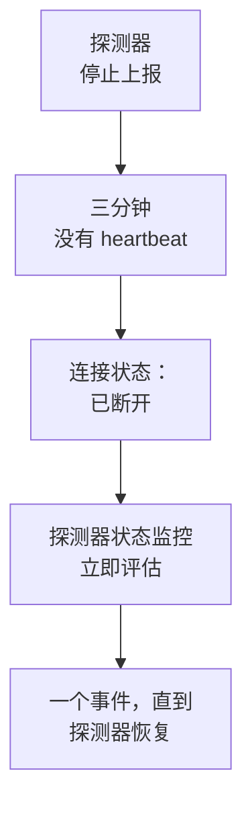

# 探测器状态监控

探测器状态监控会在探测器停止上报时通知您：探测器断开时产生一个事件，探测器恢复后该事件自动解决。把它指向您的自定义探测器，或者在自托管的 OneUptime 上指向运行所有监视器的全局探测器，这样一个沉默的探测器就不会在无人知晓的情况下让它的监视器无人检查。新监视器还会在其某个探测器滞后（其监视器的检查或其网络设备的轮询频率低于设置）时发出警报。

:::cards
- [创建一个](#创建探测器状态监控): 选择探测器，保留默认条件。
- [条件](#条件): 统计已连接、已断开或滞后的探测器，按当前值或一个时间窗口。
- [指标](#指标): 每分钟记录有多少探测器处于连接状态。
:::

## 工作原理

OneUptime 每分钟评估一次每个探测器状态监控，并在它的任一探测器连接或断开的那一刻再次评估。它读取每个探测器的连接状态，也就是探测器页面上显示的状态：探测器在三分钟内没有任何消息即视为已断开。在 OneUptime 自身停机或未接收数据之后，它会等满三分钟才把任何探测器视为已断开，因此升级 OneUptime 永远不会产生事件。它还会像探测器页面一样读取每个已连接探测器是否滞后（[探测器滞后](/docs/probe/custom-probe#探测器滞后)），并在某个探测器滞后或赶上的那一刻再次评估监视器。

一直断开的探测器只产生一个事件，而不是每分钟一个。监视器保持离线、事件保持打开，直到它关注的每个探测器都重新连接；然后事件自动解决。

一个监视器可以关注本项目的探测器和全局探测器。已删除的探测器不计入任何一方。当监视器关注的探测器一个都不剩时，它保持现有状态，并在一天后在概览中提示这一点。

## 创建探测器状态监控

:::steps
### 新建监视器

前往 **监视器**，点击 **创建监视器**。

### 选择探测器状态

在 **监视器类型** 下，点击 **更多监视器类型**，然后在 **其他** 下选择 **探测器状态**。填写 **名称**，点击 **下一步**。

### 选择探测器

在 **要关注的探测器** 下选择探测器。新监视器默认选中项目自己的探测器。没有自有探测器的自托管 OneUptime 默认选中它的全局探测器；在 OneUptime Cloud 上，全局探测器由 OneUptime 运行，因此项目如需关注它们，需要自己选择。

### 创建监视器

保留下文介绍的默认条件，点击 **创建监视器**。监视器会立即被评估，其概览会列出它关注的每个探测器，已断开的排在最前。
:::

> [!TIP]
> 探测器页面上以及 **监视器 → 设置 → 探测器** 中探测器所在行的菜单里的 **监控此探测器**，会打开 **创建监视器**，并预填一个关注该探测器、以它命名的探测器状态监控。

## 条件

探测器状态监控的筛选条件统计的是探测器：

| 筛选条件 | 统计内容 |
| --- | --- |
| **已断开连接的探测器数量** | 所关注的探测器中已断开的探测器。 |
| **已连接的探测器数量** | 所关注的探测器中已连接的探测器。 |
| **滞后的探测器数量** | 所关注的探测器中已连接但滞后的探测器：其监视器的检查或其网络设备的轮询频率低于设置。 |

三者都是整数，可用 **大于**、**小于**、**等于** 等进行比较。新监视器默认带有三条条件：

| 条件 | 筛选 | 作用 |
| --- | --- | --- |
| 检查是否有探测器断开连接 | **已断开连接的探测器数量** 大于 `0` | 将监视器标记为离线，并声明一个标题为“探测器已断开连接：{{disconnectedProbeNames}}”的事件，该事件会自动解决。 |
| 检查是否有探测器滞后 | **滞后的探测器数量** 大于 `0` | 发出一个标题为“探测器滞后：{{behindProbeNames}}”的警报，该警报会自动解决。探测器仍在上报，因此它不会改变监视器的状态，也不会声明事件。 |
| 检查所有探测器是否都已连接 | **已断开连接的探测器数量** 等于 `0` | 将监视器标记为正常运行。 |

在 **滞后的探测器数量** 出现之前创建的监视器会保留其原有条件，因此在你把这项检查添加到它的条件之前，探测器滞后时它不会收到通知。

**已连接的探测器数量** 适合关注多个探测器、可以容忍少一个的监视器：**已连接的探测器数量** 小于 `2` 只在剩下不足两个时才声明事件。

### 声明事件前多等一会儿

探测器沉默三分钟后才算断开，因此短暂重启不会产生任何事件。若要等更久，请在筛选条件下勾选 **在一段时间内评估此条件**，在 **评估** 中选择 **所有值**，并在 **过去** 中选择一个时间窗口。设为五分钟时，探测器还需再断开五分钟才会声明事件。

## 指标

每次评估都会在监视器上记录三个序列：`oneuptime.monitor.probes.connected`、`oneuptime.monitor.probes.disconnected` 和 `oneuptime.monitor.probes.behind`，即所关注的探测器中已连接、已断开和滞后的数量。它们会在监视器的 **指标** 页面上以图表显示，仪表板或指标监控也可以像读取其他序列一样读取它们。

## 模板变量

除了每个监视器都有的变量外，探测器状态监控的事件和警报模板还可以使用以下变量：

| 变量 | 值 |
| --- | --- |
| `{{disconnectedProbeNames}}` | 已断开探测器的名称，以逗号分隔。 |
| `{{disconnectedProbeCount}}` | 已断开的探测器数量。 |
| `{{connectedProbeNames}}` | 已连接探测器的名称，以逗号分隔。 |
| `{{connectedProbeCount}}` | 已连接的探测器数量。 |
| `{{behindProbeNames}}` | 滞后的已连接探测器的名称，以逗号分隔。 |
| `{{behindProbeCount}}` | 滞后的探测器数量。 |
| `{{probeStatusSummary}}` | 一句话，列出已断开的探测器（例如 `1 of 3 probes is disconnected: EU Probe.`），没有则列出滞后的探测器，或说明所有探测器均已连接。 |
| `{{probes}}` | 每个探测器，各带 `probeName`、`isConnected`、`isBehind`、`isGlobalProbe` 和 `lastAliveAt`。 |

## 故障排除

:::details 监视器显示正在等待数据
新监视器会在一两分钟内显示第一次评估结果。如果它没有关注任何探测器，则会显示 **未设置**：请在 **标准** 中选择探测器。
:::

:::details 探测器下线了，却没有声明事件
探测器在三分钟没有 heartbeat 后才算断开，如果 OneUptime 自身曾停机则会更晚。请检查监视器没有被禁用、不在维护窗口内，并且它的条件仍会声明事件。
:::

## 后续步骤

:::cards
- [自定义探测器](/docs/probe/custom-probe): 在您自己的网络中运行探测器。
- [监视器条件和状态](/docs/monitor/criteria-and-statuses): 条件如何决定监视器的状态。
- [事件和警报模板](/docs/monitor/incident-alert-templating): 编写监视器所声明事件的措辞。
:::
