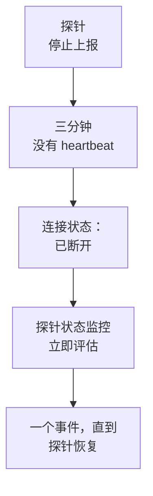

# 探针状态监控

探针状态监控会在探针停止上报时通知您：探针断开时产生一个事件，探针恢复后该事件自动解决。把它指向您的自定义探针，或者在自托管的 OneUptime 上指向运行所有监视器的全局探针，这样一个沉默的探针就不会在无人知晓的情况下让它的监视器无人检查。

:::cards
- [创建一个](#创建探针状态监控): 选择探针，保留默认条件。
- [条件](#条件): 统计已连接或已断开的探针，按当前值或一个时间窗口。
- [指标](#指标): 每分钟记录有多少探针处于连接状态。
:::

## 工作原理

OneUptime 每分钟评估一次每个探针状态监控，并在它的任一探针连接或断开的那一刻再次评估。它读取每个探针的连接状态，也就是探针页面上显示的状态：探针在三分钟内没有任何消息即视为已断开。在 OneUptime 自身停机或未接收数据之后，它会等满三分钟才把任何探针视为已断开，因此升级 OneUptime 永远不会产生事件。

一直断开的探针只产生一个事件，而不是每分钟一个。监视器保持离线、事件保持打开，直到它关注的每个探针都重新连接；然后事件自动解决。

一个监视器可以关注本项目的探针和全局探针。已删除的探针不计入任何一方。当监视器关注的探针一个都不剩时，它保持现有状态，并在一天后在概览中提示这一点。

## 创建探针状态监控

:::steps
### 新建监视器

前往 **监视器**，点击 **创建监视器**。

### 选择探针状态

在 **监视器类型** 下，点击 **更多监视器类型**，然后在 **其他** 下选择 **探测器状态**。填写 **名称**，点击 **下一步**。

### 选择探针

在 **要关注的探针** 下选择探针。新监视器默认选中项目自己的探针。没有自有探针的自托管 OneUptime 默认选中它的全局探针；在 OneUptime Cloud 上，全局探针由 OneUptime 运行，因此项目如需关注它们，需要自己选择。

### 创建监视器

保留下文介绍的默认条件，点击 **创建监视器**。监视器会立即被评估，其概览会列出它关注的每个探针，已断开的排在最前。
:::

> [!TIP]
> 探针页面上以及 **监视器 → 设置 → 探测器** 中探针所在行的菜单里的 **监控此探针**，会打开 **创建监视器**，并预填一个关注该探针、以它命名的探针状态监控。

## 条件

探针状态监控的筛选条件统计的是探针：

| 筛选条件 | 统计内容 |
| --- | --- |
| **Disconnected Probes** | 所关注的探针中已断开的探针。 |
| **Connected Probes** | 所关注的探针中已连接的探针。 |

两者都是整数，可用 **大于**、**小于**、**等于** 等进行比较。新监视器默认带有两条条件：

| 条件 | 筛选 | 作用 |
| --- | --- | --- |
| Check if a probe is disconnected | **Disconnected Probes** 大于 `0` | 将监视器标记为离线，并声明一个标题为 `Probe disconnected: {{disconnectedProbeNames}}` 的事件，该事件会自动解决。 |
| Check if every probe is connected | **Disconnected Probes** 等于 `0` | 将监视器标记为正常运行。 |

**Connected Probes** 适合关注多个探针、可以容忍少一个的监视器：**Connected Probes** 小于 `2` 只在剩下不足两个时才声明事件。

### 声明事件前多等一会儿

探针沉默三分钟后才算断开，因此短暂重启不会产生任何事件。若要等更久，请在筛选条件下勾选 **在一段时间内评估此条件**，在 **评估** 中选择 **All Values**，并在 **在过去（分钟）** 中选择一个时间窗口。设为五分钟时，探针还需再断开五分钟才会声明事件。

## 指标

每次评估都会在监视器上记录两个序列：`oneuptime.monitor.probes.connected` 和 `oneuptime.monitor.probes.disconnected`，即所关注的探针中已连接和已断开的数量。它们会在监视器的 **指标** 页面上以图表显示，仪表板或指标监控也可以像读取其他序列一样读取它们。

## 模板变量

除了每个监视器都有的变量外，探针状态监控的事件和告警模板还可以使用以下变量：

| 变量 | 值 |
| --- | --- |
| `{{disconnectedProbeNames}}` | 已断开探针的名称，以逗号分隔。 |
| `{{disconnectedProbeCount}}` | 已断开的探针数量。 |
| `{{connectedProbeNames}}` | 已连接探针的名称，以逗号分隔。 |
| `{{connectedProbeCount}}` | 已连接的探针数量。 |
| `{{probeStatusSummary}}` | 一句话，列出已断开的探针（例如 `1 of 3 probes is disconnected: EU Probe.`），或说明所有探针均已连接。 |
| `{{probes}}` | 每个探针，各带 `probeName`、`isConnected`、`isGlobalProbe` 和 `lastAliveAt`。 |

## 故障排除

:::details 监视器显示正在等待数据
新监视器会在一两分钟内显示第一次评估结果。如果它没有关注任何探针，则会显示 **Not set up**：请在 **标准** 中选择探针。
:::

:::details 探针下线了，却没有声明事件
探针在三分钟没有 heartbeat 后才算断开，如果 OneUptime 自身曾停机则会更晚。请检查监视器没有被禁用、不在维护窗口内，并且它的条件仍会声明事件。
:::

## 后续步骤

:::cards
- [自定义探针](/docs/probe/custom-probe): 在您自己的网络中运行探针。
- [监视器条件和状态](/docs/monitor/criteria-and-statuses): 条件如何决定监视器的状态。
- [事件和告警模板](/docs/monitor/incident-alert-templating): 编写监视器所声明事件的措辞。
:::
