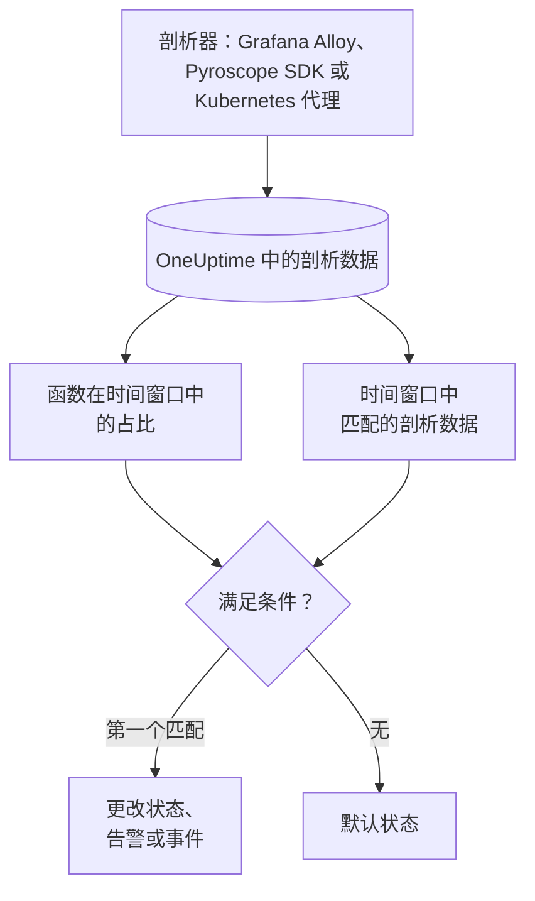

# 性能剖析监控

性能剖析监视器读取您的服务发送到 OneUptime 的持续剖析数据，并在两种情况下告警：某个函数占用的时间比例超出应有水平，例如一次部署后变重的解析器；以及某个服务不再发送剖析数据。它每分钟测量其时间窗口中有多少经过您指定的函数，统计与其过滤器匹配的剖析数据，并在满足您的条件时更改监视器状态、创建告警或声明事件。

:::cards
- [创建监视器](#创建性能剖析监视器): 从剖析器中的某个函数开始，或从 创建监视器 开始。
- [查询内容](#查询内容): 函数、剖析类型、服务和时间窗口。
- [条件](#条件): 函数在时间窗口中的占比，或剖析数据的数量。
- [函数变重了](#实例函数变重了): 当某个函数的占比猛增时告警。
:::

## 工作原理



OneUptime 每分钟读取与监视器过滤器匹配、且在其时间窗口内开始的剖析数据。它会统计这些数据，并在监视器指定了函数时，测量该窗口的时间中经过该函数的占比。它从上到下将这些数字与监视器的条件比较，第一个匹配的条件决定接下来发生什么。如果没有条件匹配，监视器会回到默认状态。

## 开始之前

- 您的服务通过 Grafana Alloy（eBPF）、Pyroscope SDK 或 OneUptime Kubernetes 代理，将持续剖析数据发送到 OneUptime。请参阅 [持续性能分析](/docs/telemetry/profiles)。
- 要关注某个函数，您需要知道它的名称，或其文件或包路径的一部分，与剖析器中显示的一致。

## 创建性能剖析监视器

:::steps
### 从剖析器开始，或从 创建监视器 开始

最快的方式是从函数本身开始：在 **性能配置文件** 中打开该函数，点击为其占比提供告警的链接。**创建监视器** 会打开，监视器已为该函数及其服务填好，阈值高于它今天的占比，详见 [实例：函数变重了](#实例函数变重了)。否则，请前往 **监视器** 并点击 **创建监视器**。

### 选择 Profiles

在 **监视器类型** 下点击 **更多监视器类型**，然后在 **遥测** 下选择 **配置文件**，或在搜索框中输入 `profiles`。输入 **名称**，然后点击 **下一步**。

### 选择读取的内容

在 **性能剖析监视器配置** 中，将 **函数** 设为要关注的函数，将 **分析内容** 设为剖析类型，将 **监控性能剖析的时长（时间）** 设为时间窗口。新监视器读取 **最近 5 分钟** 的 **CPU 时间**。字段下方的 **此监视器现在读取的内容** 会显示有多少剖析数据匹配，以及该函数今天占窗口的多少，便于您把阈值设在它之上。打开 **更多字段** 可按遥测服务或基础设施实体过滤。

### 设置条件

从 **创建监视器** 开始的监视器有两个条件：**性能剖析数量** 为 0 时离线并创建事件，大于 0 时在线。要对该函数告警，请添加 **函数占比（%）** 过滤器，参见 [条件](#条件)。

### 创建监视器

点击 **创建监视器**。监视器会在其 **概览** 页面打开，第一次评估在一分钟内运行。
:::

### 通过 API 或 Terraform 创建

监视器的步骤包含与其 `profileMonitor` 配置相同的设置。下面的配置在一个服务最近五分钟的 CPU 剖析数据中关注 `parseOrder`：

```json
{
  "profileMonitor": {
    "telemetryServiceIds": [],
    "profileTypes": ["cpu"],
    "profileType": "",
    "functionName": "parseOrder",
    "attributes": {},
    "lastXSecondsOfProfiles": 300
  }
}
```

把服务 ID 放进 `telemetryServiceIds`，或将列表留空以读取所有服务的剖析数据；只想统计剖析数据时，将 `functionName` 留空。通过 [API](/docs/api-reference/api-reference) 或 [Terraform](/docs/terraform/monitor-steps) 创建一个监视器类型为 `Profiles` 的监视器，其步骤包含此配置和至少一个条件。在 Terraform 中，将配置作为步骤的 `profile_monitor` 属性传入，并用 `jsonencode()` 编写。

## 查询内容

| 字段 | 匹配什么 | 默认值 |
| --- | --- | --- |
| `profileTypes` | 属于这些类型之一的剖析数据，精确匹配，例如 `cpu`。 | 空：所有类型 |
| `profileType` | 类型包含此文本的剖析数据，不区分大小写。设置后会忽略 `profileTypes`。 | 空 |
| `functionName` | **函数占比（%）** 测量其占比的代码：函数名或文件路径包含此文本的栈帧，不区分大小写。 | 空：不测量占比 |
| `telemetryServiceIds` | 来自这些遥测服务之一的剖析数据。 | 空：所有服务 |
| `entityKeys` | 来自这些主机、Pod、容器和其他基础设施实体之一的剖析数据。 | 空：所有实体 |
| `attributes` | 属性具有这些值的剖析数据。 | 空：无条件 |
| `lastXSecondsOfProfiles` | 在评估前这么多秒内开始的剖析数据。 | 无：务必设置，否则会统计所有已存储的剖析数据，计数永远不会降到 0 |

剖析数据必须匹配您设置的所有过滤器才会被读取。在表单中，**函数** 设置 `functionName`，**分析内容** 设置 `profileTypes`（选 **所有类型的性能剖析** 时为空），**监控性能剖析的时长（时间）** 设置 `lastXSecondsOfProfiles`，**按遥测服务过滤** 和 **按基础设施实体过滤** 设置 `telemetryServiceIds` 和 `entityKeys`。

## 如何评估

- **每分钟。** 性能剖析监视器不由探测器检查，因此没有可设置的间隔，也没有 **探测器与间隔** 页面。
- **每次评估两个数字。** 监视器统计与所有过滤器匹配、且在 `lastXSecondsOfProfiles` 内开始的剖析数据，并测量该函数在这些剖析数据中的占比。剖析器按固定间隔上传，所以请给时间窗口留出容纳多次上传的余地。
- **一次一种单位。** 占比只累加同一种单位的样本：当读取的类型混合了单位，例如来自 SDK 的以纳秒计的 CPU 时间和来自 eBPF 的样本数，它会读取窗口中样本最多的单位。
- **没有剖析数据就是计数 0，也没有占比。** 剖析器停止上传的服务计数为 0，而 **函数占比（%）** 条件不会匹配空的窗口：请对 **性能剖析数量** 告警，以便知道剖析已停止。
- **OneUptime 自身的停机不算沉默。** 只要时间窗口中包含 OneUptime 自身未接收数据的时间（正在重启、升级或追赶积压），检查就会等待：状态不会改变，也不会打开或解决任何事件或告警。请参阅 [OneUptime 未接收数据时](/docs/monitor/when-oneuptime-is-not-receiving)。
- **条件从上到下。** 第一个匹配的条件决定结果，因此请把最严重的放在最前面。

每次状态变化及其原因都会记录在监视器的 **状态时间线** 上。

## 条件

性能剖析监视器的条件将两个数字之一与某个值比较。

**函数占比（%）** 是窗口时间中经过监视器函数的占比，范围 0 到 100：每个带有与 `functionName` 匹配的帧的栈只计一次，无论其深度如何，因此函数自身的代码及其调用的一切都包含在内。

| 过滤条件 | 当函数占比…时匹配 |
| --- | --- |
| **大于** | 高于该值 |
| **大于或等于** | 等于或高于该值 |
| **小于** | 低于该值 |
| **小于或等于** | 等于或低于该值 |

**性能剖析数量** 是在窗口中匹配的剖析数据数量：

| 过滤条件 | 当剖析数据计数…时匹配 |
| --- | --- |
| **大于** | 高于该值 |
| **大于或等于** | 等于或高于该值 |
| **小于** | 低于该值 |
| **小于或等于** | 等于或低于该值 |
| **等于** | 恰好等于该值 |
| **不等于** | 不等于该值 |

剖析数据计数没有异常条件：没有可与之比较的基线。

## 实例：函数变重了

结账服务中的 `parseOrder` 占用其 CPU 时间的 18%。一次解析更大负载的部署不应被忽视：

1. 在 **性能配置文件** 中选择结账服务并打开 `parseOrder`。
2. 点击为其占比提供告警的链接。剖析器建议 30%：在今天的占比上再加一半，至少高出 10 个百分点，并向上取整到 5 的倍数。
3. **创建监视器** 打开，其中是一个读取结账服务 **最近 5 分钟** **CPU 时间** 的性能剖析监视器，带有两个条件：**函数占比（%）** **大于** `30` 会发出一个可自行解决的告警，并将监视器标记为降级；**小于或等于** `30` 将其标记为正常运行。事件已填写但处于关闭状态：如需呼叫值班人员，请将其打开。
4. 点击 **创建监视器**。

当这次部署让 `parseOrder` 占用 45% 的 CPU 时间时，下一次评估就会发出告警。当修复让它回到 30% 以下时，告警会自行解决。

## 实例：剖析数据不再到达

结账服务运行着一个上传 CPU 剖析数据的 Pyroscope SDK。您希望它们停止五分钟时创建事件：

- `profileTypes`：`["cpu"]`，`telemetryServiceIds`：结账服务，`lastXSecondsOfProfiles`：`300`
- 条件 1：**性能剖析数量** **等于** `0`：将监视器标记为离线并声明事件
- 条件 2：**性能剖析数量** **大于** `0`：将监视器标记为在线

只要 SDK 在上传，每次评估都会统计到一些剖析数据，条件 2 让监视器保持在线。当服务在没有 SDK 的情况下部署后，计数会在最后一次上传五分钟后降到 0，条件 1 匹配并声明事件。修复后的第一次上传让计数重新高于 0，如果该事件开启了 **自动解决事件**，事件会自行解决。

## 故障排查

:::details 监视器计数为 0，但 OneUptime 中能看到剖析数据
把过滤器与您看到的剖析数据比较：`profileTypes` 必须与类型完全匹配，`telemetryServiceIds` 必须包含正确的服务 ID。`lastXSecondsOfProfiles` 太短也可能正好落在两次上传之间。
:::

:::details 函数占比一直是 0%
窗口中没有任何帧包含该函数文本。在剖析器中打开该函数，按显示的样子复制它的名称；名称的一部分也可以，大小写无关。然后检查服务是否发送了 **分析内容** 所读取的剖析类型。
:::

## 后续步骤

:::cards
- [持续性能分析](/docs/telemetry/profiles): 发送剖析数据，并在剖析器中查看。
- [监控步骤](/docs/terraform/monitor-steps): 从 Terraform 传入步骤配置。
- [跟踪监控](/docs/monitor/traces-monitor): 对失败的 Span 告警。
- [指标监控](/docs/monitor/metrics-monitor): 对 CPU、内存和其他指标告警。
:::
