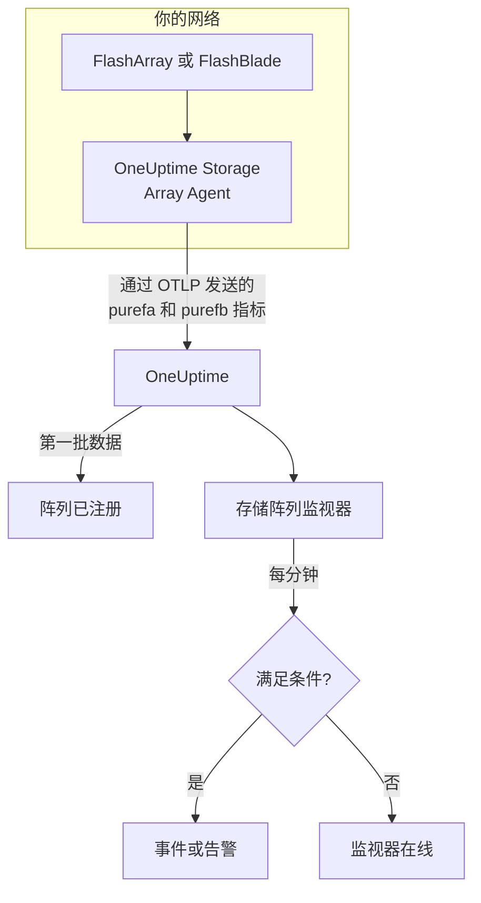

# 存储阵列监控

存储阵列监视器监视一个存储阵列，并在阵列自身发出警报、空间不足、变慢、丢失硬件或主机路径，或复制落后时通知你。它支持 Pure Storage FlashArray、Pure Storage FlashBlade 和 NetApp ONTAP（包括 Amazon FSx for NetApp ONTAP），读取 OneUptime Storage Array Agent 采集的指标：Pure 的 `purefa_*` 和 `purefb_*` 序列，以及 NetApp Harvest 从 ONTAP 集群读取的 `netapp_*` 序列。

它也适用于 Dell PowerStore（`dell.powerstore`），基于 Dell 的 `powerstore_*` 序列。

:::cards
- [创建监视器](#创建存储阵列监视器): 在仪表板中的六个步骤。
- [模板](#预置警报模板): 现成的警报，每个卷、主机、专用设备或组件一个事件。
- [Pure 序列的工作方式](#pure-序列的结构): 一个指标名称，多个数值。ONTAP 的序列[另有一节专门介绍](#ontap-序列的结构)。
- [指标](#采集的指标): 监视器可以据以警报的每个序列。
:::

## 工作原理

OneUptime Storage Array Agent 运行在能够访问阵列管理接口的机器上。它使用只读 API 令牌读取阵列的指标，为指标打上阵列的名称 `storage.array.name` 和平台 `storage.system` 标签，并通过 OTLP 发送到 OneUptime。第一批数据到达时会注册该阵列。

Dell PowerMax (`dell.powermax`) 无需代理：OneUptime 探测器每 5 分钟使用只读帐户登录一次 Unisphere for PowerMax，并以同样的方式发送它管理的每个阵列，阵列在你重命名之前以其 Symmetrix ID 命名([Dell PowerMax](/docs/telemetry/storage-arrays#dell-powermax))。

存储阵列监视器绑定到一个阵列。它每分钟对该阵列的指标运行一次查询，并将结果与其条件进行比较。



## 开始之前

- **安装 Storage Array Agent**，安装在能通过 HTTPS 访问阵列的位置，并使用拥有阵列 **readonly** 角色的用户的 API 令牌。[Storage Array Agent 指南](/docs/telemetry/storage-arrays) 介绍了用户、令牌和安装，涉及 `ONEUPTIME_URL`、`ONEUPTIME_TELEMETRY_INGESTION_KEY`、`STORAGE_ARRAY_NAME`，以及阵列的地址和令牌(`PURE_FA_ENDPOINT` 和 `PURE_FA_API_TOKEN`，或 `PURE_FB_ENDPOINT` 和 `PURE_FB_API_TOKEN`)，对于 ONTAP 则涉及集群的地址和一个只读 REST 用户(`NETAPP_ONTAP_ENDPOINT`、`NETAPP_ONTAP_USERNAME` 和 `NETAPP_ONTAP_PASSWORD`)。
- **确认阵列已注册。** 在第一次采集后大约一分钟，它会以代理的 `STORAGE_ARRAY_NAME` 命名，出现在 **产品 → 基础设施 → 存储阵列 → 所有存储阵列** 下。
- **对于 Dell PowerMax**，请改为在 **产品 → 基础设施 → 存储阵列 → 连接** 下连接管理它的 Unisphere for PowerMax，详见 [Dell PowerMax](/docs/telemetry/storage-arrays#dell-powermax)。

## 创建存储阵列监视器

:::steps
### 新建监视器

进入 **监视器**，点击 **创建监视器**。

### 选择存储阵列

在 **监视器类型** 下点击 **更多监视器类型**，然后在 **基础设施** 下选择 **存储阵列**，或在搜索框中输入 `storage`。输入 **名称**(它会用在事件和警报标题中)，然后点击 **下一步**。

### 选择阵列

在 **Storage Array Monitor Configuration** 下，从 **存储阵列** 中选择阵列。每个发送过数据的阵列都在列表中。阵列的平台决定了表单提供哪些指标和模板。选好后，字段下方的一行会显示是否有数据到达。**添加存储阵列** 会打开已填好你的密钥的设置步骤，并等待第一批数据。

### 选择要监视的内容

新监视器从 **警报内容** 下的 **Array Stopped Reporting** 开始。要监视其他内容：

- **更改**：选择另一个 [模板](#预置警报模板)。它会设置指标、标签过滤器、聚合、时间范围和阈值，并用自己的条件替换下面的条件。你仍然可以修改 **时间范围**。
- **Custom Metric**（在 **更多字段** 下）：从 **Storage Array Metric** 中选择一个指标，然后设置 **聚合** 和 **时间范围**。[过滤器](#监视器设置) 可以把它缩小到一个卷、主机、Pod、组件、文件系统或存储桶。
- **高级**（在 **更多字段** 下）：在 **选择指标** 下自己构建查询和公式，例如用 `purefa_array_space_bytes` 过滤到 `space=capacity`，减去同一指标过滤到 `space=empty`，得到已用容量。用对象的标签 **分组依据**，即可分别判断每个对象。

### 检查条件

打开 **标准** 下的每个条件，检查其 **指标**、**聚合**、**条件** 和 **阈值**。模板会填写这些内容。使用 **Custom Metric** 或 **高级** 时，监视器从 [默认条件](#默认条件) 开始，它只会注意到指标不再发送数据，所以请设置你自己的阈值。

### 创建监视器

点击 **创建监视器**。OneUptime 会打开监视器的页面，并每分钟评估一次。它发出的事件和警报也会列在阵列的 **事件** 和 **警报** 页面上。
:::

> [!TIP]
> 要一次设置多个模板，请从 **产品 → 基础设施 → 存储阵列** 打开阵列，然后进入 **建议**。选择你需要的模板和要呼叫的人员，OneUptime 会为每个模板创建一个监视器。

## 监视器设置

| 字段 | 选项卡 | 作用 |
| --- | --- | --- |
| **存储阵列** | 全部 | 必填。把每个查询限定到 `resource.storage.array.name`，因此两个都有名为 `vol-01` 的卷的阵列永远不会混在一起。 |
| **卷** | Custom Metric、高级 | 一个卷：在 FlashArray 上按 `name` 标签，例如 `vol-db-01`(Pod 或卷组中的卷命名为 `pod::volume` 或 `group/volume`)；在 ONTAP 上按 `volume` 标签，两个 SVM 可以共用同一个卷名；在 PowerMax 上按 `volume` 标签，即其设备 ID，例如 `00847`。 |
| **主机** | Custom Metric、高级 | 仅限 FlashArray。阵列所知的一台主机，按 `host` 标签，例如 `esxi-01`。 |
| **Pod** | Custom Metric、高级 | 仅限 FlashArray。一个 ActiveCluster 或 ActiveDR Pod，按 `name` 标签，在副本链接序列上则按 `local_pod`。 |
| **硬件组件** | Custom Metric、高级 | 一个硬件组件，例如 `CH0.BAY1` 或 `CT0`：在 FlashArray 上是 `component_name` 标签，在 FlashBlade 上是 `name`，在 ONTAP 上则是其序列用来命名它的标签(`node`、`disk`、`shelf` 或 `port`)，在 PowerMax 上是 `component`，即导向器(例如 `FA-1D`)或端口(例如 `FA-1D:4`)。 |
| **文件系统** | Custom Metric、高级 | 仅限 FlashBlade。一个文件系统，按 `name` 标签。 |
| **存储桶** | Custom Metric、高级 | 仅限 FlashBlade。一个对象存储桶，按 `name` 标签。 |
| **Storage Array Metric** | Custom Metric | [目录](#采集的指标) 中的一个指标。表单会添加赋予其含义的标签过滤器，并按它描述的对象分组，因此每个卷、主机或组件都会单独判断。 |
| **聚合** | Custom Metric | 如何合并样本：**平均值**、**最大值**、**最小值**、**总和** 或 **计数**。从该指标的常用聚合开始。 |
| **时间范围** | 全部 | 查询读取的滚动窗口，从 **Past 1 Minute** 到 **Past 365 Days**。新监视器从 **过去 5 分钟** 开始；文件系统或存储桶的自定义指标从 **过去 15 分钟** 开始；模板会设置自己的值。 |
| **选择指标** | 高级 | 查询构建器：**指标**、**聚合方式**、**按属性过滤**、**分组依据**，以及用于合并查询的 **添加指标** 和 **添加公式**。 |

代理每 60 秒读取一次阵列端点，每 2 分钟读取一次卷、主机和 Pod，因此 5 分钟的窗口中总会有样本。它每 5 分钟读取一次 FlashBlade 的文件系统和存储桶(所以用 15 分钟)，每 30 分钟读取一次 FlashArray 目录：请给目录监视器设置 60 分钟的窗口。在 ONTAP 上，Harvest 每分钟读取一次集群的性能，每 3 分钟读取一次其配置、状态和 EMS 事件，因此 5 分钟的窗口中总会有样本。

它每 5 分钟读取一次 PowerStore，每 60 秒读取一次其集群状态：为 PowerStore 监视器设置 15 分钟的窗口。

## Pure 序列的结构

Pure 把多个数值放在 **一个** 指标名称上，并用一个标签区分它们：

- **`dimension`** 用于性能序列。`purefa_array_performance_latency_usec` 带有读延迟(`usec_per_read_op`)、写延迟(`usec_per_write_op`)、镜像写延迟，以及每项的 SAN、队列、QoS 和服务时间。请始终按一个 `dimension` 过滤：跨它们取平均会把 200 µs 的读延迟和一个队列数值混在一起。
- **`space`** 用于容量序列：`capacity`、`empty`、`snapshots`、`total_provisioned`、`total_physical`、`available_ratio` 等。

有几个序列把状态放在 **标签** 中，其值始终为 1：

| 序列 | 状态标签 | 每个序列对应 |
| --- | --- | --- |
| `purefa_alerts_open` | `severity`，并带有 `summary`、`code` 和 `component_type` | 一个未关闭的警报 |
| `purefa_hw_component_status` | `component_status` | 一个硬件组件 |
| `purefa_host_connectivity_info` | `status`，并带有 `details` | 一台主机 |
| `purefa_drive_capacity_bytes` | `component_status`(值为驱动器的容量) | 一个驱动器 |

过滤到某个不良状态的序列只在有对象处于该状态时才存在，因此没有序列就意味着健康。这就是为什么 **Max 大于 0 时触发、为 0 时恢复** 是适合它们的形式，模板也是这样构建的：它们的恢复条件把缺失的序列计为零。当完全没有序列时，这类模板只有在同一时间窗口内收到 `purefa_info`、`purefb_info` 或 `powermax_array_info` 才会恢复，因此已停止上报的阵列不会关闭任何内容。

PowerMax 的每个序列只包含一个数值，并以该数值命名：`powermax_array_response_time_usec` 用 `operation` 区分读取和写入。它的状态序列同样只在出现问题时存在：`powermax_alert_open` 在 Unisphere 有未关闭的警报时存在，`powermax_director_offline` 在导向器不在线时存在，`powermax_port_offline` 在有人依赖的端口宕机时存在，`powermax_srdf_group_not_healthy` 在 SRDF 组挂起或离线时存在。

在监视器过滤器和分组键中，代理的属性以 `resource.` 开头(`resource.storage.array.name`、`resource.storage.system`)，而 Pure 自己的标签不以它开头(`name`、`host`、`component_name`、`dimension`、`space`、`severity`)，PowerMax 的标签也不以它开头(`storage_group`、`volume`、`director`、`port_id`、`srdf_group`)。

## PowerStore 序列的结构

Dell 的导出器每个指标名称只写一个值，因此 PowerStore 序列不需要标签过滤器。其标签标识对象：`appliance_id` 是专用设备，`name` 是部件、卷或文件系统，而 `volume_id`、`fc_port_id`、`eth_port_id`、`nas_id` 或 `volume_group_id` 是性能序列的对象。其状态序列在健康时为 1，否则为 0，因此模板在低于 1 时触发。它自己的警报通过 syslog 到达，其模板（日志监视器）列在下面的表格之后。

## ONTAP 序列的结构

NetApp Harvest 把每个序列命名为 `netapp_<object>_<counter>`，并用标签命名对象：卷用 `volume`(位于其 `svm` 中)，聚合用 `aggr`，LUN 用 `lun`(位于其 `volume` 和 `svm` 中)，节点用 `node`，磁盘用 `disk`，磁盘架用 `shelf`，SnapMirror 关系用 `destination_location`。延迟以每次操作的微秒计，`_ops` 为每秒操作数，`_data` 为每秒字节数。

ONTAP 的状态有三种表示方式：

| 序列 | 状态 | 每个序列对应 |
| --- | --- | --- |
| `netapp_*_new_status` | 1 表示健康、在线、正常或正在运行，0 表示不是 | 一个对象，每次轮询都有 |
| `netapp_health_*_alerts` | 值为 1，其标签中带有 `severity`(`error` 或 `warning`)和原因 | 一个未解决的问题：已损坏的磁盘、磁盘架故障、无法接管其配对节点的节点、已断开的端口、系统健康警报 |
| `netapp_ems_events` | 值为 1，带有 `message`、`severity` 和该事件的参数 | 一个 EMS 事件，只在收集到它的那一次轮询中存在；成对事件被清除时会以 0 再导出一次 |

以数值表示的状态在窗口中的每个读数都低于 1 时触发，一旦有读数重新为 1 就恢复。未解决的问题在其序列存在时触发，在序列消失后恢复，前提是 `netapp_cluster_new_status` 仍在到达，因此已停止的代理不会关闭任何内容。EMS 事件在其唯一的读数上触发，并在它处于模板的一小时窗口内期间保持打开；一小时内没有再出现同类事件时恢复。

## 预置警报模板

OneUptime 提供 80 个模板——12 个用于 FlashArray，8 个用于 FlashBlade，16 个用于 PowerStore，31 个用于 ONTAP，13 个用于 PowerMax——**警报内容** 列表会提供适用于阵列平台的那些模板。每个模板都会构建一个完整的监视器：指标查询、其标签过滤器、按对象自身标签的分组、一个触发条件和一个恢复条件。阈值是可以编辑的起点。

只有当条件对窗口中的 **每个** 值都成立时，条件才会触发，但 ONTAP EMS 模板的条件除外：Harvest 只在一次轮询中导出某个事件，因此一个读数就够了。在容量、延迟、滞后或比率阈值上触发的监视器，只有越过阈值 10% 后才会恢复，因此在阈值附近徘徊的值不会来回切换。警报、硬件和连接模板在某个状态在其整个 5 分钟窗口内都出现后才会触发，并在状态消失约 5 分钟后恢复。

### FlashArray

| 模板 | 类别 | 严重程度 | 监视内容 | 触发条件 |
| --- | --- | --- | --- | --- |
| Array Stopped Reporting | 可用性 | 严重 | `purefa_info`，Count，过去 10 分钟 | 整个窗口内都没有数据 — Storage Array Agent 已停止、失去了通往 OneUptime 的路由或令牌被撤销，或者阵列不再响应它；再次收到数据时恢复 |
| Critical Array Alert | 阵列健康状况 | 严重 | `purefa_alerts_open` 过滤到 `severity=critical`，按 `summary` 取 Max，过去 5 分钟 | > 0 — 阵列有一个未关闭的严重警报(组件故障、容量紧急、复制失败)。每个警报一个事件；警报关闭时恢复 |
| Warning Array Alert | 阵列健康状况 | 警告 | `purefa_alerts_open` 过滤到 `severity=warning`，按 `summary` 取 Max，过去 5 分钟 | > 0 — 阵列有一个未关闭的警告级警报。每个警报一个事件；警报关闭时恢复 |
| Capacity Above 80% | 容量 | 警告 | `purefa_array_space_utilization`，Max，过去 15 分钟 | > 80 — Pure 自己的第一个容量阈值；≤ 72 时恢复 |
| Capacity Above 90% | 容量 | 严重 | `purefa_array_space_utilization`，Max，过去 5 分钟 | > 90 — 阵列即将拒绝写入；≤ 81 时恢复 |
| High Read Latency | 性能 | 警告 | `purefa_array_performance_latency_usec` 过滤到 `dimension=usec_per_read_op`，Avg，过去 10 分钟 | > 5000 µs (5 ms) — FlashArray 的读取通常远低于 1 ms；≤ 4500 时恢复 |
| High Write Latency | 性能 | 警告 | `purefa_array_performance_latency_usec` 过滤到 `dimension=usec_per_write_op`，Avg，过去 10 分钟 | > 5000 µs (5 ms)；≤ 4500 时恢复 |
| Hardware Component Failed | 硬件 | 严重 | `purefa_hw_component_status` 过滤到 `component_status=critical`，按 `component_name` 取 Max，过去 5 分钟 | > 0 — 某个控制器、电源、风扇、托架或端口处于严重状态，冗余已经丧失。每个组件一个事件；它报告 ok 时恢复 |
| Hardware Component Degraded | 硬件 | 警告 | `purefa_hw_component_status` 过滤到 `component_status=degraded`，按 `component_name` 取 Max，过去 5 分钟 | > 0 — 某个组件已降级。每个组件一个事件；它报告 ok 时恢复 |
| Drive Failed | 硬件 | 严重 | `purefa_drive_capacity_bytes` 过滤到 `component_status=failed`，按 `component_name` 取 Max，过去 5 分钟 | > 0 — 某个 DirectFlash 模块或 SSD 发生故障，阵列正在其余驱动器上重建。每个驱动器一个事件；更换后恢复 |
| Host Lost Redundant Paths | 主机 | 警告 | `purefa_host_connectivity_info` 过滤到 `status=critical`，按 `host` 取 Max，过去 5 分钟 | > 0 — 主机只能通过一个控制器访问阵列，或完全无法访问；一次控制器故障切换就会让它的存储离线。每台主机一个事件；路径恢复时恢复 |
| Replication Lag Above 1 Minute | 复制 | 警告 | `purefa_pod_replica_links_lag_max_msec`，按 `local_pod` 取 Max，过去 10 分钟 | > 60000 ms (60 s) — 此时故障切换会丢失比计划更多的近期写入。每个 Pod 一个事件；≤ 54000 时恢复 |

### FlashBlade

| 模板 | 类别 | 严重程度 | 监视内容 | 触发条件 |
| --- | --- | --- | --- | --- |
| Array Stopped Reporting | 可用性 | 严重 | `purefb_info`，Count，过去 10 分钟 | 整个窗口内都没有数据 — 代理、其导出器或 FlashBlade 不再响应；再次收到数据时恢复 |
| Critical Array Alert | 阵列健康状况 | 严重 | `purefb_alerts_open` 过滤到 `severity=critical`，按 `summary` 取 Max，过去 5 分钟 | > 0 — FlashBlade 有一个未关闭的严重警报。每个警报一个事件；警报关闭时恢复 |
| Warning Array Alert | 阵列健康状况 | 警告 | `purefb_alerts_open` 过滤到 `severity=warning`，按 `summary` 取 Max，过去 5 分钟 | > 0 — FlashBlade 有一个未关闭的警告级警报。每个警报一个事件；警报关闭时恢复 |
| Capacity Above 80% | 容量 | 警告 | `purefb_array_space_utilization` 过滤到 `type=array`，Max，过去 15 分钟 | > 80；≤ 72 时恢复 |
| Capacity Above 90% | 容量 | 严重 | `purefb_array_space_utilization` 过滤到 `type=array`，Max，过去 5 分钟 | > 90 — 写满时每个客户端的写入都会失败；≤ 81 时恢复 |
| Hardware Component Unhealthy | 硬件 | 严重 | `purefb_hardware_health`，按 `name` 取 Min，过去 5 分钟 | < 1 — 某个刀片、交换模块、电源或风扇不健康(未使用的插槽报告 2)。每个组件一个事件；≥ 1 时恢复 |
| High Read Latency | 性能 | 警告 | `purefb_array_performance_latency_usec` 过滤到 `dimension=usec_per_read_op` 和 `protocol=all`，Avg，过去 10 分钟 | > 10000 µs (10 ms)，跨所有协议；≤ 9000 时恢复 |
| File System Near Full | 文件系统 | 警告 | `purefb_file_systems_space_bytes` 过滤到 `space=available_ratio`，按 `name` 取 Min，过去 15 分钟 | < 0.1 — 文件系统预配大小的剩余不足 10%。每个文件系统一个事件；≥ 0.11 时恢复 |

### PowerStore

| 模板 | 类别 | 严重程度 | 监视内容 | 触发条件 |
| --- | --- | --- | --- | --- |
| Array Stopped Reporting | 可用性 | 严重 | `powerstore_cluster`，Count，过去 10 分钟 | 整个窗口内都没有数据 — 代理、Dell 的导出器或集群不再响应；再次收到数据时恢复 |
| Capacity Above 80% | 容量 | 警告 | `powerstore_cap_physical_used_percent`，按 `appliance_id` 取 Max，过去 15 分钟 | > 80 — 某台专用设备的容量正在填满；≤ 72 时恢复 |
| Capacity Above 90% | 容量 | 严重 | `powerstore_cap_physical_used_percent`，按 `appliance_id` 取 Max，过去 15 分钟 | > 90 — 某台专用设备即将拒绝写入；≤ 81 时恢复 |
| High Read Latency | 性能 | 警告 | `powerstore_perf_avg_read_latency`，按 `appliance_id` 取 Avg，过去 15 分钟 | > 5000 µs (5 ms)；≤ 4500 时恢复 |
| High Write Latency | 性能 | 警告 | `powerstore_perf_avg_write_latency`，按 `appliance_id` 取 Avg，过去 15 分钟 | > 5000 µs (5 ms)；≤ 4500 时恢复 |
| Drive Failed | 硬件 | 严重 | `powerstore_hardware_Drive_state`，按 `name` 取 Min，过去 10 分钟 | < 1 — 某个驱动器发生故障或被移除；≥ 1 时恢复 |
| Node Unhealthy | 硬件 | 严重 | `powerstore_hardware_node_state`，按 `name` 取 Min，过去 10 分钟 | < 1 — 某个节点不是 Healthy；≥ 1 时恢复 |
| Power Supply Unhealthy | 硬件 | 警告 | `powerstore_hardware_Power_Supply_state`，按 `name` 取 Min，过去 10 分钟 | < 1 — 某个电源发生故障或断电；≥ 1 时恢复 |
| Fan Unhealthy | 硬件 | 警告 | `powerstore_hardware_Fan_state`，按 `name` 取 Min，过去 10 分钟 | < 1 — 某个风扇发生故障；≥ 1 时恢复 |
| Battery Unhealthy | 硬件 | 警告 | `powerstore_hardware_Battery_state`，按 `name` 取 Min，过去 10 分钟 | < 1 — 某个电池备份模块出现故障；≥ 1 时恢复 |
| Drive Wearing Out | 硬件 | 警告 | `powerstore_wear_metrics_by_drive`，按 `name` 取 Min，过去 15 分钟 | < 10 — 某个驱动器剩余的耐久度不足 10%；≥ 11 时恢复 |
| NAS Server Not Started | 文件系统 | 警告 | `powerstore_nas_server_operational_status`，按 `name` 取 Max，过去 10 分钟 | < 1 — 某个 NAS 服务器已停止或已降级；≥ 1 时恢复 |
| Volume Not Ready | 阵列健康状况 | 警告 | `powerstore_volume_state`，按 `name` 取 Max，过去 15 分钟 | < 1 — 某个卷处于离线状态；≥ 1 时恢复 |
| File System Near Full | 文件系统 | 警告 | `powerstore_filesystem_logical_used_percent`，按 `name` 取 Max，过去 15 分钟 | > 90 — 某个文件系统快满了；≤ 81 时恢复 |
| Cluster Not Configured | 阵列健康状况 | 警告 | `powerstore_cluster`，Max，过去 10 分钟 | < 1 — 集群不是 Configured；≥ 1 时恢复 |
| Metro Witness Not Connected | 复制 | 警告 | `powerstore_metro_witness_status`，按 `name` 取 Min，过去 10 分钟 | > 0 — 某个 Metro Witness 未连接；再次变为 OK 时恢复 |

### 通过 syslog 的 PowerStore 警报

PowerStore 自己的警报以日志形式到达，因此其模板是 **日志** 监视器，在阵列的 **建议** 页面的 **阵列警报** 下提供。每个模板为每条 PowerStore 警报打开一个警报，按 `powerstore.resource.name` 和 `powerstore.alert.id` 分组，并在 PowerStore 清除该警报时将其解决：

| 模板 | 严重性 | 在包含以下内容的行上打开 | 在以下内容上解决 |
| --- | --- | --- | --- |
| Critical Array Alert | 严重 | `powerstore.alert.severity=Critical` | `powerstore.alert.state=Cleared` |
| Major Array Alert | 警告 | `powerstore.alert.severity=Major` | `powerstore.alert.state=Cleared` |
| Port Link Down | 警告 | `powerstore.event.code=0x00307404` | `powerstore.alert.state=Cleared` |

### ONTAP

| 模板 | 类别 | 严重程度 | 监视内容 | 触发条件 |
| --- | --- | --- | --- | --- |
| Array Stopped Reporting | 可用性 | 严重 | `netapp_cluster_new_status`，Count，过去 10 分钟 | 整个窗口内都没有数据 — 代理或 Harvest 已停止，或者集群不再响应 Harvest；再次收到数据时恢复 |
| Cluster Not Healthy | 阵列健康状况 | 警告 | `netapp_cluster_new_status`，Max，过去 10 分钟 | < 1 — ONTAP 报告集群不健康；≥ 1 时恢复 |
| System Health Alert | 阵列健康状况 | 警告 | `netapp_health_support_alerts`，按 `name` 取 Max，过去 5 分钟 | > 0 — ONTAP 的系统健康监视器发出了警报(缺少通往磁盘架的路径、节点连接问题)。每个警报一个事件；ONTAP 清除它时恢复 |
| Emergency EMS Event | 阵列健康状况 | 严重 | `netapp_ems_events` 过滤到 `severity=emergency`，按 `message` 取 Max，过去 1 小时，任一读数 | > 0 — ONTAP 记录了一个紧急级 EMS 事件。每种 EMS 事件各一个事件；一小时内没有再出现同类事件时恢复 |
| Alert EMS Event | 阵列健康状况 | 严重 | `netapp_ems_events` 过滤到 `severity=alert`，按 `message` 取 Max，过去 1 小时，任一读数 | > 0 — ONTAP 记录了一个警报级 EMS 事件(风扇故障)；一小时内没有再出现同类事件时恢复 |
| Disk Out of Service | 硬件 | 警告 | `netapp_ems_events` 过滤到 `message=disk.outOfService`，按 `disk` 取 Max，过去 1 小时，任一读数 | > 0 — ONTAP 使某个磁盘停止服务；一小时内没有再出现同类事件时恢复 |
| Node Panic | 硬件 | 严重 | `netapp_ems_events` 过滤到 `message=sk.panic`，按 `node` 取 Max，过去 1 小时，任一读数 | > 0 — 某个节点发生 panic 并重启，其配对节点接管了它的存储；一小时内没有再出现同类事件时恢复 |
| Aggregate Above 80% | 容量 | 警告 | `netapp_aggr_space_used_percent`，按 `aggr` 取 Max，过去 15 分钟 | > 80；≤ 72 时恢复 |
| Aggregate Above 90% | 容量 | 严重 | `netapp_aggr_space_used_percent`，按 `aggr` 取 Max，过去 5 分钟 | > 90 — 其上的卷无法再增长；≤ 81 时恢复 |
| Volume Above 90% | 容量 | 警告 | `netapp_volume_size_used_percent`，按 `volume` 和 `svm` 取 Max，过去 15 分钟 | > 90；≤ 81 时恢复 |
| Volume Above 98% | 容量 | 严重 | `netapp_volume_size_used_percent`，按 `volume` 和 `svm` 取 Max，过去 5 分钟 | > 98 — 客户端会收到空间不足错误，其中的 LUN 可能会离线；≤ 88.2 时恢复 |
| High Read Latency | 性能 | 警告 | `netapp_cluster_read_latency`，Avg，过去 15 分钟 | > 10000 µs (10 ms)；≤ 9000 时恢复 |
| High Write Latency | 性能 | 警告 | `netapp_cluster_write_latency`，Avg，过去 15 分钟 | > 10000 µs (10 ms)；≤ 9000 时恢复 |
| Volume Latency Above 20 ms | 性能 | 警告 | `netapp_volume_read_latency`，按 `volume` 和 `svm` 取 Avg，过去 15 分钟 | > 20000 µs；≤ 18000 时恢复 |
| Node Not Healthy | 硬件 | 严重 | `netapp_node_new_status`，按 `node` 取 Max，过去 10 分钟 | < 1 — ONTAP 报告节点不健康；≥ 1 时恢复 |
| Takeover Not Possible | 硬件 | 严重 | `netapp_health_ha_alerts`，按 `node` 取 Max，过去 5 分钟 | > 0 — 某个节点无法接管其 HA 配对节点，因此一旦发生故障，该配对节点的存储就会离线；能够再次接管时恢复 |
| Disk Failed | 硬件 | 严重 | `netapp_health_disk_alerts` 过滤到 `container_type=broken`，按 `disk` 取 Max，过去 5 分钟 | > 0 — 某个磁盘已损坏；更换后恢复 |
| Shelf Fault | 硬件 | 严重 | `netapp_health_shelf_alerts` 过滤到 `severity=error`，按 `shelf` 取 Max，过去 5 分钟 | > 0 — ONTAP 报告某个磁盘架出现错误(电源、模块、路径)；ONTAP 清除它时恢复 |
| Node Fan Failed | 硬件 | 警告 | `netapp_node_failed_fan`，按 `node` 取 Max，过去 10 分钟 | > 0 个故障风扇；≤ 0 时恢复 |
| Node Power Supply Failed | 硬件 | 严重 | `netapp_node_failed_power`，按 `node` 取 Max，过去 10 分钟 | > 0 个故障电源；≤ 0 时恢复 |
| Shelf Power Supply Failed | 硬件 | 严重 | `netapp_shelf_psu_status`，按 `shelf` 取 Max，过去 10 分钟 | < 1 — 某个磁盘架的电源不正常；≥ 1 时恢复 |
| Shelf Fan Failed | 硬件 | 警告 | `netapp_shelf_fan_status`，按 `shelf` 取 Max，过去 10 分钟 | < 1 — 某个磁盘架的风扇不正常；≥ 1 时恢复 |
| Ethernet Port Down | 硬件 | 警告 | `netapp_health_network_ethernet_port_alerts`，按 `port` 和 `node` 取 Max，过去 5 分钟 | > 0 — 某个已启用的以太网端口已断开；其链路恢复正常时恢复 |
| FC Port Link Failures | 硬件 | 警告 | `netapp_fcp_link_failure`，按 `port` 和 `node` 取 Max，过去 15 分钟 | > 0 — 某个光纤通道端口的链路在窗口内发生故障；≤ 0 时恢复 |
| SnapMirror Behind Schedule | 复制 | 警告 | `netapp_snapmirror_lag_time` 除以 `netapp_snapmirror_schedule_seconds`，按 `destination_location` 取 Max，过去 15 分钟 | > 1.5 — 某个关系落后超过一个半计划间隔(每小时一次的计划为 90 分钟)；≤ 1.35 时恢复 |
| SnapMirror Relationship Unhealthy | 复制 | 严重 | `netapp_snapmirror_labels` 过滤到 `healthy=false`，按 `destination_location` 取 Max，过去 5 分钟 | > 0 — ONTAP 报告该关系不健康，原因在其 `unhealthy_reason` 标签中；ONTAP 报告其健康时恢复 |
| SnapMirror Lag Above 1 Day | 复制 | 警告 | `netapp_snapmirror_lag_time`，按 `destination_location` 取 Max，过去 15 分钟 | > 86400 s，无论其计划如何；≤ 77760 时恢复 |
| Aggregate Offline | 可用性 | 严重 | `netapp_aggr_new_status`，按 `aggr` 取 Max，过去 10 分钟 | < 1 — 某个聚合不在线，因此其所有卷都无法访问；≥ 1 时恢复 |
| Volume Offline | 可用性 | 警告 | `netapp_volume_new_status`，按 `volume` 和 `svm` 取 Max，过去 10 分钟 | < 1 — 某个卷不在线；≥ 1 时恢复 |
| LUN Offline | 可用性 | 严重 | `netapp_lun_new_status`，按 `lun`、`volume` 和 `svm` 取 Max，过去 10 分钟 | < 1 — 某个 LUN 不在线，其主机已失去该磁盘；≥ 1 时恢复 |
| SVM Stopped | 可用性 | 警告 | `netapp_svm_labels` 过滤到 `state=stopped` 和 `type=data`，按 `svm` 取 Max，过去 10 分钟 | > 0 — 某个数据 SVM 已停止；再次运行时恢复。ONTAP 留给自己使用的 SVM 从不被监视 |

### PowerMax

| 模板 | 类别 | 严重程度 | 监视内容 | 触发条件 |
| --- | --- | --- | --- | --- |
| Array Stopped Reporting | 可用性 | 严重 | `powermax_array_info`，Count，过去 10 分钟 | 整个窗口内都没有数据 — 探测器已停止采集该阵列：其连接失败(其在 **连接** 下的页面会说明原因)、探测器已断开，或 Unisphere 不再管理该阵列；再次收到数据时恢复 |
| Critical Unisphere Alert | 阵列健康状况 | 严重 | `powermax_alert_open` 过滤到 `severity=critical`，按 `description` 取 Max，过去 10 分钟 | > 0 — Unisphere 中该阵列有一个严重程度为 Critical 或 Fatal 的未关闭警报。每个警报一个事件；警报在 Unisphere 中被确认或清除时恢复 |
| Warning Unisphere Alert | 阵列健康状况 | 警告 | `powermax_alert_open` 过滤到 `severity=warning`，按 `description` 取 Max，过去 10 分钟 | > 0 — Unisphere 中有一个严重程度为 Warning 或 Minor 的未关闭警报。每个警报一个事件；警报被确认或清除时恢复 |
| Performance Collection Off | 阵列健康状况 | 警告 | `powermax_array_performance_collection`，Min，过去 15 分钟 | < 1 — Unisphere 没有采集该阵列的 5 分钟性能数据，因此响应时间、IOPS 和吞吐量都不会绘制图表或触发警报；≥ 1 时恢复 |
| Storage Resource Pool Above 80% | 容量 | 警告 | `powermax_srp_capacity_used_percent`，按 `srp` 取 Max，过去 15 分钟 | > 80 — 存储池写满时，其存储组将不再接受新的写入。每个存储池一个事件；≤ 72 时恢复 |
| Storage Resource Pool Above 90% | 容量 | 严重 | `powermax_srp_capacity_used_percent`，按 `srp` 取 Max，过去 15 分钟 | > 90 — 存储池一旦写满，对其存储组的写入就会失败。每个存储池一个事件；≤ 81 时恢复 |
| Storage Group Response Time Above 5 ms | 性能 | 警告 | `powermax_storage_group_response_time_usec`，按 `storage_group` 取 Avg，过去 15 分钟 | > 5000 µs (5 ms) — PowerMax 的响应时间通常远低于一毫秒。每个存储组一个事件；≤ 4500 时恢复 |
| High Read Response Time | 性能 | 警告 | `powermax_array_response_time_usec` 过滤到 `operation=read`，Avg，过去 15 分钟 | > 3000 µs (3 ms)；≤ 2700 时恢复 |
| High Write Response Time | 性能 | 警告 | `powermax_array_response_time_usec` 过滤到 `operation=write`，Avg，过去 15 分钟 | > 3000 µs (3 ms) — 同步 SRDF 会给每次写入加上到远程阵列的往返时间；≤ 2700 时恢复 |
| Director Not Online | 硬件 | 严重 | `powermax_director_offline`，按 `component` 取 Max，过去 10 分钟 | > 0 — 某个导向器不在线，阵列依靠其他导向器运行。每个导向器一个事件；它重新在线时恢复 |
| Port Down | 硬件 | 警告 | `powermax_port_offline`，按 `component` 取 Max，过去 10 分钟 | > 0 — 端口组、屏蔽视图或 SRDF 组中的某个端口未启动。每个端口一个事件；它重新启动时恢复 |
| SRDF Group Suspended or Offline | 复制 | 严重 | `powermax_srdf_group_not_healthy`，按 `srdf_group` 取 Max，过去 10 分钟 | > 0 — 组的链路离线，或其配对处于挂起、拆分或故障切换状态，因此远程副本无法保持最新。每个组一个事件；重新同步时恢复 |
| SRDF/A Lag Above 2 Minutes | 复制 | 警告 | `powermax_srdf_group_lag_seconds`，按 `srdf_group` 取 Avg，过去 15 分钟 | > 120 (2 分钟) — 此时故障切换会丢失比计划更多的近期写入。每个组一个事件；≤ 108 时恢复 |

**严重程度** 是选择器显示的标签。模板创建的事件和警报以项目中最严重的事件和警报严重程度开始；可以在条件中修改。

- **Array Stopped Reporting** 统计平台的标识序列(`purefa_info` 或 `purefb_info`，代理采集的每个端点在每次采集时都会导出该序列；或 `powermax_array_info`，每次 PowerMax 采集都会写入该序列)。数据中断时，其他模板没有可比较的数据，会保持最后的状态，因此要靠这个模板告诉你。
- **未关闭的警报和硬件状态使用 Max**，因为这类序列只在警报未关闭或组件处于该状态时才存在，所以状态在整个 5 分钟窗口内都出现后才会越过阈值。
- **每个按对象的模板都按对象自身的标签分组**(`summary`、`component_name`、`host`、`local_pod`、`name`，在 PowerMax 上还有 `description`、`component`、`srp`、`srdf_group` 和 `storage_group`)，因此每个受影响的对象各触发一个事件，并且事件中会写出该对象。
- **延迟模板使用 Avg**，对阵列自身计算的每次操作平均值取平均；容量模板对阵列自身的利用率百分比取 **最大**。延迟固定以微秒为单位，容量固定以百分比为单位。
- **Hardware Component Unhealthy 按组件使用 Min**：组件健康时其健康值为 1，不健康时降到 0。

没有针对每个卷延迟的 FlashArray 模板，因为合适的阈值取决于工作负载：请从目录中按 `name` 分组自行构建。容量预测需要的是增长趋势而不是阈值，而驱动器磨损没有可以警报的序列。

## 采集的指标

代理会发送阵列导出的所有内容，探测器会发送它从 PowerMax 读取的所有内容，单位相同(Unisphere 的毫秒换算为微秒，其每秒 MB 换算为每秒字节数)；下面的序列是监视器表单提供的目录。每个值都是阵列自己计算的仪表值——延迟以每次操作的微秒计，吞吐量以每秒计——因此不需要计算速率。**过滤器** 是赋予序列该行所述含义的标签过滤器；表单会替你应用它。

### 阵列健康状况

| 指标 | 过滤器 | 平台 | 单位 | 描述 |
| --- | --- | --- | --- | --- |
| `purefa_alerts_open` | — | FlashArray | `count` | 阵列上每个未关闭的警报一个序列(值为 1)，带有标签 `severity`(`critical`、`warning`、`info`、`hidden`)、`category`、`code`、`component_type` 和 `summary` |
| `purefb_alerts_open` | — | FlashBlade | `count` | FlashBlade 上每个未关闭的警报一个序列(值为 1)，带有标签 `severity`(`info`、`warning`、`critical`)、`code`、`component_name`、`component_type`、`summary` 和 `kburl`(Pure 知识库文章) |
| `powerstore_cluster` | — | PowerStore | `count` | PowerStore 集群为 Configured（已组建并在提供服务）时为 1，处于其他任何状态时为 0：Configuring、Expanding、Removing、Clustering_Failed 或 Unconfigured。 |
| `netapp_cluster_new_status` | — | ONTAP | — | ONTAP 报告集群健康时为 1；也用来表明代理仍在读取集群 |
| `netapp_cluster_subsystem_outstanding_alerts` | — | ONTAP | `count` | ONTAP 每个健康子系统中未关闭的警报，按 `subsystem` 区分 |
| `netapp_health_support_alerts` | — | ONTAP | `count` | ONTAP 系统健康监视器中每个未关闭的警报一个序列，在警报未关闭期间存在 |
| `netapp_ems_events` | — | ONTAP | `count` | 每个 EMS 事件一个序列，只在收集到它的那次轮询中存在；成对事件被清除时会以 0 再导出一次 |
| `powermax_alert_open` | — | PowerMax | `count` | Unisphere 为该阵列打开的每个警报对应一个序列(值为 1)：未确认、未清除且严重程度为 Minor 或更高。其 severity 标签为 critical(Critical 和 Fatal)或 warning(Warning 和 Minor)；其 alert_type、object 和 description 标签说明警报内容。在 Unisphere 中确认该警报后，序列即消失 |
| `powermax_array_health_score` | — | PowerMax | `score` | Unisphere 给出的阵列健康评分，范围 0 到 100，按 health_metric 区分：总体评分，以及其评分的每个方面(容量、配置、性能、服务级别合规性) |
| `powermax_array_performance_collection` | — | PowerMax | `count` | Unisphere 正在为该阵列采集 5 分钟性能数据时为 1，否则为 0。关闭时，OneUptime 仍会列出该阵列的清单和警报，但不会绘制任何性能图表。请在 Unisphere 的 Settings > Performance > System Registrations 中开启 |

### 容量

| 指标 | 过滤器 | 平台 | 单位 | 描述 |
| --- | --- | --- | --- | --- |
| `purefa_array_space_utilization` | — | FlashArray | `%` | 阵列可用容量中已使用的比例。Pure 自己会在 80%、90% 和 100% 时发出容量警报 |
| `purefa_array_space_bytes` | `space=capacity` | FlashArray | `bytes` | 阵列的可用容量 |
| `purefa_array_space_bytes` | `space=empty` | FlashArray | `bytes` | 未使用的容量——关注其趋势可以预测阵列何时写满 |
| `purefa_array_space_bytes` | `space=snapshots` | FlashArray | `bytes` | 仅由快照占用的物理空间；快速增长通常意味着某个保护组保留的快照比计划的多 |
| `purefa_array_space_data_reduction_ratio` | — | FlashArray | `ratio` | 整个阵列的重复数据删除和压缩，例如 4.2:1 记为 4.2。持续下降意味着新数据的缩减效果不佳 |
| `purefb_array_space_utilization` | `type=array` | FlashBlade | `%` | FlashBlade 可用容量中已使用的比例 |
| `purefb_array_space_bytes` | `type=array`、`space=empty` | FlashBlade | `bytes` | FlashBlade 未使用的容量 |
| `purefb_array_space_data_reduction_ratio` | `type=array` | FlashBlade | `ratio` | 整个 FlashBlade 的数据缩减 |
| `powerstore_cap_physical_used_percent` | — | PowerStore | `%` | 每台专用设备物理容量的使用比例，以百分比表示：物理已用除以物理总量，来自 PowerStore 的每日空间汇总。PowerStore 从 70% 起发出自己的容量警报。按 appliance_id 分组。 |
| `powerstore_cap_last_physical_total` | — | PowerStore | `bytes` | 每台专用设备的可用物理容量，以字节为单位。 |
| `powerstore_cap_last_physical_used` | — | PowerStore | `bytes` | 每台专用设备使用的物理容量，以字节为单位，为重复数据删除和压缩之后的值。观察其趋势，预测专用设备何时写满。 |
| `powerstore_cap_last_logical_provisioned` | — | PowerStore | `bytes` | 每台专用设备上预配的逻辑容量，以字节为单位：其所含每个卷、文件系统和 vVol 的大小，可能远高于其物理容量。 |
| `powerstore_cap_last_logical_used` | — | PowerStore | `bytes` | 主机写入每台专用设备的数据，以字节为单位，为重复数据删除和压缩之前的值。 |
| `powerstore_cap_last_data_reduction` | — | PowerStore | `ratio` | 每台专用设备上的重复数据删除和压缩效果，例如 3.4:1 记为 3.4。持续下降表示新写入的数据缩减效果差：加密或已压缩的数据。 |
| `powerstore_cap_last_efficiency_ratio` | — | PowerStore | `ratio` | 每台专用设备的总体效率：数据缩减加上快照和精简配置节省的空间。 |
| `netapp_aggr_space_used_percent` | — | ONTAP | `%` | 每个聚合可用空间中已使用的比例——按 `aggr` 分组 |
| `netapp_aggr_space_total` | — | ONTAP | `bytes` | 每个聚合的可用空间；集群的容量是它们的总和 |
| `netapp_aggr_space_used` | — | ONTAP | `bytes` | 每个聚合已使用或已预留的空间 |
| `netapp_aggr_space_available` | — | ONTAP | `bytes` | 每个聚合上剩余的空间——关注其趋势可以预测它何时写满 |
| `netapp_aggr_inode_used_percent` | — | ONTAP | `%` | 每个聚合中已用文件(inode)的比例 |
| `netapp_aggr_new_status` | — | ONTAP | — | 聚合在线时为 1 |
| `netapp_aggr_logical_used_wo_snapshots_flexclones` | — | ONTAP | `bytes` | 每个聚合的数据在没有存储效率时会占用的空间，不计快照和 FlexClone |
| `netapp_aggr_physical_used_wo_snapshots_flexclones` | — | ONTAP | `bytes` | 每个聚合的数据经过存储效率处理后在磁盘上占用的空间 |
| `powermax_array_capacity_used_percent` | — | PowerMax | `%` | 阵列所有存储资源池中可用容量已使用的比例(百分比) |
| `powermax_array_capacity_usable_bytes` | — | PowerMax | `bytes` | Unisphere 报告的阵列可用容量，以字节为单位 |
| `powermax_array_capacity_used_bytes` | — | PowerMax | `bytes` | 阵列已使用的可用容量，以字节为单位 |
| `powermax_array_capacity_subscribed_bytes` | — | PowerMax | `bytes` | 阵列上所有精简卷的容量，以字节为单位：即向主机承诺的容量，可能超过可用容量 |
| `powermax_array_data_reduction_ratio` | — | PowerMax | `ratio` | 主机写入的数据是其经过压缩和重复数据删除后所占空间的多少倍，以 Unisphere 报告的为准 |
| `powermax_srp_capacity_used_percent` | — | PowerMax | `%` | 每个存储资源池可用容量中已使用的比例(百分比)，按其 srp 标签区分。存储池写满后，将不再为其中的任何存储组接受新的写入 |
| `powermax_srp_capacity_used_bytes` | — | PowerMax | `bytes` | 每个存储资源池已使用的可用容量，以字节为单位，按其 srp 标签区分 |

### 性能

| 指标 | 过滤器 | 平台 | 单位 | 描述 |
| --- | --- | --- | --- | --- |
| `purefa_array_performance_latency_usec` | `dimension=usec_per_read_op` | FlashArray | `µs` | 主机看到的读取平均延迟；FlashArray 的读取通常远低于 1 ms |
| `purefa_array_performance_latency_usec` | `dimension=usec_per_write_op` | FlashArray | `µs` | 主机看到的写入平均延迟 |
| `purefa_array_performance_latency_usec` | `dimension=usec_per_mirrored_write_op` | FlashArray | `µs` | 写入延伸 ActiveCluster Pod 的平均延迟，包括到伙伴阵列的往返 |
| `purefa_array_performance_latency_usec` | `dimension=san_usec_per_read_op` | FlashArray | `µs` | 读取在 SAN 中花费的时间；SAN 延迟高而服务延迟低时，问题指向交换网络或主机 |
| `purefa_array_performance_throughput_iops` | `dimension=reads_per_sec` | FlashArray | `ops/s` | 每秒读操作数 |
| `purefa_array_performance_throughput_iops` | `dimension=writes_per_sec` | FlashArray | `ops/s` | 每秒写操作数 |
| `purefa_array_performance_bandwidth_bytes` | `dimension=read_bytes_per_sec` | FlashArray | `bytes/s` | 每秒读取的字节数 |
| `purefa_array_performance_bandwidth_bytes` | `dimension=write_bytes_per_sec` | FlashArray | `bytes/s` | 每秒写入的字节数 |
| `purefa_array_performance_queue_depth_ops` | — | FlashArray | `ops` | 阵列上排队的操作；队列增长且延迟上升意味着主机发送的量超过了阵列的处理能力 |
| `purefa_array_performance_average_bytes` | `dimension=bytes_per_op` | FlashArray | `bytes` | 操作的平均大小——大 I/O 即使一切正常也会增加延迟 |
| `purefb_array_performance_latency_usec` | `dimension=usec_per_read_op`、`protocol=all` | FlashBlade | `µs` | 所有协议的读取平均延迟 |
| `purefb_array_performance_latency_usec` | `dimension=usec_per_write_op`、`protocol=all` | FlashBlade | `µs` | 所有协议的写入平均延迟 |
| `purefb_array_performance_throughput_iops` | `dimension=reads_per_sec`、`protocol=all` | FlashBlade | `ops/s` | 所有协议的每秒读操作数 |
| `purefb_array_performance_throughput_iops` | `dimension=writes_per_sec`、`protocol=all` | FlashBlade | `ops/s` | 所有协议的每秒写操作数 |
| `purefb_array_performance_bandwidth_bytes` | `dimension=read_bytes_per_sec`、`protocol=all` | FlashBlade | `bytes/s` | 所有协议的每秒读取字节数 |
| `purefb_array_performance_bandwidth_bytes` | `dimension=write_bytes_per_sec`、`protocol=all` | FlashBlade | `bytes/s` | 所有协议的每秒写入字节数 |
| `powerstore_perf_avg_read_latency` | — | PowerStore | `µs` | 每台专用设备上读取的平均延迟，以微秒为单位，基于 PowerStore 最近的五分钟样本。PowerStore 的读取通常远低于 1 ms 即可完成。 |
| `powerstore_perf_avg_write_latency` | — | PowerStore | `µs` | 每台专用设备上写入的平均延迟，以微秒为单位。 |
| `powerstore_perf_avg_read_iops` | — | PowerStore | `ops/s` | 每台专用设备上每秒的读取操作数。 |
| `powerstore_perf_avg_write_iops` | — | PowerStore | `ops/s` | 每台专用设备上每秒的写入操作数。 |
| `powerstore_perf_avg_read_bandwidth` | — | PowerStore | `bytes/s` | 每台专用设备上每秒读取的字节数。 |
| `powerstore_perf_avg_write_bandwidth` | — | PowerStore | `bytes/s` | 每台专用设备上每秒写入的字节数。 |
| `powerstore_perf_avg_io_workload_cpu_utilization` | — | PowerStore | `%` | 每台专用设备专用于存储 I/O 的 CPU 核心中处于繁忙状态的比例，以百分比表示。持续偏高意味着该专用设备已接近其能承受的负载。 |
| `netapp_cluster_read_latency` | — | ONTAP | `µs` | 整个集群的读取平均延迟 |
| `netapp_cluster_write_latency` | — | ONTAP | `µs` | 整个集群的写入平均延迟 |
| `netapp_cluster_read_ops` | — | ONTAP | `ops/s` | 整个集群的每秒读操作数 |
| `netapp_cluster_write_ops` | — | ONTAP | `ops/s` | 整个集群的每秒写操作数 |
| `netapp_cluster_total_ops` | — | ONTAP | `ops/s` | 整个集群的每秒全部操作数，包括元数据操作 |
| `netapp_cluster_read_data` | — | ONTAP | `bytes/s` | 整个集群每秒读取的字节数 |
| `netapp_cluster_write_data` | — | ONTAP | `bytes/s` | 整个集群每秒写入的字节数 |
| `netapp_aggr_read_latency` | — | ONTAP | `µs` | 每个聚合的读取平均延迟 |
| `netapp_aggr_write_latency` | — | ONTAP | `µs` | 每个聚合的写入平均延迟 |
| `netapp_aggr_read_ops` | — | ONTAP | `ops/s` | 每个聚合的每秒读操作数 |
| `netapp_aggr_write_ops` | — | ONTAP | `ops/s` | 每个聚合的每秒写操作数 |
| `netapp_svm_vol_read_latency` | — | ONTAP | `µs` | 每个 SVM 的卷的读取平均延迟 |
| `netapp_svm_vol_write_latency` | — | ONTAP | `µs` | 每个 SVM 的卷的写入平均延迟 |
| `netapp_svm_vol_read_ops` | — | ONTAP | `ops/s` | 每个 SVM 的卷的每秒读操作数 |
| `netapp_svm_vol_write_ops` | — | ONTAP | `ops/s` | 每个 SVM 的卷的每秒写操作数 |
| `netapp_svm_vol_read_data` | — | ONTAP | `bytes/s` | 每秒从每个 SVM 的卷读取的字节数 |
| `netapp_svm_vol_write_data` | — | ONTAP | `bytes/s` | 每秒写入每个 SVM 的卷的字节数 |
| `powermax_array_response_time_usec` | `operation=read` | PowerMax | `µs` | 阵列上主机读取的平均耗时，以微秒为单位，取 Unisphere 最近一个 5 分钟间隔(operation read) |
| `powermax_array_response_time_usec` | `operation=write` | PowerMax | `µs` | 阵列上主机写入的平均耗时，以微秒为单位，取 Unisphere 最近一个 5 分钟间隔(operation write) |
| `powermax_array_read_iops` | — | PowerMax | `ops/s` | 阵列上每秒的主机读取次数：Unisphere 的主机 IO 数乘以其中读取所占的比例 |
| `powermax_array_write_iops` | — | PowerMax | `ops/s` | 阵列上每秒的主机写入次数：Unisphere 的主机 IO 数乘以其中写入所占的比例 |
| `powermax_array_read_throughput_bytes` | — | PowerMax | `bytes/s` | 主机每秒从阵列读取的字节数 |
| `powermax_array_write_throughput_bytes` | — | PowerMax | `bytes/s` | 主机每秒写入阵列的字节数 |
| `powermax_array_cache_hit_percent` | — | PowerMax | `%` | 阵列从缓存响应的主机 I/O 所占比例(百分比) |
| `powermax_array_write_pending_percent` | — | PowerMax | `%` | 阵列缓存中保存尚未转储到其驱动器的写入所占的比例(百分比)。接近上限时，阵列会减慢主机写入 |
| `powermax_array_frontend_busy_percent` | — | PowerMax | `%` | 为主机提供服务的导向器的繁忙程度(百分比) |
| `powermax_array_backend_busy_percent` | — | PowerMax | `%` | 为驱动器提供服务的导向器的繁忙程度(百分比) |
| `powermax_array_srdf_busy_percent` | — | PowerMax | `%` | 向其他阵列复制数据的导向器的繁忙程度(百分比) |
| `powermax_srp_response_time_usec` | — | PowerMax | `µs` | 每个存储资源池中 I/O 的平均耗时，以微秒为单位，按其 srp 标签区分 |

### 卷

| 指标 | 过滤器 | 平台 | 单位 | 描述 |
| --- | --- | --- | --- | --- |
| `purefa_volume_performance_latency_usec` | `dimension=usec_per_read_op` | FlashArray | `µs` | 每个卷的读取平均延迟——按 `name` 分组 |
| `purefa_volume_performance_latency_usec` | `dimension=usec_per_write_op` | FlashArray | `µs` | 每个卷的写入平均延迟 |
| `purefa_volume_performance_throughput_iops` | `dimension=reads_per_sec` | FlashArray | `ops/s` | 每个卷的每秒读操作数 |
| `purefa_volume_performance_throughput_iops` | `dimension=writes_per_sec` | FlashArray | `ops/s` | 每个卷的每秒写操作数 |
| `purefa_volume_performance_bandwidth_bytes` | `dimension=read_bytes_per_sec` | FlashArray | `bytes/s` | 每秒从每个卷读取的字节数 |
| `purefa_volume_performance_bandwidth_bytes` | `dimension=write_bytes_per_sec` | FlashArray | `bytes/s` | 每秒写入每个卷的字节数 |
| `purefa_volume_space_bytes` | `space=total_provisioned` | FlashArray | `bytes` | 主机看到的每个卷的大小 |
| `purefa_volume_space_bytes` | `space=total_physical` | FlashArray | `bytes` | 每个卷在数据缩减后占用的物理空间 |
| `purefa_volume_space_data_reduction_ratio` | — | FlashArray | `ratio` | 每个卷的数据缩减比 |
| `powerstore_volume_state` | — | PowerStore | `count` | 卷为 Ready 时为 1，为 Initializing、Offline 或正在销毁时为 0。按 name 分组，找出主机无法访问的卷。 |
| `powerstore_volume_size` | — | PowerStore | `bytes` | 主机看到的每个卷的大小，以字节为单位。 |
| `powerstore_volume_logical_used` | — | PowerStore | `bytes` | 主机写入每个卷的数据，以字节为单位，为重复数据删除和压缩之前的值。 |
| `powerstore_metricVolume_avg_read_latency` | — | PowerStore | `µs` | 每个卷的平均读取延迟，以微秒为单位。按 volume_id 分组（它包含卷的名称），找出慢的卷。 |
| `powerstore_metricVolume_avg_write_latency` | — | PowerStore | `µs` | 每个卷的平均写入延迟，以微秒为单位。 |
| `powerstore_metricVolume_avg_read_iops` | — | PowerStore | `ops/s` | 每个卷每秒的读取操作数。 |
| `powerstore_metricVolume_avg_write_iops` | — | PowerStore | `ops/s` | 每个卷每秒的写入操作数。 |
| `powerstore_metricVolume_avg_read_bandwidth` | — | PowerStore | `bytes/s` | 每秒从每个卷读取的字节数。 |
| `powerstore_metricVolume_avg_write_bandwidth` | — | PowerStore | `bytes/s` | 每秒写入每个卷的字节数。 |
| `powerstore_volumegroup_logical_provisioned` | — | PowerStore | `bytes` | 为每个卷组中各卷预配的容量，以字节为单位。按 name 分组。 |
| `powerstore_volumegroup_logical_used` | — | PowerStore | `bytes` | 主机写入每个卷组中各卷的数据，以字节为单位，为重复数据删除和压缩之前的值。 |
| `powerstore_metricVg_avg_read_latency` | — | PowerStore | `µs` | 每个卷组中各卷的平均读取延迟，以微秒为单位。按 volume_group_id 分组，它包含卷组的名称。 |
| `powerstore_metricVg_avg_write_latency` | — | PowerStore | `µs` | 每个卷组中各卷的平均写入延迟，以微秒为单位。 |
| `powerstore_metricVg_avg_total_iops` | — | PowerStore | `ops/s` | 每个卷组中各卷每秒的读写操作数。 |
| `netapp_svm_new_status` | — | ONTAP | — | SVM 正在运行时为 1——按 `svm` 分组 |
| `netapp_svm_labels` | `state=stopped`、`type=data` | ONTAP | — | 每个已停止的数据 SVM 一个序列 |
| `netapp_volume_size_used_percent` | — | ONTAP | `%` | 每个卷空间中已使用的比例，以 `volume show` 的报告为准——按 `volume` 和 `svm` 分组 |
| `netapp_volume_size_total` | — | ONTAP | `bytes` | 每个卷的可用大小，不含其快照预留空间 |
| `netapp_volume_size_used` | — | ONTAP | `bytes` | 每个卷已使用的空间 |
| `netapp_volume_size_available` | — | ONTAP | `bytes` | 每个卷中剩余的空间 |
| `netapp_volume_snapshots_size_used` | — | ONTAP | `bytes` | 每个卷的快照占用的空间 |
| `netapp_volume_inode_used_percent` | — | ONTAP | `%` | 每个卷中已用文件(inode)的比例 |
| `netapp_volume_sis_total_saved_percent` | — | ONTAP | `%` | 重复数据删除和压缩为每个卷的数据节省的比例 |
| `netapp_volume_new_status` | — | ONTAP | — | 卷在线时为 1 |
| `netapp_volume_read_latency` | — | ONTAP | `µs` | 每个卷的读取平均延迟 |
| `netapp_volume_write_latency` | — | ONTAP | `µs` | 每个卷的写入平均延迟 |
| `netapp_volume_read_ops` | — | ONTAP | `ops/s` | 每个卷的每秒读操作数 |
| `netapp_volume_write_ops` | — | ONTAP | `ops/s` | 每个卷的每秒写操作数 |
| `netapp_volume_read_data` | — | ONTAP | `bytes/s` | 每秒从每个卷读取的字节数 |
| `netapp_volume_write_data` | — | ONTAP | `bytes/s` | 每秒写入每个卷的字节数 |
| `netapp_lun_size_used_percent` | — | ONTAP | `%` | 每个 LUN 的大小中已被其主机写入的比例 |
| `netapp_lun_size` | — | ONTAP | `bytes` | 每个 LUN 向其主机呈现的大小 |
| `netapp_lun_size_used` | — | ONTAP | `bytes` | 每个 LUN 在其卷中占用的空间 |
| `netapp_lun_new_status` | — | ONTAP | — | LUN 在线时为 1 |
| `netapp_lun_avg_read_latency` | — | ONTAP | `µs` | 每个 LUN 的读取平均延迟 |
| `netapp_lun_avg_write_latency` | — | ONTAP | `µs` | 每个 LUN 的写入平均延迟 |
| `netapp_lun_read_ops` | — | ONTAP | `ops/s` | 每个 LUN 的每秒读操作数 |
| `netapp_lun_write_ops` | — | ONTAP | `ops/s` | 每个 LUN 的每秒写操作数 |
| `netapp_lun_read_data` | — | ONTAP | `bytes/s` | 每秒从每个 LUN 读取的字节数 |
| `netapp_lun_write_data` | — | ONTAP | `bytes/s` | 每秒写入每个 LUN 的字节数 |
| `powermax_storage_group_response_time_usec` | — | PowerMax | `µs` | 每个存储组的 I/O 平均耗时，以微秒为单位，按其 storage_group 标签区分，取 Unisphere 最近一个 5 分钟间隔 |
| `powermax_storage_group_read_response_time_usec` | — | PowerMax | `µs` | 每个存储组的读取平均耗时，以微秒为单位，按其 storage_group 标签区分 |
| `powermax_storage_group_write_response_time_usec` | — | PowerMax | `µs` | 每个存储组的写入平均耗时，以微秒为单位，按其 storage_group 标签区分 |
| `powermax_storage_group_iops` | — | PowerMax | `ops/s` | 每个存储组每秒的主机 I/O 数，按其 storage_group 标签区分 |
| `powermax_storage_group_throughput_bytes` | — | PowerMax | `bytes/s` | 主机对每个存储组每秒读写的字节数，按其 storage_group 标签区分 |
| `powermax_storage_group_used_bytes` | — | PowerMax | `bytes` | 每个存储组的卷所使用的容量，以字节为单位，按其 storage_group 标签区分 |
| `powermax_storage_group_host_io_limit_exceeded_percent` | — | PowerMax | `%` | 每个存储组因主机 I/O 限制而受阻的时间占间隔的比例(百分比)。只有设置了限制的存储组才会报告此值 |
| `powermax_storage_group_realtime_read_response_time_usec` | — | PowerMax | `µs` | 在 Unisphere 中已注册实时采集的存储组的读取响应时间，以微秒为单位，每 5 秒一次。每个阵列最多可注册 100 个存储组 |
| `powermax_storage_group_realtime_write_response_time_usec` | — | PowerMax | `µs` | 在 Unisphere 中已注册实时采集的存储组的写入响应时间，以微秒为单位，每 5 秒一次 |
| `powermax_storage_group_realtime_iops` | — | PowerMax | `ops/s` | 已注册实时采集的存储组每秒的主机 I/O 数，每 5 秒一次 |
| `powermax_storage_group_realtime_throughput_bytes` | — | PowerMax | `bytes/s` | 已注册实时采集的存储组每秒的字节数，每 5 秒一次 |
| `powermax_volume_response_time_usec` | — | PowerMax | `µs` | 每个卷的 I/O 平均耗时，以微秒为单位，按其 volume 标签区分。Unisphere 仅为已注册实时采集的存储组中的卷报告此值 |
| `powermax_volume_iops` | — | PowerMax | `ops/s` | 每个卷每秒的主机 I/O 数，按其 volume 标签区分，仅限已注册实时采集的存储组中的卷 |
| `powermax_volume_used_bytes` | — | PowerMax | `bytes` | 每个卷使用的容量，以字节为单位，按其 volume 标签区分 |

### 主机

| 指标 | 过滤器 | 平台 | 单位 | 描述 |
| --- | --- | --- | --- | --- |
| `purefa_host_connectivity_info` | — | FlashArray | `count` | 每台主机一个序列(值为 1)，带有连接标签 `status`(`healthy`、`critical`、`unused`)和 `details`(`Redundant`、`Single Controller`、`None`……) |
| `purefa_host_performance_latency_usec` | `dimension=usec_per_read_op` | FlashArray | `µs` | 每台主机看到的读取平均延迟——按 `host` 分组 |
| `purefa_host_performance_latency_usec` | `dimension=usec_per_write_op` | FlashArray | `µs` | 每台主机看到的写入平均延迟 |
| `purefa_host_performance_throughput_iops` | `dimension=reads_per_sec` | FlashArray | `ops/s` | 每台主机的每秒读操作数 |
| `purefa_host_performance_throughput_iops` | `dimension=writes_per_sec` | FlashArray | `ops/s` | 每台主机的每秒写操作数 |

### 复制

| 指标 | 过滤器 | 平台 | 单位 | 描述 |
| --- | --- | --- | --- | --- |
| `purefa_pod_replica_links_lag_max_msec` | — | FlashArray | `ms` | 每条 Pod 副本链接(ActiveDR / 异步)的最大复制滞后，带有标签 `local_pod`、`remote_pod`、`remote`、`direction` 和 `status`——按 `local_pod` 分组 |
| `purefa_pod_replica_links_lag_average_msec` | — | FlashArray | `ms` | 每条 Pod 副本链接的平均复制滞后 |
| `purefa_pod_performance_replication_bandwidth_bytes` | `direction=total` | FlashArray | `bytes/s` | 每个 Pod 的复制流量，带有标签 `direction` 和 `dimension` |
| `purefa_pod_performance_latency_usec` | `dimension=usec_per_mirrored_write_op` | FlashArray | `µs` | 每个 ActiveCluster Pod 的镜像写平均延迟 |
| `powerstore_metro_witness_status` | — | PowerStore | `count` | 每个 Metro Witness 的状态：0 OK，1 部分连接，2 已断开，3 正在删除，4 正在初始化。大于 0 时，Metro 会话可能无法自行故障转移。 |
| `netapp_snapmirror_lag_time` | — | ONTAP | `s` | 每个 SnapMirror 关系的目标落后于其源多少 |
| `netapp_snapmirror_schedule_seconds` | — | ONTAP | `s` | 每个关系的计划多久传输一次；代理根据计划的名称写入该值 |
| `netapp_snapmirror_last_transfer_duration` | — | ONTAP | `s` | 每个关系上次传输的耗时 |
| `netapp_snapmirror_last_transfer_size` | — | ONTAP | `bytes` | 每个关系上次传输发送的数据量 |
| `netapp_snapmirror_update_failed_count` | — | ONTAP | `count` | 每个关系失败的更新次数；只增不减 |
| `netapp_snapmirror_labels` | `healthy=false` | ONTAP | — | ONTAP 报告为不健康的每个关系一个序列，原因在 `unhealthy_reason` 中 |
| `powermax_srdf_group_not_healthy` | — | PowerMax | `count` | 每个链路离线或其配对处于挂起、分区、拆分、故障切换或无效状态的 SRDF 组对应一个序列(值为 1)，带有 srdf_group、state 和 remote_symmetrix_id 标签。组正常复制时没有该序列 |
| `powermax_srdf_group_lag_seconds` | — | PowerMax | `s` | 每个异步 SRDF 组的远程副本落后的时间，以秒为单位，按其 srdf_group 标签区分。此时进行故障切换将丢失这段时间内的写入 |
| `powermax_srdf_group_throughput_bytes` | — | PowerMax | `bytes/s` | 每个 SRDF 组每秒发送到其远程阵列的字节数，按其 srdf_group 标签区分 |
| `powermax_srdf_group_response_time_usec` | — | PowerMax | `µs` | 每个 SRDF 组中复制写入到达远程阵列的平均耗时，以微秒为单位，按其 srdf_group 标签区分 |

### 硬件

| 指标 | 过滤器 | 平台 | 单位 | 描述 |
| --- | --- | --- | --- | --- |
| `purefa_hw_component_status` | — | FlashArray | `count` | 每个硬件组件一个序列(值为 1)——机箱、控制器、驱动器和 NVRAM 托架、电源、风扇、温度传感器、以太网和光纤通道端口——带有标签 `component_status`(`ok`、`critical`、`degraded`、`device_off`、`identifying`、`not_installed`、`unknown`) |
| `purefa_hw_component_temperature_celsius` | — | FlashArray | `°C` | 每个传感器的温度——按 `component_name` 分组 |
| `purefa_drive_capacity_bytes` | — | FlashArray | `bytes` | 每个驱动器的原始容量，带有其 `component_status`(`healthy`、`failed`、`missing`、`recovering`、`unhealthy`、`empty`……)和类型标签 |
| `purefa_network_interface_performance_errors` | `dimension=total_errors_per_sec` | FlashArray | `errors/s` | 每个以太网和光纤通道接口上的每秒错误数——持续出错通常意味着线缆、光模块或交换机端口有问题 |
| `purefb_hardware_health` | — | FlashBlade | — | 每个硬件组件(刀片、交换模块、电源、风扇……)的健康状况：1 = 健康，2 = 未使用，0 = 不健康。按 `name` 取最小值 |
| `powerstore_hardware_node_state` | — | PowerStore | `count` | 专用设备的节点为 Healthy 时为 1，处于其他任何状态时为 0，状态由其 state 标签给出（Failed、Disconnected、Initializing...）。按 name 和 appliance_id 分组。 |
| `powerstore_hardware_Drive_state` | — | PowerStore | `count` | 驱动器为 Healthy 时为 1，发生故障、被移除或未就绪时为 0。按 name 分组，每个驱动器触发一个事件。 |
| `powerstore_wear_metrics_by_drive` | — | PowerStore | `%` | 每个驱动器剩余的写入耐久度比例，以百分比表示。接近 0 的驱动器已接近寿命终点：请计划更换。 |
| `powerstore_hardware_Fan_state` | — | PowerStore | `count` | 节点的风扇模块为 Healthy 时为 1，发生故障或被移除时为 0。 |
| `powerstore_hardware_Power_Supply_state` | — | PowerStore | `count` | 节点的电源为 Healthy 时为 1，发生故障、失去输入电源或断开连接时为 0。 |
| `powerstore_hardware_Battery_state` | — | PowerStore | `count` | 节点的电池备份模块为 Healthy 时为 1，出现故障或断开连接时为 0。 |
| `powerstore_fc_port_is_link_up` | — | PowerStore | `count` | 光纤通道端口链路启动时为 1，断开时为 0；未连接任何线缆的端口始终处于断开状态。按 fc_port_id 分组，它包含端口的名称。 |
| `powerstore_eth_port_is_link_up` | — | PowerStore | `count` | 以太网端口链路启动时为 1，断开时为 0。按 eth_port_id 分组，它包含端口的名称。 |
| `powerstore_metricFcPort_avg_read_latency` | — | PowerStore | `µs` | 经过每个光纤通道端口的读取的平均延迟，以微秒为单位。 |
| `powerstore_metricFcPort_avg_write_latency` | — | PowerStore | `µs` | 经过每个光纤通道端口的写入的平均延迟，以微秒为单位。 |
| `powerstore_metricFcPort_avg_total_iops` | — | PowerStore | `ops/s` | 每秒经过每个光纤通道端口的读写操作数。 |
| `powerstore_metricFcPort_avg_total_bandwidth` | — | PowerStore | `bytes/s` | 每秒经过每个光纤通道端口读取和写入的字节数。 |
| `powerstore_metricFcPort_avg_invalid_crc_count_ps` | — | PowerStore | `errors/s` | 每个光纤通道端口每秒收到的 CRC 无效的帧数。持续出现错误通常意味着线缆、光模块或交换机端口有问题。 |
| `powerstore_metricFcPort_avg_link_failure_count_ps` | — | PowerStore | `errors/s` | 每个光纤通道端口每秒的链路故障数。出现任何一次都值得检查该端口的线缆、光模块和交换机。 |
| `powerstore_metricEthPort_avg_bytes_rx_ps` | — | PowerStore | `bytes/s` | 每个以太网端口每秒接收的字节数。 |
| `powerstore_metricEthPort_avg_bytes_tx_ps` | — | PowerStore | `bytes/s` | 每个以太网端口每秒发送的字节数。 |
| `powerstore_metricEthPort_avg_pkt_rx_crc_error_ps` | — | PowerStore | `errors/s` | 每个以太网端口每秒收到的带 CRC 错误的数据包数。持续出现错误通常意味着线缆、光模块或交换机端口有问题。 |
| `netapp_node_new_status` | — | ONTAP | — | ONTAP 报告节点健康时为 1——按 `node` 分组 |
| `netapp_node_avg_processor_busy` | — | ONTAP | `%` | 每个节点处理器的繁忙程度 |
| `netapp_node_failed_fan` | — | ONTAP | `count` | 每个节点的故障风扇 |
| `netapp_node_failed_power` | — | ONTAP | `count` | 每个节点的故障电源 |
| `netapp_node_uptime` | — | ONTAP | `s` | 每个节点已运行的时长；数值下降表示重启或交还 |
| `netapp_disk_new_status` | — | ONTAP | — | 磁盘未报告中断时为 1——按 `disk` 分组 |
| `netapp_health_disk_alerts` | — | ONTAP | `count` | ONTAP 报告为已损坏或未分配的每个磁盘一个序列，在该状态持续期间存在 |
| `netapp_shelf_new_status` | — | ONTAP | — | 磁盘架在线时为 1 |
| `netapp_health_shelf_alerts` | — | ONTAP | `count` | ONTAP 在磁盘架上报告的每个故障一个序列，在故障持续期间存在 |
| `netapp_shelf_psu_status` | — | ONTAP | — | 磁盘架电源正常时为 1 |
| `netapp_shelf_fan_status` | — | ONTAP | — | 磁盘架风扇正常时为 1 |
| `netapp_shelf_temperature_status` | — | ONTAP | — | 磁盘架温度传感器在其阈值范围内时为 1 |
| `netapp_shelf_temperature_reading` | — | ONTAP | `°C` | 每个磁盘架温度传感器的读数 |
| `netapp_environment_sensor_status` | — | ONTAP | — | 节点的环境传感器在其阈值范围内时为 1 |
| `netapp_health_node_alerts` | — | ONTAP | `count` | ONTAP 报告为不健康的每个节点一个序列，在该状态持续期间存在 |
| `netapp_health_ha_alerts` | — | ONTAP | `count` | 无法接管其 HA 配对节点的每个节点一个序列，在无法接管期间存在 |
| `netapp_net_port_status` | — | ONTAP | — | 以太网端口链路正常时为 1 |
| `netapp_health_network_ethernet_port_alerts` | — | ONTAP | `count` | 每个已断开的已启用以太网端口一个序列，在断开期间存在 |
| `netapp_nic_rx_bytes` | — | ONTAP | `bytes/s` | 每个以太网端口每秒接收的字节数 |
| `netapp_nic_tx_bytes` | — | ONTAP | `bytes/s` | 每个以太网端口每秒发送的字节数 |
| `netapp_nic_util_percent` | — | ONTAP | `%` | 每个以太网端口的速率已使用了多少 |
| `netapp_nic_rx_total_errors` | — | ONTAP | `count` | 每个以太网端口在最近一分钟内计数的接收错误 |
| `netapp_fcp_read_data` | — | ONTAP | `bytes/s` | 每秒通过每个光纤通道端口读取的字节数 |
| `netapp_fcp_write_data` | — | ONTAP | `bytes/s` | 每秒通过每个光纤通道端口写入的字节数 |
| `netapp_fcp_util_percent` | — | ONTAP | `%` | 每个光纤通道端口的速率已使用了多少 |
| `netapp_fcp_link_failure` | — | ONTAP | `count` | 每个光纤通道端口在最近一分钟内计数的链路故障 |
| `powermax_director_offline` | — | PowerMax | `count` | 每个不在线的导向器对应一个序列(值为 1)，带有 director、role 和 status 标签。所有导向器都在线时没有该序列 |
| `powermax_director_busy_percent` | — | PowerMax | `%` | 每个导向器的繁忙程度(百分比)，按其 component 标签区分(例如 FA-1D) |
| `powermax_port_offline` | — | PowerMax | `count` | 每个为主机或 SRDF 提供服务(位于端口组、屏蔽视图或 SRDF 组中)但未启动的端口对应一个序列(值为 1)，带有 component、protocol 和 status 标签。无人使用的端口不计入：它们可能是有意关闭的 |
| `powermax_port_busy_percent` | — | PowerMax | `%` | 每个端口的繁忙程度(百分比)，按其 component 标签区分(例如 FA-1D:4) |
| `powermax_port_read_throughput_bytes` | — | PowerMax | `bytes/s` | 每秒通过每个端口读取的字节数，按其 component 标签区分 |
| `powermax_port_rx_power_milliwatts` | — | PowerMax | `mW` | 每个光端口接收的光功率，以毫瓦为单位，按其 component 标签区分。数值下降表示光模块或线缆正在劣化。需要 Unisphere 10.3 或更高版本 |

### 文件系统

| 指标 | 过滤器 | 平台 | 单位 | 描述 |
| --- | --- | --- | --- | --- |
| `purefb_file_systems_performance_latency_usec` | `dimension=usec_per_read_op` | FlashBlade | `µs` | 每个文件系统的读取平均延迟——按 `name` 分组 |
| `purefb_file_systems_performance_latency_usec` | `dimension=usec_per_write_op` | FlashBlade | `µs` | 每个文件系统的写入平均延迟 |
| `purefb_file_systems_space_bytes` | `space=total_physical` | FlashBlade | `bytes` | 每个文件系统占用的物理空间 |
| `purefb_file_systems_space_bytes` | `space=available_ratio` | FlashBlade | `ratio` | 每个文件系统预配大小中仍然空闲的比例，从 0 到 1——接近 0 时它即将用满配额 |
| `powerstore_nas_server_operational_status` | — | PowerStore | `count` | NAS 服务器为 Started 时为 1，为 Stopped、Starting、Stopping、已故障转移或 Degraded（在没有备份节点的情况下运行）时为 0。按 name 分组。 |
| `powerstore_metricNas_avg_read_latency` | — | PowerStore | `µs` | 每个 NAS 服务器处理的读取的平均延迟，以微秒为单位。按 nas_id 分组，它包含服务器的名称。 |
| `powerstore_metricNas_avg_write_latency` | — | PowerStore | `µs` | 每个 NAS 服务器处理的写入的平均延迟，以微秒为单位。 |
| `powerstore_metricNas_avg_total_iops` | — | PowerStore | `ops/s` | 每个 NAS 服务器每秒处理的读写操作数。 |
| `powerstore_filesystem_logical_used_percent` | — | PowerStore | `%` | 每个文件系统大小的使用比例，以百分比表示：逻辑已用除以预配大小。按 name 分组。 |
| `powerstore_filesystem_logical_provisioned` | — | PowerStore | `bytes` | 客户端看到的每个文件系统的大小，以字节为单位。 |
| `powerstore_filesystem_logical_used` | — | PowerStore | `bytes` | 客户端写入每个文件系统的数据，以字节为单位。 |
| `powerstore_metricFilesystem_avg_read_latency` | — | PowerStore | `µs` | 从每个文件系统读取的平均延迟，以微秒为单位。按 name 分组。 |
| `powerstore_metricFilesystem_avg_write_latency` | — | PowerStore | `µs` | 写入每个文件系统的平均延迟，以微秒为单位。 |
| `powerstore_metricFilesystem_avg_read_iops` | — | PowerStore | `ops/s` | 每个文件系统每秒的读取操作数。 |
| `powerstore_metricFilesystem_avg_write_iops` | — | PowerStore | `ops/s` | 每个文件系统每秒的写入操作数。 |

### 存储桶

| 指标 | 过滤器 | 平台 | 单位 | 描述 |
| --- | --- | --- | --- | --- |
| `purefb_buckets_performance_latency_usec` | `dimension=usec_per_read_op` | FlashBlade | `µs` | 每个存储桶的读取平均延迟——按 `name` 分组 |
| `purefb_buckets_space_bytes` | `space=total_physical` | FlashBlade | `bytes` | 每个存储桶占用的物理空间 |
| `purefb_buckets_object_count` | — | FlashBlade | `count` | 每个存储桶中的对象数量 |

## 监控条件

条件把监视器的某个查询或公式与阈值进行比较。存储阵列监视器的条件没有 **过滤器类型**：每条规则都用以下字段检查指标值。

| 字段 | 作用 |
| --- | --- |
| **指标** | 要检查的查询或公式，按其变量名。 |
| **聚合** | 窗口中的值如何变成一个答案：**平均值**、**总和**、**最大值**、**最小值**、**所有值**(整个窗口内每个值都必须匹配)或 **任一值**(一个就够)。 |
| **条件** | **大于**、**小于**、**大于或等于**、**小于或等于**、**等于** 或 **不等于**——或者一个异常条件：**异常偏高**、**异常偏低** 或 **异常**。**无数据** 在查询于窗口内没有返回任何数据时匹配，**有数据** 在返回了数据时匹配。 **预计高于** 和 **预计低于** 在窗口内指标的趋势到 **预测范围** 结束时越过阈值时匹配。 |
| **阈值** | 用于比较的值。指标有单位时，旁边会有一个单位列表。异常条件不显示此字段。 |
| **灵敏度** | 仅限异常条件。**低**(4σ)、**中**(3σ，默认)或 **高**(2σ)。 |
| **基线窗口** | 仅限异常条件。14 天(默认)、28、60 或 90 天的历史。 |
| **如果无数据** | 位于 **更多字段** 下。窗口中没有样本时会发生什么：**Ignore**(默认)、**Treat As Zero** 或 **触发器**。 |

异常条件会把每个值与基线中一周内相同时段的值进行比较。在基线窗口积累足够的历史之前，它们会一直处于 "Learning" 状态，不会发出任何告警。 此监视器按属性筛选查询，因此每个查询以及分组查询的每个序列都与自身的历史比较，回溯范围取决于您的指标的保留时长。如果不足两周，总和、计数或针对直方图的查询会一直保持这个状态，其余查询则与该指标的所有序列比较。直方图的百分位数始终保持这个状态。

一些可以作为起点的条件：

- **某个卷变慢：** `purefa_volume_performance_latency_usec` 过滤到 `dimension=usec_per_read_op`，平均值，按 `name` 分组，**大于** `2000`，过去 10 分钟。
- **阵列即将写满：** `purefa_array_space_utilization`，最大值，**大于** `85`，过去 15 分钟。
- **某台主机只通过一个控制器运行：** `purefa_host_connectivity_info` 过滤到 `status=critical`，最大值，按 `host` 分组，**大于** `0`。
- **某个 FlashBlade 文件系统几乎已满：** `purefb_file_systems_space_bytes` 过滤到 `space=available_ratio`，最小值，按 `name` 分组，**小于** `0.05`。

### 默认条件

不是从模板构建的监视器以两个条件开始：

| 顺序 | 条件 | 匹配时机 | 然后 |
| --- | --- | --- | --- |
| 1 | 检查 _监视器名称_ 是否离线 | 第一个查询在整个窗口内没有数据 | 把监视器标记为 **离线**，并声明事件 "_监视器名称_ 已离线"，监视器恢复时该事件会自行解决。 |
| 2 | 检查 _监视器名称_ 是否在线 | 第一个查询有数据 | 把监视器标记为 **运行正常**。 |

> [!IMPORTANT]
> 值为 `0` 也是数据，因此经常为零的指标（例如重启次数或错误数）不会让监视器离线。要针对某个值警报，请从模板开始，或添加带阈值的条件。当完全没有数据到达且没有任何条件匹配时，监视器保持原有状态，未解决的事件也保持打开：沉默不等于恢复。OneUptime 自身未接收数据的时间从不算作无数据：窗口包含这段时间的检查会改为等待，详见 [OneUptime 未接收数据时](/docs/monitor/when-oneuptime-is-not-receiving)。

## Terraform

[OneUptime Terraform 提供程序](/docs/terraform/monitor-steps) 在 `storage_array_monitor` 属性中承载存储阵列监视器步骤的配置：即 `storageArrayMonitor` 配置(`arrayIdentifier`、`storageSystem`、`resourceFilters`、`metricViewConfig`、`rollingTime`)的原始 JSON，用 `jsonencode()` 编写：

```hcl title="main.tf"
monitor_steps = [{
  storage_array_monitor = jsonencode({
    arrayIdentifier = "my-storage-array"
    storageSystem   = "purestorage.flasharray"
    resourceFilters = {}
    rollingTime     = "Past 15 Minutes"
    metricViewConfig = {
      queryConfigs = [{
        metricAliasData = { metricVariable = "capacity_used_percent", title = "Capacity Used", description = "", legend = "" }
        metricQueryData = {
          filterData = {
            metricName     = "purefa_array_space_utilization"
            attributes     = {}
            aggegationType = "Max"
            aggregateBy    = {}
          }
        }
      }]
      formulaConfigs = []
    }
  })
  criteria = [ /* ... */ ]
}]
```

`arrayIdentifier` 是阵列的 `storage.array.name`——即代理启动时使用的 `STORAGE_ARRAY_NAME`——而不是它的 OneUptime ID。`storageSystem` 是 `purestorage.flasharray`、`purestorage.flashblade` 或 `netapp.ontap`。它决定表单显示哪个目录和哪些模板，以及卷过滤器或硬件过滤器读取哪个标签。

## 故障排查

:::details 阵列不在存储阵列列表中
阵列会根据代理的数据自行注册。请检查代理是否在运行并发送数据(请参阅 [Storage Array Agent 指南](/docs/telemetry/storage-arrays))，以及是否设置了 `STORAGE_ARRAY_NAME`。
:::

:::details 警报或硬件模板从不触发
这正是健康的情况。`purefa_alerts_open`、`purefa_hw_component_status`、`purefa_drive_capacity_bytes` 和 `purefa_host_connectivity_info` 把状态放在标签中，而过滤到不良状态的序列(`severity=critical`、`component_status=failed`)只在有对象处于该状态时才存在。要查看模板背后的序列，请在 **指标** 页面上不加过滤器运行它的查询。
:::

:::details 延迟监视器的读数不对
Pure 把读、写、镜像写、SAN、队列和 QoS 数值放在同一个指标名称上，只用 `dimension` 标签区分，而没有 `dimension` 过滤器的查询会把它们全部平均。请像模板和表单的目录那样，按一个维度过滤。按卷和按主机的序列只保留 `usec_per_read_op`、`usec_per_write_op` 和 `usec_per_mirrored_write_op`：代理为节省序列丢弃了其余部分，只有阵列级的 `purefa_array_performance_latency_usec` 保留全部。
:::

:::details 基于 EMS 事件的 ONTAP 模板从不触发
只有当同类事件位于其窗口内时，EMS 模板才会触发：Harvest 只在收集到某个事件的那次轮询中导出它一次。请检查代理的 Harvest 是否运行 `Ems` 收集器(随附配置默认运行)，以及该事件是否在 Harvest 的默认列表中：`sk.panic`、`disk.outOfService` 以及警报级和紧急级事件都在其中。持续存在的 ONTAP 故障(已损坏的磁盘、磁盘架错误、无法接管其配对节点的节点)也会由对应的未解决问题模板监视，该模板会一直保持打开，直到 ONTAP 清除该故障。
:::

:::details 1 分钟的窗口没有显示数据
代理每 2 分钟读取一次卷、主机和 Pod，每 5 分钟读取一次 FlashBlade 的文件系统和存储桶，每 30 分钟读取一次 FlashArray 目录，因此 1 分钟的窗口中可能没有样本。请使用 5 分钟或更长：文件系统和存储桶用 15 分钟，目录用 60 分钟。
:::

:::details PowerMax 监视器没有显示数据
探测器每 5 分钟读取一次 PowerMax，因此请使用 10 分钟或更长的窗口。响应时间、IOPS 和吞吐量需要 Unisphere 的性能采集，**Performance Collection Off** 模板会监视这一点；卷的数值还需要在 Unisphere 中为其存储组注册实时采集。**产品 → 基础设施 → 存储阵列 → 连接** 下的连接页面会说明其最近一次采集未能读取哪些内容。
:::

:::details 事件对整个阵列只触发一次，而不是每个卷一次
按对象的标签对查询分组：卷、Pod、目录、文件系统和存储桶用 `name`，主机用 `host`，FlashArray 硬件用 `component_name`；在 PowerMax 上用 `storage_group`、`volume`、`component` 或 `srdf_group`。Pure 和 PowerMax 的标签都没有前缀，因此 `resource.name` 什么也匹配不到。
:::

## 后续步骤

:::cards
- [存储阵列代理](/docs/telemetry/storage-arrays): 安装发送指标的代理。
- [Ceph 监控](/docs/monitor/ceph-monitor): 用于 Ceph 存储集群的同类监视器。
- [指标监控](/docs/monitor/metrics-monitor): 对任何来源的任何指标发出警报。
- [事件概览](/docs/incidents/index): 条件声明事件之后会发生什么。
:::
