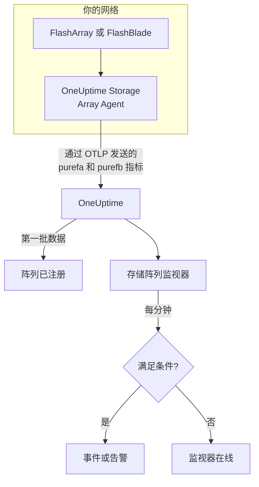

# 存储阵列监控

存储阵列监视器监视一个存储阵列，并在阵列自身发出告警、空间不足、变慢、丢失硬件或主机路径，或复制落后时通知你。它支持 Pure Storage FlashArray 和 Pure Storage FlashBlade，读取阵列自身导出的指标——Pure 的 `purefa_*` 和 `purefb_*` 序列——这些指标由 OneUptime Storage Array Agent 采集。

:::cards
- [创建监视器](#创建存储阵列监视器): 在仪表板中的六个步骤。
- [模板](#预置告警模板): 十八个现成的告警，每个卷、主机或组件一个事件。
- [Pure 序列的工作方式](#pure-序列的结构): 一个指标名称，多个数值。
- [指标](#采集的指标): 监视器可以据以告警的每个序列。
:::

## 工作原理

OneUptime Storage Array Agent 运行在能够访问阵列管理接口的机器上。它使用只读 API 令牌读取阵列的指标，为指标打上阵列的名称 `storage.array.name` 和平台 `storage.system` 标签，并通过 OTLP 发送到 OneUptime。第一批数据到达时会注册该阵列。

存储阵列监视器绑定到一个阵列。它每分钟对该阵列的指标运行一次查询，并将结果与其条件进行比较。



## 开始之前

- **安装 Storage Array Agent**，安装在能通过 HTTPS 访问阵列的位置，并使用拥有阵列 **readonly** 角色的用户的 API 令牌。[Storage Array Agent 指南](/docs/telemetry/storage-arrays) 介绍了用户、令牌和安装，涉及 `ONEUPTIME_URL`、`ONEUPTIME_TELEMETRY_INGESTION_KEY`、`STORAGE_ARRAY_NAME`，以及阵列的地址和令牌(`PURE_FA_ENDPOINT` 和 `PURE_FA_API_TOKEN`，或 `PURE_FB_ENDPOINT` 和 `PURE_FB_API_TOKEN`)。
- **确认阵列已注册。** 在第一次采集后大约一分钟，它会以代理的 `STORAGE_ARRAY_NAME` 命名，出现在 **产品 → 基础设施 → Storage Arrays → All Storage Arrays** 下。

## 创建存储阵列监视器

:::steps
### 新建监视器

进入 **监视器**，点击 **创建监视器**。

### 选择存储阵列

在 **监视器类型** 下点击 **更多监视器类型**，然后在 **基础设施** 下选择 **存储阵列**，或在搜索框中输入 `storage`。输入 **名称**(它会用在事件和告警标题中)，然后点击 **下一步**。

### 选择阵列

在 **Storage Array Monitor Configuration** 下，从 **存储阵列** 中选择阵列。每个发送过数据的阵列都在列表中。阵列的平台决定了表单提供哪些指标和模板。

### 选择要监视的内容

选择三个选项卡之一：

- **Quick Setup**：点击一个 [模板](#预置告警模板)。它会设置指标、标签过滤器、聚合、时间范围和阈值，并用自己的条件替换下面的条件。你仍然可以修改 **时间范围**。
- **Custom Metric**：从 **Storage Array Metric** 中选择一个指标，然后设置 **聚合** 和 **时间范围**。[过滤器](#监视器设置) 可以把它缩小到一个卷、主机、Pod、组件、文件系统或存储桶。
- **高级**：在 **选择指标** 下自己构建查询和公式，例如用 `purefa_array_space_bytes` 过滤到 `space=capacity`，减去同一指标过滤到 `space=empty`，得到已用容量。用对象的标签 **Group by**，即可分别判断每个对象。

### 检查条件

打开 **监视器条件** 下的每个条件，检查其 **指标**、**聚合**、**条件** 和 **Threshold**。模板会填写这些内容。使用 **Custom Metric** 或 **高级** 时，监视器从 [默认条件](#默认条件) 开始，它只会注意到指标降为零，所以请设置你自己的阈值。

### 创建监视器

点击 **创建监视器**。OneUptime 会打开监视器的页面，并每分钟评估一次。它发出的事件和告警也会列在阵列的 **事件** 和 **警报** 页面上。
:::

> [!TIP]
> 要一次设置多个模板，请从 **产品 → 基础设施 → Storage Arrays** 打开阵列，然后进入 **Recommendations**。选择你需要的模板和要呼叫的人员，OneUptime 会为每个模板创建一个监视器。

## 监视器设置

| 字段 | 选项卡 | 作用 |
| --- | --- | --- |
| **存储阵列** | 全部 | 必填。把每个查询限定到 `resource.storage.array.name`，因此两个都有名为 `vol-01` 的卷的阵列永远不会混在一起。 |
| **卷** | Custom Metric、高级 | 仅限 FlashArray。一个卷，按 `name` 标签，例如 `vol-db-01`。Pod 或卷组中的卷命名为 `pod::volume` 或 `group/volume`。 |
| **主机** | Custom Metric、高级 | 仅限 FlashArray。阵列所知的一台主机，按 `host` 标签，例如 `esxi-01`。 |
| **Pod** | Custom Metric、高级 | 仅限 FlashArray。一个 ActiveCluster 或 ActiveDR Pod，按 `name` 标签，在副本链接序列上则按 `local_pod`。 |
| **Hardware Component** | Custom Metric、高级 | 一个硬件组件，例如 `CH0.BAY1` 或 `CT0`：在 FlashArray 上是 `component_name` 标签，在 FlashBlade 上是 `name`。 |
| **File System** | Custom Metric、高级 | 仅限 FlashBlade。一个文件系统，按 `name` 标签。 |
| **Bucket** | Custom Metric、高级 | 仅限 FlashBlade。一个对象存储桶，按 `name` 标签。 |
| **Storage Array Metric** | Custom Metric | [目录](#采集的指标) 中的一个指标。表单会添加赋予其含义的标签过滤器，并按它描述的对象分组，因此每个卷、主机或组件都会单独判断。 |
| **聚合** | Custom Metric | 如何合并样本：**平均值**、**最大值**、**最小值**、**总和** 或 **计数**。从该指标的常用聚合开始。 |
| **时间范围** | 全部 | 查询读取的滚动窗口，从 **Past 1 Minute** 到 **Past 365 Days**。新监视器从 **Past 5 Minutes** 开始；文件系统或存储桶的自定义指标从 **Past 15 Minutes** 开始；模板会设置自己的值。 |
| **选择指标** | 高级 | 查询构建器：**指标**、**Aggregate by**、**Filter by attributes**、**Group by**，以及用于合并查询的 **添加指标** 和 **添加公式**。 |

代理每 60 秒读取一次阵列端点，每 2 分钟读取一次卷、主机和 Pod，因此 5 分钟的窗口中总会有样本。它每 5 分钟读取一次 FlashBlade 的文件系统和存储桶(所以用 15 分钟)，每 30 分钟读取一次 FlashArray 目录：请给目录监视器设置 60 分钟的窗口。

## Pure 序列的结构

Pure 把多个数值放在 **一个** 指标名称上，并用一个标签区分它们：

- **`dimension`** 用于性能序列。`purefa_array_performance_latency_usec` 带有读延迟(`usec_per_read_op`)、写延迟(`usec_per_write_op`)、镜像写延迟，以及每项的 SAN、队列、QoS 和服务时间。请始终按一个 `dimension` 过滤：跨它们取平均会把 200 µs 的读延迟和一个队列数值混在一起。
- **`space`** 用于容量序列：`capacity`、`empty`、`snapshots`、`total_provisioned`、`total_physical`、`available_ratio` 等。

有几个序列把状态放在 **标签** 中，其值始终为 1：

| 序列 | 状态标签 | 每个序列对应 |
| --- | --- | --- |
| `purefa_alerts_open` | `severity`，并带有 `summary`、`code` 和 `component_type` | 一个未关闭的告警 |
| `purefa_hw_component_status` | `component_status` | 一个硬件组件 |
| `purefa_host_connectivity_info` | `status`，并带有 `details` | 一台主机 |
| `purefa_drive_capacity_bytes` | `component_status`(值为驱动器的容量) | 一个驱动器 |

过滤到某个不良状态的序列只在有对象处于该状态时才存在，因此没有序列就意味着健康。这就是为什么 **Max 大于 0 时触发、为 0 时恢复** 是适合它们的形式，模板也是这样构建的：它们的恢复条件把缺失的序列计为零。

在监视器过滤器和分组键中，代理的属性以 `resource.` 开头(`resource.storage.array.name`、`resource.storage.system`)，而 Pure 自己的标签不以它开头(`name`、`host`、`component_name`、`dimension`、`space`、`severity`)。

## 预置告警模板

OneUptime 提供 18 个模板——11 个用于 FlashArray，7 个用于 FlashBlade——**Quick Setup** 会提供适用于阵列平台的那些模板。每个模板都会构建一个完整的监视器：指标查询、其标签过滤器、按对象自身标签的分组、一个触发条件和一个恢复条件。阈值是可以编辑的起点。

只有当条件对窗口中的 **每个** 值都成立时，条件才会触发。在容量、延迟、滞后或比率阈值上触发的监视器，只有越过阈值 10% 后才会恢复，因此在阈值附近徘徊的值不会来回切换；告警和硬件模板会在状态消失时立即恢复。

### FlashArray

| 模板 | 类别 | 严重程度 | 监视内容 | 触发条件 |
| --- | --- | --- | --- | --- |
| Critical Array Alert | Array Health | 严重 | `purefa_alerts_open` 过滤到 `severity=critical`，按 `summary` 取 Max，过去 5 分钟 | > 0 — 阵列有一个未关闭的严重告警(组件故障、容量紧急、复制失败)。每个告警一个事件；告警关闭时恢复 |
| Warning Array Alert | Array Health | Warning | `purefa_alerts_open` 过滤到 `severity=warning`，按 `summary` 取 Max，过去 5 分钟 | > 0 — 阵列有一个未关闭的警告级告警。每个告警一个事件；告警关闭时恢复 |
| Capacity Above 80% | 容量 | Warning | `purefa_array_space_utilization`，Max，过去 15 分钟 | > 80 — Pure 自己的第一个容量阈值；≤ 72 时恢复 |
| Capacity Above 90% | 容量 | 严重 | `purefa_array_space_utilization`，Max，过去 5 分钟 | > 90 — 阵列即将拒绝写入；≤ 81 时恢复 |
| High Read Latency | Performance | Warning | `purefa_array_performance_latency_usec` 过滤到 `dimension=usec_per_read_op`，Avg，过去 10 分钟 | > 5000 µs (5 ms) — FlashArray 的读取通常远低于 1 ms；≤ 4500 时恢复 |
| High Write Latency | Performance | Warning | `purefa_array_performance_latency_usec` 过滤到 `dimension=usec_per_write_op`，Avg，过去 10 分钟 | > 5000 µs (5 ms)；≤ 4500 时恢复 |
| Hardware Component Failed | Hardware | 严重 | `purefa_hw_component_status` 过滤到 `component_status=critical`，按 `component_name` 取 Max，过去 5 分钟 | > 0 — 某个控制器、电源、风扇、托架或端口处于严重状态，冗余已经丧失。每个组件一个事件；它报告 ok 时恢复 |
| Hardware Component Degraded | Hardware | Warning | `purefa_hw_component_status` 过滤到 `component_status=degraded`，按 `component_name` 取 Max，过去 5 分钟 | > 0 — 某个组件已降级。每个组件一个事件；它报告 ok 时恢复 |
| Drive Failed | Hardware | 严重 | `purefa_drive_capacity_bytes` 过滤到 `component_status=failed`，按 `component_name` 取 Max，过去 5 分钟 | > 0 — 某个 DirectFlash 模块或 SSD 发生故障，阵列正在其余驱动器上重建。每个驱动器一个事件；更换后恢复 |
| Host Lost Redundant Paths | 主机 | Warning | `purefa_host_connectivity_info` 过滤到 `status=critical`，按 `host` 取 Max，过去 5 分钟 | > 0 — 主机只能通过一个控制器访问阵列，或完全无法访问；一次控制器故障切换就会让它的存储离线。每台主机一个事件；路径恢复时恢复 |
| Replication Lag Above 1 Minute | Replication | Warning | `purefa_pod_replica_links_lag_max_msec`，按 `local_pod` 取 Max，过去 10 分钟 | > 60000 ms (60 s) — 此时故障切换会丢失比计划更多的近期写入。每个 Pod 一个事件；≤ 54000 时恢复 |

### FlashBlade

| 模板 | 类别 | 严重程度 | 监视内容 | 触发条件 |
| --- | --- | --- | --- | --- |
| Critical Array Alert | Array Health | 严重 | `purefb_alerts_open` 过滤到 `severity=critical`，按 `summary` 取 Max，过去 5 分钟 | > 0 — FlashBlade 有一个未关闭的严重告警。每个告警一个事件；告警关闭时恢复 |
| Warning Array Alert | Array Health | Warning | `purefb_alerts_open` 过滤到 `severity=warning`，按 `summary` 取 Max，过去 5 分钟 | > 0 — FlashBlade 有一个未关闭的警告级告警。每个告警一个事件；告警关闭时恢复 |
| Capacity Above 80% | 容量 | Warning | `purefb_array_space_utilization` 过滤到 `type=array`，Max，过去 15 分钟 | > 80；≤ 72 时恢复 |
| Capacity Above 90% | 容量 | 严重 | `purefb_array_space_utilization` 过滤到 `type=array`，Max，过去 5 分钟 | > 90 — 写满时每个客户端的写入都会失败；≤ 81 时恢复 |
| Hardware Component Unhealthy | Hardware | 严重 | `purefb_hardware_health`，按 `name` 取 Min，过去 5 分钟 | < 1 — 某个刀片、交换模块、电源或风扇不健康(未使用的插槽报告 2)。每个组件一个事件；≥ 1 时恢复 |
| High Read Latency | Performance | Warning | `purefb_array_performance_latency_usec` 过滤到 `dimension=usec_per_read_op` 和 `protocol=all`，Avg，过去 10 分钟 | > 10000 µs (10 ms)，跨所有协议；≤ 9000 时恢复 |
| File System Near Full | File Systems | Warning | `purefb_file_systems_space_bytes` 过滤到 `space=available_ratio`，按 `name` 取 Min，过去 15 分钟 | < 0.1 — 文件系统预配大小的剩余不足 10%。每个文件系统一个事件；≥ 0.11 时恢复 |

**严重程度** 是选择器显示的标签。模板创建的事件和告警以项目中最严重的事件和告警严重程度开始；可以在条件中修改。

- **未关闭的告警和硬件状态使用 Max**，因为这类序列只在告警未关闭或组件处于该状态时才存在，所以只要有一次采集显示它，就会越过阈值。
- **每个按对象的模板都按对象自身的标签分组**(`summary`、`component_name`、`host`、`local_pod`、`name`)，因此每个受影响的对象各触发一个事件，并且事件中会写出该对象。
- **延迟模板使用 Avg**，对阵列自身计算的每次操作平均值取平均；容量模板对阵列自身的利用率百分比取 **Max**。延迟固定以微秒为单位，容量固定以百分比为单位。
- **Hardware Component Unhealthy 按组件使用 Min**：组件健康时其健康值为 1，不健康时降到 0。

没有针对每个卷延迟的模板，因为合适的阈值取决于工作负载：请从目录中按 `name` 分组自行构建。容量预测需要的是增长趋势而不是阈值，而驱动器磨损没有可以告警的序列。

## 采集的指标

代理会发送阵列导出的所有内容；下面的序列是监视器表单提供的目录。每个值都是阵列自己计算的仪表值——延迟以每次操作的微秒计，吞吐量以每秒计——因此不需要计算速率。**过滤器** 是赋予序列该行所述含义的标签过滤器；表单会替你应用它。

### Array Health

| 指标 | 过滤器 | 平台 | 单位 | 描述 |
| --- | --- | --- | --- | --- |
| `purefa_alerts_open` | — | FlashArray | `count` | 阵列上每个未关闭的告警一个序列(值为 1)，带有标签 `severity`(`critical`、`warning`、`info`、`hidden`)、`category`、`code`、`component_type` 和 `summary` |
| `purefb_alerts_open` | — | FlashBlade | `count` | FlashBlade 上每个未关闭的告警一个序列(值为 1)，带有标签 `severity`(`info`、`warning`、`critical`)、`code`、`component_name`、`component_type`、`summary` 和 `kburl`(Pure 知识库文章) |

### Capacity

| 指标 | 过滤器 | 平台 | 单位 | 描述 |
| --- | --- | --- | --- | --- |
| `purefa_array_space_utilization` | — | FlashArray | `%` | 阵列可用容量中已使用的比例。Pure 自己会在 80%、90% 和 100% 时发出容量告警 |
| `purefa_array_space_bytes` | `space=capacity` | FlashArray | `bytes` | 阵列的可用容量 |
| `purefa_array_space_bytes` | `space=empty` | FlashArray | `bytes` | 未使用的容量——关注其趋势可以预测阵列何时写满 |
| `purefa_array_space_bytes` | `space=snapshots` | FlashArray | `bytes` | 仅由快照占用的物理空间；快速增长通常意味着某个保护组保留的快照比计划的多 |
| `purefa_array_space_data_reduction_ratio` | — | FlashArray | `ratio` | 整个阵列的重复数据删除和压缩，例如 4.2:1 记为 4.2。持续下降意味着新数据的缩减效果不佳 |
| `purefb_array_space_utilization` | `type=array` | FlashBlade | `%` | FlashBlade 可用容量中已使用的比例 |
| `purefb_array_space_bytes` | `type=array`、`space=empty` | FlashBlade | `bytes` | FlashBlade 未使用的容量 |
| `purefb_array_space_data_reduction_ratio` | `type=array` | FlashBlade | `ratio` | 整个 FlashBlade 的数据缩减 |

### Performance

| 指标 | 过滤器 | 平台 | 单位 | 描述 |
| --- | --- | --- | --- | --- |
| `purefa_array_performance_latency_usec` | `dimension=usec_per_read_op` | FlashArray | `µs` | 主机看到的读取平均延迟；FlashArray 的读取通常远低于 1 ms |
| `purefa_array_performance_latency_usec` | `dimension=usec_per_write_op` | FlashArray | `µs` | 主机看到的写入平均延迟 |
| `purefa_array_performance_latency_usec` | `dimension=usec_per_mirrored_write_op` | FlashArray | `µs` | 写入延伸 ActiveCluster Pod 的平均延迟，包括到伙伴阵列的往返 |
| `purefa_array_performance_latency_usec` | `dimension=san_usec_per_read_op` | FlashArray | `µs` | 读取在 SAN 中花费的时间；SAN 延迟高而服务延迟低时，问题指向交换网络或主机 |
| `purefa_array_performance_throughput_iops` | `dimension=reads_per_sec` | FlashArray | `ops/s` | 每秒读操作数 |
| `purefa_array_performance_throughput_iops` | `dimension=writes_per_sec` | FlashArray | `ops/s` | 每秒写操作数 |
| `purefa_array_performance_bandwidth_bytes` | `dimension=read_bytes_per_sec` | FlashArray | `bytes/s` | 每秒读取的字节数 |
| `purefa_array_performance_bandwidth_bytes` | `dimension=write_bytes_per_sec` | FlashArray | `bytes/s` | 每秒写入的字节数 |
| `purefa_array_performance_queue_depth_ops` | — | FlashArray | `ops` | 阵列上排队的操作；队列增长且延迟上升意味着主机发送的量超过了阵列的处理能力 |
| `purefa_array_performance_average_bytes` | `dimension=bytes_per_op` | FlashArray | `bytes` | 操作的平均大小——大 I/O 即使一切正常也会增加延迟 |
| `purefb_array_performance_latency_usec` | `dimension=usec_per_read_op`、`protocol=all` | FlashBlade | `µs` | 所有协议的读取平均延迟 |
| `purefb_array_performance_latency_usec` | `dimension=usec_per_write_op`、`protocol=all` | FlashBlade | `µs` | 所有协议的写入平均延迟 |
| `purefb_array_performance_throughput_iops` | `dimension=reads_per_sec`、`protocol=all` | FlashBlade | `ops/s` | 所有协议的每秒读操作数 |
| `purefb_array_performance_throughput_iops` | `dimension=writes_per_sec`、`protocol=all` | FlashBlade | `ops/s` | 所有协议的每秒写操作数 |
| `purefb_array_performance_bandwidth_bytes` | `dimension=read_bytes_per_sec`、`protocol=all` | FlashBlade | `bytes/s` | 所有协议的每秒读取字节数 |
| `purefb_array_performance_bandwidth_bytes` | `dimension=write_bytes_per_sec`、`protocol=all` | FlashBlade | `bytes/s` | 所有协议的每秒写入字节数 |

### Volumes

| 指标 | 过滤器 | 平台 | 单位 | 描述 |
| --- | --- | --- | --- | --- |
| `purefa_volume_performance_latency_usec` | `dimension=usec_per_read_op` | FlashArray | `µs` | 每个卷的读取平均延迟——按 `name` 分组 |
| `purefa_volume_performance_latency_usec` | `dimension=usec_per_write_op` | FlashArray | `µs` | 每个卷的写入平均延迟 |
| `purefa_volume_performance_throughput_iops` | `dimension=reads_per_sec` | FlashArray | `ops/s` | 每个卷的每秒读操作数 |
| `purefa_volume_performance_throughput_iops` | `dimension=writes_per_sec` | FlashArray | `ops/s` | 每个卷的每秒写操作数 |
| `purefa_volume_performance_bandwidth_bytes` | `dimension=read_bytes_per_sec` | FlashArray | `bytes/s` | 每秒从每个卷读取的字节数 |
| `purefa_volume_performance_bandwidth_bytes` | `dimension=write_bytes_per_sec` | FlashArray | `bytes/s` | 每秒写入每个卷的字节数 |
| `purefa_volume_space_bytes` | `space=total_provisioned` | FlashArray | `bytes` | 主机看到的每个卷的大小 |
| `purefa_volume_space_bytes` | `space=total_physical` | FlashArray | `bytes` | 每个卷在数据缩减后占用的物理空间 |
| `purefa_volume_space_data_reduction_ratio` | — | FlashArray | `ratio` | 每个卷的数据缩减比 |

### Hosts

| 指标 | 过滤器 | 平台 | 单位 | 描述 |
| --- | --- | --- | --- | --- |
| `purefa_host_connectivity_info` | — | FlashArray | `count` | 每台主机一个序列(值为 1)，带有连接标签 `status`(`healthy`、`critical`、`unused`)和 `details`(`Redundant`、`Single Controller`、`None`……) |
| `purefa_host_performance_latency_usec` | `dimension=usec_per_read_op` | FlashArray | `µs` | 每台主机看到的读取平均延迟——按 `host` 分组 |
| `purefa_host_performance_latency_usec` | `dimension=usec_per_write_op` | FlashArray | `µs` | 每台主机看到的写入平均延迟 |
| `purefa_host_performance_throughput_iops` | `dimension=reads_per_sec` | FlashArray | `ops/s` | 每台主机的每秒读操作数 |
| `purefa_host_performance_throughput_iops` | `dimension=writes_per_sec` | FlashArray | `ops/s` | 每台主机的每秒写操作数 |

### Replication

| 指标 | 过滤器 | 平台 | 单位 | 描述 |
| --- | --- | --- | --- | --- |
| `purefa_pod_replica_links_lag_max_msec` | — | FlashArray | `ms` | 每条 Pod 副本链接(ActiveDR / 异步)的最大复制滞后，带有标签 `local_pod`、`remote_pod`、`remote`、`direction` 和 `status`——按 `local_pod` 分组 |
| `purefa_pod_replica_links_lag_average_msec` | — | FlashArray | `ms` | 每条 Pod 副本链接的平均复制滞后 |
| `purefa_pod_performance_replication_bandwidth_bytes` | — | FlashArray | `bytes/s` | 每个 Pod 的复制流量，带有标签 `direction` 和 `dimension` |
| `purefa_pod_performance_latency_usec` | `dimension=usec_per_mirrored_write_op` | FlashArray | `µs` | 每个 ActiveCluster Pod 的镜像写平均延迟 |

### Hardware

| 指标 | 过滤器 | 平台 | 单位 | 描述 |
| --- | --- | --- | --- | --- |
| `purefa_hw_component_status` | — | FlashArray | `count` | 每个硬件组件一个序列(值为 1)——机箱、控制器、驱动器和 NVRAM 托架、电源、风扇、温度传感器、以太网和光纤通道端口——带有标签 `component_status`(`ok`、`critical`、`degraded`、`device_off`、`identifying`、`not_installed`、`unknown`) |
| `purefa_hw_component_temperature_celsius` | — | FlashArray | `°C` | 每个传感器的温度——按 `component_name` 分组 |
| `purefa_drive_capacity_bytes` | — | FlashArray | `bytes` | 每个驱动器的原始容量，带有其 `component_status`(`healthy`、`failed`、`missing`、`recovering`、`unhealthy`、`empty`……)和类型标签 |
| `purefa_network_interface_performance_errors` | `dimension=total_errors_per_sec` | FlashArray | `errors/s` | 每个以太网和光纤通道接口上的每秒错误数——持续出错通常意味着线缆、光模块或交换机端口有问题 |
| `purefb_hardware_health` | — | FlashBlade | — | 每个硬件组件(刀片、交换模块、电源、风扇……)的健康状况：1 = 健康，2 = 未使用，0 = 不健康。按 `name` 取最小值 |

### File Systems

| 指标 | 过滤器 | 平台 | 单位 | 描述 |
| --- | --- | --- | --- | --- |
| `purefb_file_systems_performance_latency_usec` | `dimension=usec_per_read_op` | FlashBlade | `µs` | 每个文件系统的读取平均延迟——按 `name` 分组 |
| `purefb_file_systems_performance_latency_usec` | `dimension=usec_per_write_op` | FlashBlade | `µs` | 每个文件系统的写入平均延迟 |
| `purefb_file_systems_space_bytes` | `space=total_physical` | FlashBlade | `bytes` | 每个文件系统占用的物理空间 |
| `purefb_file_systems_space_bytes` | `space=available_ratio` | FlashBlade | `ratio` | 每个文件系统预配大小中仍然空闲的比例，从 0 到 1——接近 0 时它即将用满配额 |

### Buckets

| 指标 | 过滤器 | 平台 | 单位 | 描述 |
| --- | --- | --- | --- | --- |
| `purefb_buckets_performance_latency_usec` | `dimension=usec_per_read_op` | FlashBlade | `µs` | 每个存储桶的读取平均延迟——按 `name` 分组 |
| `purefb_buckets_space_bytes` | `space=total_physical` | FlashBlade | `bytes` | 每个存储桶占用的物理空间 |
| `purefb_buckets_object_count` | — | FlashBlade | `count` | 每个存储桶中的对象数量 |

## 监控条件

条件把监视器的某个查询或公式与阈值进行比较。存储阵列监视器的条件没有 **过滤器类型**：每条规则都用以下字段检查指标值。

| 字段 | 作用 |
| --- | --- |
| **指标** | 要检查的查询或公式，按其变量名。 |
| **聚合** | 窗口中的值如何变成一个答案：**平均值**、**总和**、**Maximum Value**、**Minimum Value**、**All Values**(每个值都必须匹配)或 **Any Value**(一个就够)。 |
| **条件** | **Greater Than**、**Less Than**、**Greater Than Or Equal To**、**Less Than Or Equal To** 或 **Equal To**——或者一个异常条件：**Anomalously High**、**Anomalously Low** 或 **Anomalous**。 |
| **Threshold** | 用于比较的值。指标有单位时，旁边会有一个单位列表。异常条件不显示此字段。 |
| **灵敏度** | 仅限异常条件。**低**(4σ)、**中**(3σ，默认)或 **高**(2σ)。 |
| **基线窗口** | 仅限异常条件。14 天(默认)、28、60 或 90 天的历史。 |
| **如果无数据** | 位于 **更多字段** 下。窗口中没有样本时会发生什么：**Ignore**(默认)、**Treat As Zero** 或 **触发器**。 |

异常条件会把每个值与基线中一周内相同时段的值进行比较。在基线窗口积累足够的历史之前，它们会一直处于 "Learning" 状态，不会发出任何告警。

一些可以作为起点的条件：

- **某个卷变慢：** `purefa_volume_performance_latency_usec` 过滤到 `dimension=usec_per_read_op`，平均值，按 `name` 分组，**Greater Than** `2000`，过去 10 分钟。
- **阵列即将写满：** `purefa_array_space_utilization`，最大值，**Greater Than** `85`，过去 15 分钟。
- **某台主机只通过一个控制器运行：** `purefa_host_connectivity_info` 过滤到 `status=critical`，最大值，按 `host` 分组，**Greater Than** `0`。
- **某个 FlashBlade 文件系统几乎已满：** `purefb_file_systems_space_bytes` 过滤到 `space=available_ratio`，最小值，按 `name` 分组，**Less Than** `0.05`。

### 默认条件

不是从模板构建的监视器以两个条件开始：

| 顺序 | 条件 | 匹配时机 | 然后 |
| --- | --- | --- | --- |
| 1 | Check if _monitor name_ is offline | 第一个查询的任意值为 `0` | 把监视器标记为 **离线**，并声明事件 "_monitor name_ is offline"，监视器恢复时该事件会自行解决。 |
| 2 | Check if _monitor name_ is online | 任意值大于 `0` | 把监视器标记为 **运行正常**。 |

> [!IMPORTANT]
> 静默不会匹配任何一个条件：停止发送数据的阵列会让监视器保持原样。要在数据停止时收到通知，请在某个条件上把 **如果无数据** 设置为 **触发器**。OneUptime 自身未接收数据的时间永远不算作没有数据：窗口包含这段时间的检查会改为等待，正如 [OneUptime 未接收数据时](/docs/monitor/when-oneuptime-is-not-receiving) 所解释的那样。

## Terraform

[OneUptime Terraform 提供程序](/docs/terraform/monitor-steps) 在 `storage_array_monitor` 属性中承载存储阵列监视器步骤的配置：即 `storageArrayMonitor` 配置(`arrayIdentifier`、`storageSystem`、`resourceFilters`、`metricViewConfig`、`rollingTime`)的原始 JSON，用 `jsonencode()` 编写：

```hcl title="main.tf"
monitor_steps = [{
  storage_array_monitor = jsonencode({
    arrayIdentifier = "my-storage-array"
    storageSystem   = "purestorage.flasharray"
    resourceFilters = {}
    rollingTime     = "Past 15 Minutes"
    metricViewConfig = {
      queryConfigs = [{
        metricAliasData = { metricVariable = "capacity_used_percent", title = "Capacity Used", description = "", legend = "" }
        metricQueryData = {
          filterData = {
            metricName     = "purefa_array_space_utilization"
            attributes     = {}
            aggegationType = "Max"
            aggregateBy    = {}
          }
        }
      }]
      formulaConfigs = []
    }
  })
  criteria = [ /* ... */ ]
}]
```

`arrayIdentifier` 是阵列的 `storage.array.name`——即代理启动时使用的 `STORAGE_ARRAY_NAME`——而不是它的 OneUptime ID。`storageSystem` 是 `purestorage.flasharray` 或 `purestorage.flashblade`。它决定表单显示哪个目录和哪些模板，以及硬件过滤器读取 `component_name` 还是 `name`。

## 故障排查

:::details 阵列不在存储阵列列表中
阵列会根据代理的数据自行注册。请检查代理是否在运行并发送数据(请参阅 [Storage Array Agent 指南](/docs/telemetry/storage-arrays))，以及是否设置了 `STORAGE_ARRAY_NAME`。
:::

:::details 告警或硬件模板从不触发
这正是健康的情况。`purefa_alerts_open`、`purefa_hw_component_status`、`purefa_drive_capacity_bytes` 和 `purefa_host_connectivity_info` 把状态放在标签中，而过滤到不良状态的序列(`severity=critical`、`component_status=failed`)只在有对象处于该状态时才存在。要查看模板背后的序列，请在 **指标** 页面上不加过滤器运行它的查询。
:::

:::details 延迟监视器的读数不对
Pure 把读、写、镜像写、SAN、队列和 QoS 数值放在同一个指标名称上，只用 `dimension` 标签区分，而没有 `dimension` 过滤器的查询会把它们全部平均。请像模板和表单的目录那样，按一个维度过滤。按卷和按主机的序列只保留 `usec_per_read_op`、`usec_per_write_op` 和 `usec_per_mirrored_write_op`：代理为节省序列丢弃了其余部分，只有阵列级的 `purefa_array_performance_latency_usec` 保留全部。
:::

:::details 1 分钟的窗口没有显示数据
代理每 2 分钟读取一次卷、主机和 Pod，每 5 分钟读取一次 FlashBlade 的文件系统和存储桶，每 30 分钟读取一次 FlashArray 目录，因此 1 分钟的窗口中可能没有样本。请使用 5 分钟或更长：文件系统和存储桶用 15 分钟，目录用 60 分钟。
:::

:::details 事件对整个阵列只触发一次，而不是每个卷一次
按对象的标签对查询分组：卷、Pod、目录、文件系统和存储桶用 `name`，主机用 `host`，FlashArray 硬件用 `component_name`。Pure 的标签没有前缀，因此 `resource.name` 什么也匹配不到。
:::

## 后续步骤

:::cards
- [存储阵列代理](/docs/telemetry/storage-arrays): 安装发送指标的代理。
- [Ceph 监控](/docs/monitor/ceph-monitor): 用于 Ceph 存储集群的同类监视器。
- [指标监控](/docs/monitor/metrics-monitor): 对任何来源的任何指标发出告警。
- [事件概览](/docs/incidents/index): 条件声明事件之后会发生什么。
:::
