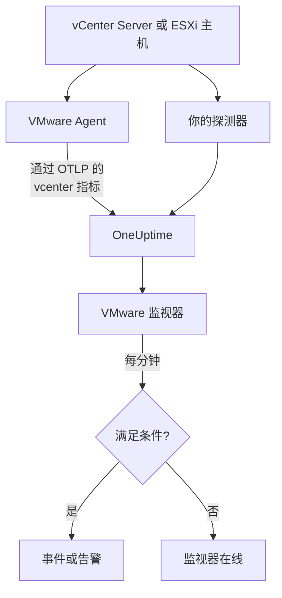

# VMware 监控

VMware 监视器监视一个 vCenter——它的数据中心、集群、ESXi 主机、虚拟机、数据存储、资源池和 vSAN——并在主机饱和、VM 缺少 CPU 或内存、数据存储写满，或 vSphere 发出警报时通知你。它读取 OneUptime VMware Agent 采集的 `vcenter.*` 指标，或你的某个探测器在无代理情况下采集的指标。

:::cards
- [创建监视器](#创建-vmware-监视器): 在仪表板中的六个步骤。
- [模板](#预置告警模板): 二十三个现成的告警，每台主机、每个 VM 或每个数据存储一个事件。
- [标识属性](#标识属性): 如何定位一台主机、一个 VM 或一个数据存储。
- [指标](#采集的指标): 监视器可以据以告警的每个 `vcenter.*` 序列。
:::

## 工作原理

指标来自 vCenter 的 API，使用只读账户通过以下两种方式之一读取：

- **VMware Agent**：一个带有 `vcenter` 接收器的 OpenTelemetry Collector，运行在能够访问 vCenter 的机器上。请参阅 [VMware 代理](/docs/telemetry/vmware)。
- **探测器**：无需安装任何东西：在 OneUptime 中连接 vCenter，并选择能访问它的探测器。请参阅 [无需代理的 VMware](/docs/telemetry/vmware-agentless)。

两者都会在每个采集间隔(默认 2 分钟)发送相同的序列，并标记上 vCenter 的名称 `vmware.vcenter.name`。一个 vCenter 就是一个 vSphere 端点：一台 vCenter Server 或一台独立的 ESXi 主机。VMware 监视器绑定到一个 vCenter。它每分钟对该 vCenter 的指标运行一次查询，并将结果与其条件进行比较。



## 开始之前

- **采集 vCenter 的指标**，使用 [VMware Agent](/docs/telemetry/vmware) 或 [无需代理](/docs/telemetry/vmware-agentless)。两者都使用一个在顶层 vCenter 对象上拥有 **Read-Only** 角色、并勾选了 **Propagate to children** 的 vSphere 用户。代理读取 `ONEUPTIME_URL`、`ONEUPTIME_TELEMETRY_INGESTION_KEY`、`VMWARE_VCENTER_NAME`、`VCENTER_ENDPOINT`、`VCENTER_USERNAME` 和 `VCENTER_PASSWORD`。
- **确认 vCenter 已注册。** 它会出现在 **产品 → 基础设施 → VMware → 所有 vCenter** 下：通过代理时，在第一次完整采集后以代理的 `VMWARE_VCENTER_NAME` 命名；无代理时，从你连接它的那一刻起出现。

## 创建 VMware 监视器

:::steps
### 新建监视器

进入 **监视器**，点击 **创建监视器**。

### 选择 VMware

在 **监视器类型** 下点击 **更多监视器类型**，然后在 **基础设施** 下选择 **VMware**，或在搜索框中输入 `vmware`。输入 **名称**(它会用在事件和告警标题中)，然后点击 **下一步**。

### 选择 vCenter

在 **VMware Monitor Configuration** 下，从 **vCenter** 中选择 vCenter。每个发送过数据或你在无代理情况下连接的 vCenter 都在列表中。

### 选择要监视的内容

选择三个选项卡之一：

- **Quick Setup**：点击一个 [模板](#预置告警模板)。它会设置指标、属性过滤器、聚合、时间范围、分组和阈值，并用自己的条件替换下面的条件。你仍然可以修改 **时间范围**。
- **Custom Metric**：从 **VMware Metric** 中选择一个指标，然后设置 **聚合** 和 **时间范围**。表单会按它描述的对象分组，因此每台主机、每个 VM 或每个数据存储都会单独判断，而 [过滤器](#监视器设置) 可以把它缩小到一个数据中心、集群、主机、VM、数据存储或资源池。
- **高级**：在 **选择指标** 下自己构建查询和公式，并按 `disk_state`、`power_state` 或 `status` 等属性过滤。用一个 [标识属性](#标识属性) 进行 **Group by**，即可分别判断每个对象。

### 检查条件

打开 **监视器条件** 下的每个条件，检查其 **指标**、**聚合**、**条件** 和 **Threshold**。模板会填写这些内容。使用 **Custom Metric** 或 **高级** 时，监视器从 [默认条件](#默认条件) 开始，它只会注意到指标降为零，所以请设置你自己的阈值。

### 创建监视器

点击 **创建监视器**。OneUptime 会打开监视器的页面，并每分钟评估一次。它发出的事件和告警也会列在 vCenter 的 **事件** 和 **警报** 页面上。
:::

> [!TIP]
> 要一次设置多个模板，请从 **产品 → 基础设施 → VMware** 打开 vCenter，然后进入 **Recommendations**。选择你需要的模板和要呼叫的人员，OneUptime 会为每个模板创建一个监视器。

## 监视器设置

| 字段 | 选项卡 | 作用 |
| --- | --- | --- |
| **vCenter** | 全部 | 必填。把每个查询限定到 `resource.vmware.vcenter.name`。 |
| **Datacenter** | Custom Metric、高级 | 可选。一个数据中心：`resource.vcenter.datacenter.name`。每个序列都带有它。 |
| **集群** | Custom Metric、高级 | 可选。一个集群：`resource.vcenter.cluster.name`。匹配集群自身的序列，以及其中的主机、VM 和资源池的序列；独立的 ESXi 主机没有集群。 |
| **ESXi Host** | Custom Metric、高级 | 可选。一台 ESXi 主机：`resource.vcenter.host.name`。匹配主机自身的序列 **以及** 它运行的每个 VM 的序列，因为 VM 带有其主机的名称。 |
| **Virtual Machine** | Custom Metric、高级 | 可选。一个 VM：`resource.vcenter.vm.name`。VM 名称不一定唯一：当两个 VM 同名时，请再加上一台主机或一个集群。 |
| **Datastore** | Custom Metric、高级 | 可选。一个数据存储：`resource.vcenter.datastore.name`。 |
| **Resource Pool Path** | Custom Metric、高级 | 可选。一个资源池，按其清单路径(`/DC/host/Cluster/Resources/pool`)：`resource.vcenter.resource_pool.inventory_path`。之所以用路径，是因为资源池名称只在其父对象内唯一。 |
| **VMware Metric** | Custom Metric | [目录](#采集的指标) 中的一个指标。 |
| **聚合** | Custom Metric | 如何合并样本：**平均值**、**最大值**、**最小值**、**总和** 或 **计数**。从该指标的常用聚合开始。 |
| **时间范围** | 全部 | 查询读取的滚动窗口，从 **Past 1 Minute** 到 **Past 365 Days**。新监视器从 **Past 5 Minutes** 开始；模板会设置自己的值。 |
| **选择指标** | 高级 | 查询构建器：**指标**、**Aggregate by**、**Filter by attributes**、**Group by**，以及用于合并查询的 **添加指标** 和 **添加公式**。 |

vCenter 每个采集间隔(默认 2 分钟)读取一次，因此 1 分钟的窗口可能根本没有样本。请把窗口保持在 5 分钟或更长；如果你为大型清单调高了采集间隔，还要更长。

## 标识属性

`vcenter` 接收器为每个 vSphere 对象发送一个 OpenTelemetry 资源，并用 **资源属性** 为它命名。一个序列带有哪些属性，就说明了它描述的是哪种对象：

| vSphere 对象 | 标识资源属性 |
| --- | --- |
| 数据中心 | `vcenter.datacenter.name` |
| 集群 | `vcenter.datacenter.name`、`vcenter.cluster.name` |
| ESXi 主机 | `vcenter.datacenter.name`、`vcenter.host.name`(属于集群时 + `vcenter.cluster.name`) |
| 虚拟机 | `vcenter.datacenter.name`、`vcenter.host.name`、`vcenter.vm.name`、`vcenter.vm.id`(+ `vcenter.cluster.name`；`vcenter.resource_pool.*` 或 `vcenter.virtual_app.*`) |
| VM 模板 | `vcenter.datacenter.name`、`vcenter.host.name`、`vcenter.vm_template.name`、`vcenter.vm_template.id` |
| 数据存储 | `vcenter.datacenter.name`、`vcenter.datastore.name` |
| 资源池 | `vcenter.datacenter.name`、`vcenter.resource_pool.name`、`vcenter.resource_pool.inventory_path`(+ `vcenter.cluster.name` 或 `vcenter.host.name`) |

在监视器过滤器和分组键中，资源属性以 `resource.` 开头(`resource.vcenter.host.name`)，而数据点属性不以它开头(`disk_state`、`power_state`、`status`、`effective`、`direction`、`object`、`type`)。布尔属性 `effective` 以文本 `"true"` 或 `"false"` 存储，因此请用文本过滤它。按标识属性过滤可定位一个对象，按它分组则可分别判断每个对象。

## 预置告警模板

OneUptime 为常见的 VMware 问题提供 23 个模板，**Quick Setup** 会提供全部模板。每个模板都会构建一个完整的监视器：指标查询、其属性过滤器、按对象自身标识属性的分组、一个触发条件和一个恢复条件。阈值是可以编辑的起点。

除非表格另有说明，模板读取过去 5 分钟。只有当条件在窗口的每一分钟都成立时，条件才会触发；阈值条件会在越过阈值 10% 后恢复，因此在这条线附近徘徊的值不会来回切换。

| 模板 | 类别 | 严重程度 | 监视内容 | 触发条件 | 恢复条件 |
| --- | --- | --- | --- | --- | --- |
| Host CPU Saturation | 主机 | Warning | `vcenter.host.cpu.utilization`，按 `resource.vcenter.host.name` 取 Avg | 高于 90%：主机上的每个 VM 都在争夺内核，并出现 CPU 就绪时间 | 达到或低于 81% |
| Host Memory Saturation | 主机 | Warning | `vcenter.host.memory.utilization`，按主机取 Avg | 高于 90%：主机开始通过气球回收、压缩和交换收回内存 | 达到或低于 81% |
| Host Disk Latency High | 主机 | Warning | `vcenter.host.disk.latency.max`，按主机取 Max | 高于 50 ms：磁盘位于该路径上的每个 VM 都在等待存储。需要性能计数器级别 3 | 达到或低于 45 ms |
| Host Network Packet Errors | 主机 | Warning | `vcenter.host.network.packet.error.rate`，按主机取 Max | 高于 0：几乎总是线缆、SFP 或交换机端口故障 | 恢复为 0 |
| Host Network Packet Drops | 主机 | Warning | `vcenter.host.network.packet.drop.rate`，按主机取 Max | 高于 0：上行链路超额订阅，或 NIC 环形缓冲区溢出 | 恢复为 0 |
| VM CPU Saturation | Virtual Machine | Warning | `vcenter.vm.cpu.utilization`，按 `resource.vcenter.vm.name` 取 Avg，**过去 15 分钟** | 在整整 15 分钟内都高于 VM vCPU 的 90%：VM 可以使用分配给它的资源，因此只有始终不降下来的 VM 才会呼叫 | 达到或低于 81% |
| VM CPU Ready Contention | Virtual Machine | Warning | `vcenter.vm.cpu.readiness`，按 VM 取 Avg | 高于 10%：VM 已准备好运行，但主机没有物理内核分配给它。在客户机内部看不到 | 达到或低于 9% |
| VM Memory Saturation | Virtual Machine | Warning | `vcenter.vm.memory.utilization`，按 VM 取 Avg | 高于其内存的 90%：客户机即将开始换页 | 达到或低于 81% |
| VM Memory Ballooning | Virtual Machine | Warning | `vcenter.vm.memory.ballooned`，按 VM 取 Max | 高于 0：主机内存不足，正在从这个客户机收回内存 | 恢复为 0 |
| VM Memory Swapping | Virtual Machine | 严重 | `vcenter.vm.memory.swapped`，按 VM 取 Max | 高于 0：主机正在交换 VM 的内存，这是在气球回收和压缩之后的最后手段 | 恢复为 0 |
| VM Disk Latency High | Virtual Machine | Warning | `vcenter.vm.disk.latency.max`，按 VM 取 Max | 高于 50 ms：客户机中的应用程序 I/O 超时 | 达到或低于 45 ms |
| VM Disk Usage High | Virtual Machine | Warning | `vcenter.vm.disk.utilization`，按 VM 取 Avg | 已占用其预配存储的 90% 以上：精简置备的 VM 即将占满其全部大小 | 达到或低于 81% |
| Datastore Capacity Warning | Datastore | Warning | `vcenter.datastore.disk.utilization`，按 `resource.vcenter.datastore.name` 取 Avg | 高于 80%：一个提前的警告，因为精简磁盘和快照会很快用完剩余空间 | 达到或低于 72% |
| Datastore Capacity Critical | Datastore | 严重 | `vcenter.datastore.disk.utilization`，按数据存储取 Avg | 高于 90%：写满的数据存储会暂停每个在其上有磁盘的 VM | 达到或低于 81% |
| Cluster Host Not Effective | 集群 | 严重 | `vcenter.cluster.host.count` 过滤到 `effective = false`，按 `resource.vcenter.cluster.name` 取 Max | 高于 0：某台主机处于维护模式、已断开连接或无响应，因此集群以低于其设计容量的容量运行 | 恢复为 0 |
| Datacenter Hosts Unhealthy | Datacenter | 严重 | `vcenter.datacenter.host.count` 过滤到 `status = red`，按 `resource.vcenter.datacenter.name` 取 Max | 高于 0：某台主机有严重警报，例如硬件传感器、丢失的存储路径或 HA 代理错误 | 恢复为 0 |
| Datacenter Hosts Degraded | Datacenter | Warning | `vcenter.datacenter.host.count` 过滤到 `status = yellow`，按数据中心取 Max | 高于 0：某台主机有警告级警报 | 恢复为 0 |
| Datacenter Hosts Powered Off | Datacenter | Warning | `vcenter.datacenter.host.count` 过滤到 `power_state = off`，按数据中心取 Max | 高于 0：某台主机已关机——它崩溃了、断电了，或被 DPM 置于待机状态 | 恢复为 0 |
| Datacenter VMs Unhealthy | Datacenter | Warning | `vcenter.datacenter.vm.count` 过滤到 `status = red`，按数据中心取 Max | 高于 0：某个 VM 有严重警报，例如 HA 重启失败、丢失的数据存储或丢失的 Tools 心跳 | 恢复为 0 |
| Datacenter Clusters Unhealthy | Datacenter | 严重 | `vcenter.datacenter.cluster.count` 过滤到 `status = red`，按数据中心取 Max | 高于 0：某个集群有严重警报，例如 HA 故障切换资源不足、HA 选举失败或严重的 vSAN 健康检查 | 恢复为 0 |
| vSAN Latency High | vSAN | Warning | `vcenter.cluster.vsan.latency.avg`，按集群取 Avg | 高于 20 000 µs (20 ms)：vSAN 数据存储上每个 VM 的存储都变慢。在没有 vSAN 的集群上保持静默 | 达到或低于 18 000 µs |
| vSAN Congestion | vSAN | Warning | `vcenter.cluster.vsan.congestions`，按集群取 Max | 高于 0：某个磁盘组跟不上，vSAN 正在减慢其客户端的 I/O | 恢复为 0 |
| Resource Pool Memory Swapped | 集群 | Warning | `vcenter.resource_pool.memory.swapped`，按 `resource.vcenter.resource_pool.inventory_path` 取 Max | 高于 0：资源池的 VM 正在从主机交换空间获取内存，通常是因为资源池的内存限制或份额过低 | 恢复为 0 |

**严重程度** 是选择器显示的标签。模板创建的事件和告警以项目中最严重的事件和告警严重程度开始；可以在条件中修改。

- **利用率模板使用 Avg：** 接收器为每个对象报告真实的 0 到 100 百分比，因此一分钟内的平均值就是持续的利用率。
- **延迟模板使用 Max：** 该指标已经是对象所有磁盘中最差的延迟，因此其最高样本才是真实的值。
- **计数和状态模板使用 Max**，因此只要有一次采集显示该状况就会触发：数据包错误、气球回收、交换、红色和黄色状态、未生效的主机、拥塞。
- **每个模板都按对象自身的标识属性分组**，因此每个受影响的对象各触发一个事件，并且事件中会写出该对象。
- **阈值固定在其单位上**(`%`、`ms`、`us`)，因此无论图表显示什么单位，它们的含义都不变。

## 采集的指标

下面的指标是监视器表单提供的目录。单位是接收器自己的单位：`MHz`、`%`、`MiBy`(MiB)、`By`(字节)、`KiBy`、`ms`、`us`(微秒)、`{KiBy/s}`、`By/s` 和计数。标记为 _默认关闭_ 的指标在你于代理的 `otel-collector-config.yaml` 中开启之前不会被采集；随附的配置已经开启了 `vcenter.host.memory.capacity`。

### 数据中心

| 指标 | 单位 | 描述 |
| --- | --- | --- |
| `vcenter.datacenter.cluster.count` | `{clusters}` | 数据中心中的集群，按 `status`(`red` / `yellow` / `green` / `gray`)细分。求和得到总数；过滤 `status = red` 可得到有严重警报的集群 |
| `vcenter.datacenter.cpu.limit` | `MHz` | 数据中心在所有 ESXi 主机上可用的 CPU 总量 |
| `vcenter.datacenter.datastore.count` | `{datastores}` | 数据中心中的数据存储 |
| `vcenter.datacenter.disk.space` | `By` | 整个数据中心的数据存储空间，按 `disk_state`(`used` / `available`)细分。used ÷ (used + available) 是整个数据中心的存储利用率 |
| `vcenter.datacenter.host.count` | `{hosts}` | 数据中心中的 ESXi 主机，按 `status` 和 `power_state`(`on` / `off` / `standby` / `unknown`)细分。过滤 `status = red` 或 `power_state = off` |
| `vcenter.datacenter.memory.limit` | `By` | 数据中心在所有 ESXi 主机上可用的物理内存总量 |
| `vcenter.datacenter.vm.count` | `{virtual_machines}` | 数据中心中的虚拟机，按 `status` 和 `power_state`(`on` / `off` / `suspended` / `unknown`)细分。过滤 `power_state = on` 可得到正在运行的 VM |

### 集群

| 指标 | 单位 | 描述 |
| --- | --- | --- |
| `vcenter.cluster.cpu.effective` | `MHz` | 集群实际可以调度的 CPU——不含处于维护模式或无响应的主机。与 `vcenter.cluster.cpu.limit` 比较可看出停止服务的容量 |
| `vcenter.cluster.cpu.limit` | `MHz` | 集群中每台 ESXi 主机的 CPU 总量，与主机状态无关 |
| `vcenter.cluster.host.count` | `{hosts}` | 集群中的 ESXi 主机，按 `effective`(`"true"` / `"false"`)细分。主机处于维护模式、已断开连接或无响应时不算生效 |
| `vcenter.cluster.memory.effective` | `By` | 集群实际可以分配给 VM 的内存——不含处于维护模式或无响应的主机，也不含 ESXi 自身保留的内存 |
| `vcenter.cluster.memory.limit` | `By` | 集群中每台 ESXi 主机的物理内存总量 |
| `vcenter.cluster.vm.count` | `{virtual_machines}` | 集群中的虚拟机，按 `power_state` 细分。求和得到总数；过滤 `power_state = on` 可得到正在运行的 VM |
| `vcenter.cluster.vm_template.count` | `{virtual_machine_templates}` | 集群中的虚拟机模板 |

### 主机(ESXi)

| 指标 | 单位 | 描述 |
| --- | --- | --- |
| `vcenter.host.cpu.capacity` | `MHz` | ESXi 主机的 CPU 总容量(内核数 × 主频)——`vcenter.host.cpu.usage` 的分母 |
| `vcenter.host.cpu.reserved` | `MHz` | 为虚拟机预留的 CPU，按 `cpu_reservation_type`(`total` / `used`)细分。`used` 接近 `total` 意味着新的预留将无法通过准入控制 |
| `vcenter.host.cpu.usage` | `MHz` | 主机上当前被所有 VM 和虚拟机管理程序本身消耗的 CPU |
| `vcenter.host.cpu.utilization` | `%` | 主机的 CPU 利用率，占其容量的百分比(0–100) |
| `vcenter.host.disk.latency.avg` | `ms` | 平均磁盘延迟(设备 + 内核时间)，按 `direction`(`read` / `write`)和 `object`(磁盘设备)细分。需要性能计数器级别 2 |
| `vcenter.host.disk.latency.max` | `ms` | 在最近 20 s 的间隔内，主机使用的所有磁盘中观察到的最高延迟，按 `object`。需要性能计数器级别 3 |
| `vcenter.host.disk.throughput` | `{KiBy/s}` | 每秒从主机磁盘读取或写入的千字节数，按 `direction` 和 `object`。需要性能计数器级别 4 |
| `vcenter.host.memory.active` | `MiBy` | 主机上已开机的 VM 正在活跃使用的内存。_默认关闭_——在代理配置中开启 `vcenter.host.memory.active` |
| `vcenter.host.memory.ballooned` | `MiBy` | 气球驱动程序从主机的 VM 回收的客户机内存；高于 0 表示主机存在内存压力。_默认关闭_ |
| `vcenter.host.memory.capacity` | `MiBy` | 主机的物理内存总量——`vcenter.host.memory.usage` 的分母。上游默认关闭；随附的代理配置会开启它 |
| `vcenter.host.memory.granted` | `MiBy` | 分配给主机上已开机 VM 的机器内存。_默认关闭_ |
| `vcenter.host.memory.usage` | `MiBy` | 主机上当前消耗的内存，包括虚拟机管理程序自身的开销 |
| `vcenter.host.memory.utilization` | `%` | 主机的内存利用率，占其物理容量的百分比(0–100) |
| `vcenter.host.network.packet.drop.rate` | `{packets/s}` | 每个物理 NIC 上每秒丢弃的数据包，按 `direction`(`transmitted` / `received`)和 `object`(例如 `vmnic0`)——上行链路超额订阅或 NIC 即将故障 |
| `vcenter.host.network.packet.error.rate` | `{errors/s}` | 主机物理 NIC 上每秒的数据包错误，按 `direction` 和 `object`——几乎总是线缆、SFP 或交换机端口故障 |
| `vcenter.host.network.packet.rate` | `{packets/s}` | 每个物理 NIC 上每秒发送或接收的数据包，按 `direction` 和 `object` |
| `vcenter.host.network.throughput` | `{KiBy/s}` | 主机每秒发送或接收的千字节数，按 `direction` 和 `object` |
| `vcenter.host.network.usage` | `{KiBy/s}` | 主机所有 NIC 的发送与接收合计速率，按 `object` |

### 虚拟机

| 指标 | 单位 | 描述 |
| --- | --- | --- |
| `vcenter.vm.cpu.readiness` | `%` | VM 已准备好运行但无法被调度到物理 CPU 上的时间百分比(CPU 就绪)。超过 5% 时客户机会感到迟缓；超过 10% 时主机已超额订阅。仅限已开机的 VM |
| `vcenter.vm.cpu.time` | `%` | VM 的 vCPU 在每种状态下花费的时间，按 `cpu_state`(`idle` / `ready` / `wait`)和 `object`(vCPU)。_默认关闭_——开启 `vcenter.vm.cpu.time` |
| `vcenter.vm.cpu.usage` | `MHz` | VM 消耗的 CPU。仅限已开机的 VM——OneUptime 正是根据它是否存在来推断 VM 的电源状态 |
| `vcenter.vm.cpu.utilization` | `%` | VM 的 CPU 利用率，占其配置的 vCPU 的百分比(0–100)。仅限已开机的 VM |
| `vcenter.vm.disk.latency.avg` | `ms` | 平均磁盘延迟，按 `direction`(`read` / `write`)、`disk_type`(`virtual` / `physical`)和 `object`(虚拟磁盘)。需要性能计数器级别 2 |
| `vcenter.vm.disk.latency.max` | `ms` | 在 20 s 的间隔内，VM 在任一磁盘上看到的最高总延迟(设备 + 内核时间)，按 `object` |
| `vcenter.vm.disk.throughput` | `{KiBy/s}` | 每秒从 VM 磁盘读取或写入的千字节数，按 `direction` 和 `object`。需要性能计数器级别 2 |
| `vcenter.vm.disk.usage` | `By` | VM 文件占用的数据存储空间，按 `disk_state`(`used` / `available`)细分。VM 模板也会发送。过滤 `disk_state = used` 可得到已占用大小 |
| `vcenter.vm.disk.utilization` | `%` | VM 的预配存储中已在数据存储上占用的百分比(0–100)——接近 100% 的精简置备 VM 即将占满其全部大小 |
| `vcenter.vm.memory.ballooned` | `MiBy` | 气球驱动程序(VMware Tools)从 VM 回收的客户机内存。高于 0 表示 ESXi 主机内存不足 |
| `vcenter.vm.memory.granted` | `MiBy` | 主机分配给 VM 的机器内存。_默认关闭_——开启 `vcenter.vm.memory.granted` |
| `vcenter.vm.memory.swapped` | `MiBy` | 从主机交换文件分配给 VM 的内存——气球回收和压缩之后的最后手段；任何高于 0 的值都意味着 VM 正在用磁盘延迟换取 RAM |
| `vcenter.vm.memory.swapped_ssd` | `KiBy` | VM 被交换到主机闪存交换缓存中的内存——比交换文件的影响小，但仍然是内存压力 |
| `vcenter.vm.memory.usage` | `MiBy` | VM 的客户机正在活跃使用的内存。已开机和已关机的 VM 都会发送(关机时为 0) |
| `vcenter.vm.memory.utilization` | `%` | VM 的内存利用率，占其配置内存的百分比(0–100) |
| `vcenter.vm.network.broadcast.packet.rate` | `{packets/s}` | 每个 vNIC 每秒的广播数据包，按 `direction` 和 `object`。_默认关闭_ |
| `vcenter.vm.network.multicast.packet.rate` | `{packets/s}` | 每个 vNIC 每秒的多播数据包，按 `direction` 和 `object`。_默认关闭_ |
| `vcenter.vm.network.packet.drop.rate` | `{packets/s}` | 每个 vNIC 每秒丢弃的数据包，按 `direction` 和 `object`。接收端丢包通常意味着客户机清空其环形缓冲区的速度不够快 |
| `vcenter.vm.network.packet.rate` | `{packets/s}` | 每个 vNIC 每秒发送或接收的数据包，按 `direction` 和 `object` |
| `vcenter.vm.network.throughput` | `By/s` | VM 网络每秒发送或接收的字节数，按 `direction` 和 `object` |
| `vcenter.vm.network.usage` | `{KiBy/s}` | VM 的发送与接收合计速率，按 `object` |

### 数据存储

| 指标 | 单位 | 描述 |
| --- | --- | --- |
| `vcenter.datastore.disk.usage` | `By` | 数据存储上的空间，按 `disk_state`(`used` / `available`)细分。used + available 是数据存储的容量 |
| `vcenter.datastore.disk.utilization` | `%` | 数据存储容量中已使用的百分比(0–100)。写满的数据存储会暂停每个向其写入的 VM，因此请在远未达到 100% 之前告警 |

### 资源池

| 指标 | 单位 | 描述 |
| --- | --- | --- |
| `vcenter.resource_pool.cpu.shares` | `{shares}` | 资源池上配置的 CPU 份额——父对象资源紧张时，它相对于同级资源池的优先级 |
| `vcenter.resource_pool.cpu.usage` | `MHz` | 资源池(及其子资源池)中每个 VM 消耗的 CPU |
| `vcenter.resource_pool.memory.ballooned` | `MiBy` | 气球驱动程序从资源池中所有 VM 回收的内存 |
| `vcenter.resource_pool.memory.granted` | `MiBy` | 分配给资源池 VM 的主机内存，按 `type`(`private` / `shared`——共享页面由透明页面共享去重)细分 |
| `vcenter.resource_pool.memory.shares` | `{shares}` | 资源池上配置的内存份额 |
| `vcenter.resource_pool.memory.swapped` | `MiBy` | 从 ESXi 主机交换空间分配给资源池 VM 的内存——任何高于 0 的值都意味着资源池中至少有一个 VM 正在被主机交换 |
| `vcenter.resource_pool.memory.usage` | `MiBy` | 资源池使用的内存，在较新的采集器构建中按 `type`(`guest` / `host` / `overhead`)细分；较旧的构建发送一个不带类型的序列。过滤 `type = guest` |

### vSAN

仅针对启用了 vSAN 的集群、其中的主机以及 vSAN 数据存储上的 VM 发送。延迟以 **微秒** (`us`) 为单位，不同于主机和 VM 以毫秒为单位的延迟：

| 指标 | 单位 | 描述 |
| --- | --- | --- |
| `vcenter.cluster.vsan.congestions` | `{congestions/s}` | 针对集群中每个 vSAN 客户端的 I/O 每秒发出的拥塞事件——vSAN 自己的背压信号 |
| `vcenter.cluster.vsan.latency.avg` | `us` | 集群访问 vSAN 存储时看到的平均延迟，按 `type`(`read` / `write`)。20 000 µs = 20 ms |
| `vcenter.cluster.vsan.operations` | `{operations/s}` | 整个集群每秒的 vSAN I/O 操作数，按 `type`(`read` / `write` / `unmap`) |
| `vcenter.cluster.vsan.throughput` | `By/s` | 集群的 vSAN 吞吐量，按 `direction`(`read` / `write`) |
| `vcenter.host.vsan.cache.hit_rate` | `%` | 在最近 5 min 的间隔内，主机的 vSAN 读 I/O 中由其本地客户端缓存提供的百分比——比率下降意味着读取落到了容量层 |
| `vcenter.host.vsan.congestions` | `{congestions/s}` | 针对来自该主机的 vSAN I/O 每秒发出的拥塞事件 |
| `vcenter.host.vsan.latency.avg` | `us` | 主机访问 vSAN 存储时看到的平均延迟，按 `type` |
| `vcenter.host.vsan.operations` | `{operations/s}` | 主机每秒发出的 vSAN I/O 操作数，按 `type` |
| `vcenter.host.vsan.throughput` | `By/s` | 主机的 vSAN 吞吐量，按 `direction` |
| `vcenter.vm.vsan.latency.avg` | `us` | VM 访问 vSAN 存储时看到的平均延迟，按 `type` |
| `vcenter.vm.vsan.operations` | `{operations/s}` | VM 每秒发出的 vSAN I/O 操作数，按 `type` |
| `vcenter.vm.vsan.throughput` | `By/s` | VM 的 vSAN 吞吐量，按 `direction` |

> [!NOTE]
> VM 的电源状态不是一个指标。接收器只为已开机的 VM 发送 `vcenter.vm.cpu.*`，因此 OneUptime 根据 CPU 数据是否与 VM 的内存和磁盘数据在同一次采集中到达，来区分 **Powered on** 和 **Powered off**；vCenter 的 **Virtual Machines** 页面会显示结果。要针对已关机的主机或正在运行的 VM 数量告警，请使用 `power_state` 属性，它位于 `vcenter.datacenter.host.count`、`vcenter.datacenter.vm.count` 或 `vcenter.cluster.vm.count` 上。

## 监控条件

条件把监视器的某个查询或公式与阈值进行比较。VMware 监视器的条件没有 **过滤器类型**：每条规则都用以下字段检查指标值。

| 字段 | 作用 |
| --- | --- |
| **指标** | 要检查的查询或公式，按其变量名。 |
| **聚合** | 窗口中的值如何变成一个答案：**平均值**、**总和**、**Maximum Value**、**Minimum Value**、**All Values**(每个值都必须匹配)或 **Any Value**(一个就够)。 |
| **条件** | **Greater Than**、**Less Than**、**Greater Than Or Equal To**、**Less Than Or Equal To** 或 **Equal To**——或者一个异常条件：**Anomalously High**、**Anomalously Low** 或 **Anomalous**。 |
| **Threshold** | 用于比较的值。指标有单位时，旁边会有一个单位列表。异常条件不显示此字段。 |
| **灵敏度** | 仅限异常条件。**低**(4σ)、**中**(3σ，默认)或 **高**(2σ)。 |
| **基线窗口** | 仅限异常条件。14 天(默认)、28、60 或 90 天的历史。 |
| **如果无数据** | 位于 **更多字段** 下。窗口中没有样本时会发生什么：**Ignore**(默认)、**Treat As Zero** 或 **触发器**。 |

异常条件会把每个值与基线中一周内相同时段的值进行比较。在基线窗口积累足够的历史之前，它们会一直处于 "Learning" 状态，不会发出任何告警。

一些可以作为起点的条件：

- **某台主机已饱和：** `vcenter.host.cpu.utilization`，平均值，按 `resource.vcenter.host.name` 分组，**Greater Than** `90`，过去 5 分钟。
- **某个数据存储即将写满：** `vcenter.datastore.disk.utilization`，平均值，按 `resource.vcenter.datastore.name` 分组，**Greater Than** `80`。
- **某个集群失去了一台主机：** `vcenter.cluster.host.count` 过滤到 `effective = false`，最大值，按 `resource.vcenter.cluster.name` 分组，**Greater Than** `0`。
- **运行的 VM 少于预期：** `vcenter.cluster.vm.count` 过滤到 `power_state = on` 和 `resource.vcenter.cluster.name = Production`，总和，**Less Than** 你预期的数量。
- **某个 VM 正在被主机交换：** `vcenter.vm.memory.swapped`，最大值，按 `resource.vcenter.vm.name` 分组，**Greater Than** `0`。

### 默认条件

不是从模板构建的监视器以两个条件开始：

| 顺序 | 条件 | 匹配时机 | 然后 |
| --- | --- | --- | --- |
| 1 | Check if _monitor name_ is offline | 第一个查询的任意值为 `0` | 把监视器标记为 **离线**，并声明事件 "_monitor name_ is offline"，监视器恢复时该事件会自行解决。 |
| 2 | Check if _monitor name_ is online | 任意值大于 `0` | 把监视器标记为 **运行正常**。 |

> [!IMPORTANT]
> 静默不会匹配任何一个条件：停止发送数据的 vCenter 会让监视器保持原样。要在数据停止时收到通知，请在某个条件上把 **如果无数据** 设置为 **触发器**。OneUptime 自身未接收数据的时间永远不算作没有数据：窗口包含这段时间的检查会改为等待，正如 [OneUptime 未接收数据时](/docs/monitor/when-oneuptime-is-not-receiving) 所解释的那样。

## Terraform

[OneUptime Terraform 提供程序](/docs/terraform/monitor-steps) 在 `vmware_monitor` 属性中承载 VMware 监视器步骤的配置：即 `vmwareMonitor` 配置(`vcenterIdentifier`、`resourceFilters`、`metricViewConfig`、`rollingTime`)的原始 JSON，用 `jsonencode()` 编写：

```hcl title="main.tf"
monitor_steps = [{
  vmware_monitor = jsonencode({
    vcenterIdentifier = "prod-vcenter"
    resourceFilters   = { clusterName = "Production" }
    rollingTime       = "Past 5 Minutes"
    metricViewConfig = {
      queryConfigs = [{
        metricAliasData = { metricVariable = "host_cpu", title = "Host CPU", description = "", legend = "" }
        metricQueryData = {
          filterData = {
            metricName     = "vcenter.host.cpu.utilization"
            attributes     = {}
            aggegationType = "Avg"
            aggregateBy    = {}
          }
          groupByAttributeKeys = ["resource.vcenter.host.name"]
        }
      }]
      formulaConfigs = []
    }
  })
  criteria = [ /* ... */ ]
}]
```

`vcenterIdentifier` 是 vCenter 的 `vmware.vcenter.name`——即代理启动时使用的 `VMWARE_VCENTER_NAME`——而不是它的 OneUptime ID。

## 故障排查

:::details vCenter 不在 vCenter 列表中
代理从中采集数据的 vCenter 会根据代理的数据自行注册。请检查代理是否在运行并发送数据(请参阅 [验证安装](/docs/telemetry/vmware#verify-the-installation))、是否设置了 `VMWARE_VCENTER_NAME`，以及是否已经过了一个采集间隔：在第一次完整遍历清单完成之前不会发送任何内容。
:::

:::details 主机有指标，但 VM、数据存储或集群没有
只读 vSphere 用户获得角色时没有勾选 **Propagate to children**，或者角色是授予在 vCenter 根以下的某个对象上。用户看不到的对象就不会出现在指标中。请在顶层 vCenter 对象上设置权限，并勾选传播。
:::

:::details Host CPU Saturation 从不触发
模板对 `vcenter.host.cpu.utilization` 取平均，按 `resource.vcenter.host.name` 分别计算，因此每台主机都会单独检查。如果你构建了自己的查询，请按带有 `resource.` 前缀的标识属性分组：裸的 `vcenter.host.name` 什么也匹配不到，而跨所有主机的平均值会被空闲的主机拉低。
:::

:::details vSAN 模板从不触发
`vcenter.cluster.vsan.*`、`vcenter.host.vsan.*` 和 `vcenter.vm.vsan.*` 只针对启用了 vSAN 的集群、其中的主机以及 vSAN 数据存储上的 VM 发送。没有 vSAN 时这些序列不存在，模板保持静默。
:::

:::details 按 effective 过滤的条件什么也匹配不到
接收器的布尔属性 `effective` 以文本 `"true"` 或 `"false"` 存储。请用文本过滤它，而不是用布尔值。
:::

:::details 缺少磁盘延迟或吞吐量指标
`vcenter.host.disk.latency.avg` 和 `vcenter.vm.disk.*` 需要 vCenter 统计级别 2，`vcenter.host.disk.latency.max` 需要级别 3，`vcenter.host.disk.throughput` 需要级别 4。请在 _vCenter → Configure → General → Statistics_ 下提高 5 分钟间隔的统计级别。
:::

:::details 1 分钟的窗口没有显示数据
vCenter 每个采集间隔读取一次，默认 2 分钟，大型清单通常更长，因此 1 分钟的窗口中可能没有样本。请使用 5 分钟或更长。
:::

## 后续步骤

:::cards
- [VMware 代理](/docs/telemetry/vmware): 安装从 vCenter 采集数据的代理。
- [无需代理的 VMware](/docs/telemetry/vmware-agentless): 改为让探测器采集。
- [Proxmox 监控](/docs/monitor/proxmox-monitor): 用于 Proxmox VE 的同类监视器。
- [事件概览](/docs/incidents/index): 条件声明事件之后会发生什么。
:::
