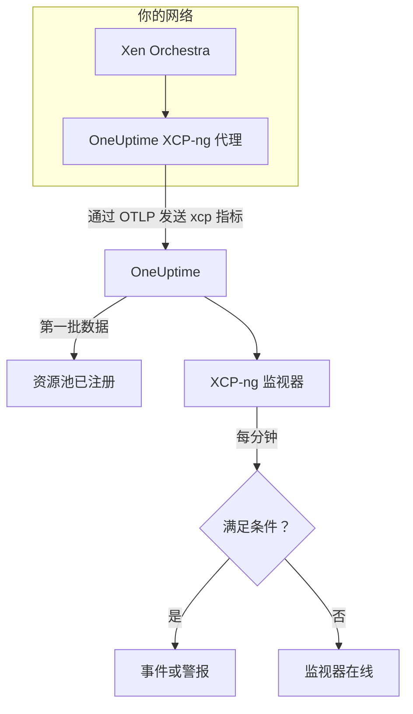

# XCP-ng 监控

XCP-ng 监视器监控一个 XCP-ng 资源池（它的主机、虚拟机、存储库和虚拟磁盘），并在 Xen Orchestra 失去该资源池、主机离线或一直处于禁用状态、运行中的虚拟机停止或 CPU 不足，或者存储库写满或变慢时通知你。它读取 OneUptime XCP-ng 代理采集的 Xen Orchestra OpenMetrics 插件的 `xcp_*` 序列，以及 OneUptime 从中派生的健康序列，因此不会从外部探测任何东西。

:::cards
- [创建监视器](#创建-xcp-ng-监视器): 在仪表板中完成六个步骤。
- [模板](#现成的警报模板): 十个现成的警报，每台主机、每台虚拟机或每个存储库一个事件。
- [资源标识](#资源标识): 如何定位到单台主机、单台虚拟机或单个存储库。
- [指标](#收集的指标): 监视器可以据以警报的每个序列。
:::

## 工作原理

OneUptime XCP-ng 代理运行在一台能访问 Xen Orchestra 的机器上。它每 60 秒读取一次 Xen Orchestra 的 OpenMetrics 插件（插件会读取 Xen Orchestra 管理的每个资源池的每台主机），并通过 OTLP 把序列发送到 OneUptime，每个资源池一个资源，并打上资源池的 UUID `xcp_ng.pool.id`。第一批数据会注册每个资源池。

XCP-ng 监视器绑定到一个资源池。它每分钟对该资源池的指标运行一次查询，并把结果与其条件进行比较。



## 开始之前

- **安装 XCP-ng 代理**，装在能访问 Xen Orchestra 的地方，并使用 Xen Orchestra OpenMetrics 插件的密钥。[XCP-ng 代理指南](/docs/telemetry/xcp-ng) 介绍了插件、Xen Orchestra 的证书和安装。
- **确认资源池已注册。** 首次抓取后大约一分钟，它会以 Xen Orchestra 中的名称出现在 **产品 → 基础设施 → XCP-ng → 所有资源池** 下。

## 创建 XCP-ng 监视器

:::steps
### 开始新的监视器

进入 **监视器** 并点击 **创建监视器**。

### 选择 XCP-ng

在 **监视器类型** 下点击 **更多监视器类型**，然后在 **基础设施** 下选择 **XCP-ng**，或在搜索框中输入 `xcp`。输入 **名称**（它会用在事件和警报标题中），然后点击 **下一步**。

### 选择资源池

在 **XCP-ng Monitor Configuration** 下，从 **XCP-ng 资源池** 中选择资源池。发送过数据的每个资源池都在列表中。选好后，字段下方的一行会显示是否有数据到达。**添加 XCP-ng 资源池** 会打开已填好你的密钥的设置步骤，这些步骤会等待第一批数据。

### 选择要监控的内容

新监视器从 **警报内容** 下的 **Pool Disconnected** 开始。要监视其他内容：

- **更改** – 选择另一个 [模板](#现成的警报模板)。它会设置指标、过滤器、聚合、时间范围和阈值，并用自己的条件替换下面的条件。你仍然可以更改 **时间范围**。
- **Custom Metric**（在 **更多字段** 下） – 从 **XCP-ng Metric** 中选择一个指标，然后设置 **聚合** 和 **时间范围**。[过滤器](#监视器设置) 可以把范围缩小到某类对象或单个对象。
- **高级**（在 **更多字段** 下） – 在 **选择指标** 下自己构建查询和公式，例如由 `xcp_sr_physical_usage_bytes / xcp_sr_physical_size_bytes` 得出存储库的已用比例。使用 **分组依据** `xcp_ng.id` 可以单独评判每个对象。

### 检查条件

打开 **标准** 下的每个条件，检查其 **指标**、**聚合**、**条件** 和 **阈值**。模板会填好这些内容。使用 **Custom Metric** 或 **高级** 时，监视器从 [默认条件](#默认条件) 开始，这些条件只会注意到指标不再发送数据，所以请设置你自己的阈值。

### 创建监视器

点击 **创建监视器**。OneUptime 会打开监视器的页面，并每分钟评估一次。它打开的事件和警报也会列在资源池的 **事件** 和 **警报** 页面上。
:::

> [!TIP]
> 要一次设置多个模板，请从 **产品 → 基础设施 → XCP-ng** 打开资源池，然后进入 **建议**。选择你需要的模板和要呼叫的人，OneUptime 会为每个模板创建一个监视器。

## 监视器设置

| 字段 | 选项卡 | 作用 |
| --- | --- | --- |
| **XCP-ng 资源池** | 全部 | 必填。把每个查询限定在资源池的 UUID `resource.xcp_ng.pool.id`，因此两个同名的资源池绝不会混在一起。 |
| **资源范围** | Custom Metric、高级 | 可选。**主机**、**虚拟机**、**存储库**、**虚拟磁盘**、**XOSTOR** 或 **XCP-ng 资源池**，与 `xcp_ng.scope` 完全匹配。 |
| **UUID** | Custom Metric、高级 | 可选。与 `xcp_ng.id` 完全匹配：单台主机、单台虚拟机、单个存储库或单个虚拟磁盘的 UUID，与 Xen Orchestra 中显示的一致。与范围搭配即可定位到单个对象。 |
| **主机名称** | Custom Metric、高级 | 可选。与 Xen Orchestra 的 `host_name` 标签完全匹配：主机自己的序列，以及运行在该主机上的虚拟机的序列。 |
| **XCP-ng Metric** | Custom Metric | [目录](#收集的指标) 中的一个指标。 |
| **聚合** | Custom Metric | 样本的合并方式：**平均值**、**最大值**、**最小值**、**总和** 或 **计数**。初始值为该指标通常的聚合方式。 |
| **时间范围** | 全部 | 查询读取的滚动窗口，从 **Past 1 Minute** 到 **Past 365 Days**。新监视器从 **Past 1 Minute** 开始；模板会设置自己的值。 |
| **选择指标** | 高级 | 查询构建器：**指标**、**聚合方式**、**按属性过滤**、**分组依据**，以及用于组合查询的 **添加指标** 和 **添加公式**。 |

代理每 60 秒读取一次 Xen Orchestra，而 Xen Orchestra 以 60 秒的分辨率读取其主机，因此 1 分钟的窗口大约只有一个样本；模板读取 5 分钟或更长时间。

## 资源标识

Xen Orchestra 用 `uuid` 标签标识主机或虚拟机，用 `sr_uuid` 标识存储库，用 `vdi_uuid` 标识虚拟磁盘。OneUptime 会在每个数据点到达时打上两个属性，这样无论对象是由哪个标签标识的，一个过滤器就能读取它的每个序列。模板依赖这些属性：

| 属性 | 取值 | 对于虚拟机 |
| --- | --- | --- |
| `xcp_ng.scope` | `pool`、`host`、`vm`、`sr`（存储库）、`vdi`（虚拟磁盘）、`xostor` | `vm` |
| `xcp_ng.id` | 对象的 UUID，小写：主机或虚拟机的 `uuid`、存储库或 XOSTOR 集群的 `sr_uuid`、虚拟磁盘的 `vdi_uuid`，以及资源池自身序列上的资源池 UUID | `5c6d7e8f-1a2b-4c3d-9e8f-0a1b2c3d4e5f` |

按 `xcp_ng.scope` 过滤一类对象，按 `xcp_ng.id` 过滤单个对象，并按 `xcp_ng.id` 分组以单独评判每个对象。Xen Orchestra 自己的标签保持其发送时的样子：`host_name` 在主机的序列上表示主机，在虚拟机的序列上表示该虚拟机所在的主机，`vm_name`、`sr_name` 和 `vdi_name` 表示其余对象，`power_state` 和 `enabled` 在状态序列上承载主机或虚拟机的状态，`is_control_domain` 在控制域的虚拟机序列上为 `true`。

资源池本身就是序列到达时所在的资源，因此它的属性在过滤器和分组键中要加上 `resource.` 前缀：`resource.xcp_ng.pool.id`（它的 UUID）、`resource.xcp_ng.pool.name`（它在 Xen Orchestra 中的名称）和 `resource.xen_orchestra.name`（读取它的 Xen Orchestra）。

## 现成的警报模板

**警报内容** 列表提供 12 个模板。每个模板都会构建一个完整的监视器：查询、属性过滤器、分组、一个触发的条件和一个恢复的条件。大多数按 `xcp_ng.id` 分组，所以每台主机、每台虚拟机或每个存储库都有自己的事件和警报。阈值只是起点，你可以编辑。

条件只有在其窗口的每一分钟都成立时才会触发，阈值条件在越过阈值 10% 处恢复，这样在边界附近徘徊的值不会来回跳动。0/1 序列在另一个值处恢复。

| 模板 | 类别 | 严重程度 | 监控内容 | 触发时机 | 恢复时机 |
| --- | --- | --- | --- | --- | --- |
| Pool Disconnected | 可用性 | 严重 | `xcp_pool_connected`，对整个资源池取 Count，最近 10 分钟 | 整个窗口内都没有数据 | 数据再次到达 |
| Host Offline | 可用性 | 严重 | `xcp_ng.host.running`（`xcp_ng.scope = host`），按 `xcp_ng.id` 取 Min，最近 5 分钟 | 低于 1 | 等于 1 |
| HA Cannot Tolerate a Host Failure | 可用性 | 严重 | `xcp_ng.pool.ha.can_tolerate_host_failure`（`xcp_ng.scope = pool`），对整个资源池取 Max，最近 5 分钟 | 低于 1 | 等于 1 |
| VM Stopped | 虚拟机 | 警告 | `xcp_ng.vm.stopped_after_running`（`xcp_ng.scope = vm`），按 `xcp_ng.id` 取 Min，最近 5 分钟 | 高于 0 | 等于 0 |
| VM Not Backed Up | 虚拟机 | 警告 | `xcp_ng.vm.backup_overdue`（`xcp_ng.scope = vm`），按 `xcp_ng.id` 取 Min，最近 10 分钟 | 高于 0 | 等于 0 |
| Storage Repository Near Full | 存储 | 严重 | `xcp_sr_physical_usage_bytes` ÷ `xcp_sr_physical_size_bytes` × 100（`xcp_ng.scope = sr`，两者都取总和），按 `xcp_ng.id`，最近 5 分钟 | 高于 90% | 不高于 81% |
| Host Disabled | 主机 | 警告 | `xcp_ng.host.enabled`（`xcp_ng.scope = host`），按 `xcp_ng.id` 取 Max，最近 30 分钟 | 低于 1 | 等于 1 |
| Host Restarted | 主机 | 警告 | `xcp_host_uptime_seconds` 和 `xcp_ng.host.running`（`xcp_ng.scope = host`），按 `xcp_ng.id` 取 Min，最近 5 分钟 | `xcp_host_uptime_seconds` 低于 900（15 分钟），同时 `xcp_ng.host.running` 为 1 | `xcp_host_uptime_seconds` 达到 990 或以上，或 `xcp_ng.host.running` 为 0 |
| High Host CPU Usage | 主机 | 警告 | `xcp_host_cpu_average`（`xcp_ng.scope = host`），按 `xcp_ng.id` 取 Avg，最近 10 分钟 | 高于 0.9（主机 CPU 的 90%） | 不高于 0.81 |
| High Host Memory Usage | 主机 | 警告 | (`xcp_host_memory_total_bytes` − `xcp_host_memory_free_bytes`) ÷ `xcp_host_memory_total_bytes` × 100（`xcp_ng.scope = host`，两者都取总和），按 `xcp_ng.id`，最近 10 分钟 | 高于 95% | 不高于 85.5% |
| VM Starved of CPU | 虚拟机 | 警告 | `xcp_vm_runstate_full_contention`（`xcp_ng.scope = vm`），按 `xcp_ng.id` 取 Avg，最近 15 分钟 | 高于 0.1（10% 的时间） | 不高于 0.09 |
| Storage Repository Slow | 存储 | 警告 | `xcp_host_disk_latency_seconds`（`xcp_ng.scope = host`），按 `sr` 取 Avg，最近 15 分钟 | 高于 0.05（50 毫秒） | 不高于 0.045 |

**严重程度** 是选择列表中显示的标签。模板创建的事件和警报从项目中最严重的事件和警报严重程度开始；请在条件中更改它们。

- **Pool Disconnected** 模板会在 `xcp_pool_connected` 连续十分钟没有到达时触发。Xen Orchestra 在连接到资源池期间每次抓取都会发送它，而在失去资源池的主节点时会停止发送，而不是发送 0；当 Xen Orchestra、其插件或 XCP-ng 代理停止，或代理失去通往 OneUptime 的路由时，它也会停止。序列恢复后即会解决。数据停止时，其他模板没有可比较的东西，会保持其最后的状态，因此由这个模板来告诉你。
- **Host Offline** 模板读取 `xcp_ng.host.running`，它由 OneUptime 从 `xcp_host_status` 派生：当 Xen Orchestra 报告主机为 Halted，或因资源池主节点与其失去联系而状态为 Unknown 时为 0。除非 HA 在别处重启了它们，否则在该主机上运行的虚拟机也已停机。
- **HA Cannot Tolerate a Host Failure** 读取 `xcp_ng.pool.ha.can_tolerate_host_failure`。直接从 XAPI 读取时，它就是 HA 自己的计划：已过量承诺，或覆盖的主机故障数少于它设置要承受的数量。通过 Xen Orchestra 读取时（其 REST API 不报告该计划），它表示可用来重启虚拟机的已启动且已启用的主机少于两台，因此在两台主机的 HA 资源池中停用一台主机就足以触发。HA 关闭期间它从不触发。
- **VM Stopped** 模板读取 `xcp_ng.vm.stopped_after_running`：当过去 24 小时内运行过的虚拟机为 Halted 或 Paused 时为 1。关机超过一天的虚拟机被视为有意关机，不再发出警报；挂起的虚拟机从不发出警报；控制域和虚拟机模板不计入。
- **VM Not Backed Up** 读取 `xcp_ng.vm.backup_overdue`，它来自 Xen Orchestra 的备份日志：计划备份作业所包含的虚拟机在其间隔（其作业计划中两次运行之间最长的间隔）再加上四分之一（至少一小时）内没有成功备份时为 1。每晚作业中的虚拟机在 30 小时后触发，任何计划作业都不包含的虚拟机从不触发。
- **Host Disabled** 模板会在主机连续 30 分钟处于禁用状态时触发：处于维护模式，或在疏散后一直处于禁用状态。XAPI 不会在其上启动任何虚拟机，HA 也无法故障转移到它。三十分钟可以让计划内的重启或更新过去而不呼叫任何人。
- **Host Restarted** 模板会在主机在线但运行不到 15 分钟时触发：它重启了，或者崩溃后又恢复了。主机运行满 16.5 分钟（越过阈值 10%）后即会解决；停机的主机则会触发 **Host Offline**。
- **比率公式** 对两边都取 **总和**。两边来自同一次抓取，所以结果是真实的百分比。报告大小为 0 的存储库（某些 ISO 库和可移动介质就是这样）永远不会触发。
- **VM Starved of CPU** 模板读取完全争用：虚拟机的所有 vCPU 都已准备好运行、却在等待物理 CPU 的时间占比。它的主机上可运行的 vCPU 多于 CPU 线程，因此虚拟机运行得比其自身 CPU 使用率所显示的更慢。
- **Storage Repository Slow** 模板按 `sr` 分组，这是每台主机的磁盘序列上 Xen Orchestra 为存储库使用的短 ID，因此每个存储库只有一个事件，其延迟是对读写它的各台主机取平均。

**HA Cannot Tolerate a Host Failure** 和 **VM Not Backed Up** 读取的是探测器读取资源池时添加的序列，因此需要从探测器连接资源池：XCP-ng 代理读取的插件不报告 HA 状态，也不报告备份。由探测器读取的资源池还可以针对其 XAPI 消息（例如崩溃的虚拟机或 HA 失去的主机）以及失败的备份作业发出警报：按[无需代理的 XCP-ng](/docs/telemetry/xcp-ng-agentless)中的说明，在资源池的 **建议** 中开启这些模板。

## 收集的指标

代理每 60 秒读取一次 Xen Orchestra OpenMetrics 插件的每个序列；下面的序列是监视器表单提供的目录。Xen Orchestra 已经把 XAPI 的 KiB、MiB/s 和微秒转换为字节、每秒字节数和秒。它命名为 `_total` 并声明为计数器的八个序列存放的是每秒速率，OneUptime 会按它们本来的样子把它们存为速率，正如 [XCP-ng 代理指南](/docs/telemetry/xcp-ng#代理采集的内容) 所说明的。`xcp_ng.*` 序列是 OneUptime 自己的：四个在 Xen Orchestra 的状态序列到达时由其派生，六个由探测器在指标之外读取的内容派生；仅由 XCP-ng 代理读取的资源池没有后者。

### 可用性

| 指标 | 单位 | 说明 |
| --- | --- | --- |
| `xcp_pool_connected` | — | 当 Xen Orchestra 连接到资源池时为 1。Xen Orchestra 失去资源池时会停止发送它，而不是发送 0：请留意它是否停止。 |
| `xcp_ng.host.running` | — | 当 Xen Orchestra 报告主机为 Running 时为 1，为 Halted 或状态为 Unknown 时为 0。由 OneUptime 从主机的状态派生。 |
| `xcp_ng.host.enabled` | — | 当主机已启用时为 1，处于维护模式或正在疏散、XAPI 不会在其上启动任何虚拟机时为 0。由 OneUptime 从主机的状态派生。 |
| `xcp_ng.vm.running` | — | 当虚拟机为 Running 时为 1，为 Halted、Paused 或 Suspended 时为 0。控制域不计入。由 OneUptime 从虚拟机的状态派生。 |
| `xcp_ng.vm.stopped_after_running` | — | 当过去 24 小时内运行过的虚拟机为 Halted 或 Paused 时为 1，否则为 0。一天内没人见过运行的虚拟机被视为有意关机，挂起的虚拟机从不计入。由 OneUptime 派生。 |
| `xcp_ng.pool.ha.enabled` | — | 资源池的高可用性开启时为 1，否则为 0。由探测器通过 Xen Orchestra 的 REST API 或直接从 XAPI 读取；XCP-ng 代理不读取它。 |
| `xcp_ng.pool.ha.can_tolerate_host_failure` | — | HA 开启期间：仍能承受主机故障时为 1，一旦不能则为 0。直接从 XAPI 读取时，这是 HA 自己的计划；通过不报告计划的 Xen Orchestra 时，表示除故障主机外是否还有处于运行和启用状态的主机。由 OneUptime 得出。 |
| `xcp_ng.pool.ha.host_failures_to_tolerate` | — | HA 设置为可承受的主机故障数。仅在直接从 XAPI 读取时提供：Xen Orchestra 的 REST API 不报告此项。 |
| `xcp_ng.pool.ha.plan_exists_for` | — | 在重启每台受保护虚拟机的情况下，HA 计划还能承受的主机故障数。仅在直接从 XAPI 读取时提供。 |
| `xcp_host_status` | count | 每台主机无论是否运行都始终为 1；主机的状态在 `power_state`（Running、Halted、Unknown）和 `enabled` 标签中。 |
| `xcp_vm_status` | count | 除控制域和虚拟机模板外，每台虚拟机都始终为 1；虚拟机的状态在 `power_state` 标签（Running、Halted、Paused、Suspended）中。 |
| `xcp_host_uptime_seconds` | seconds | 主机自启动以来的运行时长。 |
| `xcp_vm_uptime_seconds` | seconds | 运行中的虚拟机自启动以来的运行时长。仅在虚拟机运行时上报。 |

### 主机

| 指标 | 单位 | 说明 |
| --- | --- | --- |
| `xcp_ng.host.missing_patches` | — | 主机缺少的补丁数量，以 Xen Orchestra 最近一次列出的为准（每六小时检查一次）。 |
| `xcp_host_cpu_average` | ratio | 主机在其各核心上平均的 CPU 使用率，为 0 到 1 的比率。 |
| `xcp_host_cpu_core_usage` | ratio | 主机上一个 CPU 线程的使用率，为 0 到 1 的比率；`core` 标签说明是哪一个。 |
| `xcp_host_load` | — | 主机上正在运行或等待运行的 vCPU，按每个物理 CPU 计算。高于 1 时虚拟机在等待 CPU。 |
| `xcp_host_load_average` | — | 主机控制域（dom0）的平均负载。 |
| `xcp_host_memory_total_bytes` | bytes | 主机的物理内存。 |
| `xcp_host_memory_free_bytes` | bytes | 主机上未分配给任何虚拟机的内存。把它与 `xcp_host_memory_total_bytes` 比较即可看出主机有多满。 |
| `xcp_host_memory_reclaimed_bytes` | bytes | 动态内存控制从主机的虚拟机回收的内存。 |
| `xcp_host_memory_reclaimed_max_bytes` | bytes | 动态内存控制能从主机的虚拟机回收的最大内存。 |
| `xcp_host_running_vcpus` | count | 主机上运行的虚拟机的 vCPU 总数。 |
| `xcp_host_power_consumption_watts` | W | 从主机的 DCMI 传感器读取的功耗。在 Xen Orchestra 改为通过 IPMI 读取的情况下，它发送这项读数时不带其资源池，因此代理不保留它；每台虚拟机的估算份额会保留。 |

### 虚拟机

| 指标 | 单位 | 说明 |
| --- | --- | --- |
| `xcp_ng.vm.backup_overdue` | — | 对于 Xen Orchestra 计划备份作业中的虚拟机：在其作业间隔加上该间隔的四分之一（至少一小时）内没有成功备份时为 1，否则为 0。由 OneUptime 根据备份日志得出。 |
| `xcp_vm_cpu_usage` | ratio | 虚拟机在其各 vCPU 上平均的 CPU 使用率，为 0 到 1 的比率。 |
| `xcp_vm_cpu_core_usage` | ratio | 一个 vCPU 的使用率，为 0 到 1 的比率；`core` 标签说明是哪一个。 |
| `xcp_vm_runstate_full_contention` | ratio | 虚拟机的所有 vCPU 都已准备好运行、却在等待物理 CPU 的时间占比，从 0 到 1。值高表示虚拟机的 CPU 被其邻居挤占。 |
| `xcp_vm_runstate_partial_contention` | ratio | 虚拟机的部分 vCPU 在等待物理 CPU、其余被阻塞的时间占比，从 0 到 1。 |
| `xcp_vm_runstate_concurrency_hazard` | ratio | 虚拟机的部分 vCPU 在运行、其他在等待物理 CPU 的时间占比，从 0 到 1。 |
| `xcp_vm_runstate_fullrun` | ratio | 虚拟机的所有 vCPU 都在运行的时间占比，从 0 到 1。 |
| `xcp_vm_runstate_partial_run` | ratio | 虚拟机的部分 vCPU 在运行、其余被阻塞的时间占比，从 0 到 1。 |
| `xcp_vm_runstate_blocked` | ratio | 虚拟机的所有 vCPU 都被阻塞（无事可做或在等待 I/O）的时间占比，从 0 到 1。 |
| `xcp_vm_memory_bytes` | bytes | 分配给虚拟机的内存。 |
| `xcp_vm_memory_target_bytes` | bytes | 动态内存控制打算分配给虚拟机的内存。 |
| `xcp_vm_memory_internal_free_bytes` | bytes | 来宾报告的空闲内存。需要在虚拟机中安装来宾工具。 |
| `xcp_vm_power_consumption_watts` | W | Xen Orchestra 按 CPU 负载拆分估算的、虚拟机在其主机功耗中所占的份额。当虚拟机的 CPU 读数缺失时，它的 `data_complete` 标签为 `false`。 |

### 存储

| 指标 | 单位 | 说明 |
| --- | --- | --- |
| `xcp_sr_physical_size_bytes` | bytes | 存储库的物理大小。某些 ISO 库和可移动介质报告为 0。 |
| `xcp_sr_physical_usage_bytes` | bytes | 存储库上已使用的空间。用它除以大小即可看出有多满。 |
| `xcp_sr_virtual_size_bytes` | bytes | 存储库上每块磁盘的虚拟大小之和。超过其大小时，表示该存储库通过精简配置分配的空间超出了它的容量。 |
| `xcp_vdi_virtual_size_bytes` | bytes | 虚拟机看到的虚拟磁盘大小。 |
| `xcp_vdi_physical_usage_bytes` | bytes | 虚拟磁盘在其存储库上占用的空间。 |
| `xcp_host_disk_iops_read` | ops/s | 主机对存储库每秒的读操作数；`sr_name` 标签说明是哪一个。 |
| `xcp_host_disk_iops_write` | ops/s | 主机对存储库每秒的写操作数。 |
| `xcp_host_disk_iops_total` | ops/s | 主机对存储库每秒的读写操作数。 |
| `xcp_host_disk_throughput_read_bytes` | bytes/s | 主机每秒从存储库读取的字节数。 |
| `xcp_host_disk_throughput_write_bytes` | bytes/s | 主机每秒写入存储库的字节数。 |
| `xcp_host_disk_throughput_total_bytes` | bytes/s | 主机每秒从存储库读取和写入的字节数。 |
| `xcp_host_disk_read_latency_seconds` | seconds | 主机从存储库读取所需的时间。 |
| `xcp_host_disk_write_latency_seconds` | seconds | 主机向存储库写入所需的时间。 |
| `xcp_host_disk_latency_seconds` | seconds | 主机在存储库上读写所需的时间。 |
| `xcp_host_disk_iowait` | ratio | 主机等待存储库的时间占比，从 0 到 1。 |
| `xcp_vm_disk_read_bytes_total` | bytes/s | 虚拟机每秒从其某块磁盘读取的字节数；`device` 标签说明是哪一块。它是速率，尽管 Xen Orchestra 将其命名为 `_total` 并声明为计数器。 |
| `xcp_vm_disk_write_bytes_total` | bytes/s | 虚拟机每秒写入其某块磁盘的字节数。它是速率，尽管 Xen Orchestra 将其命名为 `_total` 并声明为计数器。 |
| `xcp_vm_disk_iops_read` | ops/s | 虚拟机磁盘上每秒的读操作数。 |
| `xcp_vm_disk_iops_write` | ops/s | 虚拟机磁盘上每秒的写操作数。 |
| `xcp_vm_disk_iops_total` | ops/s | 虚拟机磁盘上每秒的读写操作数。 |
| `xcp_vm_disk_throughput_read_bytes` | bytes/s | 每秒从虚拟机磁盘读取的字节数。 |
| `xcp_vm_disk_throughput_write_bytes` | bytes/s | 每秒写入虚拟机磁盘的字节数。 |
| `xcp_vm_disk_throughput_total_bytes` | bytes/s | 每秒从虚拟机磁盘读取和写入的字节数。 |
| `xcp_vm_disk_read_latency_seconds` | seconds | 从虚拟机磁盘读取所需的时间。 |
| `xcp_vm_disk_write_latency_seconds` | seconds | 向虚拟机磁盘写入所需的时间。 |
| `xcp_vm_disk_latency_seconds` | seconds | 虚拟机磁盘上读写平均所需的时间。 |
| `xcp_vm_disk_iowait` | ratio | 虚拟机等待其某块磁盘的时间占比，从 0 到 1。 |
| `xcp_vm_disk_inflight` | count | 虚拟机磁盘上尚未得到响应的请求。 |
| `xcp_vm_disk_queue_size` | count | 虚拟机磁盘上请求队列的平均长度。 |

### 网络

| 指标 | 单位 | 说明 |
| --- | --- | --- |
| `xcp_host_network_receive_bytes_total` | bytes/s | 主机每秒在一个物理接口上接收的字节数；`interface` 标签说明是哪一个。它是速率，尽管 Xen Orchestra 将其命名为 `_total` 并声明为计数器。 |
| `xcp_host_network_transmit_bytes_total` | bytes/s | 主机每秒在一个物理接口上发送的字节数。它是速率，尽管 Xen Orchestra 将其命名为 `_total` 并声明为计数器。 |
| `xcp_host_network_aggregated_receive_bytes` | bytes/s | 主机每秒在其所有物理接口上接收的字节数。 |
| `xcp_host_network_aggregated_transmit_bytes` | bytes/s | 主机每秒在其所有物理接口上发送的字节数。 |
| `xcp_vm_network_receive_bytes_total` | bytes/s | 虚拟机每秒在其某个网络接口上接收的字节数；`vif` 标签说明是哪一个。它是速率，尽管 Xen Orchestra 将其命名为 `_total` 并声明为计数器。 |
| `xcp_vm_network_transmit_bytes_total` | bytes/s | 虚拟机每秒在其某个网络接口上发送的字节数。它是速率，尽管 Xen Orchestra 将其命名为 `_total` 并声明为计数器。 |
| `xcp_vm_network_receive_errors_total` | errors/s | 虚拟机某个网络接口上每秒的接收错误数。它是速率，尽管 Xen Orchestra 将其声明为计数器。 |
| `xcp_vm_network_transmit_errors_total` | errors/s | 虚拟机某个网络接口上每秒的发送错误数。它是速率，尽管 Xen Orchestra 将其声明为计数器。 |

### XOSTOR

仅针对运行 XOSTOR（Vates 基于 LINSTOR 构建的复制存储）的资源池发送。

| 指标 | 单位 | 说明 |
| --- | --- | --- |
| `xcp_xostor_up` | — | Xen Orchestra 能读取 XOSTOR 集群的健康状况时为 1，不能时为 0。 |
| `xcp_xostor_node_status` | count | XOSTOR 集群的每个节点始终为 1；它的角色和状态在 `role` 和 `state` 标签中。 |
| `xcp_xostor_resource_total` | count | XOSTOR 集群定义的 LINSTOR 资源。 |
| `xcp_xostor_resource_state_count` | count | XOSTOR 集群在每种磁盘状态下的资源副本；`state` 标签说明是哪一种。 |
| `xcp_xostor_alarms_up` | — | Xen Orchestra 能读取 XOSTOR 集群的告警时为 1，不能时为 0。 |
| `xcp_xostor_alarms_count` | count | XOSTOR 存储库或其主机上的活动 XAPI 告警，按 `alarm_name` 和 `target_type` 分。没有告警时不存在。 |
| `xcp_xostor_smart_up` | — | Xen Orchestra 能为 XOSTOR 读取主机的 SMART 数据时为 1，不能时为 0。 |
| `xcp_xostor_disk_smart_status` | count | XOSTOR 主机的每块磁盘始终为 1；它的 SMART 健康状况在 `status` 标签中。 |
| `xcp_xostor_updates_up` | — | 主机的 XOSTOR 更新检查有响应时为 1，失败时为 0。 |
| `xcp_xostor_package_update_available` | count | 主机上每个有待安装更新的 XOSTOR 软件包为 1；`package` 标签说明是哪一个。 |

## 监控条件

条件把监视器的某个查询或公式与阈值进行比较。XCP-ng 监视器的条件没有 **过滤器类型**：每条规则都用以下字段检查指标值。

| 字段 | 作用 |
| --- | --- |
| **指标** | 要检查的查询或公式，按其变量名指定。 |
| **聚合** | 窗口中的值如何变成一个结果：**平均值**、**总和**、**最大值**、**最小值**、**所有值**（整个窗口内每个值都必须匹配）或 **任一值**（一个就够）。 |
| **条件** | **大于**、**小于**、**大于或等于**、**小于或等于**、**等于** 或 **不等于**，或者异常条件：**异常偏高**、**异常偏低** 或 **异常**。**无数据** 在查询于窗口内没有返回任何数据时匹配，**有数据** 在返回了数据时匹配。 **预计高于** 和 **预计低于** 在窗口内指标的趋势到 **预测范围** 结束时越过阈值时匹配。 |
| **阈值** | 用于比较的值。如果指标有单位，旁边会有单位列表。异常条件下不显示。 |
| **灵敏度** | 仅限异常条件。**低**（4σ）、**中**（3σ，默认）或 **高**（2σ）。 |
| **基线窗口** | 仅限异常条件。14 天（默认）、28、60 或 90 天的历史。 |
| **如果无数据** | 位于 **更多字段** 下。窗口中没有样本时的处理方式：**Ignore**（默认）、**Treat As Zero** 或 **触发器**。 |

异常条件会把每个值与基线中一周的同一小时进行比较。在基线窗口积累足够的历史之前，它们会保持在“Learning”状态，不产生任何结果。 此监视器按属性筛选查询，因此每个查询以及分组查询的每个序列都与自身的历史比较，回溯范围取决于您的指标的保留时长。如果不足两周，总和、计数或针对直方图的查询会一直保持这个状态，其余查询则与该指标的所有序列比较。直方图的百分位数始终保持这个状态。

每个条件还会说明匹配时要做什么：更改监视器状态、创建警报或宣布事件。条件按从上到下的顺序检查，第一个匹配的条件决定结果。

### 默认条件

不是从模板构建的监视器会以两个条件开始：

| 顺序 | 条件 | 匹配时机 | 结果 |
| --- | --- | --- | --- |
| 1 | 检查 _监视器名称_ 是否离线 | 第一个查询在整个窗口内没有数据 | 将监视器标记为 **离线**，并宣布事件“_监视器名称_ 已离线”，监视器恢复后该事件会自动解决。 |
| 2 | 检查 _监视器名称_ 是否在线 | 第一个查询有数据 | 将监视器标记为 **运行正常**。 |

> [!IMPORTANT]
> 值为 `0` 也是数据，因此经常为零的指标（例如虚拟机的网络错误数）不会让监视器离线。要针对某个值警报，请从模板开始，或添加带阈值的条件。当完全没有数据到达且没有任何条件匹配时，监视器保持原有状态，未解决的事件也保持打开：沉默不等于恢复。OneUptime 自身未接收数据的时间从不算作无数据：窗口包含这段时间的检查会改为等待，详见 [OneUptime 未接收数据时](/docs/monitor/when-oneuptime-is-not-receiving)。

## Terraform

[OneUptime Terraform 提供程序](/docs/terraform/monitor-steps) 在 `xcp_ng_monitor` 属性中承载 XCP-ng 监视器步骤的配置：即 `xcpNgMonitor` 配置(`poolIdentifier`、`resourceFilters`、`metricViewConfig`、`rollingTime`)的原始 JSON，用 `jsonencode()` 编写：

```hcl title="main.tf"
monitor_steps = [{
  xcp_ng_monitor = jsonencode({
    poolIdentifier  = "b7569d99-30f8-178a-7d94-801de3e29b5b"
    resourceFilters = { scope = "host" }
    rollingTime     = "Past 10 Minutes"
    metricViewConfig = {
      queryConfigs = [{
        metricAliasData = { metricVariable = "host_cpu", title = "Host CPU", description = "", legend = "" }
        metricQueryData = {
          filterData = {
            metricName     = "xcp_host_cpu_average"
            attributes     = {}
            aggegationType = "Avg"
            aggregateBy    = {}
          }
          groupByAttributeKeys = ["xcp_ng.id"]
        }
      }]
      formulaConfigs = []
    }
  })
  criteria = [ /* ... */ ]
}]
```

`poolIdentifier` 是资源池的 UUID，即资源池的 **设置** 中显示的 `xcp_ng.pool.id`，而不是它的 OneUptime ID。`resourceFilters` 包含表单中称为 **资源范围**、**UUID** 和 **主机名称** 的 [过滤器](#监视器设置)：`scope`（`host`、`vm`、`sr`、`vdi`、`xostor` 或 `pool`）、`xcpNgId` 和 `hostName`。

## 故障排除

:::details 资源池不在 XCP-ng 资源池 列表中
资源池会根据代理的数据自行注册。请检查代理是否在运行并发送数据（参阅 [XCP-ng 代理指南](/docs/telemetry/xcp-ng)），以及 Xen Orchestra 是否已连接到该资源池：Xen Orchestra 不报告的资源池永远不会到达 OneUptime。
:::

:::details Host Offline 或 VM Stopped 从不触发
它们读取 `xcp_ng.host.running` 和 `xcp_ng.vm.stopped_after_running`，OneUptime 由 `xcp_host_status` 和 `xcp_vm_status` 派生它们。这两个状态序列都来自 Xen Orchestra 6.9 或更高版本的 OpenMetrics 插件：请升级较旧的 Xen Orchestra。对于过去 24 小时内没人见过运行的虚拟机以及挂起的虚拟机，**VM Stopped** 也保持沉默。
:::

:::details 事件对整个资源池只触发一次，而不是每台主机触发一次
像模板那样按 `xcp_ng.id` 对查询分组。不分组时，查询会把资源池的每台主机、每台虚拟机或每个存储库当作一个序列读取，对它们取平均会掩盖出问题的那一个。
:::

:::details 吞吐量图表读数过高，或跌到零以下
存放速率的八个 `_total` 序列以仪表的形式存储，单位为每秒字节数或每秒错误数，也就是 Xen Orchestra 提供的值。请按原样读取它们，使用 **平均值** 或 **最大值**：查询构建器中的 **转换为每秒速率** 会求速率的速率。你自己配置的收集器也必须把它们转换为仪表，就像代理的 `transform/xcp-ng-rates` 处理器那样；OneUptime 也会转换仍以计数器形式到达的序列。
:::

:::details 一个 Xen Orchestra 的所有资源池同时触发 Pool Disconnected
代理、Xen Orchestra 或其 OpenMetrics 插件停止了，或者代理失去了通往 OneUptime 的路由：那个 Xen Orchestra 的所有资源池一起沉默了。代理的 `troubleshoot.sh` 会指出失败的步骤，正如 [XCP-ng 代理指南](/docs/telemetry/xcp-ng#故障排除) 所说明的。
:::

## 后续步骤

:::cards
- [XCP-ng 代理](/docs/telemetry/xcp-ng): 安装发送指标的代理。
- [Proxmox 监控](/docs/monitor/proxmox-monitor): 用于 Proxmox VE 的同类监视器。
- [VMware 监控](/docs/monitor/vmware-monitor): 适用于 vSphere 的同类监视器。
- [事件概览](/docs/incidents/index): 条件宣布事件之后会发生什么。
:::
