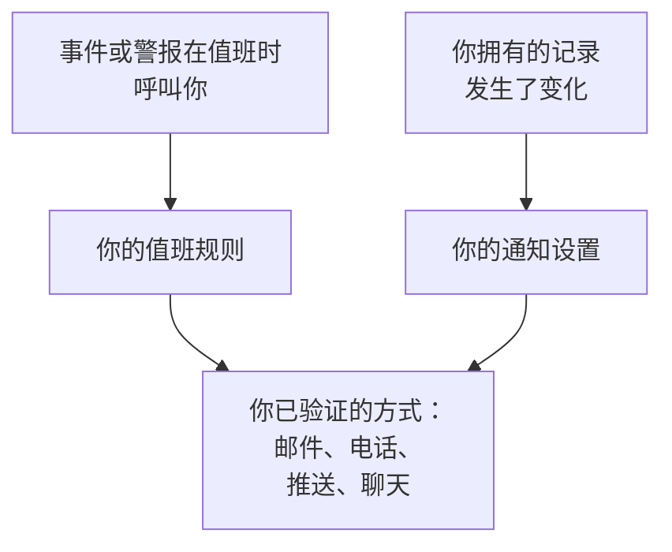

# OneUptime 如何联系你

OneUptime 通过两种方式联系你。当你值班时有事件或警报触发，它会呼叫你；它还会让你及时了解你所拥有的内容：你的事件上的一条备注、一个状态发生变化的监视器、你的下一个班次。两者都会发送到你在 **用户设置** 中按项目维护的联系方式。本页说明这些部分如何配合、它们在哪里，以及你一开始拥有什么。

:::cards
- [三个页面，三个问题](#三个页面三个问题): 通知方式、值班规则和通知设置，以及各自决定什么。
- [在哪里找到它们](#在哪里找到它们): 用户设置中的各个页面，按部分列出。
- [一开始拥有什么](#一开始拥有什么): 新成员获得的通知方式、规则和设置。
- [没有匹配的规则时](#没有匹配的规则时): 呼叫仍然如何送达你，以及谁会收到通知。
:::

## 工作原理

- 当值班策略的某条升级规则指定了你、你所在的团队或你正在值班的排班表时，该策略会呼叫你。然后由你的值班规则决定 OneUptime 尝试你的哪些通知方式，以及多久之后尝试。
- 当你拥有的记录或你的班次发生变化时，由你的通知设置决定这条更新发送到哪些渠道。
- 无论哪种情况，OneUptime 只使用你在呼叫或更新所属项目中已验证的通知方式。

## 三个页面，三个问题

| 页面 | 包含的内容 | 回答的问题 |
| --- | --- | --- |
| **通知方式** | 你的邮箱地址、电话号码、WhatsApp 号码、Telegram、Slack 和 Microsoft Teams 账户、推送设备和 Webhook | OneUptime 可以通过哪里联系到我？ |
| **值班规则** | 针对每种呼叫和每个严重级别，尝试哪种通知方式，以及多久之后尝试 | 我值班时如何被呼叫？ |
| **通知设置** | 针对与你拥有的记录或你的班次相关的每个通知项，使用哪些渠道 | 我还会收到哪些消息，在哪里收到？ |

它们是有意分开的。在 **通知设置** 中打开所有渠道也永远不会呼叫你；而你未验证的通知方式，无论规则怎么写，都不会被使用。

> [!IMPORTANT]
> 通知方式、规则和设置都属于某一个项目。请在你参与的每个项目中分别设置： **用户设置** 始终显示你当前所在的项目。

## 在哪里找到它们

打开顶部栏下方那一栏右侧的 **用户设置**。它的侧边菜单包含与 OneUptime 如何联系你有关的一切：

| 部分 | 页面 |
| --- | --- |
| **开始使用** | **设置清单**：还有哪些需要设置，按重要程度排列 |
| **警报和通知** | **通知方式**、 **值班规则**、 **通知设置** 和 **邮件偏好设置**，后者设置你的更新会汇总成多少封邮件 |
| **值班日志** | **值班日志**：你在此项目中每次被呼叫的记录，以及发送了什么 |
| **来电策略** | **来电号码**：来电策略拨打给你的号码 |
| **日历** | **日历订阅**：在你的日历应用中显示你的班次，并在班次开始前提醒你 |
| **个人资料** | **自定义字段**：项目要求成员填写的信息 |
| **工作区** | **Slack** 和 **Microsoft Teams**：你在项目已连接的每个工作区中的个人账户 |

**开始使用** 和 **警报和通知** 默认展开；其他部分起初是折叠的，当你位于某部分的页面时，该部分会自动展开。只有当项目已连接 Slack 或 Microsoft Teams 时，才会显示 **工作区**。

项目所有者和管理员也可以查看你的设置：在 **用户** 下，他们打开你所在的行及其 **值班** 部分，其中有 **就绪情况**、 **通知方式** 和 **值班规则**。他们可以在那里为你添加通知方式，但验证码会发送到该方式本身，因此只有你能完成验证。

## 一开始拥有什么

当你使用已验证的登录邮箱加入项目时，OneUptime 会为你完成如下设置，确保呼叫始终能送达你：

1. 你的登录邮箱会被添加为已验证的邮件通知方式。
2. 在 **值班规则** 的四个选项卡上，针对每个严重级别，都有一条规则在你被呼叫时立即给你发邮件。
3. 一组关于你所拥有的内容和你的班次的更新会通过邮件开启。参见 [通知设置](/docs/notifications/notification-settings#新成员默认开启的内容)。

你之后验证的每种通知方式都会获得相同的规则：每个严重级别一条，在你被呼叫时立即发送。因此，验证一个用于短信的电话号码，意味着每次呼叫也会给你发短信。如果只想在严重呼叫时收到短信，请删除其他严重级别的短信规则。参见 [个人值班规则](/docs/notifications/on-call-rules#一开始拥有的规则)。

## 设置清单

**用户设置 → 设置清单** 会打开 **Your setup checklist**：OneUptime 联系你所需的一切，按重要程度排列。每个步骤都链接到完成它的页面， **重新检查** 会重新检查所有内容。

| 部分 | 检查的内容 |
| --- | --- |
| **So we can reach you** | 你有通知方式，你添加的每种方式都已验证，并且至少有一种位于项目已开启的渠道上 |
| **How you want to be paged** | 在 **值班规则** 的四个选项卡上，每个严重级别都有规则 |
| **Staying informed** | 你会在班次开始时收到通知，并且你在 **通知设置** 中打开的每个渠道背后都有已验证的通知方式 |
| **Nice to have** | 用于来电的号码、你的 Slack 和 Microsoft Teams 账户、日历链接和你的个人资料字段 |

推送不计入 **Staying informed** ：它只需要移动应用，而且新成员通过推送收到的每条更新也会通过电子邮件发送。

**Nice to have** 不计入进度条，只有其他人才能解决的步骤也不计入。顶部的一行文字概括了状态：

| 标题 | 含义 |
| --- | --- |
| **一切就绪** | 呼叫能送达你，没有需要做的事 |
| **还有几项需要设置** | 某个严重级别没有规则，或者某个步骤尚未完成 |
| **目前还无法联系到您** | 你的通知方式都无法使用：没有一种已验证，或者每种已验证的方式都位于此项目已关闭的渠道上 |
| **您已完成设置，目前不在值班** | 一切都已就绪，等待策略指定你的那一天 |

## 没有匹配的规则时

呼叫可能以你没有规则的类型和严重级别送达你，例如在你加入后新增的严重级别。OneUptime 仍然会通过你已验证的方式呼叫你：

1. 你拥有的所有免费方式：推送设备、邮箱地址、Slack 和 Microsoft Teams。
2. 如果这些都没有，则按以下顺序选择一种付费方式：短信、电话、WhatsApp、Telegram。它是你已验证、且位于项目已开启渠道上的第一种。
3. 如果这些也都没有，则使用 Webhook。

你会收到一封说明此情况的邮件，值班策略的所有者也会收到；如果策略没有所有者，则由项目所有者收到。如果你没有任何已验证的方式，呼叫将无法送达，邮件会改为说明这一点。在呼叫持续到来期间，这些邮件会被暂缓，因此一阵密集的呼叫不会变成一阵密集的邮件。要添加缺失的规则，请参见 [个人值班规则](/docs/notifications/on-call-rules#某个严重级别没有规则时)。

## 故障排除

:::details 我在值班，但什么都没收到
打开 **用户设置 → 值班日志**。如果没有该事件的行，说明它的值班策略从未呼叫你：请检查它的升级规则以及当时谁在值班。对于状态为 **错误** 的行， **查看状态消息** 会说明原因，例如项目关闭了某个渠道。然后检查你的通知方式是否已验证，以及 **Your setup checklist** 中 **So we can reach you** 下是否没有剩余事项。
:::

:::details 我收到了关于我从未关注过的记录的邮件
你直接或通过团队成为了该记录的所有者，或者该记录没有所有者而你是项目所有者。请在 **用户设置 → 通知设置** 中关闭该通知项，或在 **用户设置 → 邮件偏好设置** 中减少邮件数量。
:::

:::details 我添加了电话号码，但它不在我的规则中
号码在验证后才会加入你的规则。点击其所在行的 **验证** 并输入验证码。如果它的卡片上没有添加按钮，说明项目关闭了该渠道。参见 [通知方式](/docs/notifications/notification-methods#为项目开启渠道)。
:::

## 后续步骤

:::cards
- [通知方式](/docs/notifications/notification-methods): 添加并验证 OneUptime 可以联系你的地址。
- [个人值班规则](/docs/notifications/on-call-rules): 决定每次呼叫尝试哪种方式，以及何时尝试。
- [通知设置](/docs/notifications/notification-settings): 选择你要收到的更新，以及通过哪些渠道。
- [升级规则](/docs/on-call/escalation-rules): 值班策略如何逐级决定呼叫谁。
:::
