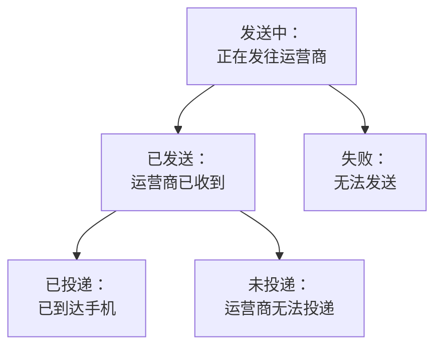

# 通知日志

通知日志列出 OneUptime 为您的项目发送的每条消息，每个渠道一个标签页，并说明每条消息的去向：是否发出、是否送达，以及未送达的原因。在 **项目设置 → 通知 → 通知日志** 中打开，或在事件、警报、维护事件、状态页或值班策略的 **通知日志** 中查看与之相关的发送记录。

:::cards
- [如何看懂状态](#如何看懂状态): 颜色表示消息所处的位置，指向它即可看到它的含义。
- [短信](#短信): 按运营商的回报，依次为发送中、已发送、已投递。
- [电话](#电话): 先是呼叫中，然后是通话如何结束。
- [WhatsApp 和 Telegram](#whatsapp-和-telegram): 各应用接受消息后会回报什么。
- [电子邮件、推送、Webhook 和工作区](#电子邮件推送webhook-和工作区): 成功，或错误及其原因。
- [短信一直停留在已发送时](#短信一直停留在已发送时): 从不回报的运营商，以及始终没有到达的回报。
:::

## 如何看懂状态

每个状态都是一个带颜色的标签，颜色表示消息所处的位置：

| 颜色 | 消息所处的位置 |
| --- | --- |
| 灰色 | 已交出，但还没有任何回报，例如 **发送中**。 |
| 蓝色 | 提供商已收到，但尚未说明结果，例如短信的 **已发送** 或电话的 **呼叫中**。 |
| 绿色 | 已送达对方，例如 **已投递**，或这是它最后的状态。 |
| 黄色 | 已到达手机但无人接听，例如 **未接来电**，或附带警告发出。 |
| 红色 | 未送达对方，例如 **未投递**、**失败**、**错误** 或 **余额不足**。 |

指向一个状态、点按它或用 Tab 键移到它上面，它就会说明自己的含义和接下来会发生什么。行菜单中的 **查看状态消息** 会显示提供商的回复，例如消息的 ID 或失败原因。每个标签页的 **状态** 筛选器按消息经历的顺序列出该标签页可能显示的所有状态。

## 短信

| 状态 | 含义 |
| --- | --- |
| **发送中** | OneUptime 已将短信交给 Twilio，Twilio 正在将其转交给运营商。 |
| **已发送** | 运营商已接受该短信。运营商回报后会变为 **已投递** 或 **未投递**。 |
| **已投递** | 运营商已确认短信到达手机。这是已送达短信的最后状态。 |
| **未投递** | 运营商无法投递。原因见 **错误代码**：`30003` 表示手机关机或不在服务区，`30005` 表示号码不存在，`30006` 表示固定电话，`30007` 表示运营商过滤了该消息。 |
| **失败** | Twilio 无法发送。原因见 **错误代码**。 |
| **错误** | 未发送，例如项目关闭了短信，或 Twilio 拒绝了该号码。原因见 **查看状态消息**。 |
| **余额不足** | 未发送：项目余额不足以支付费用。 |
| **成功** | 在 OneUptime 跟踪投递之前发送，且 Twilio 已接受。 |

服务器自己的短信和电话网关接受的短信会一直是绿色的 **已发送**：网关不回报投递情况，因此这就是它最后的状态。

Twilio 会在每次变化发生时向 OneUptime 回报，并用发送该短信的账户的认证令牌签名，OneUptime 会拒绝任何不是来自 Twilio 的回报。为此，Twilio 必须能够访问您的服务器：请参阅 [Twilio 集成](/docs/self-hosted/twilio-integration)。

## 电话

| 状态 | 含义 |
| --- | --- |
| **呼叫中** | Twilio 已拨打电话。Twilio 回报通话如何结束后，此状态会改变。 |
| **成功** | 电话已接听，通话时长见 **查看状态消息**。服务器自己的短信和电话网关接受的电话，在网关接受后即为 **成功**。 |
| **未接来电** | 电话响铃后无人接听。 |
| **忙碌** | 线路忙，或电话被拒接。 |
| **语音信箱** | 语音信箱接听了值班电话。是否留言见 **查看状态消息**。 |
| **错误** | 无法拨打或接通电话。 |
| **余额不足** | 未拨打：项目余额不足以支付费用。 |

## WhatsApp 和 Telegram

WhatsApp 消息在 OneUptime 交出时为 **排队中**，WhatsApp 接受后为 **已发送**，到达手机后为 **已投递**，如果对方开启了已读回执，打开后为 **已读**。**失败** 是 WhatsApp 无法投递的消息，**警告** 是附带警告发出的消息：WhatsApp 回报的内容见 **查看状态消息**。**错误** 和 **余额不足** 表示未发送，与短信相同。

Telegram 接受消息后不再回报任何内容，因此 Telegram 消息的 **已发送** 是绿色的：Telegram 已将其发布到聊天中，这就是它最后的状态。

## 电子邮件、推送、Webhook 和工作区

这些标签页显示 **成功** 或 **错误**。**成功** 是最后的状态：邮件服务器已接受电子邮件，推送服务已接受通知，Webhook 地址回复已收到请求，或工作区已完成所要求的操作。邮件服务器接受电子邮件后，OneUptime 不再跟踪它；如果推送服务之后回报推送通知未投递，它会变为 **错误**。消息为 **错误** 的原因见 **查看状态消息**，在 **工作区** 标签页上也可见于 **原因**。

## 短信一直停留在已发送时

**已发送** 表示运营商已收到短信，但尚未回报。大多数运营商会在几秒或几分钟内回报，但有些从不回报：这时 Twilio 也会将短信保留为 `sent`（其消息日志中也是如此），OneUptime 无法知道它是否送达。

短信一直停留在 **发送中** 则是另一回事：Twilio 的回报没有到达 OneUptime。请检查 Twilio 能否访问您的服务器，并在服务器日志中查找以 `Twilio callback refused` 开头的行：请参阅 [Twilio 集成](/docs/self-hosted/twilio-integration)。

## 后续步骤

:::cards
- [Twilio 集成](/docs/self-hosted/twilio-integration): 连接 Twilio，让它的投递回报到达 OneUptime。
- [短信和电话网关](/docs/self-hosted/sms-and-call-gateway): 通过您自己的网关发送短信和电话。
- [通知投递指标](/docs/self-hosted/notification-delivery-metrics): 统计整个安装中投递成功的数量。
:::
