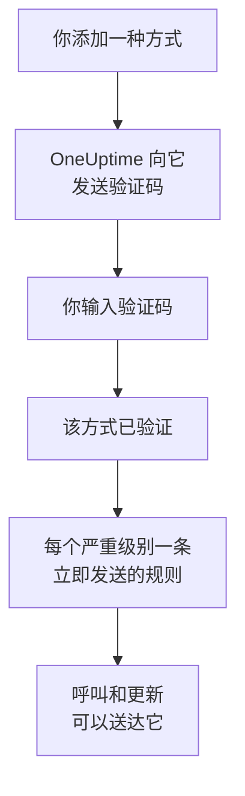

# 通知方式

通知方式是 OneUptime 在某个项目中可以联系你的地址：一个邮箱地址、一个用于短信或电话的电话号码、一个 WhatsApp 号码、一个 Telegram 账户、你的 Slack 或 Microsoft Teams 账户、一部接收推送通知的手机或一个浏览器，或者一个 Webhook。你在 **用户设置 → 通知方式** 中添加并验证它们，OneUptime 就会立即开始用它们呼叫你。

:::cards
- [选择通知方式](#选择通知方式): 每种方式需要什么，以及如何验证。
- [添加并验证通知方式](#添加并验证通知方式): 邮件、短信、电话和 WhatsApp，使用 6 位验证码。
- [Webhook](#webhook): 把呼叫发送到你自己的端点，可选择签名。
- [为项目开启渠道](#为项目开启渠道): 为什么可能看不到短信、电话、WhatsApp 或 Telegram。
:::

## 通知方式如何生效



未验证的方式永远不会被使用。推送设备、Slack、Microsoft Teams 和 Webhook 不需要验证码：注册设备或关联账户就能证明它属于你，而 Webhook 不需要证明。验证一种方式会立即为它添加你的 [默认规则](/docs/notifications/on-call-rules#一开始拥有的规则)，因此新的电话号码会在每个严重级别呼叫你，直到你修改它的规则。

## 选择通知方式

**通知方式** 的每个选项卡包含一张或多张卡片，每种方式一张：

| 卡片 | 选项卡 | 你添加的内容 | 验证方式 |
| --- | --- | --- | --- |
| **电子邮件 用于通知** | **Direct Contact** | 一个邮箱地址 | 通过邮件发送的验证码 |
| **电话号码 用于短信通知** | **Direct Contact** | 一个电话号码 | 通过短信发送的验证码 |
| **用于电话通知的电话号码** | **Direct Contact** | 一个电话号码 | 在电话中读出的验证码；已为短信验证的号码则无需验证码 |
| **用于通知的 WhatsApp 号码** | **Direct Contact** | 一个 WhatsApp 号码 | 通过 WhatsApp 发送的验证码 |
| **用于通知的 Telegram 账户** | **Direct Contact** | 你的 Telegram 账户 | 向 OneUptime 机器人发送一条消息 |
| **Slack Account for Notifications** | **Workspace Apps** | 你的 Slack 账户 | 将你的账户关联到项目的工作区 |
| **Microsoft Teams Account for Notifications** | **Workspace Apps** | 你的 Microsoft Teams 账户 | 将你的账户关联到项目的工作区 |
| **推送通知设备** | **Push Notifications** | 安装了 OneUptime On-Call 应用的手机，或一个浏览器 | 注册该设备 |
| **用于通知的 Webhook** | **Webhooks** | 你自己的 HTTPS 端点 | 无需验证 |

**Workspace Apps** 只有在项目已连接 Slack 或 Microsoft Teams 时才会显示，并且只包含已连接的那些。短信、电话、WhatsApp 和 Telegram 可以在整个项目中关闭；参见 [为项目开启渠道](#为项目开启渠道)。

## 添加并验证通知方式

邮箱地址、短信号码、电话号码和 WhatsApp 号码都使用 6 位验证码进行验证。

:::steps
### 打开你的通知方式

前往 **用户设置 → 通知方式**。 **Direct Contact** 是第一个选项卡。

### 添加地址

在该方式的卡片中，点击其添加按钮，例如 **添加电话号码 用于短信通知**。输入 **电子邮件**，或以国际格式输入 **电话号码**，例如 `+11234567890`，然后保存。

### 输入验证码

验证对话框会自动打开，并说明验证码发送到了哪里、在何时之前有效。在 **验证码** 中输入验证码，然后点击 **验证**。

### 检查该行

该行现在标记为 **已验证**。对话框关得太早？点击该行的 **验证** 即可再次打开。
:::

- 验证码的有效期为 15 分钟。输错五次会使其作废，你需要获取新的验证码。
- 对话框中有 **Send a new code**，电话号码则有 **Call me with a new code**。距离上一次请求一分钟后，才能再次请求。
- 为短信验证过的号码也会被视为已为电话验证。将其添加到 **用于电话通知的电话号码** 下无需验证码，而验证一个短信号码也会验证你为它添加的电话号码。
- 从你加入项目的那天起，你的登录邮箱就已在列表中，并且已验证。

## 关联 Telegram

:::steps
### 添加账户

在 **用于通知的 Telegram 账户** 中，点击 **添加Telegram账户**。 **Telegram 用户名（可选）** 只是给你自己看的标签，可以留空。

### 给机器人发消息

点击新行上的 **验证**。 **验证 Telegram 账户** 对话框提供了三种联系 OneUptime 机器人的方式：用手机扫描二维码、点击 **Open in Telegram**，或在 Telegram 中搜索该机器人并发送对话框中显示的 `/start` 命令。

### 确认

回到 OneUptime，点击 **I've sent the message — check**。机器人收到你的消息后，账户即完成验证。
:::

**轮换验证码** 会为尚未验证的账户生成新的验证码，之前的二维码和你打开过的链接将失效。在自托管的 OneUptime 上，需要服务器管理员先连接一个 Telegram 机器人，其他人才能关联账户。

## Slack 和 Microsoft Teams

1. 将你自己的账户关联到项目的工作区： **用户设置 → 工作区 → Slack** 或 **Microsoft Teams**。参见 [Slack](/docs/workspace-connections/slack) 和 [Microsoft Teams](/docs/workspace-connections/microsoft-teams)。
2. 在 **Workspace Apps** 选项卡上，点击 **Add Slack Account** 或 **Add Microsoft Teams Account**。账户在添加时即完成验证。
3. 点击其所在行的 **Send Test Message**。呼叫会以来自 OneUptime 应用的私信形式送达。

## 推送通知

**Push Notifications** 选项卡列出了你的 **推送通知设备**。

- **手机。** 安装 OneUptime On-Call 应用，将其连接到你的 OneUptime，登录并允许通知：手机会自动加入此列表。参见 [应用概览](/docs/mobile-desktop-apps/index)。
- **此浏览器。** 点击 **注册设备**，填写 **设备名称**，并在浏览器询问时允许通知。
- 设备所在行的 **测试通知** 会立即向它发送一条推送。
- **重要警报** 表示该手机上的呼叫是否会穿透静音模式和勿扰模式响铃。它在应用中开启，从不在这里开启，而浏览器无法做到这一点。参见 [关键值班告警](/docs/self-hosted/push-notifications#关键值班告警穿透静音模式)。
- 标记为 **未收到通知** 的设备不会收到任何内容。在那部手机上打开应用，或重新注册浏览器，它就会恢复。

## Webhook

Webhook 会把每次呼叫以 JSON 形式发送到你的 HTTPS 端点，供你自己的工具处理。

:::steps
### 添加 Webhook

在 **Webhooks** 选项卡上，点击 **添加Webhook**。填写一个便于识别的 **名称**、 **Webhook URL** 以及 **签名密钥（可选）**。

### 发送测试

点击其所在行的 **发送测试**。你的端点会收到一条 `eventType` 为 `test` 的消息。

### 检查收到的内容

呼叫是一个如下所示的 JSON `POST` 请求。请在 10 秒内以任意 `2xx` 状态码响应；不会跟随重定向。
:::

```json title="A page, as your endpoint receives it"
{
  "eventType": "on-call.incident.created",
  "timestamp": "2026-10-15T09:30:00.000Z",
  "projectId": "6a3f0d2e-1c4b-4e8a-9b7d-2f5c8e1a0b3c",
  "userId": "0c9e8d7f-6b5a-4c3d-8e2f-1a0b9c8d7e6f",
  "incident": {
    "id": "5b4a3c2d-1e0f-4a9b-8c7d-6e5f4a3b2c1d",
    "title": "Checkout API is down",
    "description": "Health check failed from 3 probes.",
    "incidentNumber": 42,
    "incidentNumberWithPrefix": "INC-42",
    "severity": "Critical Incident",
    "state": "Identified"
  },
  "onCallPolicyId": "7d6c5b4a-3e2f-4d1c-9b8a-7f6e5d4c3b2a",
  "onCallPolicyEscalationRuleId": "8e7d6c5b-4a3f-4e2d-8c1b-9a8f7e6d5c4b"
}
```

| `eventType` | 发送对象 | 记录的键 |
| --- | --- | --- |
| `on-call.incident.created` | 事件 | `incident` |
| `on-call.alert.created` | 警报 | `alert` |
| `on-call.incidentEpisode.created` | 事件片段 | `incidentEpisode` |
| `on-call.alertEpisode.created` | 警报片段 | `alertEpisode` |

你在 **通知设置** 中为 Webhook 打开的更新也会发送到同一个端点，其 `eventType` 为该设置的通知项， `subject` 和 `message` 中是简短摘要。

每个请求都带有表示事件类型的 `X-OneUptime-Event`。设置了签名密钥时，还会带有 `X-OneUptime-Signature`：即 `sha256=` 后跟原始请求体的 HMAC-SHA256 十六进制值。在信任请求之前请先校验它：

```javascript title="verify-signature.js"
const crypto = require("crypto");

// rawBody: the request body exactly as it arrived, before any JSON parsing.
function isFromOneUptime(rawBody, signatureHeader, secret) {
  const expected =
    "sha256=" + crypto.createHmac("sha256", secret).update(rawBody).digest("hex");
  const received = Buffer.from(signatureHeader || "");
  const wanted = Buffer.from(expected);
  return received.length === wanted.length && crypto.timingSafeEqual(received, wanted);
}
```

Webhook 无需验证，因此添加后会立即添加其规则。私有地址和内部地址会被拒绝，除非自托管服务器的管理员允许它们：参见 [私有网络访问](/docs/self-hosted/private-network-access#webhook-和工作流)。

## 为项目开启渠道

**SMS**、 **语音电话**、 **WhatsApp** 和 **Telegram** 在每个新项目中默认关闭，因为每条消息都要花钱：在 OneUptime Cloud 上，费用从项目余额中支付；如果项目的默认 Twilio 账户用于发送短信和电话，它们会改为通过项目自己的 Twilio 账户发送。邮件、推送、Slack、Microsoft Teams 和 Webhook 始终开启。

渠道关闭期间，项目中的任何人都无法在该渠道上添加通知方式：它的卡片上没有添加按钮，并会说明谁可以开启它。由项目所有者、 **账单管理员** 或拥有 **Manage Billing** 权限的人在 **项目设置 → 通知 → 通知设置** 的 **通知渠道** 卡片中开启。项目管理员无法开启。在自托管的 OneUptime 上，短信和电话还需要 Twilio 账户，Telegram 还需要服务器管理员连接的机器人；参见 [Twilio 集成](/docs/self-hosted/twilio-integration)。

## 删除通知方式

点击该方式所在行的 **删除**。删除一种方式会删除所有使用它的值班规则，因此对话框会先统计这些规则，并列出删除后将完全没有规则的严重级别。

## 故障排除

:::details 卡片上没有添加按钮
该渠道在此项目中已关闭。卡片会说明谁可以开启它；参见 [为项目开启渠道](#为项目开启渠道)。
:::

:::details 一直没收到验证码
邮件可能需要几分钟，有时会进入垃圾邮件；短信可能需要一分钟。请等待一分钟，然后在对话框中点击 **Send a new code**。 **项目设置 → 通知 → 通知日志** 会显示该消息的处理情况。
:::

:::details 添加我的 Slack 账户失败
请先在 **用户设置 → 工作区 → Slack** 下关联你的账户，然后再次点击 **Add Slack Account**。错误对话框中有一个按钮可以带你前往那里。
:::

:::details 我的手机收不到推送通知
检查该手机是否列在 **推送通知设备** 下，并向它发送一条 **测试通知**。参见 [常见问题与故障排除](/docs/mobile-desktop-apps/faq-troubleshooting#通知)。
:::

## 后续步骤

:::cards
- [个人值班规则](/docs/notifications/on-call-rules): 决定每次呼叫尝试哪种方式，以及何时尝试。
- [通知设置](/docs/notifications/notification-settings): 选择你要收到的更新，以及通过哪些渠道。
- [应用概览](/docs/mobile-desktop-apps/index): 在手机或桌面上接收呼叫。
- [OneUptime 如何联系你](/docs/notifications/index): 通知方式、规则和设置如何配合。
:::
