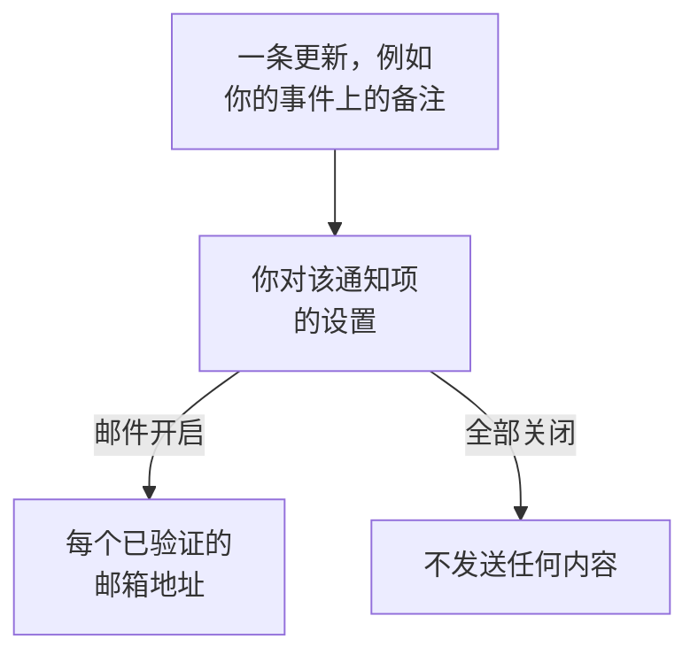

# 通知设置

通知设置决定你会收到哪些关于你所拥有记录（例如事件、监视器或状态页）以及你自己值班班次的更新，以及通过哪些渠道收到。它们永远不会呼叫你：呼叫是值班规则的工作。你在 **用户设置 → 通知设置** 中设置它们，每个通知项和渠道各有一个开关。

:::cards
- [设置如何工作](#设置如何工作): 每个通知项和渠道一个开关，发送到每种已验证的方式。
- [修改设置](#修改设置): 点击三次，立即保存。
- [新成员默认开启的内容](#新成员默认开启的内容): 默认值，逐个选项卡说明。
- [减少邮件](#减少邮件): 汇总突发的更新，或去掉例行邮件。
:::

## 设置如何工作

- 每一行是一个通知项，每一列是一个渠道：邮件、短信、电话、推送、WhatsApp、Telegram、Slack 和 Microsoft Teams，以及 Webhook。只有在项目已连接 Slack 和 Microsoft Teams 时，它们才会成为列。
- 开启的渠道会发送到你在此项目中该渠道上的每种已验证方式，而不只是其中一种。
- 开启的渠道如果背后没有已验证的方式，就不会发送任何内容。 **Your setup checklist** 会在 **Staying informed** 下指出这一点。
- 更新会发送给记录的所有者：被指定为所有者的人，以及其所有者团队的成员。当记录没有所有者时，会改为发送给项目所有者。关于被添加为所有者的通知项只发送给被添加的人。
- 安全案例没有所有者。新案例会按每个人各自选择的优先级，发送给所有能查看项目案例的人；已分配的案例则发送给被分配到的人。参见 [安全案例](/docs/telemetry/security-cases#通知)。
- 每封发给所有者的邮件末尾都有一个返回此页面的 "Manage notification preferences" 链接。

## 修改设置

:::steps
### 打开你的设置

前往 **用户设置 → 通知设置**。选项卡有 **事件**、 **警报**、 **监控**、 **状态页面**、 **计划维护**、 **值班** 和 **安全**。

### 找到通知项

每个选项卡包含一张或多张卡片，例如 **事件** 选项卡上的 **事件 片段**。每一行是一个通知项，并附有一行说明何时发送。

### 点击渠道

点击渠道的圆圈将其开启，再点击一次将其关闭。勾号表示开启。更改会自动保存。
:::

## 新成员默认开启的内容

当你加入项目时，以下通知项会通过邮件开启。其他所有通知项起初都是关闭的，在你开启某个渠道之前不会发送任何内容。

| 选项卡 | 通过邮件开启 | 关闭，直到你开启 |
| --- | --- | --- |
| **事件** | **事件已创建**、 **事件状态已更改**、 **Incident reminder**、 **事件 SLA 违约**、 **事件片段已创建**、 **事件片段状态已更改**、 **事件已添加到事件片段** | **事件备注已发布**、 **已添加为事件所有者**、 **已分配给事件**、 **事件片段备注已发布**、 **已添加为事件片段所有者** |
| **警报** | **警报已创建**、 **警报状态已更改**、 **Alert reminder**、 **警报片段已创建**、 **警报片段状态已更改**、 **警报已添加到警报片段** | **警报备注已发布**、 **已添加为警报所有者**、 **警报片段备注已发布**、 **已添加为警报片段所有者** |
| **监控** | **您监视器的探测器状态已更改**、 **监视器没有活动的探测器**、 **SLO status changed**、 **Added as SLO owner**、 **探测器状态已更改**、 **已添加为探测器所有者** | **监视器已创建**、 **监视器状态已更改**、 **已添加为监视器所有者**、 **AI 代理状态已更改**、 **已添加为 AI 代理所有者** |
| **状态页面** | 无 | **状态页已创建**、 **状态页公告已发布**、 **已添加为状态页所有者** |
| **计划维护** | **Maintenance reminder** | **维护事件已创建**、 **维护状态已更改**、 **维护备注已发布**、 **已添加为维护所有者** |
| **值班** | **您开始值班**、 **您是下一个值班人员**、 **您结束值班**、 **已添加到值班策略**、 **已从值班策略中移除**、 **未接来电**，以及同时通过推送： **我的值班班次开始前**、 **我即将到来的值班班次被重新分配** | 无 |
| **安全** | 同时通过推送： **新的安全案例**（High 和 Critical 案例）、 **分配给我的安全案例**、 **等待我审批的剧本步骤**、 **安全案例响应目标**、 **分配给我的安全案例任务**、 **狩猎发现了安全事件** | 无 |

> [!IMPORTANT]
> **监视器状态已更改** 起初是关闭的。要在你拥有的监视器宕机或恢复时收到通知，请在 **监控** 选项卡上将其开启。

## 你的班次

**值班** 选项卡关注的是你本人，而不是你所拥有的记录：

- **您开始值班**、 **您是下一个值班人员** 和 **您结束值班** 跟随你在所属值班排班表中的轮值。
- **已添加到值班策略** 和 **已从值班策略中移除** 会在值班策略开始或停止指定你时通知你。
- **我的值班班次开始前** 会在你于 **用户设置 → 日历 → 日历订阅** 中选择的时间发送提醒， **我即将到来的值班班次被重新分配** 会在你收到过提醒的班次改由他人承担时通知你。参见 [日历订阅源](/docs/on-call/calendar-feeds#提醒和重新分配通知)。
- **来电策略** 卡片上的 **未接来电** 会告知来电策略的所有者，有来电者没有联系到任何人。参见 [来电策略](/docs/on-call/incoming-call-policy#未接来电)。

## 安全案例

**安全** 选项卡关注的是你能查看的安全案例：

- **新的安全案例** 的名称下方有一个优先级：会通知你的案例的最低优先级。除非你选择 **仅严重**、 **中及以上**、 **低及以上** 或 **所有案例**，否则它是 **高及以上**。
- **分配给我的安全案例** 跟随分配给你以及分配给你所在团队的案例。
- **等待我审批的剧本步骤** 会请你批准或拒绝你有权审批的案例上的某个剧本步骤。

参见 [安全案例](/docs/telemetry/security-cases#通知)。

## 减少邮件

这些开关决定你会收到哪些更新，而不是这些更新会汇总成多少封邮件。为此， **用户设置 → 邮件偏好设置** 提供了两张卡片，都只对你本人、在此项目中生效：

- **Email Rollup** 会把一阵突发的更新合并成一封邮件：最开始的几条仍会逐条送达，其余的会在几分钟后一起送达。
- **Fewer routine emails** 通过 **Reduce routine emails** 关闭有关备注、新所有者、新监视器和状态页、片段新增内容以及值班策略变更的邮件。

参见 [通知汇总](/docs/emails/notification-rollup)。

## 故障排除

:::details 开关已打开，但什么都没收到
检查你在 **用户设置 → 通知方式** 下是否有该渠道上的已验证方式。对于短信、电话、WhatsApp 和 Telegram，项目也必须开启该渠道。
:::

:::details 我拥有一个监视器，但它宕机时我从未收到通知
**监视器状态已更改** 起初是关闭的。请在 **监控** 选项卡上为它开启一个渠道。
:::

:::details 关闭了所有开关后我仍然收到邮件
呼叫遵循你的值班规则，而不是这些开关；登录、安全和账单邮件也不属于关于记录的更新。每个项目都有自己的设置，因此请检查发出该邮件的项目。参见 [个人值班规则](/docs/notifications/on-call-rules)。
:::

## 后续步骤

:::cards
- [通知方式](/docs/notifications/notification-methods): 添加你的设置要发送到的方式。
- [个人值班规则](/docs/notifications/on-call-rules): 决定呼叫如何送达你。
- [通知汇总](/docs/emails/notification-rollup): 在突发期间，邮件更少、内容更完整。
- [OneUptime 如何联系你](/docs/notifications/index): 通知方式、规则和设置如何配合。
:::
