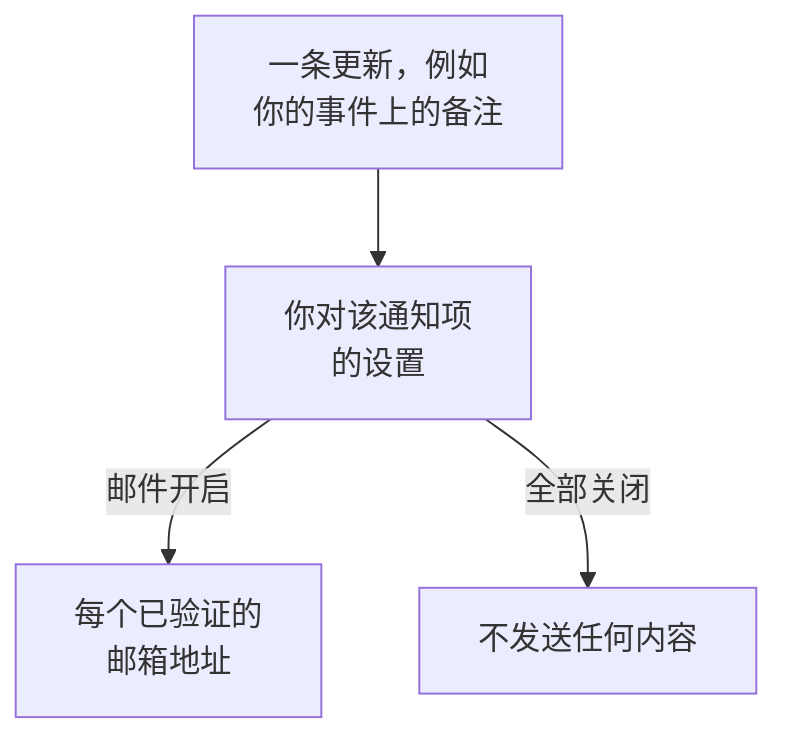

# 通知设置

通知设置决定你会收到哪些关于你所拥有记录（例如事件、监视器或状态页）以及你自己值班班次的更新，以及通过哪些渠道收到。它们永远不会呼叫你：呼叫是值班规则的工作。你在 **用户设置 → 通知设置** 中设置它们，每个通知项和渠道各有一个开关。

:::cards
- [设置如何工作](#设置如何工作): 每个通知项和渠道一个开关，发送到每种已验证的方式。
- [修改设置](#修改设置): 点击三次，立即保存。
- [新成员默认开启的内容](#新成员默认开启的内容): 默认值，逐个选项卡说明。
- [减少邮件](#减少邮件): 汇总突发的更新，或去掉例行邮件。
:::

## 设置如何工作

- 每一行是一个通知项，每一列是一个渠道：邮件、短信、电话、推送、WhatsApp、Telegram、Slack、Microsoft Teams、Mattermost 和 Webhook。只有在项目已连接 Slack、Microsoft Teams 和 Mattermost 时，它们才会成为列。尚未设置的渠道不会成为列：它会以设置链接的形式列在选项卡上方的 **尚未设置的渠道** 下。
- WhatsApp 只投递 Meta 批准的消息，OneUptime 为有关事件、警报、片段、监视器、探测器、AI 代理、状态页、维护事件以及大多数班次的更新准备了这样的消息。其他更新，例如 SLO 的状态、未接来电、安全案例或成为某个服务的所有者，没有 WhatsApp 开关，其卡片会说明 WhatsApp 不可用。这些更新会通过你的其他渠道送达。
- 开启的渠道会发送到你在此项目中该渠道上的每种已验证方式，而不只是其中一种。
- 开启的渠道如果背后没有已验证的方式，就不会发送任何内容。它的列名下方会显示 **设置**，它的开关只能关闭。 **Your setup checklist** 也会在 **Staying informed** 下指出这一点。
- 更新会发送给记录的所有者：被指定为所有者的人，以及其所有者团队的成员。当记录没有所有者时，会改为发送给项目所有者。新事件、警报或片段的值班呼叫已经送达的人不会再次收到其已创建的通知。关于被添加为所有者的通知项只发送给被添加的人。如果 OneUptime 在向记录的所有者发送更新时停止，尚未送达的人会在 OneUptime 恢复后晚几分钟收到，且没有人会收到两次。
- 安全案例没有所有者。新案例会按每个人各自选择的优先级，发送给所有能查看项目案例的人；已分配的案例则发送给被分配到的人。参见 [安全案例](/docs/telemetry/security-cases#通知)。
- 每封发给所有者的邮件末尾都有一个返回此页面的 "Manage notification preferences" 链接。

## 修改设置

:::steps
### 打开你的设置

前往 **用户设置 → 通知设置**。选项卡有 **事件**、 **警报**、 **监控**、 **状态页面**、 **计划维护**、 **值班** 和 **安全**。

### 找到通知项

每个选项卡包含一张或多张卡片，例如 **事件** 选项卡上的 **事件片段**。每一行是一个通知项，并附有一行说明何时发送。在卡片上方，选项卡会说明其中多少个通知项会通知您，以及通过哪些渠道。

### 点击渠道

点击渠道的开关将其开启，再点击一次将其关闭。卡片的第一行 **所有事件** 会为卡片中的每个通知项开启或关闭某个渠道。每次更改都会立即保存，卡片会显示 **已保存**。
:::

## 新成员默认开启的内容

当你加入项目时，以下通知项会通过邮件开启。其他所有通知项起初都是关闭的，在你开启某个渠道之前不会发送任何内容。

| 选项卡 | 通过邮件开启 | 关闭，直到你开启 |
| --- | --- | --- |
| **事件** | **事件已创建**、 **事件状态已更改**、 **事件提醒**、 **事件 SLA 违约**、 **事件片段已创建**、 **事件片段状态已更改**、 **事件已添加到事件片段** | **事件备注已发布**、 **已添加为事件所有者**、 **已分配给事件**、 **事件片段备注已发布**、 **已添加为事件片段所有者** |
| **警报** | **警报已创建**、 **警报状态已更改**、 **警报提醒**、 **警报片段已创建**、 **警报片段状态已更改**、 **警报已添加到警报片段** | **警报备注已发布**、 **已添加为警报所有者**、 **警报片段备注已发布**、 **已添加为警报片段所有者** |
| **监控** | **您监视器的探测器状态已更改**、 **监视器没有活动的探测器**、 **SLO 状态已更改**、 **已添加为 SLO 所有者**、 **分配给我的异常**、 **探测器状态已更改**、 **已添加为探测器所有者**、 **已添加为表所有者**、 **已添加为管道所有者**、 **已添加为服务或基础设施所有者**、 **已添加为仪表板所有者**、 **已添加为工作流所有者**、 **已添加为运行手册所有者**、 **已添加为监视器组所有者**、 **已添加为 Runner 所有者** | **监视器已创建**、 **监视器状态已更改**、 **已添加为监视器所有者**、 **AI 代理状态已更改**、 **已添加为 AI 代理所有者** |
| **状态页面** | **我的公开备注已批准或已拒绝**，以及同时通过推送： **等待我批准的公开备注** | **状态页已创建**、 **状态页公告已发布**、 **已添加为状态页所有者** |
| **计划维护** | **维护提醒** | **维护事件已创建**、 **维护状态已更改**、 **维护备注已发布**、 **已添加为维护所有者** |
| **值班** | **您开始值班**、 **您是下一个值班人员**、 **您结束值班**、 **已添加到值班策略**、 **已从值班策略中移除**、 **未接来电**、 **已添加为值班策略所有者**、 **已添加为值班排班所有者**、 **已添加为来电策略所有者**，以及同时通过推送： **我的值班班次开始前**、 **我即将到来的值班班次被重新分配** | 无 |
| **安全** | **已添加为数据存储所有者**，以及同时通过推送： **新的安全案例**（High 和 Critical 案例）、 **分配给我的安全案例**、 **等待我审批的剧本步骤**、 **安全案例响应目标**、 **分配给我的安全案例任务**、 **安全案例步骤不再有效**、 **OneUptime AI 将安全案例移交给了人员**、 **狩猎发现了安全事件** | 无 |

> [!IMPORTANT]
> **监视器状态已更改** 起初是关闭的。要在你拥有的监视器宕机或恢复时收到通知，请在 **监控** 选项卡上将其开启。

**已添加为服务或基础设施所有者** 位于 **服务与基础设施** 卡片上，是一个开关，涵盖你成为其所有者的每个服务、RUM 应用程序、数据库、队列、主机、集群、云资源以及其他基础设施。消息会说明是哪一个。

**已添加为监视器组所有者** 位于 **监视器** 卡片上，**已添加为 Runner 所有者** 位于 **仪表板与自动化** 卡片上，当有人将你添加为监视器组或 Runner 的所有者时会通知你。

## 你的班次

**值班** 选项卡关注的是你本人，以及你所拥有的值班记录：

- **您开始值班**、 **您是下一个值班人员** 和 **您结束值班** 跟随你在所属值班排班表中的轮值。
- **已添加到值班策略** 和 **已从值班策略中移除** 会在值班策略开始或停止呼叫你时通知你：其某条升级规则指定你或不再指定你时、你加入项目时，以及你加入或离开其某条规则指定的团队时。加入或离开时，每个策略只通知你一次，并列出其所有发生变化的规则；离开时，只有在该策略中再没有其他任何内容呼叫你时才会通知你。在你加入项目之前，或你被移出项目时，不会发送任何内容。
- **我的值班班次开始前** 会在你于 **用户设置 → 个人资料与日历 → 日历订阅** 中选择的时间发送提醒， **我即将到来的值班班次被重新分配** 会在你收到过提醒的班次改由他人承担时通知你。参见 [日历订阅源](/docs/on-call/calendar-feeds#提醒和重新分配通知)。
- **来电策略** 卡片上的 **未接来电** 会告知来电策略的所有者，有来电者没有联系到任何人。参见 [来电策略](/docs/on-call/incoming-call-policy#未接来电)。
- **已添加为值班策略所有者**、 **已添加为值班排班所有者** 和 **已添加为来电策略所有者** 会在你通过所有者规则，或由某人在其所有者页面上，成为其中某一项的所有者时通知你。

## 安全案例

**安全** 选项卡关注的是你能查看的安全案例：

- **新的安全案例** 的名称下方有一个优先级：会通知你的案例的最低优先级。除非你选择 **仅严重**、 **中及以上**、 **低及以上** 或 **所有案例**，否则它是 **高及以上**。
- **分配给我的安全案例** 跟随分配给你以及分配给你所在团队的案例。
- **等待我审批的剧本步骤** 会请你批准或拒绝你有权审批的案例上的某个剧本步骤。

参见 [安全案例](/docs/telemetry/security-cases#通知)。

## 公开备注审批

**状态页面** 标签页上的 **公开备注审批** 卡片，针对的是在要求审批的项目中、发布前需要等待审批的公开备注：

- **等待我批准的公开备注** 会告诉你，一条公开备注或对它的编辑正在等待一个由你审批的步骤，无论你是被直接指定还是通过团队指定。你不会被问到自己发送的备注，也不会被问到你已批准的步骤之后的步骤。每个步骤只会问你一次：在备注到达该步骤时，或在备注等待期间因审批步骤变化、或你加入了某个步骤指定的团队而成为它的审批人时。它一开始就通过邮件和推送开启， **Email Rollup** 也从不会把它压后：备注所面向的客户正在等着它。
- **我的公开备注已批准或已拒绝** 会告诉你，你提交审批的备注已获批并发布，或已被拒绝，并附上原因。它一开始就通过邮件开启。

参见 [公开备注审批](/docs/incidents/notes-owners-and-feed#公开备注审批)。

## 减少邮件

这些开关决定你会收到哪些更新，而不是这些更新会汇总成多少封邮件。为此， **用户设置 → 邮件偏好设置** 提供了两张卡片，都只对你本人、在此项目中生效：

- **Email Rollup** 会把一阵突发的更新合并成一封邮件：最开始的几条仍会逐条送达，其余的会在几分钟后一起送达。
- **Fewer routine emails** 通过 **Reduce routine emails** 关闭有关备注、新所有者、新监视器和状态页、片段新增内容以及值班策略变更的邮件。

参见 [通知汇总](/docs/emails/notification-rollup)。

## 故障排除

:::details 开关已打开，但什么都没收到
检查你在 **用户设置 → 通知方式** 下是否有该渠道上的已验证方式。对于短信、电话、WhatsApp 和 Telegram，项目也必须开启该渠道。
:::

:::details 某个更新没有 WhatsApp 开关
WhatsApp 只投递 Meta 批准的消息，而 OneUptime 没有该更新的消息，因此其卡片会说明 WhatsApp 不可用。请为它选择其他渠道，例如短信或推送。
:::

:::details 我拥有一个监视器，但它宕机时我从未收到通知
**监视器状态已更改** 起初是关闭的。请在 **监控** 选项卡上为它开启一个渠道。
:::

:::details 关闭了所有开关后我仍然收到邮件
呼叫遵循你的值班规则，而不是这些开关；登录、安全和账单邮件也不属于关于记录的更新。每个项目都有自己的设置，因此请检查发出该邮件的项目。参见 [如何联系我](/docs/notifications/on-call-rules)。
:::

## 后续步骤

:::cards
- [通知方式](/docs/notifications/notification-methods): 添加你的设置要发送到的方式。
- [如何联系我](/docs/notifications/on-call-rules): 决定呼叫如何送达你。
- [通知汇总](/docs/emails/notification-rollup): 在突发期间，邮件更少、内容更完整。
- [OneUptime 如何联系你](/docs/notifications/index): 通知方式、规则和设置如何配合。
:::
