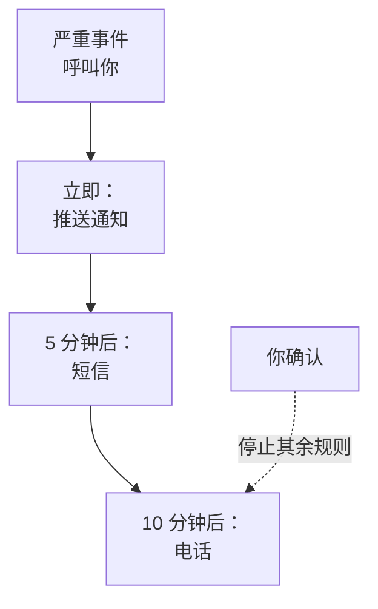

# 个人值班规则

你的值班规则决定呼叫如何送达你：OneUptime 尝试你的哪些通知方式，以及在呼叫开始多久之后尝试。每种呼叫都有自己的规则，每个严重级别一组，因此严重事件可以立即给你打电话，而低级别警报可以等一封邮件。你在 **用户设置 → 值班规则** 中设置它们。

> [!NOTE]
> 这些规则只属于你。 **事件 → 规则** 和 **警报 → 规则** 下的 **值班规则** 是另一回事：它们决定新事件或新警报运行哪些值班策略。

:::cards
- [呼叫如何送达你](#呼叫如何送达你): 一次呼叫中你的规则，逐步说明。
- [一开始拥有的规则](#一开始拥有的规则): 每种已验证的方式会添加什么，以及如何精简。
- [添加规则](#添加规则): 为一个严重级别设置一种方式和一段延迟。
- [推送规则](#推送规则): 穿透静音模式响铃，并重复直到有人确认。
:::

## 呼叫如何送达你

当值班策略的某条升级规则指定了你、你所在的团队或你正在值班的排班表时，该策略会呼叫你。随后 OneUptime 会依次执行你针对该呼叫类型及其严重级别的规则：每条规则在呼叫开始后经过其延迟时，通过它自己的方式发送。无论是从任何消息中还是在 OneUptime 中确认事件或警报，都会停止所有尚未发送的规则。

大多数消息都可以确认呼叫：邮件、短信，以及 WhatsApp、Telegram、Slack 和 Microsoft Teams 消息都带有确认链接，电话会让你按 1。如果你无法处理某次呼叫，可以通过同样的消息升级它，电话会让你按 2：策略会立即呼叫下一级，你也不会再因此被呼叫。参见 [升级呼叫](/docs/on-call/escalation-rules#升级呼叫) 。你收到的每次呼叫都列在 **用户设置 → 值班日志** 下，其中 **查看时间线** 会显示它发送的每条消息以及是否已送达。

## 四个选项卡

**用户设置 → 值班规则** 为每种呼叫提供一个选项卡。每个选项卡为每个严重级别提供一张卡片，名称和颜色与你的项目设定的一致：

| 选项卡 | 呼叫来源 | 卡片对应 |
| --- | --- | --- |
| **事件** | 事件 | 事件严重级别 |
| **事件 片段** | 将事件分组的片段 | 事件严重级别 |
| **警报** | 警报 | 警报严重级别 |
| **警报 片段** | 将警报分组的片段 | 警报严重级别 |

片段通过自己的值班策略呼叫你，与其中的事件或警报分开，因此它的规则位于单独的选项卡上。页面地址会标明当前打开的选项卡，例如 `/dashboard/{projectId}/user-settings/on-call-rules?type=alerts`；其他取值为 `incident-episodes` 和 `alert-episodes`，没有 `type` 时页面会打开 **事件**。

项目已归档的严重程度会排在其他严重程度之后，并标有 **已归档**，前提是您为它设置了规则：仍带有它的事件和警报会按这些规则呼叫您。您可以更改或移除这些规则，但不能添加新规则。

## 一开始拥有的规则

你验证的每种方式都会在每个选项卡的每张卡片上获得一条规则，在你被呼叫时立即发送。你的登录邮箱从你加入的那天起就有这些规则，因此呼叫总能送达你。验证一个用于短信的电话号码后，每次呼叫也会给你发短信。

这是一个稳妥的起点，但通常太多了。请按每个严重级别的需要进行精简：

| 严重级别 | 合理的组合 |
| --- | --- |
| 严重 | 立即推送，5 分钟后打电话 |
| 重大 | 立即推送，10 分钟后发短信 |
| 轻微或低 | 立即发邮件 |

你自己的规则没有免打扰时段：把低严重级别留给邮件，或留给设置为 **普通** 的推送规则，这样它们就永远不会吵醒你。要让所有人的低严重级别呼叫都等到工作时间，请把呼叫它的值班规则设置为 **仅在工作时间内**：参见 [值班规则](/docs/alerts/settings#值班规则)。

## 添加规则

:::steps
### 打开卡片

前往 **用户设置 → 值班规则**，打开对应呼叫类型的选项卡，找到该严重级别的卡片。

### 选择方式

点击 **添加通知 规则**。在 **通知方式** 中，选择一种已验证的方式；未验证的方式不会出现在选项中。

### 选择推送的提示方式

对于手机，在 **推送通知** 中选择 **重要警报** 或 **普通**。对于任何推送设备，选择 **重复直至确认**。参见 [推送规则](#推送规则)。

### 设置延迟

选择 **在以下时间后通知我**： **立即**、 **5 分钟**、 **10 分钟**、 **15 分钟**、 **30 分钟** 或 **1 小时**。然后点击对话框中的 **添加通知 规则**。
:::

卡片按延迟顺序列出其规则，每条规则都显示 **通知方式** 和 **通知延迟**。

## 修改或删除规则

- 规则所在行的 **编辑** 用于修改其延迟。要把规则改发到另一种方式，请删除它并添加一条新规则。
- 对于推送规则，点击方式下方的标签，可以在 **重要警报** 和 **普通** 之间切换，或修改其重复频率。修改会立即保存。
- **删除** 会先请求确认，并说明该严重级别是否会因此没有任何规则。没有规则的严重级别会回退到你已验证的方式；参见 [某个严重级别没有规则时](#某个严重级别没有规则时)。

## 推送规则

呼叫手机的规则会指定其推送的提示方式：

| 选项 | 手机的行为 |
| --- | --- |
| **重要警报** | 只要在 OneUptime On-Call 应用中开启了 Critical On-Call Alerts，即使手机处于静音或勿扰模式也会响铃。新的手机规则默认使用此选项。 |
| **普通** | 遵循手机的声音、静音和勿扰设置。 |

推送规则（无论针对手机还是浏览器）还可以重复发送推送，直到有人确认： **不重复**（默认值），或 **每分钟**、 **每 2 分钟**、 **每 3 分钟**、 **每 5 分钟**、 **每 10 分钟**、 **每 15 分钟** 或 **每 30 分钟**。它最多再重复 10 次，并在事件、警报或片段被确认后立即停止。参见 [关键值班告警](/docs/self-hosted/push-notifications#关键值班告警穿透静音模式)。

## 某个严重级别没有规则时

项目之后新增的严重级别会在几分钟内获得规则，这些规则根据你在该选项卡上已做的选择生成：相同的方式，相同的延迟。如果你在该选项卡上没有任何规则，它会获得你已验证的邮箱，立即发送。

仍然找不到规则的呼叫依然会发送到你已验证的方式，并且你会收到一封相关邮件；参见 [没有匹配的规则时](/docs/notifications/index#没有匹配的规则时)。

:::details 有意关闭某个严重级别
API 可以保存一条退出规则，设置 `isOptOut` 且不指定方式：这样你在该呼叫类型和严重级别下完全不会被呼叫，也不会回退。该行显示 **Muted - notifications turned off for this rule**，删除它即可重新开启呼叫。当你在该选项卡上的所有规则都是退出规则时，之后新增的严重级别也会被静音。
:::

:::details 为整个项目关闭回退
项目所有者或拥有 **Manage Billing** 权限的人可以通过 API 设置项目的 `disableOnCallNotificationFallback`。此后找不到规则的呼叫将不会送达，其日志会说明该用户应在 **用户设置 → 值班规则** 下添加规则。
:::

## 队友的规则

项目所有者和管理员可以为项目中的任何人查看和修改同一页面：在 **用户** 下打开此人，然后打开 **值班** 部分中的 **值班规则**。旁边的 **就绪情况** 显示每个严重级别是否都能送达此人。当其他人添加、修改或删除你的规则时，你会收到一封相关邮件，并且每次修改都会记录在项目的审计日志中。

## 故障排除

:::details 严重呼叫时我的手机没有响
检查规则的推送是 **重要警报** 而不是 **普通**，并检查在 **用户设置 → 通知方式** 的 **Push Notifications** 选项卡上，该手机的 **重要警报** 已开启。
:::

:::details 每个事件我都被呼叫两次
每种已验证的方式都有一条针对每个严重级别、立即发送的规则。删除你不需要的规则，或为它们设置延迟。片段中的事件可能通过两个策略呼叫你：事件一次，片段一次。
:::

:::details 我的规则写的是短信，却收到了邮件
该呼叫找不到与其类型或严重级别匹配的规则，因此回退到了你的免费方式：请在正确的选项卡和卡片上添加规则。或者，那封邮件是关于你所拥有的记录的更新，这类更新遵循 **通知设置**，而不是你的规则。你的 **值班日志** 只列出呼叫。
:::

## 后续步骤

:::cards
- [通知方式](/docs/notifications/notification-methods): 添加并验证你的规则所指向的方式。
- [升级规则](/docs/on-call/escalation-rules): 值班策略如何逐级呼叫人员。
- [推送通知](/docs/self-hosted/push-notifications): 手机上的重要警报、警报声和重复。
- [OneUptime 如何联系你](/docs/notifications/index): 通知方式、规则和设置如何配合。
:::
