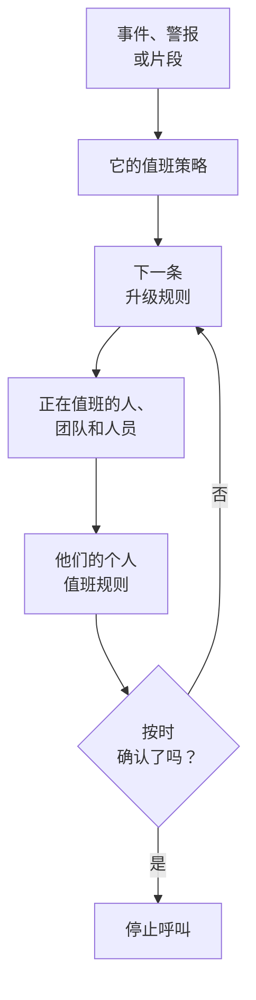

# 值班概览

值班是 OneUptime 在任何时间把人带到问题面前的方式。当事件、警报或片段需要有人处理时，它的值班策略会逐级呼叫人员，直到有人确认；每个人都会通过自己选择的方式收到通知：推送通知、短信、电话、电子邮件或聊天消息。本页说明各个部分如何配合，以及它们各自在哪里。

:::cards
- [呼叫如何到达某人](#呼叫如何到达某人): 从新事件到作出响应的人。
- [组成部分](#组成部分): 策略、升级规则、值班计划、覆盖和个人规则。
- [设置值班](#设置值班): 从零开始到一个会被呼叫的团队，共五步。
- [值班在哪里](#值班在哪里): 值班菜单，逐个部分介绍。
:::

## 呼叫如何到达某人

1. 新的事件、警报或片段会立即运行它的值班策略：在其上选定的策略，以及其值班规则添加的策略。每个策略各自运行。设置为 **仅在工作时间内** 的值班规则会让它添加的策略等到工作时间开始。
2. 策略的第一条升级规则会立即呼叫：其值班计划中此刻正在值班的人、其团队的每位成员，以及规则指定的人员。
3. 如果其中有人不在岗，用户覆盖会把呼叫转给代班的人，或者跳过此人。
4. 每个人都通过其个人值班规则收到通知：先尝试哪种方式，以及多久之后尝试。没有规则的呼叫仍会通过此人已验证的方式送达。
5. 如果在规则的等待时间结束前无人确认，下一条规则就会呼叫。最后一条规则之后，如果策略设置为重复，就从头再来，否则停止。

确认或解决事件、警报或片段，会停止所有仍在为其呼叫的策略。OneUptime 每分钟推进一次正在运行的策略，并在 **执行日志** 中按规则记录每次运行。

呼叫第一次到达某人时，OneUptime 会把这一时刻以 `First Paged At` 记录在事件、警报或片段上。测量可以从这一时刻开始计时：**呼叫后确认用时** 衡量的是人们被呼叫之后过了多久才作出响应，而不是这条记录在有人被呼叫之前等了多久。请参阅 [呼叫后确认用时](/docs/incidents/settings#呼叫后确认用时)。

> [!NOTE]
> 创建时即已确认或已解决的事件、警报或片段不会运行任何策略，其信息流会说明这一点。请参阅 [创建时即已确认或已解决](/docs/alerts/index#创建时即已确认或已解决)。

## 组成部分

| 部分 | 决定什么 | 了解更多 |
| --- | --- | --- |
| 值班策略 | 针对事件或警报逐级呼叫谁 | [值班策略](/docs/on-call/policies) |
| 升级规则 | 策略的一个级别：呼叫谁，以及等待确认多长时间 | [升级规则](/docs/on-call/escalation-rules) |
| 值班计划 | 随着大家轮流值班，任一时刻由谁值班 | [值班计划](/docs/on-call/schedules) |
| 用户覆盖 | 某人不在岗时由谁代班 | [用户覆盖](/docs/on-call/user-overrides) |
| 个人值班规则 | 如何联系到某个人：用哪种方式，多久之后 | [个人值班规则](/docs/notifications/on-call-rules) |
| 来电策略 | 拨打后会转给值班人员的电话号码 | [来电策略](/docs/on-call/incoming-call-policy) |

策略、升级规则、值班计划和覆盖属于项目，位于 **值班** 下。通知方式和个人值班规则属于每个人自己，位于 **用户设置** 下：管理员可以查看某人的设置，但只有本人才能验证自己的电话或电子邮件。请参阅 [OneUptime 如何联系你](/docs/notifications/index)。

## 设置值班

:::steps
### 建立值班计划

从 **产品** 菜单打开 **值班** ，前往 **值班计划** 。点击 **创建值班计划** ，为它命名，并在 **谁轮流值班？** 下按轮换顺序选择人员。请参阅 [值班计划](/docs/on-call/schedules)。

### 创建策略

前往 **值班策略** ，点击 **创建值班策略** 。在 **首先通知谁？** 下选择该值班计划。它会成为策略的第一条升级规则 **Level 1** ，等待确认 30 分钟。

### 添加后续级别

在策略的 **升级规则** 页面，为第一级之后的每个级别点击 **添加升级规则** ：同一值班计划轮换中的下一个人、团队负责人、经理。请参阅 [升级规则](/docs/on-call/escalation-rules)。

### 自动运行策略

前往 **事件 → 规则 → 值班规则** 或 **警报 → 规则 → 值班规则** ，添加一条规则，为匹配的事件或警报运行该策略，例如所有严重事件。请参阅 [什么会运行策略](/docs/on-call/policies#什么会运行策略)。

### 检查每个人都能联系到

打开 **值班 → 就绪情况** 。你的策略可以呼叫的每个人都会显示为 **就绪** 、 **需要设置** 或 **不可达** ，并列出缺少的内容。请参阅 [就绪情况与报告](/docs/on-call/readiness)。
:::

> [!NOTE]
> 在 OneUptime Cloud 上，值班策略和升级规则在所有套餐中都可用。值班计划、用户覆盖、执行日志和值班时间报告需要 **Growth** 套餐。

## 值班在哪里

从顶部栏的 **产品** 菜单打开 **值班** 。它会在 `/dashboard/{projectId}/on-call-duty/policies` 打开 **值班策略** ，侧边菜单包含其余内容：

| 部分 | 页面 |
| --- | --- |
| **策略** | **值班策略** 和 **就绪情况** ：你的策略实际能联系到谁 |
| **计划** | **值班计划** 、 **值班时间线** 和 **日历订阅** |
| **来电** | **来电策略** ：一个会转给值班人员的电话号码 |
| **高级** | **用户覆盖** 、 **执行日志** 和 **已归档策略** |
| **报告** | **用户值班时间** ：每个人值班了多长时间 |
| **工作区** | **Slack** 和 **Microsoft Teams** ：把值班事件发布到频道的规则 |
| **设置** | **自定义字段** 、 **标签规则** 和 **所有者规则** |
| **开发者** | **Terraform** 、 **API** 和 **AI 助手** ：通过代码设置值班 |

**策略** 、 **计划** 和 **来电** 默认展开；其他部分一开始是折叠的，当你位于其中某个页面时会自动展开。 **工作区** 列出项目已连接的聊天工具，如果没有，则显示 **连接 Slack 或 Teams** 。

当你在某个策略中值班时，右上角的铃铛会显示出来。点击它可打开 **我的值班策略** ：你在所有项目中值班的每个策略，以及你是被直接指定、通过团队还是通过值班计划。

## 故障排除

:::details 新事件没有呼叫任何人
打开事件的 **值班执行** 页面。如果为空，说明该事件没有值班策略：既没有在事件上选择策略，也没有匹配的值班规则。状态为 **Execution Completed - No One Notified** 的运行经过了每条升级规则，却没有找到任何人：通常是某个值班计划中无人值班。请参阅 [执行日志](/docs/on-call/policies#执行日志)。状态为 **正在等待** 的运行正按设置为 **仅在工作时间内** 的值班规则等待工作时间，在工作时间开始前不会呼叫任何人。
:::

:::details 有人通过错误的渠道被呼叫，或根本没被呼叫
打开 **值班 → 就绪情况** ，点击此人所在行的 **Coverage** 。它会显示此人已验证的方式，以及此人没有规则的每个严重级别。只有本人才能在 **用户设置** 中修复：可以在同一页面给此人发送设置提醒。请参阅 [就绪情况与报告](/docs/on-call/readiness)。在 OneUptime Cloud 上，屏蔽陌生来电的手机可能会让呼叫静音：请把 [OneUptime 的号码](/docs/on-call/phone-number-whitelist) 加入手机的允许列表。
:::

:::details 休假的人仍在被呼叫
添加一个用户覆盖，在 **谁不在岗？** 中选择此人。在 **值班 → 高级 → 用户覆盖** 下添加的覆盖适用于所有策略；在策略自己的 **用户覆盖** 页面添加的覆盖只适用于该策略。请参阅 [用户覆盖](/docs/on-call/user-overrides)。
:::

## 后续步骤

:::cards
- [值班策略](/docs/on-call/policies): 创建策略，决定由什么运行它，并查看它做了什么。
- [升级规则](/docs/on-call/escalation-rules): 逐级呼叫人员，直到有人响应。
- [值班计划](/docs/on-call/schedules): 轮换、层和交接。
- [OneUptime 如何联系你](/docs/notifications/index): 决定如何联系每个人的方式和规则。
:::
