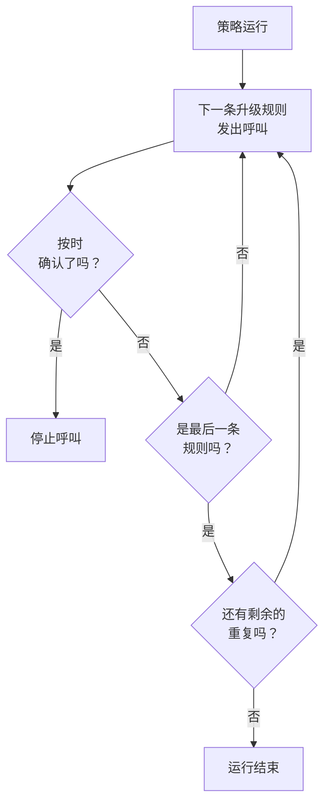

# 值班策略

值班策略决定针对事件或警报呼叫谁，以及如果无人确认，下一个是谁。它的升级规则就是它的级别，使用它的事件、警报和片段会运行它。本页介绍如何创建策略、什么会运行策略、策略页面显示什么，以及每次运行如何被记录。

:::cards
- [创建策略](#创建策略): 一个名称，以及首先呼叫谁。
- [什么会运行策略](#什么会运行策略): 规则、模板、监视器、聊天和你自己。
- [执行日志](#执行日志): 每次运行，按规则逐条记录，以及它为何停止。
- [归档或删除策略](#归档或删除策略): 让策略停止服务。
:::

## 创建策略

:::steps
1. 前往 **值班 → 值班策略** ，点击 **创建值班策略** 。
2. 输入 **名称** ，例如“支付主值班”。与项目中其他策略（包括已归档的策略）重名的名称会被拒绝，不区分大小写和空格，因此每个选择器都能区分各个策略。
3. 在 **首先通知谁？** 下点击 **添加响应人** ，选择首先呼叫的值班计划、团队和人员。
4. 点击 **创建值班策略** 。策略会在其 **升级规则** 页面打开， **Level 1** 已经就位。
:::

**首先通知谁？** 是可选的，并且只会向可以添加升级规则的人显示：留空时，策略在拥有规则之前不会呼叫任何人。 **描述** 和 **标签** 位于 **更多字段** 下。要添加后续级别，请参阅 [升级规则](/docs/on-call/escalation-rules)。

对于可以添加值班规则的人，表单还会询问 **每个新事件和警报都触发此策略**。它会在 **事件 → 规则 → 值班规则** 和 **警报 → 规则 → 值班规则** 下各添加一条规则，两条规则都匹配所有内容并运行此策略。在项目还没有任何值班策略和值班规则时创建的第一个策略默认开启，之后的策略默认关闭：每个新事件和警报都触发两个策略，需要你自己决定。保持关闭时，在规则、监视器或某个人运行它之前，策略不会呼叫任何人。

若想改为按步骤引导完成设置，从你的手机到一次测试呼叫，请点击 **引导式设置**：它位于空的 **值班策略** 列表上，或在 **工作原理** 中。请参阅 [通过电话、短信或推送接收呼叫](/docs/guides/paging)。

**值班策略** 列表显示每个策略的 **名称** 、 **最先呼叫** 、 **描述** 、 **标签** 和 **所有者** 。 **最先呼叫** 显示策略的第一条升级规则呼叫谁：它的值班计划（每个计划都附上此刻正在值班的人）、团队和人员；不呼叫任何人时显示 **无升级规则** 或 **无响应人** 。选择策略后可以执行 **添加标签** 、 **移除标签** 、 **添加所有者** 、 **移除所有者** 、 **归档** 、 **导出 JSON** 或删除。 **导入 JSON** 从导出文件创建策略：导出文件包含策略本身的设置，不包含其升级规则或所有者。在名称必须互不相同之前就与另一个策略同名的策略，会标记为 **与另一个策略同名** ，列表会显示这样的策略有多少个：请比较它们的升级规则，然后点击其中一个所在行的 **重命名** 为它改名。

## 什么会运行策略

在有东西运行策略之前，策略不会呼叫任何人。每个事件、警报和片段在创建后会立即运行它拥有的策略：

| 来源 | 如何添加策略 | 了解更多 |
| --- | --- | --- |
| 记录本身 | 创建事件或警报时的 **值班策略** 字段、事件模板，或监视器条件中的 **值班** 折叠区 | [声明事件](/docs/incidents/declaring-incidents) |
| 值班规则 | **事件 → 规则 → 值班规则** 和 **警报 → 规则 → 值班规则** 会添加每条匹配规则的策略 | [事件值班规则](/docs/incidents/settings#事件值班规则) |
| 分组规则 | 分组规则在打开片段时运行它自己的策略 | [警报片段与分组规则](/docs/alerts/episodes) |
| 手动 | 信息流的 **操作** 菜单中，或 Slack、Microsoft Teams 消息上的 **执行值班策略** | [事件信息流](/docs/incidents/notes-owners-and-feed#事件信息流) |
| 聊天和工作流 | Slack 或 Microsoft Teams 中的 `/oneuptime page` ，以及工作流的 **Page an On-Call Policy** 步骤 | [Paging](/docs/workflows/components#paging) |

多条规则添加的同一个策略只运行一次。严重级别本身从不运行策略：运行策略的是匹配该严重级别的值班规则。创建时即已确认或已解决的事件或警报不会运行任何策略。设置为 **仅在工作时间内** 的值班规则会让它添加的策略等到工作时间开始。

## 策略的页面

从列表中打开一个策略。它的侧边菜单包含关于它的一切：

| 部分 | 页面 |
| --- | --- |
| **基础** | **概览** 、 **升级规则** 和 **所有者** |
| **日志** | **执行日志** 和 **通知日志** |
| **开发者** | **Terraform** 、 **Crossplane** 、 **API** 、 **CLI** 和 **AI 助手** |
| **高级** | **用户覆盖** 、 **自定义字段** 、 **设置** 、 **审计日志** 和 **删除策略** |

**基础** 默认展开；其他部分在你点击之前都是折叠的。

- **概览** 显示 **值班策略详情** ，然后是 **策略概览** ：策略有多少级别和响应人、到最后一级需要多长时间，以及重复多少次。 **响应人就绪情况** 说明它能呼叫的每个人现在是否都能联系到， **值班策略信息流** 列出变化：添加或移除的人员、团队和值班计划，覆盖和交接。 其 Slack、Microsoft Teams 和 Mattermost 规则会把这些发布到您的频道，每次交接一行：请参阅 [值班消息](/docs/workspace-connections/slack#值班消息)。
- **所有者** 是对策略负责的人员和团队。当策略发出的呼叫找不到某人的规则或无法送达时，他们会收到电子邮件；没有所有者的策略会改为给项目所有者发送电子邮件。
- **通知日志** 列出策略发送的每条消息，每个渠道一个标签页。
- **用户覆盖** 只在此策略中为人员安排代班。请参阅 [用户覆盖](/docs/on-call/user-overrides)。
- **设置** 中有 **导出值班策略** 和用于归档策略的卡片。

**概览**中的**触发此策略的内容**会列出值班规则、其标准会触发此策略的监视器、触发它的模板和其他规则，以及触发它的工作流，每项都带有链接。已关闭的规则会显示**关闭**。如果没有内容触发此策略，卡片会说明这一点：在有内容触发它之前，它不会呼叫任何人。删除或归档此策略时，也会先说明同样的内容。你无权打开的内容只计数，不显示名称。

## 重复策略

当最后一级的等待时间结束仍无人确认时，策略会停止，除非它设置为重复。要选择，请打开策略的 **升级规则** 页面，点击规则下方 **重复策略** 卡片上的 **编辑** 。 **编辑重复策略** 会询问 **如果最后一级之后仍无人确认** 时怎么做：

| 回答 | 作用 |
| --- | --- |
| **停止通知** | 不再通知任何人，因此策略只运行一次。新策略默认使用此回答。 |
| **从 Level 1 重新开始** | 按顺序再次通知每一级。 **再重复几次？** 决定次数：1 次或更多。 |

再重新开始三次的策略总共会走完四遍所有级别。如果某一遍中没有任何级别有人可呼叫，就不会再重复：再走一遍也不会呼叫任何人，因此策略会停止。卡片上的 **最后一级之后** 一行说明策略会做什么， **概览** 上的 **策略概览** 会用文字说明同样的内容。

## 未解决时再次通知

确认会彻底停止策略的通知，即使之后无人解决该事件或警报。策略也可以改为再次通知：打开策略的 **升级规则** 页面，打开底部的 **更多设置** ，然后点击 **确认后超时** 卡片上的 **编辑** 。 **编辑确认后超时** 会询问 **如果已确认但未解决** 时怎么做：

| 回答 | 作用 |
| --- | --- |
| **不再通知** | 确认后将彻底停止通知。新策略默认使用此回答。 |
| **再次通知** | 通知确认者和当前的值班人员。 **多少分钟后？** 决定时间：5 到 1440 分钟，初始为 30。 |

分钟数从每次确认开始计算，同一策略针对同一事件、警报或片段最多再次通知 5 次。再次通知从确认时正在通知的级别开始，呼叫该级别当前的值班人员，然后像第一次运行一样逐级进行。事件或警报保持已确认状态：再次通知是一次独立的运行，显示在其信息流和策略的执行日志中，其 **状态** 显示“已再次通知（第 1 次，共 5 次）”。

被再次通知的人可以通过消息，或在事件或警报页面上点击 **再次确认** 来确认，分钟数随即重新计算； **升级** 会将其交给下一级。解决或删除事件或警报、归档或删除策略，或选择 **不再通知** 都会停止它。卡片上的 **确认之后** 一行说明策略会做什么，折叠时 **更多设置** 也会显示分钟数。 **概览** 上的 **策略概览** 和 **升级摘要** 也会用文字说明同样的内容。

## 多个策略同时呼叫时

事件、警报或片段会同时、各自独立地运行它的每个策略。

- 在其中两个策略里值班的人只会被呼叫一次。当某个策略的级别轮到另一个策略已在呼叫的人时，该策略不会重复呼叫此人：其执行日志会将此人显示为 **已呼叫过** ，事件的信息流以及该策略在 Slack 和 Microsoft Teams 中的消息会写明正在呼叫此人的策略。该级别仍会等满它的分钟数再进入下一级，就像对它呼叫过的任何人一样。回应这一次呼叫，就同时回应了两个策略。在同一个策略中，某个级别直接以及通过团队或值班计划两次指定的人，只会被呼叫一次。
- 直接发给人员的呼叫同样算数。当某个策略的级别轮到一个已在被 Slack 或 Microsoft Teams 发出的呼叫、或工作流的呼叫块为此呼叫的人时，该策略不会重复呼叫此人：其执行日志会写明发出那次呼叫的人，或那个工作流。工作流的呼叫块也不会重复呼叫一个策略或另一个呼叫已在呼叫的人。
- 确认事件或警报后，无论在哪里确认（关于它的任何呼叫、它自己的页面、移动应用，或 Slack、Microsoft Teams），为它运行的每个策略都会在一分钟内停止：不会再呼叫下一级，仍在等待发出的电话或短信也不会发送。已经发送的通知不会撤回。

只被呼叫一次不会让任何人漏掉呼叫。此人的呼叫可能在其未回应的情况下结束：此人从呼叫的某条消息中升级了它（这只会升级那次呼叫），呼叫无法发送，或者它停止了。这时，另一个策略或工作流的块会在一分钟内自行呼叫此人，但不会重新发送已经送达的内容。在事件页面或移动应用中点击 **升级** ，会同时升级两个策略。再次通知、手动启动的策略，以及某人从 Slack 或 Microsoft Teams 发出的呼叫，总是自行呼叫各自的人员，即使是另一个策略正在呼叫的人。对观察者的呼叫和对响应人的呼叫永远不会合并。

有些呼叫在确认之后仍会继续，直到被呼叫的人中有人回应，或者它被解决：再次通知、对观察者的呼叫、某人从 Slack 或 Microsoft Teams 向他人发出的呼叫，以及手动启动的策略。

手动启动的策略，是指通过 **执行值班策略** 启动的策略，或由 Slack、Microsoft Teams 中点名该策略的呼叫启动的策略。它像任何运行一样逐级呼叫，包括电话和重复的推送通知，别人确认事件也不会让它停止：这样您就能把另一个团队呼叫到已经有人在处理的事件上。被它呼叫的人可以通过呼叫的消息、电话或短信回应，也可以自己确认事件；事件被确认后，事件页面会为他们显示 **再次确认** 。 **升级** 会将其交给下一级。在已解决的事件、警报或片段上不会启动任何内容，并会告诉您原因：仪表板会停用 **执行值班策略** 并显示原因。它的通知会说明是谁启动了哪个策略，并附上从 Slack 或 Microsoft Teams 发出呼叫时写的消息。

## 测试策略

策略升级规则中的 **测试此策略** 会以测试方式呼叫其第一级，背后没有任何事件：每条消息都会注明 TEST，也不会通知任何状态页面、订阅者或频道。开启 **逐级经过每个升级级别** 后，会依次呼叫每一级，间隔最多 2 分钟，直到有人确认。发送之前，对话框会列出测试会呼叫谁、如何呼叫，以及在 OneUptime Cloud 上的费用。

只要测试无法联系到任何人，**发送测试呼叫** 就保持关闭：它呼叫的每个人都退订了该严重程度、没有对应的规则且没有可回退的方式，或者只有未经验证或在项目中已关闭的方式。列表下方的一行会说明原因。当只有后续级别能联系到人时，这一行会提供 **逐级经过每个升级级别**，一键即可开启。

被呼叫的人可以从测试的任意一条消息确认：电子邮件、短信或聊天消息中的链接，通话中按 1，或者在 1.6.0 之后版本的 OneUptime On-Call 应用中的推送通知。每个策略每 5 分钟最多测试一次，一个项目每小时最多发送 20 次测试。

### 对监视器进行故障演练

监视器 **宕机时** 卡片上的 **运行故障演练** 会演练该监视器的一种故障：其某个条件会打开的事件或警报，或者警报事件规则根据此类警报宣布的事件。它会测试该故障会呼叫的每个值班策略，每个都像 **测试此策略** 那样测试，并且不会发生任何公开的事情：不会创建事件或警报，也不会通知任何状态页面、订阅者或频道。发送之前，对话框会列出这种故障、每个策略，以及该策略当前会呼叫谁。对于宣布的事件，还会列出规则，以及警报在此之前保持打开的时长：演练会立即测试该事件的策略，无需等待。

演练会呼叫每个策略的第一级。在 **更多字段** 下开启 **逐级经过每个升级级别** 后，会依次呼叫每个策略的各个级别，间隔最多 2 分钟，直到有人确认：此时对话框会列出每个策略到达的每个级别，以及逐级经过最多的费用。当第一级都无人能收到、但后续级别可以时，列表下方的那一行会提供一键 **逐级经过每个升级级别**。

只要其中有你因无法编辑而无法测试的策略，或者它们呼叫的人都无法联系到，**开始故障演练** 就保持关闭。演练中的每个策略都算作一次单独的测试：最近 5 分钟内测试过的策略会让整个演练无法开始，而包含三个策略的演练会占用项目每小时 20 次测试中的三次。

关闭对话框后，卡片上的 **上次故障演练** 会说明该监视器的上次演练演练了哪种故障、何时由谁开始，以及其中有多少个测试已被确认。 **显示详情** 会列出每个策略的测试：是否已确认、由谁确认、通过什么方式以及多快。每个测试都会保留在其策略的执行日志中，并标记为该监视器的故障演练。能够读取该监视器以及所有这些执行日志的人才能看到演练结果。

## 执行日志

策略每次运行都会写入一条执行日志，日志会随着运行的推进经历各个状态：

| 状态 | 含义 |
| --- | --- |
| **正在等待** | 设置为 **仅在工作时间内** 的值班规则会让运行等到工作时间开始：它会说明何时开始呼叫，在此之前不呼叫任何人；如果事件或警报先被确认或解决，它会不经呼叫就结束。如果事件或警报发生变化，从而与一条立即呼叫的值班规则匹配，它会立刻开始呼叫。 |
| **已计划** 、 **已开始** | 正在准备运行。5 分钟后仍处于此状态的运行没有完成启动：它会转为 **执行中** ，并从启动停下的地方继续呼叫。仍处于此状态的直接呼叫或测试呼叫会以 **错误** 停止。 |
| **执行中** | 运行正在呼叫。OneUptime 每分钟推进一次。短暂失败的步骤（例如无法连接数据库）会在一分钟后重试，然后在 2 分钟和 4 分钟后重试，之后每 5 分钟重试一次。 |
| **执行完成** | 有人确认了、事件或警报已解决、所有规则和重复都已用完，或者策略已归档。 |
| **执行完成 - 未通知任何人** | 运行经过了每条规则，却没有呼叫任何人：通常是某个值班计划中无人值班，或某个级别没有响应人。 |
| **错误** | 运行失败：某个步骤以重试无法修复的方式失败（例如升级规则已被删除），或者某个步骤在大约 37 分钟内连续 10 次失败。 **查看状态消息** 会说明原因。 |

你可以在三个地方找到执行日志：

- 策略自己的 **执行日志** ，位于 **日志** 下；
- **值班 → 高级 → 执行日志** ，包含所有策略，来自工作流和聊天的直接呼叫显示为 **直接呼叫** ；
- 事件或警报的 **值班执行** 页面。

每一行显示是什么触发了运行、触发时间、它的 **状态** 以及谁确认了它。 **查看时间线** 会打开它的 **执行时间线** ：每条升级规则、它呼叫了谁、通过哪个值班计划，以及每次呼叫的结果。 **通知渠道** 显示每次呼叫通过什么方式送达本人：电话、短信、电子邮件、推送通知等。无人值班的值班计划会显示 **当时无人值班** ，而不是某个人。没有呼叫任何人的级别会说明原因，并在下方显示 **已立即继续** ：策略没有等待它。另一个策略或一次直接呼叫已在呼叫的人会显示为 **已呼叫过** ：参见 [多个策略同时呼叫时](#多个策略同时呼叫时)。在 OneUptime Cloud 上，执行日志需要 **Growth** 套餐。

## 归档或删除策略

归档会让策略停止服务，同时保留所有内容：打开策略的 **设置** ，在归档卡片上点击 **归档** ，或者在列表中选择策略并选择 **归档** 。

- 已归档的策略不会呼叫任何人。使用它的事件和警报会跳过它，仍在升级的运行会在下一步停止。
- 它会从 **值班策略** 列表移到 **值班 → 高级 → 已归档策略** ，在那里点击 **取消归档** 可以让它重新投入使用。它会保留自己的名称：用这个名称新建策略时，会提示你改为取消归档这个策略。

**高级** 下的 **删除策略** 会删除策略及其升级规则和用户覆盖。从列表中删除时会先要求确认，并建议改为归档。

## 谁可以更改策略

**项目所有者** 、 **项目管理员** 、 **项目成员** 、 **值班管理员** 和 **值班成员** 可以创建、更改和删除策略； **查看者** 和 **值班查看者** 可以查看。在自定义角色中，权限名为 **Create On-Call Policy** 、 **Edit On-Call Policy** 、 **Delete On-Call Policy** 和 **Read On-Call Policy** ，限定于某些标签的角色只能访问带有这些标签的策略。在 OneUptime Cloud 上，添加所有者和自定义字段需要 **Growth** 套餐。

## API 和 Terraform

值班策略是 `/api/on-call-duty-policy` 资源，在 Terraform 中是 `oneuptime_on_call_policy` 资源：

| 设置 | API 字段 |
| --- | --- |
| **名称** | `name` |
| **描述** | `description` |
| **如果最后一级之后仍无人确认** | `repeatPolicyIfNoOneAcknowledges` |
| **再重复几次？** | `repeatPolicyIfNoOneAcknowledgesNoOfTimes` |
| **多少分钟后？** | `acknowledgementTimeoutInMinutes` |
| 已归档 | `isArchived` |

`repeatPolicyIfNoOneAcknowledges` 为 `false` 表示 **停止通知** ，为 `true` 表示 **从 Level 1 重新开始** 。为 `true` 时， `repeatPolicyIfNoOneAcknowledgesNoOfTimes` 必须是 1 或更大的整数：OneUptime 会拒绝 `0` 。以前以 `0` 保存的策略永远不会重复，仪表板会将其显示为 **停止通知** 。

`acknowledgementTimeoutInMinutes` 为 `null` 表示 **不再通知** ，为 5 到 1440 之间的整数分钟表示 **再次通知** 。OneUptime 会拒绝其他任何值。

要在一个请求中创建带有第一级的策略，请参阅 [使用 API 或 Terraform 创建规则](/docs/on-call/escalation-rules#使用-api-或-terraform-创建规则)。

## 故障排除

:::details 策略运行了，但没有呼叫任何人
它的运行显示 **执行完成 - 未通知任何人** 。打开 **查看时间线** ：显示 **当时无人值班** 的行指向有空缺的值班计划，而 **已跳过** 行的状态消息会说明原因，例如某人不在岗且无人代班。 **值班 → 就绪情况** 会显示哪些人无法联系到。
:::

:::details 下一级在等待时间结束一分钟后才被呼叫
OneUptime 每分钟推进一次正在运行的策略，所以某一级会在等待时间结束后的第一次检查时被呼叫。
:::

:::details 下一级被立即呼叫，没有等待
前一级没有人可呼叫：没有响应人、其值班计划中无人值班，或者没有能联系到的人。不呼叫任何人的级别没有等待时间，所以策略一到达下一级就会呼叫它。 **查看时间线** 会显示该级别为何没有呼叫任何人。
:::

:::details 事件上列出了一个没有呼叫任何人的策略
该策略已归档：已归档的策略仍会保留在使用它的事件和警报上，但不会呼叫任何人，其执行日志会说明它未被执行。在 **值班 → 高级 → 已归档策略** 下取消归档。
:::

:::details 同一个事件让某人被呼叫了两次
在该事件运行的两个策略中都在值班的人只会被呼叫一次，由最先轮到此人的策略呼叫；同时被策略和 Slack、Microsoft Teams 或工作流发出的呼叫轮到的人也是如此。第二个策略在以下情况下也会呼叫此人：它是再次通知、手动启动的策略、从 Slack 或 Microsoft Teams 发出的呼叫或对观察者的呼叫，这些都会自行呼叫各自的人员；或者在它轮到此人之前，此人的第一次呼叫已经结束（此人升级了它，或者它已经停止）。第二次呼叫没有重复呼叫的人，会在它的 **查看时间线** 中显示为 **已呼叫过** 。
:::

:::details 事件确认后，某个策略仍在继续呼叫
它是手动启动的，或者是一次再次通知：它会一直继续，直到被它呼叫的人中有人回应，或事件被解决。参见 [多个策略同时呼叫时](#多个策略同时呼叫时)。
:::

## 后续步骤

:::cards
- [升级规则](/docs/on-call/escalation-rules): 添加策略呼叫的各个级别，以及每一级等待多久。
- [用户覆盖](/docs/on-call/user-overrides): 某人不在岗时，把其呼叫转给同事。
- [就绪情况与报告](/docs/on-call/readiness): 检查策略呼叫的每个人都能联系到。
:::
