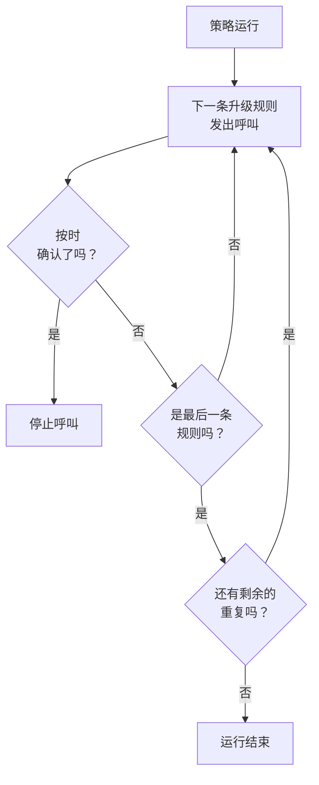

# 值班策略

值班策略决定针对事件或警报呼叫谁，以及如果无人确认，下一个是谁。它的升级规则就是它的级别，使用它的事件、警报和片段会运行它。本页介绍如何创建策略、什么会运行策略、策略页面显示什么，以及每次运行如何被记录。

:::cards
- [创建策略](#创建策略): 一个名称，以及首先呼叫谁。
- [什么会运行策略](#什么会运行策略): 规则、模板、监视器、聊天和你自己。
- [执行日志](#执行日志): 每次运行，按规则逐条记录，以及它为何停止。
- [归档或删除策略](#归档或删除策略): 让策略停止服务。
:::

## 创建策略

:::steps
1. 前往 **值班 → 值班策略** ，点击 **创建值班策略** 。
2. 输入 **名称** ，例如“支付主值班”。
3. 在 **首先通知谁？** 下点击 **添加响应人** ，选择首先呼叫的值班计划、团队和人员。
4. 点击 **创建值班策略** 。策略会在其 **升级规则** 页面打开， **Level 1** 已经就位。
:::

**首先通知谁？** 是可选的，并且只会向可以添加升级规则的人显示：留空时，策略在拥有规则之前不会呼叫任何人。 **描述** 和 **标签** 位于 **更多字段** 下。要添加后续级别，请参阅 [升级规则](/docs/on-call/escalation-rules)。

**值班策略** 列表显示每个策略的 **名称** 、 **描述** 、 **标签** 和 **所有者** 。选择策略后可以执行 **添加标签** 、 **移除标签** 、 **添加所有者** 、 **移除所有者** 、 **归档** 、 **导出JSON** 或删除。 **Import JSON** 从导出文件创建策略：导出文件包含策略本身的设置，不包含其升级规则或所有者。

## 什么会运行策略

在有东西运行策略之前，策略不会呼叫任何人。每个事件、警报和片段在创建后会立即运行它拥有的策略：

| 来源 | 如何添加策略 | 了解更多 |
| --- | --- | --- |
| 记录本身 | 创建事件或警报时的 **值班策略** 字段、事件模板，或监视器条件中的 **值班** 折叠区 | [声明事件](/docs/incidents/declaring-incidents) |
| 值班规则 | **事件 → 规则 → 值班规则** 和 **警报 → 规则 → 值班规则** 会添加每条匹配规则的策略 | [事件值班规则](/docs/incidents/settings#事件值班规则) |
| 分组规则 | 分组规则在打开片段时运行它自己的策略 | [警报片段与分组规则](/docs/alerts/episodes) |
| 手动 | 信息流的 **操作** 菜单中，或 Slack、Microsoft Teams 消息上的 **执行值班策略** | [事件信息流](/docs/incidents/notes-owners-and-feed#事件信息流) |
| 聊天和工作流 | Slack 或 Microsoft Teams 中的 `/oneuptime page` ，以及工作流的 **Page an On-Call Policy** 步骤 | [Paging](/docs/workflows/components#paging) |

多条规则添加的同一个策略只运行一次。严重级别本身从不运行策略：运行策略的是匹配该严重级别的值班规则。创建时即已确认或已解决的事件或警报不会运行任何策略。设置为 **仅在工作时间内** 的值班规则会让它添加的策略等到工作时间开始。

## 策略的页面

从列表中打开一个策略。它的侧边菜单包含关于它的一切：

| 部分 | 页面 |
| --- | --- |
| **基础** | **概览** 、 **升级规则** 和 **所有者** |
| **日志** | **执行日志** 和 **通知日志** |
| **开发者** | **Terraform** 、 **API** 和 **AI 助手** |
| **高级** | **用户覆盖** 、 **自定义字段** 、 **设置** 、 **审计日志** 和 **删除策略** |

**基础** 默认展开；其他部分在你点击之前都是折叠的。

- **概览** 显示 **值班策略详情** ，然后是 **策略概览** ：策略有多少级别和响应人、到最后一级需要多长时间，以及重复多少次。 **响应人就绪情况** 说明它能呼叫的每个人现在是否都能联系到， **值班策略信息流** 列出变化：添加或移除的人员、团队和值班计划，覆盖和交接。
- **所有者** 是对策略负责的人员和团队。当策略发出的呼叫找不到某人的规则或无法送达时，他们会收到电子邮件；没有所有者的策略会改为给项目所有者发送电子邮件。
- **通知日志** 列出策略发送的每条消息，每个渠道一个标签页。
- **用户覆盖** 只在此策略中为人员安排代班。请参阅 [用户覆盖](/docs/on-call/user-overrides)。
- **设置** 中有 **导出值班策略** 和用于归档策略的卡片。

## 重复策略

当最后一级的等待时间结束仍无人确认时，策略会停止，除非它设置为重复。要选择，请打开策略的 **升级规则** 页面，点击规则下方 **重复策略** 卡片上的 **编辑** 。 **编辑重复策略** 会询问 **如果最后一级之后仍无人确认** 时怎么做：

| 回答 | 作用 |
| --- | --- |
| **停止通知** | 不再通知任何人，因此策略只运行一次。新策略默认使用此回答。 |
| **从 Level 1 重新开始** | 按顺序再次通知每一级。 **再重复几次？** 决定次数：1 次或更多。 |

再重新开始三次的策略总共会走完四遍所有级别。卡片上的 **最后一级之后** 一行说明策略会做什么， **概览** 上的 **策略概览** 会用文字说明同样的内容。

## 未解决时再次通知

确认会彻底停止策略的通知，即使之后无人解决该事件或警报。策略也可以改为再次通知：打开策略的 **升级规则** 页面，打开底部的 **更多设置** ，然后点击 **确认后超时** 卡片上的 **编辑** 。 **编辑确认后超时** 会询问 **如果已确认但未解决** 时怎么做：

| 回答 | 作用 |
| --- | --- |
| **不再通知** | 确认后将彻底停止通知。新策略默认使用此回答。 |
| **再次通知** | 通知确认者和当前的值班人员。 **多少分钟后？** 决定时间：5 到 1440 分钟，初始为 30。 |

分钟数从每次确认开始计算，同一策略针对同一事件、警报或片段最多再次通知 5 次。再次通知从确认时正在通知的级别开始，呼叫该级别当前的值班人员，然后像第一次运行一样逐级进行。事件或警报保持已确认状态：再次通知是一次独立的运行，显示在其信息流和策略的执行日志中，其 **状态** 显示“已再次通知（第 1 次，共 5 次）”。

被再次通知的人可以通过消息，或在事件或警报页面上点击 **再次确认** 来确认，分钟数随即重新计算； **升级** 会将其交给下一级。解决或删除事件或警报、归档或删除策略，或选择 **不再通知** 都会停止它。卡片上的 **确认之后** 一行说明策略会做什么，折叠时 **更多设置** 也会显示分钟数。 **概览** 上的 **策略概览** 和 **升级摘要** 也会用文字说明同样的内容。

## 执行日志

策略每次运行都会写入一条执行日志，日志会随着运行的推进经历各个状态：

| 状态 | 含义 |
| --- | --- |
| **正在等待** | 设置为 **仅在工作时间内** 的值班规则会让运行等到工作时间开始：它会说明何时开始呼叫，在此之前不呼叫任何人；如果事件或警报先被确认或解决，它会不经呼叫就结束。如果事件或警报发生变化，从而与一条立即呼叫的值班规则匹配，它会立刻开始呼叫。 |
| **已计划** 、 **已开始** | 正在准备运行。5 分钟后仍处于此状态的运行会以 **错误** 停止。 |
| **Executing** | 运行正在呼叫。OneUptime 每分钟推进一次。 |
| **Execution Completed** | 有人确认了、事件或警报已解决、所有规则和重复都已用完，或者策略已归档。 |
| **Execution Completed - No One Notified** | 运行经过了每条规则，却没有呼叫任何人：通常是某个值班计划中无人值班。 |
| **错误** | 运行失败。 **查看状态消息** 会说明原因。 |

你可以在三个地方找到执行日志：

- 策略自己的 **执行日志** ，位于 **日志** 下；
- **值班 → 高级 → 执行日志** ，包含所有策略，来自工作流和聊天的直接呼叫显示为 **直接呼叫** ；
- 事件或警报的 **值班执行** 页面。

每一行显示是什么触发了运行、触发时间、它的 **状态** 以及谁确认了它。 **查看时间线** 会打开它的 **执行时间线** ：每条升级规则、它呼叫了谁、通过哪个值班计划，以及每次呼叫的结果。无人值班的值班计划会显示 **当时无人值班** ，而不是某个人。在 OneUptime Cloud 上，执行日志需要 **Growth** 套餐。

## 归档或删除策略

归档会让策略停止服务，同时保留所有内容：打开策略的 **设置** ，在归档卡片上点击 **归档** ，或者在列表中选择策略并选择 **归档** 。

- 已归档的策略不会呼叫任何人。使用它的事件和警报会跳过它，仍在升级的运行会在下一步停止。
- 它会从 **值班策略** 列表移到 **值班 → 高级 → 已归档策略** ，在那里点击 **取消归档** 可以让它重新投入使用。

**高级** 下的 **删除策略** 会删除策略及其升级规则和用户覆盖。从列表中删除时会先要求确认，并建议改为归档。

## 谁可以更改策略

**项目所有者** 、 **项目管理员** 、 **项目成员** 、 **值班管理员** 和 **值班成员** 可以创建、更改和删除策略； **查看者** 和 **值班查看者** 可以查看。在自定义角色中，权限名为 **Create On-Call Duty Policy** 、 **Edit On-Call Duty Policy** 、 **Delete On-Call Duty Policy** 和 **Read On-Call Duty Policy** ，限定于某些标签的角色只能访问带有这些标签的策略。在 OneUptime Cloud 上，添加所有者和自定义字段需要 **Growth** 套餐。

## API 和 Terraform

值班策略是 `/api/on-call-duty-policy` 资源，在 Terraform 中是 `oneuptime_on_call_policy` 资源：

| 设置 | API 字段 |
| --- | --- |
| **名称** | `name` |
| **描述** | `description` |
| **如果最后一级之后仍无人确认** | `repeatPolicyIfNoOneAcknowledges` |
| **再重复几次？** | `repeatPolicyIfNoOneAcknowledgesNoOfTimes` |
| **多少分钟后？** | `acknowledgementTimeoutInMinutes` |
| 已归档 | `isArchived` |

`repeatPolicyIfNoOneAcknowledges` 为 `false` 表示 **停止通知** ，为 `true` 表示 **从 Level 1 重新开始** 。为 `true` 时， `repeatPolicyIfNoOneAcknowledgesNoOfTimes` 必须是 1 或更大的整数：OneUptime 会拒绝 `0` 。以前以 `0` 保存的策略永远不会重复，仪表板会将其显示为 **停止通知** 。

`acknowledgementTimeoutInMinutes` 为 `null` 表示 **不再通知** ，为 5 到 1440 之间的整数分钟表示 **再次通知** 。OneUptime 会拒绝其他任何值。

要在一个请求中创建带有第一级的策略，请参阅 [使用 API 或 Terraform 创建规则](/docs/on-call/escalation-rules#使用-api-或-terraform-创建规则)。

## 故障排除

:::details 策略运行了，但没有呼叫任何人
它的运行显示 **Execution Completed - No One Notified** 。打开 **查看时间线** ：显示 **当时无人值班** 的行指向有空缺的值班计划，而 **已跳过** 行的状态消息会说明原因，例如某人不在岗且无人代班。 **值班 → 就绪情况** 会显示哪些人无法联系到。
:::

:::details 下一级在等待时间结束一分钟后才被呼叫
OneUptime 每分钟推进一次正在运行的策略，所以某一级会在等待时间结束后的第一次检查时被呼叫。
:::

:::details 事件上列出了一个没有呼叫任何人的策略
该策略已归档：已归档的策略仍会保留在使用它的事件和警报上，但不会呼叫任何人，其执行日志会说明它未被执行。在 **值班 → 高级 → 已归档策略** 下取消归档。
:::

## 后续步骤

:::cards
- [升级规则](/docs/on-call/escalation-rules): 添加策略呼叫的各个级别，以及每一级等待多久。
- [用户覆盖](/docs/on-call/user-overrides): 某人不在岗时，把其呼叫转给同事。
- [就绪情况与报告](/docs/on-call/readiness): 检查策略呼叫的每个人都能联系到。
:::
