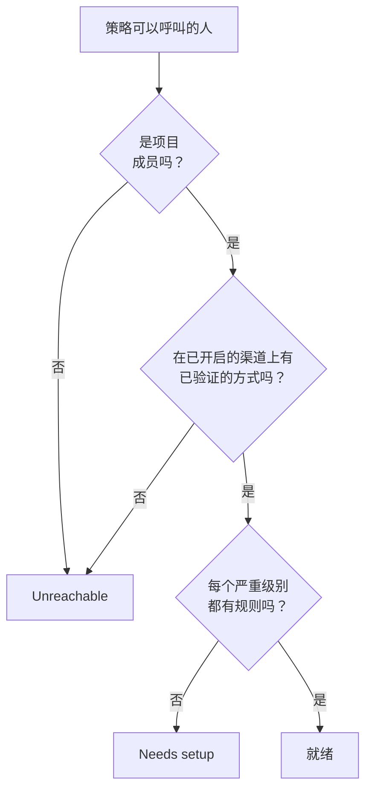

# 就绪情况与报告

就绪情况在事件发生之前回答一个问题：如果现在就有事情触发，你的值班策略要呼叫的每个人真的能被联系到吗？它列出项目中的每个响应人，说明谁已就绪、谁没有，并让你提醒大家完成设置。 **用户值班时间** 报告则显示每个人值班了多长时间。

:::cards
- [状态如何判定](#状态如何判定): 就绪、Needs setup 或 Unreachable，以及原因。
- [就绪情况页面](#就绪情况页面): 项目中的每个响应人，集中在一个列表中。
- [提醒大家完成设置](#提醒大家完成设置): 一封说明缺少什么的电子邮件。
- [用户值班时间](#用户值班时间): 每个人值班了多长时间。
:::

## 状态如何判定

响应人是值班策略可以呼叫的任何人：升级规则中指定的人、规则呼叫的团队的成员、规则呼叫的值班计划中某一层里的人，以及尚未结束的用户覆盖中的代班人。没有任何策略呼叫的值班计划不会添加任何人。

| 状态 | 含义 |
| --- | --- |
| **就绪** | 此人在项目已开启的渠道上有已验证的方式，并且在其值班规则的每个标签页上，每个严重级别都有规则。 |
| **需要设置** | 可以联系到此人，但有些严重级别没有规则。该行会统计这些缺口。 |
| **不可达** | 什么都联系不到此人：没有已验证的方式、每个已验证的方式都在项目已关闭的渠道上，或者此人不是项目成员。 |

缺口是指在事件、事件片段、警报或警报片段标签页上没有规则的严重级别。有意关闭某个严重级别的规则不算缺口。遇到缺口的呼叫仍会通过已验证的方式送达此人，除非项目关闭了这种后备行为：请参阅 [没有匹配的规则时](/docs/notifications/index#没有匹配的规则时)。

## 就绪情况页面

打开 **值班 → 就绪情况** 。 **On-call readiness** 卡片列出项目中任何值班策略能够联系到的每个人，需要处理的人排在前面。项目中的任何人都可以打开它。

列表上方的方块统计 **响应人** 、 **就绪** 、 **需要设置** 和 **不可达** 。点击 **就绪** 、 **需要设置** 或 **不可达** 只列出这些响应人，再次点击则列出所有人。

| 列 | 显示内容 |
| --- | --- |
| **响应人** | 此人及其电子邮件地址。 |
| **状态** | **就绪** 、 **不可达** ，或此人有多少个缺口。 |
| **团队** | 通过升级规则呼叫此人的团队。 |
| **渠道** | 每个渠道一段：已验证的方式为实心，尚未验证的为空心。 |
| **Coverage** | 在每个标签页上都有规则的严重级别数量，占全部严重级别的多少。 |
| **Reached via** | 策略如何联系到此人： `Direct` 、 `Team` 、 `Schedule` 或 `Override` 。 |

行上的 **Coverage** 会显示此人的通知方式、此人为何是该状态，以及显示每个严重级别有无规则的网格。漏斗图标可按 **响应人** 、 **状态** 、 **团队** 或 **Reached via** 筛选列表。结果可能是一分钟前的： **刷新** 会重新判定。

## 提醒大家完成设置

只有本人才能添加和验证自己的通知方式和规则，所以解决办法是请他们去做。

:::steps
1. 在就绪情况页面，勾选要提醒的响应人。已就绪的响应人无法勾选：没有需要提醒的内容。
2. 点击 **发送设置提醒** 。确认框会列出即将收到电子邮件的每个人。
3. 确认。每个人都会收到一封电子邮件，说明其设置中缺少什么，并附上修复它的页面链接。
:::

随后，横幅会显示有多少提醒已发送、已跳过或失败，以及每个未发送提醒的原因。同一个人在 24 小时内最多被提醒一次，一次最多提醒 250 人。发送提醒需要 **项目所有者** 、 **项目管理员** 或 **值班管理员** ，或者自定义角色中的 **Edit On-Call Duty Policy** 。

## 其他页面上的就绪情况

- 在策略的 **概览** 上， **响应人就绪情况** 列出该策略可以呼叫的、需要处理的每个人， **重新检查** 会重新读取。你自己的那一行有一个按钮，通往修复它的页面；其他人的那一行会在你自己的邮件应用中打开一封写给此人的电子邮件，其中附有修复方法。
- 在策略的 **升级规则** 上，如果某一级的响应人不能全部被呼叫，该级的卡片上会注明。请参阅 [升级概要](/docs/on-call/escalation-rules#升级概要)。
- 在 **用户** 下打开一位成员，然后打开 **值班** 部分中的 **就绪情况** ：此人的状态、方式和严重级别网格。
- 对于你自己的设置， **用户设置 → 设置清单** 会引导你逐步完成。请参阅 [设置清单](/docs/notifications/index#设置清单)。

## 每周就绪情况电子邮件

OneUptime 每周检查一次每个拥有值班策略的项目。当其中有人处于 **不可达** 或 **需要设置** 时，项目所有者会收到一封电子邮件，把这些人分成两组列出：完全无法呼叫的人，以及可以联系到但有缺口的人，每组最多 20 个名字，并附上就绪情况页面的链接。

所有人都已就绪的那一周不会发送任何内容，所以这封电子邮件总是意味着有需要修复的地方。当有人完全无法呼叫时，邮件主题以 `[Action Required]` 开头。

## 用户值班时间

**值班 → 报告 → 用户值班时间** 显示每个人在你选择的时间范围内值班了多长时间：初始为 **过去 1 个月** 。

| 列 | 显示内容 |
| --- | --- |
| **用户** | 此人。 |
| **用户值班的时间** | 此人在该时间范围内的值班时间，以小时和分钟计。 |

时间会在人员上岗和下岗时记录：从规则呼叫的值班计划把班次交给此人，或此人被直接或通过团队添加到规则时开始，直到交接或被移除为止。同时通过两个策略值班的时间只计算一次，仍在进行的时间计算到现在。

**值班时间线** 和日历订阅按今天的轮换设置显示过去的班次。此报告是在事情发生时写入的，所以请将它用于公平性评估和值班补贴。

> [!NOTE]
> 在 OneUptime Cloud 上，此报告需要 **Growth** 套餐，结束于 200 天以前的时间会被删除。自托管安装会保留全部数据。

## 故障排除

:::details 有人显示为无法联系，但有已验证的电话号码
此人的方式可能都位于项目已关闭的渠道上：在新项目中，短信、电话、WhatsApp 和 Telegram 默认是关闭的。请参阅 [为项目开启渠道](/docs/notifications/notification-methods#为项目开启渠道)。
:::

:::details 列表中缺少某人
列表只包含值班策略可以呼叫的人。尚未接受邀请的团队成员、位于没有任何策略呼叫的值班计划中的人，以及其覆盖已结束的代班人都不在其中。
:::

:::details 所有者从未收到每周电子邮件
只有在某一周有人处于 **不可达** 或 **需要设置** 时才会发送，并且只发给项目所有者。
:::

## 后续步骤

:::cards
- [OneUptime 如何联系你](/docs/notifications/index): 每个状态背后的方式、规则和后备行为。
- [通知方式](/docs/notifications/notification-methods): 添加并验证 OneUptime 联系某人的方式。
- [个人值班规则](/docs/notifications/on-call-rules): 逐个严重级别补上缺口。
:::
