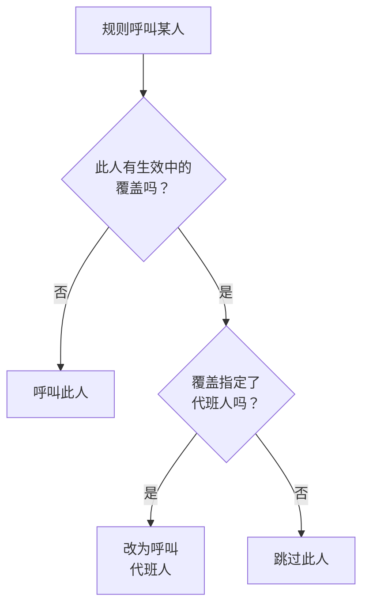

# 用户覆盖

当某人不在岗时，用户覆盖会在一段设定的时间内，把本应发给此人的呼叫转给代班的人。如果没有指定代班人，它会改为跳过此人：此人在值班计划中的每个班次都会交给轮换中的下一个人。可用于休假、病假或换班。

:::cards
- [覆盖如何改变呼叫](#覆盖如何改变呼叫): 改为呼叫谁，以及何时。
- [添加覆盖](#添加覆盖): 谁不在岗、谁代班、从何时到何时。
- [所有策略，或单个策略](#所有策略或单个策略): 在哪里添加覆盖，以及哪个优先。
- [其他添加方式](#其他添加方式): 从值班计划，以及从你即将到来的班次。
:::

## 覆盖如何改变呼叫



覆盖生效期间，从开始到结束：

- 如果 **谁代班？** 中指定了人，此人会收到不在岗者的全部呼叫，来自覆盖适用的每个值班计划、团队和规则。呼叫会通过代班人自己的个人值班规则送达。
- 如果没有代班人，就跳过此人。在值班计划中，此人的每个班次都会交给轮换中下一个在岗的人；如果某一层的所有人都不在岗，则由下面的层接替。直接或通过团队指定此人的规则不会呼叫此人，策略的运行会说明此人不在岗以及到何时为止。
- 覆盖不会连锁。如果代班人自己也不在岗，被代班者的呼叫仍然会发给代班人。

覆盖结束后，呼叫重新归此人所有。 **值班时间线** 、值班计划的层和日历订阅都会显示每个被代的班次由谁负责。

## 添加覆盖

:::steps
### 打开覆盖

要在所有值班策略中为某人安排代班，请前往 **值班 → 高级 → 用户覆盖** ；要只在某个策略中安排代班，请前往该策略自己的 **用户覆盖** 页面，它位于 **高级** 下。点击 **添加用户覆盖** 。

### 说明谁不在岗

**谁不在岗？** 默认是你自己，因为登记自己的休假是最常见的情况。选择其他人即可为其安排代班。

### 说明谁代班

将 **谁代班？** 保留为 **轮换中的下一个人** 可以跳过此人，或者选择接手其全部呼叫的同事。不在岗的人不会出现在选项中。

### 设置时间

除非你选择其他时间，否则 **开始** 为现在。把 **结束** 设为此人回来的时间：它必须晚于开始时间。点击 **添加用户覆盖** 。
:::

每个覆盖是一行： **不在岗** 、 **代班人** 、 **开始** 和 **结束** ，可按开始和结束时间筛选。跳过时， **代班人** 显示为 **轮换中的下一个人** 。覆盖无法编辑：删除它再添加一个新的，或者删除它让某人提前回来。

## 所有策略，或单个策略

| 添加位置 | 卡片 | 适用范围 |
| --- | --- | --- |
| **值班 → 高级 → 用户覆盖** | **全局用户覆盖** | 项目中的所有值班策略 |
| 策略的 **用户覆盖** | **值班策略用户覆盖** | 仅该策略 |

当同一个人的两个覆盖重叠时，策略自己的覆盖优先于全局覆盖，指定了代班人的覆盖优先于跳过。不经过策略发出的呼叫，例如来自工作流或聊天的呼叫，只遵循全局覆盖。

## 其他添加方式

- 从值班计划：在值班计划的 **层** 页面展开一层，点击某人旁边的 **跳过至…** 。它会打开同一个表单，此人为不在岗，由轮换代班，作为全局覆盖。请参阅 [有人不在岗时](/docs/on-call/schedules#有人不在岗时)。
- 从你即将到来的班次：在 **用户设置 → 日历 → 日历订阅** 下，点击你某个班次上的 **找人代班** ，会打开表单，你在该班次的时间段内为不在岗，只剩下 **谁代班？** 需要填写。请参阅 [即将到来的班次和代班](/docs/on-call/calendar-feeds#即将到来的班次和代班)。

当某人离开项目时，所有指定了此人且尚未结束的覆盖都会被删除，无论此人在哪一方。

## 谁可以添加覆盖

**项目所有者** 、 **项目管理员** 、 **项目成员** 、 **值班管理员** 和 **值班成员** 可以添加和删除覆盖； **查看者** 和 **值班查看者** 可以查看。在自定义角色中，权限名为 **Create On-Call Duty Policy User Override** 、 **Delete On-Call Duty Policy User Override** 和 **Read On-Call Duty Policy User Override** 。在 **值班时间线** 上，只有可以读取覆盖的人才能看到谁的班次正在被代。

在 OneUptime Cloud 上，用户覆盖需要 **Growth** 套餐。

## API

用户覆盖是 `/api/on-call-duty-policy-user-override` 资源：

| 字段 | 内容 |
| --- | --- |
| `overrideUserId` | 不在岗的人。必填。 |
| `routeAlertsToUserId` | 代班的人。省略它则改为跳过此人。 |
| `startsAt`, `endsAt` | 覆盖的开始和结束时间。两者都必填，且结束晚于开始。 |
| `onCallDutyPolicyId` | 它适用的策略。全局覆盖则省略。 |

```bash
curl -X POST https://oneuptime.com/api/on-call-duty-policy-user-override \
  -H "apikey: $ONEUPTIME_API_KEY" \
  -H "Content-Type: application/json" \
  -d '{
    "data": {
      "projectId": "<project-id>",
      "overrideUserId": "<away-user-id>",
      "routeAlertsToUserId": "<cover-user-id>",
      "startsAt": "2026-12-22T09:00:00Z",
      "endsAt": "2027-01-05T09:00:00Z"
    }
  }'
```

不在岗者与代班人为同一人的覆盖会被拒绝，在开始之前就结束的覆盖也会被拒绝。

## 故障排除

:::details 休假的人还是被呼叫了
检查覆盖是在哪里添加的。在策略的 **用户覆盖** 页面添加的覆盖只适用于该策略，其他策略仍会呼叫此人：要覆盖所有策略，请在 **值班 → 高级 → 用户覆盖** 下添加。还要检查 **开始** 和 **结束** ：时间按你的时区显示。
:::

:::details 代班人也没有被呼叫
代班人通过自己的个人值班规则和已验证的方式收到通知。在 **值班 → 就绪情况** 中查找此人，并在策略的 **执行日志** 中检查这次运行。
:::

:::details 我无法添加覆盖
添加覆盖需要上述角色之一，在 OneUptime Cloud 上还需要 **Growth** 套餐。
:::

## 后续步骤

:::cards
- [值班计划](/docs/on-call/schedules): 轮换、层，以及在某一层中跳过某人。
- [值班时间线](/docs/on-call/schedule-timeline): 查看所有值班计划中每个被代的班次。
- [日历订阅源](/docs/on-call/calendar-feeds): 为你自己的某个班次找人代班。
:::
