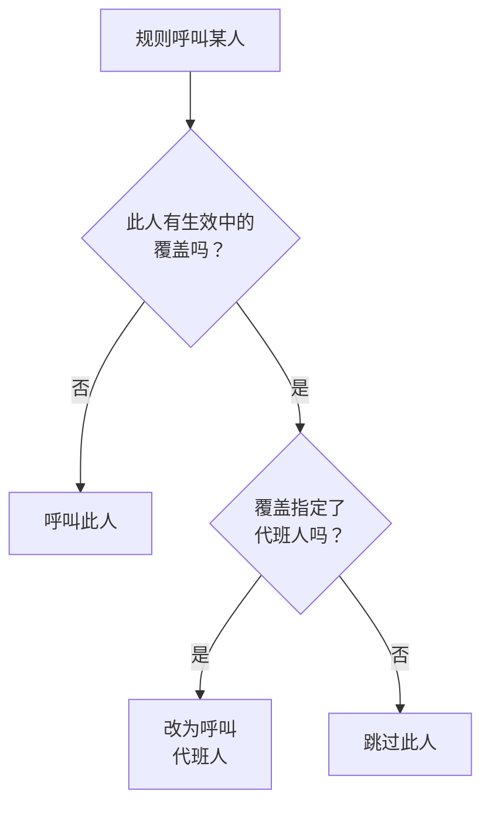

# 用户覆盖

当某人不在岗时，用户覆盖会在一段设定的时间内，把本应发给此人的呼叫转给代班的人。如果没有指定代班人，它会改为跳过此人：此人在值班计划中的每个班次都会交给轮换中的下一个人。可用于休假、病假或换班。

:::cards
- [覆盖如何改变呼叫](#覆盖如何改变呼叫): 改为呼叫谁，以及何时。
- [添加覆盖](#添加覆盖): 谁不在岗、谁代班、从何时到何时。
- [编辑覆盖](#编辑覆盖): 更改谁代班，或者它何时开始和结束。
- [所有策略，或单个策略](#所有策略或单个策略): 在哪里添加覆盖，以及哪个优先。
- [其他添加方式](#其他添加方式): 从值班计划，以及从你即将到来的班次。
:::

## 覆盖如何改变呼叫



覆盖生效期间，从开始到结束：

- 如果 **谁代班？** 中指定了人，此人会收到不在岗者的全部呼叫，来自覆盖适用的每个值班计划、团队和规则。呼叫会通过代班人自己的如何联系我送达。
- 如果没有代班人，就跳过此人。在值班计划中，此人的每个班次都会交给轮换中下一个在岗的人；如果某一层的所有人都不在岗，则由下面的层接替。直接或通过团队指定此人的规则不会呼叫此人，策略的运行会说明此人不在岗以及到何时为止。
- 覆盖不会连锁。如果代班人自己也不在岗，被代班者的呼叫仍然会发给代班人。

覆盖结束后，呼叫重新归此人所有。 **值班时间线** 、值班计划的层和日历订阅都会显示每个被代的班次由谁负责。

## 添加覆盖

:::steps
### 打开覆盖

要在所有值班策略中为某人安排代班，请前往 **值班 → 高级 → 用户覆盖** ；要只在某个策略中安排代班，请前往该策略自己的 **用户覆盖** 页面，它位于 **高级** 下。点击 **添加用户覆盖** 。

### 说明谁不在岗

**谁不在岗？** 默认是你自己，因为登记自己的休假是最常见的情况。选择其他人即可为其安排代班。

### 说明谁代班

将 **谁代班？** 保留为 **轮换中的下一个人** 可以跳过此人，或者选择接手其全部呼叫的同事。不在岗的人不会出现在选项中。

### 设置时间

除非你选择其他时间，否则 **开始** 为现在。把 **结束** 设为此人回来的时间：它必须晚于开始时间。点击 **添加用户覆盖** 。
:::

每个覆盖是一行： **不在岗** 、 **代班人** 、 **开始** 和 **结束** ，可按开始和结束时间筛选。跳过时， **代班人** 显示为 **轮换中的下一个人** 。

## 编辑覆盖

在覆盖所在行点击 **编辑** ，在任意一个 **用户覆盖** 页面上，或在值班计划的 **层** 页面上的用户覆盖列表中都可以。表单会按覆盖保存时的样子打开：修改后点击 **保存更改** 。

- **谁代班？** 在覆盖结束前都可以更改。把它改回 **轮换中的下一个人** ，就会改为跳过此人。
- **开始** 在覆盖开始前可以移动，之后保持不变。 **结束** 在覆盖结束前可以移动：把它设为现在即可提前结束覆盖。两者都不能移到过去。
- **谁不在岗？** 无法更改。如需为其他人设置，请添加新的覆盖。

已经结束的覆盖无法更改：它的 **编辑** 会被锁定并说明原因。

## 所有策略，或单个策略

| 添加位置 | 卡片 | 适用范围 |
| --- | --- | --- |
| **值班 → 高级 → 用户覆盖** | **全局用户覆盖** | 项目中的所有值班策略 |
| 策略的 **用户覆盖** | **值班策略用户覆盖** | 仅该策略 |

同一个人的两个覆盖不能在同一策略上重叠，两者都是全局覆盖时也不能。选好时间后，表单会立即说明这一点，并提供 **编辑那个覆盖** ，让你改为修改那个覆盖。一个覆盖可以在下一个开始时正好结束。

策略自己的覆盖可以与同一个人的全局覆盖重叠：在该策略上，两者都适用期间使用策略自己的覆盖，表单也会说明这一点。不经过策略发出的呼叫，例如来自工作流或聊天的呼叫，只遵循全局覆盖。

在这条规则之前就已重叠的覆盖保持原样。两者都会标上 **重叠** ，说明使用哪一个：指定了代班人的覆盖优先于跳过，其次是先开始的，再次是先添加的。

## 其他添加方式

- 从值班计划：在值班计划的 **层** 页面展开一层，点击某人旁边的 **跳过至…** 。它会打开同一个表单，此人为不在岗，由轮换代班，作为全局覆盖。请参阅 [有人不在岗时](/docs/on-call/schedules#有人不在岗时)。
- 从你即将到来的班次：在 **用户设置 → 日历 → 日历订阅** 下，点击你某个班次上的 **找人代班** ，会打开表单，你在该班次的时间段内为不在岗，只剩下 **谁代班？** 需要填写。请参阅 [即将到来的班次和代班](/docs/on-call/calendar-feeds#即将到来的班次和代班)。

当某人离开项目时，所有指定了此人且尚未结束的覆盖都会被删除，无论此人在哪一方。

## 谁可以添加覆盖

**项目所有者** 、 **项目管理员** 、 **项目成员** 、 **值班管理员** 和 **值班成员** 可以添加、编辑和删除覆盖； **查看者** 和 **值班查看者** 可以查看。在自定义角色中，权限名为 **Create On-Call Policy User Override** 、 **Edit On-Call Policy User Override** 、 **Delete On-Call Policy User Override** 和 **Read On-Call Policy User Override** 。在 **值班时间线** 上，只有可以读取覆盖的人才能看到谁的班次正在被代。

策略上的覆盖遵循该策略的范围。给团队授予限定到它所拥有的策略或它的标签的 **值班成员** ，它的成员就只能在这些策略上添加、编辑和删除覆盖。全局覆盖适用于每个策略，包括其他团队的策略，因此添加、编辑或删除它需要对整个项目的覆盖权限。权限更窄时， **值班 → 高级 → 用户覆盖** 上的 **添加用户覆盖** 、 **编辑** 和 **删除** 会被锁定并说明原因。值班计划各层上的 **跳过至…** 和你即将到来的班次上的 **找人代班** 会添加全局覆盖，因此对你会改为列出你可以添加覆盖的策略，并在每个策略上各添加一条覆盖，移动应用中的代班也一样；只有在你一个策略都无法添加时，它们才会被锁定并说明原因。团队则在每个策略自己的 **用户覆盖** 页面上添加覆盖。API 也是如此：对于限定到标签或所拥有策略的权限，没有 `onCallDutyPolicyId` 的覆盖会被拒绝。

在 OneUptime Cloud 上，用户覆盖需要 **Growth** 套餐。

## API

用户覆盖是 `/api/on-call-duty-policy-user-override` 资源：

| 字段 | 内容 |
| --- | --- |
| `overrideUserId` | 不在岗的人。必填。 |
| `routeAlertsToUserId` | 代班的人。省略它则改为跳过此人。 |
| `startsAt`, `endsAt` | 覆盖的开始和结束时间。两者都必填，且结束晚于开始。 |
| `onCallDutyPolicyId` | 它适用的策略。全局覆盖则省略。 |

```bash
curl -X POST https://oneuptime.com/api/on-call-duty-policy-user-override \
  -H "apikey: $ONEUPTIME_API_KEY" \
  -H "Content-Type: application/json" \
  -d '{
    "data": {
      "projectId": "<project-id>",
      "overrideUserId": "<away-user-id>",
      "routeAlertsToUserId": "<cover-user-id>",
      "startsAt": "2026-12-22T09:00:00Z",
      "endsAt": "2027-01-05T09:00:00Z"
    }
  }'
```

不在岗者与代班人为同一人的覆盖会被拒绝，在开始之前就结束的覆盖也会被拒绝。与同一个人的另一个覆盖在同一策略上重叠，或两者都是全局覆盖时重叠的覆盖，也会被拒绝，拒绝信息会指出与之重叠的覆盖。

要更改覆盖，请发送 `PUT /api/on-call-duty-policy-user-override/<override-id>` ，并把要更改的字段放在 `data` 中： `routeAlertsToUserId` （设为 `null` 则改为跳过此人）、 `startsAt` 和 `endsAt` 。 `overrideUserId` 和 `onCallDutyPolicyId` 无法更改。已经结束的覆盖无法更改，已经开始的覆盖的开始时间也无法更改，更改的时间也不能移到过去。

## 故障排除

:::details 休假的人还是被呼叫了
检查覆盖是在哪里添加的。在策略的 **用户覆盖** 页面添加的覆盖只适用于该策略，其他策略仍会呼叫此人：要覆盖所有策略，请在 **值班 → 高级 → 用户覆盖** 下添加。还要检查 **开始** 和 **结束** ：时间按你的时区显示。
:::

:::details 代班人也没有被呼叫
代班人通过自己的如何联系我和已验证的方式收到通知。在 **值班 → 就绪情况** 中查找此人，并在策略的 **执行日志** 中检查这次运行。
:::

:::details 我无法添加覆盖
添加覆盖需要上述角色之一，在 OneUptime Cloud 上还需要 **Growth** 套餐。 全局覆盖需要对整个项目的角色：如果你团队的角色限定为它自己的策略或某些标签，请在该策略自己的 **用户覆盖** 页面上添加覆盖。这时， **跳过至…** 、 **找人代班** 和移动应用只会列出你可以添加覆盖的策略；一个都不能添加时，它们才会被锁定。
:::

:::details 覆盖与另一个覆盖重叠，无法保存
此人在这些时间的一部分已经有一个覆盖：在同一策略上，或者当这个覆盖也是全局覆盖时，是一个全局覆盖。点击 **结束** 下方的 **编辑那个覆盖** 改为修改那个覆盖，或者选择不与之重叠的时间。
:::

## 后续步骤

:::cards
- [值班计划](/docs/on-call/schedules): 轮换、层，以及在某一层中跳过某人。
- [值班时间线](/docs/on-call/schedule-timeline): 查看所有值班计划中每个被代的班次。
- [日历订阅源](/docs/on-call/calendar-feeds): 为你自己的某个班次找人代班。
:::
