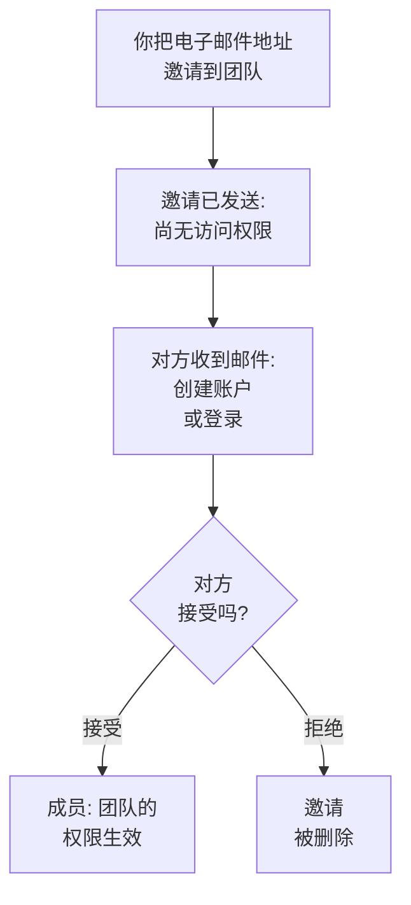

# 邀请成员

人们通过邀请加入项目。你把某人的电子邮件地址邀请到一个团队，对方接受后，由该团队决定其能做什么。本页介绍如何邀请他人、对方会看到什么，以及之后如何更改或终止其访问权限。

:::cards
- [邀请某人](#邀请某人): 一个电子邮件地址和一个团队。
- [接受邀请](#接受邀请): 受邀者看到的内容和要做的事。
- [更改某人的团队](#更改某人的团队): 给予更多或更少的访问权限。
- [移除某人](#从项目中移除某人): 离开项目会带走什么。
:::

## 邀请如何运作

- **团队决定对方能做什么。** 没有人拥有个人权限：一个人能做的，是其所在团队允许的事。参见[用户、团队与权限](/docs/permissions/index)。
- **对方接受之前不会授予任何权限。** 待处理的邀请显示为**邀请已发送**，不授予对项目的任何访问权限。
- **一次接受覆盖整个项目。** 接受一个邀请时，此人对同一项目的其他邀请也会全部被接受。之后你再把某位成员加入另一个团队时，对方会立即加入，无需接受。

## 开始之前

- **可以邀请他人的角色。** Project Owner、Project Admin，或拥有 **Invite New Members** 权限的角色。你只能把人邀请到你自己拥有其权限的团队，因为邀请会给予对方该团队的访问权限。
- **在 OneUptime Cloud 上：套餐中有空余席位。** 项目中的每个人从被邀请那一刻起就是账单上的一个席位。Free 套餐只能容纳一个人。参见[账单与用量](/docs/configuration/billing#你的套餐和席位)。
- **未使用 SCIM Push Groups。** 只要你的身份提供商通过 SCIM Push Groups 管理项目的团队，就需要在身份提供商中邀请和移除人员，而不是在 OneUptime 中。

## 邀请某人

:::steps
### 打开用户列表

前往**产品 → 设置 → 用户**。**用户**列表显示项目中的每个人、他们的团队以及他们是否已加入。

### 打开邀请对话框

点击**邀请用户**。**邀请新用户**对话框随即打开。

### 输入电子邮件地址

在**电子邮件**中输入地址。如果还没有 OneUptime 账户使用该地址，对话框还会要求填写**名称**，新账户将以此名称创建。

### 选择团队

**团队**默认选中项目的成员团队：在整个项目中拥有 Project Member 的团队，否则是名为 Members 的团队。选择其他团队可给予更多或更少的访问权限。如果项目没有这样的团队，或者你自己无法邀请人员加入该团队，**团队**会留空。

### 发送邀请

点击**邀请**。OneUptime 会通过电子邮件发送邀请并打开此人的页面。在邀请被接受之前，此人显示为**邀请已发送**。
:::

> [!TIP]
> 把人邀请到能让其完成工作的最小团队。之后你可以把他们加入更多团队，每加入一个团队，他们能做的事就会增加。

## 接受邀请

邀请邮件会写明项目名称。对于还没有 OneUptime 账户的人，邮件中的按钮是 **Create Your Account**；对于已有账户的人，则是 **Sign In to OneUptime**。登录后，对方在以下两个位置之一接受邀请：

| 对方所处情况 | 看到的内容 | 点击的按钮 |
| --- | --- | --- |
| 尚未加入任何项目 | 登录后进入的页面上的邀请 | **Accept & Join** 或 **Decline** |
| 已在另一个项目中 | 右上角铃铛上的待处理邀请，点击后打开**项目邀请** | **接受** 或 **拒绝** |

接受后，对方会立即加入项目，获得其团队的权限以及每位成员一开始拥有的通知设置：参见[一开始拥有什么](/docs/notifications/index#一开始拥有什么)。拒绝会删除邀请，之后要加入就需要新的邀请。

## 查看项目中的成员

**用户**中每人一行：

| 列 | 显示内容 |
| --- | --- |
| **用户** | 姓名和电子邮件地址。 |
| **团队** | 此人所在或受邀加入的项目中的每个团队。 |
| **状态** | 加入后显示**成员**，并附带尚未接受的其他团队邀请数量。在此之前显示**邀请已发送**。 |

可按**用户**、**状态**或**团队**筛选列表。点击某一行可打开此人的页面：

| 页面 | 用途 |
| --- | --- |
| **个人资料** | 姓名、电子邮件地址、头像和用户 ID。 |
| **团队** | 此人所在的团队。可在此添加或移除团队。 |
| **就绪情况**、**通知方式**、**值班规则** | 此人能否被呼叫以及如何呼叫。对 Project Owner、Project Admin、本人以及可以读取他人通知规则的人显示。参见[就绪情况与报告](/docs/on-call/readiness)。 |
| **自定义字段** | 项目为人员设置的自定义字段（如果有）。 |
| **从项目中移除** | 将此人移出项目。 |

## 更改某人的团队

:::steps
### 打开其团队页面

在**用户**中点击此人，然后点击**团队**。

### 将其加入团队

点击**邀请**，选择**团队**，然后在对话框中点击**邀请**。成员会立即加入新团队。尚未加入的人会再收到一封邀请，接受其中任何一封都会同时接受两封。

### 将其移出团队

在该团队所在行点击**移除**。如果这是此人已加入的最后一个团队，移除后此人将离开项目，对话框会在任何更改发生前说明这一点。
:::

Owners 团队始终至少保留一名已加入的成员，因此项目永远不会失去最后一位所有者。

## 从项目中移除某人

在**用户**中打开此人的行菜单 **⋯**，然后点击**从项目中移除**。也可以打开此人，在侧边菜单中选择**从项目中移除**。要一次移除多人，选中他们的行并删除所选项：每个人都会以同样的方式被移除。

移除某人会将其移出项目的所有团队。即使仍在登录状态，对方也会立即失去访问权限，被移出项目的值班排班和升级规则，并且不再收到项目的通知。其 OneUptime 账户不会被删除，你可以再次邀请。[用户、团队与权限](/docs/permissions/index#用户)列出了离开项目会带走的全部内容。

## 其他加入方式

- **单点登录。** 首次通过项目的身份提供商登录的人，会加入身份提供商指定的团队。参见[SSO 用户的角色和团队](/docs/identity/sso#sso-用户的角色和团队)。
- **SCIM。** 你的身份提供商创建人员，并将其加入连接的默认团队。参见[SCIM](/docs/identity/scim#项目用户如何被预配)。
- **Admin Dashboard。** 在自托管安装中，主管理员可以把某人加入项目，并代其接受邀请。参见[用户、团队与权限](/docs/permissions/index#用户)。

## 故障排除

:::details "This user has already been invited to this team"
此人已经在该团队中，可能是成员，也可能有尚未接受的邀请。在**用户**中打开此人查看其团队，或将其邀请到其他团队。
:::

:::details "You have reached the user limit for the free plan"
在 OneUptime Cloud 上，使用 Free 套餐的项目只能容纳一个人。请更改套餐，然后再次邀请。参见[更改套餐](/docs/configuration/billing#更改套餐)。
:::

:::details "Too many invitations were sent to this email address in the last hour"
无论由谁发送，一个地址每小时最多可收到 10 封邀请，项目和私有状态页合计。请等待一小时，然后再次邀请。
:::

:::details 邀请邮件没有送达，或链接已过期
邀请并不依赖邮件。请对方用你邀请的地址注册：OneUptime 会向该地址发送一个新链接以完成账户创建。已有账户的人登录后即可看到等待中的邀请。
:::

:::details 邀请用户提示用户由 SCIM Push Groups 管理
你的身份提供商管理着项目的团队。请在身份提供商中邀请或移除人员，或在**项目设置 → 安全 → SCIM** 中关闭 Push Groups，以便在这里管理。
:::

## 后续步骤

:::cards
- [用户、团队与权限](/docs/permissions/index): 决定每个团队能做什么。
- [项目设置](/docs/configuration/project-settings): 适用于整个项目的所有设置。
- [您的账户](/docs/introduction/your-account): 登录、个人资料以及你所属的项目。
- [SCIM](/docs/identity/scim): 让你的身份提供商管理人员和团队。
:::
