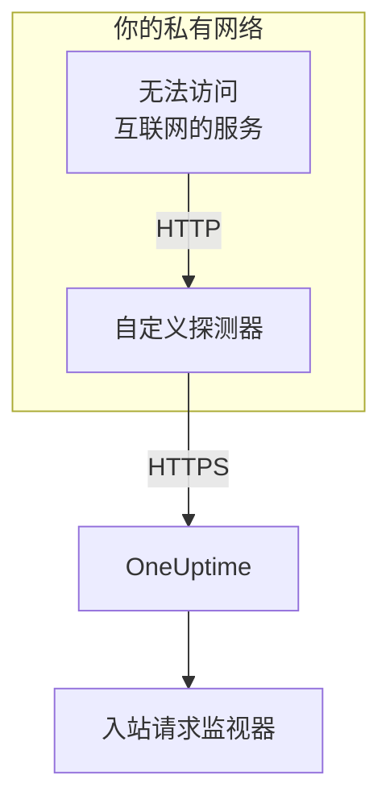

# 入站请求 Ingress

无法访问互联网的服务，同样可以向 [入站请求监控](/docs/monitor/incoming-request-monitor) 发送心跳。它改为把心跳发给同一网络中的 [自定义探测器](/docs/probe/custom-probe)，再由探测器转发给 OneUptime。

:::cards
- [工作原理](#工作原理): 从你的服务经过探测器，到达监视器。
- [开启监听器](#开启监听器): 探测器上的一项设置，适用于 Docker、Docker Compose 或 Kubernetes。
- [向探测器发送请求](#向探测器发送请求): 只改服务发送的目标 URL，其他都不用改。
- [故障排除](#故障排除): 请求没有送达时，探测器会记录什么。
:::

## 工作原理



1. **你的服务把请求发给探测器。** 也就是它原本会发给 OneUptime 的同一个 `GET` 或 `POST`，带着同样的密钥，发往探测器监听的端口。
2. **探测器立即应答。** 它在转发请求之前就返回 `200`，所以你的服务从不需要等待 OneUptime。
3. **探测器转发请求。** 它把请求连同方法、请求头和请求体发给 OneUptime，并添加一个标明该探测器的 `OneUptime-Probe-Id` 请求头。
4. **OneUptime 照常读取。** 监视器的条件看到的请求，就像服务直接发送的一样。

监听器运行在自己专用的端口上，与探测器的健康检查分开，因此你可以只把它开放给私有网络，而不开放其他任何东西。

## 何时使用

在以下情况下使用监听器：

- 你的服务运行在没有出站 HTTPS 访问的隔离网段中
- 你需要把所有监控流量都留在你的 VPC 或本地网络中
- 你希望只有一个出口（探测器）可以访问 OneUptime
- 你已经部署了 [自定义探测器](/docs/probe/custom-probe)，并想把它也用于入站心跳

如果你的服务已经能直接访问 `https://oneuptime.com`（或你的自托管地址），你 **不** 需要这个功能：直接从服务调用心跳 URL 即可。

## 开始之前

- **一个正在运行的自定义探测器。** 它的 **状态** 显示 **已连接** 。安装方法参见 [自定义探针](/docs/probe/custom-probe)。
- **一个入站请求监视器。** 它的心跳 URL 中包含你的服务要发送的密钥：参见 [入站请求监控](/docs/monitor/incoming-request-monitor)。
- **探测器主机上一个服务能访问到的端口。** 示例中使用 `3875`。

## 开启监听器

把 `PROBE_INGRESS_PORT` 设为监听器要使用的端口。任何大于 `0` 的值都会开启它；不设置或设为 `0` 时保持关闭。

:::tabs
@tab Docker
```bash
docker run --name oneuptime-probe --network host \
  -e PROBE_KEY=<probe-key> \
  -e PROBE_ID=<probe-id> \
  -e ONEUPTIME_URL=https://oneuptime.com \
  -e PROBE_INGRESS_PORT=3875 \
  -d oneuptime/probe:release
```

不使用 `--network host` 时，用 `-p 3875:3875` 发布该端口。
@tab Docker Compose
```yaml title="docker-compose.yml"
services:
  oneuptime-probe:
    image: oneuptime/probe:release
    container_name: oneuptime-probe
    environment:
      - PROBE_KEY=<probe-key>
      - PROBE_ID=<probe-id>
      - ONEUPTIME_URL=https://oneuptime.com
      - PROBE_INGRESS_PORT=3875
    network_mode: host
    restart: always
```

不使用 `network_mode: host` 时，在 `ports:` 下以 `"3875:3875"` 发布该端口。
@tab Kubernetes
```yaml title="oneuptime-probe.yaml"
apiVersion: apps/v1
kind: Deployment
metadata:
  name: oneuptime-probe
spec:
  selector:
    matchLabels:
      app: oneuptime-probe
  template:
    metadata:
      labels:
        app: oneuptime-probe
    spec:
      containers:
        - name: oneuptime-probe
          image: oneuptime/probe:release
          env:
            - name: PROBE_KEY
              value: "<probe-key>"
            - name: PROBE_ID
              value: "<probe-id>"
            - name: ONEUPTIME_URL
              value: "https://oneuptime.com"
            - name: PROBE_INGRESS_PORT
              value: "3875"
          ports:
            - name: ingress
              containerPort: 3875
---
apiVersion: v1
kind: Service
metadata:
  name: oneuptime-probe-ingress
spec:
  selector:
    app: oneuptime-probe
  ports:
    - name: ingress
      port: 3875
      targetPort: 3875
  type: ClusterIP
```

之后，集群内的服务向 `http://oneuptime-probe-ingress.<namespace>.svc.cluster.local:3875/heartbeat/<secret-key>` 发送。
:::

监听器启动后，探测器的日志中会出现 `Probe ingress listener started on port 3875 (heartbeat / incoming-request endpoints)`。

## 向探测器发送请求

你的服务改为向探测器发送，而不是 OneUptime。把公开的心跳 URL：

```text
https://oneuptime.com/heartbeat/<secret-key>
```

替换为探测器的 ingress URL：

```text
http://<probe-host>:<PROBE_INGRESS_PORT>/heartbeat/<secret-key>
```

路径、方法、请求体和请求头在其他方面完全相同，所以现有的客户端代码只需修改基础 URL。探测器也接受 `/incoming-request/<secret-key>`，效果相同。

```bash
# GET heartbeat
curl http://probe.internal:3875/heartbeat/YOUR_SECRET_KEY

# POST heartbeat with JSON body
curl -X POST http://probe.internal:3875/heartbeat/YOUR_SECRET_KEY \
  -H "Content-Type: application/json" \
  -d '{"status": "healthy", "version": "1.2.3"}'

# Cron job
*/5 * * * * curl -s http://probe.internal:3875/heartbeat/YOUR_SECRET_KEY > /dev/null
```

## 请求如何转发

| 项目 | 探测器如何处理 |
| --- | --- |
| 应答 | 在转发请求之前，返回带空 JSON 对象（`{}`）的 `200`。与 OneUptime 一样，无论之后发生什么都会返回：错误的密钥也会收到它。 |
| 方法 | `POST` 以 `POST` 转发。`GET` 和 `HEAD` 以 `GET` 转发。其他方法会从探测器收到 `404`。 |
| 请求头 | 除逐跳请求头（`Host`、`Connection`、`Content-Length`、`Transfer-Encoding`、`Keep-Alive`、`Proxy-Authenticate`、`Proxy-Authorization`、`TE`、`Trailer`、`Upgrade`）和 `Content-Encoding` 之外的全部请求头，因为探测器转发的是未压缩的请求体。探测器会添加 `OneUptime-Probe-Id`。 |
| 请求体 | 最大 50 MB 的 JSON 和表单请求体，与直接发送给 OneUptime 时相同。同样，其他请求体到达监视器时为空。 |
| 重试 | 转发失败时，探测器最多重试 `PROBE_INGRESS_FORWARD_RETRY_LIMIT` 次，依次等待 2 秒、4 秒、8 秒，最长不超过 15 秒。之后记录失败并丢弃该请求。 |
| 代理 | 设置了 `HTTP_PROXY_URL` 或 `HTTPS_PROXY_URL` 时，转发会经过探测器的代理。 |
| 转发目标 | `ONEUPTIME_URL` 加上 `/incoming-request-ingest/incoming-request/<secret-key>`。 |

## 环境变量

| 变量 | 默认值 | 作用 |
| --- | --- | --- |
| `PROBE_INGRESS_PORT` | 未设置（关闭） | 监听器使用的端口。任何大于 `0` 的值都会开启它。 |
| `PROBE_INGRESS_FORWARD_TIMEOUT_MS` | `10000` | 每次转发到 OneUptime 可用的时间，单位为毫秒。小于 `1000` 的值会回退到默认值。 |
| `PROBE_INGRESS_FORWARD_RETRY_LIMIT` | `3` | 失败的转发重试的次数。`0` 关闭重试。 |

探测器的常规变量（`PROBE_KEY`、`PROBE_ID`、`ONEUPTIME_URL` 和代理变量）全部适用：完整列表参见 [自定义探针](/docs/probe/custom-probe)。

## 安全注意事项

- **该端点按设计不做身份验证** ：URL 路径中的密钥 *本身* 就是身份验证，与公开的 `oneuptime.com` 端点相同。请像对待密码一样对待这个密钥。
- **把监听器限制在私有网络内。** 它不应该能从互联网访问。用网络策略、防火墙规则或 `ClusterIP` 服务限制谁能访问它。
- **如果网络内需要加密，请在它前面加上 TLS。** 监听器使用明文 HTTP。若要在这一段使用 TLS，请把它放在内部负载均衡器或 Ingress 控制器之后。当 `ONEUPTIME_URL` 以 `https://` 开头时，从探测器到 OneUptime 的转发使用 HTTPS。
- **如果 50 MB 太大，请自行限制请求体大小。** 在监听器前面放一个限制更低的反向代理。

## 故障排除

:::details 探测器日志从未显示监听器已启动
`PROBE_INGRESS_PORT` 未设置、为 `0` 或不是数字。把它设为一个端口号并重启探测器。日志行是 `Probe ingress listener started on port <port> (heartbeat / incoming-request endpoints)`。
:::

:::details 探测器记录 `Probe ingress: failed to forward to <url> after N attempts`
探测器在重试之后仍无法访问 OneUptime。检查探测器的出站连接、代理设置和 `ONEUPTIME_URL` 的值。如果探测器也显示 **已断开** ，请参见 [自定义探针](/docs/probe/custom-probe)，找出它的请求卡在哪里。
:::

:::details 探测器记录 `Probe ingress: probe ID not available, forwarding without it`
探测器还没有完成与 OneUptime 的连接，因此在没有 `OneUptime-Probe-Id` 请求头的情况下转发请求。请求仍会到达监视器。
:::

:::details 监视器收到了请求，但不是经过探测器
你的服务仍在向公开 URL 发送。确认它发往 `http://<probe-host>:<port>/...`：指向别处的 DNS 名称或 `/etc/hosts` 条目是常见原因。
:::

:::details 监视器什么都没收到，探测器也什么都没记录
请求从未到达探测器。检查服务能否通过该端口访问探测器的主机：可能是防火墙规则、未发布的端口，或没有选中探测器 Pod 的 Kubernetes Service。
:::

## 后续步骤

:::cards
- [入站请求监控](/docs/monitor/incoming-request-monitor): 决定什么样的心跳算正常。
- [自定义探针](/docs/probe/custom-probe): 安装探测器，并查看它读取的每个设置。
:::
