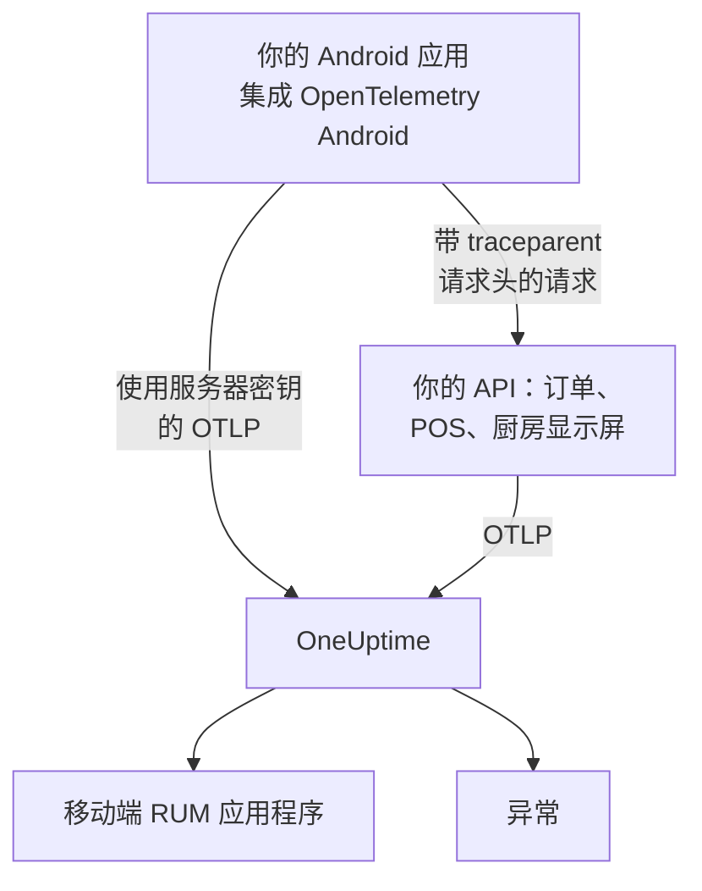

# Android 端设置

使用 OpenTelemetry Android 为原生 Android 应用插桩，让它作为移动端 RUM 应用程序向 OneUptime 上报：崩溃和 ANR、慢帧和冻结帧、应用启动、屏幕、会话，以及一直追踪到你的后端的网络请求。

:::cards
- [添加 OpenTelemetry Android](#添加-opentelemetry-android): 一个 Gradle 依赖项，以及应用启动时运行的几行代码。
- [上报的内容](#上报的内容): 崩溃、ANR、冻结帧、启动和会话，以及它们各自出现在哪里。
- [追踪发往后端的请求](#追踪发往后端的请求): 每个 OkHttp 调用一个 span，并在其上带有 `traceparent` 。
- [追踪你自己的工作流](#追踪你自己的工作流): 从菜单到厨房的一笔订单、支付终端、打印机。
- [自助终端及你拥有的其他设备](#自助终端及你拥有的其他设备): 为每台设备命名，通过 MDM 配置，离线时也保留数据。
:::

## 工作原理

OpenTelemetry Android 在你的应用内运行。它使用 **服务器** 摄取密钥，通过 OTLP 将追踪、日志和指标发送到 OneUptime，并在应用发出的请求上添加 W3C `traceparent` 请求头，让后端的 span 加入应用的追踪。



## 开始之前

- 一个 `minSdk` 为 23 或更高、使用 `compileSdk` 34 或更高版本构建的 Android 应用。如果 `minSdk` 低于 26，请开启 [核心库脱糖](https://developer.android.com/studio/write/java8-support#library-desugaring) ，并使用 Android Gradle Plugin 8.3.0 或更高版本，在 `gradle.properties` 中设置 `android.useFullClasspathForDexingTransform=true` 。
- 一个 **服务器** 摄取密钥，在 **项目设置 → 遥测与 APM → 摄取密钥** 中通过 **创建摄取密钥** 创建。应用发来的 **浏览器** 密钥会被拒绝：它要根据 `Origin` 请求头进行检查，而应用不发送这个请求头。
- 以下 OTLP 设置。如果你自行托管 OneUptime，请将 `https://oneuptime.com` 替换为你自己的主机。

| 设置 | 值 |
| --- | --- |
| OTLP 端点 | `https://oneuptime.com/otlp` |
| 请求头 | `x-oneuptime-token: YOUR_TELEMETRY_INGESTION_TOKEN` |

> [!WARNING]
> 密钥会随应用一起发布，而应用可以被解包，所以请假定有人会复制它。在密钥的页面上设置 **固定的服务名称** 、 **Requests Per Minute Limit** 和 **过期时间** 日期，并随每次发布轮换密钥。

## 添加 OpenTelemetry Android

:::steps
### 添加依赖项

```kotlin title="app/build.gradle.kts"
dependencies {
    implementation("io.opentelemetry.android:android-agent:1.8.1")
}
```

该代理自带崩溃、ANR、渲染缓慢、Activity、Fragment、网络和会话的插桩。请在 [它的发布页面](https://github.com/open-telemetry/opentelemetry-android/releases) 查看是否有更新的版本。

### 在应用启动时启动它

```kotlin title="KioskApplication.kt"
import android.app.Application
import io.opentelemetry.android.OpenTelemetryRum
import io.opentelemetry.android.agent.OpenTelemetryRumInitializer

class KioskApplication : Application() {
    lateinit var otelRum: OpenTelemetryRum

    override fun onCreate() {
        super.onCreate()

        otelRum = OpenTelemetryRumInitializer.initialize(this) {
            httpExport {
                baseUrl = "https://oneuptime.com/otlp"
                baseHeaders = mapOf("x-oneuptime-token" to BuildConfig.ONEUPTIME_TOKEN)
            }
            resource {
                put("service.name", "kiosk-ordering")
                put("deployment.environment.name", "production")
            }
        }
    }
}
```

`baseUrl` 是不带信号的端点：代理会在其后加上 `/v1/traces` 、 `/v1/logs` 和 `/v1/metrics` 。请设置 `service.name` ，否则应用会以其启动器标签命名。它是应用程序在 OneUptime 中的标识，因此请在各个版本之间保持不变。

在清单文件中 `<application>` 元素的 `android:name` 里填写这个类。 `BuildConfig.ONEUPTIME_TOKEN` 代表你的构建保存密钥的地方；设备群也可以改为从其 MDM 接收密钥，如 [自助终端及你拥有的其他设备](#自助终端及你拥有的其他设备) 所示。

### 启动应用并确认数据到达

```bash
curl -i https://oneuptime.com/otlp/v1/validate \
  -H "x-oneuptime-token: YOUR_TELEMETRY_INGESTION_TOKEN"
```

`200` 加上 `"valid": true` 表示密钥被接受。然后启动应用并使用片刻：它会以其 `service.name` 命名，出现在 **产品 → 资源 → 真实用户监控** 下。代理在发送遥测之前会先将其写入磁盘，因此第一批数据可能需要一分钟才能到达。
:::

## 上报的内容

OpenTelemetry Android 会自行记录以上所有内容。它设置的设备属性 `device.model.identifier` 、 `device.model.name` 和 `device.manufacturer` 会把应用归为移动端 RUM 应用程序，并填充其 **客户端** 页面。它还会设置 `os.name` 、 `os.version` 以及每次安装各自的 `app.installation.id` ，但不设置 `device.id` 。

| 内容 | 代理如何发送 | 在 OneUptime 中的位置 |
| --- | --- | --- |
| 崩溃 | 一个 `app.crash` 事件，包含异常的类型、消息和堆栈追踪 | **异常** ，作为未处理异常 |
| ANR | 应用停止响应约 5 秒后发送的 `device.anr` 事件，包含主线程的堆栈 | **异常** ，作为未处理异常，类型为 `ANR` |
| 慢帧和冻结帧 | 带有 `app.jank.frame_count` 的 `app.jank` 事件，即慢于 16 ms（ `app.jank.threshold` 为 `0.016` ）或 700 ms（ `0.7` ）的帧数 | **日志** ，使用 `@event.name:app.jank` 查找 |
| 应用启动 | 一个 `AppStart` span， `start.type` 设为 `cold` 、 `warm` 或 `hot` | **追踪** |
| 屏幕 | Activity 或 Fragment 生命周期中每个步骤各一个 span，以及每个 span 和日志上的 `app.screen.name` | **追踪** |
| 会话 | 每个 span 和日志上的 `session.id` ，以及 `session.start` 和 `session.end` 事件 | **追踪** 和 **日志** ，用 `@session.id:` 搜索 |
| 网络变化 | 一个 `network.change` 事件，以及每个 span 和日志上的 `network.connection.type` | **日志** |

崩溃和 ANR 会作为未处理异常进入 **异常** ，按堆栈追踪分组，并附带它们发生时所在的会话。代理会在应用终止时把崩溃保存到磁盘，再从那里发送，因此离线时发生的崩溃也会在应用再次联网运行时到达。

会话在后台停留 15 分钟后结束，或在 4 小时后结束。从不进入后台的应用（例如自助终端）会让一个会话持续 4 小时，因此请把每位顾客的到访追踪为一个独立的 span，如 [追踪你自己的工作流](#追踪你自己的工作流) 所示。

在下面的 OkHttp 模块旁添加 `android-log-library` 和 `android-log-agent` 后，应用自己的 `android.util.Log` 调用也会变成日志：每次调用的标签放在 `android.log.tag` 中，带有 Throwable 的调用会成为 **异常** 中的一个异常。OpenTelemetry Android 不读取 Logcat。

## 追踪发往后端的请求

添加 OkHttp 插桩以及构建它所用的 ByteBuddy 插件：

```kotlin title="app/build.gradle.kts"
plugins {
    // ...the plugins your app already applies, then:
    id("net.bytebuddy.byte-buddy-gradle-plugin") version "1.18.15"
}

dependencies {
    implementation("io.opentelemetry.android:android-agent:1.8.1")
    implementation("io.opentelemetry.android.instrumentation:okhttp3-library:1.8.1-alpha")
    byteBuddy("io.opentelemetry.android.instrumentation:okhttp3-agent:1.8.1-alpha")
}
```

该插件直接对 `OkHttpClient` 类本身插桩，因此应用中的每个客户端都会被追踪，包括库创建的客户端。每个请求都会成为一个以其方法命名的客户端 span，带有 URL、状态码和耗时，并携带 W3C `traceparent` 请求头。使用 [OpenTelemetry](/docs/telemetry/open-telemetry) 插桩的后端会从该请求头延续追踪，因此点单 API、POS 桥接服务和厨房显示服务都会把它们的 span 加入与自助终端上那次点按相同的追踪。

- `HttpURLConnection` 也有同样的一对模块： `httpurlconnection-library` 和 `httpurlconnection-agent` 。
- 不使用插件时，请自行包装客户端：使用 `io.opentelemetry.instrumentation:opentelemetry-okhttp-3.0` 中的 `OkHttpTelemetry.builder(otelRum.openTelemetry).build().createCallFactory(client)` 。
- 在你的代码中开启的 span（如下一节所示）是在其中发出的请求的父级。

## 追踪你自己的工作流

从代理获取一个 tracer，为一位顾客的一笔订单创建一个 span，并为订单的每个步骤创建一个子 span。这样每个步骤都有自己的耗时和错误，订单也会说明它是如何结束的：

```kotlin title="OrderTrace.kt"
import io.opentelemetry.api.trace.Span
import io.opentelemetry.api.trace.StatusCode
import io.opentelemetry.api.trace.Tracer
import io.opentelemetry.context.Context

class OrderTrace(private val tracer: Tracer) {
    // order.session: from the first tap to the order reaching the kitchen.
    private val order: Span = tracer.spanBuilder("order.session").startSpan()
    private val parent: Context = Context.current().with(order)

    // One step: menu.browse, cart.customize, payment.process, pos.inject.
    fun <T> step(name: String, block: (Span) -> T): T {
        val span = tracer.spanBuilder(name).setParent(parent).startSpan()
        return try {
            span.makeCurrent().use { block(span) }
        } catch (error: Throwable) {
            span.recordException(error)
            span.setStatus(StatusCode.ERROR)
            throw error
        } finally {
            span.end()
        }
    }

    fun complete() = finish("completed")

    fun abandon(reason: String) {
        order.setAttribute("order.abandon_reason", reason)
        finish("abandoned")
    }

    private fun finish(outcome: String) {
        order.setAttribute("order.outcome", outcome)
        order.end()
    }
}
```

```kotlin title="CheckoutFlow.kt"
val order = OrderTrace(otelRum.openTelemetry.getTracer("kiosk.ordering"))

order.step("cart.customize") { span ->
    span.setAttribute("cart.items", cart.size.toLong())
}
order.step("payment.process") { terminal.charge(cart.total) }
order.step("pos.inject") { posApi.submit(cart) } // its OkHttp span is a child
order.complete()
```

用同样的方式包装每一次对支付终端、打印机、扫描器或 NFC 读卡器 SDK 的调用，并注明是哪台设备，这样缓慢或出故障的设备就会表现为缓慢或失败的 span：

```kotlin title="ReceiptPrinter.kt"
order.step("printer.print") { span ->
    span.setAttribute("peripheral.type", "printer")
    span.setAttribute("peripheral.model", printer.model)
    span.setAttribute("peripheral.connection", "usb")
    printer.print(receipt, timeoutMillis = 10_000)
}
```

属性名称由你决定：在每个应用中保持一致，这样一个过滤条件就能找到每台打印机。请为每次调用设置超时，因为 span 只有在其调用返回时才会结束。跨越多个屏幕的步骤（例如浏览菜单）是一个在屏幕打开时开始、在屏幕关闭时结束的 span，父级相同。对于没有持续时间的事实（例如打印机缺纸），请发送一个事件： `otelRum.emitEvent("printer.paper_low")` 。

在 **追踪** 中，按步骤名称过滤可以查看它耗时多久、失败频率如何；按 `@order.outcome:abandoned` 过滤可以找到从未完成的订单。

## 自助终端及你拥有的其他设备

### 为每台设备命名

OneUptime 按应用程序而不是按设备归档移动应用，因此安装在成千上万部手机上的应用绝不会列出其用户的手机。对于你自己拥有的设备，请在 `host.name` 中为每台设备命名。这样每台设备都会作为主机出现在 **资产清单** 中，与你的其他机器并列，并显示代理上报的制造商、型号和操作系统版本、你在下面添加的信息以及最后一次出现的时间：

```kotlin title="KioskApplication.kt"
resource {
    put("service.name", "kiosk-ordering")
    put("host.name", deviceName)
    put("host.serial_number", serialNumber)
    put("device.type", "kiosk")
    put("device.location", "Store 0412")
}
```

应用的遥测仍归属于它的 RUM 应用程序，设备也不会成为 **主机** 中的主机：应用不上报主机指标，因此那里没有可显示的内容。设备在 **资产清单** 中的页面会显示它自己的日志、追踪和异常，而 `@resource.host.name:` 可以在 **追踪** 和 **日志** 中找到它们。30 天内没有发送任何数据的设备会从 **资产清单** 中移除。

### 从 MDM 配置设备群

应用可以读取 Android 的托管配置，每种设备管理服务都会把它推送到所管理的设备上。请从中读取密钥和设备名称，而不是把它们构建进应用：

```kotlin title="KioskApplication.kt"
import android.content.RestrictionsManager

val restrictions = (getSystemService(RESTRICTIONS_SERVICE) as RestrictionsManager)
    .applicationRestrictions
val token = restrictions.getString("oneuptime_token").orEmpty()
val deviceName = restrictions.getString("device_name") ?: android.os.Build.MODEL
val serialNumber = restrictions.getString("device_serial").orEmpty()
```

然后用 `token` 代替 `BuildConfig.ONEUPTIME_TOKEN` 传给 `baseHeaders` ，并把 `deviceName` 和 `serialNumber` 传给上面的资源。在 Esper 中，把下面的配置粘贴到蓝图里该应用的 **Managed Configuration** 下。使用 Esper Agent 8.00.0764 或更高版本时，Esper 会在每台设备上填入占位符：

```json title="Managed configuration"
{
  "oneuptime_token": "YOUR_TELEMETRY_INGESTION_TOKEN",
  "device_name": "${esper.deviceName}",
  "device_serial": "${esper.serialNumber}"
}
```

更改后对设备执行 Converge，让它们读取新值。如果你的 MDM 要求提供架构，请在 `app_restrictions.xml` 中声明相同的键。Esper 会拒绝没有 v1 签名的 APK，因此除了 v2 或 v3 之外，还要用 v1 方案为发布版本签名。

### 保留离线期间记录的数据

代理在发送每个 span、日志和指标之前都会先将其写入磁盘。网络中断期间，它会把数据保留在那里，并在网络恢复后发送，最长可延后 18 小时。它保留 10 MB；对于经常离线的设备，请调高这个值：

```kotlin title="KioskApplication.kt"
diskBuffering {
    maxCacheSize = 50 * 1024 * 1024
}
```

## 故障排除

:::details 应用出现在服务下，而不是真实用户监控下
OpenTelemetry Android 会自行设置 `device.model.identifier` ，所以应用是用其他 SDK 设置的，或者它的资源被 `resource(Resource)` 替换了，这会丢弃代理自己的属性。请使用 `resource { }` 代码块，它会在这些属性之上添加。已经创建的服务不会变成 RUM 应用程序，因此在 RUM 遥测到达后，请在 **产品 → 服务** 下删除它。
:::

:::details 没有数据到达，或密钥被拒绝
运行 [添加 OpenTelemetry Android](#添加-opentelemetry-android) 中的密钥检查。 `401` 表示密钥未知、已撤销、已关闭或已过期。应用发来的 **浏览器** 密钥会被拒绝：请使用 **服务器** 密钥。检查 `baseUrl` 是否以 `/otlp` 结尾、不带 `/v1/traces` ：代理会自行添加路径。
:::

:::details 崩溃或 ANR 没有出现在异常中
崩溃会在应用终止时保存，ANR 会在主线程卡住约 5 秒后保存。两者都会在磁盘上等待，直到设备能够发送它们，因此请在应用联网运行一分钟后再查看。请在 `Application` 的 `onCreate` 最开头启动代理，早于任何可能崩溃的代码，这样它的崩溃处理程序会最先就位。
:::

:::details 资产清单中缺少某台设备
只有应用设置了 `host.name` 的设备才会被列出。请在 span 的资源属性中检查该值：空值不会指向任何设备，而名称相同的两台设备会合并为一行。
:::

## 后续步骤

:::cards
- [移动端设置](/docs/rum/mobile-setup): iOS、React Native 和其他平台。
- [异常](/docs/telemetry/exceptions): 分诊你的应用上报的崩溃和 ANR。
- [追踪浏览器](/docs/telemetry/traces-explorer): 追踪一笔订单从自助终端到厨房的全过程。
- [管理应用程序](/docs/rum/applications): 名称、标签、所有者和保留期。
:::
