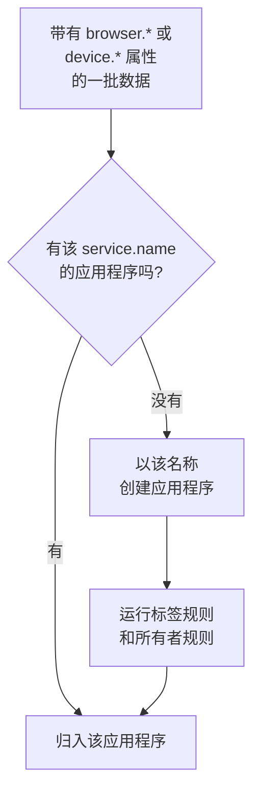

# 管理应用程序

当你的应用的遥测数据首次到达时，OneUptime 会创建一个 RUM 应用程序。本页介绍此后由你管理的内容：应用程序的名称、标签和所有者、数据保留多久、归档、谁能看到它，以及告警。

:::cards
- [应用程序是如何创建的](#应用程序是如何创建的): 按 `service.name` 匹配，随第一批数据创建。
- [标签](#标签): 对应用程序分组，并决定谁能访问它们。
- [保留](#保留): 遥测数据和录制保留多久。
- [权限](#权限): 谁能查看应用程序，谁能观看录制。
:::

## 应用程序是如何创建的

你不必手动创建 RUM 应用程序。当一批带有浏览器或设备属性和 `service.name` 的遥测数据到达时，OneUptime 会将其归入具有该 `service.name` 的应用程序；如果项目中还没有，就创建一个。



- `service.name` 是应用程序的标识，比较时不区分大小写： `Storefront-Web` 和 `storefront-web` 是同一个应用程序。
- 新的 `service.name` 会开始一个新的应用程序。旧应用程序保留其历史并变为 **已断开** ，新应用程序从空白开始，二者永远不会合并。
- 每个应用使用一个 `service.name` ，而不是每个环境一个。用 `oneuptime.label.env=production` 这样的标签区分环境，让它们共享一个应用程序和一段历史。

### 重命名应用程序

**显示名称** 最初与 `service.name` 相同。要修改它，打开应用程序的 **设置** 页面，在 **应用程序详情** 卡片上点击 **编辑详情** ，描述和标签也在这里编辑。遥测数据按卡片上显示且永不改变的 **应用名称 (service.name)** 匹配，因此重命名是安全的。

### 自行添加应用程序

如果你希望在第一位访客到来之前就准备好应用程序的标签、所有者或回放策略，可以自行创建应用程序。

:::steps
#### 打开应用程序列表

前往 **产品 → 资源 → 真实用户监控** ，点击 **创建RUM 应用程序** 。

#### 输入应用名称

在 **应用名称 (service.name)** 中填写你的应用将上报的 `service.name` ，与应用上报的完全一致。

#### 命名并保存

与自动发现的应用程序一样，该应用程序以其应用名称命名。要显示其他名称，打开 **更多字段** 并输入 **显示名称** ；描述和标签也在那里。然后保存表单。
:::

如果项目中已有具有该 `service.name` 的应用程序，无论是自动发现的、之前添加的还是已归档的，表单都会提示你，而不会再创建一个。

## 连接状态

遥测数据到达期间，应用程序显示 **已连接** ；15 分钟内没有任何数据后，显示 **已断开** 。OpenTelemetry 遥测和会话回放流量都计算在内。

**最后一次出现** 每隔几分钟刷新一次，而不是每批数据都刷新，因此它可能比实时流量最多晚约五分钟，15 分钟的窗口为此留出了余量。OneUptime 自身宕机或追赶摄取队列的时间不计算在内。

**已断开** 本身并不是错误：夜间没有访客的内部工具确实处于断开状态。如果有人正在使用该应用，请参见 [RUM 故障排除](/docs/rum/troubleshooting) 。

## 标签

标签在列表和过滤器中对应用程序进行分组。它们还决定仅限部分标签的成员可以访问什么：这样的成员只能看到带有其中某个标签的应用程序。应用程序通过三种方式获得标签：

| 方式 | 位置 |
| --- | --- |
| 手动 | 在创建表单的 **更多字段** 下，或之后在应用程序 **设置** 页面的 **应用程序详情** 卡片上通过 **编辑详情** 。 要一次为多个应用程序添加标签，请在列表中选中它们，选择 **Add Labels** ，它位于 **批量操作** 中。 |
| 来自遥测 | 名为 `oneuptime.label.<name>` 的资源属性会添加标签 `<name>:<value>` ，如下所示。 |
| 来自标签规则 | 规则会为它匹配的每个新应用程序添加标签。参见 [标签规则与所有者规则](#标签规则与所有者规则) 。 |

在与 `service.name` 相同的资源上设置这些属性，例如在 [浏览器端设置](/docs/rum/browser-setup) 中的 `src/telemetry.ts` 文件里：

```ts
const resource = defaultResource().merge(
  resourceFromAttributes({
    [ATTR_SERVICE_NAME]: "storefront-web",
    "oneuptime.label.team": "payments",
    "oneuptime.label.env": "production",
  }),
);
```

这会添加标签 `team:payments` 和 `env:production` ，如果项目中不存在则会创建它们。由于属性名写入了标签，`oneuptime.label.team=prod` 和 `oneuptime.label.env=prod` 不会混在一起。超过 100 个字符的标签会被截断为 100 个字符，空值或非字符串值不会添加任何内容。

## 标签规则与所有者规则

规则会为它匹配的每个新应用程序添加标签或所有者。打开 **真实用户监控 → 设置 → 标签规则** 或 **所有者规则** ，分两步创建规则：

1. 在 **匹配** 中，新规则默认的 **所有 RUM 应用程序** 匹配所有应用程序。要缩小范围，请选择 **仅符合条件的 RUM 应用程序** ，然后针对 **应用标签** （包含所选标签中的任意一个、全部或一个都不包含）、 **应用名称** 或 **应用描述** （等于、包含、开头是、结尾是或匹配某个模式）添加条件。
2. 在 **标签** 中（所有者规则则是 **所有者** ），选择规则要添加的内容。新规则必须至少添加一个标签或所有者。在你输入自己的名称之前， **名称** 会根据你的选择自动填写，例如 _Add team:payments_ 或 _Add Payments as owners_ 。 **描述** 以及所有者规则的 **通知所有者** 位于 **更多字段** 下。

规则在应用程序创建时运行，包括自动发现的应用程序。要将规则应用到已有的应用程序，打开其所在行的 **⋯** 菜单并选择 **Run Now** ：参见 [对现有资源运行规则](/docs/configuration/run-rules-now) 。因编辑而没有任何内容可添加的规则，会在列表中标记为 **不添加任何内容** 。 [标签与所有者规则](/docs/configuration/label-and-owner-rules) 完整介绍了这些表单。

### 所有者

所有者是对应用程序负责的人员和团队。所有者规则会为新应用程序添加所有者。要手动添加或移除所有者，请在列表中选择应用程序，选择 **Add Owner** 或 **Remove Owner** ，它们位于 **批量操作** 中；API 通过 `/rum-application-owner-user` 和 `/rum-application-owner-team` 添加所有者。在默认开启 **通知所有者** 时，规则添加的每个所有者都会收到通知。如果不希望通知任何人，请在对大量应用程序运行规则之前将其关闭。

## 保留

应用程序的遥测数据和录制的保留时长不同：

| 数据 | 保留时长 | 设置位置 |
| --- | --- | --- |
| 日志、指标、追踪和性能剖析 | 项目的保留期，除非应用程序覆盖了它 | 应用程序的 **设置** 页面 |
| 会话回放录制 | 默认 7 天，或 1、14、30、90 天 | **Replay Policy** ，通过 **Edit Policy → Limits** |

### 遥测数据保留

默认情况下，应用程序的遥测数据按项目的保留期保留，该保留期在 **项目设置 → 遥测与 APM → 数据保留** 中设置。应用程序 **设置** 页面上的两张卡片可以覆盖它：

- **遥测数据保留** 包含 **遥测数据保留时长（天）** ，即适用于该应用程序全部遥测数据的一个值。留空则使用项目的保留期。
- **按遥测类型保留** 分别包含日志、追踪、指标和性能剖析的默认值，以及按严重级别区分的日志和按状态区分的追踪的值。留空的值会回退到应用程序的值，再回退到项目的值。

保留覆盖属于 [企业版](/docs/self-hosted/enterprise) ，在 OneUptime Cloud 上属于 Scale 套餐及以上。没有这些功能时，卡片会显示套餐增加的内容，应用程序继续使用项目的保留期。

在较低的 Cloud 套餐上，试用期留下的覆盖会继续应用于新的遥测数据。 **设置** 页面会在 **保留覆盖** 卡片上显示它，并提供一个 **移除覆盖** 按钮，该按钮在所有套餐上都可用：此后应用程序使用项目的保留期，已存储的数据保持其存储时的保留期。再次设置覆盖需要 Scale 套餐。

### 会话回放保留

录制有自己的保留期，在应用程序的 **Replay Policy** 页面上通过 **Edit Policy → Limits** 设置：默认 7 天，也可选 1、14、30 或 90 天。这个保留期有意设得很短，因为录制远比 span 敏感，也远比 span 大。 **设置** 页面上的 **Session Replay Retention** 卡片会显示它（ _Session replays are kept for 7 days._ ），其 **在 Replay Policy 中编辑** 按钮会打开该策略。

更长的遥测保留期不会让录制保留得更久。会话的计数、信号和设备随录制一起过期；只有会话的日志、span 和异常遵循遥测保留期。参见 [保留与删除](/docs/telemetry/session-replay#保留与删除) 。

> [!TIP]
> RUM 往往是项目中数据量最大的遥测，因为它随用户增长，而不是随服务器增长。在这里设置较短的保留期、在后端服务上设置较长的保留期，是一种常见的配置。

## 归档与删除

**归档** 会将应用程序从 **所有应用程序** 中隐藏，同时继续收集遥测数据。对于你不再关注但希望保留其历史的应用，可以将其归档。

- 在应用程序的 **设置** 页面上点击 **归档** ，或在列表中选择多个应用程序一起归档。
- 已归档的应用程序位于 **真实用户监控 → 高级 → 已归档** 。侧边菜单中的 **高级** 默认是折叠的：点击它以显示 **已归档** 。可以在那里对一个应用程序或一次对多个应用程序 **取消归档** 。

应用程序侧边菜单 **高级** 部分中的 **删除应用程序** 会永久删除该应用程序。如果应用仍在发送遥测数据，下一批数据会重新创建该应用程序，且不带任何设置，因此请先停止插桩。

要擦除某个人的数据而不是整个应用程序，请提交擦除请求：参见 [擦除会话](/docs/telemetry/session-replay#擦除会话) 。

## 权限

拥有项目 Viewer 角色的任何人都可以查看 RUM 应用程序及其遥测数据。会话回放被有意排除在该角色之外：列出录制、观看录制和查看谁观看过录制，都是单独的权限。项目所有者和管理员拥有全部权限。权限选择器按标题列出每项权限，此处以斜体显示。

| 权限 | 允许成员 |
| --- | --- |
| `ReadRumApplication` (_Read RUM Application_) | 查看应用程序及其遥测页面。 |
| `CreateRumApplication`, `EditRumApplication`, `DeleteRumApplication` | 添加、编辑和删除应用程序。 |
| `ReadRumSessionReplay` (_List Session Replays_) | 列出已录制的会话及其详情，但不能播放，也无法得知用户是谁。 |
| `ReadRumSessionReplayPayload` (_Watch Session Replays_) | 播放录制，并读取已识别用户的引用和特征。 |
| `ReadRumSessionReplayAudit` (_Read Session Replay Audit_) | 读取 **Replay Access Log** ：谁观看了哪个录制。 |
| `DeleteRumSessionReplay` (_Delete Session Replays_) | 删除录制。 |
| `CreateRumSessionErasureRequest`, `ReadRumSessionErasureRequest` | 提交擦除请求并跟进。 |
| `ReadRumApplicationLabelRule`, `ReadRumApplicationOwnerRule` （及其 Create、Edit 和 Delete） | 管理标签规则和所有者规则。 |
| `ReadRumApplicationOwnerUser`, `ReadRumApplicationOwnerTeam` （及其 Create、Edit 和 Delete） | 通过 API 添加和移除所有者。 |

一种实用的分工：给支持工程师 `ReadRumApplication` 和 `ReadRumSessionReplay` 。他们可以看到哪些会话出现了错误，而无需观看任何人的屏幕，也不会得知用户是谁。只把 `ReadRumSessionReplayPayload` 授予需要的人；这样，拥有 `ReadRumSessionReplayAudit` 的成员就能在应用程序的 **Replay Access Log** 页面上看到每一次观看。 [谁可以观看录制](/docs/telemetry/session-replay#谁可以观看录制) 说明了每项权限在会话列表和播放器中解锁了什么。

## 针对 RUM 数据设置告警

RUM 遥测就是普通的日志、指标和追踪，因此没有单独的 RUM 监控器：常规监控器都适用于它。最快的入门方式是应用程序的 **Recommendations** 页面，它会提供已限定到该应用程序的监控器：

| 分组 | 推荐 |
| --- | --- |
| Core Web Vitals | Poor Largest Contentful Paint、Poor Interaction to Next Paint、Poor Cumulative Layout Shift、Slow First Contentful Paint 和 Slow Time to First Byte。参见 [核心 Web 指标](/docs/rum/web-vitals) 。 |
| 错误 | Failed User Operations 和 Unhandled Browser Exceptions。 |
| 会话回放 | 四个 [存储预算告警](/docs/telemetry/session-replay#存储预算告警) ，会在项目的每日上限或应用程序的每月预算用尽之前发出警告。应用程序录制过回放后就会提供它们，月度那一对则在应用程序还设置了每月预算后提供。 |

要自己构建监控器，请选择读取相应信号的那种：

- [指标监控](/docs/monitor/metrics-monitor) ：某个核心 Web 指标，或你的应用发送的任何指标。
- [跟踪监控](/docs/monitor/traces-monitor) ：客户端错误率或延迟。
- [日志监控](/docs/monitor/logs-monitor) ：浏览器日志中的某种模式。
- [异常监控](/docs/monitor/exceptions-monitor) ：新出现或激增的客户端异常。

将你构建的监控器限定到该应用程序，这样具有相似特征的后端服务就不会触发它。

## 后续步骤

:::cards
- [会话回放](/docs/telemetry/session-replay): 录制用户看到的内容，并拥有自己的策略和保留期。
- [标签与所有者规则](/docs/configuration/label-and-owner-rules): 两种规则表单，逐步说明。
- [对现有资源运行规则](/docs/configuration/run-rules-now): 将新规则应用到已有的应用程序。
- [RUM 故障排除](/docs/rum/troubleshooting): 当应用程序缺失、为空或显示已断开时。
:::
