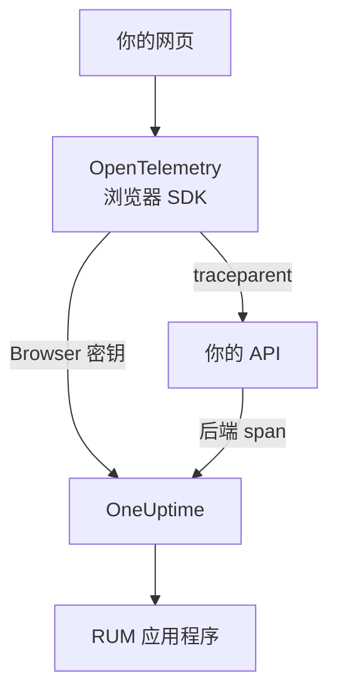

# 浏览器端设置

使用 OpenTelemetry 浏览器 SDK 为 Web 应用插桩，让它作为 RUM 应用程序向 OneUptime 上报。页面加载和请求以追踪的形式到达，同一套设置还能发送你的错误、日志、指标和核心 Web 指标。

:::cards
- [设置步骤](#设置步骤): 从 Browser 密钥到第一次页面加载的六个步骤。
- [关联后端](#关联后端追踪): 将浏览器 span 与它们发起的后端追踪连接起来。
- [上报错误](#上报未捕获的错误): 将未捕获的错误发送到异常视图。
- [故障排除](#故障排除): 什么都没有到达时要检查的内容。
:::

## 工作原理

SDK 在访问者的浏览器中运行。它为每次页面加载和请求记录一个 span，并使用 **Browser** 摄取密钥直接导出到 OneUptime，中间不需要你自己的收集器或代理。



## 开始之前

- 一个可以修改代码并重新部署、通过 npm 安装依赖的 Web 应用。
- 提供页面的来源，例如 `https://app.example.com` 。Browser 密钥只接受来自其列出来源的请求。
- 一个可以创建摄取密钥的角色：项目所有者和管理员可以创建，拥有 **Create Telemetry Ingestion Key** 权限的任何人也可以。

## 设置步骤

:::steps
### 创建 Browser 摄取密钥

1. 前往 **产品 → 项目设置** 。
2. 在侧边菜单中打开 **遥测与 APM** ，然后选择 **摄取密钥** 。
3. 点击 **创建摄取密钥** ，并在 **密钥类型** 中选择 **Browser** 。
4. 在 **浏览器设置** 步骤中，以 JSON 数组的形式在 **Allowed Origins** 中列出你的来源，例如 `["https://app.example.com"]` ，然后创建密钥。在 OneUptime Cloud 的 Free 套餐中，最后一个 **账单** 步骤会先显示遥测价格。


新密钥会在它自己的页面中打开。复制它的 **密钥** ：这就是 SDK 以 `x-oneuptime-token` 发送的令牌。


### 安装软件包

```bash
npm install @opentelemetry/api \
  @opentelemetry/sdk-trace-web \
  @opentelemetry/resources \
  @opentelemetry/semantic-conventions \
  @opentelemetry/opentelemetry-browser-detector \
  @opentelemetry/exporter-trace-otlp-http \
  @opentelemetry/context-zone \
  @opentelemetry/instrumentation \
  @opentelemetry/instrumentation-document-load \
  @opentelemetry/instrumentation-fetch \
  @opentelemetry/instrumentation-xml-http-request
```

### 创建遥测文件

创建 `src/telemetry.ts` 。 `browserDetector` 会添加让遥测被归类为 RUM 的 `browser.*` 属性，而 `service.name` 为应用程序命名。

```ts title="src/telemetry.ts"
import {
  WebTracerProvider,
  BatchSpanProcessor,
} from "@opentelemetry/sdk-trace-web";
import { OTLPTraceExporter } from "@opentelemetry/exporter-trace-otlp-http";
import { ZoneContextManager } from "@opentelemetry/context-zone";
import { registerInstrumentations } from "@opentelemetry/instrumentation";
import { DocumentLoadInstrumentation } from "@opentelemetry/instrumentation-document-load";
import { FetchInstrumentation } from "@opentelemetry/instrumentation-fetch";
import { XMLHttpRequestInstrumentation } from "@opentelemetry/instrumentation-xml-http-request";
import {
  defaultResource,
  detectResources,
  resourceFromAttributes,
} from "@opentelemetry/resources";
import { browserDetector } from "@opentelemetry/opentelemetry-browser-detector";
import { ATTR_SERVICE_NAME } from "@opentelemetry/semantic-conventions";

const ONEUPTIME_URL = "https://oneuptime.com";
// Public: it ships in your page. It must be a Browser ingestion key.
const ONEUPTIME_TOKEN = "YOUR_TELEMETRY_INGESTION_TOKEN";

/*
 * browserDetector supplies the browser.* attributes. Without them this
 * telemetry is classified as a backend Service, not a RUM application.
 * The attributes set last win, so service.name here overrides the
 * "unknown_service" that defaultResource() provides.
 */
const resource = defaultResource()
  .merge(detectResources({ detectors: [browserDetector] }))
  .merge(
    resourceFromAttributes({
      [ATTR_SERVICE_NAME]: "storefront-web",
    }),
  );

const provider = new WebTracerProvider({
  resource: resource,
  spanProcessors: [
    new BatchSpanProcessor(
      new OTLPTraceExporter({
        url: `${ONEUPTIME_URL}/otlp/v1/traces`,
        headers: { "x-oneuptime-token": ONEUPTIME_TOKEN },
      }),
    ),
  ],
});

provider.register({
  contextManager: new ZoneContextManager(),
});

registerInstrumentations({
  instrumentations: [
    new DocumentLoadInstrumentation(),
    new FetchInstrumentation({
      // See "Linking to your backend traces" before widening this.
      propagateTraceHeaderCorsUrls: [/^https:\/\/api\.example\.com/],
    }),
    new XMLHttpRequestInstrumentation({
      propagateTraceHeaderCorsUrls: [/^https:\/\/api\.example\.com/],
    }),
  ],
});
```

### 首先导入它

让它成为应用的第一个导入。插桩会修补 `fetch` 和 `XMLHttpRequest` ，在修补之前发出的请求不会被追踪。

```ts
// src/index.tsx (React), src/main.ts (Vue / Angular), etc.
import "./telemetry";
import React from "react";
// ... the rest of your app
```

### 检查密钥

在查看其他地方之前，先确认 OneUptime 是否接受该密钥：

```bash
curl -i https://oneuptime.com/otlp/v1/validate \
  -H "x-oneuptime-token: YOUR_TELEMETRY_INGESTION_TOKEN"
```

`200` 加上 `"valid": true` 表示密钥被接受；对于 Browser 密钥，消息还会说明它只能在浏览器中、从其允许的来源之一使用。 `401` 表示密钥未知、已撤销、已关闭或已过期。

### 加载一个页面

打开你的网站。一分钟内，应用程序会以其 `service.name` 命名，出现在 **产品 → 资源 → 真实用户监控** 下。
:::

## Browser 密钥允许什么

代码片段中的所有内容都会发送给访问者，因此任何人都能从你的页面复制令牌。Browser 密钥限制了复制品能做的事：

| 设置 | 作用 |
| --- | --- |
| **Allowed Origins** | 只接受来自这些来源的请求，每个来源都包含协议和端口（如有）。主机可以以一个 `*.` 通配符开头： `https://*.example.com` 涵盖 `example.com` 的所有子域，但不包括 `example.com` 本身。 |
| **Requests Per Minute Limit** | 所有使用该密钥的访问者共享的一个上限：除非你自行设置，否则为每分钟 6000 个请求。 |
| **Pinned Service Name** | 对密钥写入的所有数据强制使用 `service.name` ，因此复制品无法将其遥测伪装成你的某个后端服务。 |
| **过期时间** | 过了这个日期，密钥将不再被接受。 |
| **已启用** | 关闭它可以立即阻止泄露的密钥。 |

Browser 密钥只能写入 OTLP 追踪、日志和指标，以及会话回放；其他所有摄取路由都会拒绝它。这些设置在密钥自己的页面上修改。密钥创建后，密钥类型无法更改。

> [!WARNING]
> 切勿将 **服务器** 密钥放进页面。服务器密钥可以从任何地方写入各种遥测，不做来源检查，因此任何读过你页面的人都能写入你的项目。

## 不使用检测器设置 `browser.*`

`browserDetector` 读取 [UA Client Hints API](https://wicg.github.io/ua-client-hints/) ，而只有 Chromium 浏览器才有这个 API。在 Safari 和 Firefox 上，它会设置 `browser.language` 和 `user_agent.original` ，但不会设置 `browser.platform` 、 `browser.brands` 或 `browser.mobile` 。

这仍然足以将遥测归类为 RUM，因为仅 `browser.language` 就能把批次标记为浏览器 RUM。不过 **客户端** 页面按 `browser.platform` 列出平台，因此 Safari 和 Firefox 的访问不会在那里增加行。

要跳过检测器，或为每个浏览器提供平台，请自行设置这些属性：

```ts
const resource = defaultResource().merge(
  resourceFromAttributes({
    [ATTR_SERVICE_NAME]: "storefront-web",
    // browser.language or browser.platform marks the telemetry as browser RUM.
    "browser.language": navigator.language,
    "browser.platform":
      (navigator as any).userAgentData?.platform ?? "unknown",
    "browser.mobile": (navigator as any).userAgentData?.mobile ?? false,
    "user_agent.original": navigator.userAgent,
  }),
);
```

让 `browser.platform` 保持粗粒度。每个不同的值都会成为 **客户端** 页面上的一行，因此在其中放入完整的 user-agent 字符串或按用户区分的值会让列表无限增长，也会带来隐私问题。

## 追踪路由切换

`DocumentLoadInstrumentation` 只追踪首次加载。在单页应用中，路由切换在你记录之前都不可见，而记录只需在路由器中加几行代码：

```ts
import { trace } from "@opentelemetry/api";

const tracer = trace.getTracer("app-router");

function onRouteChange(to: string): void {
  const span = tracer.startSpan("route-change", {
    attributes: { "app.route": to },
  });
  // End it when the route's data has loaded and the view has painted.
  requestAnimationFrame(() => {
    return span.end();
  });
}
```

添加 `@opentelemetry/instrumentation-user-interaction` ，还可以追踪点击和其他 DOM 事件。关于每个路由的 INP，请参见 [单页应用](/docs/rum/web-vitals#单页应用) 。

## 关联后端追踪

`propagateTraceHeaderCorsUrls` 决定哪些跨源请求携带 W3C `traceparent` 请求头，它把浏览器 span 与其发起的后端追踪连接起来。发往页面自身来源的请求无需配置就会携带它。

> [!WARNING]
> 不要将它设为 `/.*/` 。这个请求头会把简单的跨源请求变成需要预检的请求，因此任何没有在 `Access-Control-Allow-Headers` 中列出 `traceparent` 的第三方 API 都会开始失败。

只列出你控制并已配置好的来源：

```ts
new FetchInstrumentation({
  propagateTraceHeaderCorsUrls: [
    /^https:\/\/api\.example\.com/,
    /^https:\/\/auth\.example\.com/,
  ],
});
```

安装 [会话回放](/docs/telemetry/session-replay) 后，发往你自己来源的请求还会携带回放的会话 ID，把你的后端遥测归入该录制：参见 [将追踪与会话回放关联](#将追踪与会话回放关联) 。

## 将追踪与会话回放关联

如果你还在使用 [会话回放](/docs/telemetry/session-replay) ，你的 **后端** 遥测无需在这里写任何代码就会与录制关联。会话上传期间，录制器会在页面发往自身来源的请求中添加一个携带会话 ID 的 `tracestate` 成员，并把 `traceparent` 留给你的 `FetchInstrumentation` / `XMLHttpRequestInstrumentation` 。在每个延续 W3C 追踪上下文的服务中，后端 span 会在摄取时被打上会话 ID，其日志和异常则通过追踪 ID 关联到录制。工作原理、不涵盖的内容以及关闭它的开关，请参见 [与其他遥测关联](/docs/telemetry/session-replay#correlating-with-your-other-telemetry) 。

无论调用传入的是 URL（带或不带 init 对象）还是 `Request` 对象，录制器都会读回你的插桩设置的 `traceparent` ，因此回放中的每个请求行都会链接到其后端追踪。对于另一个来源上的 API，请将它列在上面的 `propagateTraceHeaderCorsUrls` 中；它的请求不携带会话 ID，而是通过追踪 ID 关联到录制。对于 *没有* 使用此 SDK 的页面，应用程序回放策略中的 **Trace propagation origins** 起同样的作用。

请求头无法覆盖的是此 SDK 自己的浏览器 span：文档加载、路由切换以及你上报的错误。要把它们也归入录制，请在每个 span 开始时打上 `session.id` 。录制器通过 `onSessionChange` 告诉你 ID：如果会话已存在，它会立即触发，之后每当 ID 变化时再次触发：访问者空闲 30 分钟后回来时、达到 4 小时上限时、 `identify()` 指定了另一个用户时，或者同一访问者的另一个标签页先更改了它时。

```ts title="src/replaySession.ts"
import type { Context } from "@opentelemetry/api";
import type {
  ReadableSpan,
  Span,
  SpanProcessor,
} from "@opentelemetry/sdk-trace-web";

declare global {
  interface Window {
    OneUptimeReplayQueue?: Array<Array<unknown>>;
  }
}

let replaySessionId: string | null = null;

// The recorder script loads asynchronously. The queue is applied the
// moment it starts and stays live afterwards, so this works either way.
(window.OneUptimeReplayQueue = window.OneUptimeReplayQueue || []).push([
  "onSessionChange",
  (sessionId: string): void => {
    replaySessionId = sessionId;
  },
]);

export class ReplaySessionSpanProcessor implements SpanProcessor {
  public onStart(span: Span, _parentContext: Context): void {
    if (replaySessionId) {
      span.setAttribute("session.id", replaySessionId);
    }
  }

  public onEnd(_span: ReadableSpan): void {}

  public forceFlush(): Promise<void> {
    return Promise.resolve();
  }

  public shutdown(): Promise<void> {
    return Promise.resolve();
  }
}
```

然后在 `src/telemetry.ts` 中，把它放在提供程序的 span 处理器的第一位：

```ts
import { ReplaySessionSpanProcessor } from "./replaySession";

const provider = new WebTracerProvider({
  resource: resource,
  spanProcessors: [
    new ReplaySessionSpanProcessor(),
    new BatchSpanProcessor(
      new OTLPTraceExporter({
        url: `${ONEUPTIME_URL}/otlp/v1/traces`,
        headers: { "x-oneuptime-token": ONEUPTIME_TOKEN },
      }),
    ),
  ],
});
```

此后开始的 span 都带有该 ID，回放播放器的 **追踪** 选项卡会按录制的时间轴列出它们，仪表板中的每个 span 也都能链接回回放中的那一刻。span 处理器会为每个 span 打上其开始时的当前 ID；如果改为把 ID 写入 `resource.attributes` ，会话轮换时，仍在导出批次中等待的 span 也会被重新打上标签。录制器一启动，监听器就会收到 ID，早于同意或捕获触发器，因此如果这一点很重要，请在页面获得同意后再打标。

## Content Security Policy

如果你的网站发送 Content Security Policy，在你于 `connect-src` 中允许 OneUptime 之前，浏览器会阻止导出器的请求。你看不到任何失败：页面只是什么都不上报。

```text
connect-src 'self' https://oneuptime.com;
```

将它合并到你现有的 `connect-src` 指令中。如果你自行托管 OneUptime，请使用你自己的主机。

## 上报未捕获的错误

OpenTelemetry 浏览器 SDK 不会捕获未捕获的错误。自行上报后，它们会与后端错误一起出现在 **异常** 下：

```ts
import { trace, SpanStatusCode } from "@opentelemetry/api";

const tracer = trace.getTracer("app-errors");

window.addEventListener("error", (event: ErrorEvent) => {
  const span = tracer.startSpan("window.onerror");
  span.recordException(event.error ?? new Error(event.message));
  span.setStatus({ code: SpanStatusCode.ERROR });
  span.end();
});

window.addEventListener("unhandledrejection", (event: PromiseRejectionEvent) => {
  const span = tracer.startSpan("unhandledrejection");
  span.recordException(
    event.reason instanceof Error ? event.reason : new Error(String(event.reason)),
  );
  span.setStatus({ code: SpanStatusCode.ERROR });
  span.end();
});
```

使用 [会话回放](/docs/telemetry/session-replay) 时，录制器也会捕获未捕获的错误，并在回放的时间轴上标记出来。异常页面随后会显示 **Watch what the user saw** 卡片，从错误发生前十秒打开回放。在默认策略下，无论是否出错，每个会话都会被录制；错误只决定卡片从哪里打开。

## 添加日志和指标

追踪就足以填满概览。当你想在 OneUptime 中查看浏览器日志，或要发送 [核心 Web 指标](/docs/rum/web-vitals) 时，请添加日志和指标管道：

```bash
npm install @opentelemetry/api-logs @opentelemetry/sdk-logs \
  @opentelemetry/exporter-logs-otlp-http \
  @opentelemetry/sdk-metrics @opentelemetry/exporter-metrics-otlp-http
```

```ts
import { LoggerProvider, BatchLogRecordProcessor } from "@opentelemetry/sdk-logs";
import { OTLPLogExporter } from "@opentelemetry/exporter-logs-otlp-http";
import { MeterProvider, PeriodicExportingMetricReader } from "@opentelemetry/sdk-metrics";
import { OTLPMetricExporter } from "@opentelemetry/exporter-metrics-otlp-http";
import { logs } from "@opentelemetry/api-logs";
import { metrics } from "@opentelemetry/api";

const headers = { "x-oneuptime-token": ONEUPTIME_TOKEN };

logs.setGlobalLoggerProvider(
  new LoggerProvider({
    resource: resource,
    processors: [
      new BatchLogRecordProcessor({
        exporter: new OTLPLogExporter({
          url: `${ONEUPTIME_URL}/otlp/v1/logs`,
          headers,
        }),
      }),
    ],
  }),
);

metrics.setGlobalMeterProvider(
  new MeterProvider({
    resource: resource,
    readers: [
      new PeriodicExportingMetricReader({
        exporter: new OTLPMetricExporter({
          url: `${ONEUPTIME_URL}/otlp/v1/metrics`,
          headers,
        }),
        exportIntervalMillis: 30000,
      }),
    ],
  }),
);
```

用同一个 `resource` 对象来构建它们。资源中缺少 `browser.*` 的日志或指标管道会被归为一个单独的后端服务。

## 端点参考

| 信号 | 端点 | 请求头 |
| --- | --- | --- |
| 追踪 | `POST {host}/otlp/v1/traces` | `x-oneuptime-token: <token>` |
| 指标 | `POST {host}/otlp/v1/metrics` | `x-oneuptime-token: <token>` |
| 日志 | `POST {host}/otlp/v1/logs` | `x-oneuptime-token: <token>` |

`{host}` 是 `https://oneuptime.com` ，如果你自行运行 OneUptime，则是你自己的主机；请在 OTLP URL 和 Content Security Policy 条目中修改它。OneUptime 接受 OTLP/JSON 和 OTLP/protobuf。这些端点响应来自任何来源的跨源请求，并允许 `x-oneuptime-token` 请求头，因此浏览器可以直接向它们导出。

## 故障排除

:::details 网络选项卡中没有发往 OneUptime 的请求
打开浏览器的开发者工具，进入网络选项卡，按 `otlp` 过滤：你要找的是 `POST /otlp/v1/traces` 。完全没有请求意味着 SDK 从未启动：

- `telemetry.ts` 不是第一个导入，或者打包工具把它丢掉了。
- 批处理器还没有导出。它会等待几秒来填满一个批次，因此在断定什么都没发送之前，请稍等或切换到另一个页面。
- 某个构建时环境变量的值变成了 `undefined` ，导致导出器的 URL 损坏。请在启动时把 URL 记录一次。
:::

:::details 浏览器拦截了请求
- 控制台中出现 Content Security Policy 错误，说明 `connect-src` 还没有允许 OneUptime：参见 [Content Security Policy](#content-security-policy) 。
- CORS 错误几乎总是意味着请求根本没有到达 OneUptime，因为 OneUptime 的端点允许任何来源：请检查公司代理、广告拦截器或主机名中的拼写错误。
:::

:::details OneUptime 拒绝了请求
- `422` 加上 `Origin https://app.example.com is not allowed for this browser ingestion key.` 表示页面的确切来源（协议、主机和端口）不在密钥的 **Allowed Origins** 中。
- `422` 加上 `This telemetry ingestion key has been disabled.` 表示有人关闭了该密钥。请重新打开它，或使用另一个密钥。
- `401` 表示密钥未知、已撤销或已过期。运行 [设置步骤](#设置步骤) 中的密钥检查，然后创建一个有效的 Browser 密钥。
- `404` 表示 URL 有误。追踪导出器需要完整路径 `/otlp/v1/traces` 。
:::

:::details 应用出现在服务下，而不是真实用户监控下
资源没有任何 `browser.*` 属性，因此遥测被归为后端服务。请添加 `browserDetector` ，或按照 [不使用检测器设置 `browser.*`](#不使用检测器设置-browser) 设置这些属性。

在网络选项卡中查看请求的负载，检查你发送的内容： `resourceSpans[0].resource.attributes` 就是决定归类的列表。已经创建的服务不会变成 RUM 应用程序，因此在 RUM 遥测到达后，请在 **产品 → 服务** 下删除它。
:::

:::details Safari 或 Firefox 上的客户端页面为空
客户端行来自 `browser.platform` ，而 `browserDetector` 只在 Chromium 浏览器上设置它。要列出 Safari 和 Firefox 的访问，请自行设置：参见 [不使用检测器设置 `browser.*`](#不使用检测器设置-browser) 。
:::

## 后续步骤

:::cards
- [核心 Web 指标](/docs/rum/web-vitals): 从同一页面发送 LCP、INP、CLS、FCP 和 TTFB。
- [会话回放](/docs/telemetry/session-replay): 录制用户看到的画面，与这些追踪并列。
- [管理应用程序](/docs/rum/applications): 名称、标签、所有者和保留期。
- [RUM 故障排除](/docs/rum/troubleshooting): 按问题通常发生的顺序列出的所有检查。
:::
