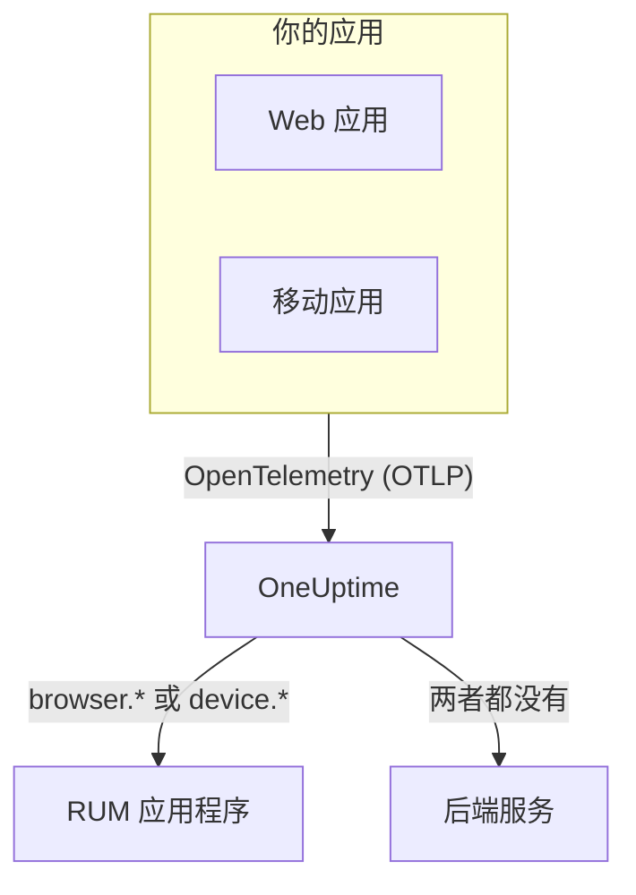

# RUM 概览

真实用户监控（RUM）展示真实用户在你的 Web 应用和移动应用中的体验：页面加载、请求、错误和核心 Web 指标，这些数据由应用自身上报，而不是来自探针。OneUptime 将这些遥测数据归入一个 RUM 应用程序，你可以对其绘制图表、搜索和设置告警。

:::cards
- [工作原理](#工作原理): 一条 OpenTelemetry 管道，数据到达时被归类为 RUM。
- [OneUptime 如何识别 RUM](#oneuptime-如何识别-rum): 决定归类的资源属性。
- [你能得到什么](#你能得到什么): 概览、Web 指标、探索器和回放。
- [开始使用](#开始使用): 从摄取密钥到第一次页面加载。
:::

## 工作原理

RUM 与 OneUptime 的其他部分使用同一条 OpenTelemetry 管道。没有专门的 RUM 代理，也没有自己的传输格式：你只需将 OpenTelemetry 浏览器或移动端 SDK 指向 OneUptime，遥测数据到达时就会被归类为 RUM。

- **每个应用一个应用程序。** 它的标识是 SDK 上报的 `service.name` ，OneUptime 会在收到第一批遥测数据时创建该应用程序。
- **绝不重复计数。** 客户端遥测只属于其 RUM 应用程序，不会同时作为后端服务列出。
- **会话回放是独立的可选层。** 它有自己的代码片段和隐私控制：参见 [会话回放](/docs/telemetry/session-replay) 。

## 在哪里找到它

打开 **产品 → 资源 → 真实用户监控** 。 **所有应用程序** 列出你的应用程序及其 **客户端类型** 、 **状态** 和 **最后一次出现** 。侧边菜单中另外两个部分默认折叠：

- **设置**: **所有者规则** 、 **标签规则** ，以及项目级的 **会话回放** 开关。
- **高级**: **已归档** ，即你归档的应用程序。

应用程序自己的侧边菜单按如下方式组织页面； **设置** 、 **开发者** 和 **高级** 默认折叠：

| 部分 | 页面 |
| --- | --- |
| **基础** | **概览**, **建议**, **文档** |
| **可观测性** | **指标**, **日志**, **追踪**, **客户端** |
| **会话回放** | **会话回放**, **User Flows**, **Replay Users**, **健康状况**, **Replay Policy**, **回放访问日志**, **文档** |
| **设置** | **设置** |
| **开发者** | **Terraform**, **API**, **AI 助手** |
| **高级** | **删除应用程序** |

## OneUptime 如何识别 RUM

大多数“我的应用没有出现”的问题都在这里找到答案。OneUptime 在每批遥测数据到达时，根据该批数据的 **资源属性** 做出判断：

1. 资源中包含 `browser.platform` 、 `browser.language` 或非空 `browser.brands` 的批次是 **浏览器** RUM。
2. 否则，包含 `device.id` 或 `device.model.identifier` 的批次是 **移动端** RUM。
3. 否则，包含 `device.manufacturer` 且没有主机标识（ `host.name` 、 `host.id` 或 `k8s.node.name` ）的批次也是 **移动端** RUM。
4. 其他一切都是后端服务。

后端 SDK 从不设置 `browser.*` 、 `device.id` 或 `device.model.identifier` ，因此它们是明确的信号。 `device.manufacturer` 是例外：主机清单也用它上报机器的制造商，因此只有在资源没有主机标识时它才起作用。参见 [清单属性](/docs/telemetry/host-otel-collector#清单属性ipmac序列号厂商型号固件) 。

| 属性 | 必需 | 作用 |
| --- | --- | --- |
| `service.name` | **是** | 应用程序的标识，例如 `storefront-web` 。没有它就不会创建 RUM 应用程序。 |
| `browser.platform`, `browser.language`, `browser.brands` | Web 端需要其中之一 | 将批次标记为浏览器 RUM。 `browser.platform` 还会填充 **客户端** 页面。 |
| `device.id`, `device.model.identifier` | 移动端需要其中之一 | 将批次标记为移动端 RUM。 `device.model.identifier` 还会填充 **客户端** 页面。 |
| `device.manufacturer` | 否 | 仅当资源不带主机标识时，将批次标记为移动端 RUM。 |
| `telemetry.sdk.language` | 否 | 显示在概览上，例如 `webjs` 或 `swift` 。 |
| `telemetry.sdk.version` | 否 | 显示为 SDK 版本；缺失时读取 `oneuptime.agent.version` 。 |
| `oneuptime.label.<name>` | 否 | 为应用程序添加项目标签 `<name>:<value>` 。 |

OneUptime 按 `service.name` 查找应用程序（不区分大小写），项目中没有时会创建一个。新的 `service.name` 会产生新的应用程序，因此请保持名称稳定，用标签而不是新名称来区分环境。名称、标签、所有者和保留期在 [管理应用程序](/docs/rum/applications) 中介绍。

> [!IMPORTANT]
> 除非你添加浏览器资源检测器或自行设置，OpenTelemetry 浏览器 SDK 不会添加任何 `browser.*` 属性。只有 `service.name` 时，遥测数据会成为后端服务，而不是 RUM 应用程序。 [浏览器端设置](/docs/rum/browser-setup) 展示了这两种方式。

## 你能得到什么

| 位置 | 显示内容 |
| --- | --- |
| **概览** | **页面加载** 、 **页面加载时间（p95）** 、 **事件** 、 **错误率** 、 **Event duration (p95)** 、 **异常** 、 **客户端** 和 **Sessions recorded** 磁贴，以及你所选时间范围内的趋势图。 |
| **核心 Web 指标** | 概览上的一张卡片，显示 LCP、INP、CLS、FCP 和 TTFB，每项都按 Google 的阈值评级，并为单页应用显示每个路由的 INP。参见 [核心 Web 指标](/docs/rum/web-vitals) 和 [单页应用](/docs/rum/web-vitals#单页应用) 。 |
| **指标**, **日志**, **追踪** | 只显示此应用程序数据的遥测探索器。 |
| **客户端** | 应用程序被使用过的浏览器平台和设备型号：按平台列出的简短列表，绝不会每个用户一行。 |
| **会话回放** | 真实会话的录制，与其错误、追踪和日志并列显示：参见 [会话回放](/docs/telemetry/session-replay) 。 |
| **建议** | 为应用程序准备的现成监控器：核心 Web 指标较差、请求失败、浏览器异常，以及开始录制后的会话回放预算。 |

这些数字来自你的插桩发送的 span。 **页面加载** 统计页面加载插桩为每次完整加载记录的 `documentLoad` span，因此单页应用内的路由切换不算页面加载。

遥测数据持续到达时，应用程序显示 **已连接** ；15 分钟内没有任何数据时显示 **已断开** 。OneUptime 自身停机或在追赶摄取队列的时间不计入这 15 分钟。

## 开始使用

:::steps
### 创建摄取密钥

打开 **项目设置 → 遥测与 APM → 摄取密钥** ，点击 **创建摄取密钥** 。Web 应用需要 **浏览器** 密钥，它只能在你列出的来源中使用。移动应用需要 **服务器** 密钥，因为移动端 SDK 不发送 `Origin` 请求头。

### 为应用插桩

Web 应用请按照 [浏览器端设置](/docs/rum/browser-setup) 操作，Android、iOS、React Native 和其他平台请按照 [移动端设置](/docs/rum/mobile-setup) 操作。

### 打开一个页面

加载你网站的一个页面，或启动你的应用。收到第一批遥测数据后，应用程序会以其 `service.name` 命名，出现在 **产品 → 资源 → 真实用户监控** 下。无需事先创建。

### 添加 Web 指标和回放

基础数据到达后，发送 [核心 Web 指标](/docs/rum/web-vitals) 并添加 [会话回放](/docs/telemetry/session-replay) 。两者都是可选的。
:::

如果什么都没有出现， [RUM 故障排除](/docs/rum/troubleshooting) 会按问题通常发生的顺序逐一排查原因。

## 后续步骤

:::cards
- [浏览器端设置](/docs/rum/browser-setup): 使用 OpenTelemetry 浏览器 SDK 为 Web 应用插桩。
- [移动端设置](/docs/rum/mobile-setup): Android、iOS、React Native 以及其他任何 OpenTelemetry SDK。
- [核心 Web 指标](/docs/rum/web-vitals): 发送 LCP、INP、CLS、FCP 和 TTFB，并逐个路由查看 INP。
- [会话回放](/docs/telemetry/session-replay): 查看用户看到的画面，与其错误和追踪并列。
:::
