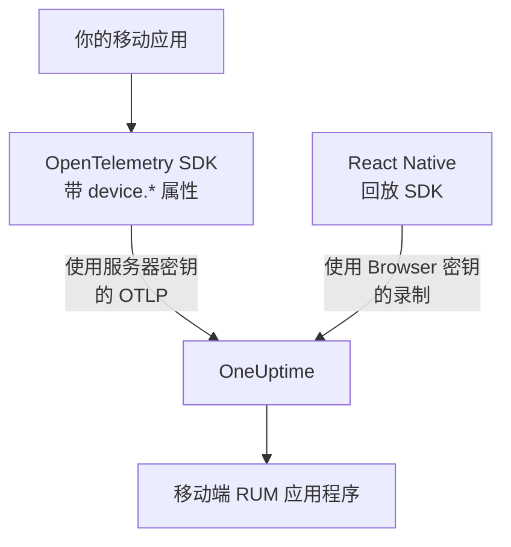

# 移动端设置

使用 OpenTelemetry 为 Android、iOS 或 React Native 应用插桩，让它作为移动端 RUM 应用程序向 OneUptime 上报。任何其他拥有 OpenTelemetry SDK 的平台都以同样的方式工作。

:::cards
- [OneUptime 需要什么](#oneuptime-需要什么): 两个资源属性，用服务器密钥发送。
- [设置你的平台](#设置你的平台): Android、iOS、React Native 及其他平台。
- [确认数据到达](#确认数据到达): 先测试密钥，再找到应用。
- [移动端的会话回放](#移动端的会话回放): React Native 应用的录制。
:::

## 工作原理

你的应用使用 **服务器** 摄取密钥将 OTLP 直接导出到 OneUptime。让它被归类为移动端 RUM 而不是后端服务的，是其资源上的 `device.*` 属性。



## OneUptime 需要什么

应用导出的每个批次都需要两个资源属性：

| 属性 | 含义 |
| --- | --- |
| `service.name` | 应用程序的标识，例如 `storefront-android` 。 |
| `device.id` 或 `device.model.identifier` | 将遥测标记为移动端 RUM。 `device.model.identifier` 还会填充 **客户端** 页面。 |

没有设备属性时，遥测数据仍会到达，你也可以查询它，但它会被归为后端服务，而不是 RUM 应用程序。

`device.manufacturer` 也会将批次标记为移动端，但仅限于没有主机标识的资源，因为主机清单也用它上报机器的制造商。像下面每个示例那样同时设置 `device.id` 或 `device.model.identifier` ，这一点就无关紧要。

让 `device.id` 成为按安装区分的标识符，绝不要使用广告 ID 或任何其他能识别个人的值。OneUptime 读取它只是为了识别移动端遥测。

## 开始之前

- 一个带有 OpenTelemetry SDK 的应用：OpenTelemetry Java SDK 或 OpenTelemetry Android、opentelemetry-swift，或用于 React Native 的 OpenTelemetry JavaScript SDK。
- 一个 **服务器** 摄取密钥，在 **项目设置 → 遥测与 APM → 摄取密钥** 中通过 **创建摄取密钥** 创建。移动应用发来的 **浏览器** 密钥会被拒绝：它要根据 `Origin` 请求头进行检查，而移动端 SDK 不发送这个请求头。
- 以下 OTLP 设置。如果你自行托管 OneUptime，请将 `https://oneuptime.com` 替换为你自己的主机。

| 设置 | 值 |
| --- | --- |
| OTLP 端点 | `https://oneuptime.com/otlp` |
| 请求头 | `x-oneuptime-token: YOUR_TELEMETRY_INGESTION_TOKEN` |
| 追踪 | `POST https://oneuptime.com/otlp/v1/traces` |
| 指标 | `POST https://oneuptime.com/otlp/v1/metrics` |
| 日志 | `POST https://oneuptime.com/otlp/v1/logs` |

> [!WARNING]
> 密钥会随应用一起发布，而应用可以被解包，所以请假定有人会复制它。在密钥的页面上设置 **固定的服务名称** ，使复制品无法以你的后端服务的名称写入，再添加 **Requests Per Minute Limit** 和 **过期时间** 日期，并随每次发布轮换密钥。

## 设置你的平台

这些代码片段展示了设置的大致结构。移动端 OpenTelemetry SDK 的 API 会在版本之间变化，因此请对照你锁定的版本核对方法名。OneUptime 需要的东西从不改变：端点、请求头、 `service.name` 和一个 `device.*` 属性。

:::tabs
@tab Android
使用可在 Android 上运行的 OpenTelemetry Java SDK 及其 OTLP 导出器：

```kotlin title="app/build.gradle.kts"
dependencies {
    implementation(platform("io.opentelemetry:opentelemetry-bom:<latest>"))
    implementation("io.opentelemetry:opentelemetry-sdk")
    implementation("io.opentelemetry:opentelemetry-exporter-otlp")
}
```

```kotlin title="StorefrontApplication.kt"
import android.app.Application
import android.os.Build
import io.opentelemetry.exporter.otlp.http.trace.OtlpHttpSpanExporter
import io.opentelemetry.sdk.OpenTelemetrySdk
import io.opentelemetry.sdk.resources.Resource
import io.opentelemetry.sdk.trace.SdkTracerProvider
import io.opentelemetry.sdk.trace.export.BatchSpanProcessor

class StorefrontApplication : Application() {
    override fun onCreate() {
        super.onCreate()

        val resource = Resource.getDefault().toBuilder()
            .put("service.name", "storefront-android")
            .put("device.manufacturer", Build.MANUFACTURER)
            .put("device.model.identifier", Build.MODEL)
            .build()

        val exporter = OtlpHttpSpanExporter.builder()
            .setEndpoint("https://oneuptime.com/otlp/v1/traces")
            .addHeader("x-oneuptime-token", BuildConfig.ONEUPTIME_TOKEN)
            .build()

        OpenTelemetrySdk.builder()
            .setTracerProvider(
                SdkTracerProvider.builder()
                    .setResource(resource)
                    .addSpanProcessor(BatchSpanProcessor.builder(exporter).build())
                    .build()
            )
            .buildAndRegisterGlobal()
    }
}
```

[OpenTelemetry Android](https://github.com/open-telemetry/opentelemetry-android) 代理在此基础上添加了自动插桩，并在它自己的资源上设置设备属性。如果你使用它，请将其导出器指向相同的端点和请求头，并检查在你的版本中 `device.model.identifier` 是否进入了资源。
@tab iOS
使用 [opentelemetry-swift](https://github.com/open-telemetry/opentelemetry-swift) ，并自行设置设备属性：各个版本自行添加的资源在不同版本之间有所变化。

```swift
let resource = Resource(attributes: [
    "service.name": .string("storefront-ios"),
    "device.model.identifier": .string(UIDevice.current.model),
    "device.manufacturer": .string("Apple"),
    "telemetry.sdk.language": .string("swift"),
])

let exporter = OtlpHttpTraceExporter(
    endpoint: URL(string: "https://oneuptime.com/otlp/v1/traces")!,
    config: OtlpConfiguration(
        headers: [("x-oneuptime-token", oneUptimeToken)]
    )
)

OpenTelemetry.registerTracerProvider(
    tracerProvider: TracerProviderBuilder()
        .with(resource: resource)
        .add(spanProcessor: BatchSpanProcessor(spanExporter: exporter))
        .build()
)
```

`UIDevice.current.model` 给出 `iPhone` 这样的简短名称，使 **客户端** 页面每种设备只有一行。
@tab React Native
React Native 运行 OpenTelemetry JavaScript SDK，因此请按照 [浏览器端设置](/docs/rum/browser-setup) 构建提供程序、OTLP 导出器和批处理器，并做三处修改：使用 **服务器** 密钥发送，去掉 `browserDetector` 和 `DocumentLoadInstrumentation` ，并自行设置设备属性。

```ts
import { Platform } from "react-native";
import * as Device from "expo-device"; // or react-native-device-info
import {
  defaultResource,
  resourceFromAttributes,
} from "@opentelemetry/resources";

const resource = defaultResource().merge(
  resourceFromAttributes({
    "service.name": "storefront-mobile",
    "device.manufacturer": Device.manufacturer ?? Platform.OS,
    "device.model.identifier":
      Device.modelId ?? Device.modelName ?? "unknown",
    "telemetry.sdk.language": "webjs",
  }),
);
```

`Device.modelId` 只在 iOS 上设置，因此 Android 上会退回到 `Device.modelName` 。
@tab 其他平台
Flutter、Unity、.NET MAUI、嵌入式客户端或你自己编写的 OTLP 写入器都可以，只要资源带有 `service.name` 和一个 `device.*` 属性。读取标准 OpenTelemetry 环境变量的 SDK 会原样使用这些值：

```bash
OTEL_EXPORTER_OTLP_ENDPOINT="https://oneuptime.com/otlp"
OTEL_EXPORTER_OTLP_HEADERS="x-oneuptime-token=YOUR_TELEMETRY_INGESTION_TOKEN"
OTEL_RESOURCE_ATTRIBUTES="service.name=storefront-mobile,device.manufacturer=Acme,device.model.identifier=AC-100"
```

SDK 会自行在端点后加上 `/v1/traces` 、 `/v1/metrics` 和 `/v1/logs` 。
:::

## 确认数据到达

:::steps
### 测试密钥

在翻看 SDK 的设置之前，先确认 OneUptime 是否接受该密钥：

```bash
curl -i https://oneuptime.com/otlp/v1/validate \
  -H "x-oneuptime-token: YOUR_TELEMETRY_INGESTION_TOKEN"
```

`200` 加上 `"valid": true` 表示密钥被接受。Browser 密钥也会返回 `200` ，但其消息说明它只能在浏览器中使用：移动应用需要服务器密钥。 `401` 表示密钥未知、已撤销、已关闭或已过期，任何 SDK 设置都无法解决。

### 启动应用

运行应用并使用片刻。收到第一批遥测数据后，它会以其 `service.name` 命名，出现在 **产品 → 资源 → 真实用户监控** 下。

### 打开客户端页面

打开应用程序的 **客户端** 页面： `device.model.identifier` 中的每个设备型号都有一行。如果 **追踪** 有数据而此页面一直为空，说明设备属性没有进入资源。
:::

## 移动端的会话回放

React Native 应用可以使用 `@oneuptime/react-native-replay` 录制会话。它将原生视图树记录为线框，绝不记录屏幕截图或屏幕上的文字，其录制与 Web 录制在同一个播放器中打开。它使用 **浏览器** 密钥发送，该密钥的 **允许的来源** 以 `app://` 加上 Android 应用 ID 或 iOS bundle ID 的形式列出你的应用：这是一个独立的密钥，不同于你的 OpenTelemetry SDK 使用的服务器密钥。 [在 React Native 中安装](/docs/telemetry/session-replay#在-react-native-中安装) 会逐步介绍。

原生 Android 和 iOS 应用以及其他平台没有会话录制器：它们的 **会话回放** 页面保持为空，而追踪、日志、指标、异常和 **客户端** 页面照常工作。

## 故障排除

:::details 密钥检查返回 401，或密钥被拒绝
`401` 表示密钥未知、已撤销、已关闭或已过期：请创建一个服务器密钥，并用它重新构建应用。

Browser 密钥能通过检查，但移动应用的每次导出都会被拒绝，返回 `422` 和 `This request did not send an Origin header, so it cannot be checked against the allowed origins of this browser ingestion key. Use a server ingestion key for requests that are not sent by a browser.` 。请使用 **服务器** 密钥。
:::

:::details 应用出现在服务下，而不是真实用户监控下
资源既没有 `device.id` 也没有 `device.model.identifier` ，因此遥测被归为后端服务。请按照 [设置你的平台](#设置你的平台) 设置它们。

已经创建的服务不会变成 RUM 应用程序，因此在 RUM 遥测到达后，请在 **产品 → 服务** 下删除它。
:::

:::details 客户端页面为空
客户端行只来自 `device.model.identifier` 。只设置 `device.id` 或 `device.manufacturer` 的 SDK 会把应用归为移动端 RUM，但不会列出任何客户端：请同时设置 `device.model.identifier` 。
:::

:::details 有人在使用应用，状态却显示已断开
15 分钟内没有遥测时，状态会变为 **已断开** 。如果有人正在使用应用：

- 采样器可能丢弃了所有数据：检查是否有 always-off 采样器，或比例非常低的采样器。
- 应用可能只为那段时间内没有人执行过的操作发送遥测。
- 发布之后，密钥可能已被撤销或已过期：按照 [确认数据到达](#确认数据到达) 测试它。
:::

## 后续步骤

:::cards
- [会话回放](/docs/telemetry/session-replay): 录制 React Native 会话，与其追踪并列。
- [管理应用程序](/docs/rum/applications): 名称、标签、所有者和保留期。
- [OpenTelemetry](/docs/telemetry/open-telemetry): OTLP 端点、限制和错误的完整说明。
- [RUM 故障排除](/docs/rum/troubleshooting): 按问题通常发生的顺序列出的所有检查。
:::
