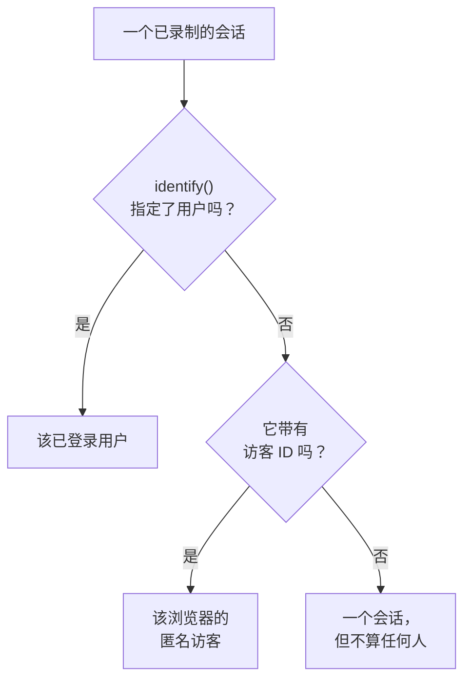

# 产品分析

产品分析统计使用某个 RUM 应用程序的人，以及他们的会话情况：活跃、新、回访、已登录和休眠用户，以及按设备、浏览器、国家和页面划分的会话。它统计 [会话回放](/docs/telemetry/session-replay) 录制的会话，因此不需要单独的代码片段，并会把数字保留 13 个月，远远长于录制的过期时间。

:::cards
- [如何统计人](#如何统计人): 已登录用户算一次，匿名浏览器也算一次。
- [用户](#用户): 活跃、新、回访、已登录、全部和休眠用户。
- [会话](#会话): 多少个、多长，以及按设备、浏览器、国家和页面划分。
- [隐私与保留](#隐私与保留): 13 个月，不存储姓名，可按请求擦除。
:::

## 如何统计人

应用程序的侧边菜单有一个 **产品分析** 部分，包含两个页面： **用户** 和 **会话** 。两者都统计会话回放录制的会话，因此在应用程序的录制器开始工作时开始统计，回放策略没有录制的会话不计入。每个会话要么算作一个人，要么不算作任何人：

- **已登录用户只算一次** ，无论他们使用多少个浏览器和设备：识别依据是你的页面传给 `identify()` 的引用的单向哈希（参见 [识别你的用户](/docs/telemetry/session-replay#识别你的用户) ）。
- **匿名浏览器只算一次** ，依据其 [匿名访客 ID](/docs/telemetry/session-replay#匿名访客) 。两个浏览器就是两个访客，而某个浏览器在有人登录之前的会话仍归其访客所有。
- **来自旧版录制器的会话** 不发送访客 ID，因此算作会话，但不算作人。

天数按你自己的时区计算。

## 用户

**用户** 统计你所选时间范围内的人：

| 磁贴 | 统计什么 |
| --- | --- |
| **活跃用户** | 在该时间范围内来过的每个人：每个已登录用户算一次，每个匿名浏览器算一次。 |
| **新用户** | 首次访问发生在该时间范围内的活跃用户。 |
| **回访用户** | 在该时间范围开始之前就来过的活跃用户。 |
| **已登录用户** | 你的应用通过 `identify()` 登录的活跃用户，以及他们在全部活跃用户中所占的比例。 |
| **用户总数** | 应用程序在过去 13 个月里见过的每个人。 |
| **休眠用户** | 以前来过，但在过去 30 天内，或你选择的 7、14、60 或 90 天内没有来过的人。 |

前三个还会显示与上一个时间段相比的变化。磁贴下方， **活跃用户** 按天绘制当天来过的人、截至当天的 7 天内来过的人和截至当天的 30 天内来过的人， **新用户与回访用户** 则把每天的人分成两部分。

**人员** 列出磁贴统计的每个人，每人一行，最近见到的排在最前，其筛选器可以显示某个磁贴的人、匿名访客或所有人。打开某个人，可查看其首次和最近一次访问，以及过去 13 个月里的每个会话，录制仍被保留的会话旁有 **观看** 。

## 会话

**会话** 统计在该时间范围内开始的会话： **会话** 、 **已登录会话** 、 **会话时长中位数** 、 **每个会话的页面数** 、 **有错误的会话** 和 **受挫会话** 。磁贴下方：

- **按设备划分的会话** 按天绘制来自桌面设备、手机和平板电脑的会话。移动应用在较短边为 600 点或以上的屏幕上的会话算作平板电脑的会话。
- **会话时长** 按持续时间对已结束的会话分组，从不到 10 秒到超过 30 分钟。仍在录制的会话还没有时长。
- **明细** 按设备类型、浏览器、操作系统、国家、应用版本、入口页面或页面对用户和会话排序，用户最多的排在最前。

## 隐私与保留

- **13 个月** 。某个月的数字会在其后第 13 个月的第一天删除，因此最近 12 个完整月份始终都在，与录制本身的保留期（默认 7 天）无关。
- **不存储姓名** 。这些数字保存已登录用户的单向密钥和浏览器的访客 ID，从不保存引用、特征或 IP 地址。只有在此人的某个录制仍被保留时，并且只对可以读取身份的角色，行才会显示已登录用户的名字；否则显示 **已登录用户** 或 **匿名访客** 以及 ID 的开头。
- **按请求擦除** 。擦除请求也会删除这里对应的数字（参见 [擦除会话](/docs/telemetry/session-replay#擦除会话) ）。

## 谁可以查看

读取这两个页面所需的权限与读取会话列表相同： `ReadRumSessionReplay` (_List Session Replays_) 或 `ReadRumSessionReplayPayload` (_Watch Session Replays_)，项目所有者和管理员拥有这些权限。要查看已登录用户是谁，以及按姓名搜索人，需要 [谁可以观看录制](/docs/telemetry/session-replay#谁可以观看录制) 中所述的身份权限。

## 后续步骤

:::cards
- [会话回放](/docs/telemetry/session-replay): 录制这些页面统计的会话，并观看它们。
- [管理应用程序](/docs/rum/applications): 名称、标签、所有者和保留。
- [RUM 概览](/docs/rum/index): RUM 应用程序还会显示什么。
:::
