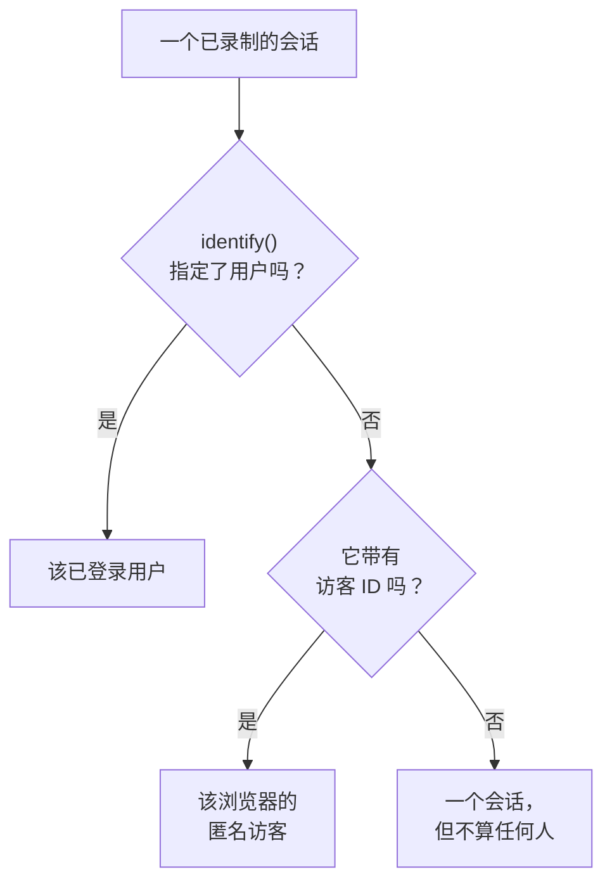

# 产品分析

产品分析统计使用某个 RUM 应用程序的人、他们的会话情况以及他们做了什么：活跃、新、回访、已登录和休眠用户，按设备、浏览器、国家和页面划分的会话，以及你的应用发送的事件，以趋势、漏斗和留存的形式呈现。它统计 [会话回放](/docs/telemetry/session-replay) 录制的会话以及其录制器发送的事件，因此不需要单独的代码片段，并会把数字保留 13 个月，远远长于录制的过期时间。

:::cards
- [用户](#用户): 活跃、新、回访、已登录、全部和休眠用户。
- [会话](#会话): 多少个、多长，以及按设备、浏览器、国家和页面划分。
- [发送事件和指标](#发送事件和指标): 人们做了什么，以及你的页面测量的数值。
- [事件](#事件): 某件事发生的频率、谁做的以及在哪里。
- [漏斗](#漏斗): 谁一步一步继续下去，以及用了多长时间。
- [用户留存](#用户留存): 谁回来了，按同期群逐一来看。
:::

## 如何统计人

应用程序的侧边菜单有一个 **产品分析** 部分： **用户** 、 **会话** 、 **事件** 、 **漏斗** 、 **用户留存** 、 **用户流程** 和 **分析设置** 。 **用户** 和 **会话** 统计会话回放录制的会话，因此在应用程序的录制器开始工作时开始统计，回放策略没有录制的会话不计入。每个会话要么算作一个人，要么不算作任何人：



- **已登录用户只算一次** ，无论他们使用多少个浏览器和设备：识别依据是你的页面传给 `identify()` 的引用的单向哈希（参见 [识别你的用户](/docs/telemetry/session-replay#识别你的用户) ）。
- **匿名浏览器只算一次** ，依据其 [匿名访客 ID](/docs/telemetry/session-replay#匿名访客) 。两个浏览器就是两个访客，而某个浏览器在有人登录之前的会话仍归其访客所有。
- **来自旧版录制器的会话** 不发送访客 ID，因此算作会话，但不算作人。

**事件** 、 **漏斗** 和 **用户留存** 以同样的方式统计人，依据是录制器从每个会话（无论是否录制）发送的事件（参见 [发送事件和指标](#发送事件和指标) ）。

天数按你自己的时区计算。

## 用户

**用户** 统计你所选时间范围内的人：

| 磁贴 | 统计什么 |
| --- | --- |
| **活跃用户** | 在该时间范围内来过的每个人：每个已登录用户算一次，每个匿名浏览器算一次。 |
| **新用户** | 首次访问发生在该时间范围内的活跃用户。 |
| **回访用户** | 在该时间范围开始之前就来过的活跃用户。 |
| **已登录用户** | 你的应用通过 `identify()` 登录的活跃用户，以及他们在全部活跃用户中所占的比例。 |
| **用户总数** | 应用程序在过去 13 个月里见过的每个人。 |
| **休眠用户** | 以前来过，但在过去 30 天内，或你选择的 7、14、60 或 90 天内没有来过的人。 |

前三个还会显示与上一个时间段相比的变化。磁贴下方， **活跃用户** 按天绘制当天来过的人、截至当天的 7 天内来过的人和截至当天的 30 天内来过的人， **新用户与回访用户** 则把每天的人分成两部分。

**人员** 列出磁贴统计的每个人，每人一行，最近见到的排在最前，其筛选器可以显示某个磁贴的人、匿名访客或所有人。打开某个人，可查看其首次和最近一次访问，以及过去 13 个月里的每个会话，录制仍被保留的会话旁有 **观看** 。

## 会话

**会话** 统计在该时间范围内开始的会话： **会话** 、 **已登录会话** 、 **会话时长中位数** 、 **每个会话的页面数** 、 **有错误的会话** 和 **受挫会话** 。磁贴下方：

- **按设备划分的会话** 按天绘制来自桌面设备、手机和平板电脑的会话。移动应用在较短边为 600 点或以上的屏幕上的会话算作平板电脑的会话。
- **会话时长** 按持续时间对已结束的会话分组，从不到 10 秒到超过 30 分钟。仍在录制的会话还没有时长。
- **明细** 按设备类型、浏览器、操作系统、国家、应用版本、入口页面或页面对用户和会话排序，用户最多的排在最前。

## 发送事件和指标

只要应用程序的 **分析设置** 页面上的 **发送产品分析事件** 处于开启状态，就会发送事件。新应用程序一开始就是开启的，而在它出现之前创建的应用程序则是关闭的，所以请在那里开启它。应用程序的会话回放也必须开启，因为事件由它的录制器发送；React Native 录制器目前还不发送事件。

浏览器录制器运行的每个会话都会自动发送其开始和它浏览的每个页面，包括单页应用的路由变化，无论回放的抽样和策略是否录制该会话。你自己的事件和数值来自页面的代码：

```js
OneUptimeReplay.track("Signed up", { plan: "pro" });
OneUptimeReplay.metric("cart.value", 42.5, { currency: "EUR" });
```

| 调用 | 发送的内容 |
| --- | --- |
| `track(name, properties?)` | 一个由 **事件** 、 **漏斗** 和 **用户留存** 统计的事件，在会话被录制时还会成为回放时间线上的一个标记。 `name` ≤ 64 个字符；≤ 20 个属性，值为字符串、数字或布尔值，键 ≤ 40 个字符，值 ≤ 200 个字符。 |
| `metric(name, value, attributes?)` | 你的页面测量的一个数值，作为应用程序某个指标的一个数据点（参见 [仪表板和告警](#仪表板和告警) ）。 `name` ≤ 100 个字符，由字母、数字、 `_` 、 `.` 、 `-` 和 `/` 组成，以字母开头且不以 `oneuptime.` 开头； `value` 为有限数字； `attributes` 与 `track()` 的属性相同。 |

在录制器加载之前，请把同样的调用以 `["track", name, properties]` 和 `["metric", name, value, attributes]` 的形式推入 `window.OneUptimeReplayQueue` （参见 [JavaScript API](/docs/telemetry/session-replay#javascript-api) ）。

- **每个会话，无论是否录制** 。回放的抽样和上传策略决定哪些会话被录制，而不是哪些会话被统计。在 Do Not Track 或 Global Privacy Control 下不会发送任何内容，来自应用程序不允许的来源的内容也不会保留。当策略要求同意时，事件会等待 `grantConsent()` ，最多 500 个，而 `revokeConsent()` 会丢弃它们。
- **像录制一样遮盖** 。在 _Mask all text_ 下，事件属性和指标属性的值会在离开页面之前被遮盖，因此按其中某一项拆分的明细显示的是占位符，而不是你的值；事件名称、属性键和指标值按原样发送。在该模式下需要读取的值请放进会话标签（ `setTags()` ），标签从不遮盖，所以不要在其中放个人数据。标签显示在会话上以及会话列表的 `tag:key=value` 搜索中，不会出现在这些页面的明细里。页面以其路径发送，不带查询字符串和片段。
- **小批量发送** ，每 5 秒一次，以及在标签页被隐藏时。在发生 3 天之后才到达 OneUptime 的事件会被丢弃，一个项目（所有应用程序合计）每分钟最多可发送 60,000 个事件和指标数据点；超过之后，录制器会等待并重新发送。

`metric()` 在事件关闭时不发送任何内容， `getDiagnostics().productAnalytics` 会说明事件是否开启（参见 [`getDiagnostics()`](/docs/telemetry/session-replay#getdiagnostics) ）。

### 用户属性

要按执行者对事件进行明细拆分和细分，请在 **分析设置** 的 **用于分析的用户属性** 中列出 `identify()` 的特征键，例如 `["plan", "role"]` ，最多 20 个，按书写原样匹配。之后每个事件都会携带已登录用户的这些特征，与页面传给 `identify()` 的一致。其他特征从不离开页面，而在 **捕获最终用户身份** 关闭时，任何特征都不会离开。不要列出包含个人数据的特征，例如电子邮件地址。

## 事件

**事件** 一次显示一个事件：在你选择其他事件之前，显示你的应用最常发生的事件；在应用还没有发送任何事件时，显示浏览最多的页面。选择器还会列出 **会话已开始** 和每个被浏览的页面，下方的 **所有事件** 列出时间范围内的每个事件，以及它发生的次数和执行它的人数；选择一个即可在上方查看。

- 磁贴统计该事件的 **事件** （以及每人平均次数）、它的 **用户** 和它的 **会话** 。
- **事件和用户** 按天绘制该事件发生的次数，以及当天执行它的人数。
- **明细** 按设备类型、浏览器、操作系统、国家、应用版本、页面、事件属性或用户属性对该事件排序，并显示每个值的事件数、用户数和占比。选择一个值即可只显示它。

**细分** 把页面限定为字段具有你所选值的事件：点击 **添加筛选条件** ，然后选择字段和值，精确匹配。一个细分最多包含 5 个筛选条件，事件必须全部匹配。页面地址会保留事件、时间范围、细分和明细，因此链接会打开同样的视图。

## 漏斗

**漏斗** 按顺序跟踪人们走过 2 到 6 个步骤，每个步骤都是 **事件** 中列出的一个事件。在时间范围内完成第一步的人中，它统计之后有多少人完成了第二步，然后第三步，且都在你从其第一步起选定的时间内： **1 小时内** 、 **1 天内** 、 **7 天内** 、 **14 天内** 或 **30 天内** 。 **添加步骤** 会添加一个步骤。

**转化** 下显示完成所有步骤的人所占的比例，以及每个步骤到达的人数、这占第一步人数的比例、自上一步以来流失的人数，以及他们从上一步开始所用时间的中位数。尝试多次的人只算一次，以走得最远的那次尝试为准。

漏斗的细分以及留存表的细分，使用每个事件都带有的字段和用户属性，而不使用事件自身的属性，因为它的各个步骤是不同的事件。

## 用户留存

**用户留存** 按人们在时间范围内首次执行某个事件（ **初始行为** ）的日、周或月对人们分组，并显示每组中有多大比例的人在该周期及之后的每个周期执行了另一个事件（ **回访行为** ）。两者在你选择其他事件之前都是 **会话已开始** 。

**同期群** 设置周期： **按天** 、 **按周** 或 **按月** 。当时间范围包含的周期多于一张表能显示的数量（32 天、26 周或 13 个月）时，页面会把同期群拉长并加以说明。

每一行是一个同期群及其人数，每个单元格是其中在该周期回来的人所占的比例，人越多颜色越深。尚未开始的周期留空。

**所有同期群** 显示在各同期群之上，把它们当作一个来统计：在每个周期中，回来的人除以已到达该周期的同期群的人数，因此 200 人的同期群的权重是 50 人同期群的四倍。只要有两个同期群里有人，它就会显示。

## 已保存的漏斗和留存表

**漏斗** 页面上的 **已保存的漏斗** 和 **用户留存** 上的 **已保存的留存表** 列出你的团队为该应用程序保存的内容，以便再次打开或显示在仪表板上。已保存的漏斗保留其步骤、完成步骤的时限和细分，已保存的留存表保留其两个事件、周期和细分。两者都不保留时间范围：页面保留自己的时间范围，仪表板读取自己的时间范围。

- **+ 保存漏斗** 或 **+ 保存留存表** 以一个名称保存页面当前显示的内容。每个应用程序每种最多保留 100 个。
- 选择一个即可打开。页面地址会指明它，因此链接会为所有可以查看它的人打开它。当你更改它显示的内容时，它的名称会注明这一点， **更新** 会保存更改。
- **编辑** 重命名一个， **删除** 会为所有人删除它。 **清除视图** 关闭当前打开的那个，并保留页面显示的内容。
- 指向已删除或你无权查看的项的链接会说明这一点，页面会在没有它的情况下打开。

## 仪表板和告警

每个事件还会按分钟作为应用程序的一个指标进行统计，而每次 `metric()` 调用都是其所给名称下的一个独立指标的数据点。你可以在应用程序的 **指标** 页面上绘制它们，把它们添加到仪表板，或用指标监控对它们设置告警； **所有事件** 下的 **打开指标** 会打开该页面。

| 指标 | 统计内容 | 维度 |
| --- | --- | --- |
| `oneuptime.rum.product.events` | 你的 `track()` 事件，每分钟 | `event.name` |
| `oneuptime.rum.product.sessions` | 开始的会话，每分钟 | `device.type` |
| `oneuptime.rum.product.page.views` | 浏览的页面，每分钟 | `device.type` |

这三个指标不计费，并且 `metric()` 会拒绝以 `oneuptime.` 开头的名称，因此你的页面发送的任何内容都不会冒充它们。你的 `metric()` 数据点会像应用程序的其他指标一样被保留和计费。

已保存的漏斗或留存表也可以放到仪表板上：小部件目录 **产品分析** 组中的 **漏斗** 和 **用户留存** 小部件会在仪表板时间范围内显示它， **在漏斗中打开** 或 **在用户留存中打开** 会在其页面上打开它（参见 [仪表板小部件](/docs/dashboards/widgets#产品分析) ）。

## 隐私与保留

- **13 个月** 。某个月的数字会在其后第 13 个月的第一天删除，因此最近 12 个完整月份始终都在，与录制本身的保留期（默认 7 天）无关。事件也以同样的方式保留。
- **不存储姓名** 。这些数字保存已登录用户的单向密钥和浏览器的访客 ID，从不保存引用或 IP 地址，特征中也只保存你列出的用户属性。只有在此人的某个录制仍被保留时，并且只对可以读取身份的角色，行才会显示已登录用户的名字；否则显示 **已登录用户** 或 **匿名访客** 以及 ID 的开头。
- **按请求擦除** 。擦除请求也会删除这里对应的数字和事件（参见 [擦除会话](/docs/telemetry/session-replay#擦除会话) ）。

## 谁可以查看

读取这些页面所需的权限与读取会话列表相同： `ReadRumSessionReplay` (_List Session Replays_) 或 `ReadRumSessionReplayPayload` (_Watch Session Replays_)，项目所有者和管理员拥有这些权限。要查看已登录用户是谁，以及按姓名搜索人，需要 `ReadRumSessionReplayPayload` (_Watch Session Replays_)，如 [谁可以观看录制](/docs/telemetry/session-replay#谁可以观看录制) 中所述。

保存、重命名和删除已保存的漏斗和留存表需要与读取这些页面相同的权限，仪表板小部件只会向拥有这些权限的读者显示它们。

开启或关闭事件需要 `EditRumApplication` (_Edit RUM Application_) 或项目所有者、管理员或成员的角色。列出用户属性需要 `EditRumApplication` 或所有者或管理员的角色，因为这决定了会保留已登录者的哪些信息。

## 后续步骤

:::cards
- [会话回放](/docs/telemetry/session-replay): 录制这些页面统计的会话，并观看它们。
- [管理应用程序](/docs/rum/applications): 名称、标签、所有者和保留。
- [RUM 概览](/docs/rum/index): RUM 应用程序还会显示什么。
:::
