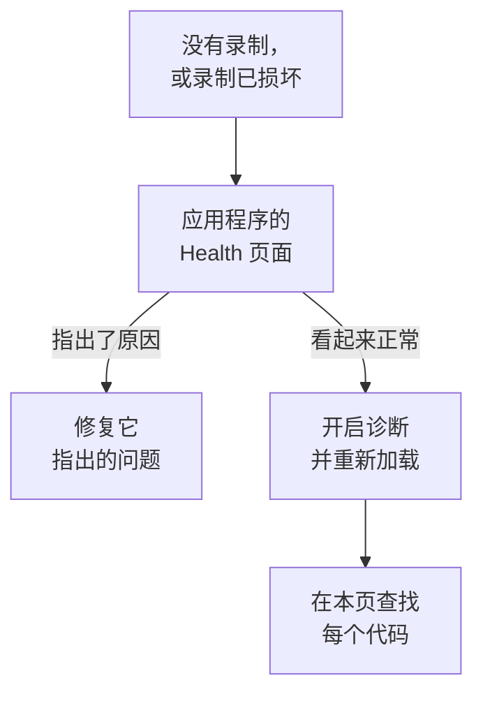

# 会话回放故障排除

当录制没有到达，或者到达时已经损坏，本页会帮你找出原因。会话回放默认录制每个会话并边录边上传，因此一个正常的页面在用户进行操作时，大约每 15 秒发送一个分块。空闲的选项卡不会产生事件，也不会发送任何内容；在没有输入五分钟后，录制器会彻底暂停（ `recording-paused-idle` ），所以在根据 Network 选项卡判断安装之前，请先移动鼠标或点击。如果即便如此也完全看不到发往 OneUptime 的请求，原因就在下面某一项中。

:::cards
- [开启诊断](#开启诊断): 让录制器在控制台中解释它的每个决定。
- [代码](#代码): 录制器输出的每一行，以及如何处理。
- [OneUptime 前面的防火墙拒绝了分块](#oneuptime-前面的防火墙拒绝了分块): 要检查的规则和要添加的排除项。
- [回放中缺少图片、图标或样式](#回放中缺少图片图标或样式): 能播放、但与用户所见不一样的录制。
:::



唯一一种静默属于正常的设置，是 _On error or frustration_ （ `OnErrorOrFrustration` ）上传：此时录制器在内存中保留一个滚动缓冲区，只在出问题时才上传，在触发器触发之前，看起来与安装损坏完全一样。在排查其他问题之前，先确认你用的是哪种设置：下面介绍的 `config-accepted` 行会输出它。

如果可以，从服务器端开始。应用程序侧边菜单 **会话回放** 部分中的 **健康状况** 页面会在没有数据到达时说明原因：录制器从未加载；已加载但没有上传任何内容，以及原因；上传被拒绝，以及原因；或预算已用完。参见 [录制健康状况](/docs/telemetry/session-replay#录制健康状况) 。接下来是浏览器端：开启诊断，重新加载一次，然后阅读控制台。

录制能到达，但播放时图片损坏、图标缺失或某些区域没有样式？这是回放的问题，答案在 [回放中缺少图片、图标或样式](#回放中缺少图片图标或样式) 中。

## 开启诊断

选择你能用到的任意一个开关。它们的作用都一样。

:::tabs
@tab 在浏览器中
在出问题的浏览器中操作。无需重新部署，在生产环境中也能用，重新加载后依然有效：

```js
localStorage.setItem("oneuptime.sessionReplay.debug", "true");
// then reload the page
```

用以下代码再次关闭：

```js
localStorage.removeItem("oneuptime.sessionReplay.debug");
```
@tab 通过链接
对于不懂技术的人，或无法打开控制台的页面，在 URL 中添加 `oneuptime_debug=1` 。它在片段中也有效，因此即使服务器会去掉不认识的查询参数，它也能保留下来：

```text
https://your-app.example.com/checkout?oneuptime_debug=1
https://your-app.example.com/checkout#oneuptime_debug=1
```
@tab 在脚本标签上
适用于希望对所有人开启的预发布环境：

```html
<script
  src="https://oneuptime.com/telemetry/session-replay/v1/recorder.js"
  data-oneuptime-token="YOUR_TELEMETRY_INGESTION_KEY"
  data-oneuptime-app-identifier="YOUR_RUM_APP_IDENTIFIER"
  data-oneuptime-debug="true"
  crossorigin="anonymous"
  async
></script>
```
@tab 在 init 全局对象中
如果你通过 init 全局对象配置录制器：

```js
window.__ONEUPTIME_SESSION_REPLAY__ = {
  host: "https://oneuptime.com",
  token: "YOUR_TELEMETRY_INGESTION_KEY",
  appIdentifier: "YOUR_RUM_APP_IDENTIFIER",
  debug: true,
};
```
@tab 在部署上
在 OneUptime 部署上操作，这是唯一一个不需要有人守在出问题的浏览器前的开关。设置 `SESSION_REPLAY_DEBUG=true` 并重启。此后，这个实例提供的每个录制器都会在它运行的每个页面上输出日志，所以开启它，收集一次重新加载的日志，然后关闭。它不会改变任何策略：不改变采样，不改变遮盖，也不改变同意。其他部署设置参见 [自托管说明](/docs/telemetry/session-replay#自托管说明) 。
@tab 运行时
在录制器加载之后：

```js
OneUptimeReplay.setDebug(true);
```
:::

输出如下所示：

```text
[OneUptime Session Replay] loader-start: Loader running.
[OneUptime Session Replay] init-options-read: Init options read. {host: "https://oneuptime.com", appIdentifier: "checkout-web", …}
[OneUptime Session Replay] config-fetch-start: Requesting the policy. {url: "https://oneuptime.com/telemetry/session-replay/v1/config", …}
[OneUptime Session Replay] config-accepted: Policy accepted. {captureTrigger: "Always", samplePercentage: 100, …}
[OneUptime Session Replay] recording: Recording and uploading …
```

## 无需事先开启任何东西即可获取时间线

无论诊断是否开启，录制器都会保留它最近的 250 个决定。如果问题已经发生，你不需要在开启日志的情况下重现它，而是改为获取以下内容：

```js
copy(JSON.stringify(OneUptimeReplay.getDiagnostics(), null, 2));
```

它会返回录制器版本、会话 ID、它的 `state` （ `recording` 、 `uploading` 、 `not-sampled` 、 `stopped` …）、如果已停止则包括停止原因、 `bootstrapDecision` 、 `decisions` 下每道关卡的答案（是否被采样、同意状态、是否允许上传以及是什么在阻止上传、服务器的最后一条指令）、录制器的 `capabilities` ，以及完整的记录列表 — 包括加载器存根的记录，它在录制器构件存在之前运行，大多数放弃录制的决定都在这里做出。按设计，它不包含任何页面内容；参见 [诊断信息从不包含的内容](#诊断信息从不包含的内容) 。这些字段在 [`getDiagnostics()`](/docs/telemetry/session-replay#getdiagnostics) 中有说明。

**如果出现 `OneUptimeReplay is not defined`** ，说明录制器构件从未加载 — 这本身就是下面相当一部分代码的答案，而这恰恰是你最需要时间线的时候。记录仍然存在，位于加载器存根在构件存在之前写入的一个全局对象上：

```js
copy(JSON.stringify(window.__ONEUPTIME_SESSION_REPLAY_DEBUG__.records, null, 2));
```

把其中任意一个粘贴到你的支持工单中 — 或粘贴到应用程序 **健康状况** 页面上的 **Ask the browser** 中，它会解释其中的每个代码。通常仅靠这些就足够了。

## 何时静默是正常的：错误触发的策略

只有当 `config-accepted` 输出了 `captureTrigger: "OnErrorOrFrustration"` 时，本节才适用。在默认的 `Always` 策略下，录制器边录制边发送，用户正在交互的页面如果保持静默，就说明确实出了问题 — 请跳过本节继续阅读。

如果控制台显示如下内容：

```text
[OneUptime Session Replay] recording: Recording into memory. Nothing uploads until a trigger fires - call OneUptimeReplay.captureSession() to force one.
```

…那么录制器在正常工作。在错误触发的策略下，正常的页面每次页面加载只向 OneUptime 发出一个请求（获取配置），在发生错误、5xx、挫败信号或性能预算超标之前，不会发送其他任何内容。

要端到端验证整条路径，可以强制上传一次：

```js
OneUptimeReplay.captureSession("installation test");
```

你应该会立即在 Network 选项卡中看到一个 `POST /telemetry/session-replay/v1/chunk` ，并在控制台中看到一行 `chunk-accepted` 。如果看到了，说明安装正确，回放会在大约一分钟内出现在仪表板中，并在其时间线上标出你给出的原因。

要找的是带有 `chunk-accepted` 的 `202` 。 `204` 则会记录 `chunk-not-recorded` ：请求没有问题，是服务器选择不存储它 — 预算超标、未被采样，或应用程序已关闭。这是策略给出的答案，而不是安装故障，旁边的 `server-directive` 行会说明是哪一种。

要重新录制每个会话，在应用程序的 **Replay Policy** 页面上将 **何时上传录制** 设为 _Always_ ，并将 **采样百分比** 设为大于 0。这是出厂默认设置。

## 代码

每一行都带有一个稳定的 `code` 。在这里查找你遇到的代码。

### 启动

| 代码 | 含义 |
| --- | --- |
| `loader-start` | 录制器脚本已运行。如果在开启诊断时看不到这一行，说明脚本本身从未运行 — 检查 Network 选项卡中的 `<script>` 请求以及 CSP 中的 `script-src` 。 |
| `init-options-read` | 找到了选项。检查详细信息中的 `host` 和 `appIdentifier` ： `appIdentifier` 必须与 RUM 应用程序完全一致， `host` 必须是你的 OneUptime 来源，而不是你自己应用的来源。 |
| `init-options-incomplete` | 缺少必需的选项。详细信息会说明 `hasHost` / `hasToken` / `hasAppIdentifier` 中哪个为 false。如果 `hasHost` 为 false，说明脚本标签没有可用于推导主机的 `src` — 请添加 `data-oneuptime-host` 。 |
| `privacy-signal` | 浏览器发送了 Do Not Track 或 Global Privacy Control，并且该信号得到了遵守 — 由页面（脚本标签上没有其他说明）或服务器的策略遵守。不会录制任何内容；在 `stage: "before-config-fetch"` 时，也不会发出配置请求。这不是错误。只有当你的法律依据确实不取决于该信号时，才设置 `data-oneuptime-respect-do-not-track="false"` 。 |
| `init-options-missing` | 页面上没有可读取的内容：既没有 `script[data-oneuptime-token]` 标签，也没有 `window.__ONEUPTIME_SESSION_REPLAY__` 。标记属性拼写错误、代码片段放进了另一个文档，或者被标签管理器移除了。 |
| `loader-threw` | 这是录制器本身的缺陷，而不是你的配置问题。请附上诊断输出进行报告。 |

### 策略

| 代码 | 含义 |
| --- | --- |
| `config-fetch-start` | 即将请求策略。详细信息中的 `url` 是确切的 URL — 检查它能否在浏览器中响应。 |
| `config-fetch-rejected` | 端点返回了非 2xx 的响应。参见下面的 [配置获取状态](#配置获取状态) 。 |
| `config-fetch-failed` | 请求从未完成：CSP 中的 `connect-src` 、广告拦截器、DNS、TLS、没有网络连接，或 5 秒超时。浏览器通常会在这一行旁边记录它自己的一行。 |
| `config-body-unparseable` | 端点以 2xx 响应，但正文根本不是 JSON。与 `config-fetch-failed` 不同：请求 *已完成* ，所以是路径上的某个东西 — 代理、强制门户、SSO 中间页 — 代替 OneUptime 作出了响应。 |
| `config-unparseable` | 正文 *是* 有效的 JSON，但不是对象 — `null` 、字符串、数组。可能是会改写内容的代理，或在另一个路径上响应的服务器。 |
| `config-disabled` | 服务器说这里关闭了回放。答案在详细信息的 `disabledReason` 中：参见下面的 [disabledReason](#disabledreason) 。 |
| `config-recorder-version-invalid` | 策略没有准确地写出小写的 `latest` ，因此无法构建构件 URL。这是会改写内容的代理或被篡改的响应 — 没有构建产物的部署会改为报告带有 `recorder-not-built` 的 `config-disabled` 。 |
| `config-accepted` | 策略已被接受。详细信息就是完整的策略 — `captureTrigger` 、 `samplePercentage` 、 `consentMode` 、 `maskingMode` 。 |
| `config-field-defaulted` | 服务器没有发送某个策略字段（详细信息中会写明）的值，因此该录制器使用了产品默认值。仅供参考：通常是服务器比录制器旧。如果仪表板显示该字段是另一个值，请更新 OneUptime。 |
| `config-value-unrecognised` | 服务器发送了这个版本的录制器不认识的值，因此它回退到了最安全的值 — 这可能与仪表板显示的值不同。通常是某个页面仍在运行上一次部署的录制器。 |
| `directive-stop` | 服务器让这个录制器放弃录制。检查应用程序的录制健康状况，看是否有预算、速率限制或紧急开关。 |

#### 配置获取状态

| 状态 | 处理 |
| --- | --- |
| `401` | 摄取令牌错误、已吊销、已过期或属于另一个项目。在 **项目设置 → 遥测与 APM → 摄取密钥** 下创建一个，并用 `GET /session-replay/v1/validate` 确认 — 像录制器那样发送密钥并加上 `x-oneuptime-app-identifier` 标头，响应中还会包含该应用程序的 `isSessionReplayEnabled` 、在未开启时指出关闭了哪个开关的 `sessionReplayDisabledDetail` 、 `isIngestEnabledOnThisInstance` 和 `keyType` 。 |
| `400` | 缺少 `data-oneuptime-app-identifier` 。 |
| `403` | 页面的来源不在摄取密钥的 **允许的来源** 中。添加它，或使用允许列表覆盖此页面的密钥。 |
| `404` | 在 OneUptime 来源上找不到该路径。几乎总是 `data-oneuptime-host` 错误 — 或者 OneUptime 前面的反向代理没有转发 `/telemetry/*` 。 |
| `5xx` | 服务器端错误；检查 OneUptime 应用的日志。 |

#### disabledReason

| 值 | 处理 |
| --- | --- |
| `not-enabled-for-application` | 这个 RUM 应用程序关闭了会话回放、标识符与任何应用程序都不匹配，或者项目不允许使用回放。 `disabledDetail` 会说明是哪一种： `application-not-enabled` （该应用程序的开关）、 `project-not-allowed` （位于 **真实用户监控 → 设置 → 会话回放** 下的项目级开关）、 `application-unknown` （没有应用程序使用这个 `appIdentifier` — 在应用程序的 **Replay Policy** 页面上核对拼写），或 `project-killed` （此部署上运维人员的紧急开关）。 |
| `budget-exhausted` | 项目的每日字节预算或应用程序的每月预算已经用完，因此录制器被告知不要录制，而不是上传会被拒绝的分块。 `disabledDetail` 为 `project-daily-budget-exhausted` 或 `app-monthly-budget-exhausted` ， `budgetResetsAt` 会说明何时解除。在 **Replay Policy** 页面上提高预算，或等待重置。 |
| `recorder-not-built` | **该部署没有录制器构件。** 客户端无法修复这个问题。生成 `packages/App/FeatureSet/BrowserRecorder/public/dist/manifest.json` 的构建没有运行，或者其输出从未进入正在运行的镜像。重新构建并重新部署 OneUptime 应用。对于回放从未正常工作过的自托管安装，这就是典型的答案。 |
| `disabled-by-default` | 此部署上设置了 `SESSION_REPLAY_ENABLED_BY_DEFAULT=false` 。将其设为 `true` — 如果是自托管，请先设置 `SESSION_REPLAY_MAX_BYTES_PER_PROJECT_PER_DAY` ，因为回放是你最重的表。 |
| `ingest-disabled` | 此部署上设置了 `SESSION_REPLAY_INGEST_ENABLED=false` 。 |
| `policy-unavailable` | 服务器无法确定策略 — 通常是 Redis 或 Postgres 的问题。这是有意的失败即关闭。检查 OneUptime 应用的日志。 |
| `not-reported` | 服务器比这个字段旧。改用仪表板中 **Replay Policy** 页面上的 **Test your installation** 面板。 |

### 构件

| 代码 | 含义 |
| --- | --- |
| `artifact-requested` | 正在注入最新的录制器包。 `url` 是确切的地址。 |
| `artifact-load-failed` | 它没有加载。按可能性排序：CSP 中的 `script-src` 不允许你的 OneUptime 来源、SRI 不匹配（有代理改写了包），或者因为此部署没有构建录制器而返回 404。 |
| `artifact-url-invalid` | 策略没有准确地写出小写的 `latest` ，因此没有构建 URL。这是被篡改或被代理修改的配置响应。 |
| `artifact-api-missing` | 包已加载，但没有发布 `window.OneUptimeReplay` — 页面上的另一个脚本覆盖了它。 |
| `bootstrap` | 录制器构件正在启动。 |
| `bootstrap-already-started` | 同一页面上有两份代码片段。删除其中一份。 |
| `bootstrap-already-running` | 在录制器已经运行时再次调用了 `bootstrap()` 。无害；通常是重复的集成。 |
| `bootstrap-cancelled` | 在录制器启动之前，执行了 `window.OneUptimeReplayQueue` 队列中的 `revokeConsent()` 或 `stop()` ，因此这个会话不会被录制。如果你的横幅已被拒绝，这是正确的。 |
| `prerender-wait` | 浏览器预渲染了这个页面（Chrome 会对它预计接下来会被打开的页面这样做），而且还没有人打开它。录制器在访客打开页面时才启动，因此从未被打开的页面什么也不会录制；在此期间你的页面发出的调用会在那时应用。 |
| `start-stopped` | 在独立包路径上， `start()` 没有获得可用的策略。确切原因在紧挨着它上方的 `config-*` 行中。 |
| `rrweb-did-not-start` | DOM 录制器拒绝启动。请报告此问题。 |
| `rrweb-error` | DOM 录制器在这个页面上遇到了内部错误（错误名称在详细信息中；只记录一次）。录制可能在该处跳跃或卡住，出现三次这样的错误后，会话会带有一条说明此情况的保真度通知。请附上页面的框架和错误名称进行报告。 |

### 录制与上传

| 代码 | 含义 |
| --- | --- |
| `not-sampled` | 这个会话在采样抽签中落选，因此完全不会被录制。采样由会话 ID 决定，是确定性的，所以重新加载对这个会话没有帮助。提高采样百分比。 |
| `recording` | 正在录制。阅读详细信息：在默认触发器 `Always` 下， `uploading: true` 是正常状态。 `captureTrigger: "OnErrorOrFrustration"` 时的 `uploading: false` 是另一种正常状态，不会发出请求。 |
| `same-origin-propagation` | 录制器启动时记录一次：它是否会向页面自身来源的请求添加追踪上下文（ `traceparent` ，以及携带会话 ID 的 `tracestate` ）。带 `reason: "on"` 的 `enabled: true` 是默认值。 `reason: "policy-off"` 表示应用程序的 **Replay Policy** 页面上关闭了 **同源追踪传播** ； `reason: "opaque-origin"` 表示页面没有自己的来源（沙箱化的 iframe、 `about:blank` 、 `srcdoc` 或 `file:` ），因此没有任何东西算作同源。即使开启，这些标头也只随会话上传期间发出的请求一起发送，并且绝不会附加到路径以 `/v1/traces` 、 `/v1/logs` 或 `/v1/metrics` 结尾的 `POST` 上（页面自身的 OpenTelemetry 导出）。当录制器在一次页面加载中第一次把同源请求的 `traceparent` 让给某个代理（因为该代理被配置为追踪该请求；对 Datadog RUM 而言仅限它跟踪的会话）时，还会再记录一次，带有 `reason: "agent-stand-down"` 和一个 `agent` 字段（ `DD_RUM` 、 `NREUM` 或 `elasticApm` ）；该请求仍会获得 `tracestate` 成员，并且只有在代理确实发送了 `traceparent` 时才会被关联，而 Datadog 只会在被采样用于追踪的、它所跟踪的 Datadog 会话中发送。New Relic（ `NREUM` ）会发送它自己的 `tracestate` 来代替该成员，因此它的请求只能通过追踪 ID 关联（参见 [Logs 和 Traces 选项卡为空](#播放器的-logs-和-traces-选项卡为空) ）。参见 [与其他遥测数据关联](/docs/telemetry/session-replay#与其他遥测数据关联) 。 |
| `same-origin-propagation-tripped` | 录制器添加了追踪上下文的某个请求在网络层失败，通常是一个被重定向到另一个来源的同源请求，而那个来源不允许 `traceparent` 和 `tracestate` 。在本次页面加载的剩余时间里，录制器不再添加它们。 `retried: true` 表示它是不带正文的 `fetch` `GET` 或 `HEAD` ，并已按你的页面发出的原样再发送了一次； `false` 表示它无法重试并且失败了：只有不带正文的 `fetch` `GET` 或 `HEAD` 会被重试（不包括 XHR、其他方法和带正文的请求）。你自己页面的中止和超时不会触发它，浏览器报告离线期间的失败也不会；下一次页面加载会重新开始。参见 [启用会话回放后下载或重定向失败](#启用会话回放后下载或重定向失败) 。 |
| `trigger` | 发生了值得保留的事情。 `reason` 是 `error` 、 `frustration` 、 `performance` 、 `sampled` 或 `manual` 之一。 |
| `upload-started` | 正在冲刷缓冲区中的预录内容。分块 POST 从这里开始。 |
| `upload-blocked-consent` | 触发器已触发，但由于从未获得同意，没有上传任何内容。在同意模式 `RequireExplicit` 下，你的页面必须在横幅被接受时调用 `OneUptimeReplay.grantConsent()` 。 |
| `chunk-discarded-consent` | 同样的原因，发生在下一层：一个已完成的分块被丢弃了。 |
| `chunk-accepted` | 分块已到达并被存储。安装工作正常。 |
| `chunk-not-recorded` | 服务器接受了请求，但有意选择不录制它 — 预算超标、未被采样、应用程序已禁用，或达到每个会话的分块上限。旁边的 `server-directive` 行会给出原因。安装是正确的；是策略或预算与你的预期不符。 |
| `chunk-post-failed` | 在这个页面成功上传任何内容之前，POST 从未到达服务器。原因是 CSP 中的 `connect-src` 、广告拦截器、摄取来源上的 CORS — 或者页面在首次上传之前就断开了连接。计入熔断器。 |
| `chunk-held-offline` | 离线模式：设备没有网络连接（浏览器报告离线，或者请求从未到达一个此前有响应的服务器）。录制继续进行，分块排队等待； `queueDepth` 是等待中的数量， `retryInMs` 是下一次尝试的时间。不算作失败，也不会丢失任何内容。 |
| `back-online` | 断网后的第一个请求到达了服务器。队列中的分块正在按从旧到新的顺序上传。 |
| `browser-offline` | 浏览器触发了它的 `offline` 事件。录制继续进行；录制器会打开它的离线存储，以便保留此刻被关闭的选项卡中的分块。 |
| `browser-online` | 浏览器触发了它的 `online` 事件， `queuedChunks` 现在就会上传，而不是等待重试计时器。 |
| `offline-queue-full` | 断网时间超过了上传队列的容量（240 个分块或 4 MB）：为了保留最新的分块，最旧的 `dropped` 个分块被丢弃。会话会在它们原本的位置显示空缺。 |
| `offline-flush-stored` | 页面在离线时被隐藏或关闭，因此它最后的分块被写入了浏览器的 IndexedDB，而不是发送出去。 `storeOpen: false` 表示存储还没有打开完成，正在关闭的选项卡仍可能丢失它们。应用的下一个页面会上传它们。 |
| `final-flush-deferred` | 最后的请求无法携带所有分块，剩余部分（ `kept` ）被写入 IndexedDB 留给下一个页面，而不是被丢弃。 |
| `offline-chunks-restored` | 这个页面找到了之前某个页面离线录制但未能发送的 `chunks` ，并在上传自己的分块之前先上传它们。 |
| `offline-chunk-claimed-elsewhere` | 同一应用的另一个选项卡已经上传了这个选项卡存储的某个分块，因此这个选项卡跳过了它。没有缺失任何内容。 |
| `chunk-post-server-error` | 服务器返回了 5xx。录制器会重试；比较详细信息中的 `consecutiveFailures` 和 `maxFlushFailures` ，可以看出它离放弃还有多远。 |
| `chunk-retry-scheduled` | 一次可重试的失败（网络、5xx 或服务器限流）把分块放进了重试队列；详细信息中的 `inMs` 是下一次尝试前的等待时间， `queueDepth` 是等待中的分块数。目前还没有丢失任何内容。 |
| `chunk-retry` | 等待结束，正在重新发送队列中的分块。 |
| `chunk-abandoned` | 某个分块失败次数过多而被丢弃；上传从下一个分块继续。会话会在它原本的位置显示空缺。查看前面的 `chunk-post-*` 行了解原因。 |
| `final-chunk-carried-queue` | 页面被隐藏或关闭时，重试队列中仍有分块，它们作为额外的帧，随页面隐藏时发出的那唯一一个请求一起发送： `frames` 是该请求携带的数量， `bytes` 是它的总大小。没有丢失任何内容 — 放不下的部分由 `final-flush-partial` 报告。 |
| `final-flush-truncated` | 页面消失时，缓冲区中的数据超过了 keepalive 请求能携带的量，因此丢弃了最后一个分块中最旧的事件以使其放得下； `droppedEvents` 说明丢弃了多少。保留下来的是会话的结尾 — 通常正是你要找的部分。 |
| `final-flush-partial` | 最后的请求无法携带交给它的所有分块：发送了 `sent` 个帧，未发送 `dropped` 个。封口分块会被优先选中，所以丢失的是队列中较旧的分块，会话会在它们原本的位置显示空缺。 |
| `chunk-too-large` | 一个分块在压缩后仍超过单个请求的上限 — 这是来自一个非常大的 DOM、无法拆分的整页快照。只会发送它声明的大小，服务器返回 422，会话会用一条保真度通知代替该快照，而不是失败。 |
| `envelope-trimmed` | 分块的头部 JSON 超过了服务器 8 KB 的信封上限，因此按以下顺序去掉了可选字段，直到放得下为止：追踪 ID、路由、特征、标签、保真度通知（ `shed` 列出了被去掉的内容）。录制不受影响；会话可能缺少部分关联数据或标签数据。通常是同一个会话中有 20 个最大长度的标签和 20 个最大长度的特征。 |
| `final-chunk-too-large` | 页面消失时发送的某个分块超过了录制器在页面隐藏刷新时给自己的 56 KB 限额 — 有意低于浏览器 64 KB 的 keepalive 总配额。如果是 `sealed: true` ，那就是最后一个分块：它的事件被丢弃，录制会提前几秒结束，并改为发送一个空的最后分块，这样会话仍随选项卡一起结束，分块序列也没有空缺。如果是 `sealed: false` ，那就不是最后一个分块：它被整个丢弃，没有任何内容被封口，会话保持打开状态，并在该分块原本的位置留下空缺。无论哪种情况，丢失的都是该分块的事件；同一请求中放不下的排队分块由 `final-flush-partial` 单独报告。 |
| `upload-blocked-transport` | 触发器触发时，这个页面的上传已经被关闭了。上方的 `transport-disabled` 行会说明原因。 |
| `chunk-rejected-terminal` | 上传已永久停止。 `status: 401` 是令牌错误； `status: 403` 是来源不在应用程序或密钥的允许列表中； `status: 404` 是主机错误。修复后重新加载 — 录制器不会自行重试。先看 `answeredBy` ： `"not-oneuptime"` 表示拒绝根本不是来自 OneUptime — 是它前面的 Web 应用防火墙、CDN 或代理作出了响应，或者该主机不是 OneUptime。参见 [OneUptime 前面的防火墙拒绝了分块](#oneuptime-前面的防火墙拒绝了分块) 。 |
| `chunk-refused` | 某个分块被拒绝（过大或无法读取），录制在没有它的情况下继续。 |
| `chunk-refused-terminal` | 上传已停止，因为服务器会拒绝这个录制器的每一个分块：要么详细信息中的 `error` 是服务器总会给出相同答复的那一类（ `unsupported-wire-version` — 服务器不再接受的录制器； `app-identifier-mismatch` 或 `missing-app-identifier` — 分块指向的应用程序与获取策略时的不同； `malformed-body` / `malformed-envelope` / `missing-envelope` — 改写请求的代理），要么最近的每个分块都因格式错误被拒绝。更新 OneUptime，让发布的录制器与服务器匹配；如果问题仍然存在，请附上诊断信息进行报告。 |
| `chunk-throttled` | 被限流。上传会暂停，并自行恢复。 |
| `transport-disabled` | 熔断器在多次失败后跳闸。 `reason` 会说明是哪种失败。 |
| `server-directive` | 服务器在会话进行中改变了录制器要做的事。 `reason` 来自一个封闭的词汇表 — 参见下面的 [分块 POST 状态](#分块-post-状态) 。 |
| `recorder-stopped-by-server` | 服务器让录制器停止。通常是因为每日字节预算。 |
| `recorder-throttled-by-server` | 服务器要求录制器放慢速度。上传会自行恢复；无需做任何事。 |
| `recorder-stopped-transport` | 上传永久失败，因此录制停止，缓冲区被释放。 `reason` 与 `transport-disabled` 报告的相同。 |
| `recorder-stopped` | 录制已结束，并附有会话的总计： `droppedEvents` 、 `droppedChunks` 、 `flushFailures` 。在正常的会话中，这三项都应为 0。 |
| `session-ended-idle` | 页面上 30 分钟内没有发生任何事情，因此会话结束 — 结束时间记为最后一次活动的时间，而不是录制器察觉到的时间（ `idleForMs` 说明已过去多久）。在用户回来之前，不会再上传任何内容，发往你自己来源的请求也不携带会话 ID；没人看着的打开的选项卡不会每半小时就开始一个新会话。 |
| `recording-paused-idle` | 5 分钟内没有人按键、点击、移动鼠标、滚动或触摸页面，因此录制已暂停（ `idleForMs` 说明已过去多久）。在下一次输入恢复同一个会话之前，不会捕获或上传任何内容，发往你自己来源的请求也不携带会话 ID — 参见 [空闲时间](/docs/telemetry/session-replay#空闲时间) 。对于任何无人操作的选项卡，这都是正常的。 |
| `recording-resumed` | 录制暂停期间用户回来了，因此录制在同一个会话中基于新的快照恢复（ `pausedForMs` 说明暂停了多久）。播放器会跳过中间的那一段。 |
| `session-rotated` | 开始了一个新会话（用户在空闲 30 分钟后回来、会话达到 4 小时、 `identify()` 指定了与会话所属用户不同的用户 — `rotationReason: "identity-change"` — 或同一访客的另一个选项卡先开始了新会话 — `rotationReason: "adopted"` ）。录制以新的 ID 继续， `onSessionChange` 监听器会收到通知，此后发往你自己来源的请求会携带新的 ID。 |
| `command-queue-not-an-array` | `window.OneUptimeReplayQueue` 不是数组，因此队列中的所有命令都被忽略。它必须是由 `[command, ...arguments]` 条目组成的数组。 |
| `command-queue-unknown-command` | 无法识别队列中某个命令的名称 — 对照 [JavaScript API](/docs/telemetry/session-replay#javascript-api) 检查拼写。 |
| `command-queue-command-failed` | 队列中的某个命令在应用时抛出了错误 — `command` 和错误的 `name` 在详细信息中。队列的其余部分仍然运行了。通常是参数格式不对（在需要特征对象的地方传了字符串）。 |

#### 分块 POST 状态

摄取端点对分块 `POST` 的响应，与你在 Network 选项卡中看到的一致。只有 429 以外的 4xx 才表示安装有误。

| 状态 | 含义 |
| --- | --- |
| `202` | 已接受并排队等待存储。如果它还带有原因为 `session-chunk-cap` 的 `directive: "stop"` ，说明这个请求中处于每会话上限以内的分块已经到达，之后的内容将永远不会到达 — 这是一个长时间打开的选项卡达到了会话能容纳的上限，而不是错误。 |
| `204` | 已收到，但有意不存储。204 没有正文，因此指令通过标头传递：当录制器应当放弃录制时（回放已关闭、未被采样、预算超标、达到上限）， `x-oneuptime-replay-directive` 为 `stop` ；当只有这个请求被拒绝时为 `continue` ，而 `x-oneuptime-replay-reason` 携带原因。随 `continue` 返回的是 `consent-required` ：同意模式为 _Require explicit_ ，而页面尚未调用 `grantConsent()` ，因此录制器继续录制并会再次尝试。原因词汇表为 `ingest-disabled` 、 `instance-not-offering-replay` 、 `policy-unavailable` 、 `not-enabled` 、 `origin-not-allowed` 、 `session-chunk-cap` 、 `not-sampled` 、 `rate-limited` 、 `rate-counter-unavailable` 、 `budget-exhausted` 、 `budget-counter-unavailable` 、 `app-monthly-budget-exhausted` 和 `consent-required` ， **健康状况** 页面会按名称统计它们。 |
| `400` | 无法处理该帧，同一构建的下一帧也同样无法处理，因此正文带有 `directive: "stop"` 和一个稳定的 `error` 代码： `empty-body` 、 `missing-envelope` 、 `envelope-too-large` 、 `malformed-envelope` 、 `malformed-body` 、 `unsupported-wire-version` 、 `truncated-payload` 、 `too-many-frames` 、 `app-identifier-mismatch` 、 `missing-app-identifier` 或 `chunk-index-malformed` （ `chunkIndex` 缺失、为负、为小数或不合理）。其中六个 — `unsupported-wire-version` 、 `app-identifier-mismatch` 、 `missing-app-identifier` 、 `malformed-body` 、 `malformed-envelope` 、 `missing-envelope` — 会立即停止上传（ `chunk-refused-terminal` ）；其他任何 400 都会被容忍一次，连续三次后停止上传。几乎总是改写请求的代理，或录制器与服务器的版本不一致。 |
| `401` | 摄取密钥错误、已吊销、已过期或属于另一个项目。 |
| `403` | 页面的来源不在摄取密钥或应用程序的允许列表中。这是终止性的 — 录制器不会重试。正文是 HTML 页面或为空的 403 并非来自 OneUptime：是 Web 应用防火墙拒绝了请求 — 参见 [OneUptime 前面的防火墙拒绝了分块](#oneuptime-前面的防火墙拒绝了分块) 。 |
| `413` | 正文超过了单个请求的上限。录制器拆分出的分块远低于这个上限，所以是某个代理解压了压缩过的正文。该分块被丢弃；会话继续。 |
| `422` | `snapshot-too-large` ：某个帧声明的负载超过了上限 — 一个放不下的、无法拆分的整页快照。这只针对单个分块，而不是终止性的：会话会保留下来，并带有一条说明缺少该快照的保真度通知，回放从下一个快照继续。精简 DOM，或者预期那次页面加载会出现空缺。 |
| `429` | 被限流。 `Retry-After` 说明要等多久；上传会暂停并自行恢复。 |
| `503` | 无法访问分块存储。录制器会重试。 |

### 你的页面发起的调用

这些记录了你自己的代码向录制器提出的请求。它们用于确认同意横幅或手动录制确实到达了录制器，以及到达的时间。

| 代码 | 含义 |
| --- | --- |
| `api-capture-session` | 调用了 `captureSession()` 。 `hasReason` 说明它是否带有用于时间线的原因。 |
| `api-grant-consent` | 调用了 `grantConsent()` 。 |
| `api-revoke-consent` | 调用了 `revokeConsent()` 。缓冲区中的所有内容都被丢弃，上传已停止；录制器仅在内存中继续运行，因此之后调用 `grantConsent()` 会以一个新会话继续。 |
| `api-stop` | 调用了 `stop()` 。最后一个分块已上传，会话已封口；在页面的剩余生命周期内不会再录制任何内容。 |
| `api-no-recorder` | 上面某个调用在没有活动录制器的情况下运行了 — 通常是因为它在录制器构件加载之前就运行了。改为把 `[command, ...arguments]` 条目放入 `window.OneUptimeReplayQueue` ，它们会在构件到达后立即应用。 |

## Network 选项卡中完全没有请求

按顺序检查这份清单；它是按每个原因成为答案的频率排序的。

1. **按 `session-replay` 过滤，而不是按应用程序的标识符过滤。** 配置请求是一个 `GET` ，也是一个没有触发器的正常会话发出的唯一请求。
2. **有没有 `GET .../session-replay/v1/config` ？**
   - **没有，控制台中也没有 `loader-start`** → 脚本从未运行。检查 `<script>` 元素是否在 DOM 中、它的请求是否成功，以及 CSP 中的 `script-src` 。
   - **没有，但控制台中有 `privacy-signal`** → Do Not Track 或 GPC。这是预期行为。
   - **有，但不是 2xx** → 参见 [配置获取状态](#配置获取状态) 。
3. **没有分块 `POST` ？** 先与页面交互 — 空闲的选项卡没有东西可发送。然后阅读 `recording` 行。在默认触发器 `Always` 下， `uploading` 应为 `true` ，并且在有活动时大约每 15 秒发出一个分块；在 `OnErrorOrFrustration` 下 `uploading: false` 是正常的 — 调用 `OneUptimeReplay.captureSession()` 强制发送一个，确认路径可用。
4. **调用 `captureSession()` 后仍然什么都没有？** 查找 `upload-blocked-consent` （调用 `grantConsent()` ）、 `not-sampled` 或 `transport-disabled` 。

## OneUptime 前面的防火墙拒绝了分块

如果录制器通过你自己的边缘 — Azure Front Door 或 Application Gateway 之类的 Web 应用防火墙、Cloudflare，或 ModSecurity、Coraza 代理 — 访问 OneUptime，那么在 OneUptime 看到每个分块之前，防火墙都会先检查它。当它拒绝分块时，你会看到：

- 分块 `POST` 以 `403` （有时是 `400` 或 `406` ）响应，带有 HTML 页面或空正文，而不是 OneUptime 的 JSON；
- 控制台中出现带有 `answeredBy: "not-oneuptime"` 的 `chunk-rejected-terminal` ，并且在页面的剩余时间里停止上传；
- 防火墙日志中出现 `920420` （ _Request content type is not allowed by policy_ ）、 `921110` （ _HTTP Request Smuggling Attack_ ），然后是 `949110` （ _Inbound Anomaly Score Exceeded_ ）之类的规则 ID。

最快的检查是看请求发往哪里。如果录制器的主机是你自己的域名（例如被代理到 OneUptime 的 `https://app.example.com/telemetry/...` ），那么防火墙就在路径上。直接从你的 OneUptime 主机加载录制器，可以让防火墙完全离开这条路径。

### 录制器发送什么

每条排除规则都要精确地针对这些内容编写，不要更宽：

| 项目 | 内容 |
| --- | --- |
| 请求 | `GET /telemetry/session-replay/v1/config` 、 `POST /telemetry/session-replay/v1/chunk` ，以及浏览器为每个请求发出的 CORS 预检 `OPTIONS` 。不带 `/telemetry` 前缀的相同路径也有效。 |
| `Content-Type` | `application/octet-stream` 。在这次更改之前构建的录制器发送的是 `application/vnd.oneuptime.session-replay.v1` ，规则 920420 会拒绝它。 |
| 标头 | 两个请求都带有 `x-oneuptime-token` 和 `x-oneuptime-app-identifier` ；当你的页面识别了用户时，配置请求还带有 `x-oneuptime-user-ref` 。没有 `Content-Encoding` 。 |
| 正文 | 既不是 JSON，也不是表单或 XML：一个或多个帧，每帧是 `<envelope JSON>` 后跟录制内容，通常经过 gzip 压缩。防火墙会把它当作不透明的字节读取。 |

除此之外，录制器还会向你的页面发往其自身来源的请求添加 `traceparent` 和 `tracestate` 标头（参见 [与其他遥测数据关联](/docs/telemetry/session-replay#与其他遥测数据关联) ）。这些标头发往你的后端，而不是 OneUptime，所以只有当你自己网站前面的防火墙会拒绝或去除未知标头时，它们才与此有关。

### OWASP Core Rule Set 3.3 与 Azure 的 DRS 2.x

无需任何配置。 `application/octet-stream` 在该规则集默认允许的内容类型列表中，因此 920420 会放行它；这种类型的正文永远不会被拆分成参数，因此注入规则永远看不到其中的页面 URL 或属性值。唯一读取原始正文的规则 921110，查找的是形如 HTTP 请求行的文本：一个方法名（例如 `get` ）、空白，然后是换行或 `HTTP/1.1` 。录制器写入每个分块时都会让这种模式无法出现 — `%` 、 `&` 和 `http/` 以 JSON 转义形式发出，不留下任何能被防火墙的 URL 和实体解码变成换行的内容，每个帧自身的换行前面也都有一个空格。OneUptime 读取分块的方式与之前完全相同。

Azure Front Door 的 DRS 2.1 和 2.2 基于 CRS 3.3.2 和 3.3.4，因此同样适用。

如果某个页面仍在运行这次更改之前的录制器 — 一个打开了很久的选项卡，或一个尚未更新的移动应用版本 — 它的分块会带有旧的内容类型，在重新加载或更新之前都会被拒绝。要在 Azure Front Door 上覆盖这段时期，添加一条自定义规则：匹配包含 `/session-replay/v1/chunk` 的 `RequestUri` ，以及等于 `application/vnd.oneuptime.session-replay.v1` 的请求标头 `Content-Type` ，操作为 _Allow_ 。这些客户端消失后再删除它。

### OWASP Core Rule Set 4

CRS 4 从默认允许的类型中移除了 `application/octet-stream` ，因此在你允许这种类型之前，920420 会拒绝分块 — 只对分块路径允许，而不是整个网站：

```apache
# REQUEST-900-EXCLUSION-RULES-BEFORE-CRS.conf
SecRule REQUEST_FILENAME "@endsWith /session-replay/v1/chunk" \
    "id:1000100,phase:1,pass,nolog,ctl:ruleRemoveById=920420"
```

分块正文不需要其他任何东西：同样的编码让 921110 在 CRS 4 下也保持安静。

### 你的 OpenTelemetry 请求也被阻止了

OpenTelemetry 浏览器 SDK 的 OTLP/HTTP 导出器发送 `application/json` ，防火墙会解析它 — 于是每个 span 属性都成了注入规则的一个参数。span 上一个带查询字符串的 `http.url` 就足以触发其中一条；防火墙日志中提到 `JsonValue:resourceSpans.scopeSpans.spans.attributes.value.stringValue` 的那一行就是这种情况。OneUptime 无法改变那个 SDK 发送的内容，所以修复要在防火墙上做：仅在 OTLP 路径（ `/otlp/v1/traces` 、 `/otlp/v1/logs` 、 `/otlp/v1/metrics` ）上将 OTLP 负载中的值排除在检查之外。在 Azure Front Door 上，给提供这些路径的路由关联一个单独的 WAF 策略，并在其中添加托管规则排除项，匹配变量为 _Request body JSON arg names_ ，运算符为 _Starts with_ ，选择器为 `resourceSpans` 、 `resourceLogs` 和 `resourceMetrics` ，范围限定为日志中显示被触发的规则或规则组。

## 会话列表显示“N chunks missing”，或者播放器绘制出空缺

录制按选项卡以编号的分块序列上传。终结器会把每个从未到达的索引报告为缺失的分块，列表会将该会话显示为 **部分** 并注明缺失的秒数，播放器会在序列跳跃处绘制一个带标签的空缺并跳过它 — 这是有意的，因为否则就要在漏洞之上重放变更，展示一个用户从未见过的 DOM。

所以这个数字始终说的是实话。它意味着什么，取决于漏洞的位置：

- **最末尾的漏洞** 是常见且无害的情况：浏览器在冲刷过程中被关闭或跳转到了其他页面。在控制台中查找 `final-flush-partial` 或 `final-chunk-carried-queue` 。带有 `sealed: true` 的 `final-chunk-too-large` 会丢失最后几秒，但不会在分块序列中留下空缺。
- **中间的漏洞** 是服务器拒绝或从未收到的分块。控制台中的 `chunk-refused` 、 `chunk-abandoned` 、 `chunk-post-failed` 、 `chunk-not-recorded` 以及带有 `sealed: false` 的 `final-chunk-too-large` 各自说明了一个原因，旁边的 `server-directive` 行给出服务器的原因。
- **在 DOM 很大的页面上，每个会话都在同一位置出现同样的空缺** ，这是旧录制器的一个缺陷，已在这个 OneUptime 版本发布的录制器中修复。那些构建会把超过 256 KB 冲刷阈值的整页 rrweb 快照拆分成标记为 `snapshotPart` 的片段，而接收端从未把它们重新组装起来，所以每次页面加载时，该快照 — 以及它占用的每个分块索引 — 都会被丢弃，客户这一侧对此无能为力。当前的录制器从不拆分快照。服务器会统计它拒绝的内容，因此旧录制器会在 **健康状况** 页面上显示为原因是 `snapshot-fragment-unsupported` 的被丢弃分块。重新加载受影响的页面，绕过浏览器缓存获取 `latest` ；已经生成的录制保持原样。

空缺与空闲区段不同：空闲区段是什么都没发生的录制，在时间线上以灰色绘制，可以跳过；空缺是从未到达的录制，以琥珀色绘制。

## 播放器显示 Buffering，或者某个片段加载失败

播放器会在播放头接近时，按 15 秒一段获取录制。 _Buffering_ 表示下一段还没有到达；八秒后它会提供 **重试** 。最终失败的片段会显示一个带有 **重试** 和 **Copy diagnostic** 的错误 — 后者包含会话 ID、选项卡、片段和代数，这正是支持团队需要的信息。录制已过期的会话会显示一段说明来代替舞台，而 Logs、Traces 和 Errors 选项卡仍会基于你的遥测数据工作。

## 回放中缺少图片、图标或样式

录制为每张图片，以及录制器无法读取的每个样式表，保存的是地址而不是文件本身，播放器会在你观看时于你的浏览器中从这些地址加载它们；参见 [回放中的图片、样式和字体](/docs/telemetry/session-replay#回放中的图片样式和字体) 。当其中某个没有加载时，回放看起来就会与用户所见不同：

- 损坏图片的图标，有时旁边还有图片的替代文本，例如“web”或“close”；
- 缺失的徽标或商品照片；
- 失去样式的区域：纯文本、堆叠的布局、浏览器默认外观的控件；
- 你的网站通常会隐藏的横幅或对话框显示了出来，因为隐藏它的规则位于没有加载的样式表中。Power Pages 门户的 _You're offline. This is a read only version of the page._ 横条就是一例：它存在于门户的每个页面上，由来自 `content.powerapps.com` 的样式表隐藏。它是门户自己的元素，而不是 OneUptime 的 [离线模式](/docs/telemetry/session-replay#离线模式) ，也不能说明用户的网络连接状况；
- 以另一种字体显示的文本，可能会改变换行位置；
- 显示为空方块，或显示为其所代表单词的图标字体。

### 先检查这些

1. **阅读播放器下方的录制说明。** 当图片或样式表无法在你的浏览器中加载时，第一条说明会指出这一点 — 例如 _2 images didn't load in this replay_ — 并列出它们来自哪些网站。它涵盖自你打开会话以来播放器播放过的每个选项卡。 **会话详情** （ `I` ）→ **Fidelity** → **Missing assets** 会列出每个地址，最多列出前 200 个。Web 字体、CSS 背景图片以及你的页面在浏览器中创建的图片（ `blob:` 地址）不在该列表中；请在 DevTools 中查找它们（见下文）。
2. **检查遮盖模式。** 在 _Mask all text_ 下录制的会话按设计既不加载图片也不加载 Web 字体（页面以 `data:` URL 形式持有的图片是录制的一部分，仍会显示），其录制说明会写着 _Images and web fonts are not loaded_ 。遮盖模式未被上报、或不是仪表板能识别的模式的会话也是如此。两种情况下样式表仍会加载。 **会话详情** → **隐私** 会显示会话上报的模式，即其最近一次页面加载的模式。
3. **检查用户那里是否也失败了。** 在那个时刻打开事件面板的 **错误** 选项卡：如果同一文件有一行 _Resource failed to load_ ，说明它在用户的屏幕上也是坏的，回放只是如实地展示了这一点。

### 在 DevTools 中找到原因

在仪表板选项卡上打开浏览器的开发者工具（F12，或在 Mac 上按 Cmd+Option+I），选择 **Network** ，重新加载页面并播放到缺少内容的位置。按录制说明中提到的主机或按类型（ **Img** 、 **CSS** 、 **Font** ）过滤，然后查看失败文件的状态； **Console** 会用文字说明浏览器拒绝它的原因。下面的字符串是 Chrome 和 Edge 显示的内容；Firefox 和 Safari 的措辞有所不同。

| 你看到的内容 | 文件没有加载的原因 | 要修改什么 |
| --- | --- | --- |
| `401` 或 `403` | 文件需要用户登录，或者其服务器拒绝了它：IP 允许列表、防火墙规则，或要求来自你自己网站的 `Referer` 的防盗链保护。过期的签名链接通常也会返回 `403` 。 | 无需登录即可提供徽标、图标和样式表等静态文件，并让防盗链保护接受不带 `Referer` 的请求以及 `Referer` 为你的 OneUptime 来源的请求：由 CSS 发出的请求（例如背景图片和字体）在 Chrome 和 Edge 中会发送它。只有已登录用户才能获取的文件无法在回放中显示。 |
| `404` 或 `410` | 文件已经不存在了：某次部署改变了它的哈希文件名，或者它被删除了。回放请求的是文件现在的样子，而不是用户当时看到的样子。 | 在保留录制的期间，让之前部署的文件保持在线。已经不存在的文件无法找回。 |
| _CORS error_ ，并且控制台中显示 _No 'Access-Control-Allow-Origin' header is present on the requested resource_ | Web 字体，或你的页面用 `crossorigin` 加载的图片。浏览器只有在服务器许可时才会在另一个网站上使用它们，而回放运行在 OneUptime 来源上。 | 为这些文件发送 `Access-Control-Allow-Origin: *` 或你的 OneUptime 来源。 |
| 控制台中出现 `ERR_BLOCKED_BY_RESPONSE.NotSameOrigin` 或 `ERR_BLOCKED_BY_RESPONSE.NotSameSite` ，Network 面板中出现 `(blocked:CORP not "same-origin")` 或 `(blocked:CORP not "same-site")` | 服务器发送了 `Cross-Origin-Resource-Policy: same-origin` 或 `same-site` ，从而拒绝向其他任何网站提供该文件。 | 为静态文件发送 `Cross-Origin-Resource-Policy: cross-origin` ，或者不发送这个标头。 |
| `(blocked:mixed-content)` ，并且控制台错误以 _This request has been blocked; the content must be served over HTTPS_ 结尾 | 在 `https` 仪表板上通过 `http://` 加载的样式表、字体、 `srcset` 候选项或 `<picture>` 中的图片。其他 `http://` 图片（普通的 `` 、视频海报、CSS 背景）则会被升级为 `https://` 并显示 _Mixed Content_ 警告，如果主机不支持 `https` 就会失败。 | 通过 `https` 提供这些文件。 |
| `(blocked:csp)` ，并且控制台中有一行说该文件 _violates the following Content Security Policy directive_ | 这一行写明了拒绝它的指令。 `img-src data: blob:` 或 `font-src data:` 是回放自身针对不带图片和 Web 字体播放的会话（ _Mask all text_ ，或未上报或无法识别的遮盖模式）的策略，而 `object-src 'none'` 或 `media-src 'none'` 是它针对每个录制中的嵌入内容、视频和音频的策略：两者都是有意的。其他任何指令都来自 OneUptime 仪表板本身的 `Content-Security-Policy` ，它同样适用于回放内部；在自托管安装上，它通常由反向代理添加。 | 对于回放自身的策略，无需任何操作。对于仪表板的策略，在其 `img-src` 、 `style-src` 和 `font-src` 中允许 `https:` 或你的页面使用的主机。 |
| 网络错误，例如 `ERR_NAME_NOT_RESOLVED` 或 `ERR_CONNECTION_TIMED_OUT` | 你的浏览器无法访问该主机：内网主机名、仅能通过 VPN 访问的主机、不包含你的 IP 允许列表。 | 从能够访问该主机的网络观看回放。 |
| 控制台中出现 `ERR_BLOCKED_BY_CLIENT` ，Network 面板中出现 `(blocked:other)` | 你浏览器中的扩展程序（例如广告或跟踪器拦截器）拒绝了该文件。用户很可能看到了它；录制说明也会指出这个原因。 | 在该扩展程序中允许该网站，或在没有该扩展程序的浏览器配置文件中观看回放。你的网站无需做任何更改。 |
| 精灵图文件上出现 `(blocked:origin)` （它的类型是 **Other** ，所以 **Img** 过滤器会把它隐藏），并且控制台中显示 _Unsafe attempt to load URL … Domains, protocols and ports must match._ | 图标是从 SVG 精灵图文件（ `<use href="/icons.svg#close">` ）绘制的。浏览器只允许 `<use>` 指向页面自身来源上的文件，而回放运行在 OneUptime 的来源上，因此这些图标永远不会渲染，即使来自你自己的域名也是如此。 | 把精灵图内联到页面中（ `<use href="#close">` ），或用 `` 或内联的 `<svg>` 绘制图标。 |
| `blob:` 地址上出现 `(blocked:other)` ，并且控制台中显示 _Not allowed to load local resource: blob:…_ | 你的页面在浏览器中用 `URL.createObjectURL` 创建的图片：上传预览，或用令牌获取的图片。 `blob:` 地址只在创建它的选项卡内有意义，因此这些图片永远不会在回放中加载，录制说明也不会列出它们。 | 无能为力：回放无法显示它们。 |

### Power Pages 门户

- 离线横条的样式表及其图标 `web.png` 和 `close.png` 来自 `content.powerapps.com` ，它向任何网站提供这些文件，因此播放器会加载它们，横条会像在用户那里一样保持隐藏。如果它仍然显示，录制说明会指出没有在你的浏览器中加载的那个 `content.powerapps.com` 样式表。检查你的网络或自托管仪表板上的策略是否允许你访问该主机； `404` 表示该版本的文件已不再提供。
- 门户从自身域名提供的图标字体，例如 Glyphicons（ `/fonts/glyphicons-halflings-regular.woff2` ），只有在门户通过 CORS 允许你的 OneUptime 来源时才会加载。在 Portal Management 应用的站点设置 `HTTP/Access-Control-Allow-Origin` 中，或在 Power Pages 设计工作室的 **Security** → **Advanced settings** → **CORS** 下添加它（例如 `https://oneuptime.com` ）。
- 需要登录门户才能访问的页面、Web 文件和图片 — 位于页面或表权限之后，或在私有网站上 — 在回放中仍然是坏的，因为你的浏览器没有用户的门户会话。

在 OneUptime 开始于播放期间加载这些文件之前录制的门户会话，也就是每次回放都显示离线横条的那些，现在也会以隐藏横条的方式播放，只要它们引用的样式表仍在提供：录制本身无需任何更改。

## RUM 应用程序显示“已断开”

应用程序页面上的状态标签和 **最后一次出现** 报告的是该应用程序最近一次收到遥测数据的时间。会话回放也计算在内：获取策略的录制器和被接受的分块都会刷新它们，因此只用回放代码片段进行插桩的应用程序会保持“已连接”。在早期版本中，只有来自 OpenTelemetry 的 RUM 遥测会刷新它们，所以只有回放的应用程序会显示“已断开”，最后一次出现是几天前，而它的录制器其实运行得很好。

因此，“已连接”表示 *某些东西* 正在上报 — 而不是所有东西都在上报。页面浏览量、错误率、p95 时长和客户端来自 OpenTelemetry 浏览器 SDK，它需要单独安装；当这些数值为零而录制仍在到达时，应用程序的概览页面会直接说明这一点。

## RUM 遥测是独立的

会话回放和 RUM 追踪是两条独立的管道，有两种独立的失败方式。录制器正常工作并不意味着 RUM 遥测正在到达，而录制器加载也不需要一个正常工作的 RUM 应用程序。

如果 Network 选项卡中没有你的 OTLP 请求，那是你页面上的 OpenTelemetry 浏览器 SDK 的问题，而不是这个录制器 — 参见 [RUM 故障排除](/docs/rum/troubleshooting) ，它按顺序介绍了 SDK 一侧的原因。

## 播放器的 Logs 和 Traces 选项卡为空

这些选项卡显示与录制关联的后端遥测，无需你编写任何代码：在摄取时根据录制器添加到你的页面发往其自身来源的请求中的 `tracestate` 而被盖上会话 ID 的 span，以及同一批追踪中的日志和异常，通过追踪 ID 合并。参见 [与其他遥测数据关联](/docs/telemetry/session-replay#与其他遥测数据关联) 。如果它们一直为空，请按顺序检查这份清单：

1. **录制器是否添加了标头？** 开启诊断后， `same-origin-propagation` 应显示 `enabled: true` 。 `reason: "policy-off"` 表示该应用程序关闭了 **同源追踪传播** ； `"opaque-origin"` 表示页面没有自己的来源。出现 `same-origin-propagation-tripped` 行表示某个请求失败，录制器在本次页面加载的剩余时间里不再添加这些标头（参见 [下文](#启用会话回放后下载或重定向失败) ）。在 DevTools 中，会话上传期间发出的同源 `fetch` 会带有 `tracestate: oneuptime=sid:…` 。在 _Require explicit_ 下获得同意之前，或在 _On error or frustration_ 下触发之前，不会添加任何内容。
2. **有 `tracestate` 但没有 `traceparent` ？** 一个在 DevTools 中显示 `tracestate: oneuptime=…` 却没有 `traceparent` 的同源请求，意味着页面上的另一个追踪代理让录制器退让了，而它自己又没有添加 `traceparent` 。你的后端会丢弃没有这个标头的 `tracestate` ，因此什么都不会关联。开启诊断后，查找带有 `reason: "agent-stand-down"` 的 `same-origin-propagation` ：它的 `agent` 会指出 Datadog RUM（ `DD_RUM` ）或 Elastic APM（ `elasticApm` ）。如果是 Datadog，通常是 Datadog 没有为追踪采样的会话：当 `traceSampleRate` 低于 100 且使用默认的 `traceContextInjection: "sampled"` 时，它在其他会话中不发送 `traceparent` 。设置 `traceSampleRate: 100` 可以关联它跟踪的每个会话； `traceContextInjection: "all"` 也会在那些会话中发送 `traceparent` ，但会标记为未采样，所以你后端默认的 `ParentBased` 采样器仍会丢弃它们的追踪。如果是 Elastic APM，检查它的 `disableInstrumentations` 是否没有列出 `fetch` 或 `xmlhttprequest` 。否则，请将该代理配置为向你自己的来源传播 W3C `traceparent` 。如果是 OpenTelemetry 浏览器 SDK，检查该 URL 不在其插桩的 `ignoreUrls` 中。New Relic（ `NREUM` ）表现出不同的症状，在第 5 步中介绍。
3. **你的 API 在另一个来源上吗？** 除非该来源在 **追踪传播来源** 中，否则它的请求什么也得不到，即使在其中也只得到 `traceparent` ，通过追踪 ID 匹配。如果该请求在 Network 选项卡中的那一行也没有追踪链接，说明该来源没有列出，而你的页面也没有自己设置 `traceparent` 。
4. **你的后端是否延续了 W3C 追踪上下文？** 它的 OpenTelemetry 传播器必须包含 `tracecontext` （Go SDK 在调用 `otel.SetTextMapPropagator(propagation.TraceContext{})` 之前不会传播任何内容），并且它前面的代理或 CDN 不能去除 `traceparent` 和 `tracestate` 。如果某个后端追踪的 ID 与 Network 行中的追踪 ID 一致，但它的 span 却不在选项卡中，问题就在这里。
5. **请求是否已经带有 `tracestate` ？** Datadog RUM、Elastic RUM 和某些 OpenTelemetry 配置会发送它们自己的 tracestate。录制器不会写入其他厂商的标头，因此那些 span 不会被盖章，只能通过追踪 ID 关联。开启分布式追踪的 New Relic（ `agent-stand-down` 指出 `NREUM` ）会随它添加的每个 `traceparent` 发送它自己的 `tracestate` ，代替该成员：DevTools 中显示一个 `traceparent` 和一个没有 `oneuptime=` 条目的 `tracestate` 。它的 `XMLHttpRequest` 调用以及用 `Request` 对象发起的 `fetch` 调用会通过追踪 ID 关联；当 New Relic 先加载时，用 URL 调用的 `fetch` 完全不会被关联，因为 New Relic 发送的是请求选项的一个副本，录制器从来看不到它。没有任何 New Relic 设置能让该成员回来；只有关闭它的分布式追踪才行，届时录制器会自己生成 `traceparent` 。
6. **有追踪，但日志为空？** 日志通过追踪 ID 合并，因此你的后端必须在请求的 span 内部写日志，并使用会记录当前追踪 ID 的 OpenTelemetry 日志功能。
7. **被采样丢掉了？** 你的后端丢弃的追踪永远不会到达 OneUptime；参见 [浏览器发起的追踪的采样](/docs/telemetry/session-replay#浏览器发起的追踪的采样) 。

显示某项权限名称的锁定选项卡，表示你的角色无法读取 Logs 或 Traces。React Native 录制本身不会关联任何内容：SDK 不对网络进行插桩，所以请自己通过 `onSessionChange()` 附加 `session.id` 。

## 启用会话回放后下载或重定向失败

发往你自己来源、而服务器又把它重定向到另一个来源的请求（重定向到 S3、GCS 或 Azure Blob 预签名 URL 的下载，从 CDN 提供的头像），会带着录制器添加的 `traceparent` 和 `tracestate` 标头一起过去。这时浏览器必须先通过 CORS 预检向另一个来源请求许可，如果那个来源不允许这些标头，请求就会失败，并在控制台中显示 CORS 错误。

录制器在第一次出现这种失败时就会熔断。它会记录 `same-origin-propagation-tripped` ，在本次页面加载的剩余时间里停止添加这些标头，并把不带正文的 `fetch` `GET` 或 `HEAD` 按你的页面发出的原样重试一次（详细信息中的 `retried: true` ），因此你的页面会得到重试的结果。除了不带正文的 `fetch` `GET` 或 `HEAD` 之外的任何请求（不包括 `XMLHttpRequest` 、其他方法和带正文的请求）都不会重试，所以那个请求仍然会失败，而下一次页面加载又会重新添加这些标头。要彻底解决，可以：

- 在另一个来源的 CORS 配置中允许 `traceparent` 和 `tracestate` （在 S3 上是存储桶 CORS 的 `AllowedHeaders` ），或者
- 在应用程序的 **Replay Policy** 页面上关闭 **同源追踪传播** ，如果你把自己的来源加入了 **追踪传播来源** ，也把它移除，否则它的请求会继续获得 `traceparent` 。这样一来，只有 **追踪传播来源** 中的来源以及你的页面自行追踪的请求，才会关联后端遥测。

参见 [重定向到其他来源](/docs/telemetry/session-replay#重定向到其他来源) 。

## 列表中的每个会话都显示 Anonymous 或 Visitor

除非你的页面告诉录制器，否则它不知道你的用户是谁。一旦知道就调用 `OneUptimeReplay.identify(userRef, traits)` ，或者在脚本加载之前把它放进 `window.OneUptimeReplayQueue` 队列 — 参见 [识别你的用户](/docs/telemetry/session-replay#识别你的用户) 。在此之前，列表会把同一个浏览器的会话归到 _Visitor a1b2c3_ 名下，这是录制器为每个浏览器创建的随机 [访客 ID](/docs/telemetry/session-replay#匿名访客) ，它跟随的是浏览器，而不会跨设备跟随某个人； **Replay Users** 页面和播放器的其他会话菜单可以使用它， `user:` 搜索则不行。

这些行能说明的五件事：

- **每一行都是 _Visitor_** — 录制器是最新的，而你的页面没有调用 `identify()` ，或者只在会话结束后才调用。一旦带有特征的 `identify()` 到达录制器， `getDiagnostics()` 中的 `hasTraits` 就会变为 `true` 。
- **显示 _Anonymous_ 而不是 _Visitor_** — 这些会话来自访客 ID 出现之前构建的录制器。检查 `getDiagnostics().capabilities` 中是否有 `visitor-id` ；如果没有，重新加载页面以获取当前的 `latest` 录制器。
- **同一个浏览器每次加载页面都出现新的 _Visitor_ ID** — 录制器无法写入 `localStorage` （隐私浏览、站点数据被阻止），因此每次加载都创建了新的 ID。录制仍然正常工作；只是跨访问的分组丢失了。
- **你的页面调用了 `identify()` ，却仍显示 _Visitor_** — 检查该应用程序是否开启了 **捕获最终用户身份** 。关闭时，引用有意不离开浏览器，会话仍是一位访客的会话。显示 _Hidden_ 的行则是另一回事：页面识别了某个人，但你的角色无权读取那是谁。
- **已登录用户的某些会话显示 _Visitor_ ，另一些显示用户名** — 只要会话中的任意一个页面调用了 `identify()` ，会话就会获得用户名，此后该会话的每个页面和选项卡都带有这个用户，包括那些自己从不调用它的页面（参见 [识别你的用户](/docs/telemetry/session-replay#识别你的用户) ）。 _Visitor_ 行是没有任何页面识别过任何人的会话：通常是一个开着没动的登录页面、一次在用户登录前就结束的访问，或者一个新会话 — 在空闲 30 分钟或达到 4 小时上限之后 — 开始于一个自己没有调用 `identify()` 的页面。在应用知道用户的每次页面加载时都调用 `identify()` ，而不只是在登录后立即调用，就能覆盖最后一种情况。在同一浏览器中，一个用户退出、另一个用户登录，会各自得到自己的会话：用不同的引用调用 `identify()` 会结束当前会话并开始一个新会话。

## 诊断信息从不包含的内容

诊断信息不携带任何页面内容，这是强制保证的，而不只是承诺：

- 每条记录的详细信息在类型层面被限制为字符串、数字、布尔值和 null。从无类型的 JavaScript 传入的 DOM 节点、Response 或任何其他对象，会在记录创建之前（而不仅是在输出之前）被替换为 `<object omitted>` 。
- 字符串值会被截断。
- 记录中出现的 URL，要么是 OneUptime 自己的端点，要么是已经由录制本身使用的同一个清理器去除了查询字符串和片段的 URL。

因此， `getDiagnostics()` 的输出可以安全地粘贴到支持工单中。不明智的做法是让生产网站的每位访客都开着诊断 — 不是出于隐私原因，而是因为它会在最终用户的控制台中制造噪声。

## 仍然无法解决？

在寻求帮助之前收集以下信息：

- `OneUptimeReplay.getDiagnostics()` 的输出。
- `session-replay/v1/config` 请求的状态。
- 应用程序的 **健康状况** 页面以及 **Replay Policy** 上的 **Test your installation** 面板显示的内容。它们从服务器端回答，也就是浏览器看不到的那一半。
- 对于缺失的图片、图标或样式：一个未能加载的文件的地址（ **Missing assets** 会列出它们），以及浏览器控制台为它输出的那一行。

然后联系 support@oneuptime.com，或在 [GitHub](https://github.com/OneUptime/oneuptime) 上提交 issue。

## 后续步骤

:::cards
- [会话回放](/docs/telemetry/session-replay): 安装、策略，以及本页提到的每项设置。
- [RUM 故障排除](/docs/rum/troubleshooting): 当缺失的是 OpenTelemetry 遥测而不是录制时。
- [浏览器端设置](/docs/rum/browser-setup): 摄取密钥、允许的来源和 Content Security Policy。
:::
