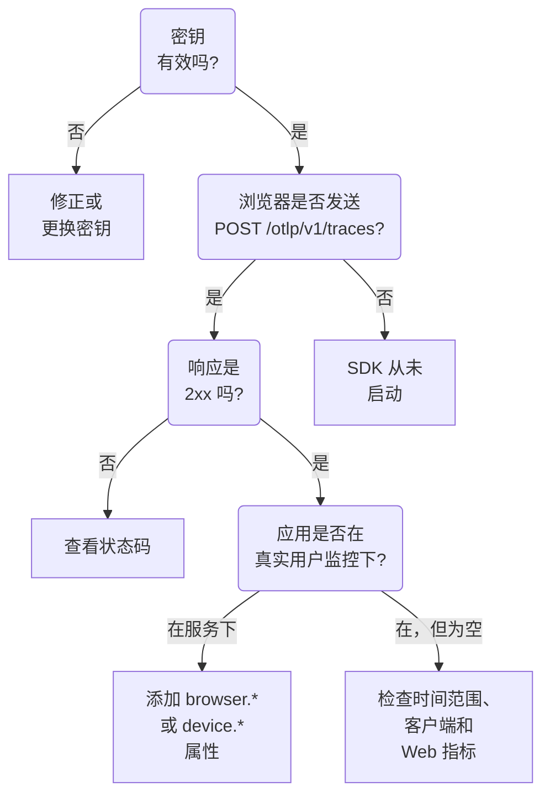

# RUM 故障排除

当 RUM 应用程序缺失、为空或显示 **已断开** 时，请按顺序逐项检查本页。每项检查都会排除从你的应用到 OneUptime 这条路径中的一段，顺序与这些问题通常出现的顺序一致。

:::cards
- [检查密钥](#检查密钥): 最快的检查，之后的一切都依赖于它。
- [检查离开浏览器的内容](#检查离开浏览器的内容): 在浏览器开发者工具中查看导出请求。
- [检查遥测数据落在哪里](#检查遥测数据落在哪里): RUM 应用程序，还是后端服务。
- [会话回放问题](#会话回放问题): 一条独立的管道，有自己的页面。
:::

## RUM 遥测在哪里中断

遥测数据在到达 RUM 应用程序的途中要经过三项检查。找出第一个失败的检查：



## 检查密钥

先检查密钥。这是最快的检查，没有 OneUptime 接受的密钥，之后的一切都无法工作：

```bash
curl -i https://oneuptime.com/otlp/v1/validate \
  -H "x-oneuptime-token: YOUR_TELEMETRY_INGESTION_TOKEN"
```

| 响应 | 含义 |
| --- | --- |
| `200` 且 `"valid": true` | OneUptime 接受该密钥。响应中还会给出它的 `keyType` 和 `projectId` 。继续下一项检查。 |
| `401` 且 `"valid": false` | 密钥缺失、未知、已吊销、已关闭或已过期， `message` 会说明是哪一种。在 **项目设置 → 遥测与 APM → 摄取密钥** 下创建一个有效的密钥。 |

Web 应用需要 **浏览器** 密钥，移动应用需要 **服务器** 密钥：参见 [浏览器端设置](/docs/rum/browser-setup) 和 [移动端设置](/docs/rum/mobile-setup) 。导出端点也会按 OTLP 规范的要求以 `401` 拒绝错误的密钥，因此行为良好的 SDK 会记录这次拒绝，而不是重试。这一行在浏览器控制台中很容易被忽略，而这项检查会直接给出答案。

## 检查离开浏览器的内容

在应用页面上打开浏览器的开发者工具，选择 Network 选项卡并按 `otlp` 过滤。你要找的是以 `2xx` 状态响应的 `POST /otlp/v1/traces` 。

### 完全没有请求

SDK 从未启动。几乎总是以下原因之一：

- `telemetry.ts` 不是你的应用的第一个导入，或者打包工具把它丢掉了。插桩会修补 `fetch` 和 `XMLHttpRequest` ，因此在修补之前发出的请求不会被追踪，而被打包工具移除的文件根本不会运行。
- 批处理器还没有导出。 `BatchSpanProcessor` 会等待几秒钟来填满一个批次，所以在断定没有发送任何内容之前，请等待一下，或切换到另一个页面。
- 某个构建时环境变量变成了 `undefined` ，导致导出器的 URL 损坏。在启动时把 URL 记录一次日志。

### 浏览器阻止了请求

- **控制台中出现 Content Security Policy 错误。** 页面的策略尚未允许 OneUptime。把它添加到你现有的 `connect-src` 指令中，如果你自己运行 OneUptime，则使用你自己的主机：

  ```text
  connect-src 'self' https://oneuptime.com;
  ```

- **CORS 错误。** OTLP 端点接受来自任何来源的请求，并允许 `x-oneuptime-token` 标头，因此真正的 CORS 失败几乎总是意味着请求根本没有到达 OneUptime：检查公司代理、广告拦截器或主机名拼写错误。在 Network 选项卡中检查请求的 URL。

### 请求收到错误状态

**`401`.** 密钥未知、已吊销或已过期。运行 [密钥检查](#检查密钥) ，然后使用有效的密钥。

**`404`.** URL 错误。追踪导出器需要完整路径 `/otlp/v1/traces` 。常见的错误是把基础地址（ `https://oneuptime.com/otlp` ）交给期望完整 URL 的导出器，或者把完整 URL 交给会自行添加路径的导出器，结果请求到了 `/otlp/v1/traces/v1/traces` 。

**`413`.** 批次大于代理允许的大小。OneUptime 自身的入口在 `/otlp` 上最多接受 4 MB，但你放在 OneUptime 前面的代理可能更严格 — 例如 ingress-nginx 默认将 `proxy-body-size` 设为 1 MB — 所以如果你有这样的代理，也要提高它在 `/otlp` 上的上限。无论哪种情况，在 `BatchSpanProcessor` 上设置更小的 `maxExportBatchSize` 都会让每次导出变小：

```ts
new BatchSpanProcessor(exporter, { maxExportBatchSize: 100 });
```

除非 span 携带了很大的属性，例如整段堆栈跟踪或响应正文，浏览器很少发送这么大的批次。精简这些属性是更好的解决办法。

**`422`.** OneUptime 在这里拒绝了该密钥，消息会说明原因。 `Origin https://app.example.com is not allowed for this browser ingestion key.` 表示页面的确切来源（包括协议和端口，如果有）不在该密钥的 **允许的来源** 中。 `This telemetry ingestion key has been disabled.` 表示有人关闭了该密钥。

**`429`.** 该密钥的 **Requests Per Minute Limit** 已用完： `Too many telemetry requests for this ingestion key. Please retry later.` 除非你在密钥上设置了自己的上限，否则 Browser 密钥对你所有访客合计每分钟允许 6000 个请求。

**带有 HTML 页面或空正文的 `403`。** OneUptime 对每次拒绝都以 JSON 响应，所以这个响应来自它前面的某个东西，通常是你自己域名上的 Web 应用防火墙（如果你通过它代理 OneUptime）。防火墙会解析 OTLP/JSON，并用它的注入规则检查每个 span 属性，因此 span 上一个带查询字符串的 URL 就足以被拦截，防火墙的日志会写明是哪条规则。仅在 OTLP 路径上将 OTLP 负载排除在检查之外： [你的 OpenTelemetry 请求也被阻止了](/docs/rum/session-replay-troubleshooting#你的-opentelemetry-请求也被阻止了) 说明了做法，也涵盖了位于同一防火墙后面的回放录制器。

## 检查遥测数据落在哪里

请求成功了，但应用出现在 **产品 → 服务** 下，而不是 **产品 → 资源 → 真实用户监控** 下。这是最常见的问题，原因几乎总是资源上没有客户端属性。只有当一批数据的资源带有以下属性之一时，OneUptime 才会将其归为 RUM：

| 类型 | 属性 |
| --- | --- |
| 浏览器 | `browser.platform` 、 `browser.language` ，或非空的 `browser.brands` |
| 移动端 | `device.id` 或 `device.model.identifier` ，或者在没有主机标识（ `host.name` 、 `host.id` 或 `k8s.node.name` ）的资源上的 `device.manufacturer` |

仅有 `service.name` 会成为后端服务。OpenTelemetry 浏览器 SDK 不会添加任何 `browser.*` 属性，除非你添加浏览器资源检测器或自己设置它们：参见 [浏览器端设置](/docs/rum/browser-setup) 。

要查看你实际发送了什么，在 Network 选项卡中打开 OTLP 请求并查看其负载：起决定作用的是 `resourceSpans[0].resource.attributes` 列表。如果里面没有 `browser.*` 属性，那么无论文档怎么说，SDK 都没有添加它。

添加这些属性后，下一批数据就会创建 RUM 应用程序。最先创建的服务不会变成 RUM 应用程序，因为二者是独立的记录，所以在 RUM 遥测到达后，请在 **产品 → 服务** 下删除它。

> [!NOTE]
> 如果资源唯一的客户端属性是 `device.manufacturer` ，而它同时还有主机标识，那么它会被当作一台机器而不是手机，因为主机的清单也用同一个属性上报其制造商。添加 `device.id` 或 `device.model.identifier` ，无论这批数据还携带了什么，都会被归为移动端 RUM。

## 应用程序为空

应用程序存在，但其页面没有显示任何内容。

- **检查时间范围。** 概览默认显示过去一小时，因此今天早上发送的测试批次不在范围内。
- **等待几分钟。** 摄取是排队进行的，而 **最后一次出现** 每隔几分钟刷新一次，而不是每批数据都刷新。
- **检查项目。** 密钥写入它自己的项目，因此用另一个项目的密钥发送的遥测数据在那个项目里，而不在这里。

## 客户端页面为空

**客户端** 页面在 Web 上列出 `browser.platform` ，在移动端列出 `device.model.identifier` 。在其他一切都正常时它仍为空，有两个原因：

- **Safari 和 Firefox。** `browserDetector` 读取 UA Client Hints API，而只有基于 Chromium 的浏览器才有这个 API。在其他浏览器中，它会设置 `browser.language` ，这足以将遥测归为 RUM，但不会设置 `browser.platform` 。要列出这些客户端，请自己设置 `browser.platform` 。
- **只设置 `device.manufacturer` 的移动端 SDK。** 这会把遥测归为移动端 RUM，但 **客户端** 页面需要 `device.model.identifier` 。

## 核心 Web 指标显示“No web vitals reported yet”

这张卡片只由你的应用发送的指标填充，所以仅有追踪永远填不满它。检查你是否导出了指标、指标名称是否是 OneUptime 读取的名称，以及它们是否出现在应用程序的 **指标** 页面上。 [卡片显示“No web vitals reported yet”](/docs/rum/web-vitals#故障排除) 逐一介绍了每项检查，包括访客在下一次导出前关闭选项卡而丢失的值。

## 有人在使用应用，但状态显示已断开

应用程序在 15 分钟没有遥测数据后会变为 **已断开** 。如果有人正在使用该应用：

- **采样器可能丢弃了所有数据。** 检查你没有设置始终关闭的采样器或非常低的比例。
- **应用可能只在某些交互时发送遥测**，而这段时间内没有人进行这些交互。
- **密钥可能在部署后被吊销或关闭**：再次运行 [密钥检查](#检查密钥) 。

夜间没有访客的内部应用或低流量应用确实处于断开状态。这并不是故障。

## 会话回放问题

会话回放是一条独立的管道，有它自己的问题：录制器脚本、来源允许列表、同意、Content Security Policy 和遮盖。 [会话回放故障排除](/docs/rum/session-replay-troubleshooting) 涵盖了这些问题。从那里开始，并且先开启录制器的诊断，因为它的大多数失败都是有意静默的：

```js
localStorage.setItem("oneuptime.sessionReplay.debug", "true");
// then reload the page
```

应用程序 **会话回放** 部分中的 **健康状况** 页面，以及 **Replay Policy** 上的 **Test your installation** 面板，会从服务器端检查密钥、允许列表和策略，并说明为什么没有数据到达。浏览器控制台则告诉你服务器看不到的那一半。

在默认策略下，用户与页面交互时，录制器大约每 15 秒发送一个分块。空闲的选项卡没有东西可发送，所以先点击或移动鼠标；如果之后仍然完全没有分块请求，那就是出了问题。如果应用程序只在 _On error or frustration_ 时上传，那么在出问题之前保持静默是正常的。调用 `OneUptimeReplay.captureSession()` 强制上传，无论哪种情况都能验证这条路径。

这两条管道是相互独立的。录制器加载并不需要一个正常工作的 RUM 应用程序，而录制器正常工作也不意味着 RUM 遥测正在到达：二者都可能单独失败。

## 仍然无法解决？

在寻求帮助之前收集以下信息。这样可以省去一轮往返沟通：

- 一个真实 OTLP 请求负载中的 `resource.attributes` 列表。
- 该请求的 HTTP 状态。
- 你发送的确切 `service.name` ，以及项目中是否有该名称的应用程序或服务。
- 对于已部署构建中的密钥， `/otlp/v1/validate` 是否返回 `200` 。

然后联系 support@oneuptime.com，或在 [GitHub](https://github.com/OneUptime/oneuptime) 上提交 issue。

## 后续步骤

:::cards
- [浏览器端设置](/docs/rum/browser-setup): 这些检查所依据的设置，逐步说明。
- [移动端设置](/docs/rum/mobile-setup): 移动应用需要的密钥和属性。
- [管理应用程序](/docs/rum/applications): 名称、标签、保留和状态。
- [会话回放故障排除](/docs/rum/session-replay-troubleshooting): 录制器的每个代码，以及如何处理。
:::
