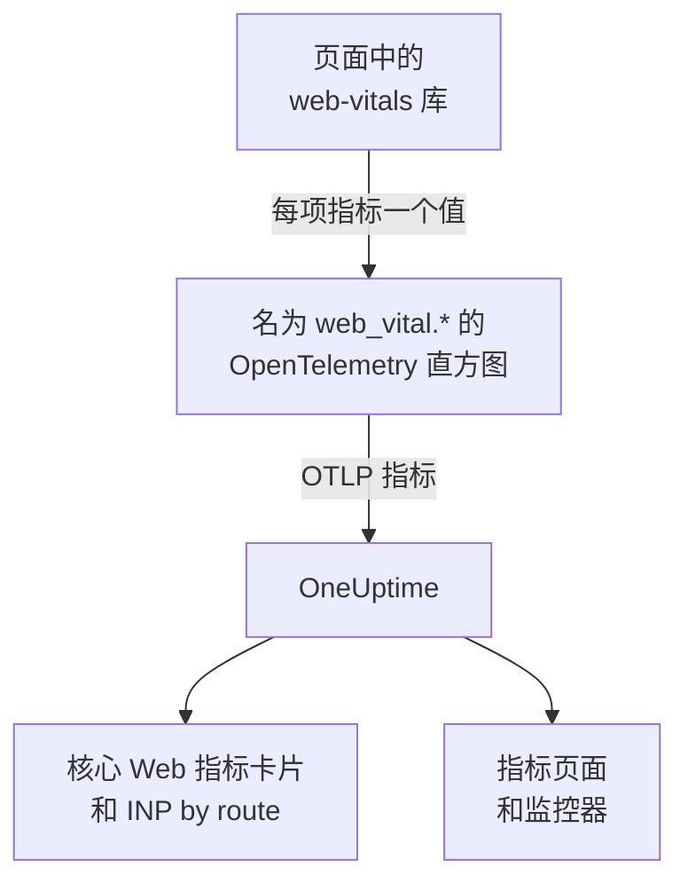
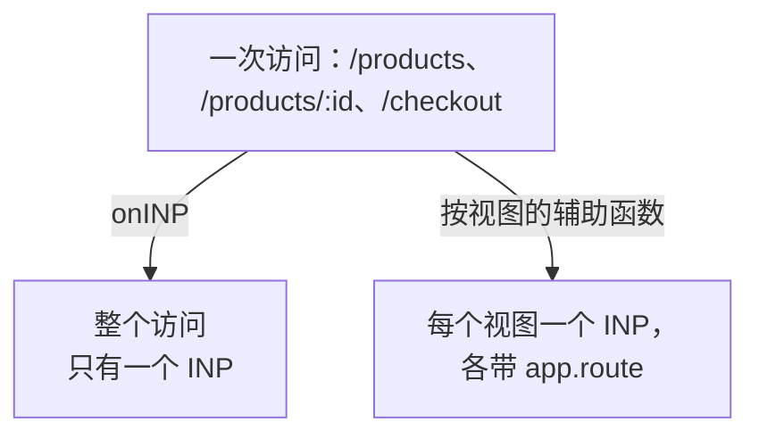

# 核心 Web 指标

RUM 应用程序概览上的 **核心 Web 指标** 卡片显示 LCP、INP、CLS、FCP 和 TTFB，每项都按 Google 的阈值评级。OneUptime 自身不测量其中任何一项：卡片只由你的浏览器插桩上报的指标填充，本页介绍如何发送这些指标。

:::cards
- [发送指标](#从应用发送指标): 将 web-vitals 库的值作为 OpenTelemetry 指标转发。
- [OneUptime 读取的名称](#oneuptime-识别的指标名称): 每项指标可能使用的指标名称。
- [单页应用](#单页应用): 每个视图一个 INP，而不是每次页面加载一个值。
- [针对指标告警](#针对指标告警): 针对较差指标的现成监控器。
:::

## 工作原理

[`web-vitals`](https://github.com/GoogleChrome/web-vitals) 库在页面中测量每项指标，Chrome 自己的工具也使用这个库。你的代码把每个值记录到一个 OpenTelemetry 直方图上，浏览器的指标管道再把它导出到 OneUptime。



OpenTelemetry 还没有关于 web vitals 命名的最终约定，因此 OneUptime 会以多个名称查找每项指标，并使用第一个有数据的名称。新的插桩请使用 `web_vital.*` 名称。

## 开始之前

- 一个按照 [浏览器端设置](/docs/rum/browser-setup) 设置好、带有指标管道的 Web 应用：导出这些值的是 [添加日志和指标](/docs/rum/browser-setup#添加日志和指标) 中的 `MeterProvider` 。

## 从应用发送指标

:::steps
### 安装库

```bash
npm install web-vitals
```

### 将每项指标记录到直方图上

创建 `src/web-vitals.ts` 。每项指标都是一个直方图，这样 **指标** 页面之后就能计算百分位数；桶边界设在 Google 的良好和较差阈值上。

```ts title="src/web-vitals.ts"
// Import after ./telemetry
import { metrics } from "@opentelemetry/api";
import { onCLS, onFCP, onINP, onLCP, onTTFB, type Metric } from "web-vitals";

const meter = metrics.getMeter("web-vitals");

// Histograms, so the Metrics tab can compute percentiles later. The bucket
// edges sit on each vital's good / poor limits: a percentile is read from
// the buckets, and the defaults are far too coarse for these ranges.
const buckets = (...edges: number[]) => ({ advice: { explicitBucketBoundaries: edges } });

const lcp = meter.createHistogram("web_vital.lcp", { unit: "ms", ...buckets(0, 1000, 1500, 2000, 2500, 3000, 3500, 4000, 5000, 7500, 10000) });
const inp = meter.createHistogram("web_vital.inp", { unit: "ms", ...buckets(0, 50, 100, 150, 200, 250, 300, 400, 500, 750, 1000, 2000) });
const fcp = meter.createHistogram("web_vital.fcp", { unit: "ms", ...buckets(0, 600, 1200, 1800, 2400, 3000, 4000, 6000, 10000) });
const ttfb = meter.createHistogram("web_vital.ttfb", { unit: "ms", ...buckets(0, 200, 400, 600, 800, 1200, 1800, 2500, 4000) });
const cls = meter.createHistogram("web_vital.cls", { unit: "1", ...buckets(0, 0.025, 0.05, 0.1, 0.15, 0.2, 0.25, 0.4, 0.6, 1) });

function record(
  histogram: { record: (v: number, a?: Record<string, string>) => void },
) {
  return (metric: Metric): void => {
    histogram.record(metric.value, {
      // Keep attributes low-cardinality. Never put a full URL or a user id here.
      "web_vital.rating": metric.rating,
    });
  };
}

onLCP(record(lcp));
onINP(record(inp));
onCLS(record(cls));
onFCP(record(fcp));
onTTFB(record(ttfb));
```

### 在遥测设置之后导入它

```ts
import "./telemetry";
import "./web-vitals";
```

### 检查指标页面

加载几个页面，然后在应用程序的 **指标** 页面上搜索 `web_vital.lcp` 。指标出现后， **核心 Web 指标** 卡片就会按你选择的时间范围填充。
:::

## 在页面关闭前发送最后的值

`onINP` 和 `onCLS` 在页面被隐藏时上报，而不是在访问过程中。使用 [浏览器端设置](/docs/rum/browser-setup) 中 30 秒的导出间隔时，在最后一个值之后立即关闭标签页的访问者可能在它被导出前就离开了。如果完整性很重要，请缩短 `exportIntervalMillis` ，或保留你在 `telemetry.ts` 中构建的 `MeterProvider` ，并在页面隐藏时刷新它：

```ts
// In telemetry.ts, export the provider you created:
export const meterProvider = new MeterProvider({ /* ... */ });

// Anywhere after setup:
import { meterProvider } from "./telemetry";

document.addEventListener("visibilitychange", () => {
  if (document.visibilityState === "hidden") {
    void meterProvider.forceFlush();
  }
});
```

## OneUptime 识别的指标名称

OneUptime 按此顺序尝试这些名称，所选时间范围内第一个有数据的名称胜出。

| 指标 | 指标名称（任选其一） | 单位 |
| --- | --- | --- |
| LCP: Largest Contentful Paint | `web_vital.lcp`, `browser.largest_contentful_paint`, `largest_contentful_paint`, `web.vitals.lcp` | 毫秒 |
| INP: Interaction to Next Paint | `web_vital.inp`, `browser.interaction_to_next_paint`, `interaction_to_next_paint`, `web.vitals.inp` | 毫秒 |
| CLS: Cumulative Layout Shift | `web_vital.cls`, `browser.cumulative_layout_shift`, `cumulative_layout_shift`, `web.vitals.cls` | 分数 |
| FCP: First Contentful Paint | `web_vital.fcp`, `browser.first_contentful_paint`, `first_contentful_paint`, `web.vitals.fcp` | 毫秒 |
| TTFB: Time to First Byte | `web_vital.ttfb`, `browser.time_to_first_byte`, `time_to_first_byte`, `web.vitals.ttfb` | 毫秒 |

其他名称的存在，是为了让已经按社区约定发送数据的应用无需修改就能显示出来。

## 评级阈值

卡片按 Google 公布的核心 Web 指标阈值为每个值评级：

| 指标 | **Good** | **Needs work** | **Poor** |
| --- | --- | --- | --- |
| LCP | 低于 2500 毫秒 | 2500 到 4000 毫秒 | 4000 毫秒及以上 |
| INP | 低于 200 毫秒 | 200 到 500 毫秒 | 500 毫秒及以上 |
| CLS | 低于 0.1 | 0.1 到 0.25 | 0.25 及以上 |
| FCP | 低于 1800 毫秒 | 1800 到 3000 毫秒 | 3000 毫秒及以上 |
| TTFB | 低于 800 毫秒 | 800 到 1800 毫秒 | 1800 毫秒及以上 |

卡片显示所选时间范围内的 **平均值** ，而不是 Google 现场工具上报的第 75 百分位数。这是有意为之：OneUptime 从直方图的桶中读取百分位数，因此百分位数的精度取决于桶，而平均值来自直方图精确的总和与计数。使用 OpenTelemetry 的默认桶（ `0, 5, 10, 25, 50, …` ）时，每个 CLS 值都落在第一个桶里，一个几乎不发生位移的页面的第 75 百分位数也会显示为 2.5。

> [!TIP]
> 把卡片当作趋势来看。要查看第 75 百分位数，请使用上面的桶边界记录，然后在 **指标** 页面上用 **P75** 聚合绘制该指标。指标监控器也提供同样的选项。

## 单页应用

`onINP` 按浏览器的定义测量 INP： **每次页面加载一个值** 。单页应用只加载一次，之后通过 `history.pushState` 切换路由，因此一次依次访问 `/products` 、 `/products/42` 和 `/checkout` 的访问，整个过程只产生一个 INP。每个视图的交互都在争夺这一个数字，而附在它上面的路由属性指向的是上报时正在显示的页面，而不是变慢的那个页面。



要按视图查看 INP，就要按视图测量：每次路由切换都会结束当前视图并开始一个新视图，每个视图上报自己的 INP。下面的辅助函数借助浏览器的 Event Timing API（ `onINP` 使用的也是这些数据）来做到这一点，并处理了容易出错的部分： **引发** 导航的那次点击在路由已经切换之后才送达，但它属于被点击的那个页面。

```ts title="src/inp-per-route.ts"
// INP for each view of a single-page app.
type Report = (inpMs: number, route: string) => void;

interface View {
  route: string;
  path: string; // the URL path it was opened for
  start: number; // performance.now() when the view began
  latencies: Map<number, number>; // interactionId -> its slowest entry
}

// Long enough for the click that navigated to be delivered: its entry
// arrives after the next paint, i.e. after the route has changed.
const SETTLE_MS = 1000;

let views: Array<View> = [];
let report: Report = () => {};

// The path, plus the hash when a hash router keeps the route there.
const currentPath = (): string =>
  location.pathname + (location.hash.startsWith("#/") ? location.hash : "");

function close(view: View): void {
  if (!views.includes(view)) return; // already reported
  views = views.filter((v) => v !== view);

  const sorted = [...view.latencies.values()].sort((a, b) => b - a);
  if (sorted.length === 0) return; // nobody interacted: no INP, not 0

  // web-vitals' p98: skip one outlier for every 50 interactions.
  report(sorted[Math.min(sorted.length - 1, Math.floor(sorted.length / 50))]!, view.route);
}

function record(entries: PerformanceEntryList): void {
  for (const entry of entries as Array<PerformanceEventTiming & { interactionId?: number }>) {
    if (!entry.interactionId) continue; // hovers, scrolls: not interactions

    // The view the interaction STARTED in, so the click that navigated
    // counts towards the page it was clicked on.
    const view = [...views].reverse().find((v) => entry.startTime >= v.start);
    if (!view) continue;

    const slowest = view.latencies.get(entry.interactionId) ?? 0;
    view.latencies.set(entry.interactionId, Math.max(slowest, entry.duration));
  }
}

export function observeInpPerRoute(route: string, onReport: Report): void {
  if (typeof PerformanceObserver === "undefined" || !PerformanceObserver.supportedEntryTypes?.includes("event")) return;

  report = onReport;
  views = [{ route, path: currentPath(), start: 0, latencies: new Map() }];

  const observer = new PerformanceObserver((list) => record(list.getEntries()));
  observer.observe({ type: "event", durationThreshold: 40, buffered: true } as PerformanceObserverInit);

  // The tab may never come back: report every view now, then keep
  // measuring the current route as a fresh view.
  document.addEventListener("visibilitychange", () => {
    if (document.visibilityState !== "hidden") return;
    record(observer.takeRecords());
    const current = views[views.length - 1]?.route ?? route;
    [...views].forEach(close);
    views = [{ route: current, path: currentPath(), start: performance.now(), latencies: new Map() }];
  });
}

// Call after every navigation, with the route PATTERN ("/products/:id").
// Safe to call when nothing changed (a router's initial navigation, a
// query-string update): the view only ends when the path does.
export function startView(route: string): void {
  const closing = views[views.length - 1];
  if (!closing || closing.path === currentPath()) return;

  views.push({ route, path: currentPath(), start: performance.now(), latencies: new Map() });
  setTimeout(() => close(closing), SETTLE_MS);
}
```

两个函数都接收路由 **模式** ，而不是 URL： `/products/42` 和 `/products/7` 必须是同一个路由，否则每个商品都会成为一个单独的序列。路由器有模式时就用它；否则请自己合并 ID：

```ts
// "/products/42" -> "/products/:id", also for UUIDs.
export const toRoutePattern = (path: string): string =>
  path.replace(/\/(\d+|[0-9a-f]{8}-[0-9a-f-]{27})(?=\/|$)/gi, "/:id");
```

把辅助函数上报的值记录到同一个 `web_vital.inp` 直方图上，以 `app.route` 作为路由，并从上面的代码片段中 **去掉 `onINP`** ：两者都保留会让每次交互被计算两次。

```ts
// src/web-vitals.ts, in place of onINP(record(inp))
import { observeInpPerRoute } from "./inp-per-route";

observeInpPerRoute(toRoutePattern(location.pathname), (inpMs, route) => {
  inp.record(inpMs, {
    "app.route": route,
    "web_vital.rating": inpMs <= 200 ? "good" : inpMs <= 500 ? "needs-improvement" : "poor",
  });
});
```

然后在路由器宣布导航完成的地方调用 `startView` 。URL 路径没有变化时它会忽略调用，因此即使路由器也上报首次加载或查询字符串更新，视图也不会被拆分：

:::tabs
@tab Vue Router
```ts
router.afterEach((to) => startView(to.matched[to.matched.length - 1]?.path ?? toRoutePattern(to.path)));
```
@tab React Router
```tsx
// In a component that stays mounted inside the router
const { pathname } = useLocation();
useEffect(() => startView(toRoutePattern(pathname)), [pathname]);
```
:::

你会得到：

- 概览上的 **INP by route** ，按 `app.route` 从最慢开始排列；OneUptime 也会读取 OpenTelemetry 的 `url.template` 。
- 用于告警的路由过滤器：在指标监控器中按 `app.route` 过滤 `web_vital.inp` ，即可单独监视一个流程，例如 `/checkout` 。
- **核心 Web 指标** 卡片上的全应用 INP 照常工作：它还是同一个指标，只是现在每个视图一个值，而不是每次页面加载一个。

Chromium 浏览器会上报这项功能所需的交互 ID。Safari 不上报，这也是 `onINP` 在那里什么都不上报的原因。Chrome 的实验性 Soft Navigations API 旨在原生实现这一点，但尚未全面推出；这个辅助函数现在就能用。

> [!NOTE]
> [会话回放](/docs/telemetry/session-replay) 录制器已经无需任何代码就能按视图测量 INP：每段录制都会为用户交互过的每个路由显示一行 INP，包括慢的元素，以及其耗时在输入延迟、处理和呈现之间如何分配。

## 控制基数

指标属性会相乘。 `web_vital.rating` 有三个可能的值，这没有问题，路由或页面类型属性通常也值得添加：

```ts
histogram.record(metric.value, {
  "web_vital.rating": metric.rating,
  "app.route": routePattern, // "/product/:id" — the PATTERN, not "/product/8842"
});
```

记录具体的 URL 而不是路由模式，会为每个商品页面创建一个时间序列，使 **指标** 页面变慢，存储费用变高。用户 ID、会话 ID 和屏幕尺寸也是如此。

## 针对指标告警

应用程序的 **Recommendations** 页面为每项指标提供一个现成的监控器。每个监控器读取其指标的五分钟平均值，并在达到 Google 的较差阈值时触发：

| 推荐 | 指标 | 触发值 | 严重程度 |
| --- | --- | --- | --- |
| **Poor Largest Contentful Paint** | `web_vital.lcp` | 4000 毫秒 | **严重** |
| **Poor Interaction to Next Paint** | `web_vital.inp` | 500 毫秒 | **严重** |
| **Poor Cumulative Layout Shift** | `web_vital.cls` | 0.25 | **严重** |
| **Slow First Contentful Paint** | `web_vital.fcp` | 3000 毫秒 | **Warning** |
| **Slow Time to First Byte** | `web_vital.ttfb` | 1800 毫秒 | **Warning** |

这些监控器只读取 `web_vital.*` 名称。如果你的应用以其他名称发送某项指标，请编辑所创建监控器的指标。要针对单个路由告警，请为监控器添加 `app.route` 过滤器。你也可以基于这些指标中的任何一个构建自己的监控器：参见 [指标监控](/docs/monitor/metrics-monitor) 。

## 故障排除

:::details 卡片显示“No web vitals reported yet”
卡片只由你的应用发送的指标填充。请按顺序检查：

1. 你到底有没有指标管道：仅有追踪永远填不满这张卡片。
2. 指标名称是否是 OneUptime 读取的名称：参见 [OneUptime 识别的指标名称](#oneuptime-识别的指标名称) 。
3. 指标是否出现在应用程序的 **指标** 页面上。如果有，说明导出正常，问题出在名称或时间范围上。
4. INP 和 CLS 在页面隐藏时上报，因此一次短暂的访问可能在下一次导出之前就结束了：参见 [在页面关闭前发送最后的值](#在页面关闭前发送最后的值) 。

如果这些都没有帮助， [RUM 故障排除](/docs/rum/troubleshooting) 会检查整个管道。
:::

:::details INP 有上报，但不是按路由
**INP by route** 卡片需要 `web_vital.inp` 上带有 `app.route` 属性或 `url.template` 。请按照 [单页应用](#单页应用) 为每个值记录路由模式。
:::

:::details 数值与 Google 的报告不同
卡片显示你所选时间范围内的平均值，而 Google 上报的是其自身访问者的第 75 百分位数。在 **指标** 页面上绘制 **P75** ，才能进行同类比较。
:::

## 后续步骤

:::cards
- [浏览器端设置](/docs/rum/browser-setup): 承载这些指标的追踪、日志和指标管道。
- [指标监控](/docs/monitor/metrics-monitor): 针对任何指标告警，可以面向整个应用或单个路由。
- [会话回放](/docs/telemetry/session-replay): 无需代码，在录制中按视图查看 INP。
- [RUM 故障排除](/docs/rum/troubleshooting): 按问题通常发生的顺序列出的所有检查。
:::
