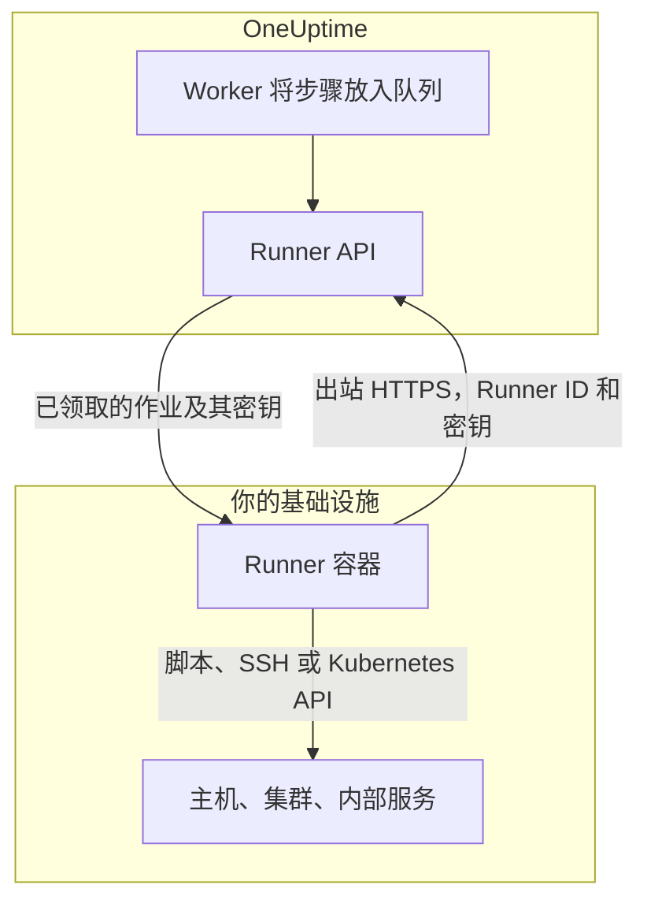
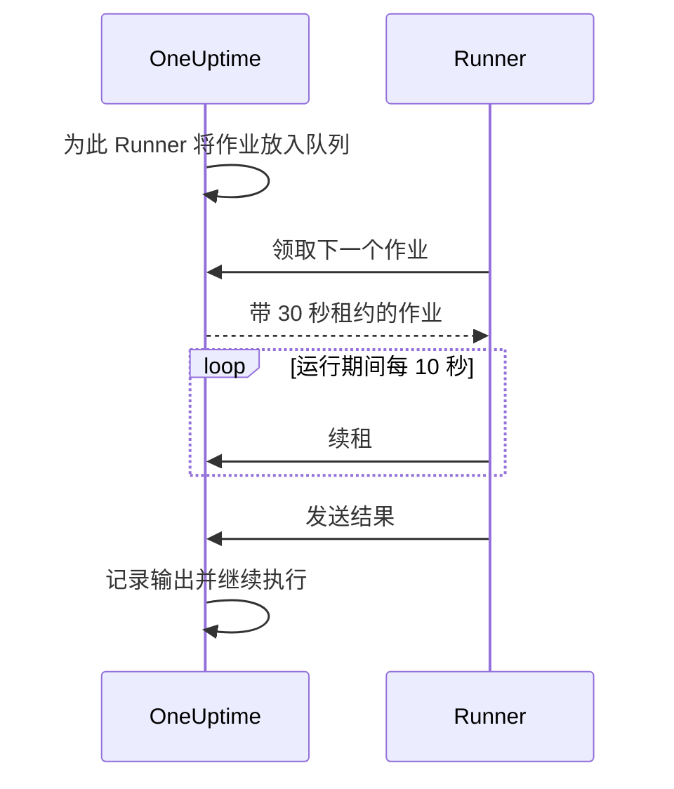

# Runbook 代理

**Runbook 代理** 在仪表板中称为 **Runner** ，是一个小型的自托管进程，它 **在你自己的基础设施中** 运行 Runbook 的 JavaScript、Bash、SSH 和 kubectl 步骤。OneUptime Worker 从不运行你的脚本：它把脚本放入队列，由步骤作者选择的 Runner 领取每个作业、运行它并发回结果。本页面向安装和运维 Runner 的人员。 未选择 Runner 的步骤在你设置的 [项目默认 Runner](#项目默认-runner) 上运行；如果没有设置，JavaScript 步骤会在 [全局 Runner](#全局-runner) 上运行，即 OneUptime 为所有项目运行的 Runner。

:::cards
- [安装 Runner](#安装-runner): 五步完成，从仪表板到已连接的容器。
- [为步骤指定 Runner](#为步骤指定-runner): 把步骤绑定到应运行它的 Runner。
- [项目默认 Runner](#项目默认-runner): 未选择 Runner 的步骤和代码存储库运行所在的 Runner。
- [全局 Runner](#全局-runner): OneUptime 为所有项目运行的 Runner，以及它们运行什么。
- [超时](#超时): 领取超时和执行超时，以及两者如何配合。
- [环境变量](#环境变量): 容器启动时读取的内容。
:::

## 工作原理



1. 你在 OneUptime 中创建一个 Runner。OneUptime 为它生成一个 ID 和一个密钥。
2. 你在自己基础设施中的一台主机上运行 Runner 容器，并提供该 ID、密钥和你的 OneUptime URL。
3. Runner 每 5 秒向 OneUptime 请求一次工作，每 60 秒报告一次自己仍在运行。
4. 编写 JavaScript、Bash、SSH 或 kubectl 步骤时，你从步骤 **更多字段** 中的下拉列表选择 Runner。步骤会绑定到该 Runner。 未选择 Runner 的步骤会在你设置的项目默认 Runner 上运行；如果没有设置，JavaScript 步骤会在 **全局 Runner** 上运行。
5. 步骤运行时，Worker 会把一个 `targetAgentId` 设置为该 Runner 的作业放入队列。只有该 Runner 能领取它。
6. Runner 在本地运行该任务（Bash 和 kubectl 使用 `bash -c <script>`，JavaScript 使用 `isolated-vm` 沙箱，SSH 使用在机器上用 bash 运行脚本的 SSH 连接），记录结果，隐藏其中步骤的机密，然后回传。Worker 用该结果继续运行 Runbook。

Runner 只需要到你的 OneUptime 实例的 **出站 HTTPS** 。它不接受任何入站连接。

Runner 只保存自己的 ID 和密钥。其余一切都随它领取的任务一起收到：已填入其引用的 [Runbook 变量](/docs/runbooks/variables) 的脚本，以及 SSH 步骤的密钥或密码，或 kubectl 步骤的 kubeconfig。只有当机密允许时，它才会收到该机密。因此任何持有 Runner 密钥的人都能以该 Runner 的身份行事：请像对待它可以使用的机密一样对待这个密钥。

## 为什么脚本在 Runner 上运行

在 OneUptime Worker 上运行脚本有两个问题：

- **信任边界。** 任何能编写 Runbook 的人都能在 Worker 上运行代码，并访问 Worker 能访问的一切。
- **可达范围。** 大多数有用的步骤作用于 _你的_ 基础设施（“重启这个服务”“在我们的内部数据库中查一条记录”），而不是 OneUptime 的。

有了 Runner，这些步骤在你掌控的主机上运行，由你决定这台主机可以做什么。HTTP 请求和 AI 步骤仍在 Worker 上运行，因为它们不需要你网络中的任何东西。

## 全局 Runner

全局 Runner 是 OneUptime 为所有项目运行的 Runner。未选择自己 Runner 的 JavaScript 步骤会在其中一个上运行（除非项目有 [默认 Runner](#项目默认-runner) ），因此你可以在安装任何东西之前就编写它。 **运行手册 → Runbook 代理** 在 **全局 Runner** 下列出它们，位于你自己的 Runner 上方；JavaScript 步骤的 **Runner** 下拉列表会首先提供 **全局 Runner** ，或紧跟在项目默认 Runner 之后提供。 Bash、SSH 或 kubectl 步骤的下拉列表把它灰显在最后，并显示 **仅运行 JavaScript 步骤。** 这些步骤在你自己网络内的 Runner 上运行，绝不会在所有项目共享的 Runner 上运行。

| | 全局 Runner | 你自己的 Runner |
| --- | --- | --- |
| 运行的步骤 | JavaScript | JavaScript、Bash、SSH 和 kubectl |
| 步骤可以访问的地址 | 公共互联网地址 | 其主机可以访问的地址 |
| 步骤的最长运行时间 | 5 分钟 | 1 小时 |
| 机密变量 | 你允许全局 Runner 使用的那些 | 列出了它的那些 |
| OneUptime AI 的 Bash 命令 | 从不运行 | 选择它的 AI 规则的命令 |

全局 Runner 运行许多项目的步骤，因此每个步骤都与其他所有步骤相互隔离：

- 每个步骤都在自己的 `isolated-vm` 沙箱中运行，该沙箱为这个步骤创建，并在步骤结束后丢弃：没有文件、没有进程、没有环境变量，也不会从一个步骤保留任何东西到下一个步骤。
- 它的 HTTP 请求只能到达公共互联网地址，绝不会到达私有地址、环回地址、链路本地地址或云元数据端点，因此全局 Runner 永远无法访问你的网络。
- 只有当机密变量的 **全局 Runner 可以使用** 开关开启时，它才会收到该变量，而且只用于该变量所属项目的步骤。
- 一个项目在全局 Runner 上同时最多运行三个步骤，因此没有项目能独占它们。

对于需要访问你的网络的步骤，或者要让步骤留在你掌控的主机上，请为它选择你自己的 Runner。要让每个步骤都在你自己的 Runner 上运行，请在 **运行手册 → Runbook 代理** 底部关闭 **使用全局 Runner** 。之后，未选择 Runner 的 JavaScript 步骤会在项目默认 Runner 上运行；如果没有设置默认 Runner，它会失败并说明原因，直到它选择你的某个 Runner；选择了你的某个 Runner 的步骤无论如何都会保留它。在代码的设置中没有选择 Runner 的代码存储库同样在项目默认 Runner 上工作，没有设置默认 Runner 时在全局 Runner 上工作，而在关闭该开关时需要你的某个 Runner；参见 [代码](/docs/ai/ai-agent#选择存储库的-runner)。

### 全局 Runner 从哪里来

在 OneUptime Cloud 上，由 OneUptime 运行它们。自托管安装默认运行一个自己的全局 Runner，就像它运行自己的全局探针一样：Docker Compose 中的 `global-runner` 服务，以及 Helm chart 中的 `globalRunner` 部署。它持有自己的密钥 `GLOBAL_RUNNER_KEY`，不持有服务器的任何其他东西。

主管理员可以添加更多全局 Runner，以便从其他主机运行步骤：在 Admin Dashboard 中依次打开 **设置** 、 **全局 Runner** ，创建一个，然后在可以访问互联网的主机上运行其 **显示 ID 和密钥** 给出的命令。

要关闭内置的全局 Runner，请在 Docker Compose 的 `config.env` 中设置 `GLOBAL_RUNNER_REPLICAS=0`，或在 Helm chart 中将 `globalRunner.enabled` 设为 `false`。完全没有全局 Runner 时， **运行手册 → Runbook 代理** 只列出你自己的 Runner，每个 JavaScript 步骤都要选择其中一个。

## 开始之前

- 你基础设施中的 **一台装有 Docker 的主机** ，能通过 HTTPS 访问你的 OneUptime URL，并能访问步骤要操作的系统。
- **能创建 Runner 的角色。** Project Owner、Project Admin、Project Member 和 Runbook Admin 可以创建 Runner。只有 Project Owner、Project Admin 或 Runbook Admin 能看到 Runner 的密钥，而安装命令中包含该密钥。

## 安装 Runner

### 1. 创建代理记录

前往 **运行手册 → Runbook 代理** ，创建一个新的代理。点击 **创建Runner** ，在同一页上填写它的字段：

| 字段 | 位置 | 说明 |
| --- | --- | --- |
| **名称** | 页面上 | 易读的名称，通常写明它在哪里运行、能访问什么，例如 `prod-eu-west-1`。编写步骤时你选择的就是这个名称。 |
| **描述** | 页面上 | 可选。用一句话说明这台主机能访问什么。 |
| **执行运行手册** | **更多字段** 下 | 默认开启。允许此 Runner 领取 Runbook 步骤。 |
| **标签** | **更多字段** 下 | 可选。 |

Runner 会在下一次心跳时获取功能的变更，无需重启。AI 不是一项功能。代码存储库会在代码的设置中选择 AI 在其中工作所用的 Runner，Runner 的页面会列出选择了它的存储库。AI 规则选择 OneUptime AI 运行其命令所用的 Runner：正是在那里选择 Runner，才让 OneUptime AI 的命令可以在其上运行。

### 2. 复制安装命令

在 Runner 所在行点击 **显示设置说明** 。 **Runbook 代理设置** 对话框会显示一条 `docker run` 命令，其中已经包含该 Runner 的 ID 和密钥。同样的命令也位于 Runner 自身页面的 **设置说明** 下。

只有 Project Owner、Project Admin 或 Runbook Admin 能读取密钥。其他人看到的不是命令，而是“您无权查看此 Runbook 代理的密钥”。

### 3. 在你基础设施中的主机上运行

在你环境中满足以下条件的主机上运行该命令：

- 能通过 HTTPS 访问你的 OneUptime 实例，并且
- 能完成步骤所需的操作，例如通过 SSH 访问其他主机、调用集群的 API 服务器或与数据库通信。

```bash
docker run --name oneuptime-runner --restart unless-stopped \
  -e ONEUPTIME_RUNNER_ID=<runner-id> \
  -e ONEUPTIME_RUNNER_KEY=<runner-key> \
  -e ONEUPTIME_URL=https://oneuptime.yourdomain.com \
  -d oneuptime/runner:release
```

### 4. 确认代理已连接

回到 **运行手册 → Runbook 代理** 。容器启动后一分钟内，Runner 的 **状态** 应显示为 **已连接** ，并有新的 **最后一次出现** 时间。在 Runner 自身的页面上， **Runbook 代理状态** 卡片会显示它的 **Runbook 代理版本** 和 **主机** 。如果一直显示 **从未连接** 或 **已断开** ，请参见 [故障排除](#故障排除)。

### 5. 保持代理为最新版本

当代理运行的版本比你的 OneUptime 旧时，其页面上的 **Runbook 代理版本** 旁会出现警告标记。选择它即可查看升级方法：拉取新镜像，删除容器，然后重新运行第 2 步中的安装命令。由 Kubernetes 代理的 Chart 安装的代理则改为通过该 Chart 升级。

```bash
docker pull oneuptime/runner:release
docker rm -f oneuptime-runner
```

## 为步骤指定 Runner

:::steps
### 添加在 Runner 上运行的步骤

在 Runbook 的 **步骤** 中添加 JavaScript、Bash、SSH 或 kubectl 步骤。

### 选择 Runner

打开步骤的 **更多字段** ：其中的 **Runner** 下拉列表会列出项目中的所有 Runner 以及它们是否已连接，折叠后的那一行会显示步骤运行所在的 Runner。如果项目中还没有 Runner，步骤会提示这一点，并引导你前往 **Runbooks › Runners** 。 第一个选项就是未选择 Runner 的步骤运行所在的位置：标有 **项目默认** 的 [项目默认 Runner](#项目默认-runner) ；如果没有，对于 JavaScript 步骤则是 **全局 Runner** 。

### 保存步骤

点击 **Save Steps** 。执行到达该步骤时，Worker 会为该 Runner 的 ID 放入一个作业，只有该 Runner 能领取它。 选择 **全局 Runner** 的步骤会等待任意一个空闲的全局 Runner。
:::

Bash 通过 `bash -c` 运行。JavaScript 在 Runner 上的 `isolated-vm` 沙箱中运行，无法访问文件系统或进程；它可以用 `axios` 调用公开的 HTTP API，但不能调用私有网络上的地址。SSH 和 kubectl 步骤使用机密 [Runbook 变量](/docs/runbooks/variables) 登录，该变量必须在 **可以使用它的 Runner** 中列出步骤的 Runner。

需要多个 Runner？分别创建，并为每个步骤指定合适的 Runner。若要冗余，可以再运行一个 Runner 并把步骤分配给两者，或者准备一个步骤指向另一个 Runner 的备用 Runbook。

## 项目默认 Runner

项目可以把自己的某个 Runner 设为默认，就像把某个 Twilio 配置设为默认一样。之后，所有未选择 Runner 的运行手册步骤都会在它上面运行：Bash、SSH 和 kubectl 步骤，以及原本会在全局 Runner 上运行的 JavaScript 步骤。在代码的设置中没有选择 Runner 的代码存储库，其中的 AI 也在它上面工作。

要把某个 Runner 设为默认，请前往 **运行手册 → Runbook 代理** ，打开该 Runner 所在行的 **⋯** 菜单，点击 **设为项目默认** ，然后在对话框中确认。也可以打开该 Runner，在它的 **项目默认值** 卡片上打开 **用作项目默认** 。列表会在默认 Runner 的名称旁标出 **项目默认** ，步骤的 **Runner** 下拉列表也会在第一个选项上这样标出。一个项目只有一个默认 Runner：把另一个 Runner 设为默认会替换它。同一菜单中的 **不再用作项目默认** ，或 Runner 页面上的开关，可以停止使用它。

未选择 Runner 的步骤在哪里运行：

| 项目 | JavaScript 步骤 | Bash、SSH 或 kubectl 步骤 |
| --- | --- | --- |
| 有默认 Runner | 默认 Runner | 默认 Runner |
| 没有，并且使用全局 Runner | 全局 Runner | 无处可运行：步骤失败，并说明它没有 Runner |
| 没有，并且不使用全局 Runner | 无处可运行：步骤失败并说明原因 | 无处可运行：步骤失败，并说明它没有 Runner |

选择了 Runner 的步骤无论默认是什么都会保留它，JavaScript 步骤仍然可以自己选择 **全局 Runner** 。设置默认 Runner 不会更改任何已保存的步骤。

默认 Runner 必须是项目自己的、运行运行手册步骤的 Runner：不能是全局 Runner，不能是 Kubernetes 代理安装的集群内 Runner，也不能是关闭了 **执行运行手册** 的 Runner。只要某个 Runner 是默认 Runner，它的 **执行运行手册** 就保持开启。默认 Runner 未连接时，步骤的下拉列表会提示这一点，在它上面的步骤会像对待任何 Runner 一样等待它，直到 claim timeout 结束。

未选择 Runner 的运行手册步骤和代码存储库使用默认 Runner，并在另一个 Runner 成为默认时随之转移。AI 规则选择自己的 Runner，新规则从默认 Runner 开始。

## 运维说明

### 超时

在 Runner 上运行的每个步骤都有两个超时：

| 超时 | 默认值 | 控制内容 |
| --- | --- | --- |
| **领取超时** | 2 分钟 | Worker 等待所选 Runner 领取作业的时长。如果 Runner 没有及时领取，步骤因超时而失败，Runbook 继续（或停止，取决于 **失败时继续** ）。 |
| **执行超时** | 30 秒 | Runner 在停止步骤之前允许其运行的时长。Bash 会收到 `SIGKILL`；JavaScript 的沙箱会被销毁。 |

两者都可以按步骤设置。打开 **Runbooks › 你的 Runbook › 步骤** ，展开步骤，在其 **更多字段** 中填写 **执行超时** 和 **领取超时** （以秒为单位）。留空则使用默认值。每个超时都接受 1 秒到 1 小时；超出该范围的值会在步骤运行时被限制到范围内。

Worker 的总等待时间是 `claim timeout + execution timeout + a few seconds`。请选择适合该步骤的值。

缩短 claim timeout 时要记住两点：

- Runner 按轮询周期请求工作（`ONEUPTIME_RUNNER_POLL_INTERVAL_MS`，默认 5 秒）。短于一个周期的 claim timeout 可能在完全健康的 Runner 看到作业之前就已过期，此时步骤失败时给出的消息与 Runner 离线时相同。
- Runner 默认一次运行一个作业（`ONEUPTIME_RUNNER_CONCURRENCY`）。当一个长步骤占用它时，指向同一 Runner 的其他步骤会一直等到各自的 claim timeout 到期。如果你把某个 execution timeout 调高到几分钟，请相应调高共用该 Runner 的步骤的 claim timeout，或者给它们分配另一个 Runner。

### 租约和心跳



Runner 领取作业时会获得一个短租约（默认 30 秒）。步骤运行期间，Runner 每 10 秒续租一次。如果 Runner 在脚本运行中途崩溃或断网，租约就会过期，Worker 会将作业标记为 `TimedOut`，而不是一直等待。

租约过期时，Bash 子进程 **不会** 被自动取消（JavaScript 沙箱如果能结束，也会被允许运行完），但 Worker 不再等待它们，并且在另一次领取接管之后，Runner 无法再提交结果。如果“恰好运行一次”对你很重要，请把脚本设计成可以安全地重新运行。

### 如果 OneUptime Worker 在步骤中途重启

一次 Runbook 执行从开始到结束都在一个 Worker 上运行，因此部署或崩溃可能会在步骤进行中打断它。接下来会发生什么，取决于执行是否会被重新领取：

- **执行恢复。** 领取它的 Worker 会找到你的步骤已经创建的作业，并 **重新接上它** 。它会等待这个作业，而不是再给你的 Runner 发一份脚本副本。如果 Runner 已经完成，会直接使用记录下来的结果。每次执行中，一个步骤最多只会被发送给 Runner 一次。
- **执行不恢复。** 如果执行再也没有被领取，清理任务会在它超出当前步骤的领取和执行时间窗口后，将其标记为 `Failed`，并附上点明该步骤的消息。执行永远不会卡在 `Running`。

唯一无法得知的是：Worker 消失之前，脚本运行到了哪一步。正在运行中的步骤会被报告为失败，并附注它可能只运行了一部分：再次运行 Runbook 之前，请先检查目标系统。

### 没有在线的代理

如果步骤运行时所选 Runner 处于离线状态，作业会以 `Pending` 等待到 claim timeout 结束，然后步骤失败，消息为“No runbook agent picked up this step before the wait window expired.”在正式运行 Runbook 之前，可以在 **Runbook 代理** 页面上检查覆盖情况。 全局 Runner 上的步骤则会失败，消息为“No global Runner picked up this step before the wait window expired.”

### 输出上限

stdout 和 stderr 合计每个步骤上限为 **50 KB** 。更长的输出会被截断并加上标记。如果需要完整日志，请在脚本中把它写入日志存储或对象存储，并用 `echo` 输出其 URL。

### 取消

从执行页面或 API 取消一次 Runbook 执行，会立即把它处于 `Pending`、`Claimed` 和 `Running` 的所有作业标记为 `Cancelled`。已经在运行脚本的 Runner 会把工作做完，但服务器不会接受结果，Runbook 中之后的步骤也不会再被发出。

### 并发

每个 Runner 默认一次运行一个作业。要允许更多，请在容器上设置 `ONEUPTIME_RUNNER_CONCURRENCY`，但要记住，Runner 与该主机上运行的其他一切共享这台主机。

## 环境变量

Runner 在启动时读取以下变量：

| 变量 | 必需 | 默认值 | 说明 |
| --- | --- | --- | --- |
| `ONEUPTIME_URL` | 是 | — | 你的 OneUptime 实例的基础 URL，例如 `https://oneuptime.yourdomain.com`。 |
| `ONEUPTIME_RUNNER_ID` | 是 | — | 安装命令中的 Runner ID。 |
| `ONEUPTIME_RUNNER_KEY` | 是 | — | 安装命令中的 Runner 密钥。 |
| `ONEUPTIME_RUNNER_POLL_INTERVAL_MS` | 否 | `5000` | Runner 请求新作业的频率。低于 `1000` 的值会回退为默认值。 |
| `ONEUPTIME_RUNNER_HEARTBEAT_INTERVAL_MS` | 否 | `60000` | Runner 报告自己仍在运行的频率。低于 `5000` 的值会回退为默认值。 |
| `ONEUPTIME_RUNNER_JOB_HEARTBEAT_INTERVAL_MS` | 否 | `10000` | Runner 为正在运行的作业续租的频率。低于 `1000` 的值会回退为默认值。 |
| `ONEUPTIME_RUNNER_CONCURRENCY` | 否 | `1` | 此 Runner 上同时运行的最大作业数。 |
| `ONEUPTIME_RUNNER_ENABLE_RUNBOOKS` | 否 | — | 设为 `false` 可让此 Runner 停止领取 Runbook 步骤，无论仪表板如何设置。它只能关闭该功能。 |
| `ONEUPTIME_RUNNER_ENABLE_CODE_FIXES` | 否 | — | 设为 `false` 可让此 Runner 停止领取 AI 代码修复，即使是选择了它的代码存储库。 |
| `ONEUPTIME_RUNNER_ENABLE_AI_COMMANDS` | 否 | — | 设为 `false` 可让此 Runner 停止运行 AI 补救命令，无论仪表板如何设置。 |

## 轮换代理密钥

如果密钥泄露，请重置它。旧密钥会立即失效。

:::steps
### 重置密钥

从 **运行手册 → Runbook 代理** 打开 Runner，点击 **重置 Runbook 代理密钥** 并确认。在拿到新密钥之前，Runner 将无法连接。

### 用新密钥运行容器

从 Runner 的 **设置说明** 中复制新命令，删除旧容器，然后在同一台主机上运行新命令：

```bash
docker rm -f oneuptime-runner
```

### 确认它重新连接

在 **运行手册 → Runbook 代理** 下，Runner 的 **状态** 会在一分钟内恢复为 **已连接** 。
:::

## 权限

代理管理位于现有的 Runbooks 权限组中：

- `CreateRunner`、`EditRunner`、`DeleteRunner`、`ReadRunner` —— 管理代理记录。
- `RunbookAdmin`、`RunbookMember`、`RunbookViewer`（角色）—— `RunbookAdmin` 构建 Runbook、其规则以及运行它们的 Runner，并运行 Runbook。`RunbookMember` 打开 Runbook 及其执行并运行它们（启动执行、完成或跳过其步骤、取消执行），但不创建、更改或删除任何 Runbook 或 Runner。`RunbookViewer` 只读取 Runbook 及其执行，什么也不运行。`RunbookAdmin` 包含上述所有细粒度权限。
- 全局 Runner 不属于任何项目：只有主管理员可以在 Admin Dashboard 中添加、更改或删除全局 Runner。任何能读取项目 Runner 的人都能看到它们，而关闭 **使用全局 Runner** 需要编辑项目的权限。

触发 Runbook（从而把其步骤发送给 Runner）需要一个运行 Runbook 的角色——`ProjectOwner`、`ProjectAdmin`、`ProjectMember`、`RunbookAdmin` 或 `RunbookMember`——或 `CreateRunbookExecution`；完成、跳过或取消执行还接受 `EditRunbookExecution`。角色只运行其范围所及的 Runbook。

只有 Project Owner、Project Admin 和 Runbook Admin 能读取 Runner 的密钥。

## 面向代理的 API

供好奇的读者参考：Runner 使用以下挂载在 `/runner-ingest` 下的端点。合并之前的路径 `/runbook-agent-ingest` 仍会为尚未重新部署的代理提供服务，因此升级服务器不会使它们失效。它们使用 JSON 请求体中的 Runner ID 和密钥（`agentId` 和 `agentKey`），或请求头 `x-agent-id` 和 `x-agent-key` 进行认证。

| 端点 | 用途 |
| --- | --- |
| `POST /heartbeat` | 存活信号。更新 Runner 的最后出现时间、版本和主机信息，并返回项目授予它的功能。 |
| `POST /claim-next-job` | 以原子方式领取指向此 Runner ID 的、最早的 `Pending` 作业。没有任务时返回 `{ job: null }`。 全局 Runner 则领取正在等待任意全局 Runner 的最早步骤。 |
| `POST /job/:jobId/heartbeat` | 为作业续租。租约已过期或作业已结束时返回 404。 |
| `POST /job/:jobId/result` | 提交最终结果。如果租约已经转移，则忽略。 |
| `POST /disconnect` | 正常关闭时注销。 |

你不需要手动调用它们：随附的 Runner 会调用。在这里记录它们，是为了在我们的代理不符合你的限制条件时，你可以自己构建代理。

## 故障排除

:::details Runner 一直显示从未连接或已断开
- 用 `docker logs oneuptime-runner` 查看容器日志中的认证或网络错误。
- 确认主机能访问你的 OneUptime URL，例如使用 `curl`。
- 确认 ID 和密钥在复制时没有带空格，并且 `ONEUPTIME_URL` 是你打开 OneUptime 时使用的地址。

**从未连接** 表示 Runner 从未报到过。 **已断开** 表示它报到过，但过去 5 分钟内没有。
:::

:::details 步骤失败，提示“No runbook agent picked up this step before the wait window expired.”
步骤的 Runner 没有在其 claim timeout 内领取作业。检查 Runner 是否为 **已连接** 、是否为它开启了 **执行运行手册** ，以及它是否正被一个长步骤占用：除非你调高 `ONEUPTIME_RUNNER_CONCURRENCY`，否则它一次只运行一个作业。短于轮询间隔的 claim timeout 也会以同样方式失败。
:::

:::details 步骤失败，提示“The runbook agent stopped responding while this step was running.”
Runner 领取了作业，然后停止续租：它崩溃了、重启了或断网了。确认它已在线，然后在再次运行 Runbook 之前检查目标系统。
:::

:::details Runner 日志显示“No capability is enabled”
此 Runner 的所有功能都已关闭。在 OneUptime 中 Runner 的页面上开启 **执行运行手册** 。它会在下一次心跳时获取该变更。
:::

:::details 步骤失败，因为其 Runner 不能使用某个机密变量
该步骤引用的机密变量不允许其 Runner 使用，因此 Runner 没有收到它，步骤也没有运行。错误会指出该机密以及需要修改的内容。在 **运行手册 → 设置 → 全局变量** 或 Runbook 的 **设置 → 变量** 中，把该 Runner 添加到 **可以使用它的 Runner** ，或者对于全局 Runner 上的步骤，开启 **全局 Runner 可以使用** 。也可以选择一个机密允许的 Runner。
:::

:::details kubectl 步骤失败，因为其 Runner 太旧
步骤失败并显示 "This kubectl step runs a script, and this Runner is too old to run one, so it was not run." 早于 kubectl 脚本的 Runner 无法运行脚本。升级时迁移为 kubectl 脚本的 Kubernetes 步骤，在其脚本或 kubeconfig 被更改之前，仍会以编写时的操作在这样的 Runner 上运行。按 [保持代理为最新版本](#5-保持代理为最新版本) 中的说明更新 Runner，然后再次运行 Runbook。
:::

## 后续步骤

:::cards
- [编写 Runbook](/docs/runbooks/authoring): 编写在你的 Runner 上运行的步骤。
- [Runbook 变量](/docs/runbooks/variables): 步骤使用的值和机密，以及接收它们的 Runner。
- [Runbook 配置与安全](/docs/runbooks/configuration): 限制、权限和加固。
:::
