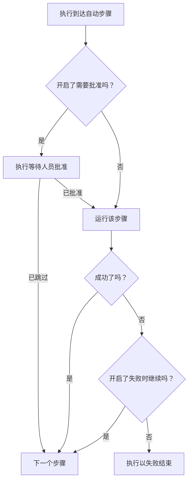

# 编写 Runbook

你在 Runbook 的 **步骤** 页面上把它编写成一份有序的步骤列表。本页介绍如何创建 Runbook、如何设置七种步骤类型中的每一种，以及失败和审批如何改变一次执行的流程。

:::cards
- [创建 Runbook](#创建-runbook): 从空白 Runbook 到已保存的步骤。
- [步骤类型](#步骤类型): Manual、JavaScript、HTTP request、Bash、SSH、kubectl 和 AI。
- [失败处理与审批](#失败处理与审批): 步骤失败或等待审批时会发生什么。
- [完整示例](#完整示例): 五个步骤完成一次数据库故障转移。
:::

## 开始之前

- **能编写 Runbook 的角色。** Project Owner、Project Admin 和 Runbook Admin 可以创建 Runbook 并保存其步骤。使用细粒度权限时，你需要 **Create Runbook** 和 **Edit Runbook** 。参见 [权限](/docs/runbooks/configuration#权限)。
- **用于 Bash、SSH 和 kubectl 步骤的 Runner。** 这些步骤在你自己基础设施中的 [Runner](/docs/runbooks/agents) 上运行，从不在 OneUptime Worker 上运行。请先安装一个。未选择 Runner 的步骤会在你设置的 [项目默认 Runner](/docs/runbooks/agents#项目默认-runner) 上运行；如果没有设置，JavaScript 步骤会在 [全局 Runner](/docs/runbooks/agents#全局-runner) 上运行。
- **用于 SSH 和 kubectl 步骤的机密变量。** 步骤登录所用的密钥、密码或 kubeconfig 是一个机密 [Runbook 变量](/docs/runbooks/variables)。变量由 Project Owner 和 Project Admin 创建，Runbook Admin 在自己编写的步骤中选择它们。kubectl 步骤也可以改用 Runner 自身的访问权限。
- **用于 AI 步骤的 LLM 提供商。** 参见 [LLM 提供商](/docs/ai/llm-provider)。

## 创建 Runbook

:::steps
### 打开运行手册

打开 **产品 → 运行手册** 。Runbook 位于 **仪表板与自动化** 分组中。

### 新建 Runbook

点击 **创建运行手册** ，输入 **名称** ，并可选地输入说明 Runbook 用途的 **描述** 。 **更多字段** 下有默认开启的 **已启用** 开关和 **标签** 。新的 Runbook 会在其 **步骤** 页面打开。

### 添加步骤

在 **开始编写运行手册** 下选择第一个步骤的类型；在最后一个步骤下方， **再添加一个步骤** 提供同样的七种类型。每个步骤打开时带有 **标题** 和该类型所需的设置；其余内容，例如 **描述** 和超时，都折叠在 **更多字段** 下。Runbook 有了一个步骤后，卡片顶部的 **添加步骤** 会添加一个 Manual 步骤。

### 调整步骤顺序

步骤 **按顺序** 运行。要调整顺序，拖动步骤标题左侧的手柄；使用键盘时，聚焦手柄，按空格键，用方向键移动步骤，再按一次空格键。

### 保存步骤

点击 **保存步骤** 。保存之前，编辑器会显示 **未保存的更改** 。保存后你会看到 **已保存** ，Runbook 即可 [运行](/docs/runbooks/running)。
:::

## 步骤的组成

每个步骤都有以下字段。自动步骤会显示 **标题** 和该类型的设置，其余内容折叠在 **更多字段** 下，并注明其中哪些已设置：

| 字段 | 用途 |
| --- | --- |
| **标题** | 显示在步骤列表和每次执行中的简短名称。 |
| **描述** | 给响应人员的可选上下文，使用 Markdown，位于 **更多字段** 下。在 Manual 步骤中，它就是人员阅读并照做的 **说明** ，显示在标题下方。 |
| **失败时继续** | 仅限自动步骤。开启后，步骤失败不会停止执行：下一个步骤照常运行。 |
| **需要批准** | 仅限自动步骤。开启后，执行会在此步骤之前停下，直到有人批准，然后才运行此步骤。该开关名为 **运行此步骤之前需要批准** ，步骤标题栏显示 **需要批准** 。 |
| 类型相关设置 | 脚本、URL、Runner、机密变量或提示词。参见 [步骤类型](#步骤类型)。 |

## 步骤类型

| 类型 | 运行位置 | 需要 |
| --- | --- | --- |
| [Manual](#manual) | 人员 | 无 |
| [JavaScript](#javascript) | Runner | 一个 Runner |
| [HTTP request](#http-request) | OneUptime Worker | 无 |
| [Bash](#bash) | Runner | 一个 Runner |
| [SSH](#ssh) | Runner | 一个 Runner 和一个用于登录的机密变量 |
| [kubectl](#kubectl) | Runner | 一个 Runner，以及一个 kubeconfig 变量或 Runner 自身的访问权限 |
| [AI](#ai) | OneUptime Worker | 一个 LLM 提供商 |

在下面的每个自动步骤中，步骤的 **更多字段** 先放步骤的 **Runner** （对于在 Runner 上运行的步骤），再放 **需要批准** 和 **失败时继续** ，然后是步骤自己的设置（HTTP request 步骤的请求头、SSH 步骤的端口和密钥口令、AI 步骤的提供商和上下文开关），最后是 **描述** 和超时。折叠时，它会显示步骤的 Runner，这样无需打开就能看到步骤在哪里运行。

### Manual

供人员处理的清单项：它的 **说明** 写明要做或要检查什么。执行到达 Manual 步骤时会暂停，并保持在 `WaitingForManualStep`（ **等待您处理** ），直到有人点击 **标记完成** 或 **跳过** 。等待人员处理的执行永远不会超时。Manual 步骤没有审批开关：它本身就会为人员停下执行。

用于只有人才能检查或完成的事情：“在负载均衡器的仪表板中确认流量已切换到备用区域。”

### JavaScript

一段在 `isolated-vm` 沙箱中运行的 JavaScript，运行在 [Runbook 代理](/docs/runbooks/agents) 上，而不是 OneUptime Worker 上：在你的某个 Runner 上，或者在步骤未选择 Runner 时，在 [全局 Runner](/docs/runbooks/agents#全局-runner) 上。

| 字段 | 作用 | 默认值 |
| --- | --- | --- |
| **Runner** | 位于 **更多字段** 中。运行该步骤的 Runner： **全局 Runner** ，或你自己的某个 Runner。只有你选择的 Runner 可以领取该作业；任何全局 Runner 都可以领取选择 **全局 Runner** 的步骤。 | 你设置的 [项目默认 Runner](/docs/runbooks/agents#项目默认-runner) ；否则为 **全局 Runner** （如果有） |
| **脚本** | 要运行的 JavaScript。用 `return` 返回一个值即可记录它；`console.log` 的每一行也会被记录。抛出的错误会使步骤失败。 | — |
| **执行超时** | Runner 在销毁沙箱之前允许代码运行的时长。 全局 Runner 最多让它运行 5 分钟。 | 30 秒 |
| **领取超时** | Worker 等待 Runner 领取作业的时长。 | 2 分钟 |

```javascript
const start = Date.now();
// ... your logic ...
console.log("replica lag checked");
return { durationMs: Date.now() - start };
```

沙箱有 128 MB 内存，不能访问文件系统或进程。它可以用 `axios` 发送 HTTP 请求，但只能发往公网地址：发往私有网络、Runner 自身主机或云元数据端点的请求会被拒绝。要访问你网络中的服务，请使用带 `curl` 的 [Bash](#bash) 步骤。

### HTTP request

由 OneUptime Worker 发出的出站 HTTP 调用。不需要 Runner。

| 字段 | 作用 | 默认值 |
| --- | --- | --- |
| **方法** | `GET`、`POST`、`PUT`、`PATCH`、`DELETE` 或 `HEAD`。 | `GET` |
| **URL** | 要调用的端点。 | 空 |
| **请求头（JSON）** | 位于 **更多字段** 下。一个 JSON 对象，例如 `{ "Authorization": "Bearer ..." }`。不是有效 JSON 的请求头会使步骤失败。 | 无 |
| **请求体** | 方法为 `POST`、`PUT`、`PATCH` 或 `DELETE` 时显示。能解析为 JSON 时按 JSON 发送，否则按文本发送。 | 无 |
| **请求超时** | 在步骤失败之前等待端点响应的时长。 | 30 秒 |

步骤在收到 `2xx` 或 `3xx` 响应时成功，收到其他响应时失败，错误为 `HTTP <status>`。不跟随重定向。响应的状态、请求头和正文会被记录，最多 50 KB。

> [!NOTE]
> Worker 从不调用环回地址或链路本地地址，例如云元数据端点。在 OneUptime Cloud 上，它只调用公网地址。自托管的 OneUptime 也能访问私有网络，除非 `DATA_SOURCE_BLOCK_PRIVATE_ADDRESSES` 为 `true`。要从 OneUptime Cloud 调用你网络中的服务，请使用带 `curl` 的 [Bash](#bash) 步骤。

适用于：打开 PagerDuty 事件、向 Slack Webhook 发帖、调用云服务商的 API 或你自己的公开 API。

> [!TIP]
> 不要把令牌写进步骤。把它们存为机密 [Runbook 变量](/docs/runbooks/variables)，并在 URL、请求头或正文中值应出现的位置写 `{{global.variables.NAME}}`。请求由 OneUptime 自己发送，所以机密也会填入，而步骤记录的响应中该位置显示为 `[REDACTED]`。在 JSON 请求头或 JSON 正文中，值会放进它所在的字符串，因此值中的引号或换行不会破坏 JSON。

### Bash

一个 bash 脚本，在你自己基础设施中的 [Runbook 代理](/docs/runbooks/agents) 上通过 `bash -c <script>` 运行。Bash 从不在 OneUptime Worker 上运行。

| 字段 | 作用 | 默认值 |
| --- | --- | --- |
| **Runner** | 位于 **更多字段** 中。运行该步骤的 Runner。只有这个 Runner 可以领取该作业。全局 Runner 只运行 JavaScript 步骤。 | 你设置的项目默认 Runner |
| **Bash 脚本** | 脚本。输出（stdout 和 stderr）最多记录 50 KB，非零退出码会使步骤失败。 | — |
| **执行超时** | Runner 在用 `SIGKILL` 终止脚本之前允许其运行的时长。对于确实需要几分钟的步骤，请调高它。 | 30 秒 |
| **领取超时** | Worker 等待 Runner 领取作业的时长。 | 2 分钟 |

脚本在 Runner 的容器中运行，可以使用镜像自带的工具，例如 `curl`、`wget` 和 `ssh` 客户端，并拥有其所在主机的网络访问权限。例如，检查只有你的网络才能访问的服务：

```bash
set -euo pipefail
HTTP_CODE=$(curl -s -o /tmp/resp.txt -w "%{http_code}" "http://payments.internal:8080/health")
echo "HTTP $HTTP_CODE"
cat /tmp/resp.txt
if [[ "$HTTP_CODE" != "200" ]]; then
  echo "Health check failed"
  exit 1
fi
```

如果执行到达此步骤时所选 Runner 处于离线状态，步骤会等待至 **claim timeout** （默认 2 分钟），然后因超时而失败。在依赖 Bash 步骤之前，请在 **运行手册 → Runbook 代理** 下添加一个代理。

> [!TIP]
> 不要把密码和令牌写进脚本。把它们存为机密 [Runbook 变量](/docs/runbooks/variables)，并在值应出现的位置写 `{{global.variables.NAME}}`：Runner 收到的脚本已填入值，而步骤输出中该位置显示为 `[REDACTED]`。

### SSH

通过 SSH 登录一台机器并在那里运行 bash 脚本。连接由 Runner 打开，因此机器只需能从 Runner 访问；步骤登录所用的密钥或密码是一个机密 [Runbook 变量](/docs/runbooks/variables)，从不写在步骤中。

| 字段 | 作用 |
| --- | --- |
| **Runner** | 位于 **更多字段** 中。打开连接的 Runner。它必须能通过网络访问该机器。未选择 Runner 的步骤在项目默认 Runner 上运行。 |
| **SSH 目标** | 用户和机器，写法与在 `ssh` 之后相同：`deploy@10.0.4.21`。 |
| **登录方式** | 保存私钥或密码的机密变量；值本身表明是哪一种。只提供机密变量；当步骤的 Runner 不能使用所选变量时，步骤会提示。 |
| **Bash 脚本** | 以登录的用户身份在机器上用 `bash` 运行。输出最多记录 50 KB，退出码非零会让步骤失败。 |
| **端口** | 位于 **更多字段** 下。留空时为 22。 |
| **密钥口令** | 位于 **更多字段** 下。保存密钥口令的机密变量，用于有口令的密钥。 |
| **执行超时** | 连接、登录和运行脚本合在一起计算，因此卡住的脚本无法让步骤一直开着。默认 30 秒。 |
| **领取超时** | Worker 等待 Runner 领取作业的时长。默认 2 分钟。 |

例如，重启一个服务并显示它已恢复：

```bash
sudo systemctl restart nginx
systemctl status nginx --no-pager
```

### kubectl

对集群运行 kubectl 命令。脚本在自带 `kubectl` 的 Runner 上用 bash 运行，`KUBECONFIG` 指向该集群：任何 kubectl 命令都可以运行，周围的任何 bash 也可以。

| 字段 | 作用 |
| --- | --- |
| **Runner** | 位于 **更多字段** 中。运行 kubectl 的 Runner。它必须能访问集群的 API 服务器。未选择 Runner 的步骤在项目默认 Runner 上运行。 |
| **Kubeconfig** | 保存集群 kubeconfig 的机密变量，或 **Runner 自身的访问权限** ：使用 Runner 自己的 kubeconfig，或在集群内运行时使用其服务账号。Runner 会把 kubeconfig 写入只有它能读取的文件，并在脚本结束时删除。 |
| **脚本** | kubectl 命令。输出最多记录 50 KB，退出码非零会让步骤失败。 |
| **执行超时** | Runner 在用 `SIGKILL` 停止脚本之前允许它运行的时长。默认 30 秒。 |
| **领取超时** | Worker 等待 Runner 领取作业的时长。默认 2 分钟。 |

例如，重启一个 Deployment 并等待它的新 Pod 就绪：

```bash
kubectl rollout restart deployment/checkout-api --namespace checkout
kubectl rollout status deployment/checkout-api --namespace checkout --timeout=120s
```

每个脚本下方的 **示例 — 点击插入** 可以填入此类常用脚本。只给 kubeconfig 的用户授予脚本所做的事：在脚本操作的 namespace 中授予一个 Role，只包含它们使用的动词。如果 API 服务器拒绝某条命令，kubectl 自己的消息会出现在步骤输出中，因此权限错误会告诉你该扩大哪个 RoleBinding。

### AI

在执行过程中请 AI 进行分析、总结或做出决定。回答会成为该步骤在执行中的输出。AI 步骤在 OneUptime Worker 上运行，不需要 Runner。

| 字段 | 作用 |
| --- | --- |
| **提示词** | 希望 AI 做什么。例如：“查看前面步骤的输出，判断继续修复是否安全。” |
| **LLM 提供商** | 可选。 **项目默认** 使用项目的默认提供商。当步骤需要特定模型时（例如处理不能离开你网络的数据的自托管模型），请固定一个提供商。参见 [LLM 提供商](/docs/ai/llm-provider)。 |
| **包含上一步的上下文** | 开启后，AI 会看到此步骤之前运行过的所有步骤：标题、类型、状态、输出和错误消息。每个步骤的输出最多提供 4,000 个字符。 |
| **包含触发器上下文** | 开启后，AI 会看到启动这次执行的内容：关联的事件、警报或计划维护事件（描述、严重性、当前状态、受影响的监视器、根本原因、状态时间线和公开备注），或手动运行 Runbook 的人。 |

要让人始终参与其中，请在 AI 步骤之后的那个步骤上开启 **需要批准** ：AI 进行分析，人员阅读回答，修复步骤只有在人员批准后才会运行。

**AI 永远看不到的内容。** AI 步骤的回答会作为步骤输出保存在执行中，而任何有 Runbook 读取权限的人都能读取执行，这比能看到事件的人群更广。因此，触发上下文不包含 **私有内部备注** 和 **Slack 与 Microsoft Teams 的频道消息** 。前面步骤的输出会被扫描是否含有机密信息（令牌、密钥、凭据），这些内容在发送给模型之前会被遮盖。嵌入的图片和很长的编码数据（例如粘贴到事件描述中的截图）也会被省略，并以一条简短说明代替。

AI 步骤与其他 AI 功能一样计量和计费。当步骤没有提示词、项目关闭了 AI 功能、没有可用的 LLM 提供商，或固定的提供商对项目不再可用时，步骤会失败，并给出说明原因的消息。如果仍希望运行 Runbook 的其余部分，请开启 **失败时继续** 。

## 失败处理与审批



默认情况下，步骤失败会停止执行，并将执行标记为 `Failed`，以该步骤的错误作为原因。开启 **失败时继续** 后，失败会被记录，下一个步骤照常运行，适合“先试这三件事，然后通知”这类 Runbook。

**需要批准** 在步骤运行之前生效，无论之前发生了什么：执行会一直等待，直到有人点击 **批准并运行** ，该步骤随即运行，或点击 **跳过** ，该步骤永远不会运行。请为会改变某些东西的步骤开启它（重启、故障转移、缩容），让人员先查看前面步骤的发现。审批属于步骤本身，所以移动步骤时审批也会随之移动。

:::note
通过 API 和 Terraform，该开关是步骤的 `requireApprovalBeforeRunning`。在审批移到所保护的步骤之前，Runbook 写入的是步骤的 `requireApproval`，它仍然有效，含义不变：在该步骤之后审批。OneUptime 会把它读作下一个步骤之前的审批；如果它在最后一个步骤之后，则读作末尾的 Manual 步骤 **Approve the result** 。
:::

## 保存与编辑

对步骤的更改在点击 **保存步骤** 时生效。每次执行都基于启动时拍下的快照运行，因此进行中的执行会保留启动时的步骤，编辑也永远不会改写过去运行的历史。

## 完整示例

一个用于“DB primary unreachable”的 Runbook：

| # | 类型 | 作用 |
| --- | --- | --- |
| 1 | JavaScript | 从你的配置服务获取当前的主库主机并记录日志。 |
| 2 | Manual | “确认备库的复制延迟低于 5 秒。” |
| 3 | HTTP request | 向你的故障转移编排器 API 发送 `POST`。 |
| 4 | Manual | “确认写入现在转到了新的主库。” |
| 5 | HTTP request | 向 Slack Webhook `POST` 一条解除消息。 |

响应人员看着步骤 1 运行，勾选步骤 2，看着步骤 3 运行，勾选步骤 4，执行以步骤 5 结束。每个步骤的输出都会被记录下来，供事后复盘使用。

## 后续步骤

:::cards
- [运行 Runbook](/docs/runbooks/running): 启动一次执行，并完成、批准或跳过其步骤。
- [Runbook 规则](/docs/runbooks/rules): 在匹配的事件上自动启动此 Runbook。
- [Runbook 代理](/docs/runbooks/agents): 安装你的脚本步骤所需的 Runner。
- [Runbook 变量](/docs/runbooks/variables): 让主机、密钥、密码和 kubeconfig 不出现在步骤中。
:::
