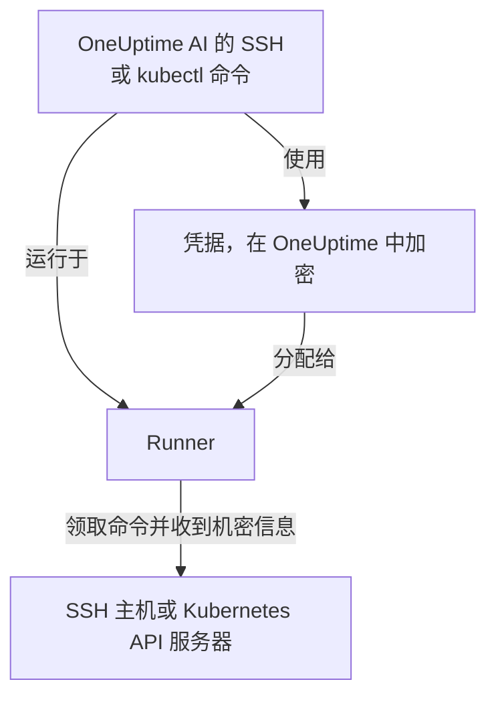

# AI 访问

AI 访问是 OneUptime AI 自己的命令到达 **不是** Runner 自身主机的目标的方式：通过 SSH 访问的服务器，或未运行 Kubernetes 代理 chart 的 Kubernetes 集群的 API 服务器。每一项访问都是一个凭据：作为受管对象的访问权限，静态加密存储，分配给特定的 Runner，并由 OneUptime AI 选择，而不是写进命令。Runbook 步骤不使用它们：SSH 或 kubectl 步骤使用机密 [Runbook 变量](/docs/runbooks/variables) 登录。早于此版本的 Runner 是例外：对于从操作迁移而来的 Kubernetes 步骤，在该步骤的脚本或 kubeconfig 被更改之前，它会使用该步骤引用的凭据来运行。

在 **运行手册 → Runbook 代理 → AI 访问** 下管理凭据。

:::cards
- [创建凭据](#创建凭据): 它的访问权限，以及可以使用它的 Runner。
- [另一端的最小权限](#另一端的最小权限): 限制密钥或令牌能做的事。
- [运行 OneUptime AI 命令的 Runner](#运行-oneuptime-ai-命令的-runner): 谁可以把 SSH 凭据交给这样的 Runner。
:::

## 凭据的使用方式

OneUptime AI 使用分配给其运行所在 Runner 的某个 SSH 凭据来运行 SSH 命令，并使用绑定到集群的 Kubernetes 凭据，为未运行 Kubernetes 代理 chart 的集群运行 kubectl 命令，参见 [AI SRE](/docs/ai/ai-sre)。当 Runner 领取命令时，OneUptime 会检查该凭据是否已分配给它，解密机密，并只在对这次领取的应答中交出。机密从不保存在任务上，也永远无法通过 API 读取。

## 开始之前

- **能管理凭据的角色。** Project Owner 和 Project Admin，或拥有 **Create Runbook Credential** 权限的任何人。Runbook Admin 角色不包含此权限。把 SSH 凭据分配给运行 OneUptime AI 命令的 Runner 还需要 **Read Runbook Credential** ；参见 [运行 OneUptime AI 命令的 Runner](#运行-oneuptime-ai-命令的-runner)。
- **包含该功能的套餐。** 在 OneUptime Cloud 上，Runbook 凭据需要 **Growth** 或更高套餐。
- **一个 [Runner](/docs/runbooks/agents)** ，能通过网络访问目标主机或集群的 API 服务器。

## 创建凭据

:::steps
### 打开 AI 访问

打开 **运行手册 → Runbook 代理 → AI 访问** ，点击 **创建Credential** 。

### 命名并选择类型

在 **Credential** 步骤中输入 **名称** （例如 `prod-cluster`）、可选的 **描述** 以及 **类型** ： **SSH** 或 **Kubernetes** 。类型之后不能更改；如需更改，请创建新的凭据。

### 填写访问信息

:::tabs
@tab SSH
在 **SSH 主机** 下输入 **主机名** 、 **端口** （留空则为 22）和 **用户名** 。在 **SSH 认证** 下选择 **登录方式** ：可以选择时更好的 **私钥** ，然后粘贴 **Private Key (PEM)** 及其 **Private Key Passphrase** （如果有）；或者为不支持密钥访问的主机选 **密码** ，然后输入 **密码** 。
@tab Kubernetes
在 **Kubernetes** 下输入 **API Server URL** （例如 `https://10.0.0.1:6443`）、 **Service Account Token** 和 **CA Certificate (PEM)** ，以便 Runner 验证 API 服务器。只有当 API 服务器出示的证书已被 Runner 信任时，才可以把 CA 留空。
:::

### 分配给 Runner

在 **Runbook 代理** 步骤中选择可以使用该凭据的 Runner，然后点击 **创建Credential** 。未分配给任何 Runner 的凭据不能被任何命令使用。

### 让 OneUptime AI 使用它

OneUptime AI 在开启了 **执行 AI 补救命令** 的 Runner 上，使用分配给该 Runner 的某个 SSH 凭据运行其 SSH 命令。Kubernetes 凭据一旦与它的某个 Runner 一起绑定到集群就会被使用：参见 [AI SRE](/docs/ai/ai-sre)。
:::

## 保存的内容

| 类型 | 字段 |
| --- | --- |
| SSH | 主机名、端口（默认 22）、用户名，以及 PEM 私钥（可带口令）或密码。 |
| Kubernetes | API 服务器 URL、服务账号令牌和集群的 CA 证书。 |

## 机密值只能写入

私钥、口令、密码和服务账号令牌都静态加密存储，API **从不返回它们** ：不返回给仪表板，不返回给工作流，也不出现在导出中。表格可以告诉你凭据 *是什么* ，但永远不会显示其中的内容。

因此，机密值没有“查看”，只有“替换”：重新输入一个值就是轮换它的方式。如果你丢失了原始值，请在目标系统上签发新密钥，然后更新凭据。

## 将凭据分配给 Runner

凭据只能由你分配给的 Runner 使用。引用了未分配给其 Runner 的凭据的命令会 **失败而不是运行** ——一个悄无声息什么都不做的 Runner，看起来和一个成功运行的 Runner 完全一样。

分配就是访问边界，所以请保持范围尽量小：一个只负责重启某个集群的 Runner，不需要你数据库主机的 SSH 密钥。

### 运行 OneUptime AI 命令的 Runner

在开启了 **执行 AI 补救命令** 的 Runner 上，OneUptime AI 会从分配给该 Runner 的 SSH 凭据中挑选，用于它在那里运行的命令。因此，无论先保存哪一方，SSH 凭据都只能经由有权读取 Runbook 凭据的人（ **Read Runbook Credential** ，或 Project Owner、Project Admin）到达这样的 Runner：

- **分配凭据。** 创建包含此类 Runner 的 SSH 凭据，或把此类 Runner 添加到凭据中，都需要该权限。没有该权限时，保存会被拒绝并指出该 Runner：请把凭据分配给不运行 AI 补救命令的 Runner，或请有该权限的人来分配。
- **打开开关。** 为持有 SSH 凭据的 Runner 开启 **执行 AI 补救命令** 需要同样的权限。

从凭据中移除 Runner、按凭据现有的 Runner 原样保存凭据，以及 Kubernetes 凭据，都不需要额外权限：OneUptime AI 的 kubectl 命令使用绑定到其集群的凭据运行。没有该权限的人所做的凭据分配和开关开启，在一个项目中会逐个保存，因此两者不能一起通过检查；在另一次保存进行时到达的保存会等待它完成，如果等待太久，会以 *Try again in a moment* 被拒绝。请再次保存。

工作流的步骤以 Project Admin 的身份执行，但不会借用 Project Admin 读取 Runbook 凭据的权限：只有当最后保存工作流步骤的人拥有该权限时，步骤才拥有它。参见 [工作流步骤可以做什么](/docs/workflows/configuration#工作流步骤可以做什么)。

## 另一端的最小权限

OneUptime 无法限制你的凭据在目标系统上能做什么：这是目标系统的职责，而且值得去做：

- **SSH** ——优先使用密钥而不是密码，只给用户它需要的命令（在可行时使用强制命令或受限 Shell），不要复用管理员的个人密钥。
- **Kubernetes** —— 把服务账号绑定到一个 Role，只允许你让 OneUptime AI 做的事，并且只在它可以操作的命名空间中。只能读取的服务账号让 OneUptime AI 可以调查，但会拒绝每一次修复。

## 谁能看到它们

创建、编辑和删除凭据需要 Runbook 凭据权限（或 Project Owner/Admin）。读取凭据只会显示其非机密字段。

请注意，Runner 的 **代理密钥** 等同于分配给该 Runner 的凭据：任何持有该密钥的东西都能以该 Runner 的身份领取工作并收到凭据。因此，代理密钥只能由 Project Owner、Project Admin 和 Runbook Admin 读取：请像对待凭据本身一样对待它们。

## 后续步骤

:::cards
- [Runbook 变量](/docs/runbooks/variables): SSH 和 kubectl 步骤登录所用的机密。
- [Runbook 代理](/docs/runbooks/agents): 安装要分配凭据的 Runner。
- [Runbook 配置与安全](/docs/runbooks/configuration): 整个 Runbook 体系的权限和加固。
:::
