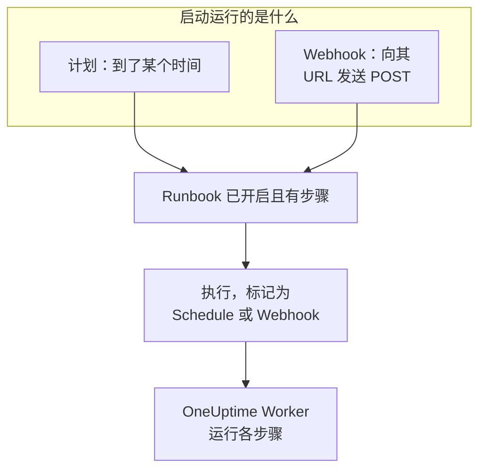

# Runbook 触发器

Runbook 可以自动启动：按计划，或在其他工具调用它的 Webhook URL 时。计划适合例行工作，例如每晚清理或每周检查证书；Webhook 适合从告警系统、CI 流水线或脚本启动 Runbook。两者都在 Runbook 的 **触发器** 页面设置。

:::cards
- [按计划运行](#按计划运行): 每隔几分钟、每天、每周的某几天，或使用 cron 表达式。
- [调用 Webhook](#调用-webhook): 向 Runbook 的 URL 发送 POST 请求来启动一次运行。
- [Webhook 调用发送的值](#webhook-调用发送的值): 步骤如何读取调用方发送的 JSON。
- [故障排除](#故障排除): 不运行的计划、被拒绝的调用。
:::

## 触发器如何启动运行



触发器启动运行的方式与 **立即运行** 相同：这次运行执行 Runbook 当前的步骤，不关联任何事件、告警或计划维护事件。每次运行都会记录是什么启动了它。Runbook 的 **执行** 和 **运行手册 → 执行** 在 **触发者** 中显示这一点，并附上计划运行的预定时间或调用 Webhook 的地址，两个列表都可以按此筛选。

## 开始之前

- 一个至少有一个步骤的 Runbook，且其 **设置** 页面上的 **运行此 Runbook** 开关已打开。
- 编辑并运行该 Runbook 的权限。参见[谁可以设置触发器](#谁可以设置触发器)。

## 按计划运行

:::steps
### 打开 Runbook 的触发器页面
从 **运行手册** 打开 Runbook，然后点击其侧边菜单中的 **设置 → 触发器**。 **设置** 默认是折叠的：点击它以显示 **触发器**。

### 设置计划
点击 **设置计划**。在 **运行时间** 下选择 **重复** 以及它需要的内容。对话框会用一句话说出计划，例如“每个工作日 09:00 运行”，并在你修改时列出接下来的几次运行。

### 检查时区
**时区** 默认是你自己的时区。计划中的时间按此时区的时钟计算。

### 保存
点击 **保存计划**。计划随即开启，卡片用一句话显示计划及其 **下次运行**。
:::

| **重复** | 你选择的内容 | 示例 |
| --- | --- | --- |
| **每隔几分钟** | **每**：1、2、3、4、5、6、10、12、15、20 或 30 分钟 | 每 15 分钟 |
| **每隔几小时** | **每**：1、2、3、4、6、8 或 12 小时，以及 **每小时的第几分钟** | 每 2 小时的第 30 分钟 |
| **每天** | **时间** | 每天 09:00 |
| **按星期几** | **在这些日子**，可用 **工作日** 和 **每天** 快捷选择，以及 **时间** | 每个工作日 09:00 |
| **自定义（cron 表达式）** | **cron 表达式** | `0 2 1 * *`：每月 1 日 02:00 |

cron 表达式有五个字段：分钟、小时、日期、月份和星期。Runbook 最多每分钟运行一次，因此没有秒字段。对话框会解释它无法读取的表达式，或永远不会运行的表达式（例如 `0 0 31 2 *`），在能运行之前不会保存任何内容。

之后，卡片会显示计划、按时区时钟的接下来三次运行、运行仍在进行或错过某个时间时的处理方式，以及 **上次计划运行** 和 **查看运行**。**编辑计划** 会打开同一个对话框，**按此计划运行** 开关可以暂停计划而不丢失它。

### 如果运行仍在进行

只要运行在排队、正在执行，或在等待有人完成或批准某个步骤，就算仍在进行，无论它是如何启动的。计划的 **如果运行仍在进行** 设置折叠在对话框的 **更多字段** 中，它决定此时到来的时间如何处理：

| 设置 | 结果 |
| --- | --- |
| **跳过该时间** （默认） | 不启动任何内容。计划等待下一个时间。 |
| **在其结束后运行** | 一次运行会等待，在进行中的运行结束后启动。期间到来的其他时间不会启动任何内容。 |

### 如果 OneUptime 错过了某个时间

如果 OneUptime 在计划时间停机或正在升级，只要延迟超过 5 分钟，该时间就算错过。**如果 OneUptime 错过了某个时间** 决定 OneUptime 恢复后会发生什么：

| 设置 | 结果 |
| --- | --- |
| **OneUptime 恢复后运行一次** （默认） | 启动一次运行，无论错过了多少个时间，并标记为“为补上 OneUptime 错过的时间而运行一次”。 |
| **跳过错过的时间** | 在下一个时间之前不启动任何内容。 |

计划或 Runbook 关闭期间经过的时间不算错过：重新开启其中任何一个后，会从下一个时间开始。

### 时区与夏令时

时间全年按时区的时钟计算。Europe/London 中 09:00 的计划，无论冬夏都在伦敦时间 09:00 运行。在时钟拨快的那一夜，当夜不存在的时间会在时钟上晚一小时运行。时钟拨回、某个小时出现两次时，每小时运行的计划会在两次中都运行，其他计划只在第一次运行一次。

## 调用 Webhook

:::steps
### 开启 Webhook
在 Runbook 的 **触发器** 页面上，打开 **调用此 URL 时运行**。Runbook 会获得自己的 URL。

### 复制 URL
**Webhook URL** 是遮盖的：点击 **显示** 查看，或点击 **复制 URL** 复制完整 URL。**试一试** 提供了一条可作为起点的 `curl` 命令。

### 从你的工具调用它
向该 URL 发送 `POST` 请求，正文为 JSON 对象，或不带正文：

```bash
curl -X POST "https://oneuptime.com/runbook/webhook/RUNBOOK_ID/SECRET_KEY" \
  -H "Content-Type: application/json" \
  -d '{"host": "web-1", "reason": "Disk almost full"}'
```

### 检查运行
响应会指出它启动的运行：`{"runbookExecutionId": "...", "status": "Scheduled"}`。这次运行出现在 Runbook 的 **执行** 中，**触发者** 显示 **Webhook**，其页面的 **输入** 中显示调用发送的内容。
:::

**发送测试请求** 会像其他工具一样，用你编写的正文向该 URL 发送 `POST`，并链接到它启动的运行。这是一次真实的 Runbook 运行。

### 调用会收到的响应

| 响应 | 情况 |
| --- | --- |
| `200` | 运行已启动。正文会指出这次运行。 |
| `400` | 正文不是 JSON 对象、嵌套超过 32 层或包含 NUL 字符，或者 Runbook 没有步骤。 |
| `403` | Webhook 或 Runbook 已关闭。 |
| `404` | 此 URL 上没有 Runbook Webhook 应答：Runbook ID 或密钥错误，或者 URL 已被重置。 |
| `405` | 请求是 `GET`。`GET` 永远不会启动运行，因此聊天应用中的链接预览不会意外运行它。 |
| `413` | 正文大于 64 KB。 |
| `429` | Webhook 在最近一分钟内启动了 30 次运行，它有 10 次运行仍在进行，或者某个地址在一分钟内调用 Runbook Webhook 超过 120 次，或者同一个 IPv6 /64 中的地址合计超过 1200 次。在可能的情况下，`Retry-After` 头会说明何时重试。 |
| `503` | OneUptime 目前无法统计调用次数。请一分钟后重试。 |

被拒绝的调用不会启动任何内容，其正文会用一句话说明原因，例如 "This runbook is turned off, so it was not started. Turn it on with Run this runbook, under the runbook's Settings."

### 保管好 URL

URL 中含有 Runbook 的密钥：任何拿到它的人都能启动该 Runbook。密钥由 43 个随机字符组成，以恒定时间比较，错误的密钥得到的响应与该 Runbook 不存在时相同。

如果 URL 泄露，请点击 **重置 URL**。Runbook 会获得新的 URL，旧 URL 立即失效，因此请把新 URL 交给每个调用它的工具。关闭再重新开启 Webhook 时，URL 保持不变。

## Webhook 调用发送的值

正文的顶层值会成为这次运行的输入。它们始终以数据形式传给步骤，绝不会作为文本粘贴进脚本或命令：

| 步骤类型 | 如何读取输入 |
| --- | --- |
| Bash 和 kubectl | 环境变量：每个顶层值一个 `ONEUPTIME_INPUT_<NAME>`，`ONEUPTIME_INPUTS` 以 JSON 形式包含整个对象，`ONEUPTIME_TRIGGER` 表示启动运行的方式，例如 `Webhook` 或 `Schedule`。 |
| JavaScript | `args.inputs`（按发送时的样子提供的对象）和 `args.trigger`。 |
| AI | 当 **包含触发器上下文** 打开时，在其提示中作为来自 OneUptime 外部的数据标出。 |
| HTTP request 和 SSH | 完全不读取。它们的 URL、脚本和目标就是 Runbook 中写的内容，调用方发送的任何内容都无法改变它们。 |

变量名是值的名称转为大写，其中字母和数字以外的每个字符都写成 `_`：`host-name` 会变成 `ONEUPTIME_INPUT_HOST_NAME`。文本按原样传递，数字以及 `true` 或 `false` 按书写方式传递，对象和列表以 JSON 传递。一个步骤最多获得 100 个这样的变量，超过 100 个字符的名称不会成为变量；所有值仍都在 `ONEUPTIME_INPUTS` 中。每个名称都以 `ONEUPTIME_` 开头，因此调用方无法设置 `PATH` 或 Runner 读取的任何其他变量。

这些值由调用方决定，因此在据此执行操作之前请先检查它们：

```bash
set -euo pipefail
case "$ONEUPTIME_INPUT_HOST" in
  web-1|web-2|web-3) ;;
  *) echo "Unknown host: $ONEUPTIME_INPUT_HOST"; exit 1 ;;
esac
curl -fsS -X POST "http://$ONEUPTIME_INPUT_HOST.internal:8080/restart"
```

```javascript
const host = args.inputs.host;
if (!["web-1", "web-2", "web-3"].includes(host)) {
  throw new Error(`Unknown host: ${host}`);
}
console.log(`Started by ${args.trigger} for ${host}`);
return { host };
```

## 谁可以设置触发器

计划或 Webhook 会在无人在场时启动运行，因此设置它们需要编辑和运行该 Runbook 的权限：Project Owner、Project Admin 或 Runbook Admin，或者 **Edit Runbook** 加上 Project Member、Runbook Member 或 **Create Runbook Execution**。与 **立即运行** 一样，角色所限的标签也会计入。查看或重置 Webhook URL 需要同样的权限。

关闭计划或 Webhook 不会启动任何内容，因此只需要编辑该 Runbook 的权限。能编辑但不能运行该 Runbook 的人会看到 **设置计划** 被锁定的 **触发器** 页面，并被告知谁可以查看 Webhook URL。

## 故障排除

:::details 计划没有运行任何内容
Runbook 已关闭或没有步骤：卡片会说明是哪一种。在 Runbook 的 **设置** 页面打开 **运行此 Runbook**，或在其 **步骤** 页面添加步骤。如果卡片显示计划已暂停，请打开 **按此计划运行**。
:::

:::details 某个计划时间没有启动任何内容
当时有运行仍在进行而计划会跳过这类时间，或者 OneUptime 错过了该时间而计划会跳过错过的时间。参见[如果运行仍在进行](#如果运行仍在进行)和[如果 OneUptime 错过了某个时间](#如果-oneuptime-错过了某个时间)。
:::

:::details 保存计划失败，提示 "You do not have permission to set up this runbook's schedule or webhook."
设置触发器除了需要编辑 Runbook 的权限，还需要运行它的权限。请申请 Runbook Admin，或者在 **Edit Runbook** 之外申请 Runbook Member 或 **Create Runbook Execution**。
:::

:::details 调用收到响应 "No runbook webhook answers at this URL."
URL 已被重置或复制错误。请从 Runbook 的 **触发器** 页面重新复制。
:::

:::details 调用收到响应 "This runbook's webhook is turned off, so the runbook was not started."
在 Runbook 的 **触发器** 页面上打开 **调用此 URL 时运行**。URL 与之前相同。
:::

## 后续步骤

:::cards
- [运行 Runbook](/docs/runbooks/running): 运行会显示什么，以及如何推进它。
- [编写 Runbook](/docs/runbooks/authoring): 编写触发器要运行的步骤。
- [Runbook 配置与安全](/docs/runbooks/configuration): 限制、权限和加固。
:::
