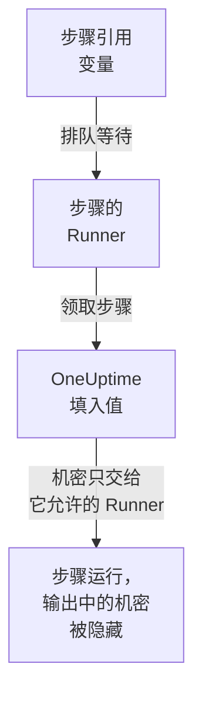

# Runbook 变量

Runbook 变量是步骤通过名称使用、而不是自己保存的值：主机、namespace 或 URL，或者 SSH 密钥、密码、kubeconfig、API 令牌之类的机密。只需修改一次值，每个引用它的步骤下次运行时就会使用新值。机密会被加密，再也不会显示，并在步骤输出的内容中被隐藏。

:::cards
- [创建变量](#创建变量): 普通值，或者机密以及可以使用它的 Runner。
- [在步骤中使用变量](#在步骤中使用变量): 在脚本或 HTTP 请求中使用，或作为 SSH 步骤的登录凭据和 kubectl 步骤的 kubeconfig。
- [谁会收到机密](#谁会收到机密): 你的 Runner、你允许时的全局 Runner，以及 HTTP 请求步骤中的 OneUptime 本身。
:::

## 变量如何到达步骤



步骤保存的是变量的名称，而不是它的值。当步骤的 Runner 领取它时，OneUptime 会填入值（填入脚本、SSH 步骤的目标机器和登录方式，或 kubectl 步骤的 kubeconfig），并只交给那个 Runner。引用了不能使用的变量的步骤会带着原因失败，而不会在本该是值的地方带着名称运行。

Bash、JavaScript、SSH、kubectl 和 HTTP 请求步骤会使用变量。AI 步骤不会填入变量。HTTP 请求步骤由 OneUptime 自己发送，不经过 Runner，因此该步骤会得到它引用的每个变量，包括机密，并在它记录的响应中隐藏这些机密。

## 全局变量和 Runbook 变量

| | 全局变量 | Runbook 自己的变量 |
| --- | --- | --- |
| 管理位置 | **运行手册 → 设置 → 全局变量** | Runbook 的 **设置 → 变量** |
| 使用者 | 项目中的每个 Runbook | 只有该 Runbook 的步骤 |
| 在步骤中的写法 | `{{global.variables.NAME}}` | `{{local.variables.NAME}}` |

一个名称（不区分大小写）在项目的全局变量中只能使用一次，在一个 Runbook 自己的变量中也只能使用一次。Runbook 的变量可以和全局变量同名：两者的写法不同。

## 开始之前

- **管理变量的角色。** Project Owner 和 Project Admin，或拥有 **Create Runbook Variable** 权限。Runbook Admin 可以读取变量，以便在自己编写的步骤中选择它们，但不能修改。
- **包含此功能的套餐。** 在 OneUptime Cloud 上，Runbook 变量需要 **Growth** 或更高的套餐。

## 创建变量

:::steps
### 打开变量

打开 **运行手册 → 设置 → 全局变量** 或某个 Runbook 的 **设置 → 变量** ，然后点击 **创建变量** 。

### 命名并输入值

在 **变量** 步骤中输入 **名称** ：字母、数字、连字符和下划线，最多 100 个字符，例如 `PROD_DB_SSH_KEY`。 **密钥** 默认开启：把密钥、密码、令牌或 kubeconfig 粘贴到 **密钥值** 中，然后点击 **下一步** 。对于任何人都可以读取的值（例如主机），关闭 **密钥** ，在 **值** 中输入，然后点击 **创建变量** 。可选的 **描述** 位于 **更多字段** 下。

### 选择谁可以使用机密

在 **谁可以使用** 步骤中，在 **可以使用它的 Runner** 下选择你的 Runner。在有[全局 Runner](/docs/runbooks/agents#全局-runner) 的服务器上， **全局 Runner 可以使用** 还允许本项目中在全局 Runner 上运行的步骤使用该机密：只要项目在使用全局 Runner，它默认就是开启的。机密需要二者之一。点击 **创建变量** 。
:::

变量是否为机密，之后无法更改。请改为删除它，再用相同的名称重新创建：步骤按名称引用变量，所以它们会继续工作。Kubernetes 代理 chart 安装的集群内 Runner 永远不会收到机密。

## 机密值只能写入

机密的值在存储时加密，API **从不返回它** ：不会返回给仪表板、工作流或导出。列表中普通变量显示值的位置会显示 **密钥** ，其 **Runbook 代理** 列会显示每个机密交给哪些 Runner。要修改它，请点击其所在行的 **替换值** ：新值会被加密，旧值永久消失，步骤会在下次运行时得到新值。

当步骤打印出它收到的机密时，Runner 会在输出离开其主机之前把它替换为 `[REDACTED]`，OneUptime 在保存输出之前还会再替换一次。私钥的某一行或 kubeconfig 中的令牌也会被隐藏。少于 4 个字符的机密不会被查找。

## 在步骤中使用变量

:::tabs
@tab 在脚本中
在 Bash、JavaScript、SSH 或 kubectl 脚本中，把引用写在值应该出现的位置：

```bash
curl -s -X POST \
  -H "Authorization: Bearer {{global.variables.CDN_API_TOKEN}}" \
  "https://api.cdn.example.com/v1/purge"
```
@tab 在 HTTP 请求中
把引用写在 [HTTP 请求步骤](/docs/runbooks/authoring#http-request)的 URL、请求头或正文中：

```json
{ "Authorization": "Bearer {{global.variables.API_TOKEN}}" }
```
@tab SSH 登录
[SSH 步骤](/docs/runbooks/authoring#ssh)在 **登录方式** 中选择保存其私钥或密码的机密变量，并在 **更多字段 → 密钥口令** 中选择其密钥的口令。值本身表明它是密钥还是密码。
@tab Kubeconfig
[kubectl 步骤](/docs/runbooks/authoring#kubectl)在 **Kubeconfig** 中选择保存集群 kubeconfig 的机密变量，或选择 **Runner 自身的访问权限** 来使用 Runner 自己的访问权限。
:::

在 Runbook 的 **步骤** 页面上，每个脚本和每个 HTTP 请求下方的 **变量 — 点击复制** 会列出其步骤可以使用的变量；当步骤引用了不存在的变量，或其 Runner 不能使用的机密时，编辑器会提示。

## 谁会收到机密

| 谁运行步骤 | 普通变量 | 机密 |
| --- | --- | --- |
| 你的某个 Runner | 总是 | 当机密在 **可以使用它的 Runner** 中列出它时 |
| 全局 Runner | 总是 | 当 **全局 Runner 可以使用** 开启时，且步骤属于机密自己的项目 |
| OneUptime 本身（HTTP 请求步骤） | 总是 | 总是 |

引用了其 Runner 不能使用的机密的步骤会失败，并指出该机密以及需要修改什么，不会交出任何东西。

## Runbook 机密和凭据变成了变量

Runbook 变量取代了 Runbook 机密，以及 SSH 和 Kubernetes 步骤引用的凭据。在 OneUptime 升级时，每个项目已有的内容都被迁移了一次，因此每个 Runbook 都会像以前一样运行：

- 每个 Runbook 机密都变成了同名的机密全局变量，具有相同的值、相同的 Runner 和相同的全局 Runner 开关；
- 脚本中的 `{{runbookSecrets.NAME}}` 被改写为 `{{global.variables.NAME}}`，旧写法仍会读取全局变量 `NAME`；
- 步骤引用的每个凭据都变成了具有相同 Runner 的机密全局变量，并以它命名：`<name>-ssh-key`（如果密钥有口令，还有 `<name>-ssh-key-passphrase`）、`<name>-ssh-password` 或 `<name>-kubeconfig`；
- 每个引用凭据的 SSH 步骤都会用这些变量登录其目标机器，并把它的命令作为脚本运行；每个 Kubernetes 步骤都变成了 kubectl 步骤，运行其操作原本执行的 `kubectl patch`，所需的访问权限不超过该步骤原有的权限。

早于此版本（14.0.79）的 Runner 无法运行 kubectl 脚本：它会让 kubectl 步骤失败，并提示更新 Runner。每个以这种方式迁移的 Kubernetes 步骤起初还在脚本旁为这样的 Runner 保留了其凭据和操作；它们随 Runbook 凭据一起移除，因此每个 kubectl 步骤都需要 14.0.79 或更高版本的 Runner。

此后 Runbook 凭据已被移除，仍引用凭据的步骤会先以同样的方式迁移。引用凭据的步骤不再运行，其步骤页面会提供 **转换为脚本步骤** ；通过 API 或 Terraform 保存时若为步骤指定凭据会被拒绝。请参阅 [Runbook 凭据已移除](/docs/installation/upgrading#runbook-凭据已移除)。

## 后续步骤

:::cards
- [编写 Runbook](/docs/runbooks/authoring): 编写使用变量的 SSH 和 kubectl 步骤。
- [Runbook 代理](/docs/runbooks/agents): 安装接收机密的 Runner。
- [Runbook 配置与安全](/docs/runbooks/configuration): 整个 Runbook 体系的权限和加固。
:::
