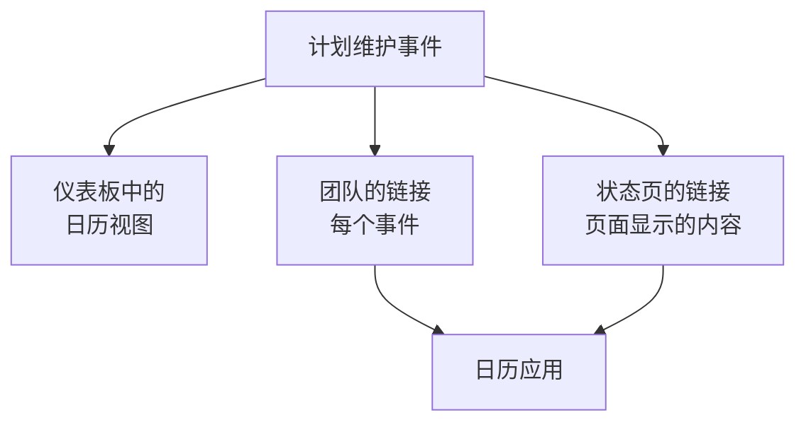

# 维护日历

维护日历按日期显示你的计划维护：作为仪表板中的日历，通过一个秘密链接显示在你团队自己的日历应用中，也显示在关注你状态页的人的日历中。本页说明日历视图、团队的日历链接、状态页的日历，以及每个日历日程包含的内容。

:::cards
- [日历视图](#日历视图): 按月、周或天显示每个事件，用其状态的颜色。
- [团队的日历链接](#团队的日历链接): 在 Google 日历、Outlook 或 Apple 日历中显示项目的每个事件。
- [状态页的日历](#状态页的日历): 把状态页显示的内容放进访客的日历。
- [日历日程包含的内容](#日历日程包含的内容): 标题、时间窗口、状态和一个返回链接。
:::



## 日历视图

打开 **计划维护 → 所有事件** 。在筛选栏的右端， **列表** 和 **日历** 在事件表格和事件日历之间切换。浏览器会记住你的选择，所以下次页面会直接打开日历。

- 日历打开时显示本月，并标出今天。 **月** 、 **周** 和 **天** 改变显示的范围，用箭头移动，用 **今天** 返回。时间按你自己的时区显示。
- 每个事件是一个带有其状态颜色的块，各状态的颜色在日历下方注明。点击事件即可打开它。
- 日历上方的筛选器和列表中的作用相同：选择一个状态、标签或所有者，只看这些事件。
- 尚未到来的日子，在你把指针移到它所在的那一周时会显示 **+** 。它会打开 **创建计划维护事件** ，并把 **开始** 设为那一天，时间是表单今天会选的整点。只有能创建事件的人才能看到它。
- 一个视图最多显示 500 个事件。事件更多的月份会给出提示：用筛选器缩小范围，或者查看一周。

## 团队的日历链接

日历下方或列表的 **⋯** 菜单中的 **订阅日历** 会打开项目的日历链接：一个秘密的 iCalendar（`.ics`）链接，把项目的每个计划维护事件放进 Google 日历、Outlook、Apple 日历，或任何能按 URL 订阅日历的应用。

:::steps
### 发布链接

点击 **发布链接** 。一个项目只有一个供整个团队使用的链接，所以只需发布一次。

### 添加到你的日历应用

**Google 日历** 会打开 Google 日历，它会询问是否添加该日历。 **Apple 日历 / Outlook** 会在你电脑或手机的日历应用中打开链接。 **复制链接** 会复制链接，供其他任何应用使用。

### 检查是否生效

**状态** 面板显示日历应用最近一次读取链接的时间，以及是哪个应用。新链接在有应用读取之前显示 **等待首次同步** 。
:::

链接的形式如下：

```text
https://<your host>/api/scheduled-maintenance-calendar/project/<token>/maintenance.ics
```

> [!WARNING]
> 任何拥有该链接的人，无需登录即可看到项目的每个计划维护事件。请像对待密码一样对待它，如果不小心分享出去，请重新生成。

### 谁可以看到链接

链接会显示项目的每个事件，所以对话框只向能读取每个事件的人显示它。角色只允许其查看部分事件（按标签，或只限自己拥有的事件）的人，会看到原因说明。

| 操作 | 谁可以执行 |
| --- | --- |
| 复制链接 | 能读取项目每个计划维护事件的人 |
| **发布链接** | 还能创建计划维护事件的人 |
| **重新生成链接** 、 **禁用链接** | 还能编辑计划维护事件的人 |

### 管理链接

**重新生成链接** 和 **禁用链接** 位于对话框顶部的 **⋯** 菜单中。

| 操作 | 会发生什么 |
| --- | --- |
| **重新生成链接** | 生成一个新链接。旧链接在 30 天内返回一个空日历，让持有它的应用清空自己的副本；之后就找不到了。请用新链接重新订阅。 |
| **禁用链接** | 保留链接，但在 **启用链接** 之前它会返回一个空日历。 |

日历包含从 90 天前到一年后的每个事件，最多 1,000 个。

## 状态页的日历

关注某个状态页的人可以把它的计划维护放进自己的日历。在状态页的计划事件页面上， **订阅日历** 提供 Google 日历、他们设备上的日历应用，或可复制的链接。链接是页面地址后面加上 `/maintenance.ics` ，例如 `https://status.example.com/maintenance.ics` 。

- **包含的内容。** 与页面显示的完全一致：页面历史时段内的事件、每个尚未开始的事件和每个进行中的事件，前提是 **在状态页面上可见** 处于开启状态。每个事件影响的对象，按页面给其资源起的名称显示，绝不使用你的监视器自己的名称。
- **私有页面。** 日历应用无法登录，所以私有页面不提供 **订阅日历** ，其链接返回一个空日历，并说明该页面是私有的。
- **单个事件。** 事件页面上的 **添加到日历** 只添加该事件：Google 日历会打开并预先填好它，或者它会作为文件下载，由设备的日历应用打开。已登录的访客在私有页面上也能使用，事件结束后就不再提供。

## 日历日程包含的内容

每个日历，无论是团队的还是状态页的，都以相同的方式写入日程。

| 部分 | 包含的内容 |
| --- | --- |
| 标题 | 事件的标题 |
| 开始和结束 | 计划的时间窗口，使用 UTC；日历应用会按你自己的时区显示 |
| 描述 | 纯文本形式的描述、状态、影响的对象，以及指向事件的链接；团队的链接还会列出它的状态页 |
| 状态 | 事件被取消时显示为已取消：从未进行就已完成 |
| 空闲或忙碌 | 空闲，因此维护时间窗口绝不会占用你的空闲时间 |
| 类别 | 事件的标签；状态页的日历只有在页面显示标签时才显示它们 |

在 OneUptime 中编辑的事件，会在包含它的每个日历中原地更新；被删除或从状态页移除的事件，会在下次刷新时离开日历。

## 日历多久刷新一次

日历应用按自己的计划读取已订阅的链接。Google 日历每隔几小时读取一次，有时一天只读取一次；Apple 日历和 Outlook 通常每小时读取一次。OneUptime 最多保留一个日历五分钟，所以你看到的等待来自日历应用。各应用的步骤见 [日历订阅源](/docs/on-call/calendar-feeds#在日历应用中订阅) ，对值班班次也以同样的方式工作。

## 故障排除

:::details 日历应用不再显示新事件
链接已被重新生成或禁用：打开 **订阅日历** 查看它的状态。重新生成的链接需要用新链接重新订阅；已禁用的链接可以用 **启用链接** 恢复。
:::

:::details Google 日历无法添加链接
Google 日历从 Google 的服务器读取链接，所以 OneUptime 服务器必须能从互联网访问。自托管服务器请参阅 [日历订阅源](/docs/on-call/calendar-feeds#故障排除) 。
:::

:::details 状态页的日历中缺少某个事件
页面的日历包含页面显示的内容。请检查事件是否指定了该页面， **在状态页面上可见** 是否在其 **设置** 中开启，以及它是否在页面的历史时段内开始。
:::

## 后续步骤

:::cards
- [创建维护事件](/docs/scheduled-maintenance/creating-events): 表单的每个字段，以及之后会发生什么。
- [订阅者与公告](/docs/status-pages/subscribers#计划维护事件): 状态页的订阅者会收到哪些关于维护的通知。
- [日历订阅源](/docs/on-call/calendar-feeds): 同样类型的链接，用于值班班次。
:::
