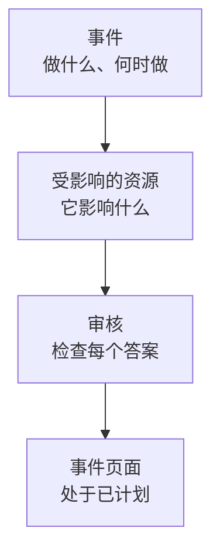

# 创建维护事件

只需两个简短步骤即可安排维护：说明要做什么、何时做，然后说明它影响什么、应该通知谁。只有标题需要输入，其他内容都以合理的默认值开始。本页介绍表单、创建事件那一刻会发生什么、以后如何更改它，以及如何通过代码创建事件。

:::cards
- [创建事件](#创建事件): 两个步骤和一次审核。
- [创建时会发生什么](#创建时会发生什么): 它的编号、规则、所有者和第一批消息。
- [稍后发布](#稍后发布): 在指定的日期和时间之前，不让它出现在你的状态页上。
- [以后更改事件](#以后更改事件): 它的时间窗口、资源、状态页和备注。
- [通过代码创建事件](#通过代码创建事件): API、Terraform、工作流和聊天。
:::

## 工作原理

表单每个步骤问一个问题，共两个，然后在创建事件之前把所有内容显示在审核页上。事件从你的已计划状态开始，并打开它的页面。



## 开始之前

- **你的角色。** 创建事件需要 **项目所有者** 、 **项目管理员** 、 **项目成员** 、 **计划维护管理员** 或 **计划维护成员** ，或拥有 **Create Scheduled Maintenance** 权限的自定义角色。
- **你的状态页。** 要通知客户，你需要一个显示计划维护事件的状态页。请参阅 [状态页概览](/docs/status-pages/index)。

## 创建事件

:::steps
### 打开表单

前往 **计划维护 → 所有事件** ，点击 **创建计划维护事件** 。表单会在第一步 **事件** 上打开。

### 说明要做什么、何时做

输入 **标题** ，如有帮助再添加 **描述** ：描述使用 Markdown，并会显示在你的状态页上。 **开始** 已经是你时钟上的下一个整点， **结束** 则晚一个小时；只有在它们不对时才需要更改。移动 **开始** 时， **结束** 会随之移动，时间窗口的长度保持不变。 **所有者** 和 **标签** 在折叠的 **更多字段** 下。

### 选择它影响的内容

点击 **下一步** 进入 **受影响的资源** 。选择工作涉及的 **监视器** 。选中一个后，它们下方会出现 **将监视器状态更改为** ：事件开始时监视器切换到的状态。然后选择任何 **其他受影响的资源** ，例如主机、集群、数据库、网络站点或服务。

### 选择通知谁

在 **在这些状态页上显示事件** 下选择状态页。折叠的 **订阅者通知** 用一行说明事件何时显示在这些状态页上，以及谁会在何时收到通知；展开它可以在 **在状态页面上发布** 下选择 **在指定日期和时间** ，或更改 **事件安排时** 、 **事件开始时** 、 **事件结束时** 或 **事件前提醒** 。

### 创建它

点击 **下一步** 查看审核页，检查无误后点击 **创建计划维护事件** 。事件自己的页面会打开。
:::

在你选择状态页之前不会发送任何内容：不显示在任何状态页上的事件不会通知任何订阅者。

## 表单字段

| 字段                                 | 步骤               | 初始值                          | 作用                                                                             |
| ------------------------------------ | ------------------ | ------------------------------- | -------------------------------------------------------------------------------- |
| **标题**                             | **事件**           | 空，必填                        | 在各处为事件命名，包括你的状态页。                                               |
| **描述**                             | **事件**           | 空                              | 用 Markdown 向客户说明这项工作。                                                 |
| **开始**                             | **事件**           | 下一个整点                      | 事件自动开始的时间。                                                             |
| **结束**                             | **事件**           | **开始** 之后一小时             | 事件自动结束的时间。必须晚于 **开始** 。                                         |
| **所有者**                           | **事件**           | 无                              | 拥有该事件并收到相关通知的人员和团队。                                           |
| **标签**                             | **事件**           | 无                              | 规则和筛选器可以匹配的标签。                                                     |
| **监视器**                           | **受影响的资源**   | 无                              | 事件进行期间不检查的监视器。                                                     |
| **将监视器状态更改为**               | **受影响的资源**   | 不更改                          | 事件期间这些监视器显示的状态。选择监视器后才会询问。                             |
| **其他受影响的资源**                 | **受影响的资源**   | 无                              | 主机、集群、数据库、网络站点、服务等。                                           |
| **在这些状态页上显示事件**           | **受影响的资源**   | 无                              | 显示该事件并通知其订阅者的状态页。                                               |
| **订阅者通知**                       | **受影响的资源**   | 立即发布，三个时间点全部开启，无提醒 | 事件何时显示在这些页面上，以及其订阅者何时收到通知。                     |

在你填写时，有两项内容会自动帮你填写表单：

- **关联的资源。** 当你选择一个监视器时，与它关联的主机、集群、服务和其他资源会添加到 **其他受影响的资源** 下，字段下方会有一行列出它们。删除你不需要的即可。云资源不会添加进来，因为维护事件不包含云资源。
- **建议的状态页。** 在 **在这些状态页上显示事件** 下，会建议显示你的监视器的页面：点击页面名称即可添加，或点击 **全部添加** 。不会替你自动选择任何页面。请参阅 [计划维护事件](/docs/status-pages/subscribers#计划维护事件)。

## 从资源或模板开始

在主机、Kubernetes、Proxmox、Ceph 或 Docker Swarm 集群、Docker 或 Podman 主机、vCenter、存储阵列、IoT 设备群、数据库、服务或网络站点的 **计划维护** 选项卡上， **创建计划维护事件** 会打开同一个表单，并已在 **其他受影响的资源** 下选好该资源；该选项卡还会列出影响该资源的事件。资产清单项的选项卡会选择该项指向的主机、服务或 Kubernetes 集群。

创建按钮旁边的 **从模板创建** 会让你 **选择计划维护模板** ，然后打开用该模板填好的表单。请参阅 [模板与周期性事件](/docs/scheduled-maintenance/templates)。

## 创建时会发生什么

在你点击 **创建计划维护事件** 的那一刻，OneUptime 会按以下顺序执行这些步骤：

1. **它获得编号和状态。** 编号来自每个项目的计数器，并带上你的前缀显示（`SM-42`）。无论请求指定什么状态，事件都从你的已计划状态开始。
2. **你的聊天工具会收到消息。** **工作区** 下的 Slack 和 Microsoft Teams 规则会把它发布到各自的频道，规则还可以为该事件创建频道。它的信息流会记录它已创建。
3. **它的状态时间线开始。** 它的 **状态时间线** 的第一行是你的已计划状态。
4. **添加所有者和标签**：先添加你选择的，再添加匹配的所有者规则和标签规则中的。
5. **Runbook 规则启动** 与该事件匹配的运行手册。
6. **安排提醒**：当某条提醒规则匹配时，为它的所有者安排提醒。

发布后一分钟内（除非你选择了 **发布时间** ，否则会立即发布），它的状态页的订阅者会收到事件已安排的通知，除非你关闭了 **事件安排时** 。工作流触发器 **On Create Scheduled Maintenance Event** 会启动基于它构建的所有工作流；如果所有者开启了相应通知，他们也会收到消息：请参阅 [通知设置](/docs/notifications/notification-settings)。

## 稍后发布

你可以尽早规划工作，并在客户需要知道之前只让团队知道。在表单中，或在事件 **编辑** 的 **状态页面** 步骤中，在 **在状态页面上发布** 下选择 **在指定日期和时间** ，并设置一个早于 **开始** 的 **发布时间** 。在此之前，事件不会出现在它的任何状态页上：不会出现在它们的列表、正常运行时间历史、RSS 和 Atom 订阅源、维护日历或 API 中，也无法通过它自己的链接打开。到了那个时间，它会显示为即将进行，其订阅者会收到一次事件已安排的通知。

| 时间                     | 会发生什么                                                   | 在你的状态页上 |
| ------------------------ | ------------------------------------------------------------ | -------------- |
| 创建时                   | 你选择一个早于 **开始** 的 **发布时间**                      | 不显示         |
| 到了 **发布时间**        | 事件被发布，其订阅者收到事件已安排的通知                     | 即将进行       |
| 到了 **开始**            | 它像任何事件一样开始                                         | 进行中         |
| 到了 **结束**            | 它结束                                                       | 已结束         |

- **在此之前，订阅者不会收到任何消息。** 事件等待期间，事件前的提醒、状态变更和公开备注都不会发送给他们。
- **它的页面会说明。** 它的页眉显示 **尚未显示在状态页面上** 以及开始显示的时间， **立即发布** 会在确认后立即发布它。它的 **设置** 也会这样说明，事件列表会在它的状态页下方显示该时间。
- **更改它，或立即发布。** 在 **编辑** 的 **状态页面** 步骤中调整 **发布时间** ，或选择 **立即** 。在它的 **设置** 中关闭 **在状态页面上可见** ，无论时间如何都不会显示在它的状态页上。

## 以后更改事件

表单上的所有内容都可以在事件自己的页面上更改，只有三个订阅者通知时间点除外，它们在创建事件时一次性设定。

| 要更改的内容                                | 前往                                                                           |
| ------------------------------------------- | ------------------------------------------------------------------------------ |
| 标题、时间窗口或标签                        | 它的 **概览** 上 **Maintenance Details** 卡片中的 **编辑** ，步骤 **事件**      |
| 状态页、发布时间或提醒                      | 同一个 **编辑** ，步骤 **状态页面**                                             |
| 监视器、它们的状态或其他资源                | **受影响的资源** 卡片上的 **编辑**                                             |
| 描述                                        | 它侧边菜单中的 **描述**                                                        |
| 所有者                                      | 它侧边菜单中的 **所有者**                                                      |

**将监视器状态更改为** 在事件开始之前都可以更改。之后卡片会以只读方式显示它，因为监视器已经处于该状态。每次编辑都会在 **计划 维护 信息流** 中添加一条说明更改内容的记录；未做任何更改就保存则不会添加。

## 在工作进行中发布备注

- **公开备注** 是给客户的更新：它们会显示在事件的状态页上，每条都可以通过 **Notify status page subscribers** 通知这些页面的订阅者。
- **私人备注** 仅供你的团队查看。

在事件的 **公开备注** 或 **私人备注** 页面上编写，或在 **计划 维护 信息流** 的 **操作** 菜单中通过 **Add Public Note** 或 **添加私密注释** 编写。同一个菜单可以通过 **Execute Runbook** 运行运行手册。备注模板会填入团队经常编写的文本：请参阅 [维护规则与设置](/docs/scheduled-maintenance/settings#备注模板)。

## 通过代码创建事件

事件模型有标准 API，因此 `POST /api/scheduled-maintenance` 会创建一个事件。使用 **项目设置 → 高级 → API 密钥** 中的 API 密钥进行身份验证，并通过 `apikey` 请求头发送；密钥决定了项目。

```bash
curl -X POST https://oneuptime.com/api/scheduled-maintenance \
  -H "apikey: $ONEUPTIME_API_KEY" \
  -H "Content-Type: application/json" \
  -d '{
    "data": {
      "title": "Database upgrade",
      "description": "Writes pause for a few minutes while the primary restarts.",
      "startsAt": "2030-06-01T02:00:00Z",
      "endsAt": "2030-06-01T04:00:00Z"
    }
  }'
```

| 字段                                                  | 说明                                                                                      |
| ----------------------------------------------------- | ----------------------------------------------------------------------------------------- |
| `title`, `startsAt`, `endsAt`                          | 必填，与表单相同。                                                                        |
| `monitors`, `statusPages`, `labels`                   | 事件的监视器、状态页和标签，都必须来自 API 密钥所属的项目。                               |
| `changeMonitorStatusToId`                             | 事件开始时其监视器切换到的监视器状态。                                                    |
| `currentScheduledMaintenanceStateId`                  | 会被忽略：每个事件都从你的已计划状态开始。                                                |
| `shouldStatusPageSubscribersBeNotifiedOnEventCreated` | **事件安排时** 开关。另外两个时间点各有自己的字段。                                       |
| `publishOnStatusPageAt`                               | 事件在其状态页上发布、其订阅者收到事件已安排通知的时间。省略时立即发布。                   |

以代码表示的同一个事件是 Terraform 资源 `oneuptime_scheduled_maintenance_event` ：请参阅 [示例](/docs/terraform/examples#计划维护)。工作流通过其 **Create One Scheduled Maintenance Event** 步骤创建事件， `/oneuptime maintenance` 会在 Slack 中打开表单：请参阅 [Slack](/docs/workspace-connections/slack#从-slack-创建事件和维护)。

## 故障排除

:::details 提示结束必须晚于开始
时间窗口必须按顺序：事件在开始之后才结束。先移动 **开始** ，因为 **结束** 会随之移动，然后再设置 **结束** 。
:::

:::details 表单中没有将监视器状态更改为
只有当事件有监视器时才会询问它。在 **监视器** 下选择一个，它就会出现在其正下方。
:::

:::details 将监视器状态更改为无法再更改
事件已经开始，它的监视器已经处于该状态。该状态从事件开始的那一刻起一直适用到事件结束。
:::

:::details 提示发布时间必须早于开始
发布事件是为了让客户在工作开始之前就知道它。请选择早于 **开始** 的 **发布时间** ，或选择 **立即** 。
:::

## 后续步骤

:::cards
- [维护状态](/docs/scheduled-maintenance/states): 什么会开始和结束事件，以及如何手动推进它。
- [模板与周期性事件](/docs/scheduled-maintenance/templates): 保存表单的答案以便下次使用。
- [订阅者与公告](/docs/status-pages/subscribers#计划维护事件): 准确地说明谁会在何时收到通知。
- [维护规则与设置](/docs/scheduled-maintenance/settings): 自动添加所有者、标签和提醒。
:::
