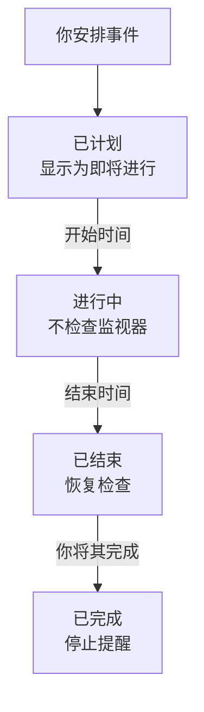

# 计划维护概览

计划维护事件会在计划内的工作开始之前告知所有人：数据库升级、网络变更、迁移到新服务器。OneUptime 会按时开始和结束事件，在工作进行期间停止检查受影响的监视器，并在你的状态页上显示该事件，让计划内的停机永远不会看起来像故障。本页说明事件如何推进、各项内容在仪表板中的位置，以及事件会改变 OneUptime 其他部分的哪些行为。

:::cards
- [事件如何推进](#事件如何推进): 从已计划到已完成，大多自动进行。
- [事件从何而来](#事件从何而来): 创建表单、模板、计划、表单功能、聊天和代码。
- [事件影响什么](#事件影响什么): 监视器、状态页、订阅者和警报。
- [事件自己的页面](#事件自己的页面): 概览、时间线、备注和设置。
:::

## 事件如何推进

每个事件都有一个计划的时间窗口，即它的 **开始** 和 **结束** ，并沿着你的维护状态列表向下推进。一个每分钟运行的作业会在窗口的两端推进它，因此你只需安排一次工作，其余的由 OneUptime 完成。

新事件从 **已计划** 开始。到了 **开始** 时间，它会变为 **进行中** ：OneUptime 停止检查它的监视器，如果你为监视器选择了状态，就以该状态显示它们。到了 **结束** 时间，它会变为 **已结束** ：检查恢复，每个监视器都回到正常运行。 **已完成** 是最后一步，不会自动进入：由某个人、聊天按钮或 API 将工作标记为已验收，这也会停止发给所有者的提醒。

你可以提前开始或结束事件，也可以在这四个状态之间添加自己的状态。请参阅 [维护状态](/docs/scheduled-maintenance/states)。

## 维护与公告

两者都会向状态页的访问者告知某件事。有开始和结束的工作请使用维护事件，其他需要访问者阅读的内容请使用公告。

|                              | 计划维护                                                                | 公告                                           |
| ---------------------------- | ----------------------------------------------------------------------- | ---------------------------------------------- |
| **它是什么**                 | 有时间窗口的计划内工作                                                  | 给状态页访问者的消息                           |
| **它的监视器**               | 进行期间不检查，并以你选择的状态显示                                    | 不变                                           |
| **如何推进**                 | 按时经过你的维护状态                                                    | 从开始时间显示到结束时间（如果有结束时间）     |
| **何时通知订阅者**           | 安排时、开始时和结束时，如有需要也在开始前                              | 开始显示时通知一次                             |
| **新项目中的编号**           | `SM-42`                                                                 | 无                                             |

公告的介绍见 [订阅者与公告](/docs/status-pages/subscribers#公告)。

## 事件从何而来

- **创建表单。** 在事件列表中，或在主机、集群、服务、网络站点等资源的 **计划维护** 选项卡上点击 **创建计划维护事件** ；从资源选项卡打开时，会为你选好该资源。请参阅 [创建维护事件](/docs/scheduled-maintenance/creating-events)。
- **模板。** **从模板创建** 会用你为常做的工作保存的模板填写表单。请参阅 [模板与周期性事件](/docs/scheduled-maintenance/templates)。
- **计划。** 周期性模板会按计划创建新事件，例如每周或每月一次，无需任何人打开表单。
- **表单功能。** 提交后会创建维护事件的表单，会把变更请求变成事件。请参阅 [提交会创建什么](/docs/forms/on-submit#提交如何成为计划维护活动)。
- **聊天。** 在 Slack 中输入 `/oneuptime maintenance` ，或在 Microsoft Teams 中向 OneUptime 机器人输入 `maintenance` ，即可在聊天工具中打开表单。请参阅 [Slack](/docs/workspace-connections/slack#从-slack-创建事件和维护)。
- **代码。** 位于 `/api/scheduled-maintenance` 的 API、Terraform 资源 `oneuptime_scheduled_maintenance_event` ，以及工作流的 **Create One Scheduled Maintenance Event** 步骤。

## 维护在仪表板中的位置

从顶部栏的 **产品** 菜单打开 **计划维护** 。事件列表位于 `/dashboard/{projectId}/scheduled-maintenance-events` ，它的侧边菜单包含与维护有关的一切：

| 分组          | 在其中可以做什么                                                                                                           |
| ------------- | -------------------------------------------------------------------------------------------------------------------------- |
| **概览**      | **所有事件** 和 **进行中的事件** ，后者的徽章显示当前正在进行的事件数量。                                                   |
| **日历** | **维护日历** ：按月、周或天显示每个事件，并与你添加的项目外部日历并排显示。 |
| **工作区**    | 项目已连接的 **Slack** 和 **Microsoft Teams** ，若两者都未连接，则为 **连接 Slack 或 Teams** 。                              |
| **规则**      | **所有者规则** 、 **Runbook 规则** 、 **标签规则** 、 **Reminder Rules** 。                                                 |
| **设置**      | **事件状态** 、 **事件模板** 、 **备注模板** 、 **自定义字段** 、 **测量** 、 **日历设置** 、 **编号规则** 。                               |

**概览** 和 **日历** 处于展开状态； **工作区** 、 **规则** 、 **设置** 和 **开发者** 开始时是折叠的，当你位于某个分组的页面上时，该分组会自动展开。 **开发者** 包含 **Terraform** 、 **API** 和 **AI 助手** ，用于通过代码管理维护。与维护有关的一切都在这里，而不在 **项目设置** 中。

列表显示 **计划维护编号** 、 **标题** 、 **当前状态** 、 **受影响的资源** 、 **显示在状态页上** 、 **开始** 、 **持续时间** 、 **结束** 、 **标签** 和 **所有者** 。选择事件即可一次处理多个： **标记为“{{state}}”** 、 **更改状态** 、 **分配给我** 、 **添加所有者** 、 **移除所有者** 、 **添加标签** 、 **移除标签** 或 **删除** 。每个事件行末的 **⋯** 菜单可对该事件单独执行同样的操作：在事件还能进入下一步时提供 **标记为“{{state}}”** 各步骤，以及 **更改状态**、在你成为所有者之前的 **分配给我** 和 **添加所有者**。

**日历** 部分中的 **维护日历** 按月、周或天显示相同的事件，还可以在旁边显示项目之外的日历。请参阅 [维护日历](/docs/scheduled-maintenance/calendar)。

## 事件影响什么

在事件进行期间，OneUptime 会把它所计划的中断视为预期之内：

- **不检查它的监视器。** **监视器** 下的每个监视器都会停止检查，每个监视器的页面都会显示 **此监视器已禁用** 。如果你选择了 **将监视器状态更改为** ，监视器会显示该状态，状态页上也是如此。当事件结束或被删除时，检查会恢复，每个监视器都会回到正常运行，除非另一个进行中的事件仍然占用它。
- **它的其他资源保持安静。** 一个以每个资源一条序列的方式监视许多主机、集群、数据库或服务的遥测监视器，不会为事件所覆盖资源的序列创建事件或警报，而其他序列会继续告警。
- **网络站点和 SLO 也会暂停计算。** 事件覆盖的网络站点不再把计划内的中断计入其上级站点，而只要 SLO 的任一监视器处于维护中，它的消耗率规则就不会创建任何内容。请参阅 [网络站点](/docs/monitor/network-sites#网络站点的计划维护) 和 [消耗率警报与事件](/docs/slo/burn-rate-alerts#计划维护)。
- **你的状态页会显示它。** 事件会出现在你选择的状态页上，先显示为即将进行，然后是进行中，最后是已结束，前提是它的 **设置** 中开启了 **在状态页面上可见** 。开始之后，在这些状态页上，它的监视器所在的每个资源的正常运行时间历史，都会在它的时间窗口覆盖的每一天列出它，并且在它进行期间，这些资源会显示“维护中”；仪表板中监视器的正常运行时间历史也会以同样方式显示它。请参阅 [正常运行时间百分比和历史图表](/docs/status-pages/resources-and-groups#正常运行时间百分比和历史图表)。
- **订阅者会收到通知。** 默认情况下，这些页面的订阅者会在事件安排时、开始时和结束时收到通知，如果你设置了提醒，还会在开始前收到提醒。请参阅 [计划维护事件](/docs/status-pages/subscribers#计划维护事件)。
- **你的团队会收到通知。** 它的所有者会按照各自的 [通知设置](/docs/notifications/notification-settings) 收到通知， **工作区** 下的 Slack 和 Microsoft Teams 规则会把它发布到你的频道。

## 事件自己的页面

从列表中打开一个事件即可看到它的页面。它的侧边菜单包含：

| 侧边菜单分组      | 页面                                                                                          |
| ----------------- | --------------------------------------------------------------------------------------------- |
| **概览** | **概览** 、 **状态时间线** 、 **描述** 、 **运行手册** |
| **团队** | **所有者** |
| **通知**          | **通知日志** 和 **AI 日志** ：关于该事件发送的每条消息，以及 AI 为它做了什么                   |
| **备注**          | **私人备注** 和 **公开备注**                                                                   |
| **开发者**        | **Terraform** 、 **API** 和 **AI 助手** ：通过代码管理该事件                                   |
| **高级**          | **自定义字段** 、 **设置** 、 **审计日志** 、 **删除事件**                                     |

**概览**、**团队** 和 **备注** 处于展开状态；其他分组会保持折叠，直到你点击它们。

- **概览** — 标题区域显示事件的编号、标题和状态，距离开始还有多久或已经进行了多久，谁拥有它、它显示在哪些状态页上、谁创建了它，以及推进事件的按钮。其下方的 **开始** 、 **结束** 和 **持续时间** 以你的时区显示计划的时间窗口。 **计划 维护 信息流** 记录事件发生的一切，旁边是 **Maintenance Details** 和 **受影响的资源** 卡片，如果你的项目有相关内容，还有 **测量** 和 **自定义字段** 卡片。
- **状态时间线** — 事件经历过的每个状态、时间以及持续多久。请参阅 [维护状态](/docs/scheduled-maintenance/states#状态时间线)。
- **公开备注** — 面向你的状态页及其订阅者的更新。 **私人备注** 仅供你的团队查看。
- **设置** — **在状态页面上可见** 用于在其状态页上显示或隐藏事件， **发送提醒** 会在事件完成之前一直提醒它的所有者。每个开关在你切换的那一刻就会保存。

## 故障排除

:::details 事件没有在开始时间开始
开始事件的作业每分钟运行一次，所以请等一分钟。如果标题区域显示 **开始已逾期** ，说明事件已错过开始时间两分钟以上：用标题区域的按钮开始它，该按钮会完成作业所做的一切，然后打开它的 **状态时间线** ，查看它停留在哪个状态。
:::

:::details 维护期间监视器仍在被检查
只有事件在 **监视器** 下列出的监视器才会停止检查，而且只在事件进行期间停止。事件在 **其他受影响的资源** 下列出的主机或服务的监视器仍会被检查。编辑事件的 **受影响的资源** 卡片来添加该监视器。
:::

:::details 事件没有出现在我的状态页上
检查事件是否在 **在这些状态页上显示事件** 中列出了该页面，以及事件的 **设置** 中是否开启了 **在状态页面上可见** 。然后检查状态页本身：它必须显示计划维护事件，而且开始时间早于该页面历史窗口（未修改时为 14 天）的事件不会再显示。
:::

## 后续步骤

:::cards
- [创建维护事件](/docs/scheduled-maintenance/creating-events): 表单的每个字段，以及之后会发生什么。
- [维护状态](/docs/scheduled-maintenance/states): 什么会开始和结束事件，以及你自己的状态。
- [模板与周期性事件](/docs/scheduled-maintenance/templates): 重用一个事件，或每周安排它。
- [维护规则与设置](/docs/scheduled-maintenance/settings): 自动添加所有者、标签、运行手册和提醒。
:::
