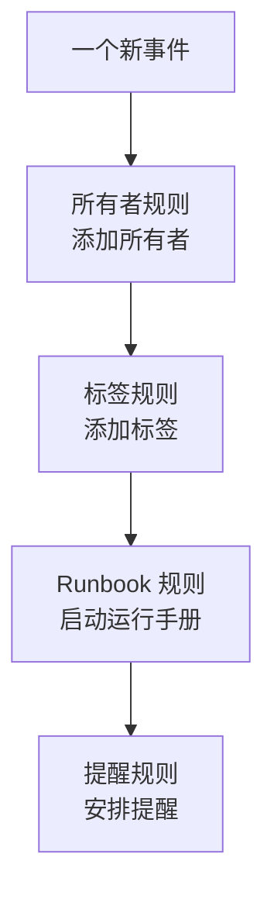

# 维护规则与设置

维护的配置位于 **计划维护** 中，而不在 **项目设置** 中：包括作用于每个新事件的规则，以及塑造项目中每个事件的设置。本页是其中每一项以及谁可以更改它们的参考。

:::cards
- [新事件依次经过的规则](#新事件依次经过的规则): 按顺序列出，以及每条规则的作用。
- [提醒规则](#提醒规则): 在事件完成之前一直提醒所有者。
- [设置](#设置): 备注模板、自定义字段、测量和编号规则。
- [谁可以更改这些内容](#谁可以更改这些内容): 维护角色和套餐。
:::

## 维护设置的位置

从顶部栏的 **产品** 菜单打开 **计划维护** 。它侧边菜单中的 **规则** 和 **设置** 分组默认折叠，请先展开它们。这里的每个页面都作用于整个项目，地址以 `/dashboard/{projectId}/scheduled-maintenance-events/settings/` 开头。

| 规则页面           | 作用                                                                |
| ------------------ | ------------------------------------------------------------------- |
| **所有者规则**     | 为匹配的事件添加所有者。                                            |
| **Runbook 规则**   | 为匹配的事件启动运行手册。                                          |
| **标签规则**       | 为匹配的事件添加标签。                                              |
| **Reminder Rules** | 按固定间隔提醒所有者，直到事件完成。                                |

**设置** 分组包含 **事件状态** （在 [维护状态](/docs/scheduled-maintenance/states) 中介绍）、 **事件模板** （在 [模板与周期性事件](/docs/scheduled-maintenance/templates) 中介绍），以及 **备注模板** 、 **自定义字段** 、 **测量** 、 **日历设置** 和 **编号规则** 。 **日历设置** 在 [维护日历](/docs/scheduled-maintenance/calendar#外部日历) 中介绍，其余在下文介绍。

**工作区** 分组包含把事件发布到频道的 Slack 和 Microsoft Teams 规则。请参阅 [Slack](/docs/workspace-connections/slack#通知规则) 和 [Microsoft Teams](/docs/workspace-connections/microsoft-teams#通知规则)。

## 新事件依次经过的规则

各类规则在多条匹配时的处理方式不同：

- **所有者规则** 、 **标签规则** 和 **Runbook 规则** 只要匹配就都会生效。多条规则添加的所有者和标签只会添加一次。
- **Reminder Rules** 按列表从上到下检查，第一条匹配的规则生效。拖动规则即可更改它的位置；新规则会放在末尾。

新规则创建后即为启用状态；在编辑表单中关闭 **已启用** 即可暂停它，列表会为每条规则显示绿色的 **已启用** 或红色的 **已禁用** 。所有者规则、标签规则和 Runbook 规则作用于保存之后创建的事件。要把所有者规则或标签规则应用到已有的事件，请使用 **立即运行** ：请参阅 [对现有资源运行规则](/docs/configuration/run-rules-now)。

## 所有者规则和标签规则

**所有者规则** 为匹配的新事件添加所有者用户和团队， **标签规则** 则添加标签。创建一条规则需要两个步骤：先在 **匹配** 中设置条件，再在 **所有者** 或 **标签** 中设置规则要添加的内容。

| 条件                                                            | 匹配                                                                       |
| --------------------------------------------------------------- | -------------------------------------------------------------------------- |
| **监视器** 、 **事件标签** 、 **监视器标签**                    | 带有你所选任一监视器或标签的事件。                                         |
| **事件标题** 、 **事件描述** 、 **监视器名称** 、 **监视器描述** | 一个按正则表达式解释、不区分大小写的模式。                                 |

只有当你填写的每个条件都成立时，规则才会匹配；留空的条件会被跳过。

- **规则可以继承。** 在折叠的 **继承所有者** 或 **继承标签** 下，有六个开关可以沿用事件的监视器、主机、Kubernetes 集群、Docker 主机、Podman 主机和服务的所有者或标签。
- **新规则必须添加点什么**：至少选择一个所有者或标签，或开启一个开关。
- 所有者规则 **更多字段** 下的 **通知所有者** 决定是否通知被添加的人员。

[标签与所有者规则](/docs/configuration/label-and-owner-rules) 会针对每种资源逐步介绍该表单。

## Runbook 规则

**Runbook 规则** 会在新事件匹配时启动一个运行手册，例如每次数据库升级前的检查清单。它们与所有者规则和标签规则匹配的内容相同；事件没有严重级别，因此维护的 Runbook 规则不提供严重级别。运行会关联到事件，显示在它的 **运行手册** 页面上。请参阅 [Runbook 规则](/docs/runbooks/rules)。

## 提醒规则

**计划维护 → 规则 → Reminder Rules** 会一直提醒事件的所有者，直到工作通过验收。每个事件会采用列表中从上到下第一条匹配它的规则。

:::steps
### 选择要提醒哪些事件

点击 **创建Scheduled Maintenance Reminder Rule** 。在 **匹配** 中保持选中 **所有计划维护事件** ，则对每个事件都发送提醒；选择 **仅符合条件的计划维护事件** 后，再选择它适用的 **标签** 。

### 设置间隔

在 **提醒** 中设置 **提醒间隔（分钟）**，即提醒所有者的频率，并在 **提醒所有者** 中选择何时提醒。在你输入自己的名称之前，**名称** 会随两者变化，例如“进行期间每 30 分钟提醒一次”；**描述** 在 **更多字段** 中。然后创建规则。
:::

| 选项 | 何时提醒所有者 |
| --- | --- |
| **进行期间** | 从事件开始起，直到事件结束。新规则默认选这一项。 |
| **开始之前** | 从事件排期起，直到事件开始。 |
| **开始之前和进行期间** | 从事件排期起，直到事件结束。 |

API 和 Terraform 会拒绝等事件开始又在开始时停止的规则：这样的规则永远不会发送提醒。以前这样保存的规则会在列表中标记为 **从不提醒** ，它的表单会请你选择何时提醒。

所有者收到的每条提醒都是 **Maintenance reminder** ，它对每个新成员默认通过电子邮件开启。保存、更改或删除提醒规则时，会重新匹配每个尚未完成的事件。要停止某个事件的提醒，请在它的 **设置** 页面上关闭 **发送提醒** ；切换的那一刻就会保存。

这些提醒是给你的团队的。状态页订阅者在事件开始前收到的提醒，是在事件本身的 **事件前提醒** 下设置的。

## 设置

### 备注模板

**计划维护 → 设置 → 备注模板** 保存用于维护更新的预写文本。 **计划维护事件的公开或私密备注模板** 卡片列出这些模板； **创建计划 维护 备注 模板** 会要求填写 **模板名称** 、 **模板描述** 和 **备注** 。当有人在事件上撰写公开或私人备注，或更改事件状态时，会提供模板，且其文本在发布前可以编辑。与故障事件的备注模板不同，维护备注模板不会填入任何变量。

### 自定义字段

**计划维护 → 设置 → 自定义字段** 会为每个事件添加你自己的字段，例如变更工单或客户等级。可以在事件的 **自定义字段** 页面上填写，也可以通过 API 以 `customFields` 填写。字段也可以从监视器的自定义字段复制值，而不必手动输入：请参阅 [从监视器复制的字段](/docs/incidents/settings#从监视器复制的字段)，它对维护事件的作用方式相同。

### 测量

**计划维护 → 设置 → 测量** 会计算每个事件中各环节所花的时间。可以选择 **开始延迟** （从计划开始到事件实际开始）、 **超时** （从计划结束到实际结束）或 **维护时长** （从开始到结束）；也可以用 **其他** 选择你自己的两个时间点。每项测量都会显示在事件页面上，并以 `oneuptime.scheduled-maintenance.measurement.<key>` 绘制成图表。请参阅 [测量](/docs/incidents/settings#测量)，它对维护事件的作用方式相同。

### 编号规则

**计划维护 → 设置 → 编号规则** 设置事件编号前面的文本：新项目中为 `SM-` ，不设置时为 `#` 。 **更新** 会要求填写 **计划维护编号前缀** ，并在你输入时预览编号。只有之后创建的事件才会使用新前缀；已有事件保留原来的编号。前缀的规则见 [编号前缀](/docs/incidents/settings#编号前缀)。

其下方的 **下一个编号** 卡片设置下一个事件得到的编号，用来延续其他工具的编号： **更新** 会打开 **下一个计划维护编号** ，它必须大于迄今的最大编号。参见 [下一个编号](/docs/incidents/settings#下一个编号)。

> [!NOTE]
> 在 OneUptime Cloud 上，自定义字段需要 **Growth** 或更高的套餐，添加和更改维护状态及模板也是如此。

## 工作流

每个维护模型都有以其命名的工作流触发器和操作： **On Create Scheduled Maintenance Event** 、 **On Update Scheduled Maintenance Event** 、 **On Create or Update Scheduled Maintenance Event** 和 **On Delete Scheduled Maintenance Event** ， **Scheduled Maintenance State Timeline** 及其他模型也有同样的触发器，还有 **Create One Scheduled Maintenance Event** 和 **Update One Scheduled Maintenance Event** 等操作。自定义字段定义和测量值是例外：它们没有工作流步骤。请参阅 [工作流概览](/docs/workflows/index)。

## 谁可以更改这些内容

| 角色                              | 可以做什么                                                                                           |
| --------------------------------- | ---------------------------------------------------------------------------------------------------- |
| **计划维护查看者**  | 查看事件，不能更改任何内容。                                                                         |
| **计划维护成员**  | 创建、更改和删除事件及其备注、状态时间线和所有者，以及两类模板。                                     |
| **计划维护管理员**   | 成员能做的一切，另外还能创建、更改和删除维护状态。                                                   |

规则、自定义字段和测量需要 **项目所有者** 或 **项目管理员** ，或拥有该页面专属权限（例如 **Create Scheduled Maintenance Owner Rule** ）的自定义角色。 Runbook 规则还可以由 **运行手册管理员** 管理。 **项目成员** 与 **计划维护成员** 一样可以处理事件和模板。请参阅 [用户、团队与权限](/docs/permissions/index)。

## 故障排除

:::details 所有者规则没有为新事件添加任何人
打开规则并检查它的条件：你填写的每个条件都必须成立。标题模式是正则表达式，因此 `db upgrade` 不会匹配 "DB-Upgrade"；请写成 `db.upgrade` 。另外，规则只作用于它保存之后创建的事件：对于已有的事件，请使用 **立即运行** 。
:::

:::details 所有者没有收到提醒
检查是否有提醒规则匹配事件的标签、事件的 **发送提醒** 是否开启，以及所有者的通知设置中是否开启了 **Maintenance reminder** 。设为 **进行期间** 的规则在事件开始前不会发送任何提醒。
:::

## 后续步骤

:::cards
- [维护状态](/docs/scheduled-maintenance/states): 事件状态页面，以及每个状态的作用。
- [模板与周期性事件](/docs/scheduled-maintenance/templates): 深入介绍事件模板页面。
- [标签与所有者规则](/docs/configuration/label-and-owner-rules): 逐步介绍规则表单。
- [通知设置](/docs/notifications/notification-settings): 每个所有者如何选择接收哪些通知。
:::
