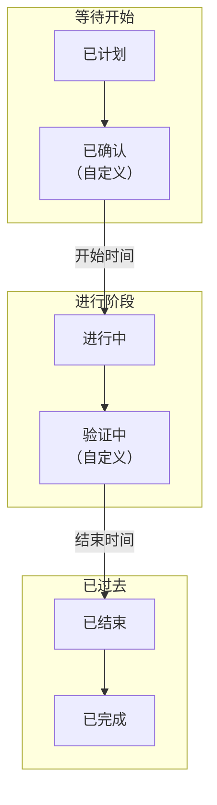

# 维护状态

每个计划维护事件都处于一个 **状态** ：表示工作进行到哪一步，从已计划到已验收。状态决定 OneUptime 如何处理事件：它的监视器何时停止检查、你的状态页显示什么、它的提醒何时停止。本页介绍每个项目初始都有的四个状态、在它们之间推进事件的方式，以及如何添加你自己的步骤。

:::cards
- [初始状态](#初始状态): 已计划、进行中、已结束和已完成。
- [推进事件的方式](#推进事件的方式): 时钟、标题区域、时间线、聊天和 API。
- [自定义状态](#自定义状态): 工作开始前的一个步骤，或工作结束后的一次检查。
- [状态时间线](#状态时间线): 事件经历过的每个状态，以及如何更正。
:::

## 工作原理

一个项目的维护状态是一个有序列表，事件只会沿列表向下移动。状态在列表中的位置决定了处于该状态的事件被视为什么：等待开始、进行中或已过去。

`ScheduledMaintenanceState` 模型有 `name`、`description`、`color` 和 `order`，以及四个标志：`isScheduledState`、`isOngoingState`、`isEndedState` 和 `isResolvedState`。OneUptime 读取的是标志和顺序，而不是名称，因此你可以把 **已完成** 重命名为“已验收”，不会有任何问题。

> [!TIP]
> 该列表位于 **计划维护 → 设置 → 事件状态** 。 **设置** 在侧边菜单中默认折叠：请先展开它。

## 初始状态

每个新项目都以下面这四个维护状态开始，顺序如下：

| 状态          | `order` | 标志               | 颜色      | 含义                                                           |
| ------------- | ------- | ------------------ | --------- | -------------------------------------------------------------- |
| **已计划**    | `1`     | `isScheduledState` | `#000000` | 每个新事件都从这里开始，等待它的开始时间。                     |
| **进行中**    | `2`     | `isOngoingState`   | `#ffbf53` | 工作正在进行，事件的监视器不会被检查。                         |
| **已结束**    | `3`     | `isEndedState`     | `#4a4a4a` | 时间窗口已过，检查恢复。                                       |
| **已完成**    | `4`     | `isResolvedState`  | `#2ab57d` | 有人验收了工作，发给所有者的提醒停止。                         |

这四个带标志的状态在设置页上带有 **内置** 标记。你可以重命名、改颜色和拖动它们，但它们会保持自己的顺序，而且不能删除：它们的 **删除** 保持锁定，并说明原因。

**已结束** 和 **已完成** 都表示已过去。区别在于由谁推进事件：OneUptime 在事件的 **结束** 时间把它移到 **已结束** ，而在工作检查完毕后，由某个人、聊天按钮或 API 把它移到 **已完成** 。

## 推进事件的方式

| 方式             | 位置                                                                                        | 询问的内容                                                                                                      |
| ---------------- | ------------------------------------------------------------------------------------------- | --------------------------------------------------------------------------------------------------------------- |
| **时钟**         | 每分钟运行一次的作业                                                                        | 不询问：到了 **开始** 时间，它把等待中的事件移到 **进行中** ；到了 **结束** 时间，把进行中的事件移到 **已结束** 。 |
| **标题区域**     | 事件的 **概览** ： **标记为“{{state}}”** 按钮，以及其 **⋯** 菜单中的 **将状态更改为**     | 一个简短的对话框 **将计划维护标记为“{{state}}”** ，包含 **通知状态页订阅者** ，以及 **添加公开备注** 下的可选备注。 |
| **时间线**       | 事件侧边菜单中的 **状态时间线**                                                             | 你手动添加的一行，包含 **计划维护状态** 和 **开始** 。                                                          |
| **列表行** | 事件列表中事件行上的 **⋯** 菜单：**标记为“{{state}}”** 各步骤和 **更改状态** | 与标题区域相同的对话框，并写明事件的名称。其间已被其他更改推进的事件保持不变，对话框会说明原因。 |
| **批量更改**     | 在事件列表中对所选事件使用 **标记为“{{state}}”** 或 **更改状态**                                                     | 状态，以及添加到每个事件的一条公开备注。已经处于该状态或之后状态的事件会被跳过。                                |
| **聊天**         | 事件在 Slack 和 Microsoft Teams 中的消息上的按钮                                            | 同样的更改，以你的身份执行。请参阅 [Slack](/docs/workspace-connections/slack#从-slack-处理事件警报和活动)。 |
| **API**          | 在 `/api/scheduled-maintenance-state-timeline` 创建的一行                                   | 状态，以及是否通知订阅者。                                                                                      |

标题区域的按钮以你的状态命名。事件等待期间会提供两个：一个用于开始，以你的进行中状态命名；一个用于结束，以你的已结束状态命名。事件进行期间只提供第二个。 **⋯** 菜单会列出当前状态之后的所有其他状态。角色不允许更改事件状态的人会看到按钮被锁定，也没有其他状态的菜单；将指针移到按钮上会列出允许此操作的权限。

## 开始和结束会做什么

当事件从等待中的状态移到 **进行中** ，或直接移到你放在 **进行中** 和 **已结束** 之间的自定义状态时，事件开始。此时：

- **它的监视器停止检查** ，如果事件设置了 **将监视器状态更改为** ，监视器会切换到该状态。在事件进行期间添加到事件的监视器也会切换。
- **它的状态页把它显示为进行中** ，并通知它的订阅者：如果开启了 **事件开始时** ，则按时通知；手动推进时，按照对话框中 **通知状态页订阅者** 的设置通知。
- **它的所有者会收到通知** ，前提是他们开启了状态变更通知，并且事件会出现在 **进行中的事件** 下。

当事件从进行中的状态移到 **已结束** 、 **已完成** 或你放在 **已结束** 之后的自定义状态时，事件结束。此时它的监视器会重新被检查并回到正常运行，除非另一个进行中的事件仍然占用它们；它的订阅者也会以同样的方式收到通知：如果开启了 **事件结束时** ，则按时通知；手动推进时，按照对话框的设置通知。

从 **进行中** 推进到“验证中”，或从 **已结束** 推进到 **已完成** ，不会再次开始或结束任何东西：事件早已开始或结束。

## 标题区域的时钟

开始之前，标题区域会倒计时到开始；事件进行期间，它会计算已进行的时长；事件结束后，它会显示用了多长时间。当事件错过某个边界超过两分钟时，会出现一条琥珀色提示：

- **开始已逾期**：事件在其 **开始** 时间之后仍在等待。
- **已超时**：事件在其 **结束** 时间之后仍在进行。

提示会写明计划时间和事件尚未达到的状态。刚过边界时，推进事件的作业可能还没有运行，因此在接下来的几分钟内，标题区域会自行再次检查，并在不刷新页面的情况下显示新状态。

## 顺序是强制的

每次状态更改都会对照列表进行检查，无论由谁发起：仪表板、Slack、Microsoft Teams、API、Terraform、工作流或 OneUptime 本身。

- **向后移动会被拒绝**，并显示一条写明两个状态的消息："Scheduled Maintenance cannot transition to Scheduled state from Ongoing state because Scheduled is before Ongoing in the order of scheduled maintenance states."
- **移动到事件当前所处的状态会被拒绝**："Scheduled Maintenance state cannot be same as previous state."
- **选择器只提供当前状态之后的状态**，因此不会有人看到会被拒绝的移动选项。

要更正误设的状态，请在事件的 **状态时间线** 页面上删除它对应的行；事件会回到前一行的状态。

## 自定义状态

你添加的状态是团队要经历、而四个初始状态没有涵盖的步骤：工作开始前的“已确认”，工作结束后的“验证中”。

:::steps
### 打开状态列表

前往 **计划维护 → 设置 → 事件状态** 。 **计划 维护 状态** 卡片按顺序列出你的状态。每一行显示它的颜色和名称、处于该状态的事件被视为什么（ **视为** 列），以及它的描述。

### 创建状态

点击 **创建计划 维护 状态** ，填写它的 **名称** 、 **描述** 和 **颜色** 。新状态会添加在已完成状态的正上方。

### 拖动到位

拖动某一行的手柄即可移动它；松开时新的顺序就会保存。 **视为** 列会随你放置的位置而变化。
:::

你添加的状态没有标志，因此它的位置就是它的含义：

| 放置位置                                | 处于该状态的事件                                                                                                 |
| --------------------------------------- | ---------------------------------------------------------------------------------------------------------------- |
| **已计划** 与 **进行中** 之间           | 与 **已计划** 一样等待它的 **开始** 时间，并按时从那里开始。                                                    |
| **进行中** 与 **已结束** 之间           | 与 **进行中** 一样处于进行中：它的监视器保持不检查，并在它的 **结束** 时间结束。                                 |
| **已结束** 与 **已完成** 之间           | 已过去，但尚未完成：持续到完成为止的提醒会继续发送。                                                             |
| **已完成** 之下                         | 已完成，与 **已完成** 一样。                                                                                     |

请把你的状态放在 **已计划** 之下：每个新事件都从那里开始，而事件永远不会沿列表向上移动，因此它之上的状态永远不会被到达。你可以从事件标题区域的 **⋯** 菜单中，在 **将状态更改为** 下把事件移到自定义状态。

> [!NOTE]
> 在 OneUptime Cloud 上，添加或更改维护状态需要 **Growth** 或更高的套餐。所有套餐都可以读取、使用这些状态，并删除你添加的状态。

## 归档状态

对于您自己添加且团队不应再使用的状态，请将其归档而不是删除。归档不会更改任何事件：处于该状态的事件会保持该状态并照常推进，其状态时间线仍会显示它。

- **归档** 位于该行的 **⋯** 菜单中。它会先请求确认，并列出设置为使用该状态的测量和工作流。
- **任何人都无法再选择它。** 事件标题栏、**更改状态**、Slack 和 Microsoft Teams 都不会提供它，API、Terraform 和 MCP 会拒绝它。您仍可按它筛选事件。
- **已归档的状态会单独列出**，位于表格下方折叠的 **已归档的计划维护状态** 部分。**取消归档** 会将其恢复原样。
- **四个内置状态无法归档**：OneUptime 会将事件移入这些状态。它们的 **归档** 已锁定，并说明原因。

## 状态时间线

事件的 **状态时间线** 页面记录了它经历过的每个状态。它的卡片把这些状态绘制成时间线：一条色带，每个状态的长度与它持续的时间相同，下方按从新到旧列出每次更改。卡片标题中的 **表格** 会改为以行的形式列出它们，包含 **计划维护状态** 、 **开始** 、 **结束** 、 **持续时间** 、是否需要通知订阅者，以及通知的结果。

在仪表板中，行可以添加和删除，但不能编辑，而且事件始终至少保留一行。通过 API 可以更正某一行的 `startsAt`，根据时间线计算的每项测量都会随之更新。删除最新的一行会让事件回到前一行的状态。

> [!WARNING]
> 删除一行会改写事件的历史，以及据此计算出的每项测量。请用它来纠正错误，而不是用来整理。

## 故障排除

:::details 标题区域显示 Start overdue
事件在其 **开始** 时间过去两分钟以上后仍在等待，说明开始事件的作业还没有推进它。请用标题区域的按钮自己开始：手动开始会完成作业所做的一切，包括对监视器的处理。
:::

:::details 无法把事件移回它曾经处于的状态
状态只沿列表向下移动。请在事件的 **状态时间线** 页面上，从最新的一行开始，删除你想要的状态之后的各行。
:::

:::details 标题区域的按钮中没有已完成状态
标题区域的按钮用于开始和结束事件。要完成事件，请使用 **⋯** 菜单中 **将状态更改为** 下的选项。
:::

## 后续步骤

:::cards
- [计划维护概览](/docs/scheduled-maintenance/index): 各项内容的位置，以及事件影响什么。
- [创建维护事件](/docs/scheduled-maintenance/creating-events): 表单的每个字段。
- [维护规则与设置](/docs/scheduled-maintenance/settings): 在事件完成之前一直提醒所有者。
- [事件状态与严重级别](/docs/incidents/states-and-severities): 同样的有序列表，用于故障事件。
:::
