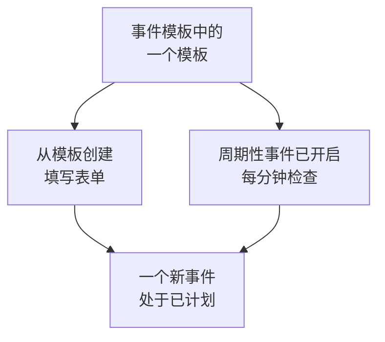

# 模板与周期性事件

计划维护模板会保存你经常安排的事件：它的标题和描述、它暂停的监视器、它显示在哪些状态页上，以及通知谁。使用模板可以一键填写表单；把它设为周期性，OneUptime 就会每周、每月或按你选择的任意间隔替你安排事件。

:::cards
- [创建模板](#创建模板): 表单的步骤，开头是名称，结尾是计划。
- [使用模板](#使用模板): 用它填写一个新事件。
- [周期性事件](#周期性事件): 让 OneUptime 自行安排事件。
- [更改或停止模板](#更改或停止模板): 编辑它、暂停它的计划或删除它。
:::

## 工作原理

模板是一个起点。用它创建的事件是一份拥有自己取值的副本：之后更改模板，只会影响此后创建的事件。

## 开始之前

- **你的套餐。** 在 OneUptime Cloud 上，模板需要 **Growth** 或更高的套餐。
- **你的角色。** 创建模板需要 **项目所有者** 、 **项目管理员** 、 **项目成员** 、 **计划维护管理员** 或 **计划维护成员** ，或可以创建计划维护模板的自定义角色。

## 创建模板

:::steps
### 打开模板

前往 **计划维护 → 设置 → 事件模板** 。 **设置** 在侧边菜单中默认折叠：请先展开它。点击 **创建计划 维护 模板** 。

### 为模板命名

在 **模板信息** 中填写 **模板名称** 和 **模板描述** ，让团队知道何时使用它。两者都是必填项。

### 描述事件

在 **事件** 中填写用它创建的每个事件初始的 **标题** 和 **描述** 。 **所有者** 和 **标签** 在 **更多字段** 下。

### 选择它影响的内容

在 **受影响的资源** 中选择 **监视器** 、它们的 **将监视器状态更改为** 、任何 **其他受影响的资源** 、 **在这些状态页上显示事件** 下的状态页，以及 **订阅者通知** 。

### 决定是否重复

在 **周期性** 中，对于手动使用的模板，保持 **周期性事件** 关闭；或者开启它并填写计划。点击 **下一步** 查看审核页，然后创建模板。
:::

即使模板没有指定任何监视器，它也会询问 **将监视器状态更改为** ：该状态同样适用于你用它安排事件时添加的监视器。在 **其他受影响的资源** 下，模板可以接受主机、Kubernetes 集群、Docker 主机、Podman 主机和服务。

## 模板会填写什么

| 事件的部分                                        | 从模板创建                           | 周期性事件                      |
| ------------------------------------------------- | ------------------------------------ | ------------------------------- |
| **标题** 和 **描述**                              | 已填写，你可以修改                   | 复制                            |
| **监视器** 和 **将监视器状态更改为**              | 已填写                               | 复制                            |
| **其他受影响的资源**                              | 已填写                               | 复制                            |
| 状态页和 **订阅者通知**                           | 已填写                               | 复制                            |
| **所有者** 和 **标签**                            | 已填写                               | 复制                            |
| **开始** 和 **结束**                              | 下一个整点起，持续一小时             | 根据计划计算                    |

## 使用模板

:::steps
### 选择模板

在 **计划维护 → 所有事件** 上点击 **从模板创建** ，并在 **选择计划维护模板** 下选择一个模板。

### 检查表单

点击 **从模板创建** 。创建表单会打开，模板的答案已经填好。设置时间窗口，并修改此事件需要更改的任何内容。

### 创建事件

用 **下一步** 完成各个步骤，然后在审核页上点击 **创建计划维护事件** 。
:::

当项目还没有任何模板时， **从模板创建** 会提示这一点，并链接到 **事件模板** 。

## 周期性事件

周期性模板会按计划创建事件。你设置第一个事件何时创建、何时开始以及何时结束；之后的每个事件都保持相同的间隔，依次推迟一个周期。

| 字段                                                     | 含义                                                                                               |
| -------------------------------------------------------- | -------------------------------------------------------------------------------------------------- |
| **周期性事件**                                           | 开启计划。                                                                                         |
| **首次事件计划于**                                       | OneUptime 创建第一个事件的时间，也就是它的订阅者得知事件已安排的时间。                             |
| **首次事件开始于**                                       | 第一个事件开始的时间。                                                                             |
| **首次事件结束于**                                       | 第一个事件结束的时间。                                                                             |
| **您希望此事件多久重复一次？**                           | 一个数字和一个单位：小时、天、周、月或年。                                                         |

例如，一个每周的时间窗口，第一个事件在星期一创建，用于其后的星期六：

| 事件         | 创建时间           | 开始               | 结束               |
| ------------ | ------------------ | ------------------ | ------------------ |
| 第一个       | `2030-06-03 09:00` | `2030-06-08 02:00` | `2030-06-08 04:00` |
| 第二个       | `2030-06-10 09:00` | `2030-06-15 02:00` | `2030-06-15 04:00` |

把 **首次事件计划于** 设置为比开始时间提前多久，取决于你希望客户提前多久得知这项工作。创建模板时，三个时间都必须在将来，事件必须在开始和结束之前创建，并且必须在结束之前开始；表单会指出某个时间违反了哪条规则。

一个作业每分钟检查一次周期性模板。当某个模板的下一个时间到来时，它会把该时间推后一个周期，然后创建事件。模板列表会在 **周期性事件** 列中显示该时间，不重复的模板则显示 **否** 。按计划创建的事件与其他事件一样：它的规则会运行，它的所有者会被添加，它的订阅者会得知事件已安排。

## 更改或停止模板

从列表中打开一个模板即可看到它的页面：

- **计划维护模板详情** 显示新事件的初始内容。它的 **编辑** 会依次经过 **模板信息** 、 **事件** 、 **状态页面** 和 **周期性** 。
- **受影响的资源** 包含它的 **监视器** 、它们的 **将监视器状态更改为** ，以及它的 **其他受影响的资源** ，并有自己的 **编辑** 。
- **所有者** 列出拥有用它安排的每个事件的人员和团队。

更改只适用于保存之后创建的事件；已经创建的事件保留自己的取值。要停止计划，请在 **编辑** 中关闭 **周期性事件** ，或删除该模板。关闭的模板会保留它的计划：重新开启后，它从计划的下一个时间继续，并跳过关闭期间的时间。删除模板不会删除它已经创建的事件。

## 故障排除

:::details 创建周期性模板时提示时间必须在将来
创建时，三个首次时间都必须晚于当前时间。把它们往后挪：之后计划会从第一个事件开始继续。
:::

:::details 周期性模板没有创建事件
检查 **周期性事件** 是否仍然开启，并查看列表中 **周期性事件** 列的时间：事件在那个时间创建，而不是在它开始时创建。作业每分钟运行一次，所以请等一分钟。
:::

:::details 用模板创建的事件缺少我选择的资源
在 **其他受影响的资源** 下，模板只接受主机、Kubernetes 集群、Docker 主机、Podman 主机和服务。其他类型的资源请通过事件 **受影响的资源** 卡片上的 **编辑** 添加到事件本身。
:::

## 后续步骤

:::cards
- [创建维护事件](/docs/scheduled-maintenance/creating-events): 模板所填写的表单。
- [维护状态](/docs/scheduled-maintenance/states): 每个事件创建后如何推进。
- [维护规则与设置](/docs/scheduled-maintenance/settings): 自动为每个新事件添加所有者和标签。
- [计划维护概览](/docs/scheduled-maintenance/index): 模板在整个维护功能中的位置。
:::
