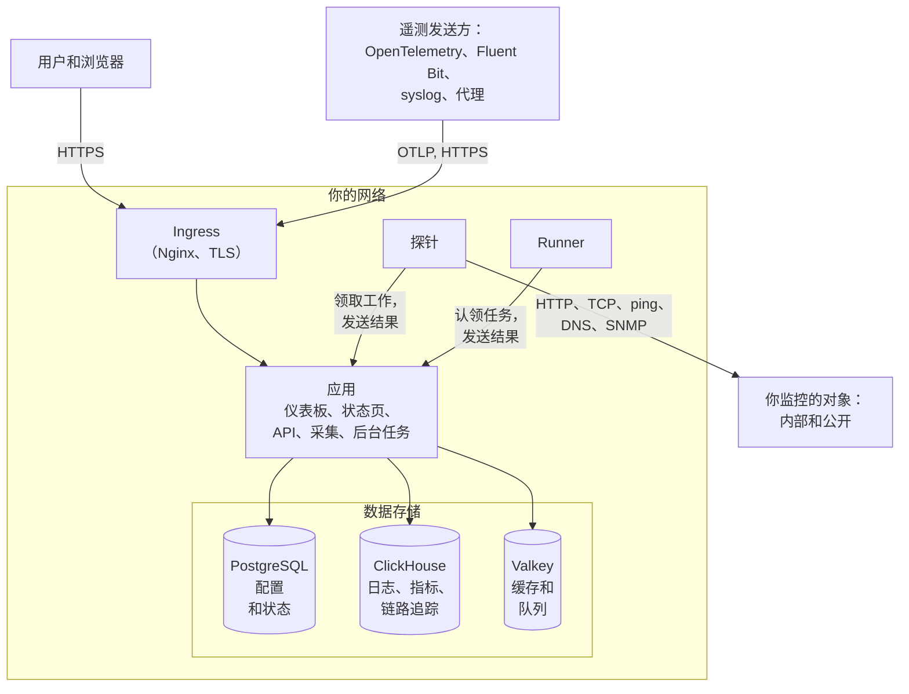

# 架构

自托管的 OneUptime 由少数几个容器组成：每个请求都从它进入的一个 ingress、负责处理工作的一个应用镜像、运行监视器检查的探针，以及三个数据存储。本页说明它们如何组合在一起、各自做什么，以及哪些连接会跨越你的网络边界。

## 图中展示了什么

- 用户通过 **ingress** 访问 OneUptime。ingress 终止 TLS，并把每个请求路由到应用：Dashboard、状态页、API，以及接收遥测数据的每个采集端点。
- **应用** 在 PostgreSQL 中读写自己的状态，把遥测数据保存在 ClickHouse 中，并使用 Valkey（Redis 7.2 的 BSD 许可分支）作为缓存，以及承载其后台任务所处理的队列。
- **探针** 可以运行在你的集群内（推荐），也可以运行在你网络中的其他位置。它们可以监控：
  - 防火墙后面的内部/私有服务。
  - 互联网上的外部/公开资源。
- 探针的结果发送到应用，在 Valkey 中排队，再由后台任务处理并写入你的数据存储。位于你网络中其他位置的探针，通过 ingress 以你的 OneUptime URL 访问应用。
- 遥测数据（指标、链路追踪、日志等）由同一个应用采集，并存储在 ClickHouse 中。

> [!NOTE]
> 如果你使用外部的 PostgreSQL、Valkey（或 Redis）或 ClickHouse，而不是内置的，应用会改为连接你的外部端点。逻辑流程保持不变。

## 组件

| 组件 | Docker Compose 服务 | Helm Chart | 作用 |
| --- | --- | --- | --- |
| Ingress | `ingress` | `nginx` | 终止 TLS，为你的主机名和状态页域名提供服务，并把每个请求路由到应用。 |
| 应用 | `app` | `app` | Dashboard、状态页、API 和采集端点，以及（除非你把它们拆分出去）后台任务。 |
| Worker | `app` 的一部分 | `worker`（默认关闭） | 在独立的 Pod 中运行后台任务，让繁重的队列处理永远不与 API 请求争抢资源。 |
| Telemetry writer | `app` 的一部分 | `telemetryWriter`（默认关闭） | 一个固定规模的层，执行每一次 ClickHouse 插入，使插入量无论 worker 扩展到多大都保持在限度内。 |
| 探针 | `probe-1` | `probes` | 运行监视器检查并把结果发回。每个内置探针都是所有项目都能使用的全局探针。 |
| Runner | `runner` | `runner` | 实例自己的 Runner，可以为每个项目运行 AI 代码修复。Runbook 的步骤运行在你安装到相应位置的 [Runner](/docs/runbooks/agents) 上。 |
| PostgreSQL | `postgres` | `postgresql`，或 `postgresOperator.cnpg` | 项目、监视器、事件、用户以及其他所有设置和状态。 |
| ClickHouse | `clickhouse` | `clickhouse`，或 `clickhouseOperator.altinity` | 日志、指标、链路追踪、异常、性能剖析和监视器日志。 |
| Valkey | `valkey` | `valkey` | 缓存、任务队列，以及待处理的推送回执之类的短期状态。 |

应用的所有角色都是同一个镜像：Docker Compose 在一个 `app` 容器中运行它们，而 Helm Chart 可以把 worker 和 telemetry writer 作为各自独立的部署来运行。如何为每一层确定规模，请参阅[规模估算与容量规划](/docs/installation/sizing)。

## 从你的网络向外的连接

应用只会为你开启的功能向外连接。下面每一项都是可选的，并且都有一个页面列出需要放行的确切地址：

| 出站连接 | 用途 | 了解更多 |
| --- | --- | --- |
| 电子邮件（SMTP，或 SendGrid 的 API） | 通知和邀请 | [SMTP](/docs/emails/smtp) |
| Twilio | 短信和电话 | [Twilio 集成](/docs/self-hosted/twilio-integration) |
| OneUptime 的推送中继，或 Expo | 移动推送通知 | [推送通知](/docs/self-hosted/push-notifications) |
| Slack 和 Microsoft Teams | 工作区通知和操作 | [Slack 集成](/docs/self-hosted/slack-integration) |
| LLM 提供商，例如 OpenAI、Anthropic、Microsoft Foundry，或你自己运行的模型 | OneUptime AI | [LLM 提供商](/docs/ai/llm-provider) |
| `oneuptime.com` | 在线激活 Enterprise 许可证 | [企业版](/docs/self-hosted/enterprise) |

反方向的连接——SendGrid 投递入站邮件、Slack 和 Microsoft Teams 回调——需要 ingress 能从互联网访问。应用和探针可以访问哪些私有地址由你决定：请参阅[私有网络访问](/docs/self-hosted/private-network-access)。

## 后续步骤

:::cards
- [Docker Compose](/docs/installation/docker-compose): 在一台机器上安装所有组件。
- [规模估算与容量规划](/docs/installation/sizing): 每一层需要多少 CPU、内存和磁盘。
- [自定义探针](/docs/probe/custom-probe): 在另一个网络中运行探针。
- [企业版](/docs/self-hosted/enterprise): Enterprise 镜像增加了什么，以及许可证如何运作。
:::
